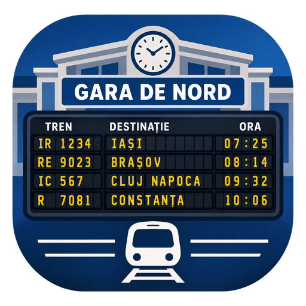
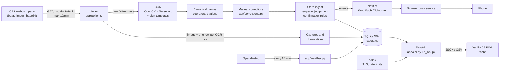
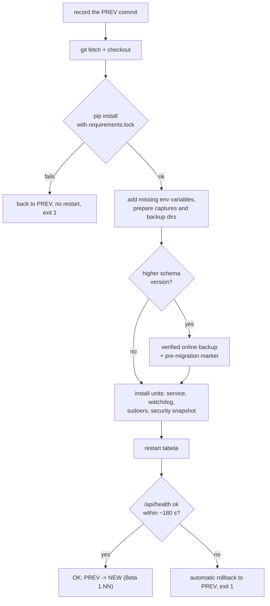

<p align="center"></p>

**English** · [Română](README.ro.md)

# Tabela Gara de Nord

[](https://github.com/Andy217ACE/tabela-gara-de-nord/actions/workflows/ci.yml)
[](https://github.com/Andy217ACE/tabela-gara-de-nord/actions/workflows/codeql.yml)
[](https://github.com/Andy217ACE/tabela-gara-de-nord/releases)
[](LICENSE)

A web application (PWA) that reads the arrivals and departures board of **Gara de Nord, Bucharest**
from the public CFR webcam image, using classic OCR (OpenCV + Tesseract, **no AI**), and turns it into
a live board, a searchable history, journey statistics and Web Push notifications for the trains you
follow. Everything runs in one small Python process on a home server, with SQLite as its only database.

**Live:** https://tabelacfr.ddns.net

**Status: Beta.** The current version is in [`VERSION`](VERSION), the history in
[`CHANGELOG.md`](CHANGELOG.md), in the app at `#versiuni` and in
[Releases](https://github.com/Andy217ACE/tabela-gara-de-nord/releases).

> [!IMPORTANT]
> The data is read by OCR from the image of the CFR webcam and **may contain errors**. A value that
> could not be read is shown as **"—"**, never as 0, and an unsure reading is marked as such. This is
> an independent project, **not affiliated with CFR**; the official source is [cfr.ro](https://cfr.ro).

## Contents

- [What it does](#what-it-does)
- [Pages](#pages)
- [How it works](#how-it-works)
- [Reading the board: OCR](#reading-the-board-ocr)
- [Validation and data quality](#validation-and-data-quality)
- [Journeys, history and statistics](#journeys-history-and-statistics)
- [Notifications](#notifications)
- [Weather](#weather)
- [Data model](#data-model)
- [Captures, retention and privacy](#captures-retention-and-privacy)
- [Administration](#administration)
- [Security and reliability](#security-and-reliability)
- [API](#api)
- [Tech stack and repository layout](#tech-stack-and-repository-layout)
- [Running locally](#running-locally)
- [Testing and CI](#testing-and-ci)
- [Releases](#releases)
- [Deploy (Ubuntu server)](#deploy-ubuntu-server)
- [Documentation](#documentation)
- [Contributing, security policy, license](#contributing-security-policy-license)
- [Attribution](#attribution)

## What it does

| Feature | What you get |
|---|---|
| **Live board** | Arrivals and departures at București Nord as on the station board: scheduled time, train category and number, origin/destination station, operator, read delay and platform. The physical board shows **12 rows per panel** and so does the app. It refreshes every 10 s (`refresh_s` from `/api/config`) and goes grey ("STALE DATA") when the last good reading is older than 180 s. |
| **Two views** | **Cards** (default on phones) and **Panel**, a station-style display (default from 1024 px): Arrivals / Departures / All, clock, data status (UPDATED / STALE DATA / UNAVAILABLE), search, filters (delay, operator, platform, local Favourites), sorting, configurable columns, full screen. Delay colours follow the thresholds from `/api/config`. |
| **Train detail** | Tap a train for its details, a link to its History and a "Follow (notifications)" button. |
| **Estimated platform** | An optional column (off by default) with a platform **estimate** from the observed history (`/api/predict/peron`), shown only above the accuracy threshold measured in a backtest, otherwise "—". It is labelled as an estimate, not CFR information. |
| **Following + Web Push** | Follow a train for the day and get a notification when its delay or platform changes, or when it leaves the board. A change is pushed only after several confirming readings, so a one-frame misread never triggers a notification. |
| **History and search** | What the board showed on a day, or across all days: filters for day, train, station, time range and panel; journey detail in a dialog with the observed delay chart; deep links such as `#istoric?train=1636&date=2026-10-21`; "Load N more" paging; CSV export through the API. |
| **Journeys** | One appearance of a train on a panel on a service day, with a final result: `confirmed`, `unconfirmed` (with a reason), `unknown` or `in_progress`. |
| **Statistics and charts** | Punctuality, typical delay, rankings, heatmaps, weekdays, routes, operators and categories, "what changed this week", period comparison, platform changes, dwell time on the board, seasons and weather. Every figure carries its sample size **N**; below the minimum sample no percentage is shown. |
| **Trains and stations** | A public train catalog with a page per train (`#tren?nr=…`) and per station (`#statie?nume=…`), with charts and CSV/JSON exports. Station names are shown with diacritics (Brașov, Aeroport Henri Coandă); search ignores diacritics. |
| **Data quality indicators** | Unsure OCR values are underlined with the title "uncertain reading"; ghost services (misreads) are hidden; low-quality periods are marked and excluded from statistics by default. |
| **Weather** | A small widget next to the clock with the current conditions in Bucharest (Open-Meteo model data) and a 24 h temperature chart. |
| **PWA / offline** | Installable; works offline with the last board (marked as stale) and an offline page with the logo. |
| **Themes** | Auto → Light → Dark from the header button (also in the Panel and in full screen), remembered in the browser. |
| **Romanian / English** | The whole interface in both languages, switched instantly without a reload; `?lang=en` opens the English version directly (link previews get English tags too). |
| **Accessibility** | WCAG 2.2 AA work: touch targets of at least 24×24 px (44 px for key buttons on touch screens), one main heading per page without skipped levels, skip link, polite live regions, keyboard-operable charts with a table alternative, contrast of at least 4.5:1 in both themes, "reduce motion" respected, forced-colors support. |
| **Print** | Clean printing for Board, History, Trains and Statistics: black on white, no menu, filters or buttons, rows not split across pages; the printed Board shows the selected panel as its title. |
| **Phone navigation** | A bottom bar with Board, History, Trains, Statistics and "More" (Followed, Rankings, Stations, System, Versions, Settings, How it works, language). Tablets and desktops keep the top menu. |

## Pages

The app is a single HTML page (`web/index.html`); each page is a fragment of the address.

| Fragment | Page | Who |
|---|---|---|
| `#` (no fragment) | **Board** (Cards / Panel / full screen) | everyone |
| `#istoric` | **History** (one day or all days) | everyone |
| `#urmarite` | **Followed** trains and the notification switch | everyone |
| `#trenuri`, `#tren?nr=<number>` | **Trains** (catalog) and **Train** (profile, journeys, charts) | everyone |
| `#statistici` | **Statistics**; sections can be linked: `#statistici?sect=probleme` (also `bune`, `rute`, `operatori`, `sumar`, `glosar`) | everyone |
| `#clasamente` | **Rankings** | everyone |
| `#statii`, `#statie?nume=<name>` | **Stations** and **Station** | everyone |
| `#sistem` | **System**: service state, reading quality (24 h / 7 days), speed (OCR cycle, API p50/p95); details for admins | everyone |
| `#cum` | **How it works**, in plain language: where the data comes from, what "delay" means, limits, privacy, where to report a problem | everyone |
| `#versiuni` | **Versions** (the changelog) | everyone |
| `#setari` | **Settings** (capture retention, free-space threshold) | admin |
| `#ocr` | **OCR captures** (image with OCR boxes, raw vs. normalized text, manual corrections) | admin |
| `#ocr2` | **OCR alternative** journal (crops and verdicts) | admin |
| `#admin` | **Administration** (see [Administration](#administration)) | admin |

The admin pages do not appear in the menu and are not precached by the service worker. The full list,
with the script behind each page, is in [Interface](docs/en/interfata.md).

## How it works



The main principles:

- **One process.** The web server and the poller live in the same uvicorn process, with **one worker**
  (a second worker would start a second poller). OCR runs in a thread (`asyncio.to_thread`), outside
  the event loop.
- **Polite to CFR.** The poller learns at which second of the minute the image changes and asks around
  that moment: usually 1–4 requests a minute, with hard limits of at least 2 s between requests and at
  most 10 per minute, exponential backoff on errors, a slow 30 s pace when the image has not changed for
  5 minutes, and an identifying User-Agent. Images over 10 MB and truncated JPEGs are refused. Do not run
  several instances against the same source.
- **A wrong reading does not break the state.** Each panel (arrivals, departures) is judged separately;
  a partial or broken panel is rejected, saved for diagnosis, and the previous state stays.
- **Nothing is deleted from the history.** What was read stays as read; quality verdicts live in separate
  tables. Cleanups exist only as reversible scripts with an archive.
- **No cron.** Periodic work is either an async task in the process or a systemd timer.

The full description (the sequence of a polling cycle, the module map, the paths on the server) is in
[Architecture](docs/en/arhitectura.md).

## Reading the board: OCR

<details>
<summary><b>The OCR pipeline, step by step</b></summary>

1. **Capture.** `app/fetcher.py` downloads the CFR page, extracts the board image (JPEG/PNG in base64)
   and computes its SHA-1; an unchanged image is not read again. The last image is kept in
   `LAST_IMAGE_PATH` for debugging.
2. **Split and preprocess** (`app/ocr/preprocess.py`). The image is split into the Arrivals and
   Departures panels; a colour mask isolates the text, scaled ×3, with an Otsu threshold.
3. **The 4 × 3 grid.** Each CFR panel has 4 blue groups of 3 rows (12 rows). The text bands found by
   projection are checked per group (`structured_bands`); a group with a number of rows other than 3 gets
   its fixed grid (derived from the image, not from the text), so a weak or empty row neither vanishes nor
   merges with its neighbour.
4. **Cells and Tesseract** (`app/ocr/reader.py`, `app/ocr/engine.py`). One composite image per column,
   one Tesseract call (timeout 10 s), behind the `OcrEngine` interface (`TesseractEngine` is the
   implementation in use).
5. **Digits** (`app/ocr/digits.py`). Numbers and times are also read by template matching against the
   board's single fixed font (`app/ocr/digit_templates.npz`, shipped with the code; without it the app
   starts with a warning in the log and falls back to Tesseract only).
6. **Fields** (`app/normalize.py`). Digit confusions (O/0, l/1), times, train category (`IR`, `IRN`, `R`,
   `RE`, `RM`, `IC`, `EC`, `EN`, `D`), delay (at most 999), platform and the marker asterisk. Times on a
   panel are chronological (`app/ocr/order.py`); glare and the board's arrow are handled in
   `app/ocr/glare.py`.
7. **Re-reading.** A row with text but no readable category/number/time is re-read on those columns with
   alternative preprocessings (`preprocess.VARIANTS`: without the vertical glare lines, lower/higher
   threshold, ×4, adaptive threshold, wider crop) until it succeeds or the frame budget
   (`OCR_FRAME_BUDGET_S`, default 8 s) runs out. A panel with more than 4 unread rows is a broken frame
   and is not re-read (no invented trains).
8. **Canonicalization** (`app/canonical.py`). Operators and stations are matched with `difflib` against
   `data/operators.txt` (`Official name | alias | alias`) and the stations in `data/stations_seed.txt`
   plus those learned from the history (seen in at least 2 distinct trains on at least 2 service days).
   Threshold 0.82; a score of 0.65–0.82 is accepted only with a margin of at least 0.10 over the
   runner-up operator (measured on 823,912 live readings). Operators are shown under their official
   names (`CFR Călători`, `Regio Călători`, `Transferoviar Călători`, …); RE and RM as "R-E" and "R-M".
   Below the threshold the read text is kept and the row is marked `uncertain`. The raw text is always
   kept in the `*_raw` columns.

Unread rows stay "unread" (not 0, not a guessed train); a row without text is an "empty row". Each
observation records its processing version (`ocr-tess-grid-5`) with suffixes such as `+empty`, `+unread`,
`+retry:<variant>:<tries>`. `/api/health` → `ocr` shows the rows per panel in the last frame, the
re-reads, the duration and how many of the last 60 frames had 12/12.

</details>

**Alternative OCR (shadow mode).** `app/ocr/alt_reader.py` is a small digit MLP that can fill the number
and time cells Tesseract left unread. It is **off by default** (`OCR_ALT=1` turns it on); with
`OCR_ALT_SHADOW=1` it only records what it *would* fill, without changing what is shown. The model
(`OCR_ALT_MODEL`) must carry the reading engine's fingerprint, otherwise it is refused. Every proposal
goes to a journal (`ocr_alt/` next to the database, 30 days, at most 5000 events) with crops of the cell,
reviewed on the admin page `#ocr2` with Correct / Wrong / Unclear verdicts; lines it fills are marked
`+ocr:alt` and stay `uncertain`. Separately, an experimental digit classifier is trained every night in
shadow mode (`tabela-shadow-train.timer`, 03:30) and never promotes itself to production.

Details, constants and how accuracy is measured: [OCR](docs/en/ocr.md).

## Validation and data quality

What is read from the board stays in the database exactly as read. The rules below decide what becomes
the visible state; quality verdicts are stored in separate tables (`app/quality.py`, every rule tested on
real cases).

| Rule | Value |
|---|---|
| Panel accepted | at least 4 reliable rows on the accepted panels and at least 2 per panel; a panel that drops under half of its last good count is "partial" and rejected (accepted after 10 equally small frames) |
| Delay change | applied at the **2nd** identical consecutive reading; a big jump (at least 60 min, to 100 min or more) at the **3rd**; a value that looks like the "+" sign read as a digit (25 → 425) at the **5th** |
| Platform change | 2 readings; 3 for confusable digits (5/6, 1/4/11/14, 3/8) |
| Platform cleared | a shown platform is cleared only after **5** empty readings, so platforms 6, 8 and two-digit ones cut at the top by the band no longer vanish |
| Train gone | after 3 readings in which it is missing; back within 10 minutes = not a new appearance |
| Ghosts | a service seen for under 2 minutes, a one-character variant of a longer-lived service with at most one observation, the minority variant of a row the OCR reads alternately, or a train read in a single observation. Ghosts are marked, never deleted, and hidden from the Board, History, catalog, statistics and station pages |
| Renaming | a stored misread is renamed by vote: at least 3 readings and 70% of the last 10 |
| Suspect events | isolated delay spikes and gone/appeared flapping under 180 s are marked as suspect |
| Low-quality periods | `quality_periods` (e.g. 21.10.2026 00:00–11:31) are excluded from statistics unless `STATS_INCLUDE_LOW_QUALITY=1` |
| Displayed value | the per-train consensus of recent frames (`app/consensus.py`), not just the last reading |

The retroactive quality backfill (`python -m app.quality --dry-run`, then without `--dry-run`, with the
service stopped) and the reversible scripts `scripts/purge_ghosts.py` and `scripts/merge_number_dups.py`
(dry run by default; a full backup and an archive table on `--apply`; `--restore` to undo) are described in
[Administration and operations](docs/en/administrare-operare.md).

## Journeys, history and statistics

- **Journey** = one appearance of a train on a panel (arrivals or departures at București Nord) on a
  *service day* (the day of the scheduled time; 00:05 read at 23:58 belongs to the next day).
  **Train** = a train number. **Observation** = one OCR line from one capture. They are reported separately.
- **The delay used** is the last value actually **read** on the București Nord board, with proof of the
  reading (`services.delay_read_at`). Without proof the delay is "unknown", never 0. On station pages the
  delay is still the one read at București Nord.
- **Final result** (`app/journeys.py`): `confirmed` only with an observed disappearance after the
  estimated time (scheduled + delay) and a delay read at most `FINAL_READ_MAX_GAP_MIN` (15) minutes
  before; otherwise `unconfirmed` (with a reason) or `unknown`; `in_progress` while on the board.
- **Statistics** (`app/stats.py`): N, mean ("on average"), median ("typical delay"), p90, max, % on time
  (≤ `ON_TIME_MAX_MIN`, default 5), share over 30 min. Below `STATS_MIN_SAMPLE` (5) no percentages or p90
  are shown. Arrivals and departures are always separate.
- **History across all days** (`/api/history?all=1`): journeys newest first, without ghosts, with cursor
  paging; low-quality periods are marked (`low_quality`) and left out of the summary.
- **The Statistics page** (one payload from `/api/stats/overview`, cached `STATS_CACHE_TTL_S` = 60 s, plus
  sections loaded on first view): summary cards, threshold alerts, "what changed this week", comparison
  with the previous 7 days, "Problems" (deterministic findings, no language model) and "What works well",
  routes, operators and categories (share bars, operator × category matrix), most reliable trains,
  heatmap (weekday × hour), weekdays, delay steps, platform changes after announcement, time spent on the
  board, seasons and weather. The filters (period, panel, operator, category, confirmed only) stay
  visible and can be saved as up to 5 presets on the device; simple/expert mode and a high-contrast
  option; every chart and table exports to CSV (UTF-8 with BOM) and PNG; charts are drawn as you scroll.
- **Estimates are not published until they earn it.** The final-delay estimate per train
  (`/api/trains/{no}/prediction`) stays `published: false` until a quality gate passes (30 days of good
  data, 100 predictions, error below the baseline). The season comparison shows no figures under 30
  eligible days.

Formulas, thresholds and every chart: [Statistics, journeys, quality](docs/en/statistici-calatorii-calitate.md).

## Notifications

```mermaid
sequenceDiagram
    participant U as Browser (#urmarite)
    participant A as API
    participant S as Store
    participant N as Notifier
    participant P as Push service
    U->>A: GET /api/push/key, then POST /api/push/subscribe
    U->>A: POST /api/follow (train, day)
    S-->>N: events after each ingest (delay, platform, gone)
    N->>N: pending change, confirmed over several good readings
    N->>P: Web Push (VAPID), once per change
    P-->>U: notification; a click opens the app
```

- Web Push with VAPID keys (`pywebpush`); without both keys the app runs and push is disabled.
- A change is pushed only after it is seen in several successful readings; `appeared` events and a
  platform cleared to "none" are never pushed; the same value is not pushed twice.
- Up to 20 active follows per subscription; subscriptions answering 404/410 are removed automatically.
- Push endpoints are accepted only for known push services over HTTPS (protection against SSRF,
  `app/endpoints.py`), and the `/api/follows` location is not written to the nginx access log.
- Requires HTTPS; on iPhone/iPad it works only for the app added to the home screen.
- An optional **Telegram** channel (`TELEGRAM_BOT_TOKEN` + `TELEGRAM_CHAT_ID`) sends the same kind of
  alerts and keeps its own sent log, so its deduplication survives a restart.

## Weather

Next to the clock (in the Cards header and in the Panel's title bar) there is a small widget with the
weather in Bucharest: an icon from `weather_code` (day/night variant from `is_day`), the temperature and
"feels like"; on tap/hover a popover with humidity, pressure (hPa), wind (speed + direction in words, +
gusts), precipitation (rain / showers / snow only when > 0; 0.0 mm is a real value), an SVG chart of the
next 24 h with minimum, maximum and "now", the observation time and the source.

- The **server** (not the browser: the CSP stays `connect-src 'self'`) makes **one request** to
  Open-Meteo: `current=temperature_2m,relative_humidity_2m,apparent_temperature,is_day,precipitation,rain,
  showers,snowfall,weather_code,surface_pressure,wind_speed_10m,wind_direction_10m,wind_gusts_10m` +
  `hourly=temperature_2m`, with `timezone=UTC` and `forecast_days=2`, every 15 minutes, in its own task,
  independent of the CFR poller. A weather error affects neither the board nor `ok` in `/api/health`
  (which only gets `weather_age_s`). Backoff on errors (5 → 30 min), never more than one request per 5
  minutes, not even after a restart.
- Honest labelling: the `current` values are **model data** for the grid cell, not a weather station's
  measurements; they are stored with `kind = model_current` and shown as "Current conditions (Open-Meteo
  model)". A missing value is `NULL` / "—", never 0. After 45 minutes the data turns grey ("stale").
- Storage: the `weather_observations` table (schema v4; **schema v8** added, additive and nullable,
  `relative_humidity_pct, is_day, rain_mm, showers_mm, snowfall_cm, surface_pressure_hpa,
  wind_gusts_kmh, hourly_json`; old rows stay untouched, with `NULL` in the new columns), one row per
  observation (unique `observed_at`, ~96 rows a day), kept permanently for the "seasons and weather"
  analysis. The hourly series (25 points, compact JSON) is kept only on the newest row: it is a forecast,
  not history. API: `GET /api/weather`; `GET /api/config` → `weather`.
- Variables (optional): `WEATHER_ENABLED` (default `1`; `0` stops the module and hides the widget),
  `WEATHER_INTERVAL_S` (default `900`, minimum `300`), `WEATHER_LAT` / `WEATHER_LON` (default `44.4323` /
  `26.1063`), `WEATHER_URL` (default `https://api.open-meteo.com/v1/forecast`).
- License: weather data by [Open-Meteo.com](https://open-meteo.com/), **CC BY 4.0** (the free API is for
  non-commercial use); the attribution is in the popover, in the page footer and in the Panel's credit
  (also visible in full screen).

More: [Weather](docs/en/meteo.md).

## Data model

SQLite in WAL mode (`synchronous=NORMAL`, `busy_timeout` 5000), **schema v10** (`PRAGMA user_version`,
`SCHEMA_VERSION` in `app/store.py`). Migrations are additive, atomic together with the version bump,
re-runnable, never renumbered, and never touch the `*_raw` columns. A database with data is backed up
before any migration, otherwise the migration is refused.

| Table | One row is | Since |
|---|---|---|
| `runs` | one processed frame (accepted or rejected) | v3 |
| `services` | one train, one service date, one panel (the journey): times, delay, platform, operator and station (+ `*_raw`), `delay_read_at` | v3 (+v6) |
| `events` | a change of a service: `appeared`, `delay`, `platform`, `gone` | v3 |
| `subscriptions`, `follows` | a Web Push subscription; a followed train for a day | v3 |
| `weather_observations` | one Open-Meteo observation | v4 (+v8) |
| `captures`, `observations`, `trains` | a downloaded image; one OCR line with raw/normalized value, confidence and box per field; the train-number catalog | v5 |
| `dq_meta`, `service_quality`, `event_quality`, `quality_periods` | the quality layer: ghost / low-quality verdicts, suspect events, low-quality periods | v7 |
| `corrections`, `correction_batches`, `correction_archive`, `correction_audit` | manual correction rules, their applications, before/after values, the audit log | v9 |
| `settings` | values edited on the Settings page (outside the versioned schema) | — |

v10 added no structure: it rewrote operators to their official names across the tables (the raw text is
untouched). Every table and column, the ingest path and the restore procedure:
[Data and schema](docs/en/date-si-schema.md).

## Captures, retention and privacy

- Every new image is saved **unchanged** as `CAPTURE_DIR/YYYY/MM/DD/HHMMSS-<hash8>.jpg` (UTC); the same
  image (same hash) does not create a new capture. Incomplete or low-confidence lines are kept too,
  marked. A recording error never stops the board.
- **Retention:** image files are deleted after `CAPTURE_RETENTION_DAYS` (default 7; editable between 1 and
  30 on `#setari`; `0` in the environment writes no images). The rows stay, with `path` set to `NULL`.
  Below `CAPTURE_MIN_FREE_MB` (default 2048) of free disk space no images are written, only metadata.
  Nothing outside `CAPTURE_DIR` is ever touched. The last 40 rejected frames are kept in `REJECTED_DIR`.
- **Raw CFR captures are private:** visible only from the administration, never redistributed and not
  tracked in git (the OCR ground-truth images live only on the developer machine and on the server).
- **Personal data:** there are no accounts. The app stores push subscriptions (endpoint + keys) and
  follows, and the administrator's IP in the correction audit; it keeps IPs in memory only for rate
  limiting and the "Online visitors" card (masked). Public visitors' IPs are not stored in the database.

Full rules: [Captures and privacy](docs/en/capturi-si-confidentialitate.md).

## Administration

Administration is enabled by `ADMIN_TOKEN` in `/etc/tabela.env` (at least 12 characters; with
`ADMIN_TOKEN_STRICT=1`, at least 24, or the service refuses to start). Without it every `/api/admin/*`
route answers 503. Sign-in is from `#ocr` or `#admin` (an HttpOnly, Secure, SameSite=Strict session
cookie valid for 12 h that holds an HMAC, not the token) or with `Authorization: Bearer` on the server.

The **`#admin`** page has these cards:

| Card | What it does |
|---|---|
| **Server (live)** | load, memory and services, read-only |
| **NVMe disk (live)** | disk health from the read-only NVMe collector (`tabela-nvme.timer`, every 2 minutes) |
| **Security (fail2ban)** | currently banned IPs, ban history, probe requests over 24 h / 7 days, top IPs, jails; read from a snapshot written every 2 minutes by a read-only root exporter (`tabela-security-snapshot.timer`); there is no unban button |
| **Online visitors** | who used the site in the last 5 minutes: masked IP, browser and OS, bots and scanners excluded; in memory only, refreshed every 30 s |
| **Push notification test** | sends one test notification, only to the subscription of the device you press it on |
| **Duplicate train numbers** | report, apply (with a safety copy first) and restore merges |
| **Proposed OCR13 marks** | an informational list from an analysis of the old history; nothing to apply |

The other admin pages: **`#ocr`** (captures with the OCR boxes coloured by confidence: green ≥ 80, yellow
50–79, red < 50; raw vs. normalized text per field; "Copy JSON"; manual correction rules with preview →
apply → restore), **`#ocr2`** (the alternative-OCR journal), **`#setari`** (retention and free-space
threshold) and the admin details on **`#sistem`** (Tesseract version and languages, pending security
updates, daily data quality: confirmation rate, reading quality, hourly coverage).

**Rotating the admin key** is manual: generate a new value
(`python -c "import secrets;print(secrets.token_urlsafe(32))"`), put it in `/etc/tabela.env` and restart
the service; every session is invalidated. Steps: [Admin key rotation](docs/en/admin-rotatie-cheie.md).

Runbooks (corrections, merges, ghost purge, backup and restore, Telegram, push, watchdog):
[Administration and operations](docs/en/administrare-operare.md).

## Security and reliability

What exists, where it lives and where it is documented. Deliberate omissions and their reasons are in
[Architecture decisions](docs/en/decizii-arhitectura.md).

| Feature | Where | Documentation |
|---|---|---|
| Strict CSP (`default-src 'self'`, no inline script/style, `frame-ancestors 'none'`), `nosniff`, `Referrer-Policy: no-referrer`, `X-Frame-Options: DENY` | `app/api.py`, `web/` | [Interface](docs/en/interfata.md), [API](docs/en/api.md) |
| DOM built only with `createElement` / `textContent` (no `innerHTML`), enforced by static tests | `web/*.js`, `tests/` | [Interface](docs/en/interfata.md) |
| HSTS and nginx rate limits (`tabela_api` 10 r/s burst 20, `tabela_stats` 60 r/min, `tabela_admin_login` 5 r/min), `client_max_body_size 8k`, `server_tokens off` | `deploy/nginx-tabela.conf`, `deploy/tabela-limits.conf` | [Deploy](docs/en/deploy-si-configurare.md) §6 |
| Admin auth: one token compared in constant time, HMAC-signed session cookie with expiry, CSRF token (+ same-origin check), 5 failures/min/IP and 30/min overall → 429, `Cache-Control: private, no-store` | `app/admin.py` | [API](docs/en/api.md) §6, [Key rotation](docs/en/admin-rotatie-cheie.md) |
| Firewall: `ufw` deny incoming, only 80/443 public, SSH only from the local network; uvicorn listens only on `127.0.0.1` | server | [Deploy](docs/en/deploy-si-configurare.md) §7 |
| fail2ban jails `sshd`, `nginx-tabela-probes`, `nginx-tabela-slow` (increasing bans for repeat offenders); the filters are tested in CI | `deploy/fail2ban/` | [Operations](docs/en/administrare-operare.md) §15 |
| systemd hardening: unprivileged user, `NoNewPrivileges`, `ProtectSystem=strict` (writes only to `/var/lib/tabela`), `PrivateTmp`, `PrivateDevices`, `RestrictAddressFamilies`, one worker, `OMP_THREAD_LIMIT=1` | `deploy/tabela.service` | [Deploy](docs/en/deploy-si-configurare.md) §5 |
| Backups: automatic and verified before every schema migration (the last 5 kept) and before destructive admin operations; `update.sh` rolls the code back if the health check fails | `app/dbbackup.py`, `deploy/update.sh` | [Operations](docs/en/administrare-operare.md) §6 |
| Monitoring: watchdog (restarts after 3 failed health checks, at most once per 10 min, running as `tabela` with a single sudoers rule; Telegram alerts), NVMe health timer, security snapshot timer, external uptime checks (`/api/health` also answers `HEAD`) | `app/watchdog.py`, `deploy/tabela-*.timer` | [Operations](docs/en/administrare-operare.md) §10, §15 |
| Data integrity: `processing_version` per observation, multi-frame consensus, confirmation of delay and platform changes | `app/consensus.py`, `app/quality.py` | [OCR](docs/en/ocr.md), [Statistics and quality](docs/en/statistici-calatorii-calitate.md) |
| OCR regression suite on hand-labelled frames, with strict thresholds that fail on any regression | `tests/fixtures/ocr_truth`, `app/ocr/truth.py` | [Testing](docs/en/testare.md) |
| CI on every PR and on `main` (tests incl. three browser engines, `pip-audit`, release check, fail2ban filters), CodeQL (`security-extended`), Dependabot, pinned `requirements.lock` | `.github/` | [Testing](docs/en/testare.md) |
| Docs kept in step with the code: every route must appear in the API page | `tests/test_docs_routes.py` | [Testing](docs/en/testare.md) |

Known gaps, stated openly: **there is no off-site backup yet** (the owner's decision, deferred); OS updates
and reboots are manual; the admin token is rotated by hand.

## API

JSON over HTTPS, with no API keys (rate limits instead). Many routes accept `format=csv` for export.

<details>
<summary><b>Public routes</b></summary>

| Route | Returns |
|---|---|
| `GET /api/board` | the live board (arrivals, departures, data age) |
| `GET /api/health` (also `HEAD`) | service state, `version`, OCR counters |
| `GET /api/config` | colour thresholds (`DELAY_THRESHOLDS`, default `5,15,30`), `refresh_s`, `stale_after_s`, weather |
| `GET /api/changelog` | the version history from `CHANGELOG.md` |
| `GET /api/weather` | the last weather observation and the hourly series |
| `GET /api/history` | one day; with `all=1` all days (`train`, `date`, `station`, `from`/`to`, `board`, `limit`, `cursor`) |
| `GET /api/train/{no}` | a train's events on a day |
| `GET /api/journeys`, `/api/journeys/{id}` | journeys and their final result |
| `GET /api/trains`, `/api/trains/{no}`, `/api/trains/stats`, `/api/trains/{no}/journeys` | the catalog and per-train statistics |
| `GET /api/stats`, `/api/stats/overview`, `/api/stats/rankings`, `/api/stats/seasons` | statistics, rankings, seasons and weather |
| `GET /api/stats/changes`, `/heatmap`, `/reliable`, `/dwell`, `/platform-changes` | the extra Statistics sections |
| `GET /api/stations`, `/api/stations/{name}`, `/api/stations/{name}/journeys`, `/api/station-names` | stations and display names |
| `GET /api/predict/peron` | platform estimates (not official CFR information) |
| `GET /api/trains/{no}/prediction` | the final-delay estimate (unpublished until the quality gate passes) |
| `GET /api/system` | the public system state (details for admins) |
| `GET /api/export/history.csv` | CSV export of the history (at most 366 days) |
| `GET /api/push/key`, `POST /api/push/subscribe`, `POST /api/push/unsubscribe`, `GET /api/follows`, `POST` / `DELETE /api/follow` | notifications |

Common parameters of the statistics routes: `prag`, `min`, `board`, `from`, `to` (YYYY-MM-DD),
`doar_confirmate=1`.

</details>

<details>
<summary><b>Admin routes (<code>/api/admin/*</code>)</b></summary>

Session (`session`, `login`, `logout`, `csrf`), captures (`captures…`, `stats`), `settings`, corrections
(`corrections…` with `preview`, `apply`, `audit` and batch `restore`), duplicates (`tools/dupes…`), server
(`tools/server`, `tools/nvme`, `system`), `security`, `visitors`, `push-test`, the alternative OCR
(`ocr-alt…`) and daily quality (`quality-daily/confirmation`, `/reading`, `/coverage`). With the cookie,
changing requests need the CSRF token. There is no HTTP route that downloads the database.

</details>

Every route with its parameters, responses, errors, cache headers and limits: [API](docs/en/api.md).

## Tech stack and repository layout

| Layer | Technology |
|---|---|
| Backend | Python 3.14, FastAPI, uvicorn (1 worker), SQLite (WAL) |
| OCR | OpenCV (headless), numpy, Tesseract 5 (`eng` + `ron`) through `pytesseract`, own digit templates; no AI service |
| Push | `pywebpush`, `py-vapid`, `cryptography` |
| Frontend | a vanilla JavaScript PWA, no framework and no external libraries; SVG charts drawn by own code; self-hosted Fira Sans / Fira Code fonts |
| Server | Ubuntu 26.04 LTS, nginx + Let's Encrypt, systemd units and timers, ufw, fail2ban |
| Tests / CI | pytest, pytest-asyncio, Playwright (Chromium, Firefox, WebKit), GitHub Actions, CodeQL, Dependabot |

<details>
<summary><b>Repository tree</b></summary>

```text
app/                    FastAPI application, poller, storage, statistics, administration
  api.py                  app factory, lifespan (store, migration, poller, weather), public routes, security headers
  main.py                 ASGI entry point (uvicorn app.main:create --factory)
  config.py               Settings built from environment variables
  poller.py, fetcher.py   polling loop and CFR page download
  ocr/                    preprocess, reader, engine (Tesseract), digits (+ digit_templates.npz), glare, order,
                          truth (accuracy), alt_reader + alt_journal (alternative OCR), stats
  normalize.py, canonical.py, operator_names.py   field normalization, canonical names, the v10 migration
  store.py                SQLite schema and migrations, ingest, live board, history, subscriptions
  quality.py, consensus.py, corrections*.py       validation rules, consensus, manual corrections
  captures.py, observations.py, rejected.py       captures, OCR observations, rejected frames
  journeys.py, history_all.py, stations.py, trains_api.py, export.py
  stats*.py, seasons.py, predict.py, line_prediction.py, peron_predict.py, peron_api.py
  admin*.py, system_*.py, security_status.py, visitors.py, perf.py, nvme_status.py, ocr_alt_api.py
  dbbackup.py, backup_api.py, restore.py          backups and restore
  notifier.py, telegram.py, endpoints.py          Web Push, Telegram, push endpoint validation
  weather.py, watchdog.py, version.py
web/                    the PWA: index.html, app.js, sw.js, manifest, page scripts and styles,
                        ui2.* (shared visual layer), charts3.* (lazy chart layer), stat_*.js (Statistics
                        sections), i18n/ro.json + en.json, fonts/, icons/
data/                   operators.txt, stations.txt (display names), stations_seed.txt
deploy/                 install.sh, update.sh, tabela.service, watchdog / shadow-train / NVMe /
                        security-snapshot units and timers, nginx site + limits, fail2ban/
scripts/                maintenance and evaluation: check_release, purge_ghosts, merge_number_dups,
                        restore_db, dev_seed, ocr_eval, ocr_alt_eval, ocr_digit_clf, nightly_shadow_train,
                        backtest_delay, backtest_peron, security_snapshot, nvme_collect, make_icons, ...
tests/                  pytest suite (unit, API, static, browser, OCR, migrations, deploy) + fixtures
docs/                   detailed documentation (Romanian), docs/en/ (English), brand/, superpowers/ (historical plans)
design-system/          design tokens and component rules (MASTER.md)
.github/                CI, CodeQL and lock workflows, Dependabot, issue and PR templates
```

</details>

**Page graphics without libraries.** The pages outside the Board share a visual layer, `web/ui2.css` +
`web/ui2.js` (donut, count-up figures, proportion bars, sparklines, loading skeletons, transitions). The
interactive chart layer (shared tooltip, toggle legend, full screen with the table alongside, "Copy link",
section chips, calendar, data morphing on filter changes) is in `web/charts3.js` + `web/charts3.css`,
**loaded on demand** only on the pages with charts, outside the service worker precache. No external
library: a charting library would need inline styles or canvas (CSP), would not follow the themes or
offer an accessible table for every value, and would be heavier than the ~18 KB gzip of own code. If one
is ever added, it goes under `web/vendor/<name>-<version>/` with its license file, is loaded on demand and
stays out of the `SHELL` of `sw.js`. The Board (Cards / Panel / full screen) does not use this layer.

**The logo.** The original is `docs/brand/logo-source.png`; every variant (header, favicon 16/32/48, PWA
icons 192/512 + maskable, apple-touch-icon, `og:image` 1200×630) is regenerated with
`python scripts/make_icons.py`. At 16–32 px a simplified crop of the same artwork (the train's front) is
used, so it stays legible in tabs.

## Running locally

```bash
python -m venv .venv
.venv/bin/pip install -r requirements-dev.txt -c requirements.lock      # Windows: .venv\Scripts\pip ...
python -m playwright install chromium firefox webkit                    # optional: browser tests
```

Tesseract 5 with the `eng` and `ron` languages must be installed for OCR; if it is not in `PATH`, set
`TESSERACT_CMD` (on Windows the tests and scripts also try `C:\Program Files\Tesseract-OCR\tesseract.exe`).

Serve a development database without contacting CFR:

```bash
python scripts/dev_seed.py dev.db                       # a real board read from tests/fixtures
DB_PATH=dev.db POLLER_ENABLED=0 uvicorn app.main:create --factory
```

Then open http://127.0.0.1:8000. Push notifications also need VAPID keys and a secure origin (localhost
counts as one).

<details>
<summary><b>Environment variables</b></summary>

| Variable | Default | Meaning |
|---|---|---|
| `DB_PATH` | `tabela.db` | the SQLite database (server: `/var/lib/tabela/tabela.db`) |
| `SOURCE_URL` | the cfr.ro webcam page for București Nord | the board image source |
| `POLLER_ENABLED` | `1` | `0` serves the stored state only |
| `POLLER_RESTART_BACKOFF` | `5` | first pause before restarting a crashed poller (doubles, at most 300 s) |
| `LAST_IMAGE_PATH` | `data/last.jpg` | the last downloaded image (empty = off) |
| `REJECTED_DIR` | `/var/lib/tabela/rejected` | the last 40 rejected frames (empty = off) |
| `TESSERACT_CMD` | `tesseract` | the Tesseract executable |
| `OCR_FRAME_BUDGET_S` | `8` | maximum OCR time per frame, re-reads included |
| `OCR_ALT`, `OCR_ALT_SHADOW`, `OCR_ALT_MODEL`, `OCR_ALT_JOURNAL_DIR` | off | alternative OCR, shadow mode, model file, journal directory |
| `VAPID_PRIVATE_KEY`, `VAPID_PUBLIC_KEY` | empty | Web Push keys (the private key is secret); empty = push off |
| `VAPID_SUBJECT` | `https://tabelacfr.ddns.net` | the VAPID subject |
| `ADMIN_TOKEN`, `ADMIN_TOKEN_STRICT` | unset, `0` | the admin key (secret; at least 12 characters, 24 in strict mode) |
| `CAPTURE_ENABLED`, `CAPTURE_DIR`, `CAPTURE_RETENTION_DAYS`, `CAPTURE_MIN_FREE_MB` | `1`, `/var/lib/tabela/captures` or `data/captures`, `7`, `2048` | captures |
| `BACKUP_DIR` | `<database dir>/backups` | pre-migration backups |
| `DELAY_THRESHOLDS` | `5,15,30` | delay colour thresholds (minutes) |
| `ON_TIME_MAX_MIN`, `STATS_MIN_SAMPLE`, `FINAL_READ_MAX_GAP_MIN`, `STATS_CACHE_TTL_S`, `STATS_INCLUDE_LOW_QUALITY` | `5`, `5`, `15`, `60`, `0` | statistics |
| `WEATHER_ENABLED`, `WEATHER_INTERVAL_S`, `WEATHER_LAT`, `WEATHER_LON`, `WEATHER_URL` | `1`, `900`, `44.4323`, `26.1063`, Open-Meteo | weather |
| `TELEGRAM_BOT_TOKEN`, `TELEGRAM_CHAT_ID`, `TELEGRAM_STATE_PATH` | empty, empty, `data/telegram_sent.json` | optional Telegram alerts (the token is secret) |

A template without real values is in [`.env.example`](.env.example); every variable, with its valid range
and its behaviour when missing, is in [Deploy and configuration](docs/en/deploy-si-configurare.md) §2.

</details>

## Testing and CI

```bash
python -m pytest -q                      # the whole suite (from the repo root)
python -m pytest tests/test_version.py   # one file
python -m pytest -k "stats and not browser"
python scripts/check_release.py          # release consistency
```

- **Layers:** unit (in-memory SQLite), API (`TestClient`, poller off), static checks of `web/`, `deploy/`
  and the docs (CSP, no `innerHTML`, identical i18n keys, precache budget, nginx limits, versions),
  browser tests with Playwright (layout at 390 px and on desktop, navigation, theme, touch targets,
  contrast, CSP; Firefox and WebKit smoke tests on phone and desktop sizes), OCR accuracy on real frames,
  migrations and restore, and a simulation of `deploy/update.sh` in a temporary git repo.
- **Skips, not failures:** browser tests skip without the Playwright browsers; OCR tests that need private
  captures skip without them (`OCR_TRUTH_DIR`); deploy tests skip without bash and git.
- **`.github/workflows/ci.yml`** (every PR, pushes to `main`, weekly): Python 3.14, Tesseract, dependencies
  pinned by `requirements.lock`, Playwright Chromium + Firefox + WebKit, `scripts/check_release.py`,
  `pip-audit`, then the full suite; a second job validates the fail2ban filters with `fail2ban-regex` and
  the jails with `fail2ban-client -t`.
- **`codeql.yml`:** CodeQL `security-extended` for Python and JavaScript on PRs, on `main` and weekly.
- **`lock.yml` + Dependabot:** Dependabot proposes weekly pip updates and monthly Actions updates;
  `lock.yml` regenerates `requirements.lock` on Dependabot pip PRs. OpenCV and numpy minor/major updates
  are not automatic, because they can change OCR results and need a re-measurement.

Details: [Testing](docs/en/testare.md).

## Releases

Every deploy is a new version, **`Beta 1.NN`**, with NN increased by 1:

1. `VERSION` → `Beta 1.NN`;
2. a new top section in `CHANGELOG.md`, `## Beta 1.NN — YYYY-MM-DD`, with Romanian groups
   (`### Adăugat` / `### Schimbat` / `### Reparat`) and an `### English` subsection;
3. `CHARTS_V` in `web/ui2.js` = `1.NN` (the cache key of the lazy chart layer);
4. the service worker cache version in `web/sw.js` is bumped when the precached files change.

`scripts/check_release.py` (run in CI) fails when these disagree. The version appears in the footer (a
link to `#versiuni`), in `/api/health` (`version`) and in `/api/changelog`; `update.sh` prints it at the end.

## Deploy (Ubuntu server)

Production runs on a home server (Ubuntu 26.04 LTS): nginx terminates TLS (Let's Encrypt, renewed by
`certbot.timer`) and proxies to uvicorn on `127.0.0.1:8000`, run by `tabela.service` as the unprivileged
`tabela` user. Paths: the code in `/opt/tabela/app`, the venv in `/opt/tabela/venv`, the data in
`/var/lib/tabela`, the configuration in `/etc/tabela.env` (root, mode 600, not in git).

**First install** (as root, idempotent): `sudo bash deploy/install.sh <branch>`. The script installs
`tesseract-ocr`, `tesseract-ocr-ron`, `python3-venv`, `git`, `curl`, `sqlite3`, creates the `tabela`
system user, the code checkout, the venv and `/etc/tabela.env`, generates the VAPID keys once (they are
never regenerated: that would invalidate every subscription), installs the service and the watchdog,
configures nginx (`nginx -t` before reload, automatic restore of the previous site on failure) and waits
for the health check. It does not enable `ufw` and does not install fail2ban (both are set up by hand).
The Let's Encrypt certificates must exist before the first run.

**Update:** `sudo bash /opt/tabela/app/deploy/update.sh [branch]`



- Any failure before the restart puts the old code back and **does not restart** the service.
- The default health gate (`HEALTH_MODE=strict`) needs `"ok":true`, i.e. the CFR board was read recently.
  When CFR itself is down, use `sudo HEALTH_MODE=up bash .../update.sh <branch>` for an emergency redeploy.
- The rollback does not restore the database and leaves the watchdog timer off until the next successful
  update. To restore data from a backup: stop the service, remove the `-wal` / `-shm` files and install the
  backup file (the procedure is in the deploy guide); never copy over an open WAL database.
- The script runs from a temporary copy of itself and is tested by `tests/test_update_sh.py`.
- Logs: `journalctl -u tabela -f`. `/api/follows` is not written to the nginx access log, and
  `limit_req_log_level warn` keeps the 429 lines (with their query strings) out of `error.log`.

Every step, the systemd units, nginx, certificates, dynamic DNS and the manual rollback:
[Deploy and configuration](docs/en/deploy-si-configurare.md).

## Documentation

| Page | What it covers |
|---|---|
| [Architecture](docs/en/arhitectura.md) | Processes, the modules in `app/`, systemd units, nginx, data paths on the server |
| [Data and schema](docs/en/date-si-schema.md) | Every table and column, migrations v0–v10, ingest, service identity, retention, archives, restore |
| [API](docs/en/api.md) | All public and admin routes: parameters, responses, errors, cache, limits, the security model |
| [Interface](docs/en/interfata.md) | Pages and routes, navigation, theme, service worker, CSP, charts, accessibility |
| [OCR](docs/en/ocr.md) | The reading pipeline step by step, the real constants, delay rules, measurement, open problems |
| [Captures and privacy](docs/en/capturi-si-confidentialitate.md) | What a capture is, retention, what git ignores, the privacy rule, personal data |
| [Statistics, journeys, quality](docs/en/statistici-calatorii-calitate.md) | Catalog, journeys, stations, formulas and thresholds, prediction, consensus, data quality |
| [Weather](docs/en/meteo.md) | The Open-Meteo source, storage, frequency, failures |
| [Administration and operations](docs/en/administrare-operare.md) | `#admin`, corrections, merges, purge, backup and restore, Telegram, push, watchdog, runbooks, fail2ban |
| [Deploy and configuration](docs/en/deploy-si-configurare.md) | Environment variables, install.sh, update.sh, systemd, nginx, certificates, the release process, rollback |
| [Testing](docs/en/testare.md) | Running the suite, test layers, capture-dependent tests, adding a test |
| [Architecture decisions](docs/en/decizii-arhitectura.md) | Why SQLite and not Postgres, no Redis/Docker, in-process OCR, no API keys, manual rotation and updates, deferred off-site backup |
| [Admin key rotation](docs/en/admin-rotatie-cheie.md) | The steps for changing `ADMIN_TOKEN` |
| [Glossary](docs/en/glosar.md) | The Romanian → English terms used in the interface and the docs |

Also: [`CHANGELOG.md`](CHANGELOG.md) (version history, Romanian + English),
[`design-system/tabela-gara-de-nord/MASTER.md`](design-system/tabela-gara-de-nord/MASTER.md) (design
tokens and rules) and [`docs/superpowers/`](docs/superpowers/README.md) (historical planning documents,
not kept up to date). The Romanian originals of the guides are in `docs/` (start with
[Arhitectura](docs/arhitectura.md)).

## Contributing, security policy, license

- **Contributing:** branch from `main`, a PR with green CI and the PR template checklist; strict CSP, all
  interface text through i18n (identical keys in `web/i18n/ro.json` and `en.json`). See
  [CONTRIBUTING.md](CONTRIBUTING.md).
- **Security:** report vulnerabilities privately with *Report a vulnerability* in the **Security** tab, not
  in a public issue. See [SECURITY.md](SECURITY.md).
- **License:** MIT, see [LICENSE](LICENSE).

## Attribution

Data taken from CFR (cfr.ro) — an independent project, not affiliated with CFR. The official board: https://cfr.ro. © 2026 Andy217Ace.
Weather: Open-Meteo.com (CC BY 4.0), model values.

License: MIT (see `LICENSE`).
