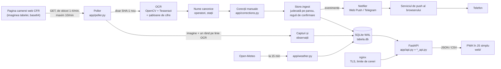
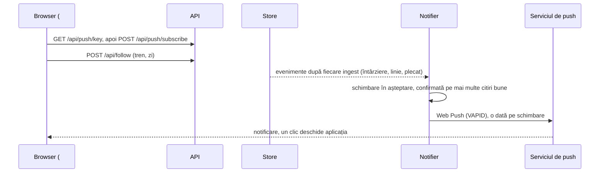
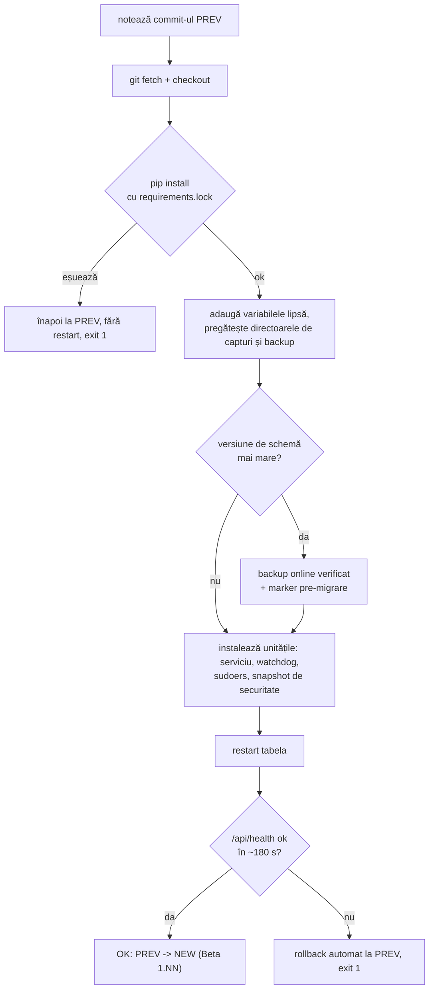

<p align="center"></p>

**Română** · [English](README.md)

# Tabela Gara de Nord

[](https://github.com/Andy217ACE/tabela-gara-de-nord/actions/workflows/ci.yml)
[](https://github.com/Andy217ACE/tabela-gara-de-nord/actions/workflows/codeql.yml)
[](https://github.com/Andy217ACE/tabela-gara-de-nord/releases)
[](LICENSE)

Aplicație web (PWA) care citește tabela de sosiri și plecări din **Gara de Nord București** de pe imaginea
publică a camerei web CFR, prin OCR clasic (OpenCV + Tesseract, **fără AI**), și o transformă într-o
tabelă live, un istoric căutabil, statistici pe călătorii și notificări Web Push pentru trenurile pe care
le urmărești. Totul rulează într-un singur proces Python mic, pe un server de acasă, cu SQLite ca unică
bază de date.

**Live:** https://tabelacfr.ddns.net

**Stare: Beta.** Versiunea curentă e în [`VERSION`](VERSION), istoricul în
[`CHANGELOG.md`](CHANGELOG.md), în aplicație la `#versiuni` și în
[Releases](https://github.com/Andy217ACE/tabela-gara-de-nord/releases).

> [!IMPORTANT]
> Datele sunt citite prin OCR de pe imaginea camerei web CFR și **pot conține erori**. O valoare care nu
> a putut fi citită apare ca **„—”**, niciodată ca 0, iar o citire nesigură e marcată ca atare. Proiectul
> este independent, **neafiliat CFR**; sursa oficială este [cfr.ro](https://cfr.ro).

## Cuprins

- [Ce face](#ce-face)
- [Pagini](#pagini)
- [Cum funcționează](#cum-funcționează)
- [Citirea tabelei: OCR](#citirea-tabelei-ocr)
- [Validare și calitatea datelor](#validare-și-calitatea-datelor)
- [Călătorii, istoric și statistici](#călătorii-istoric-și-statistici)
- [Notificări](#notificări)
- [Meteo](#meteo)
- [Modelul datelor](#modelul-datelor)
- [Capturi, retenție și confidențialitate](#capturi-retenție-și-confidențialitate)
- [Administrare](#administrare)
- [Securitate și fiabilitate](#securitate-și-fiabilitate)
- [API](#api)
- [Tehnologii și structura depozitului](#tehnologii-și-structura-depozitului)
- [Rulare locală](#rulare-locală)
- [Testare și CI](#testare-și-ci)
- [Versiuni](#versiuni)
- [Deploy (server Ubuntu)](#deploy-server-ubuntu)
- [Documentație](#documentație)
- [Contribuții, politica de securitate, licență](#contribuții-politica-de-securitate-licență)
- [Atribuire](#atribuire)

## Ce face

| Funcție | Ce primești |
|---|---|
| **Tabelă live** | Sosirile și plecările din București Nord ca pe tabela din gară: ora programată, categoria și numărul trenului, stația de origine/destinație, operatorul, întârzierea citită și linia. Tabela fizică are **12 rânduri pe panou**, la fel și aplicația. Se reîmprospătează la 10 s (`refresh_s` din `/api/config`) și trece pe gri („DATE VECHI”) când ultima citire bună e mai veche de 180 s. |
| **Două vizualizări** | **Carduri** (implicit pe telefon) și **Panou**, un afișaj de gară (implicit de la 1024 px): Sosiri / Plecări / Toate, ceas, starea datelor (ACTUALIZAT / DATE VECHI / INDISPONIBIL), căutare, filtre (întârziere, operator, linie, Favorite locale), sortare, coloane configurabile, ecran complet. Culorile întârzierii urmează pragurile din `/api/config`. |
| **Detaliu pe tren** | Apeși pe un tren și vezi detaliile, un link către Istoricul lui și butonul „Urmărește (notificări)”. |
| **Linie estimată** | O coloană opțională (oprită implicit) cu o **estimare** a liniei din istoricul observat (`/api/predict/peron`), afișată doar peste pragul de precizie măsurat în backtest, altfel „—”. E etichetată ca estimare, nu ca informație CFR. |
| **Urmărire + Web Push** | Urmărești un tren pentru ziua respectivă și primești o notificare când i se schimbă întârzierea sau linia ori când dispare de pe tabelă. O schimbare se trimite doar după mai multe citiri care o confirmă, deci o citire greșită într-un singur cadru nu produce niciodată o notificare. |
| **Istoric și căutare** | Ce a afișat tabela într-o zi sau pe toate zilele: filtre pe zi, tren, stație, interval orar și panou; detaliul călătoriei într-un dialog, cu graficul întârzierii observate; linkuri directe ca `#istoric?train=1636&date=2026-10-21`; paginare cu „Încarcă încă N”; export CSV prin API. |
| **Călătorii** | O apariție a unui tren pe un panou într-o zi de serviciu, cu un rezultat final: `confirmed`, `unconfirmed` (cu motiv), `unknown` sau `in_progress`. |
| **Statistici și grafice** | Punctualitate, întârziere tipică, clasamente, hărți de căldură, zilele săptămânii, rute, operatori și categorii, „ce s-a schimbat săptămâna asta”, comparație între perioade, linii schimbate, cât stă trenul pe tabelă, sezoane și meteo. Fiecare cifră are lângă ea eșantionul **N**; sub eșantionul minim nu se afișează procente. |
| **Trenuri și stații** | Un catalog public al trenurilor, cu o pagină pe tren (`#tren?nr=…`) și pe stație (`#statie?nume=…`), cu grafice și exporturi CSV/JSON. Numele stațiilor apar cu diacritice (Brașov, Aeroport Henri Coandă); căutarea ignoră diacriticele. |
| **Indicatori de calitate a datelor** | Valorile OCR nesigure sunt subliniate punctat, cu titlul „citire nesigură”; serviciile-fantomă (citiri greșite) sunt ascunse; perioadele de calitate redusă sunt marcate și excluse implicit din statistici. |
| **Meteo** | Un widget mic lângă ceas, cu condițiile curente din București (date de model Open-Meteo) și graficul temperaturii pe 24 h. |
| **PWA / offline** | Instalabilă; funcționează offline cu ultima tabelă (marcată „date vechi”) și o pagină offline cu sigla. |
| **Teme** | Auto → Luminoasă → Întunecată, din butonul din antet (și în Panou, inclusiv în ecran complet); alegerea se păstrează în browser. |
| **Română / engleză** | Toată interfața în ambele limbi, comutată instant, fără reîncărcare; `?lang=en` deschide direct varianta în engleză (și previzualizările linkurilor primesc etichete în engleză). |
| **Accesibilitate** | Lucru pe WCAG 2.2 AA: zone de atingere de cel puțin 24×24 px (44 px pentru butoanele importante pe ecrane tactile), un singur titlu principal pe pagină, fără salturi de nivel, link de sărit la conținut, anunțuri discrete pentru cititoarele de ecran, grafice utilizabile cu tastatura și cu tabel alternativ, contrast de cel puțin 4,5:1 în ambele teme, „mișcare redusă” respectată, suport pentru culori forțate. |
| **Tipărire** | Tipărire curată pentru Tabelă, Istoric, Trenuri și Statistici: negru pe alb, fără meniu, filtre și butoane, rândurile nu se rup între pagini; Tabela tipărită are ca titlu panoul ales. |
| **Navigare pe telefon** | O bară jos cu Tabelă, Istoric, Trenuri, Statistici și „Mai mult” (Urmărite, Clasamente, Stații, Sistem, Versiuni, Setări, Cum funcționează?, limba). Pe tabletă și desktop meniul rămâne sus. |

## Pagini

Aplicația are o singură pagină HTML (`web/index.html`); fiecare pagină e un fragment al adresei.

| Fragment | Pagină | Cine |
|---|---|---|
| `#` (fără fragment) | **Tabelă** (Carduri / Panou / ecran complet) | oricine |
| `#istoric` | **Istoric** (o zi sau toate zilele) | oricine |
| `#urmarite` | Trenurile **urmărite** și comutatorul de notificări | oricine |
| `#trenuri`, `#tren?nr=<număr>` | **Trenuri** (catalog) și **Tren** (profil, călătorii, grafice) | oricine |
| `#statistici` | **Statistici**; secțiunile au linkuri directe: `#statistici?sect=probleme` (și `bune`, `rute`, `operatori`, `sumar`, `glosar`) | oricine |
| `#clasamente` | **Clasamente** | oricine |
| `#statii`, `#statie?nume=<nume>` | **Stații** și **Stație** | oricine |
| `#sistem` | **Sistem**: starea serviciului, calitatea citirii (24 h / 7 zile), viteza (ciclul OCR, API p50/p95); detalii pentru admin | oricine |
| `#cum` | **Cum funcționează?**, pe înțelesul oricui: de unde vin datele, ce înseamnă „întârziere”, limitele, confidențialitatea, unde raportezi o problemă | oricine |
| `#versiuni` | **Versiuni** (istoricul schimbărilor) | oricine |
| `#setari` | **Setări** (retenția capturilor, pragul de spațiu liber) | admin |
| `#ocr` | **Capturi OCR** (imaginea cu dreptunghiurile OCR, text brut vs. normalizat, corecții manuale) | admin |
| `#ocr2` | Jurnalul **alternativei OCR** (decupaje și verdicte) | admin |
| `#admin` | **Administrare** (vezi [Administrare](#administrare)) | admin |

Paginile de administrare nu apar în meniu și nu intră în precache-ul service worker-ului. Lista completă,
cu scriptul din spatele fiecărei pagini, e în [Interfața](docs/interfata.md).

## Cum funcționează



Principiile de bază:

- **Un singur proces.** Serverul web și poller-ul trăiesc în același proces uvicorn, cu **un singur
  worker** (un al doilea worker ar porni un al doilea poller). OCR-ul rulează într-un fir
  (`asyncio.to_thread`), în afara buclei de evenimente.
- **Politețe față de CFR.** Poller-ul învață la ce secundă din minut se schimbă imaginea și cere în jurul
  acelui moment: de obicei 1–4 cereri pe minut, cu limite fixe de cel puțin 2 s între cereri și cel mult
  10 pe minut, backoff exponențial la erori, ritm lent de 30 s când imaginea nu s-a schimbat 5 minute și
  un User-Agent care îl identifică. Imaginile peste 10 MB și JPEG-urile tăiate sunt refuzate. Nu rulați
  mai multe instanțe pe aceeași sursă.
- **O citire greșită nu strică starea.** Fiecare panou (sosiri, plecări) e judecat separat; un panou
  parțial sau stricat e respins, salvat pentru diagnostic, iar starea anterioară rămâne.
- **Nimic nu se șterge din istoric.** Ce s-a citit rămâne cum s-a citit; verdictele de calitate stau în
  tabele separate. Curățările există doar ca scripturi reversibile, cu arhivă.
- **Fără cron.** Munca periodică e fie o sarcină asincronă în proces, fie un timer systemd.

Descrierea completă (secvența unui ciclu de citire, harta modulelor, căile de pe server) e în
[Arhitectura](docs/arhitectura.md).

## Citirea tabelei: OCR

<details>
<summary><b>Pipeline-ul OCR, pas cu pas</b></summary>

1. **Captura.** `app/fetcher.py` descarcă pagina CFR, extrage imaginea tabelei (JPEG/PNG în base64) și
   îi calculează SHA-1; o imagine neschimbată nu se mai citește. Ultima imagine se păstrează în
   `LAST_IMAGE_PATH`, pentru depanare.
2. **Împărțire și preprocesare** (`app/ocr/preprocess.py`). Imaginea se împarte în panourile Sosiri și
   Plecări; o mască de culoare izolează textul, mărit ×3, cu prag Otsu.
3. **Grila 4 × 3.** Fiecare panou CFR are 4 grupuri albastre a câte 3 rânduri (12 rânduri). Benzile de
   text găsite prin proiecție sunt verificate pe grupuri (`structured_bands`); un grup cu alt număr de
   rânduri decât 3 primește grila lui fixă (derivată din imagine, nu din text), așa că un rând slab sau gol
   nici nu dispare, nici nu se lipește de vecin.
4. **Celule și Tesseract** (`app/ocr/reader.py`, `app/ocr/engine.py`). O imagine compusă pe coloană, un
   singur apel Tesseract (timeout 10 s), prin interfața `OcrEngine` (`TesseractEngine` e implementarea
   folosită).
5. **Cifre** (`app/ocr/digits.py`). Numerele și orele se citesc și prin potrivire cu șabloane pe fontul
   unic, fix, al tabelei (`app/ocr/digit_templates.npz`, livrat cu codul; fără el aplicația pornește cu un
   avertisment în log și rămâne doar Tesseract).
6. **Câmpuri** (`app/normalize.py`). Confuziile de cifre (O/0, l/1), orele, categoria trenului (`IR`,
   `IRN`, `R`, `RE`, `RM`, `IC`, `EC`, `EN`, `D`), întârzierea (cel mult 999), linia și asteriscul de
   marcaj. Orele de pe un panou sunt în ordine cronologică (`app/ocr/order.py`); reflexiile și săgeata
   tabelei sunt tratate în `app/ocr/glare.py`.
7. **Recitirea.** Un rând cu text, dar fără categorie/număr/oră citibile, e recitit pe acele coloane cu
   preprocesări alternative (`preprocess.VARIANTS`: fără liniile verticale de reflexie, prag mai mic/mai
   mare, ×4, prag adaptiv, decupaj mai larg), până reușește sau se termină bugetul cadrului
   (`OCR_FRAME_BUDGET_S`, implicit 8 s). Un panou cu mai mult de 4 rânduri necitite e un cadru stricat și
   nu se recitește (nu se inventează trenuri).
8. **Canonicalizarea** (`app/canonical.py`). Operatorii și stațiile se potrivesc cu `difflib` pe
   `data/operators.txt` (`Nume oficial | alias | alias`) și pe stațiile din `data/stations_seed.txt`, plus
   cele învățate din istoric (văzute în cel puțin 2 trenuri distincte, în cel puțin 2 zile de serviciu).
   Prag 0,82; un scor de 0,65–0,82 se acceptă doar cu o diferență de cel puțin 0,10 față de al doilea
   operator (măsurat pe 823.912 citiri live). Operatorii apar cu numele oficiale (`CFR Călători`,
   `Regio Călători`, `Transferoviar Călători`, …); RE și RM ca „R-E” și „R-M”. Sub prag se păstrează
   textul citit și rândul e marcat `uncertain`. Textul brut se păstrează mereu în coloanele `*_raw`.

Rândurile necitite rămân „necitit” (nu 0, nu tren ghicit); un rând fără text e „rând gol”. Fiecare
observație își notează versiunea de procesare (`ocr-tess-grid-5`), cu sufixe ca `+empty`, `+unread`,
`+retry:<variantă>:<încercări>`. `/api/health` → `ocr` arată rândurile pe panou din ultimul cadru,
recitirile, durata și câte dintre ultimele 60 de cadre au avut 12/12.

</details>

**Alternativa OCR (în umbră).** `app/ocr/alt_reader.py` e un mic MLP pentru cifre, care poate completa
celulele de număr și oră lăsate necitite de Tesseract. E **oprită implicit** (`OCR_ALT=1` o pornește); cu
`OCR_ALT_SHADOW=1` doar notează ce *ar* completa, fără să schimbe ce se afișează. Modelul
(`OCR_ALT_MODEL`) trebuie să poarte amprenta motorului de citire, altfel e refuzat. Fiecare propunere
ajunge într-un jurnal (`ocr_alt/` lângă baza de date, 30 de zile, cel mult 5000 de evenimente), cu
decupaje ale celulei, verificate în pagina de administrare `#ocr2` cu verdictele Corect / Greșit / Neclar;
liniile completate de ea sunt marcate `+ocr:alt` și rămân `uncertain`. Separat, un clasificator
experimental de cifre se antrenează în fiecare noapte în umbră (`tabela-shadow-train.timer`, 03:30) și nu
se promovează niciodată singur în producție.

Detalii, constante și cum se măsoară precizia: [OCR](docs/ocr.md).

## Validare și calitatea datelor

Ce se citește de pe tabelă rămâne în baza de date exact cum a fost citit. Regulile de mai jos decid ce
devine starea vizibilă; verdictele de calitate stau în tabele separate (`app/quality.py`, fiecare regulă e
testată pe cazuri reale).

| Regulă | Valoare |
|---|---|
| Panou acceptat | cel puțin 4 rânduri sigure pe panourile acceptate și cel puțin 2 pe panou; un panou care scade sub jumătate din ultimul număr bun e „parțial” și e respins (se acceptă după 10 cadre la fel de mici) |
| Schimbare de întârziere | se aplică la a **2-a** citire identică consecutivă; un salt mare (cel puțin 60 min, la 100 min sau mai mult) la a **3-a**; o valoare care pare semnul „+” citit ca cifră (25 → 425) la a **5-a** |
| Schimbare de linie | 2 citiri; 3 pentru cifrele confundate (5/6, 1/4/11/14, 3/8) |
| Linie golită | o linie afișată se golește abia după **5** citiri goale, așa că liniile 6, 8 și cele de două cifre, tăiate sus de bandă, nu mai dispar |
| Tren plecat | după 3 citiri în care lipsește; dacă revine în cel mult 10 minute, nu e o apariție nouă |
| Fantome | un serviciu văzut mai puțin de 2 minute, o variantă la un caracter a unui serviciu mai longeviv, cu cel mult o observație, varianta minoritară a unui rând pe care OCR-ul îl citește alternativ sau un tren citit într-o singură observație. Fantomele sunt marcate, niciodată șterse, și ascunse din Tabelă, Istoric, catalog, statistici și paginile de stații |
| Redenumire | o citire greșită salvată se redenumește prin vot: cel puțin 3 citiri și 70% din ultimele 10 |
| Evenimente suspecte | salturile izolate de întârziere și alternanța plecat/apărut sub 180 s sunt marcate suspecte |
| Perioade de calitate redusă | `quality_periods` (ex. 21.10.2026 00:00–11:31) sunt excluse din statistici, în afară de cazul `STATS_INCLUDE_LOW_QUALITY=1` |
| Valoarea afișată | consensul pe tren al cadrelor recente (`app/consensus.py`), nu doar ultima citire |

Recalcularea retroactivă a calității (`python -m app.quality --dry-run`, apoi fără `--dry-run`, cu
serviciul oprit) și scripturile reversibile `scripts/purge_ghosts.py` și `scripts/merge_number_dups.py`
(implicit doar dry run; copie completă și tabel de arhivă la `--apply`; `--restore` pentru anulare) sunt
descrise în [Administrare și operare](docs/administrare-operare.md).

## Călătorii, istoric și statistici

- **Călătorie** = o apariție a unui tren pe un panou (sosiri sau plecări din București Nord) într-o *zi de
  serviciu* (ziua orei programate; 00:05 citit la 23:58 aparține zilei următoare). **Tren** = un număr de
  tren. **Observație** = o linie OCR dintr-o captură. Se raportează separat.
- **Întârzierea folosită** e ultima valoare **citită** efectiv pe tabela din București Nord, cu dovada
  citirii (`services.delay_read_at`). Fără dovadă, întârzierea e „necunoscută”, niciodată 0. Pe paginile
  de stație, întârzierea e tot cea citită la București Nord.
- **Rezultatul final** (`app/journeys.py`): `confirmed` doar cu dispariție observată după ora estimată
  (programat + întârziere) și întârziere citită cu cel mult `FINAL_READ_MAX_GAP_MIN` (15) minute înainte;
  altfel `unconfirmed` (cu motiv) sau `unknown`; `in_progress` cât e pe tabelă.
- **Statistici** (`app/stats.py`): N, media („în medie”), mediana („întârziere tipică”), p90, max, % la
  timp (≤ `ON_TIME_MAX_MIN`, implicit 5), ponderea peste 30 min. Sub `STATS_MIN_SAMPLE` (5) nu se afișează
  procente și nici p90. Sosirile și plecările sunt mereu separate.
- **Istoricul pe toate zilele** (`/api/history?all=1`): călătoriile, cele mai noi primele, fără fantome,
  cu paginare prin cursor; perioadele de calitate redusă sunt marcate (`low_quality`) și nu intră în
  rezumat.
- **Pagina Statistici** (un singur răspuns de la `/api/stats/overview`, păstrat `STATS_CACHE_TTL_S` = 60 s,
  plus secțiuni încărcate la prima afișare): carduri de rezumat, alerte de prag, „ce s-a schimbat
  săptămâna asta”, comparația cu cele 7 zile dinainte, „Probleme” (constatări deterministe, fără model de
  limbaj) și „Ce merge bine”, rute, operatori și categorii (bare de pondere, matricea operator ×
  categorie), cele mai punctuale trenuri, harta de căldură (zi a săptămânii × oră), zilele săptămânii,
  întârzieri în trepte, linii schimbate după anunț, cât stă trenul pe tabelă, sezoane și meteo. Filtrele
  (perioadă, panou, operator, categorie, doar confirmate) rămân vizibile și pot fi salvate pe dispozitiv
  ca cel mult 5 seturi; mod simplu/expert și opțiune de contrast ridicat; fiecare grafic și tabel se
  exportă în CSV (UTF-8 cu BOM) și PNG; graficele se desenează pe măsură ce derulezi.
- **Estimările nu se publică până nu își câștigă dreptul.** Estimarea întârzierii finale pe tren
  (`/api/trains/{nr}/prediction`) rămâne `published: false` până trece o poartă de calitate (30 de zile de
  date bune, 100 de predicții, eroare sub cea de referință). Comparația pe sezoane nu arată cifre sub 30
  de zile eligibile.

Formule, praguri și fiecare grafic: [Statistici, călătorii, calitate](docs/statistici-calatorii-calitate.md).

## Notificări



- Web Push cu chei VAPID (`pywebpush`); fără ambele chei aplicația merge, iar notificările sunt oprite.
- O schimbare se trimite doar după ce e văzută în mai multe citiri reușite; evenimentele `appeared` și o
  linie golită („fără linie”) nu se trimit niciodată; aceeași valoare nu se trimite de două ori.
- Cel mult 20 de urmăriri active pe abonare; abonările care răspund 404/410 se șterg automat.
- Adresele de push se acceptă doar pentru servicii de push cunoscute, prin HTTPS (protecție împotriva
  SSRF, `app/endpoints.py`), iar locația `/api/follows` nu se scrie în logul de acces nginx.
- Necesită HTTPS; pe iPhone/iPad funcționează doar pentru aplicația adăugată pe ecranul principal.
- Un canal opțional **Telegram** (`TELEGRAM_BOT_TOKEN` + `TELEGRAM_CHAT_ID`) trimite același tip de alerte
  și își ține propriul jurnal de trimiteri, așa că deduplicarea lui supraviețuiește unei reporniri.

## Meteo

Lângă ceas (în antetul vizualizării Carduri și în bara de titlu a Panoului) apare un widget mic cu vremea
din București: pictogramă după `weather_code` (variantă zi/noapte după `is_day`), temperatura și „se
simte”; la apăsare/hover, un popover cu umiditate, presiune (hPa), vânt (viteză + direcție în cuvinte, +
rafale), precipitații (ploaie / averse / zăpadă doar când sunt > 0; 0,0 mm e o valoare reală), un grafic
SVG al următoarelor 24 h cu minim, maxim și „acum”, ora observației și sursa.

- **Serverul** (nu browserul: CSP rămâne `connect-src 'self'`) face **o singură cerere** către
  Open-Meteo: `current=temperature_2m,relative_humidity_2m,apparent_temperature,is_day,precipitation,rain,
  showers,snowfall,weather_code,surface_pressure,wind_speed_10m,wind_direction_10m,wind_gusts_10m` +
  `hourly=temperature_2m`, cu `timezone=UTC` și `forecast_days=2`, la fiecare 15 minute, într-o sarcină
  proprie, independentă de poller-ul CFR. O eroare meteo nu afectează nici tabela, nici `ok` din
  `/api/health` (care primește doar `weather_age_s`). Backoff la erori (5 → 30 min), niciodată mai mult de
  o cerere la 5 minute, nici după repornire.
- Etichetare onestă: valorile `current` sunt **date de model** pentru celula de grilă, nu măsurătorile
  unei stații meteo; se salvează cu `kind = model_current` și se afișează „Condiții curente (model
  Open-Meteo)”. O valoare lipsă e `NULL` / „—”, niciodată 0. Peste 45 de minute datele trec pe gri („date
  vechi”).
- Stocare: tabelul `weather_observations` (schema v4; **schema v8** a adăugat, aditiv și nullable,
  `relative_humidity_pct, is_day, rain_mm, showers_mm, snowfall_cm, surface_pressure_hpa,
  wind_gusts_kmh, hourly_json`; rândurile vechi rămân neatinse, cu `NULL` în coloanele noi), un rând pe
  observație (`observed_at` unic, ~96 de rânduri pe zi), păstrat permanent pentru analiza „sezoane și
  meteo”. Seria orară (25 de puncte, JSON compact) se păstrează doar pe cel mai nou rând: e o prognoză, nu
  istoric. API: `GET /api/weather`; `GET /api/config` → `weather`.
- Variabile (opționale): `WEATHER_ENABLED` (implicit `1`; `0` oprește modulul și ascunde widgetul),
  `WEATHER_INTERVAL_S` (implicit `900`, minim `300`), `WEATHER_LAT` / `WEATHER_LON` (implicit `44.4323` /
  `26.1063`), `WEATHER_URL` (implicit `https://api.open-meteo.com/v1/forecast`).
- Licență: datele meteo sunt de la [Open-Meteo.com](https://open-meteo.com/), **CC BY 4.0** (API-ul
  gratuit este pentru uz necomercial); atribuirea apare în popover, în subsolul paginii și în creditul
  Panoului (vizibil și în ecran complet).

Mai mult: [Meteo](docs/meteo.md).

## Modelul datelor

SQLite în mod WAL (`synchronous=NORMAL`, `busy_timeout` 5000), **schema v10** (`PRAGMA user_version`,
`SCHEMA_VERSION` din `app/store.py`). Migrările sunt aditive, atomice împreună cu creșterea versiunii,
se pot rula din nou, nu se renumerotează niciodată și nu ating coloanele `*_raw`. O bază cu date primește
o copie de siguranță înaintea oricărei migrări, altfel migrarea e refuzată.

| Tabel | Un rând înseamnă | De la |
|---|---|---|
| `runs` | un cadru procesat (acceptat sau respins) | v3 |
| `services` | un tren, o zi de serviciu, un panou (călătoria): ore, întârziere, linie, operator și stație (+ `*_raw`), `delay_read_at` | v3 (+v6) |
| `events` | o schimbare a unui serviciu: `appeared`, `delay`, `platform`, `gone` | v3 |
| `subscriptions`, `follows` | o abonare Web Push; un tren urmărit într-o zi | v3 |
| `weather_observations` | o observație Open-Meteo | v4 (+v8) |
| `captures`, `observations`, `trains` | o imagine descărcată; o linie OCR cu valoare brută/normalizată, încredere și dreptunghi pe câmp; catalogul numerelor de tren | v5 |
| `dq_meta`, `service_quality`, `event_quality`, `quality_periods` | stratul de calitate: verdicte de fantomă / calitate redusă, evenimente suspecte, perioade de calitate redusă | v7 |
| `corrections`, `correction_batches`, `correction_archive`, `correction_audit` | regulile de corecție manuală, aplicările lor, valorile dinainte/după, jurnalul de audit | v9 |
| `settings` | valorile editate în pagina Setări (în afara schemei versionate) | — |

v10 nu a adăugat structură: a rescris operatorii cu numele oficiale în toate tabelele (textul brut rămâne
neatins). Fiecare tabel și coloană, drumul unei citiri și restaurarea: [Date și schema bazei](docs/date-si-schema.md).

## Capturi, retenție și confidențialitate

- Fiecare imagine nouă se salvează **nemodificată** în `CAPTURE_DIR/AAAA/LL/ZZ/HHMMSS-<hash8>.jpg` (UTC);
  aceeași imagine (același hash) nu creează o captură nouă. Liniile incomplete sau cu încredere mică se
  păstrează și ele, marcate. O eroare la înregistrare nu oprește niciodată tabela.
- **Retenție:** fișierele imagine se șterg după `CAPTURE_RETENTION_DAYS` (implicit 7; se poate schimba
  între 1 și 30 din `#setari`; `0` în mediu nu mai scrie imagini). Rândurile rămân, cu `path` NULL. Sub
  `CAPTURE_MIN_FREE_MB` (implicit 2048) spațiu liber pe disc nu se mai scriu imagini, doar metadatele. Nu
  se atinge nimic în afara `CAPTURE_DIR`. Ultimele 40 de cadre respinse se păstrează în `REJECTED_DIR`.
- **Capturile brute CFR sunt private:** se văd doar din administrare, nu se redistribuie și nu intră în
  git (imaginile setului de adevăr OCR stau doar pe mașina de dezvoltare și pe server).
- **Date personale:** nu există conturi. Aplicația păstrează abonările push (adresa + cheile) și
  urmăririle, plus IP-ul administratorului în auditul corecțiilor; IP-urile stau în memorie doar pentru
  limitarea cererilor și pentru cardul „Vizitatori online” (mascate). IP-urile vizitatorilor publici nu se
  salvează în baza de date.

Regulile complete: [Capturi și confidențialitate](docs/capturi-si-confidentialitate.md).

## Administrare

Administrarea se activează cu `ADMIN_TOKEN` în `/etc/tabela.env` (minim 12 caractere; cu
`ADMIN_TOKEN_STRICT=1`, minim 24, altfel serviciul refuză să pornească). Fără el, toate rutele
`/api/admin/*` răspund 503. Autentificarea se face din `#ocr` sau `#admin` (cookie de sesiune HttpOnly,
Secure, SameSite=Strict, valabil 12 h, care conține un HMAC, nu tokenul) sau cu `Authorization: Bearer`,
pe server.

Pagina **`#admin`** are aceste carduri:

| Card | Ce face |
|---|---|
| **Server (live)** | încărcarea, memoria și serviciile, doar citire |
| **Disc NVMe (live)** | sănătatea discului, de la colectorul NVMe doar-citire (`tabela-nvme.timer`, la 2 minute) |
| **Securitate (fail2ban)** | IP-urile banate acum, istoricul ban-urilor, cererile-probă pe 24 h / 7 zile, top IP-uri, jail-uri; citite dintr-un snapshot scris la 2 minute de un exportator root doar-citire (`tabela-security-snapshot.timer`); nu există buton de unban |
| **Vizitatori online** | cine a folosit site-ul în ultimele 5 minute: IP mascat, browser și sistem, fără boți și scanere; doar în memorie, reîmprospătat la 30 s |
| **Test notificări push** | trimite o notificare de test, doar către abonarea dispozitivului de pe care apeși |
| **Duplicate de numere de tren** | raport, aplicare (cu copie de siguranță întâi) și restaurarea fuziunilor |
| **Marcaje propuse (OCR13)** | listă informativă dintr-o analiză a istoricului vechi; nimic de aplicat |

Celelalte pagini de administrare: **`#ocr`** (capturile cu dreptunghiurile OCR colorate după încredere:
verde ≥ 80, galben 50–79, roșu < 50; text brut vs. normalizat pe câmp; „Copiază JSON”; reguli de corecție
manuală cu previzualizare → aplicare → restaurare), **`#ocr2`** (jurnalul alternativei OCR), **`#setari`**
(retenția și pragul de spațiu liber) și detaliile de admin din **`#sistem`** (versiunea și limbile
Tesseract, actualizările de securitate în așteptare, calitatea datelor pe zi: rata de confirmare,
calitatea citirii, acoperirea pe ore).

**Rotația cheii de administrare** se face manual: generezi o valoare nouă
(`python -c "import secrets;print(secrets.token_urlsafe(32))"`), o pui în `/etc/tabela.env` și repornești
serviciul; toate sesiunile se invalidează. Pașii: [Rotația cheii de administrare](docs/admin-rotatie-cheie.md).

Runbook-uri (corecții, fuziuni, purjarea fantomelor, backup și restaurare, Telegram, push, watchdog):
[Administrare și operare](docs/administrare-operare.md).

## Securitate și fiabilitate

Ce există, unde se află și unde e documentat. Omisiunile deliberate și motivele lor sunt în
[Decizii de arhitectură](docs/decizii-arhitectura.md).

| Funcție | Unde | Documentație |
|---|---|---|
| CSP strict (`default-src 'self'`, fără script/stil inline, `frame-ancestors 'none'`), `nosniff`, `Referrer-Policy: no-referrer`, `X-Frame-Options: DENY` | `app/api.py`, `web/` | [Interfața](docs/interfata.md), [API](docs/api.md) |
| DOM construit doar cu `createElement` / `textContent` (fără `innerHTML`), impus de teste statice | `web/*.js`, `tests/` | [Interfața](docs/interfata.md) |
| HSTS și limitarea cererilor în nginx (`tabela_api` 10 c/s burst 20, `tabela_stats` 60 c/min, `tabela_admin_login` 5 c/min), `client_max_body_size 8k`, `server_tokens off` | `deploy/nginx-tabela.conf`, `deploy/tabela-limits.conf` | [Deploy](docs/deploy-si-configurare.md) §6 |
| Autentificare admin: un singur token comparat în timp constant, cookie de sesiune semnat HMAC cu expirare, token CSRF (+ verificarea originii), 5 eșecuri/min/IP și 30/min în total → 429, `Cache-Control: private, no-store` | `app/admin.py` | [API](docs/api.md) §6, [Rotația cheii](docs/admin-rotatie-cheie.md) |
| Firewall: `ufw` deny incoming, doar 80/443 publice, SSH doar din rețeaua locală; uvicorn ascultă doar pe `127.0.0.1` | server | [Deploy](docs/deploy-si-configurare.md) §7 |
| fail2ban: jail-urile `sshd`, `nginx-tabela-probes`, `nginx-tabela-slow` (ban-uri crescătoare pentru recidiviști); filtrele sunt testate în CI | `deploy/fail2ban/` | [Operare](docs/administrare-operare.md) §15 |
| Întărire systemd: utilizator fără privilegii, `NoNewPrivileges`, `ProtectSystem=strict` (scrie doar în `/var/lib/tabela`), `PrivateTmp`, `PrivateDevices`, `RestrictAddressFamilies`, un singur worker, `OMP_THREAD_LIMIT=1` | `deploy/tabela.service` | [Deploy](docs/deploy-si-configurare.md) §5 |
| Copii de siguranță: automate și verificate înaintea fiecărei migrări de schemă (se păstrează ultimele 5) și înaintea operațiilor distructive din admin; `update.sh` revine la codul vechi dacă verificarea de sănătate eșuează | `app/dbbackup.py`, `deploy/update.sh` | [Operare](docs/administrare-operare.md) §6 |
| Monitorizare: watchdog (repornește după 3 verificări de sănătate eșuate, cel mult o dată la 10 min, rulând ca `tabela` cu o singură regulă sudoers; alerte Telegram), timer de sănătate NVMe, timer de snapshot de securitate, verificări externe de uptime (`/api/health` răspunde și la `HEAD`) | `app/watchdog.py`, `deploy/tabela-*.timer` | [Operare](docs/administrare-operare.md) §10, §15 |
| Integritatea datelor: `processing_version` pe observație, consens pe mai multe cadre, confirmarea schimbărilor de întârziere și de linie | `app/consensus.py`, `app/quality.py` | [OCR](docs/ocr.md), [Statistici și calitate](docs/statistici-calatorii-calitate.md) |
| Suita de regresie OCR pe cadre etichetate de mână, cu praguri stricte care pică la orice regres | `tests/fixtures/ocr_truth`, `app/ocr/truth.py` | [Testare](docs/testare.md) |
| CI la fiecare PR și pe `main` (teste inclusiv pe trei motoare de browser, `pip-audit`, verificarea versiunii, filtrele fail2ban), CodeQL (`security-extended`), Dependabot, `requirements.lock` fixat | `.github/` | [Testare](docs/testare.md) |
| Documentația ține pasul cu codul: fiecare rută trebuie să apară în pagina API | `tests/test_docs_routes.py` | [Testare](docs/testare.md) |

Lacune cunoscute, spuse deschis: **nu există încă o copie de siguranță în afara serverului** (decizia
proprietarului, amânată); actualizările de sistem și repornirile sunt manuale; tokenul de administrare se
schimbă de mână.

## API

JSON prin HTTPS, fără chei API (în schimb, limite de cereri). Multe rute acceptă `format=csv` pentru export.

<details>
<summary><b>Rute publice</b></summary>

| Rută | Întoarce |
|---|---|
| `GET /api/board` | tabela live (sosiri, plecări, vârsta datelor) |
| `GET /api/health` (și `HEAD`) | starea serviciului, `version`, contoarele OCR |
| `GET /api/config` | pragurile de culoare (`DELAY_THRESHOLDS`, implicit `5,15,30`), `refresh_s`, `stale_after_s`, meteo |
| `GET /api/changelog` | istoricul versiunilor din `CHANGELOG.md` |
| `GET /api/weather` | ultima observație meteo și seria orară |
| `GET /api/history` | o zi; cu `all=1`, toate zilele (`train`, `date`, `station`, `from`/`to`, `board`, `limit`, `cursor`) |
| `GET /api/train/{nr}` | evenimentele unui tren într-o zi |
| `GET /api/journeys`, `/api/journeys/{id}` | călătoriile și rezultatul lor final |
| `GET /api/trains`, `/api/trains/{nr}`, `/api/trains/stats`, `/api/trains/{nr}/journeys` | catalogul și statisticile pe tren |
| `GET /api/stats`, `/api/stats/overview`, `/api/stats/rankings`, `/api/stats/seasons` | statistici, clasamente, sezoane și meteo |
| `GET /api/stats/changes`, `/heatmap`, `/reliable`, `/dwell`, `/platform-changes` | secțiunile suplimentare din Statistici |
| `GET /api/stations`, `/api/stations/{nume}`, `/api/stations/{nume}/journeys`, `/api/station-names` | stațiile și numele afișate |
| `GET /api/predict/peron` | estimări de linie (nu informație oficială CFR) |
| `GET /api/trains/{nr}/prediction` | estimarea întârzierii finale (nepublicată până trece poarta de calitate) |
| `GET /api/system` | starea publică a sistemului (detalii pentru admin) |
| `GET /api/export/history.csv` | export CSV al istoricului (cel mult 366 de zile) |
| `GET /api/push/key`, `POST /api/push/subscribe`, `POST /api/push/unsubscribe`, `GET /api/follows`, `POST` / `DELETE /api/follow` | notificări |

Parametri comuni ai rutelor de statistici: `prag`, `min`, `board`, `from`, `to` (AAAA-LL-ZZ),
`doar_confirmate=1`.

</details>

<details>
<summary><b>Rute de administrare (<code>/api/admin/*</code>)</b></summary>

Sesiune (`session`, `login`, `logout`, `csrf`), capturi (`captures…`, `stats`), `settings`, corecții
(`corrections…` cu `preview`, `apply`, `audit` și `restore` pe lot), duplicate (`tools/dupes…`), server
(`tools/server`, `tools/nvme`, `system`), `security`, `visitors`, `push-test`, alternativa OCR
(`ocr-alt…`) și calitatea pe zi (`quality-daily/confirmation`, `/reading`, `/coverage`). Cu cookie,
cererile care modifică date cer tokenul CSRF. Nu există nicio rută HTTP care descarcă baza de date.

</details>

Fiecare rută, cu parametri, răspunsuri, erori, antete de cache și limite: [API](docs/api.md).

## Tehnologii și structura depozitului

| Strat | Tehnologie |
|---|---|
| Backend | Python 3.14, FastAPI, uvicorn (1 worker), SQLite (WAL) |
| OCR | OpenCV (headless), numpy, Tesseract 5 (`eng` + `ron`) prin `pytesseract`, șabloane de cifre proprii; niciun serviciu AI |
| Push | `pywebpush`, `py-vapid`, `cryptography` |
| Frontend | PWA în JavaScript simplu, fără framework și fără biblioteci externe; grafice SVG desenate de cod propriu; fonturi Fira Sans / Fira Code găzduite local |
| Server | Ubuntu 26.04 LTS, nginx + Let's Encrypt, unități și timere systemd, ufw, fail2ban |
| Teste / CI | pytest, pytest-asyncio, Playwright (Chromium, Firefox, WebKit), GitHub Actions, CodeQL, Dependabot |

<details>
<summary><b>Arborele depozitului</b></summary>

```text
app/                    aplicația FastAPI, poller, stocare, statistici, administrare
  api.py                  fabrica aplicației, lifespan (store, migrare, poller, meteo), rute publice, antete de securitate
  main.py                 punctul de intrare ASGI (uvicorn app.main:create --factory)
  config.py               Settings din variabilele de mediu
  poller.py, fetcher.py   bucla de citire și descărcarea paginii CFR
  ocr/                    preprocess, reader, engine (Tesseract), digits (+ digit_templates.npz), glare, order,
                          truth (precizie), alt_reader + alt_journal (alternativa OCR), stats
  normalize.py, canonical.py, operator_names.py   normalizarea câmpurilor, nume canonice, migrarea v10
  store.py                schema SQLite și migrările, ingest, tabela live, istoric, abonări
  quality.py, consensus.py, corrections*.py       reguli de validare, consens, corecții manuale
  captures.py, observations.py, rejected.py       capturi, observații OCR, cadre respinse
  journeys.py, history_all.py, stations.py, trains_api.py, export.py
  stats*.py, seasons.py, predict.py, line_prediction.py, peron_predict.py, peron_api.py
  admin*.py, system_*.py, security_status.py, visitors.py, perf.py, nvme_status.py, ocr_alt_api.py
  dbbackup.py, backup_api.py, restore.py          copii de siguranță și restaurare
  notifier.py, telegram.py, endpoints.py          Web Push, Telegram, validarea adreselor push
  weather.py, watchdog.py, version.py
web/                    PWA-ul: index.html, app.js, sw.js, manifest, scripturile și stilurile paginilor,
                        ui2.* (stratul vizual comun), charts3.* (stratul de grafice la cerere), stat_*.js
                        (secțiunile din Statistici), i18n/ro.json + en.json, fonts/, icons/
data/                   operators.txt, stations.txt (numele afișate), stations_seed.txt
deploy/                 install.sh, update.sh, tabela.service, unități și timere pentru watchdog / antrenarea
                        în umbră / NVMe / snapshot de securitate, site-ul nginx + limite, fail2ban/
scripts/                întreținere și evaluare: check_release, purge_ghosts, merge_number_dups,
                        restore_db, dev_seed, ocr_eval, ocr_alt_eval, ocr_digit_clf, nightly_shadow_train,
                        backtest_delay, backtest_peron, security_snapshot, nvme_collect, make_icons, ...
tests/                  suita pytest (unitare, API, statice, browser, OCR, migrări, deploy) + fixturi
docs/                   documentația detaliată (română), docs/en/ (engleză), brand/, superpowers/ (planuri istorice)
design-system/          tokenii de design și regulile componentelor (MASTER.md)
.github/                workflow-urile CI, CodeQL și lock, Dependabot, șabloane de issue și PR
```

</details>

**Grafica paginilor, fără biblioteci.** Paginile din afara Tabelei folosesc un strat vizual comun,
`web/ui2.css` + `web/ui2.js` (donut, cifre care numără, bare de proporție, minigrafice, schelete de
încărcare, tranziții). Stratul interactiv al graficelor (tooltip comun, legendă cu comutare, ecran complet
cu tabelul alături, „Copiază linkul”, chips de secțiuni, calendar, alunecarea datelor la schimbarea unui
filtru) e în `web/charts3.js` + `web/charts3.css`, **încărcat la cerere** doar pe paginile cu grafice, în
afara precache-ului service worker-ului. Fără biblioteci externe: o bibliotecă de grafice ar cere stiluri
inline sau canvas (CSP), n-ar urma temele și n-ar oferi un tabel accesibil pentru fiecare valoare, și ar fi
mai grea decât ~18 KB gzip cât are codul propriu. Dacă pe viitor se adaugă una, se pune sub
`web/vendor/<nume>-<versiune>/` cu fișierul de licență, se încarcă la cerere și nu intră în `SHELL` din
`sw.js`. Tabela (Carduri / Panou / ecran complet) nu folosește acest strat.

**Sigla.** Originalul e `docs/brand/logo-source.png`; toate variantele (antet, favicon 16/32/48, iconițe
PWA 192/512 + maskable, apple-touch-icon, `og:image` 1200×630) se regenerează cu
`python scripts/make_icons.py`. La 16–32 px se folosește un decupaj simplificat din aceeași grafică (fața
trenului), ca să rămână lizibilă în taburi.

## Rulare locală

```bash
python -m venv .venv
.venv/bin/pip install -r requirements-dev.txt -c requirements.lock      # Windows: .venv\Scripts\pip ...
python -m playwright install chromium firefox webkit                    # opțional: testele de browser
```

Pentru OCR trebuie instalat Tesseract 5 cu limbile `eng` și `ron`; dacă nu e în `PATH`, setați
`TESSERACT_CMD` (pe Windows, testele și scripturile încearcă și `C:\Program Files\Tesseract-OCR\tesseract.exe`).

O bază de dezvoltare, servită fără să contactezi CFR:

```bash
python scripts/dev_seed.py dev.db                       # o tabelă reală, citită din tests/fixtures
DB_PATH=dev.db POLLER_ENABLED=0 uvicorn app.main:create --factory
```

Apoi deschide http://127.0.0.1:8000. Notificările push cer în plus chei VAPID și o origine sigură
(localhost contează ca una).

<details>
<summary><b>Variabile de mediu</b></summary>

| Variabilă | Implicit | Rol |
|---|---|---|
| `DB_PATH` | `tabela.db` | baza SQLite (pe server: `/var/lib/tabela/tabela.db`) |
| `SOURCE_URL` | pagina camerei web cfr.ro pentru București Nord | sursa imaginii tabelei |
| `POLLER_ENABLED` | `1` | `0` servește doar starea salvată |
| `POLLER_RESTART_BACKOFF` | `5` | prima pauză înainte de repornirea unui poller căzut (se dublează, cel mult 300 s) |
| `LAST_IMAGE_PATH` | `data/last.jpg` | ultima imagine descărcată (gol = oprit) |
| `REJECTED_DIR` | `/var/lib/tabela/rejected` | ultimele 40 de cadre respinse (gol = oprit) |
| `TESSERACT_CMD` | `tesseract` | executabilul Tesseract |
| `OCR_FRAME_BUDGET_S` | `8` | timpul maxim de OCR pe cadru, inclusiv recitirile |
| `OCR_ALT`, `OCR_ALT_SHADOW`, `OCR_ALT_MODEL`, `OCR_ALT_JOURNAL_DIR` | oprit | alternativa OCR, modul în umbră, fișierul model, directorul jurnalului |
| `VAPID_PRIVATE_KEY`, `VAPID_PUBLIC_KEY` | gol | cheile Web Push (cheia privată e secretă); gol = push oprit |
| `VAPID_SUBJECT` | `https://tabelacfr.ddns.net` | subiectul VAPID |
| `ADMIN_TOKEN`, `ADMIN_TOKEN_STRICT` | nesetat, `0` | cheia de administrare (secretă; minim 12 caractere, 24 în modul strict) |
| `CAPTURE_ENABLED`, `CAPTURE_DIR`, `CAPTURE_RETENTION_DAYS`, `CAPTURE_MIN_FREE_MB` | `1`, `/var/lib/tabela/captures` sau `data/captures`, `7`, `2048` | capturi |
| `BACKUP_DIR` | `<directorul bazei>/backups` | copiile dinaintea migrărilor |
| `DELAY_THRESHOLDS` | `5,15,30` | pragurile de culoare ale întârzierii (minute) |
| `ON_TIME_MAX_MIN`, `STATS_MIN_SAMPLE`, `FINAL_READ_MAX_GAP_MIN`, `STATS_CACHE_TTL_S`, `STATS_INCLUDE_LOW_QUALITY` | `5`, `5`, `15`, `60`, `0` | statistici |
| `WEATHER_ENABLED`, `WEATHER_INTERVAL_S`, `WEATHER_LAT`, `WEATHER_LON`, `WEATHER_URL` | `1`, `900`, `44.4323`, `26.1063`, Open-Meteo | meteo |
| `TELEGRAM_BOT_TOKEN`, `TELEGRAM_CHAT_ID`, `TELEGRAM_STATE_PATH` | gol, gol, `data/telegram_sent.json` | alerte Telegram opționale (tokenul e secret) |

Un model fără valori reale e în [`.env.example`](.env.example); fiecare variabilă, cu intervalul valid și
comportamentul când lipsește, e în [Deploy și configurare](docs/deploy-si-configurare.md) §2.

</details>

## Testare și CI

```bash
python -m pytest -q                      # toată suita (din rădăcina depozitului)
python -m pytest tests/test_version.py   # un fișier
python -m pytest -k "stats and not browser"
python scripts/check_release.py          # coerența versiunii
```

- **Straturi:** unitare (SQLite în memorie), API (`TestClient`, poller oprit), verificări statice pe
  `web/`, `deploy/` și documentație (CSP, fără `innerHTML`, aceleași chei i18n, bugetul de precache,
  limitele nginx, versiunile), teste de browser cu Playwright (aspectul la 390 px și pe desktop, navigarea,
  tema, zonele de atingere, contrastul, CSP; teste de fum pe Firefox și WebKit, la dimensiuni de telefon și
  desktop), precizia OCR pe cadre reale, migrări și restaurare, plus o simulare a `deploy/update.sh` într-un
  depozit git temporar.
- **Omise, nu picate:** testele de browser se omit fără browserele Playwright; testele OCR care au nevoie
  de capturi private se omit fără ele (`OCR_TRUTH_DIR`); testele de deploy se omit fără bash și git.
- **`.github/workflows/ci.yml`** (la fiecare PR, la push pe `main`, săptămânal): Python 3.14, Tesseract,
  dependențele fixate de `requirements.lock`, Playwright Chromium + Firefox + WebKit,
  `scripts/check_release.py`, `pip-audit`, apoi toată suita; un al doilea job validează filtrele fail2ban
  cu `fail2ban-regex` și jail-urile cu `fail2ban-client -t`.
- **`codeql.yml`:** CodeQL `security-extended` pentru Python și JavaScript, la PR-uri, pe `main` și
  săptămânal.
- **`lock.yml` + Dependabot:** Dependabot propune săptămânal actualizări pip și lunar actualizări de
  Actions; `lock.yml` regenerează `requirements.lock` pe PR-urile Dependabot pentru pip. OpenCV și numpy nu
  se actualizează automat la minor/major, pentru că pot schimba rezultatul OCR și cer o re-măsurare.

Detalii: [Testare](docs/testare.md).

## Versiuni

Fiecare deploy e o versiune nouă, **`Beta 1.NN`**, cu NN mărit cu 1:

1. `VERSION` → `Beta 1.NN`;
2. o secțiune nouă sus în `CHANGELOG.md`, `## Beta 1.NN — AAAA-LL-ZZ`, cu grupuri în română
   (`### Adăugat` / `### Schimbat` / `### Reparat`) și o subsecțiune `### English`;
3. `CHARTS_V` din `web/ui2.js` = `1.NN` (cheia de cache a stratului de grafice încărcat la cerere);
4. versiunea cache-ului din `web/sw.js` crește când se schimbă fișierele din precache.

`scripts/check_release.py` (rulat în CI) pică dacă acestea nu se potrivesc. Versiunea apare în subsol
(link spre `#versiuni`), în `/api/health` (câmpul `version`) și în `/api/changelog`; `update.sh` o afișează
la final.

## Deploy (server Ubuntu)

Producția rulează pe un server de acasă (Ubuntu 26.04 LTS): nginx termină TLS (Let's Encrypt, reînnoit de
`certbot.timer`) și trimite cererile către uvicorn pe `127.0.0.1:8000`, rulat de `tabela.service` ca
utilizatorul fără privilegii `tabela`. Căi: codul în `/opt/tabela/app`, venv-ul în `/opt/tabela/venv`,
datele în `/var/lib/tabela`, configurarea în `/etc/tabela.env` (root, mod 600, nu e în git).

**Prima instalare** (ca root, idempotentă): `sudo bash deploy/install.sh <branch>`. Scriptul instalează
`tesseract-ocr`, `tesseract-ocr-ron`, `python3-venv`, `git`, `curl`, `sqlite3`, creează utilizatorul de
sistem `tabela`, checkout-ul codului, venv-ul și `/etc/tabela.env`, generează cheile VAPID o singură dată
(nu se regenerează niciodată: toate abonările ar deveni invalide), instalează serviciul și watchdog-ul,
configurează nginx (`nginx -t` înainte de reload, restaurarea automată a site-ului anterior la eșec) și
așteaptă verificarea de sănătate. Nu activează `ufw` și nu instalează fail2ban (ambele se configurează de
mână). Certificatele Let's Encrypt trebuie să existe înainte de prima rulare.

**Actualizare:** `sudo bash /opt/tabela/app/deploy/update.sh [branch]`



- Orice eșec înainte de restart pune înapoi codul vechi și **nu repornește** serviciul.
- Poarta de sănătate implicită (`HEALTH_MODE=strict`) cere `"ok":true`, adică tabela CFR a fost citită
  recent. Când CFR însuși nu răspunde, pentru o redistribuire de urgență:
  `sudo HEALTH_MODE=up bash .../update.sh <branch>`.
- Rollback-ul nu restaurează baza de date și lasă timer-ul watchdog oprit până la următoarea actualizare
  reușită. Pentru restaurarea datelor dintr-un backup: oprești serviciul, ștergi fișierele `-wal` / `-shm`
  și instalezi fișierul de backup (procedura e în ghidul de deploy); nu copiați niciodată peste o bază WAL
  deschisă.
- Scriptul rulează dintr-o copie temporară a lui însuși și e testat de `tests/test_update_sh.py`.
- Log-uri: `journalctl -u tabela -f`. `/api/follows` nu se scrie în logul de acces nginx, iar
  `limit_req_log_level warn` ține liniile 429 (cu query string-ul lor) în afara `error.log`.

Fiecare pas, unitățile systemd, nginx, certificatele, DNS-ul dinamic și rollback-ul manual:
[Deploy și configurare](docs/deploy-si-configurare.md).

## Documentație

| Pagină | Ce acoperă |
|---|---|
| [Arhitectura](docs/arhitectura.md) | Procesele, modulele din `app/`, unitățile systemd, nginx, căile datelor pe server |
| [Date și schema bazei](docs/date-si-schema.md) | Fiecare tabel și coloană, migrările v0–v10, ingestul, identitatea serviciilor, retenția, arhivele, restaurarea |
| [API](docs/api.md) | Toate rutele publice și de administrare: parametri, răspunsuri, erori, cache, limite, modelul de securitate |
| [Interfața](docs/interfata.md) | Paginile și rutele, navigarea, tema, service worker, CSP, grafice, accesibilitate |
| [OCR](docs/ocr.md) | Pipeline-ul de citire pas cu pas, constantele reale, regulile întârzierii, măsurarea, problemele deschise |
| [Capturi și confidențialitate](docs/capturi-si-confidentialitate.md) | Ce e o captură, retenția, ce ignoră git, regula de confidențialitate, datele personale |
| [Statistici, călătorii, calitate](docs/statistici-calatorii-calitate.md) | Catalog, călătorii, stații, formule și praguri, predicție, consens, calitatea datelor |
| [Meteo](docs/meteo.md) | Sursa Open-Meteo, stocarea, frecvența, eșecurile |
| [Administrare și operare](docs/administrare-operare.md) | `#admin`, corecții, fuziuni, purjare, backup și restaurare, Telegram, push, watchdog, runbook-uri, fail2ban |
| [Deploy și configurare](docs/deploy-si-configurare.md) | Variabilele de mediu, install.sh, update.sh, systemd, nginx, certificate, procesul de release, rollback |
| [Testare](docs/testare.md) | Cum rulezi suita, straturile de teste, testele care depind de capturi, cum adaugi un test |
| [Decizii de arhitectură](docs/decizii-arhitectura.md) | De ce SQLite și nu Postgres, fără Redis/Docker, OCR în proces, fără chei API, rotație și actualizări manuale, backup off-site amânat |
| [Rotația cheii de administrare](docs/admin-rotatie-cheie.md) | Pașii pentru schimbarea `ADMIN_TOKEN` |
| [Glosar](docs/en/glosar.md) | Termenii română → engleză folosiți în interfață și în documentație (doar în engleză) |

În plus: [`CHANGELOG.md`](CHANGELOG.md) (istoricul versiunilor, română + engleză),
[`design-system/tabela-gara-de-nord/MASTER.md`](design-system/tabela-gara-de-nord/MASTER.md) (tokenii și
regulile de design) și [`docs/superpowers/`](docs/superpowers/README.md) (documente de planificare
istorice, neactualizate). Traducerile în engleză ale ghidurilor sunt în `docs/en/` (începe cu
[Architecture](docs/en/arhitectura.md)).

## Contribuții, politica de securitate, licență

- **Contribuții:** branch din `main`, PR cu CI verde și lista din șablonul de PR; CSP strict, tot textul
  interfeței prin i18n (aceleași chei în `web/i18n/ro.json` și `en.json`). Vezi
  [CONTRIBUTING.md](CONTRIBUTING.md).
- **Securitate:** vulnerabilitățile se raportează privat, cu *Report a vulnerability* din fila
  **Security**, nu într-un issue public. Vezi [SECURITY.md](SECURITY.md).
- **Licență:** MIT, vezi [LICENSE](LICENSE).

## Atribuire

Date preluate de la CFR (cfr.ro) — proiect independent, neafiliat CFR. Tabela oficială: https://cfr.ro. © 2026 Andy217Ace.
Meteo: Open-Meteo.com (CC BY 4.0), valori de model.

Licență: MIT (vezi `LICENSE`).
