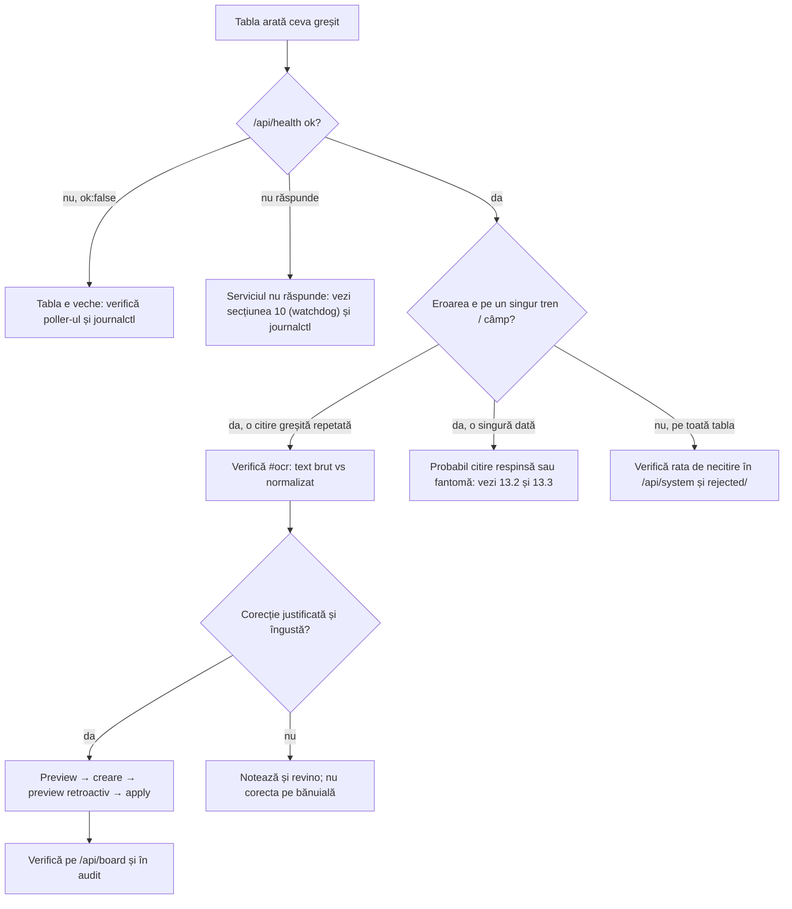
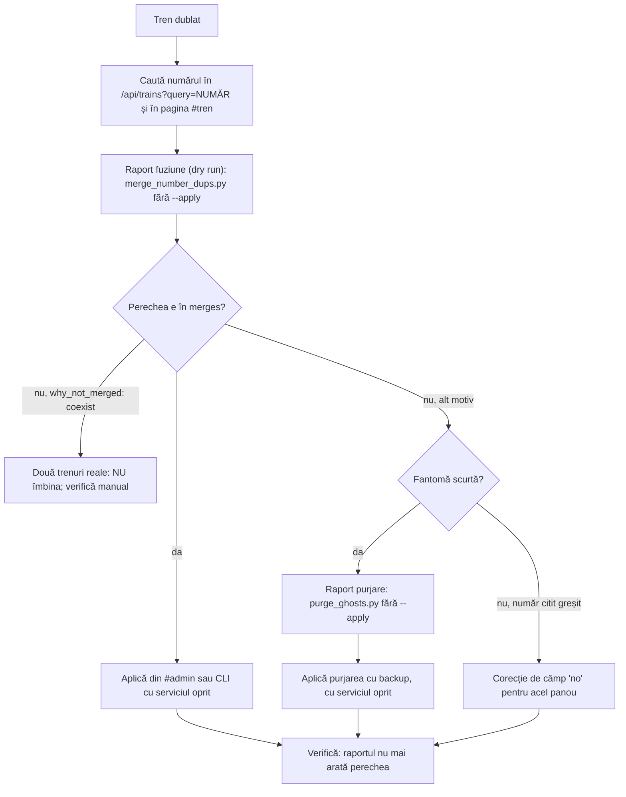
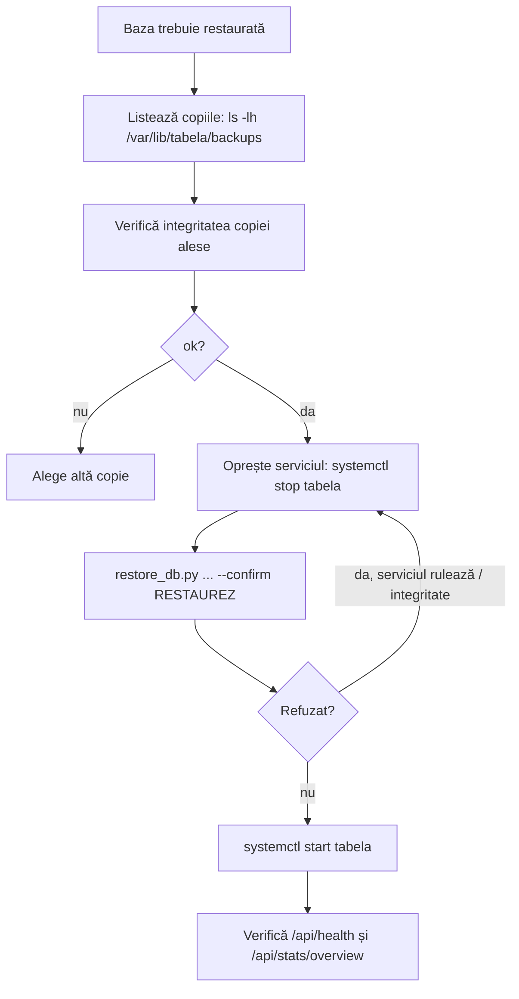

# Administrare și operare: runbook-uri

Această pagină este pentru cel care operează Tabela Gara de Nord pe server. Descrie funcțiile de administrare (pagina `#admin`, corecțiile, fuziunea și purjarea trenurilor-duplicat, copiile de siguranță și restaurarea, alertele Telegram, notificările push, starea serverului, watchdog-ul, fișierele respinse) și pașii pentru cele patru situații frecvente.

Convenții:

- Pe server, aplicația rulează ca serviciul `tabela` (`deploy/tabela.service`): cod în `/opt/tabela/app`, interpretor în `/opt/tabela/venv/bin/python`, baza în `/var/lib/tabela/tabela.db`, copiile în `/var/lib/tabela/backups`, configurația în `/etc/tabela.env` (root, 600).
- Comenzile de mai jos se dau pe server, în sesiunea SSH a operatorului.
- Niciun secret nu apare în această pagină. Acolo unde trebuie o valoare secretă, scrie `<ADMIN_TOKEN>`, `<TELEGRAM_CHAT_ID>` etc. Nu le scrie în terminal în clar și nu le pune în repo, în CHANGELOG sau în log.
- Pentru cheia de administrare, vezi `docs/admin-rotatie-cheie.md`.

## Cuprins

1. [Accesul la administrare și autentificarea](#1-accesul-la-administrare-și-autentificarea)
2. [Paginile și endpoint-urile de administrare](#2-paginile-și-endpoint-urile-de-administrare)
3. [Corecții manuale (`app/corrections.py`, `app/corrections_api.py`)](#3-corecții-manuale)
4. [Fuziunea trenurilor-duplicat (`scripts/merge_number_dups.py`)](#4-fuziunea-trenurilor-duplicat)
5. [Purjarea fantomelor (`scripts/purge_ghosts.py`)](#5-purjarea-fantomelor)
6. [Copia de siguranță și restaurarea bazei](#6-copia-de-siguranță-și-restaurarea-bazei)
7. [Alerte Telegram (`app/telegram.py`, `app/notifier.py`)](#7-alerte-telegram)
8. [Notificări web push și chei VAPID](#8-notificări-web-push-și-chei-vapid)
9. [Starea serverului (`app/system_status.py`, `app/system_api.py`, `app/admin_tools.py`)](#9-starea-serverului)
10. [Watchdog-ul (`app/watchdog.py`)](#10-watchdog-ul)
11. [Fișierele respinse (`app/rejected.py`)](#11-fișierele-respinse)
12. [Capturile OCR și spațiul pe disc](#12-capturile-ocr-și-spațiul-pe-disc)
13. [Runbook-uri](#13-runbook-uri)
14. [Ce nu am putut verifica și inconsistențe](#14-ce-nu-am-putut-verifica-și-inconsistențe)

---

## 1. Accesul la administrare și autentificarea

Sursa: `app/admin.py`.

| Element | Valoare din cod |
|---|---|
| Variabila | `ADMIN_TOKEN` în `/etc/tabela.env` |
| Lungime minimă | 12 caractere (`MIN_TOKEN_LEN`). Sub această lungime, toate `/api/admin/*` răspund **503** „Administrare dezactivată.” |
| Mod strict | `ADMIN_TOKEN_STRICT=1` cere minimum 24 de caractere (`STRICT_TOKEN_LEN`). Dacă cheia e prea scurtă, serviciul **nu pornește** și afișează un mesaj fără cheie |
| Autentificare | `Authorization: Bearer <ADMIN_TOKEN>` sau cookie-ul `tabela_admin` obținut de la `POST /api/admin/login` |
| Cookie | `HttpOnly`, `Secure`, `SameSite=Strict`, valabil 12 ore (`SESSION_S`). Conține expirarea și un HMAC cheiat cu tokenul, nu tokenul |
| Invalidare | schimbarea `ADMIN_TOKEN` invalidează toate sesiunile |
| Limitare | 5 încercări greșite pe minut per IP (`FAIL_LIMIT`), apoi 429; 30 de încercări greșite pe minut din toate sursele (`GLOBAL_FAIL_LIMIT`); fiecare greșeală întârzie răspunsul cu 0,5 s (`FAIL_DELAY_S`) |
| CSRF | Cererile de modificare cu cookie cer `X-CSRF-Token` (din `GET /api/admin/csrf`) și, dacă browserul trimite `Origin`, același host. Cererile cu `Bearer` nu cer CSRF |
| Antet | răspunsurile admin au `Cache-Control: private, no-store` |

Nginx limitează în plus `POST /api/admin/login` (zona `tabela_admin_login` din `deploy/tabela-limits.conf`; README: 5 pe minut).

Verificare rapidă că administrarea e activă (pe server, fără să afișezi cheia):

```bash
sudo systemctl is-active tabela
curl -s http://127.0.0.1:8000/api/admin/session
# {"enabled": true, "authenticated": false} = cheie validă (≥ 12 caractere), fără sesiune
# {"enabled": false, ...} = ADMIN_TOKEN lipsă sau prea scurt; toate celelalte rute admin dau 503
```

`GET /api/admin/session` răspunde mereu 200 și nu contorizează o încercare greșită (`admin.py`).

Pentru apelurile din runbook-uri, încarcă tokenul din fișier în shell, fără să-l afișezi:

```bash
set -a; . /etc/tabela.env; set +a
curl -s -H "Authorization: Bearer $ADMIN_TOKEN" http://127.0.0.1:8000/api/admin/tools/server
```

Atenție: `Bearer` ocolește CSRF, deci are aceleași drepturi ca sesiunea. Folosește-l doar pe server, prin `127.0.0.1`.

---

## 2. Paginile și endpoint-urile de administrare

| Pagină (hash) | Fișier | Ce face | Acces |
|---|---|---|---|
| `#ocr` „Capturi OCR” | `web/ocr.js` | listă capturi, imagine cu dreptunghiurile OCR, text brut față de text normalizat, **corecțiile manuale**, starea OCR | admin |
| `#setari` | `web/setari.js` | retenția capturilor și pragul de spațiu liber (`app/admin_settings.py`) | admin |
| `#admin` „Administrare” | `web/admin.js` | „Duplicate de numere de tren” (raport, aplicare, restaurare) și „Server (live)” | admin |
| `#sistem` | `web/sistem.js` | starea serverului; detaliile apar doar pentru admin | public, cu detalii pentru admin |

Endpoint-uri (toate sub `/api/admin/`, cu excepția celor marcate):

| Metodă și rută | Rol |
|---|---|
| `POST /login`, `POST /logout`, `GET /session` | sesiunea (cookie) |
| `GET /csrf` | tokenul CSRF pentru sesiunea curentă |
| `GET /captures`, `GET /captures/{cid}`, `GET /captures/{cid}/image`, `GET /captures/{cid}/overlay.png` | capturile OCR |
| `GET /stats` | statistici OCR și capturi |
| `GET /settings`, `POST /settings` | setările editabile (`capture_retention_days`, `capture_min_free_mb`) |
| `GET /tools/dupes` | raportul fuziunii duplicatelor (doar citire) |
| `POST /tools/dupes/apply` | aplicarea fuziunii (cere `"confirm": "APLICA"`) |
| `POST /tools/dupes/restore` | restaurarea fuziunilor (cere `"confirm": "RESTAUREAZA"`) |
| `GET /tools/server` | starea serverului (doar citire) |
| `GET /system` | detaliile stării serverului (`app/system_api.py`) |
| `GET /api/system` | **public**: starea minimă a serverului |
| `GET/POST/DELETE /api/admin/corrections…` | corecțiile manuale, vezi secțiunea 3 (`…/audit`, `…/preview`, `…/{rid}/preview`, `…/{rid}/apply`, `…/batches/{batch}/restore`) |

Setările (`POST /api/admin/settings`) acceptă doar cheile din `admin_settings.SPECS`:

| Cheie | Minim | Maxim | Implicit (dacă mediul nu are valoare validă) |
|---|---|---|---|
| `capture_retention_days` | 1 | 30 | 7 |
| `capture_min_free_mb` | 256 | 102400 | 2048 |

Valoarea din tabelul `settings` are prioritate față de mediu (`CAPTURE_RETENTION_DAYS`, `CAPTURE_MIN_FREE_MB`). Fiecare schimbare ajunge în `correction_audit` cu `action = 'setting'`. Corpul cererii are cel mult 1024 de octeți.

---

## 3. Corecții manuale

Sursa: `app/corrections.py` (logica), `app/corrections_api.py` (API). Schema v9.

### Ce este o regulă

O regulă corectează o valoare pe care OCR o citește greșit în mod repetat. Exemplu din cod: IR 1584 pe tabelă este de fapt IR 1581.

Forma: `(panou, câmp, valoare citită) → valoare corectă`, opțional limitată la o stație, o oră programată și un interval de zile de serviciu.

| Parametru | Valori permise |
|---|---|
| `board` | `arrival` (sosiri) sau `departure` (plecări) |
| `field` | `type`, `no`, `station`, `operator`, `time`, `platform`, `delay` |
| `wrong_value` | valoarea citită. Șirul gol `""` înseamnă „necitit” și este permis **doar** la `platform` și `delay` |
| `correct_value` | valoarea corectă, validată pe câmp (tipuri din `normalize._TYPES`, `no` 1–99999, stație 2–60 caractere, operator 2–40, oră `HH:MM`, platformă până la `PLATFORM_MAX`, întârziere până la `MAX_DELAY`) |
| `station`, `sched_time` | opționale; limitează regula |
| `date_from`, `date_to` | opționale, `AAAA-LL-ZZ`; intervalul e cel mult 3660 de zile (`MAX_SPAN_DAYS`) |
| `note` | obligatorie, 3–500 de caractere (`NOTE_MIN`, `NOTE_MAX`) |
| `source_capture_id`, `source_row_index` | opționale, pentru legătura cu rândul din captură |

Limite: cel mult **500** de reguli active (`MAX_ACTIVE_RULES`); corpul cererii cel mult 8192 de octeți; valorile corecte identice cu cele citite sunt respinse.

### Cele trei efecte

1. **Pe cadrele noi.** `correct_frame` rescrie rândurile OCR care se potrivesc, înainte de ingestie. Observația poartă marcajul `+corr:<id>` în versiunea de procesare; textul brut rămâne în `fields_json`.
2. **Retroactiv, reversibil.** `plan` (dry run, nu scrie) → `apply` (o tranzacție; fiecare rând modificat e arhivat cu valorile dinainte și de după, în `correction_archive`, sub un `batch`) → `restore` (readuce valorile, doar pe rândurile care încă au valoarea corectată).
3. **Dezactivare.** Regula se șterge logic (`status = 'deleted'`). Nu mai acționează pe cadre noi.

Toate schimbările de stare intră în `correction_audit` (acțiune, actor, IP, lot, detalii). Actorul este întotdeauna `admin`.

Nimic din corecții nu apare pe endpoint-urile publice.

### Ordinea corectă (previzualizare înainte de aplicare)

1. **Previzualizează** regula nouă: `POST /api/admin/corrections/preview` (validează, nu scrie). Răspunsul are `services.count`, `conflicts.count`, `observations.count`, `events.count`, `plan_hash` și exemple (până la 50 pe fel).
2. **Creează** regula: `POST /api/admin/corrections` (201). Regula acționează imediat pe cadrele noi.
3. **Previzualizează retroactiv**: `POST /api/admin/corrections/{rid}/preview`. Notează `plan_hash`.
4. **Aplică** cu hash-ul: `POST /api/admin/corrections/{rid}/apply` cu corpul `{"plan_hash": "<hash>"}`. Dacă datele s-au schimbat între timp, răspunsul este **409** („Previzualizarea nu mai este valabilă”) și trebuie reluat pasul 3. Dacă nu există nimic de aplicat, 409 („Nimic de aplicat”).
5. **Anulează** un lot, dacă e nevoie: `POST /api/admin/corrections/batches/{batch}/restore`.
6. **Șterge** regula: `DELETE /api/admin/corrections/{rid}`. Dacă are loturi aplicate și nerestaurate, răspunsul este 409. Cu `?restore=1` restaurează întâi loturile.

Exemple (pe server, cu tokenul încărcat din `/etc/tabela.env` ca mai sus):

```bash
# previzualizare a unei reguli noi (nu scrie)
curl -s -H "Authorization: Bearer $ADMIN_TOKEN" -H "Content-Type: application/json" \
  -X POST http://127.0.0.1:8000/api/admin/corrections/preview \
  -d '{"board":"arrival","field":"no","wrong_value":"1584","correct_value":"1581","note":"OCR confunda 1581 cu 1584"}'

# lista regulilor active, și jurnalul
curl -s -H "Authorization: Bearer $ADMIN_TOKEN" "http://127.0.0.1:8000/api/admin/corrections?status=active"
curl -s -H "Authorization: Bearer $ADMIN_TOKEN" "http://127.0.0.1:8000/api/admin/corrections/audit?limit=50"
```

Parametrul `status` la listă: `active` (implicit), `deleted` sau `all`. Limita la audit: 1–500, implicit 100.

Pentru crearea și aplicarea din interfață, folosește pagina `#ocr` (corecțiile sunt în același ecran, cu aceleași reguli).

---

## 4. Fuziunea trenurilor-duplicat

Sursa: `scripts/merge_number_dups.py` (logica, CLI) și `app/admin_tools.py` + `web/admin.js` (interfața din `#admin`).

### Ce face

Un rând fizic de pe tabelă a fost citit cu un număr diferit (de exemplu RE 9209 și RE 92011, ca zgomot de tip „1” în plus). Astfel, un singur slot (zi, panou, stație, oră programată) a devenit două servicii. Scriptul îmbină cele două servicii **doar** când toate condițiile din docstring sunt îndeplinite:

- aceeași stație, după aliasurile de stații;
- diferența de număr este zgomot de „1” (cost ponderat ≤ 1,5, lungimi diferite), sau trunchiere a cifrelor, cu o regulă mai strictă (numărul lung cu cel puțin 2 zile, numărul scurt fără viață proprie);
- niciodată văzute împreună în aceeași captură, pe același panou (două rânduri într-un cadru sunt două trenuri reale). Gardă: `coexisting_numbers`;
- fantomele sunt ignorate (le tratează `purge_ghosts.py`).

Scriptul mai face două lucruri:

- **Aliasuri de stații**: de exemplu `KIEV -CHISINAU` → `KIEV - CHISINAU` și `VATRA DORNEI BA` → `VATRA DORNEI BAI` (`ALIASES`), în `services`, `observations` și `service_quality`.
- **Ore divergente** pentru același număr, în aceeași zi și pe același panou: doar **listate**, niciodată îmbinate (decizia e a utilizatorului).

Perdantul își mută observațiile la câștigător. Rândul, evenimentele și rândurile de calitate ale perdantului sunt arhivate în tabelul `merged_rows` și șterse. Câștigătorul primește prima și ultima văzută a ambelor. Platforma și întârzierea se completează doar dacă lipsesc (o citire stocată nu se înlocuiește niciodată).

### Modurile CLI

```bash
cd /opt/tabela/app
# 1. raport (dry run; conexiune doar-citire; nu scrie nimic)
/opt/tabela/venv/bin/python scripts/merge_number_dups.py --db /var/lib/tabela/tabela.db

# 2. aplicare: copie de siguranță întâi, apoi îmbinarea (oprește serviciul înainte, vezi mai jos)
sudo systemctl stop tabela
/opt/tabela/venv/bin/python scripts/merge_number_dups.py --db /var/lib/tabela/tabela.db \
  --apply --backup-dir /var/lib/tabela/backups
sudo systemctl start tabela

# 3. restaurare (anulare) a unui lot, sau a tuturor
sudo systemctl stop tabela
/opt/tabela/venv/bin/python scripts/merge_number_dups.py --db /var/lib/tabela/tabela.db --restore --batch <ID_LOT>
sudo systemctl start tabela
```

Lotul are identificatorul `MD<AAAAMMZZTHHMMSSZ>` (UTC), afișat în raport. `--min-age-min` (implicit 60) amână perechile văzute mai recent decât atât.

Reguli operaționale din docstring:

- Scriptul cere `--backup-dir` la `--apply`. Copia (`sqlite3 backup`, cu `integrity_check`) se face **înainte** de orice scriere și are numele `tabela-before-merge-<AAAAMMZZ-HHMMSS-micro>.db`. Din director se păstrează ultimele **10** copii de acest tip (`BACKUP_KEEP = 10`).
- Oprește serviciul înainte de `--apply` și `--restore` (docstring). Calea din interfață (`#admin`) nu cere oprirea, pentru că lucrează sub lacătul store-ului (vezi mai jos).
- După îmbinare, rulează `python -m app.quality` (idempotent) ca să reîmprospătezi rândurile de calitate ale câștigătorilor.

### Calea din interfață `#admin`

1. `GET /api/admin/tools/dupes` afișează raportul (dry run).
2. `POST /api/admin/tools/dupes/apply` cu `{"confirm": "APLICA", "min_age_min": 60}`. Serverul face întâi copia de siguranță (`_backup`), apoi aplică, totul sub `store._lock`, deci poller-ul nu scrie în timpul operației. Răspunsul are `batch`, `summary` și `backup` (numele fișierului, nu calea).
3. `POST /api/admin/tools/dupes/restore` cu `{"confirm": "RESTAUREAZA", "batch": "<ID_LOT>"}` (sau fără `batch` pentru toate loturile). Face și el copia de siguranță întâi.

Confirmarea `RESTAUREAZA` este cea a restaurării fuziunilor din `#admin`. Restaurarea completă a bazei are alt cuvânt (`RESTAUREZ`, secțiunea 6).

---

## 5. Purjarea fantomelor

Sursa: `scripts/purge_ghosts.py`. Fantomele sunt rânduri citite greșit de OCR, fără tren real (verdictele sunt în `service_quality.ghost`, vezi `docs/statistici-calatorii-calitate.md`, secțiunea 12).

### Criterii (toate necesare)

- `service_quality.ghost = 1`;
- `status = 'gone'` (un serviciu încă pe tabelă nu se șterge);
- ultima văzută acum mai mult de `--min-age-min` (implicit 60) minute.

Pe lângă fantome, scriptul curăță și, arhivat și reversibil: observațiile fantomei se mută la serviciul real (`ghost_of`), evenimentele de întârziere imposibile (de exemplu 10 → 410 → 10), perechile „gone → appeared” sub 180 de secunde (flapping), `last_delay` greșit înlocuit cu `last_delay_clean`, iar rândurile din `trains` rămase fără nicio călătorie.

Idempotent: a doua rulare de `--apply` nu găsește nimic, iar a doua `--restore` nu găsește nimic.

### Comenzi

```bash
cd /opt/tabela/app
# dry run (implicit): arată ce ar șterge, pe motive și exemple
/opt/tabela/venv/bin/python scripts/purge_ghosts.py --db /var/lib/tabela/tabela.db

# aplicare: oprește serviciul; copie de siguranță (tabela-before-purge-*.db) și apoi purjarea
sudo systemctl stop tabela
/opt/tabela/venv/bin/python scripts/purge_ghosts.py --db /var/lib/tabela/tabela.db \
  --apply --backup-dir /var/lib/tabela/backups
sudo systemctl start tabela

# restaurare: un lot (ID-ul e data UTC AAAAMMZZTHHMMSSZ din raport) sau toate
sudo systemctl stop tabela
/opt/tabela/venv/bin/python scripts/purge_ghosts.py --db /var/lib/tabela/tabela.db --restore --batch <ID_LOT>
sudo systemctl start tabela
```

Raportul JSON are `would_remove` (planul), `by_reason` (numărul pe motiv: `short`, `near_dup`, `minority_dup`) și `examples` (până la 25). După `--apply`, adaugă `backup` și `batch`.

Diferențe față de fuziune, care trebuie știute:

- Scriptul de purjare **nu** apelează retenția copiilor de siguranță: fiecare `--apply` lasă un fișier `tabela-before-purge-*.db` în director.
- Comanda `--restore` nu face copie de siguranță înainte. Dacă vrei această plasă, fă o copie manuală (secțiunea 6) înainte.

---

## 6. Copia de siguranță și restaurarea bazei

### Copiile

| Cine face copia | Când | Nume | Retenție |
|---|---|---|---|
| `deploy/update.sh` | înainte de un deploy care ridică versiunea schemei | `tabela-<AAAAMMZZ-HHMMSS>-v<schema>.db` în `/var/lib/tabela/backups` (sau `BACKUP_DIR`) | ultimele 5 (`BACKUP_KEEP`) |
| `app/dbbackup.py` (`ensure`) | înainte de o migrare a schemei, dacă nu există o copie recentă (24 de ore) | `tabela-<stamp>-v<schema>.db` | ultimele 5 (`BACKUP_KEEP = 5`) |
| `app/backup_api.py` (`make_backup`) | la restaurare, copia stării curente | `tabela-<stamp microsecunde>-v<schema>.db` | ultimele 5 |
| `scripts/merge_number_dups.py` | înainte de `--apply` | `tabela-before-merge-*.db` | ultimele 10 |
| `scripts/purge_ghosts.py` | înainte de `--apply` | `tabela-before-purge-*.db` | nicio retenție |
| `#admin` (fuziune) | înainte de aplicare sau restaurare | ca la fuziune | ca la fuziune |

Toate copiile se fac online (`sqlite3 backup`), se verifică cu `PRAGMA integrity_check` și se scriu ca fișier temporar, apoi se redenumesc. Fișierele au mod 600.

Directorul de copii este `BACKUP_DIR` (implicit `<directorul bazei>/backups`, adică `/var/lib/tabela/backups`).

Lista copiilor:

```bash
ls -lh /var/lib/tabela/backups/
```

Verificarea unei copii (fără să atingi baza):

```bash
/opt/tabela/venv/bin/python -c "import sqlite3,sys; c=sqlite3.connect('file:'+sys.argv[1]+'?mode=ro', uri=True); print(c.execute('PRAGMA integrity_check').fetchone()[0])" /var/lib/tabela/backups/<NUME_COPIE>.db
# trebuie să scrie: ok
```

Atenție la retenție: `dbbackup._prune` (folosit de `make_backup` și de migrări) șterge orice fișier `tabela-*.db` din director, peste primele 5 în ordinea numelor. Copiile `tabela-before-merge-*` și `tabela-before-purge-*` au același prefix, deci pot fi șterse de aceste rutine, iar cele mai noi copii de fuziune pot fi printre cele afectate. Vezi secțiunea 14.

### Restaurarea

Nu există restaurare din interfața web. Restaurarea se face din linia de comandă (`scripts/restore_db.py`, care apelează `app/restore.py`):

1. **Confirmarea**: cuvântul `RESTAUREZ` (`restore.CONFIRM`) este obligatoriu, ca parametru `--confirm`. Fără el nu se face nimic.
2. **Serviciul trebuie oprit**: `restore.service_active` verifică `systemctl is-active tabela`; dacă serviciul rulează, restaurarea e refuzată.
3. **Verificarea copiei**: `integrity_check` pe copia sursă și pe o copie de lucru.
4. **Copia stării curente**: baza live se salvează în directorul de copii, cu calea afișată în log.
5. **Înlocuirea**: fișierele `-wal` și `-shm` ale bazei sunt șterse, apoi copia de lucru înlocuiește baza atomic (`os.replace`).

Dacă copia restaurată are o schemă mai veche, `Store` o migrează la următoarea pornire.

Comanda completă:

```bash
sudo systemctl stop tabela
cd /opt/tabela/app
sudo -u tabela /opt/tabela/venv/bin/python scripts/restore_db.py \
  /var/lib/tabela/backups/<NUME_COPIE>.db --db /var/lib/tabela/tabela.db --confirm RESTAUREZ
sudo systemctl start tabela
```

Cuvintele de confirmare, ca să nu se confunde:

| Cuvânt | Unde | Ce face |
|---|---|---|
| `RESTAUREZ` | `scripts/restore_db.py`, `app/restore.py` | restaurează **toată baza** din o copie |
| `RESTAUREAZA` | `#admin` → „Restaurează fuziunile” (`/api/admin/tools/dupes/restore`) | anulează un lot de fuziune (`merged_rows`) |
| `APLICA` | `#admin` → „Aplică fuziunea” | aplică fuziunea duplicatelor |

---

## 7. Alerte Telegram

Sursa: `app/telegram.py` și `app/notifier.py`. Canal suplimentar, lângă Web Push, doar pentru administrator.

### Când pleacă o alertă

Toate condițiile:

1. Evenimentul este de tip `delay` (întârziere), `platform` (linie) sau `gone` (a ieșit de pe panou). `appeared` nu se trimite niciodată.
2. Schimbarea a fost **confirmată**: a fost văzută în cel puțin **2** citiri reușite (`Notifier(confirm=2)`). O citire greșită de un cadru nu trimite nimic.
3. Trenul este **urmărit** de cel puțin un abonat (`followers` nu e gol). Alertele Telegram nu pleacă pentru trenuri neurmărite.
4. Cheia evenimentului (`event_key`: data, panou, număr, oră, tip, valoarea nouă) nu a fost deja trimisă.

Mesajul (`format_text`), fără token: `Gara de Nord: <TIP> <NUMĂR>: întârziere +<N> min. Ora citirii: HH:MM.` Variante: `la timp`, `linia <N>`, `a ieșit de pe panou`.

Comportamentul de eșec:

- Fără reîncercare. Fiecare încercare e înregistrată **înainte** de trimitere, în fișierul de stare; deci un eveniment încercat o dată nu se retrimite după repornire.
- Erorile de rețea sau HTTP diferit de 200 se înregistrează în log cel mult o dată la 10 minute (`ERROR_LOG_EVERY = 600`). Tokenul nu apare niciodată în log sau în excepții.
- Cheile se păstrează două zile (`KEEP_DAYS = 2`).
- Timeout 10 secunde pentru cerere, și timeout-ul notificatorului (`SEND_TIMEOUT = 10`).

### Configurare

Canalul este **oprit** dacă lipsește oricare dintre cele două variabile.

| Variabilă | Valoare | Notă |
|---|---|---|
| `TELEGRAM_BOT_TOKEN` | `<TELEGRAM_BOT_TOKEN>` | token-ul botului; nu se pune în repo, în CHANGELOG sau în log |
| `TELEGRAM_CHAT_ID` | `<TELEGRAM_CHAT_ID>` | un singur chat, al administratorului |
| `TELEGRAM_STATE_PATH` | implicit `data/telegram_sent.json` | fișierul cu cheile trimise |

Pe server, serviciul rulează cu `ProtectSystem=strict` și doar `/var/lib/tabela` este scriptibil (`deploy/tabela.service`). Implicitul `data/telegram_sent.json` este relativ la directorul de lucru `/opt/tabela/app`, care nu e scriptibil. Pune deci în `/etc/tabela.env`:

```
TELEGRAM_STATE_PATH=/var/lib/tabela/telegram_sent.json
```

Fără această linie, scrierea stării eșuează, se loghează „telegram state not saved” și deduplicarea nu supraviețuiește repornirii. Nu am văzut această variabilă în `deploy/` sau în README; a se verifica (secțiunea 14).

### Verificare

```bash
sudo journalctl -u tabela --since "1 hour ago" --no-pager | grep -i telegram
```

Nu există rută de test din interfață. Testul real se face urmărind un tren de test în `#tren` și așteptând o schimbare de întârziere, sau temporar cu un eveniment din log. Nu scrie un test care trimite mesaje reale fără să avertizezi pe cel care primește alertele.

### Dezactivare

Șterge `TELEGRAM_BOT_TOKEN` sau `TELEGRAM_CHAT_ID` din `/etc/tabela.env`, apoi `sudo systemctl restart tabela`.

---

## 8. Notificări web push și chei VAPID

Sursa: `app/notifier.py`, `app/api.py` (`_make_sender`, `/api/push/*`), `app/config.py`, `deploy/install.sh`.

### Variabile

| Variabilă | Implicit în cod | Valoare în deploy |
|---|---|---|
| `VAPID_PRIVATE_KEY` | gol | generată de `install.sh`; **secret** |
| `VAPID_PUBLIC_KEY` | gol | derivată din cheia privată; publică (apare în `GET /api/push/key`) |
| `VAPID_SUBJECT` | `mailto:admin@example.com` | `install.sh` scrie `https://tabelacfr.ddns.net` |

Dacă una dintre cele două chei lipsește, notificările push sunt **dezactivate**: se loghează „VAPID keys not configured; push notifications are disabled” o singură dată, iar restul aplicației funcționează.

### Cum se generează

- La instalare, `deploy/install.sh` generează perechea **doar dacă** `VAPID_PRIVATE_KEY` lipsește din `/etc/tabela.env`. Cheia privată este `ec` P-256, în format base64url (32 de octeți), iar cheia publică este punctul necomprimat, tot base64url.
- Dacă există cheia privată, dar lipsește cea publică, `install.sh` o derivează din privată.
- Scriptul afișează **doar** cheia publică. Cheia privată nu se afișează, nu se loghează și nu intră în repo.
- **Nu regenera niciodată** perechea dacă există abonări: toate abonările push existente devin invalide.

Pentru o generare manuală, folosește blocul Python din `deploy/install.sh` (liniile 95–110), cu ieșirea redirecționată direct în `/etc/tabela.env`, nu în terminal.

### Verificare

```bash
curl -s http://127.0.0.1:8000/api/push/key
# întoarce cheia publică; dacă lipsește, notificările sunt dezactivate
```

Abonările se fac din browser (`POST /api/push/subscribe`, `POST /api/push/unsubscribe`). Abonamentele sunt în baza de date; nu le copia în documente și nu le pune în log.

Dacă un serviciu de push răspunde 404 sau 410, abonamentul e șters automat. Starea de deduplicare pentru push este în memorie: se pierde la repornire.

---

## 9. Starea serverului

Surse: `app/system_status.py` (datele), `app/system_api.py` (rutele), `app/admin_tools.py` (`server_status`, doar pentru `#admin`), `web/sistem.js` (pagina).

### Ce se măsoară

Public, `GET /api/system` (câmpuri minime, fără căi, tokenuri sau erori brute):

| Câmp | Sursă | Regulă |
|---|---|---|
| `stare` | ultima citire reușită a tablei | `live` dacă are cel mult **600 s** (`STALE_PANEL_S`); `date_vechi` dacă e mai veche; `necunoscut` dacă nu a fost citită niciodată |
| `poller.last_ok_age_s` | `store.last_ok_age` | vârsta ultimei citiri reușite |
| `poller.last_error` | ultima eroare a poller-ului | un cod scurt: `fetch`, `ocr`, `store` sau `other` |
| `ocr.unread_rate_1h` | `app/ocr/stats.py` | procentul de linii de text rămase necitite în ultima oră; `null` când nu s-a citit nimic (nu 0) |
| `ocr.n` | | numărul de cadre din fereastra de o oră |
| `ocr.insufficient` | | `true` dacă sunt sub **10** cadre (`OCR_MIN_FRAMES`); atunci rata nu are sens încă |
| `disk.free_gb` | `shutil.disk_usage` pe directorul bazei | |
| `db.size_mb`, `db.wal_mb` | mărimea fișierelor | lipsa `-wal` înseamnă 0 MB (normal după checkpoint) |
| `version`, `schema`, `uptime_s` | | |

Detalii, doar pentru admin (`GET /api/admin/system`): `poller.last_error_age_s`, `ocr.expected_rows`, `ocr_window`, `disk.total_gb`.

Pentru `#admin`, `GET /api/admin/tools/server` adaugă: `load` (`/proc/loadavg`, plus numărul de nuclee), `memory` (`MemTotal`, `MemAvailable`, swap), `disk`, `uptime_s`, `process.rss_mb`, `services` (`systemctl is-active` pentru `tabela`, `tabela-watchdog.timer` și `nginx`; `unknown` dacă nu se poate afla) și `watchdog` (numărul de eșecuri și ultima repornire din `watchdog.json`). Pe Windows sau fără `/proc`, câmpurile lipsă sunt `null`.

### Ce înseamnă „sănătos”

| Verificare | Prag | Sursă |
|---|---|---|
| `/api/health` → `ok` | vârsta ultimei citiri ≤ **180 s** (`STALE_S`) | `app/api.py` |
| `/api/system` → `stare` | `live` ≤ 600 s | `system_status.py` |
| Rata de necitire | informativă, dacă `insufficient` este `false` | `system_status.py` |

### Comenzi

```bash
curl -s http://127.0.0.1:8000/api/health
curl -s http://127.0.0.1:8000/api/system
set -a; . /etc/tabela.env; set +a
curl -s -H "Authorization: Bearer $ADMIN_TOKEN" http://127.0.0.1:8000/api/admin/system
curl -s -H "Authorization: Bearer $ADMIN_TOKEN" http://127.0.0.1:8000/api/admin/tools/server
sudo systemctl status tabela --no-pager
sudo journalctl -u tabela -n 200 --no-pager
```

---

## 10. Watchdog-ul

Sursa: `app/watchdog.py`, `deploy/tabela-watchdog.service`, `deploy/tabela-watchdog.timer`, `deploy/tabela-watchdog.sudoers`.

### Ce face

- Un timer systemd pornește, la fiecare 60 de secunde (`OnUnitActiveSec=60s`, prima dată la 2 minute după boot), un proces scurt, `python -m app.watchdog --state /var/lib/tabela/watchdog.json --url http://127.0.0.1:8000/api/health --service tabela`.
- Procesul rulează ca utilizatorul `tabela`. O verificare reușește dacă `/api/health` răspunde cu **HTTP 200 și un obiect JSON**. Conținutul nu contează.
- După **3** verificări consecutive eșuate (`THRESHOLD = 3`), repornește serviciul `tabela` prin `sudo -n /bin/systemctl restart tabela`.

### Limitele regulii (de știut)

| Situație | Ce face watchdog-ul |
|---|---|
| Serviciul nu răspunde, timeout 20 s (`CHECK_TIMEOUT_S`), HTTP diferit de 200 sau JSON invalid | numără ca eșec; după 3, repornește |
| Serviciul răspunde 200 JSON, dar `ok: false` (tabla e veche) | **nu** repornește. Răspunsul `ok: false` nu e eșec pentru watchdog |
| Repornire deja făcută în ultimele **600 s** (`RESTART_COOLDOWN_S`) | nu repornește; loghează „restart skipped (cooldown)” și revine |
| Nginx e oprit | nu repornește nimic (scrisă în docstring: „nginx is left alone”) |
| `sudo` refuză | loghează eroarea de repornire; sudoers permite doar `systemctl restart tabela` |

Starea (`failures`, `last_restart`) stă în `/var/lib/tabela/watchdog.json` și se citește în `#admin`.

### Verificare

```bash
systemctl list-timers tabela-watchdog.timer --no-pager
cat /var/lib/tabela/watchdog.json
sudo journalctl -u tabela-watchdog.service -n 50 --no-pager
```

---

## 11. Fișierele respinse

Sursa: `app/rejected.py`, `app/poller.py`, `app/config.py`.

- **Ce sunt**: imaginile tablei pe care poller-ul le-a respins, fie pentru un panou (motivul vine din `on_rows`), fie pentru tot cadrul (OCR a eșuat). Scopul: diagnosticarea citirilor greșite.
- **Unde**: `REJECTED_DIR` (implicit `/var/lib/tabela/rejected`). `REJECTED_DIR=` gol dezactivează salvarea.
- **Ce se scrie**: pentru fiecare cadru, un `.jpg` (imaginea așa cum a fost descărcată) și un `.json` cu `ts` și `reasons` (panoul → motivul). Numele: `AAAAMMZZTHHMMSSmmmZ`.
- **Cât se păstrează**: ultimele **40** de cadre (`REJECTED_KEEP`). Se șterg perechile `.jpg` + `.json` cele mai vechi.
- **Permisiuni**: directorul se creează cu modul 0750. Un symlink sau un fișier în locul directorului e refuzat.
- **Eroare**: orice `OSError` se loghează („could not save rejected frame”), iar poller-ul continuă.

Comenzi:

```bash
ls -lt /var/lib/tabela/rejected | head
cat /var/lib/tabela/rejected/<NUME>.json
```

---

## 12. Capturile OCR și spațiul pe disc

Sursa: `app/captures.py`, `app/observations.py`, `app/admin_settings.py`.

- Imaginile capturilor sunt în `CAPTURE_DIR` (pe server `/var/lib/tabela/captures`). Doar fișierele imagine expiră, după `CAPTURE_RETENTION_DAYS` (implicit **7**; `0` nu păstrează imagini). Rândurile din `captures` și `observations` rămân, cu `path` `NULL` după ștergere.
- Dacă spațiul liber de pe discul capturilor scade sub `CAPTURE_MIN_FREE_MB` (implicit **2048** MB, `MIN_FREE_MB_DEFAULT`), nu se mai scrie nicio imagine. Baza și tabla live rămân pe același disc, deci un disc plin ar opri tabla.
- Ambele valori se pot schimba din `#setari` (vezi secțiunea 2), care are prioritate față de mediu.
- Capturile sunt private (doar admin) și nu se redistribuie.

Verificare spațiu:

```bash
df -h /var/lib/tabela
du -sh /var/lib/tabela/captures /var/lib/tabela/backups /var/lib/tabela/rejected 2>/dev/null
```

---

## 13. Runbook-uri

Fiecare procedură are: simptome, verificări (cu comenzi), remediere, verificare după remediere și rollback.

### 13.1 „Tabla arată ceva greșit”

**Simptome.** Pe site sau pe panou apare o întârziere, o linie, un operator sau o oră greșită; un tren apare cu alt număr sau alt tip; sau tabla pare înghețată.



**Verificări.**

```bash
curl -s http://127.0.0.1:8000/api/health
curl -s http://127.0.0.1:8000/api/system            # stare, last_ok_age_s, unread_rate_1h
sudo journalctl -u tabela -n 200 --no-pager | grep -iE "rejected|ocr|error" | tail -n 40
ls -lt /var/lib/tabela/rejected | head              # cadre respinse recent
```

Apoi deschide `#ocr`, găsește captura din momentul greșit și compară textul brut cu cel normalizat pe câmpul respectiv. Dacă greșeala se repetă la același tren sau aceeași stație, e candidat pentru corecție.

**Remediere.**

1. Dacă greșeala este doar într-o captură, nu face nimic: următoarea citire o corectează.
2. Dacă e o greșeală repetată a OCR-ului, creează o regulă **îngustă** (cu stație, oră sau interval de zile când se poate), după ordinea din secțiunea 3: `preview` → `POST /api/admin/corrections` → `POST /{rid}/preview` (notează `plan_hash`) → `POST /{rid}/apply`.
3. Dacă regula ar atinge prea mult (de exemplu `conflicts.count` mare sau `services.count` neașteptat), nu aplica. Restrânge regula sau șterge-o.

**Verificare.** `curl -s http://127.0.0.1:8000/api/board` arată valoarea corectă pentru trenul respectiv. În `GET /api/admin/corrections/audit?limit=20` apare acțiunea `create`, `apply` sau `restore`, cu IP-ul și lotul.

**Rollback.**

- Lot aplicat greșit: `POST /api/admin/corrections/batches/<LOT>/restore` (readuce valorile, doar acolo unde rândul nu a fost schimbat între timp; rândurile schimbate sunt sărite și numărate în `skipped`).
- Regulă greșită: `DELETE /api/admin/corrections/<ID>?restore=1` (restaurează întâi loturile, apoi șterge logic regula).

### 13.2 „Un tren apare dublat”

**Simptome.** Același tren apare de două ori pe aceeași oră, cu numere aproape identice (de exemplu 9209 și 92011), sau un tren apare ca fantomă (dispare după câteva secunde).



**Verificări.**

```bash
curl -s "http://127.0.0.1:8000/api/trains?query=<NUMĂR>"
cd /opt/tabela/app
/opt/tabela/venv/bin/python scripts/merge_number_dups.py --db /var/lib/tabela/tabela.db
/opt/tabela/venv/bin/python scripts/purge_ghosts.py --db /var/lib/tabela/tabela.db
```

Ambele comenzi sunt dry run (citesc doar). În raportul fuziunii, fiecare pereche are fie un loc în `merges`, fie un `why_not_merged` cu motivul (de exemplu „coexist: …”).

**Remediere.**

- Pentru perechile din `merges`: aplică din `#admin` („Aplică fuziunea”, cu `APLICA`), sau din CLI (secțiunea 4), cu serviciul oprit.
- Pentru fantome: `purge_ghosts.py --apply --backup-dir /var/lib/tabela/backups`, cu serviciul oprit.
- Pentru perechile marcate „coexist”: **nu le îmbina**. Sunt două trenuri reale, citite în același cadru. Dacă numărul e totuși citit greșit într-un singur rând, folosește o regulă de corecție pe câmpul `no`.

**Verificare.** Rulează din nou dry run-urile: perechea nu mai apare. `GET /api/trains?query=<NUMĂR>` arată un singur tren pe slotul respectiv. Raportul de fuziune are `merges` gol pentru acel număr.

**Rollback.**

- Fuziune: `#admin` → „Restaurează fuziunile” (`RESTAUREAZA`, cu ID-ul lotului), sau CLI cu `--restore --batch <ID_LOT>`, cu serviciul oprit.
- Purjare: `purge_ghosts.py --restore --batch <ID_LOT>`, cu serviciul oprit. Fă înainte o copie manuală (secțiunea 6), pentru că restaurarea CLI nu face copie.

### 13.3 „Trebuie restaurată baza”

**Simptome.** Baza e coruptă (`integrity_check` nu dă `ok`), o migrare a eșuat, sau ai aplicat o operație greșită care nu se poate anula cu lot.



**Verificări.**

```bash
sudo systemctl status tabela --no-pager
ls -lh /var/lib/tabela/backups/
/opt/tabela/venv/bin/python -c "import sqlite3,sys; c=sqlite3.connect('file:'+sys.argv[1]+'?mode=ro', uri=True); print(c.execute('PRAGMA integrity_check').fetchone()[0])" /var/lib/tabela/backups/<NUME_COPIE>.db
/opt/tabela/venv/bin/python -c "import sqlite3,sys; c=sqlite3.connect('file:'+sys.argv[1]+'?mode=ro', uri=True); print(c.execute('PRAGMA integrity_check').fetchone()[0])" /var/lib/tabela/tabela.db
```

**Remediere.**

```bash
sudo systemctl stop tabela
cd /opt/tabela/app
sudo -u tabela /opt/tabela/venv/bin/python scripts/restore_db.py \
  /var/lib/tabela/backups/<NUME_COPIE>.db --db /var/lib/tabela/tabela.db --confirm RESTAUREZ
sudo systemctl start tabela
```

Restaurarea salvează întâi starea curentă într-o copie nouă din `/var/lib/tabela/backups`; calea apare în log („starea curentă salvată în …”).

**Verificare.**

```bash
curl -s http://127.0.0.1:8000/api/health
curl -s "http://127.0.0.1:8000/api/stats/overview" | head -c 300
```

Verifică și data ultimei citiri din `/api/system`: trebuie să fie recentă (poller-ul continuă de la copie).

**Rollback.** Dacă restaurarea a ales copia greșită, restaurează copia salvată automat înainte (numele ei apare în log), cu aceiași pași și cu `RESTAUREZ`. Datele scrise între copia aleasă și momentul restaurării se pierd dacă nu sunt în copia de rollback.

### 13.4 „Cheia de admin a fost compromisă”

Procedura completă este în `docs/admin-rotatie-cheie.md`. Nu o duplica aici și nu scrie cheia în niciun document.

Rezumat pentru orientare, fără secrete:

1. Schimbă `ADMIN_TOKEN` în `/etc/tabela.env` (procedura din `docs/admin-rotatie-cheie.md`), apoi `sudo systemctl restart tabela`. Toate sesiunile se invalidează.
2. Verifică în log eșecurile de autentificare recente: `sudo journalctl -u tabela --since "7 days ago" --no-pager | grep "wrong credentials"`. Log-ul conține doar IP-urile, nu încercările.
3. Verifică în jurnalul de corecții dacă au fost acțiuni neașteptate: `GET /api/admin/corrections/audit?limit=200` (IP și acțiune pe fiecare linie).
4. Dacă au fost acțiuni neautorizate, folosește secțiunile 3 și 4 pentru a le anula, cu lotul, și secțiunea 6 pentru o restaurare dacă e nevoie.
5. Dacă a fost compromis și tokenul Telegram sau cheia privată VAPID, rotește-le separat. Cheia VAPID privată nu se regenerează fără să invalideze abonările push; vezi secțiunea 8.

**Verificare.** Cu cheia nouă, `GET /api/admin/tools/server` cu `Authorization: Bearer` răspunde 200; cu cheia veche răspunde 401 și se contorizează ca încercare greșită. Detaliile sunt în `docs/admin-rotatie-cheie.md`.

---

## 14. Ce nu am putut verifica și inconsistențe

**Nesigur sau de verificat pe server:**

- Fișierul `/etc/tabela.env` și comportamentul real al serviciului (nu am acces la server). Procedurile de mai sus sunt din codul și scripturile din repo.
- Dacă `TELEGRAM_STATE_PATH` trebuie setat pe server (secțiunea 7). Nu există nicio mențiune în `deploy/`, în README sau în `.env.example`; verifică `app/telegram.py` (`config_from_env`) și `deploy/tabela.service` (`ProtectSystem=strict`, `ReadWritePaths=/var/lib/tabela`).
- Calea interpretorului: presupun `/opt/tabela/venv/bin/python` din `deploy/tabela.service` și `deploy/update.sh`. Verifică pe server.
- Locația exactă a `last.jpg` și a `LAST_IMAGE_PATH` din README (nu am verificat în cod).

**Risc de retenție (de verificat cu un test):**

- `app/dbbackup.py` `_prune` (folosit de `backup_api.make_backup` și de migrări) șterge orice `tabela-*.db` din directorul de copii, peste primele 5 în ordinea numelor, în ordine descrescătoare. Copiile `tabela-before-merge-*.db` și `tabela-before-purge-*.db` au același prefix, iar „before” sortează înaintea cifrelor, deci sunt considerate cele mai noi. Efect posibil: copiile de fuziune și de purjare pot fi șterse de rutinele de restaurare și de migrare, și invers, `scripts/merge_number_dups.py` păstrează 10 copii din propriul prefix. Nu am rulat acest scenariu.
- `scripts/purge_ghosts.py` nu are retenție pentru copiile sale.

**Inconsistențe între cod și documentație:**

- Cuvântul de confirmare pentru restaurarea bazei este `RESTAUREZ` (`app/restore.py`, `scripts/restore_db.py`). `RESTAUREAZA` este cuvântul pentru restaurarea fuziunilor din `#admin` (`app/admin.py`, `web/admin.js`). Cerința de documentare le asocia pe amândouă cu restaurarea bazei; codul le deosebește.
- README, secțiunea „Meteo”, spune „un rând per oră de observație”. Codul stochează câte un rând per observație, cu cadența de 15 minute (`DEFAULT_INTERVAL_S = 900`).
- README și `deploy/install.sh` nu menționează variabilele `TELEGRAM_*`, deși canalul există în cod.
- Copiile de siguranță: `deploy/update.sh` păstrează 5 (`BACKUP_KEEP`), `app/dbbackup.py` 5, `scripts/merge_number_dups.py` 10. Documentația nu spune asta peste tot.

**Nu am verificat în browser:** paginile `#admin`, `#ocr`, `#setari`, `#sistem` și exporturile lor (am citit codul JavaScript și API-ul).
