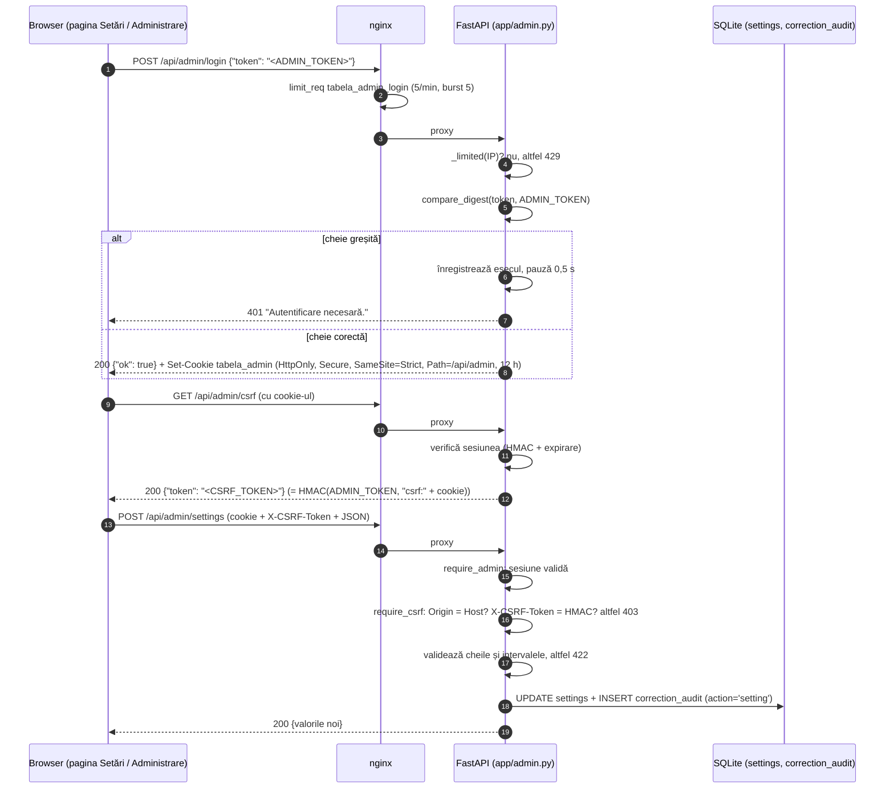

# API HTTP — Tabela Gara de Nord

© 2026 Andy217Ace

Documentația completă a tuturor rutelor HTTP ale aplicației: endpoint-urile publice (folosite de
pagina live, de Istoric, de Statistici și de ceilalți) și endpoint-urile de administrare
(`/api/admin/*`). Pentru fiecare ruta găsești metoda, calea, autentificarea, parametrii cu tipuri
și valori implicite, forma răspunsului, codurile de eroare, antetele de cache și limitele de cereri.

Documentul descrie versiunea **Beta 1.43** (`VERSION`). Pagina de interfață este descrisă în
`docs/interfata.md`; deploy-ul și nginx sunt descrise în `README.md`.

## Cum a fost verificat documentul

- Forma răspunsurilor, codurile de stare și antetele au fost obținute prin `fastapi.testclient.TestClient`
  pe o bază SQLite temporară, creată cu codul aplicației (`create_app`, `Store.ingest`,
  `observations.refresh_catalog`), cu patru servicii de test. Exemplele sunt copiate din aceste
  rulări și apoi trunchiate; acolo unde un câmp lipsește din exemplu, forma completă e în cod.
- Parametrii, valorile implicite și limitele au fost citite din codul sursă (`app/api.py`,
  `app/admin.py`, `app/stats_api.py`, `app/trains_api.py`, `app/system_api.py`,
  `app/corrections_api.py`, `app/export.py`, `app/endpoints.py` și modulele pe care le apelează).
- Limitele de cereri și de dimensiune a corpului vin din `deploy/nginx-tabela.conf` și
  `deploy/tabela-limits.conf`.
- Exemplele folosesc date de test. Cheile, tokenii și cookie-urile din exemple sunt înlocuite cu
  `<ADMIN_TOKEN>`, `<CSRF_TOKEN>` și `<SESIUNE>`.

## Cuprins

1. [Convenții generale](#1-convenții-generale)
2. [Sumar al endpoint-urilor](#2-sumar-al-endpoint-urilor)
3. [Limite de cereri și de dimensiune](#3-limite-de-cereri-și-de-dimensiune)
4. [Antete de cache](#4-antete-de-cache)
5. [Endpoint-uri publice](#5-endpoint-uri-publice)
6. [Modelul de securitate al administrării](#6-modelul-de-securitate-al-administrării)
7. [Endpoint-uri de administrare](#7-endpoint-uri-de-administrare)
8. [Coduri de eroare](#8-coduri-de-eroare)
9. [Lucruri neclare sau de verificat](#9-lucruri-neclare-sau-de-verificat)

---

## 1. Convenții generale

| Subiect | Regula | Sursă |
|---|---|---|
| Format | JSON (`application/json; charset=utf-8`), cu excepția exporturilor CSV și a imaginilor. | `app/api.py`, `app/stats_api.py` |
| Fus orar | Toate datele și orele sunt în `Europe/Bucharest`. | `app/store.py` (`TZ`) |
| Date | `AAAA-LL-ZZ` (ISO). Orice altă formă dă 422. | `_parse_date` în `app/api.py` |
| Ore | `HH:MM`, de la `00:00` la `23:59`. | `_HHMM` în `app/api.py` |
| Număr de tren | Întreg între 1 și 999999 (în unele rute, 99999 în export). | `_parse_train` |
| Panou | `arrival` (Sosiri) sau `departure` (Plecări). Orice altă valoare dă 422. | `BOARDS`, `stats.BOARDS` |
| Erori de validare | 422 cu `detail` în română. Erorile de validare FastAPI nelămurite primesc `"Parametri invalizi."`. | `app/api.py` (`validation_error`) |
| Corp JSON | Cel mult 4 096 de octeți pentru push și urmărire (`MAX_BODY`); peste limită: 413. | `_json_body` |
| Documentația OpenAPI | Dezactivată: `/docs`, `/redoc` și `/openapi.json` nu există. | `FastAPI(docs_url=None, redoc_url=None, openapi_url=None)` |
| Rută inexistentă | `/api/<altceva>` dă 404 `{"detail": "Nu există."}`. Dacă ruta există, dar metoda nu, dă 405 cu antetul `Allow`. | `api_not_found` în `app/api.py` |

**Parametrii statistici comuni** (folosiți de `/api/journeys`, `/api/trains/stats`,
`/api/trains/{no}/journeys`, `/api/stats`, `/api/stats/overview`, `/api/stats/rankings`,
`/api/stations`, `/api/stations/{name}`, `/api/stations/{name}/journeys` și `/api/stats/seasons`):

| Parametru | Tip | Implicit | Interval | Efect |
|---|---|---|---|---|
| `prag` | întreg | `5` (env `ON_TIME_MAX_MIN`) | 0–60 | Întârzierea maximă (minute) care înseamnă „la timp”. |
| `min` | întreg | `5` (env `STATS_MIN_SAMPLE`) | 1–1000 | Eșantion minim sub care nu se afișează procente. |
| `board` | text | — (toate) | `arrival`, `departure` | Filtrează pe panou. Altă valoare: 422. |
| `from` | `AAAA-LL-ZZ` | — | — | Data de început (inclusiv). |
| `to` | `AAAA-LL-ZZ` | — | — | Data de sfârșit (inclusiv). `from` nu poate fi după `to`. |
| `doar_confirmate` | `0` / `1` | `0` | — | Doar călătoriile cu rezultat confirmat. |

Răspunsurile statistice includ întotdeauna un bloc `params` cu valorile efective (de exemplu
`"on_time_max_min": 5, "min_sample": 5, "include_low_quality": false, "final_read_max_gap_min": 15`).
Parametrul `include_low_quality` nu se poate schimba din cerere: perioada de calitate redusă (beta
inițială) iese din statistici dacă nu e activată variabila de mediu `STATS_INCLUDE_LOW_QUALITY=1`
(`app/quality.py`).

---

## 2. Sumar al endpoint-urilor

Legendă pentru autentificare: **nimic** = public; **admin** = cookie de sesiune sau
`Authorization: Bearer` (vezi secțiunea 6); **CSRF** = obligă și antetul `X-CSRF-Token`.

### Publice

| Metodă | Cale | Autentificare | Ce returnează | Secțiune |
|---|---|---|---|---|
| GET | `/api/board` | nimic | Tabela live: sosiri și plecări | 5.1 |
| GET | `/api/health` | nimic | Starea serviciului (folosită de `update.sh`) | 5.2 |
| GET | `/api/changelog` | nimic | Istoricul versiunilor din `CHANGELOG.md` | 5.3 |
| GET | `/api/config` | nimic | Setările interfeței (praguri, reîmprospătare) | 5.4 |
| GET | `/api/weather` | nimic | Ultima observație meteo (model Open-Meteo) | 5.5 |
| GET | `/api/history` | nimic | Istoricul unei zile sau, cu `all=1`, al tuturor zilelor | 5.6 |
| GET | `/api/train/{no}` | nimic | Evenimentele unui tren într-o zi | 5.7 |
| GET | `/api/follows` | nimic (parametru `endpoint`) | Trenurile urmărite de un abonat | 5.8 |
| GET | `/api/push/key` | nimic | Cheia publică VAPID pentru notificări | 5.9 |
| POST | `/api/push/subscribe` | nimic | Abonare la notificări | 5.10 |
| POST | `/api/push/unsubscribe` | nimic | Dezabonare | 5.11 |
| POST | `/api/follow` | nimic | Urmărește un tren într-o zi | 5.12 |
| DELETE | `/api/follow` | nimic | Oprește urmărirea | 5.12 |
| GET | `/api/journeys` | nimic | Călătoriile (rezultatul final) | 5.13 |
| GET | `/api/journeys/{jid}` | nimic | Detaliul unei călătorii | 5.13 |
| GET | `/api/trains` | nimic | Catalogul public al trenurilor | 5.14 |
| GET | `/api/trains/{no}` | nimic | Detaliul unui tren din catalog | 5.14 |
| GET | `/api/trains/stats` | nimic | Statistici pe tren × panou | 5.15 |
| GET | `/api/trains/{no}/journeys` | nimic | Profilul statistic al unui tren | 5.15 |
| GET | `/api/stats` | nimic | Statistica generală (JSON, fără CSV) | 5.16 |
| GET | `/api/stats/overview` | nimic | Tot ce arată pagina Statistici | 5.16 |
| GET | `/api/stats/seasons` | nimic | Comparație sezoane și meteo | 5.16 |
| GET | `/api/stats/rankings` | nimic | Clasamente (cele mai întârziate, cele mai punctuale) | 5.17 |
| GET | `/api/stations` | nimic | Lista stațiilor | 5.18 |
| GET | `/api/stations/{name}` | nimic | Detaliul unei stații | 5.18 |
| GET | `/api/stations/{name}/journeys` | nimic | Călătoriile unei stații (paginat) | 5.18 |
| GET | `/api/system` | nimic (detalii doar pentru admin) | Starea sistemului, versiunea, discul | 5.19 |
| GET | `/api/export/history.csv` | nimic | Export CSV al istoricului pe interval | 5.20 |

### Administrare

| Metodă | Cale | Autentificare | Ce face | Secțiune |
|---|---|---|---|---|
| GET | `/api/admin/session` | nimic | Starea de autentificare (mereu 200) | 7.1 |
| POST | `/api/admin/login` | nimic (limitat) | Deschide sesiunea | 7.1 |
| POST | `/api/admin/logout` | nimic | Închide sesiunea | 7.1 |
| GET | `/api/admin/csrf` | admin | Token CSRF al sesiunii | 7.2 |
| GET | `/api/admin/captures` | admin | Lista capturilor OCR | 7.3 |
| GET | `/api/admin/captures/{cid}` | admin | Detaliul unei capturi | 7.3 |
| GET | `/api/admin/captures/{cid}/image` | admin | Imaginea capturii (JPEG) | 7.3 |
| GET | `/api/admin/captures/{cid}/overlay.png` | admin | Imaginea cu dreptunghiurile OCR (PNG) | 7.3 |
| GET | `/api/admin/stats` | admin | Starea capturilor și a OCR-ului | 7.4 |
| GET | `/api/admin/settings` | admin | Setările editabile | 7.5 |
| POST | `/api/admin/settings` | admin + CSRF | Modifică setările | 7.5 |
| GET | `/api/admin/corrections` | admin | Regulile de corecție | 7.6 |
| GET | `/api/admin/corrections/audit` | admin | Jurnalul de audit | 7.6 |
| POST | `/api/admin/corrections/preview` | admin + CSRF | Previzualizează o regulă nouă (nu scrie) | 7.6 |
| POST | `/api/admin/corrections` | admin + CSRF | Creează o regulă | 7.6 |
| POST | `/api/admin/corrections/{rid}/preview` | admin + CSRF | Previzualizează o regulă existentă | 7.6 |
| POST | `/api/admin/corrections/{rid}/apply` | admin + CSRF | Aplică retroactiv o regulă | 7.6 |
| POST | `/api/admin/corrections/batches/{batch}/restore` | admin + CSRF | Restaurează un lot aplicat | 7.6 |
| DELETE | `/api/admin/corrections/{rid}` | admin + CSRF | Șterge (soft) o regulă | 7.6 |
| GET | `/api/admin/tools/dupes` | admin | Raportul duplicatelor de numere (dry run) | 7.7 |
| POST | `/api/admin/tools/dupes/apply` | admin + CSRF | Comasează duplicatele (cu copie de siguranță) | 7.7 |
| POST | `/api/admin/tools/dupes/restore` | admin + CSRF | Restaurează comasările | 7.7 |
| GET | `/api/admin/tools/server` | admin | Starea serverului (load, memorie, servicii) | 7.8 |
| GET | `/api/admin/system` | admin | Detaliile paginii Sistem | 7.9 |

**Copii de siguranță.** Nu există o rută HTTP pentru descărcarea sau crearea unei copii a bazei.
Copia de siguranță se face doar în interiorul `POST /api/admin/tools/dupes/apply` și
`POST /api/admin/tools/dupes/restore` (copia rămâne pe server), iar modulul `app/backup_api.py`
este folosit intern de `app/restore.py` și de teste. Vezi secțiunea 7.7.

---

## 3. Limite de cereri și de dimensiune

Limitele sunt aplicate în două straturi: nginx (înainte de aplicație, pe IP-ul clientului) și
aplicația FastAPI. Dacă nginx refuză o cerere, răspunsul are codul 429 și nu ajunge la aplicație.

### 3.1 nginx (`deploy/tabela-limits.conf` și `deploy/nginx-tabela.conf`)

| Zonă (`limit_req_zone`) | Rată | Ce acoperă | Burst |
|---|---|---|---|
| `tabela_api` (10 MB) | 10 cereri/s pe IP | Toate `/api/*` care nu au zonă proprie, inclusiv `/api/board`, `/api/history`, `/api/follow`, `/api/export/history.csv` și rutele admin (mai puțin login) | 20 (`nodelay`) |
| `tabela_stats` (10 MB) | 60 cereri/min (1/s) pe IP | `/api/stats…`, `/api/trains/stats`, `/api/trains/{nr}/journeys`, `/api/stations…`, `/api/journeys…` (agregate pe tot istoricul) | 20 (`nodelay`) |
| `tabela_admin_login` (1 MB) | 5 cereri/min pe IP | exact `POST /api/admin/login` | 5 (`nodelay`) |

Alte setări din nginx:

- `limit_req_status 429`: cererile limitate primesc 429.
- `limit_req_log_level warn`: cererile limitate se înregistrează în `error.log` la nivelul `warn`,
  cu linia cererii. Pentru `/api/follows` linia conține adresa endpoint-ului push, de aceea
  `location = /api/follows` are `access_log off`.
- `client_max_body_size 8k`: corpurile mai mari de 8 KB primesc 413 de la nginx (pagina HTML
  implicită a nginx, nu JSON-ul aplicației).
- `proxy_read_timeout 30s`, `proxy_connect_timeout 5s`.

Ordinea de potrivire a locațiilor: `location = /api/follows`, `location = /api/admin/login`, apoi
regex-ul `^/api/(stats|trains/stats|trains/[0-9]+/journeys|stations|journeys)(/|$)`, apoi
`location /api/`, apoi `location /` (pagina statică).

### 3.2 Aplicație

| Limită | Valoare | Unde | Răspuns |
|---|---|---|---|
| Încercări greșite de administrare | 5 per IP în 60 s (`FAIL_LIMIT`) | `app/admin.py` | 429, `Retry-After: 60` |
| Încercări greșite, toți clienții | 30 în 60 s (`GLOBAL_FAIL_LIMIT`) | `app/admin.py` | 429 |
| Întârziere la cheie greșită | 0,5 s (`FAIL_DELAY_S`) | `app/admin.py` | — (răspunsul vine mai târziu) |
| Export CSV | 30 cereri per IP în 60 s (`RATE_LIMIT`) | `app/export.py` | 429 `{"detail": "Prea multe cereri de export; încearcă mai târziu."}` |
| Export CSV: interval | cel mult 366 de zile (`MAX_DAYS`) | `app/export.py` | 422 |
| Export CSV: rânduri | cel mult 50 000 (`MAX_ROWS`) | `app/export.py` | 200 cu `X-Truncated: 1` |
| Istoric (`/api/history`) | cel mult 500 de servicii pe zi (`HISTORY_MAX`) | `app/store.py` | 200 cu `X-Truncated: 1` |
| Trenuri urmărite per abonat | 20 (`MAX_FOLLOWS`) | `app/store.py` | 422 |
| Corp JSON public | 4 096 octeți (`MAX_BODY`) | `app/api.py` | 413 |
| Corp admin: login | 1 024 octeți | `app/admin.py` | 413 |
| Corp admin: setări | 1 024 octeți (`MAX_SETTINGS_BODY`) | `app/admin.py` | 413 |
| Corp admin: unelte | 512 octeți (`MAX_TOOLS_BODY`) | `app/admin.py` | 413 |
| Corp admin: corecții | 8 192 octeți (`MAX_BODY`) | `app/corrections_api.py` | 413 |
| Lungimea căutării | 40 caractere (`MAX_QUERY`) | `app/stats_api.py`, `app/trains_api.py` | 422 |
| Lungimea numelui de stație în `/api/history` | 64 caractere (`MAX_STATION_LEN`) | `app/api.py` | 422 |
| Lungimea endpoint-ului push | 500 caractere (`MAX_ENDPOINT_LEN`) | `app/endpoints.py` | 422 |

**De ce există limitele.** Statisticile și catalogul parcurg tot istoricul, de aceea au o zonă
nginx separată, mai strictă (1 cerere/s). Exportul și încercările de parolă au limite proprii în
aplicație, pentru că nginx nu vede când o cerere e lentă sau când parola e greșită. Limitarea
pe IP funcționează doar fiindcă uvicorn rulează cu `--proxy-headers --forwarded-allow-ips 127.0.0.1`
(`deploy/tabela.service`): altfel toate cererile ar veni de la `127.0.0.1`.

---

## 4. Antete de cache

| Rută | Antet | Motiv |
|---|---|---|
| Toate `/api/admin/*` (răspunsuri și erori) | `Cache-Control: private, no-store`, `Pragma: no-cache` | Date private; nu trec prin cache-ul browserului sau al service worker-ului. |
| `/api/admin/captures/{cid}/image` și `/overlay.png` | aceleași antete | Imagini ale tablelor reale; nu se păstrează în cache. |
| `/api/export/history.csv` | `Cache-Control: no-store` | Export generat la cerere. |
| `/api/changelog` | `Cache-Control: no-cache` | Versiunea se schimbă la fiecare deploy. |
| `/sw.js` și `/manifest.webmanifest` | `Cache-Control: no-cache` | Un deploy trebuie să ajungă imediat la client. |
| Fișierele statice (HTML, CSS, JS, imagini) | `Cache-Control: no-cache` + `ETag` (de la `StaticFiles`) | Revalidare la fiecare cerere; trimitere 304 dacă nu s-a schimbat. Pus de middleware-ul `security_headers` în `app/api.py`. |
| Restul `/api/*` publice | niciun antet `Cache-Control` | Datele sunt live. Browserul nu le păstrează, iar service worker-ul nu cache-uiește niciun `/api/*`, cu excepția `/api/board` (vezi mai jos). |

**Cache pe server:**

- `GET /api/stats/overview`: fiecare răspuns e păstrat `STATS_CACHE_TTL_S` secunde (implicit 60,
  interval 0–3600); câmpul `cache_ttl_s` îl arată (`app/stats_overview.py`).
- `GET /api/history?all=1`: agregatele sunt păstrate 60 s (`AGG_TTL_S`) sau până la o schimbare
  de date (`app/history_all.py`).
- Meteo: modelul Open-Meteo se interoghează la 15 minute (`DEFAULT_INTERVAL_S = 900`), cel mult
  o dată la 5 minute (`MIN_INTERVAL_S = 300`) (`app/weather.py`).

**Service worker** (`web/sw.js`): `/api/board` este network-first; ultima tablă bună e păstrată în
cache-ul `tabela-board-<versiune>` și servită offline, cu `"sw_offline": true` și
`"sw_cached_at"` (milisecunde) în JSON. Restul `/api/*` nu e niciodată cache-uit.

---

## 5. Endpoint-uri publice

### 5.1 `GET /api/board`

Tabela live. Este cerută la fiecare 10 secunde de pagina principală (`refresh_s` din `/api/config`).

- **Autentificare:** nimic.
- **Parametri:** niciunul.
- **Erori:** niciuna specifică; ruta nu returnează 503 chiar dacă poller-ul e oprit (atunci
  `stale` devine `true`).

**Răspuns (200), fragment din test:**

```json
{
  "updated_at": "2026-10-31T22:50:17.970276+02:00",
  "arrivals": [
    {"delay_last_read_age_s": 0, "train_type": "IR", "train_no": 1636, "station": "BRASOV",
     "operator": "CFR Calatori", "sched_time": "12:10", "delay_min": 5, "platform": 3,
     "flagged": false, "status": "listed", "service_date": "2026-10-31",
     "uncertain": false, "delay_read": true}
  ],
  "departures": [ "…" ],
  "age_s": 0.009059,
  "stale": false,
  "boards": {
    "arrivals":   {"age_s": 0.009059, "ok": true, "stale": false},
    "departures": {"age_s": 0.009059, "ok": true, "stale": false}
  },
  "attribution": {"source": "CFR", "url": "https://cfr.ro", "author": "Andy217Ace"}
}
```

Câmpuri importante:

- `age_s` și `stale`: vârsta ultimei citiri acceptate a tablei. `stale` este `true` dacă vârsta
  depășește `STALE_S = 180` secunde sau lipsesc citiri.
- `boards`: același lucru pe fiecare panou. Un panou poate fi învechit singur, de exemplu când
  cadrele lui sunt respinse ca citiri parțiale.
- `delay_min`: întârzierea citită (minute); `null` înseamnă că nu a fost citită niciodată (nu 0).
- `platform`: linia, sau `null` dacă nu a fost citită.
- `uncertain`: `true` când textul citit e sub pragul de încredere; `delay_read`: întârzierea a fost
  citită efectiv.
- Un rând poate avea și `status` (de exemplu `listed`) și `flagged`.

### 5.2 `GET /api/health`

Starea serviciului. Folosită de `deploy/update.sh` după repornire (vezi `README.md`).

- **Autentificare:** nimic.
- **Răspuns (200):**

```json
{
  "ok": true,
  "age_s": 0.004525,
  "version": "Beta 1.43",
  "boards": {
    "arrivals":   {"age_s": 0.004525, "ok": true, "stale": false},
    "departures": {"age_s": 0.004525, "ok": true, "stale": false}
  },
  "ocr": {"expected_rows": 12, "last": null,
          "window": {"frames": 0, "full_frames": 0, "frames_retried": 0,
                     "lines_retried": 0, "lines_recovered": 0,
                     "duration_ms_max": null, "duration_ms_p50": null, "retry_ms_max": null}},
  "weather_age_s": null
}
```

- `ok` este `true` dacă ultima citire acceptată are cel mult 180 de secunde.
- `weather_age_s` este `null` dacă nu există nicio observație meteo. Meteo nu influențează `ok`.

### 5.3 `GET /api/changelog`

Istoricul versiunilor, citit din `CHANGELOG.md` (funcția `changelog()` din `app/version.py`).

- **Autentificare:** nimic. **Antet:** `Cache-Control: no-cache`.
- **Răspuns (200):**

```json
{
  "version": "Beta 1.43",
  "entries": [
    {"version": "Beta 1.43", "date": "2026-10-31",
     "groups": [{"title": "Schimbat", "items": ["**Capturi scoase din git:** …"]}]}
  ]
}
```

Sunt păstrate doar liniile `## <versiune> — <data>`, `### <grup>` și `- <punct>`. Textul e
trimis neschimbat; interfața îl afișează cu `textContent`, deci markdown-ul apare ca text.
Lista e în ordinea cea mai nouă primul. Dacă fișierul lipsește, `entries` este `[]`.

### 5.4 `GET /api/config`

Setările interfeței. Este singura sursă pentru pragurile de culoare și pentru reîmprospătare.

- **Autentificare:** nimic.
- **Răspuns (200):**

```json
{
  "delay_thresholds": {"low": 5, "mid": 15, "high": 30},
  "stale_after_s": 180,
  "refresh_s": 10,
  "weather": {"enabled": false, "stale_after_s": 2700, "refresh_s": 300}
}
```

- `delay_thresholds` vine din variabila de mediu `DELAY_THRESHOLDS="low,mid,high"`. Valorile
  trebuie să fie întregi, strict crescătoare, între 1 și 1440. Altfel se folosesc `5,15,30`.
- `weather.enabled` este `true` dacă e configurat serviciul meteo (`WEATHER_*`, pornit implicit).

### 5.5 `GET /api/weather`

Ultima observație meteo (model Open-Meteo, „Condiții curente”). Pagina nu cere alte date meteo.

- **Autentificare:** nimic.
- **Fără observație:** `{"available": false, "kind": "model_current", "label_ro": "Condiții curente (model Open-Meteo)", "observed_at": null, "age_s": null, "stale": true, "attribution": {…}}`
  (verificat în test).
- **Cu observație:** câmpurile `available: true`, `observed_at` (UTC, `Z`), `observed_local`
  (`HH:MM`, Bucharest), `fetched_at`, `age_s`, `stale` (`true` după 2 700 s), `temperature_c`,
  `apparent_temperature_c`, `precipitation_mm`, `weather_code`, `condition_ro`, `icon`, `is_day`,
  `wind_speed_kmh`, `wind_direction_deg`, `wind_direction_ro`, `wind_gusts_kmh`,
  `relative_humidity_pct`, `surface_pressure_hpa`, `rain_mm`, `showers_mm`, `snowfall_cm`,
  `hourly` (seria orară pe 24 de ore, sau `null`) și `attribution`.
- **Atribuire obligatorie:** `attribution` trebuie afișată (CC BY 4.0), vezi `web/index.html`.

### 5.6 `GET /api/history`

Istoricul serviciilor afișate pe tablă, pe o zi, sau pe toate zilele cu `all=1`.

**Parametri (mod implicit, `all` absent sau `0`):**

| Parametru | Tip | Implicit | Validare | Efect |
|---|---|---|---|---|
| `date` | `AAAA-LL-ZZ` | azi (Bucharest) | format și dată reală | Ziua. |
| `train` | întreg | — | 1–999999 | Doar acest tren. |
| `board` | text | — | `arrival` sau `departure` | Doar un panou. |
| `station` | text | — | cel mult 64 caractere | Subșir al numelui stației (`LIKE '%…%'`, pe numele canonic). |
| `from` | `HH:MM` | — | format | Ora programată de la (inclusiv). |
| `to` | `HH:MM` | — | format; nu înainte de `from` | Ora programată până la (inclusiv). |
| `all` | `0` / `1` | `0` | altă valoare: 422 | `1` trece la modul „toate zilele”. |

**Parametri (mod `all=1`):** `train`, `date` (opțional; fără el, toate zilele), `board`,
`station`, `from`, `to`, `limit` (întreg 1–200, implicit 200), `cursor` (de la pagina anterioară,
forma `AAAA-LL-ZZ_HH:MM_id`), `doar_confirmate` (`0`/`1`, implicit `0`), `prag` (0–60) și `min`
(1–1000) cu aceleași valori implicite ca în secțiunea 1. Cursorul invalid dă 422
`"Cursor de paginare invalid."`.

**Răspuns, mod implicit (200):**

```json
{
  "date": "2026-10-31",
  "services": [
    {"id": 1, "delay_known": true, "delay_seen": true, "board": "arrival",
     "train_type": "IR", "train_no": 1636, "station": "BRASOV", "operator": "CFR Calatori",
     "sched_time": "12:10", "max_delay": 5, "final_delay": 5, "platform": 3,
     "status": "listed", "first_seen": "2026-10-31T22:50:17.970276+02:00",
     "last_seen": "2026-10-31T22:50:17.970276+02:00", "uncertain": false,
     "low_quality": false}
  ]
}
```

Dacă rezultatul are mai mult de 500 de servicii, se trimit primele 500 și antetul
`X-Truncated: 1`.

**Răspuns, mod `all=1` (200), fragment:**

```json
{
  "mode": "all", "train": null,
  "params": {"on_time_max_min": 5, "min_sample": 5, "board": null, "from": null, "to": null,
             "confirmed_only": false, "include_low_quality": false,
             "final_read_max_gap_min": 15},
  "total": 4,
  "period": {"first": "2026-10-31", "last": "2026-10-31", "days": 1},
  "quality": {"journeys": 4, "finished": 0, "delay_known": 0, "delay_known_pct": null,
              "states": {"in_progress": 4, "confirmed": 0, "unconfirmed": 0, "unknown": 0},
              "uncertain_names": 0},
  "summary": {"arrival":   {"n": 0, "mean": null, "median": null, "p90": null, "max": null,
                            "on_time": 0, "on_time_pct": null, "over_30": 0,
                            "over_30_pct": null, "sufficient": false},
              "departure": {"…": "aceeași structură"}},
  "n": 2,
  "next": "2026-10-31_12:30_3",
  "journeys": [ "…" ],
  "date": null
}
```

`next` este `null` la ultima pagină. `summary` se calculează pe tot setul filtrat și se
păstrează 60 s în cache (`AGG_TTL_S`), iar `total` e numărul total de călătorii filtrate.

**Erori:** 422 pentru `all`, `board`, `date`, `from`/`to`, `station` prea lung, `cursor`
invalid, `train` invalid sau când `from` e după `to`.

### 5.7 `GET /api/train/{no}`

Evenimentele unui tren într-o zi (apariții, schimbări de întârziere, linie, dispariții).

- **Parametri:** `no` (cale, 1–999999); `date` (query, `AAAA-LL-ZZ`, implicit azi).
- **Răspuns (200):** `{"train": 1636, "date": "2026-10-31", "events": [{"ts": "…", "kind": "appeared", "old": null, "new": null, "board": "arrival", "sched_time": "12:10", "station": "BRASOV"}]}`.
- Un tren fără evenimente primește `"events": []`, nu 404.
- **Erori:** 422 `"Număr de tren invalid."`, 422 pentru dată.

### 5.8 `GET /api/follows`

Trenurile urmărite de un abonament push. Este apelată de pagina „Urmărite”.

- **Parametri:** `endpoint` (query, obligatoriu). Trebuie să treacă validarea din secțiunea 5.10.
- **Răspuns (200):** `{"follows": [{"train_no": 1636, "date": "2026-10-31", "on_board": true, "delay_min": 5, "delay_read": true}]}`.
- **Erori:** 422 `"Endpoint de notificare invalid."` (și pentru parametru lipsă).
- **Confidențialitate:** adresa endpoint-ului push apare în query string; nginx nu o scrie în
  jurnalul de acces (`access_log off`). Jurnalul de erori o poate conține la 429.

### 5.9 `GET /api/push/key`

- **Răspuns (200):** `{"key": "<cheie publică VAPID>"}`.
- **Fără chei VAPID:** 404 `{"detail": "Notificările push nu sunt configurate."}` (verificat).

### 5.10 `POST /api/push/subscribe`

Înregistrează un abonament Web Push.

- **Corp JSON** (cel mult 4 096 octeți):

| Câmp | Tip | Obligatoriu | Reguli |
|---|---|---|---|
| `endpoint` | text | da | HTTPS, fără date de autentificare, port absent sau 443, gazdă pe lista permisă (vezi mai jos), cel mult 500 de caractere, fără spații sau caractere de control. |
| `keys` | obiect | da | Trebuie să conțină `p256dh` și `auth`. |

- **Gazde permise** (`app/endpoints.py`): `fcm.googleapis.com`, `updates.push.services.mozilla.com`,
  `web.push.apple.com`, și sufixele `.push.services.mozilla.com`, `.notify.windows.com`,
  `.push.apple.com`. Adresele IP și numele locale sunt respinse. Motivul: serverul face cereri
  HTTP către endpoint-ul trimis de browser, deci fără listă permisă ar putea fi folosit pentru
  cereri către rețeaua internă (SSRF).
- **Răspuns (200):** `{"ok": true}`.
- **Erori:** 422 `"Endpoint de notificare invalid."`, 422 `"Cheile abonării lipsesc."`, 422
  `"Abonare invalidă."` (chei prea scurte sau formă greșită), 413 peste 4 096 de octeți.

### 5.11 `POST /api/push/unsubscribe`

- **Corp:** `{"endpoint": "<același endpoint>"}`.
- **Răspuns (200):** `{"ok": true}`. Dezabonarea șterge și urmăririle trenurilor.
- **Erori:** 422 pentru endpoint invalid.

### 5.12 `POST /api/follow` și `DELETE /api/follow`

Urmărește sau oprește urmărirea unui tren pentru o zi. Notificarea vine la schimbarea
întârzierii sau a liniei ori la dispariția trenului de pe tablă.

- **Corp (ambele metode):** `{"endpoint": "…", "train": 1636, "date": "2026-10-31"}`.

| Câmp | Reguli |
|---|---|
| `endpoint` | Ca la 5.10. Abonamentul trebuie să existe deja. |
| `train` | Întreg 1–999999 (sau text numeric). |
| `date` | Obligatoriu, `AAAA-LL-ZZ`. La `POST` trebuie să fie azi sau mai târziu (fus `Europe/Bucharest`). |

- **Răspuns (200):** `{"ok": true}` (la ambele metode).
- **Erori la POST:**
  - 422 `"Data trebuie să fie azi sau mai târziu."` (pentru o zi din trecut);
  - 422 `"Abonare necunoscută; activează întâi notificările."`;
  - 422 `"Limită de 20 de trenuri."` (de la 20 de urmăriri active; urmăririle din zile trecute nu se
    numără);
  - 422 `"Cerere invalidă."` sau alt mesaj de validare.
- **DELETE** nu verifică data și returnează `{"ok": true}` chiar dacă nu exista urmărirea.
- Corpul pentru `DELETE` e JSON; nu e un parametru de query.

### 5.13 `GET /api/journeys` și `GET /api/journeys/{jid}`

Călătoriile: o apariție a unui tren pe un panou, cu rezultatul final (confirmat, neconfirmat,
în desfășurare sau necunoscut). Este baza pentru statistici.

**`GET /api/journeys` — parametri:**

| Parametru | Tip | Implicit | Validare |
|---|---|---|---|
| `train` | întreg | — | 1–999999 |
| `station` | text | — | cel mult 40 caractere; se canonicalizează (`stations.canonical`) |
| `state` | text | — | `in_progress`, `confirmed`, `unconfirmed`, `unknown`; altă valoare: 422 `"Stare invalidă."` |
| `limit` | întreg | 500 | 1–5000 |
| `format` | text | `json` | `json` sau `csv` (fișier `calatorii.csv`) |
| + parametrii statistici comuni | | | secțiunea 1 |

**Răspuns (200), fragment:**

```json
{
  "params": {"on_time_max_min": 5, "min_sample": 5, "board": null, "from": null, "to": null,
             "confirmed_only": false, "include_low_quality": false,
             "final_read_max_gap_min": 15},
  "n": 2,
  "total": 4,
  "truncated": true,
  "journeys": [
    {"id": 1, "board": "arrival", "service_date": "2026-10-31", "train_type": "IR",
     "train_no": 1636, "station": "BRASOV", "operator": "CFR Calatori", "sched_time": "12:10",
     "status": "listed", "platform": 3, "uncertain": false,
     "result": {"state": "in_progress", "label": "În desfășurare (încă pe tabelă)",
                "reason": null, "delay_known": true, "observed_delay": 5,
                "final_delay": null, "delay_read_at": "2026-10-31T22:50:17.970276+02:00",
                "sched_at": "2026-10-31T12:10:00+02:00",
                "estimated_at": "2026-10-31T12:15:00+02:00", "disappeared_at": null}}
  ]
}
```

`truncated` este `true` când există mai multe rezultate decât `limit`. Atunci `total` e numărul
complet. Pentru a obține mai mult, mărește `limit` (până la 5 000) sau restrânge filtrele.

**`GET /api/journeys/{jid}`:** `jid` trebuie să fie cifre, cel mult 12. Răspunsul adaugă
`events`, `delay_series` (serie `{t, delay, source}`) și `final_read_max_gap_min` (default 15, env
`FINAL_READ_MAX_GAP_MIN`). Fără călătoria cerută: 404 `{"detail": "Călătoria nu există."}`.

### 5.14 `GET /api/trains` și `GET /api/trains/{no}`

Catalogul public al trenurilor: un rând pentru fiecare număr și panou observat. Fără imagini și
fără text brut OCR. Numărul de călătorii (`journeys`, servicii) și cel de observații OCR
(`observations`) sunt raportate separat.

**`GET /api/trains` — parametri:**

| Parametru | Tip | Implicit | Validare |
|---|---|---|---|
| `query` | text | — | cel mult 40 caractere; prefix de număr (cifre) sau subșir în stație sau operator, fără diferență între majuscule și minuscule |
| `limit` | întreg | 50 | 1–200 (`TRAINS_MAX`); altfel 422 `"Limită invalidă (1–200)."` |

**Răspuns (200), fragment după un ingest și `observations.refresh_catalog`:**

```json
{
  "trains": [
    {"train_no": 531, "first_seen": "2026-10-31T20:50:45+00:00",
     "last_seen": "2026-10-31T20:50:45+00:00",
     "operators": [{"operator": "CFR Calatori", "journeys": 1}],
     "routes": [{"board": "departure", "station": "CONSTANTA", "journeys": 1}],
     "journeys": 1, "observations": 0}
  ],
  "n": 3
}
```

Rândurile sunt în ordinea „cel mai recent văzut primul”. Nu apar trenurile fără nicio călătorie
reală (doar fantome sau citiri izolate).

**`GET /api/trains/{no}`:** adaugă `journeys_list` (până la `JOURNEYS_MAX` = 200 de intrări, cele
mai noi primele; cu `journeys_truncated`) și păstrează `operators`, `routes`, `journeys`,
`observations`. Erori: 422 `"Număr de tren invalid."` (ne-cifre, 0, peste 999999); 404
`{"detail": "Trenul nu a fost observat."}`.

### 5.15 `GET /api/trains/stats` și `GET /api/trains/{no}/journeys`

**`GET /api/trains/stats`:** statistici pe tren × panou (parametrii comuni din secțiunea 1 și
`query`, `format`). Răspunsul are `params`, `n` și `trains` (fiecare cu `train_no`, `board`,
`train_type`, `station`, `operator`, `stations`, `journeys`, `first_date`, `last_date`,
`observations`, `quality`, `stats`). `format=csv` dă `trenuri.csv`.

**`GET /api/trains/{no}/journeys`:** `no` validat ca la 5.14 (422 `"Număr de tren invalid."`);
404 `{"detail": "Trenul nu a fost observat."}`. Răspunsul are `params`, `train_no`, `observations`,
`operators`, `entries` (câte o intrare pe stație/panou), `distribution` și `journeys`.
`format=csv` dă `tren-<no>.csv`.

### 5.16 `GET /api/stats`, `GET /api/stats/overview`, `GET /api/stats/seasons`

**`GET /api/stats`:** statistica generală (parametrii comuni). Răspunsul are `params`, `period`
(`first`, `last`, `days`), `trains`, `observations`, `quality`, `boards` (per panou: `n`, `mean`,
`median`, `p90`, `max`, `on_time`, `on_time_pct`, `over_30`, `over_30_pct`, `sufficient`),
`distribution`, `by_time`. **Nu** acceptă `format=csv`: răspunde 422 cu
`"Pentru export CSV folosiți /api/journeys?format=csv sau /api/trains/stats?format=csv."`.

**`GET /api/stats/overview`:** tot ce arată pagina Statistici, într-un singur răspuns (cu
cache 60 s, vezi secțiunea 4).

| Parametru | Tip | Implicit | Validare |
|---|---|---|---|
| `perioada` | text | `all` | `1`, `7`, `30` sau `all`; altă valoare: 422 `"Perioadă invalidă (1, 7, 30 sau all)."` |
| `operator` | text | — | cel mult 40 caractere |
| `tip` | text | — | cel mult 40 caractere (tipul trenului, de exemplu `IR`) |
| `from`, `to` | `AAAA-LL-ZZ` | — | nu se combină cu `perioada` ≠ `all` (422) |
| `format` | `json` / `csv` | `json` | |
| `set` | text | — | obligatoriu pentru CSV; valorile sunt `distribution`, `hourly`, `heatmap`, `daily`, `operators`, `types`, `routes`, `traffic`, `platforms`, `weather`; altceva: 422 cu lista |

Cheile de nivel superior ale răspunsului JSON: `params`, `options`, `coverage`, `history`,
`boards`, `insights`, `problems`, `distribution`, `hourly`, `heatmap`, `daily`, `operators`,
`types`, `routes`, `traffic`, `platforms`, `weather`, `quality`, `generated_at`, `cache_ttl_s`.
`format=csv&set=<nume>` dă `statistici-<nume>.csv`.

**`GET /api/stats/seasons`:** comparația sezoanelor și a meteo (nu apare în OpenAPI, deoarece
ruta e declarată cu `include_in_schema=False`). Parametrii sunt cei ai `/api/stats/overview`.
Răspunsul conține `min_days` (30), `group_min` (30), `day_obs_min` (48), `timetable_changes`,
`timetable_margin_days` (7), `timetable_excluded_days`, un `note` care spune că e vorba de
corelație și nu de cauzalitate, și `boards` (per panou: `seasons`, …).

### 5.17 `GET /api/stats/rankings`

Clasamente: cele mai întârziate și cele mai punctuale trenuri și stații, doar cu eșantion
suficient.

- **Parametri:** parametrii comuni; `limit` (întreg 1–50, implicit 10); `format` (`json`/`csv`,
  fișier `clasamente.csv`).
- **Răspuns (200), fără date:** `{"params": {…}, "eligible": 0, "below_min": 0, "most_delayed": [], "most_punctual": [], "stations": {"eligible": 0, "below_min": 0, "most_delayed": [], "most_punctual": []}}`.
- Cu date, `most_delayed` și `most_punctual` sunt liste de `{train_no, board, station, stats}`.

### 5.18 `GET /api/stations`, `GET /api/stations/{name}`, `GET /api/stations/{name}/journeys`

Stațiile afișate pe tablă: originea trenurilor la sosiri și destinația la plecări. Întârzierea
e cea afișată pe tabla din București Nord, nu cea a stației de destinație (text inclus în răspuns).

**`GET /api/stations`:** `query` (cel mult 40 caractere), `limit` (1–500, implicit 100),
`format` (`csv` dă `statii.csv` cu coloanele `name, journeys, arrivals, departures, trains,
delay_known, first_date, last_date, uncertain_only`).

```json
{"n": 3, "stations": [
  {"name": "BRASOV", "journeys": 2, "arrivals": 1, "departures": 1, "trains": 2,
   "delay_known": 0, "first_date": "2026-10-31", "last_date": "2026-10-31",
   "uncertain_only": false}
]}
```

**`GET /api/stations/{name}`:** `name` (cale) are cel mult 40 de caractere, apoi se canonicalizează.
Nume invalid: 422 `"Nume de stație invalid."`; nevăzut pe tablă: 404
`{"detail": "Stația nu a fost observată pe tabelă."}`. Răspunsul are `params`, `name`, `note`,
`journeys`, `trains`, `uncertain_names`, `first_seen`, `last_seen`, `period`, `quality`,
`boards`, `by_time`. `format=csv` dă `statie-<slug>.csv`.

**`GET /api/stations/{name}/journeys`:** `limit` (1–500, implicit 100) și `before` (id de
călătorie, pentru pagina următoare). Răspunsul: `params`, `name`, `n`, `next_before` (`null` la
ultima pagină), `journeys`. `format=csv` dă `statie-<slug>-calatorii.csv`.

### 5.19 `GET /api/system`

Starea sistemului, pentru pagina Sistem. Varianta publică e minimă.

- **Răspuns (200), public:**

```json
{"version": "Beta 1.43", "schema": 9, "uptime_s": 0, "stare": "live", "stale_after_s": 600,
 "poller": {"last_ok_age_s": 0, "last_error": null},
 "ocr": {"unread_rate_1h": null, "n": 0, "insufficient": true},
 "disk": {"free_gb": 291.2}, "db": {"size_mb": 0.0, "wal_mb": 0.3}, "admin": false}
```

- `admin` este `true` doar dacă cererea are un token Bearer valid sau o sesiune validă. Atunci
  pagina cere și `GET /api/admin/system` (secțiunea 7.9). Verificarea nu produce niciodată 401 sau
  503 pentru vizitatorii obișnuiți.
- `stare` poate fi `live`, dar și alte valori (`app/system_status.py`).

### 5.20 `GET /api/export/history.csv`

Export CSV al istoricului, pentru un interval de zile.

- **Parametri:**

| Parametru | Tip | Obligatoriu | Reguli |
|---|---|---|---|
| `from` | `AAAA-LL-ZZ` | da | Dată reală. |
| `to` | `AAAA-LL-ZZ` | da | Dată reală, nu înainte de `from`. |
| `train` | întreg | nu | 1–99999 (altfel 422 `"Numărul trenului este invalid."`). |

- **Limite:** cel mult 366 de zile între `from` și `to` (diferența lor în zile; 422 `"Intervalul este mai mare de 366 de zile."`);
  cel mult 50 000 de rânduri (peste limită: `X-Truncated: 1`); 30 de cereri pe minut pe IP
  (429).
- **Răspuns (200):** `text/csv; charset=utf-8`, cu `Content-Disposition: attachment; filename="istoric-<from>-<to>.csv"` și `Cache-Control: no-store`.
  Antetul CSV este fix: `data,ora,tren,stație,întârziere_min,peron`. Întârzierea e goală dacă nu a
  fost citită niciodată (nu 0). Exemplu:

```
data,ora,tren,stație,întârziere_min,peron
2026-10-31,12:10,1636,BRASOV,5,3
2026-10-31,12:20,3001,PLOIESTI SUD,0,
```

- Exportul conține doar date publice (cele afișate pe pagina Istoric), fără corecții manuale
  și fără note de administrare.

---

## 6. Modelul de securitate al administrării

### 6.1 Cheia: `ADMIN_TOKEN`

- Se citește din variabila de mediu `ADMIN_TOKEN` (pe server, în `/etc/tabela.env`). Trebuie să
  aibă cel puțin **12 caractere** (`MIN_TOKEN_LEN`). Dacă lipsește sau e prea scurtă, toate
  rutele `/api/admin/*` (cu excepția `GET /api/admin/session`, care răspunde 200 cu `enabled: false`) răspund **503** `"Administrare dezactivată."`, iar site-ul public
  funcționează normal.
- `ADMIN_TOKEN_STRICT=1` cere **cel puțin 24 de caractere** (`STRICT_TOKEN_LEN`). Dacă e prea
  scurtă, aplicația refuză să pornească (`check_startup`), iar mesajul nu conține cheia.
- Generare recomandată (din `README.md`): `python -c "import secrets;print(secrets.token_urlsafe(32))"`.
- Cheia nu se loghează și nu apare în răspunsuri. Comparațiile se fac cu `hmac.compare_digest`.
- Rotația cheii e descrisă în `docs/admin-rotatie-cheie.md`.

### 6.2 Cele două moduri de autentificare

1. **`Authorization: Bearer <ADMIN_TOKEN>`**, pentru scripturi și unelte. Nu există un cookie, deci
   nu există un risc de tip CSRF; de aceea cererile cu Bearer nu cer `X-CSRF-Token`
   (`require_csrf` le lasă să treacă).
2. **Cookie de sesiune** `tabela_admin`, obținut prin `POST /api/admin/login`. Pagina de
   administrare folosește acest mod.

### 6.3 Cookie-ul `tabela_admin`

Valoarea din răspunsul la login (exemplu cu valori înlocuite):

```
Set-Cookie: tabela_admin=<SESIUNE>; HttpOnly; Max-Age=43200; Path=/api/admin; SameSite=strict; Secure
```

| Atribut | Valoare | Ce înseamnă |
|---|---|---|
| `HttpOnly` | da | JavaScript din pagină nu poate citi cookie-ul (protecție împotriva furtului prin XSS). |
| `Secure` | da | Cookie-ul se trimite doar pe HTTPS. |
| `SameSite` | `Strict` | Browserul nu trimite cookie-ul din cereri inițiate de alte site-uri. |
| `Path` | `/api/admin` | Cookie-ul ajunge doar la rutele de administrare. |
| `Max-Age` | `43200` (12 ore) | Durata browserului. |
| Conținutul | `<expirare Unix>.<HMAC-SHA256>` | Expirarea în secunde Unix și `HMAC-SHA256(ADMIN_TOKEN, "session:<expirare>")`. Tokenul nu apare în cookie. |

Validarea sesiunii (`check_session`): valoarea are cel mult 200 de caractere, expirarea e în
viitor și semnătura se compară cu `hmac.compare_digest`. Schimbarea `ADMIN_TOKEN` invalidează
toate sesiunile, pentru că semnătura se face cu cheia.

La logout, răspunsul trimite același cookie cu `Max-Age=0`. Sesiunea expiră și pe server, indiferent
dacă browserul trimite cookie-ul.

### 6.4 Protecția împotriva ghicirii cheii

- Fiecare încercare greșită (login sau Bearer) e înregistrată pe IP. După **5 încercări greșite în
  60 de secunde** pe același IP, răspunsul este 429 `"Prea multe încercări. Reîncearcă peste un minut."`
  cu `Retry-After: 60`.
- Limita globală: **30 de încercări greșite în 60 de secunde**, de la toți clienții. Scopul e să
  nu se ocolească limita pe IP cu rotație de adrese.
- Fiecare încercare greșită e întârziată cu 0,5 secunde.
- nginx limitează în plus `POST /api/admin/login` la 5 pe minut pe IP (burst 5).
- Verificarea sesiunii (`GET /api/admin/session`) nu e considerată încercare greșită.

### 6.5 Token CSRF (`X-CSRF-Token`)

Cererile de modificare (POST și DELETE pe rutele marcate „CSRF” în secțiunea 2) cer un antet
`X-CSRF-Token` care e:

```
token_csrf = HMAC-SHA256(ADMIN_TOKEN, "csrf:" + valoarea_cookie_ului_de_sesiune)
```

Tokenul se obține prin `GET /api/admin/csrf` (cu cookie-ul de sesiune). Pentru o cerere cu
Bearer, răspunsul conține `""` și nu e nevoie de token.

Regulile din `require_csrf` (`app/admin.py`), în ordine:

1. Dacă cererea are `Authorization: Bearer`, este acceptată fără verificări suplimentare.
2. Dacă browserul trimite antetul `Origin`, gazda lui trebuie să fie aceeași cu antetul `Host`
   (fără port). Altfel: 403 `"Origine nepermisă."`. Aceasta e a doua linie de apărare, după
   `SameSite=Strict`.
3. Cookie-ul de sesiune trebuie să existe și `X-CSRF-Token` trebuie să fie egal cu tokenul
   calculat. Altfel: 403 `"Token CSRF lipsă sau invalid."`.

Tokenul se schimbă cu sesiunea și cu `ADMIN_TOKEN`. Pagina „Capturi OCR” reîncearcă o dată cu
un token nou dacă primește 403 (`web/ocr.js`).

### 6.6 Cuvinte de confirmare și confirmări în interfață

Acțiunile distructive cer în corp câmpul `confirm`, cu un cuvânt fix. Serverul verifică
cuvântul (altfel 422 `"Confirmarea lipsește."`); interfața cere și utilizatorului să-l scrie.

| Acțiune | Ruta | Cuvânt |
|---|---|---|
| Aplicarea comasării duplicatelor | `POST /api/admin/tools/dupes/apply` | `APLICA` |
| Restaurarea comasărilor | `POST /api/admin/tools/dupes/restore` | `RESTAUREAZA` |

Pentru corecții nu există cuvânt de confirmare. Aplicarea cere mai întâi o previzualizare și
trimite `plan_hash`; serverul recalculează planul și refuză dacă datele s-au schimbat (409).
Ștergerea și restaurarea unui lot sunt confirmate în interfață cu `window.confirm` (`web/ocr.js`),
nu de server.

### 6.7 Ce se înregistrează

| Eveniment | Unde | Ce conține |
|---|---|---|
| Încercare greșită de autentificare | `log.warning` în jurnalul aplicației | „admin: wrong credentials from <IP>” (fără cheie). |
| Modificare de setări | `log.info` | „admin: settings updated from <IP>” (fără valori) și o linie în `correction_audit` cu `action='setting'`, cu `key`, `old`, `new`. |
| Comasare / restaurare duplicate | `log.info` | „admin: dupes apply/restore from <IP>” (fără valori). |
| Creare, previzualizare, aplicare, restaurare, ștergere de corecție | `correction_audit` (tabel SQLite) | `ts`, `actor` (`admin`), `ip`, `action`, `correction_id`, `batch`, `detail` (valorile regulii). |
| Login reușit | — | Nu se loghează separat. |

Jurnalul de audit se citește cu `GET /api/admin/corrections/audit?limit=` (implicit 100, maxim 500).
Răspunsurile admin nu trec prin cache-ul browserului (`no-store`).

### 6.8 Diagrama: login, CSRF și o modificare



Fiecare modificare de stare urmează aceeași formă: `GET /api/admin/csrf`, apoi POST/DELETE cu
`X-CSRF-Token`. Pentru o cerere cu Bearer, pasul CSRF se sare.

---

## 7. Endpoint-uri de administrare

Toate rutele de mai jos (cu excepția `session`, `login` și `logout`) cer autentificare admin.
Răspunsurile au `Cache-Control: private, no-store`. Erorile comune sunt descrise în secțiunea 8.

### 7.1 Sesiunea: `GET /api/admin/session`, `POST /api/admin/login`, `POST /api/admin/logout`

**`GET /api/admin/session`** — fără autentificare, mereu 200. Folosită de interfață pentru a
decide ce afișează. Nu contează ca încercare greșită.

```json
{"enabled": true, "authenticated": false}
```

`enabled` este `false` când `ADMIN_TOKEN` lipsește sau e prea scurt; atunci și `authenticated` e `false`.

**`POST /api/admin/login`** — corp `{"token": "<ADMIN_TOKEN>"}` (cel mult 1 024 de octeți; JSON
cu obiect care conține `token` de tip text). Ordinea verificărilor: administrarea e activată
(503) → limita pe IP (429) → corpul (413) → comparația cheii (401 dacă e greșită sau corpul nu
e JSON).

- **200:** corpul `{"ok": true}` și antetul `Set-Cookie` descris în 6.3.
- **401:** `{"detail": "Autentificare necesară."}` cu `WWW-Authenticate: Bearer`.
- **429:** `{"detail": "Prea multe încercări. Reîncearcă peste un minut."}` cu `Retry-After: 60`.

Verificat în test: a șasea încercare greșită consecutivă dă 429 (secvența 401, 401, 401, 401, 401,
429, 429).

**`POST /api/admin/logout`** — fără corp. Returnează `{"ok": true}` și un cookie care șterge
sesiunea (`Max-Age=0`). Nu cere CSRF: fără cookie valid, o cerere cross-site nu trimite cookie-ul
(`SameSite=Strict`), deci nu are efect.

### 7.2 `GET /api/admin/csrf`

- **Autentificare:** admin.
- **Răspuns (200):** `{"token": "<CSRF_TOKEN>"}`. Cu Bearer, `token` e `""`.
- Tokenul se folosește în antetul `X-CSRF-Token` (vezi 6.5).

### 7.3 Capturile OCR

Captura este o imagine a tablei, păstrată pentru a verifica citirea OCR. Imaginile sunt private
și nu se văd public; niciun endpoint public nu citește tabelele de capturi.

**`GET /api/admin/captures`** — `limit` (întreg 1–200, implicit 50), `before` (id; pagina
următoare). Răspuns:

```json
{"captures": [
  {"id": 12, "captured_at": "2026-10-31T22:40:00+02:00", "last_seen_at": "…",
   "hash8": "1a2b3c4d", "has_image": true, "width": 1280, "height": 720, "bytes": 84210,
   "ok": true, "n_rows": 8, "processing_version": "ocr-tess-grid-5", "duration_ms": 412,
   "error": null, "expires_at": "2026-11-07T22:40:00+02:00",
   "boards": {"arrivals": {"lines": 12, "rows": 8, "empty": 2, "unread": 2,
                           "retried": 1, "recovered": 1},
              "departures": {"lines": 12, "rows": 9, "empty": 1, "unread": 2,
                             "retried": 0, "recovered": 0}}}
 ],
 "next_before": 12}
```

`next_before` este `null` când pagina are mai puțin de `limit` rânduri. Cu ID-uri, `hash8` sunt
primele 8 caractere ale hash-ului imaginii (nu imaginea). Valorile din exemplu sunt ilustrative
(forma e cea din `app/captures.py`, `_cap` și `_board_counts`); lista era goală în testul rulat.

**`GET /api/admin/captures/{cid}`** — detaliul unei capturi: aceleași câmpuri plus `boards` și
observațiile (`observations`) pe rând. 404 `{"detail": "Captura nu există."}`; 422 dacă `cid` nu e
întreg pozitiv.

**`GET /api/admin/captures/{cid}/image`** — `image/jpeg`, `Cache-Control: private, no-store`. 404
`{"detail": "Imaginea nu mai este disponibilă (retenție expirată)."}` după retenție.

**`GET /api/admin/captures/{cid}/overlay.png`** — `image/png`, cu dreptunghiurile OCR desenate
(verde ≥ 80, galben 50–79, roșu < 50, potrivit interfeței `web/ocr.js`). 422 `"Imaginea nu poate fi
decodată."`.

Retenția imaginilor: `capture_retention_days` (secțiunea 7.5, implicit 7). Metadatele rămân și
după ștergerea imaginii.

### 7.4 `GET /api/admin/stats`

Starea capturilor și a OCR-ului. Folosită de cardul „Server (live)” și de pagina Capturi OCR.

Cheile răspunsului (verificate în test): `disk_free_bytes`, `last_capture_attempt`,
`last_capture_ok`, `last_ocr_run`, `duration_ms` (`n`, `avg`, `p95`), `errors_24h`, `rows_24h`,
`rows_with_errors_24h`, `db_bytes`, `images` (`count`, `bytes`, `oldest`, `captures_total`),
`live_age_s`, `ocr` (`expected_rows` = 12, `last`, `window`), `tesseract` (`available`,
`version`, cache 300 s), `capture` (`enabled`, `retention_days`), `source` (`last_image_age_s`,
`available` — `true` dacă ultima imagine are cel mult 300 s —, `poller_enabled`).

### 7.5 Setările: `GET /api/admin/settings`, `POST /api/admin/settings`

Setările editabile sunt numai valori nesecrete. Cheia de administrare nu e aici.

| Cheie | Tip | Interval | Implicit (când nu e nicio valoare) | Efect |
|---|---|---|---|---|
| `capture_retention_days` | întreg | 1–30 | 7 (env `CAPTURE_RETENTION_DAYS`) | Zilele de păstrare a imaginilor. |
| `capture_min_free_mb` | întreg | 256–102400 | 2048 (env `CAPTURE_MIN_FREE_MB`) | Sub acest spațiu liber, capturile noi se salvează doar ca metadate. |

- **GET** răspunde: `{"capture_retention_days": {"value": 7, "min": 1, "max": 30}, "capture_min_free_mb": {"value": 2048, "min": 256, "max": 102400}}`.
- **POST** (admin + CSRF) cere un obiect JSON cu cel mult 1 024 de octeți și **numai** chei din
  lista de mai sus. Valorile trebuie să fie întregi (nu șiruri, nu booleeni), în interval. Orice
  cheie necunoscută, corp gol sau valoare greșită dă 422 `"Parametri invalizi."`, iar nimic nu se
  scrie (validarea e înainte de scriere). Răspuns 200 cu aceeași structură ca la GET, cu valorile
  noi.
- Fiecare valoare schimbată se scrie în `correction_audit` (`action='setting'`, cu `key`, `old`,
  `new`).
- Verificat în test: `capture_retention_days=5` dă 200; corpul `{"foo": 1}` dă 422; fără CSRF dă
  403.
- Valorile din mediu rămân valabile până când se salvează o valoare în baza de date.

### 7.6 Corecțiile manuale: `/api/admin/corrections…`

Corecțiile sunt reguli care reparează o valoare citită greșit de OCR, de exemplu `IR 1584` care
pe tablă este `IR 1581`. O regulă are: panou (`board`), câmp (`field`), valoarea citită greșit
(`wrong_value`), valoarea corectă (`correct_value`) și, opțional, limitări: stația (`station`), ora
programată (`sched_time`), intervalul de zile (`date_from`, `date_to`), nota (`note`) și
referința la captură (`source_capture_id`, `source_row_index`).

**Corp al unei reguli** (POST pe `/api/admin/corrections` și `/preview`; cel mult 8 192 octeți;
câmpurile străine dau 422 `"Câmpuri necunoscute: …"`):

| Câmp | Obligatoriu | Reguli |
|---|---|---|
| `board` | da | `arrival` sau `departure` (altfel 422 `"Panou invalid (Sosiri sau Plecări)."`). |
| `field` | da | `type`, `no`, `station`, `operator`, `time`, `platform` sau `delay` (altfel 422 `"Câmp invalid."`). |
| `wrong_value` | da (poate fi `""`) | Valoarea citită. `""` înseamnă „celula nu a fost citită” (doar pentru `platform` și `delay`). |
| `correct_value` | da | Nu poate fi identică cu `wrong_value` (422). |
| `station` | nu | 2–60 de caractere. |
| `sched_time` | nu | `HH:MM`. |
| `date_from`, `date_to` | nu | `AAAA-LL-ZZ`; `date_from` nu după `date_to`; cel mult 3 660 de zile între ele. |
| `note` | da | 3–500 de caractere, fără caractere de control. |
| `source_capture_id`, `source_row_index` | nu | Întregi. |

**Rute:**

| Rută | Ce face | Corp | Răspuns (200 sau 201) |
|---|---|---|---|
| `GET /api/admin/corrections?status=` | Listează regulile. `status`: `active` (implicit), `deleted`, `all`. | — | `{"corrections": [ … ]}` |
| `GET /api/admin/corrections/audit?limit=` | Jurnalul de audit (1–500, implicit 100). | — | `{"audit": [ … ]}` |
| `POST /api/admin/corrections/preview` | Validează o regulă nouă și arată ce ar schimba. Nu scrie. | regula | `{"rule": {…}, "preview": {…}}` |
| `POST /api/admin/corrections` | Creează regula (activă și imediat în vigoare pe cadrele noi). | regula | **201** `{"correction": {…}}` |
| `POST /api/admin/corrections/{rid}/preview` | Previzualizarea unei reguli existente. | — | `{"preview": {…}}` |
| `POST /api/admin/corrections/{rid}/apply` | Aplică retroactiv regula. | `{"plan_hash": "<hash>"}` (8–64 caractere) | `{…}` rezultatul aplicării |
| `POST /api/admin/corrections/batches/{batch}/restore` | Restaurează un lot. `batch`: 1–60 caractere alfanumerice, `-` sau `.`. | — | rezultatul restaurării |
| `DELETE /api/admin/corrections/{rid}?restore=1` | Șterge regula (soft, `status='deleted'`). Cu `restore=1` (sau `true`) întâi restaurează loturile aplicate. | — | `{"id": 1, "status": "deleted", "restored": []}` |

**Fluxul de aplicare retroactivă:**

1. `POST …/{rid}/preview` returnează `plan_hash` (un hash scurt al planului: servicii, observații,
   evenimente care ar fi schimbate).
2. `POST …/{rid}/apply` cu același `plan_hash`. Serverul recalculează planul în aceeași tranzacție.
   Dacă hash-ul nu se mai potrivește: 409 `"Previzualizarea nu mai este valabilă (datele s-au schimbat). Previzualizează din nou."`.
   Dacă nu există nimic de schimbat: 409 `"Nimic de aplicat: nicio înregistrare nu se potrivește."`.
3. Fiecare rând schimbat e arhivat cu valorile vechi, sub un id de lot. Restaurarea pune valorile
   vechi înapoi doar acolo unde rândul mai are valoarea corectată.

**Erori specifice:** 404 `"Regula nu există."`, 409 `"Regula este ștearsă."`, 409 `"Prea multe reguli active."` (limita este 500), 409 la creare dacă există deja o regulă activă identică (`"Există deja regula activă #<id> …"`), 409 `"Regula are <n> lot(uri) aplicate retroactiv. Restaurează-le sau șterge cu restaurare."` la ștergere fără `restore=1`, 404 `"Lotul nu există."`, 409 `"Lotul a fost deja restaurat."`.

**Exemplu verificat (creare, 201):**

```json
{"correction": {"id": 1, "board": "arrival", "field": "no", "wrong_value": "1584",
  "correct_value": "1581", "station": null, "sched_time": null, "date_from": null,
  "date_to": null, "note": "exemplu de nota", "source_capture_id": null,
  "source_row_index": null, "status": "active", "created_at": "2026-10-31T20:50:19+00:00",
  "created_by": "admin", "deleted_at": null}}
```

**Exemplu verificat (ștergere, 200):** `{"id":1,"status":"deleted","restored":[]}`.

**Exemplu verificat (previzualizare fără potriviri):** `{"rule": {…}, "preview": {"services": {"count": 0, "sample": []}, "conflicts": {"count": 0, "sample": []}, "observations": {"count": 0, "captures": 0, "sample": []}, "events": {"count": 0}, "trains_refreshed": [1581], "plan_hash": "bd255dd5d8d94c3c", "empty": true}}`.

**De ce corecțiile nu sunt publice.** Nicio rută publică nu citește tabelele de corecții. Jurnalul
și notele sunt doar pentru administrator (`app/corrections.py`).

### 7.7 Unelte: duplicatele de numere

Unele trenuri sunt scrise greșit de OCR cu două numere (de exemplu zgomot sau număr trunchiat).
Comasarea le unește, cu arhivă reversibilă. Logica e în `scripts/merge_number_dups.py`.

| Rută | Corp | Răspuns |
|---|---|---|
| `GET /api/admin/tools/dupes` | — | `{"report": {…}, "generated_at": "…"}`. Dry run: nu scrie nimic. |
| `POST /api/admin/tools/dupes/apply` | `{"confirm": "APLICA", "min_age_min": 60}` | `{"batch": "…", "summary": {…}, "backup": "<nume fișier>"}` |
| `POST /api/admin/tools/dupes/restore` | `{"confirm": "RESTAUREAZA", "batch": "…"}` (`batch` opțional, 1–64 caractere) | `{"restored": …, "backup": "<nume fișier>"}` |

- `min_age_min`: întreg 1–1440, implicit 60 (valoarea implicită din `scripts/merge_number_dups.py`).
  Semnificația exactă în logica de comasare nu am verificat (nesigur, vezi scripturile). În afara intervalului: 422.
- `confirm` greșit sau lipsă: 422 `"Confirmarea lipsește."`.
- **Copie de siguranță:** înainte de fiecare aplicare sau restaurare se face o copie verificată a
  bazei, în directorul de backup-uri (`BACKUP_DIR` sau `backups/` lângă bază). Răspunsul conține
  numele fișierului. Dacă copia eșuează, nu se scrie nimic și răspunsul e 500
  `"Copia de siguranță a eșuat."`.
- Fiecare apel cu `confirm` corect se loghează (`admin: dupes apply/restore from <IP>`).
- Interfața (`web/admin.js`) cere scrierea cuvântului, iar pentru restaurare avertizează că se
  restaurează toate loturile.

### 7.8 `GET /api/admin/tools/server`

Starea serverului, read-only, fără CSRF. Cheile din test: `generated_at`, `load`, `memory`,
`disk` (`total_gb`, `free_gb`), `uptime_s`, `process` (`rss_mb`), `services` (`tabela`,
`tabela-watchdog.timer`, `nginx`, fiecare `active`, `inactive`, `failed` sau `unknown`), `watchdog`
(`failures`, `last_restart`). Pe un sistem fără `/proc` și `systemctl` (de exemplu în teste, pe
Windows), câmpurile sunt `null` sau `unknown`. Numele serviciilor sunt fixe (`SERVICE_UNITS`), nu
vin din cerere.

### 7.9 `GET /api/admin/system`

Detaliile paginii Sistem. Aceleași câmpuri ca la `/api/system`, plus `disk.total_gb`,
`ocr.expected_rows`, `poller.last_error_age_s` și `ocr_window`. Pentru vizitatorii fără admin
ruta returnează 401, iar pagina nu o cere.

---

## 8. Coduri de eroare

| Cod | Când | Corp (`detail`) | Observații |
|---|---|---|---|
| 401 | Lipsă autentificare admin sau cheie greșită | `"Autentificare necesară."` | Cu `WWW-Authenticate: Bearer`. |
| 403 | CSRF lipsă/greșit sau origine diferită | `"Token CSRF lipsă sau invalid."`, `"Origine nepermisă."` | Pagina de administrare reîncearcă o dată cu un token nou. |
| 404 | Resursă inexistentă | `"Nu există."` (rută `/api/…` necunoscută), `"Trenul nu a fost observat."`, `"Călătoria nu există."`, `"Stația nu a fost observată pe tabelă."`, `"Captura nu există."`, `"Regula nu există."`, `"Lotul nu există."`, `"Notificările push nu sunt configurate."` | Pentru pagini statice, 404 vine de la `StaticFiles`. |
| 405 | Metodă nepermisă | `"Metodă nepermisă."` cu `Allow` | Pentru `PUT` pe `/api/board` răspunsul este cel implicit FastAPI, `"Method Not Allowed"`, cu `Allow: GET, HEAD` (vezi secțiunea 9). |
| 409 | Conflict cu starea corecțiilor | mesajele din 7.6 | |
| 413 | Corp prea mare | `"Cererea este prea mare (maxim 4 KB)."` (public), `"Cererea este prea mare."` (admin) | nginx dă 413 pentru peste 8 KB, cu pagina sa HTML. |
| 422 | Validare | `"Parametri invalizi."` și mesajele specifice din fiecare rută | Răspunsul e întotdeauna cu `detail` în română. |
| 429 | Limită de cereri | `"Prea multe încercări…"`, `"Prea multe cereri de export…"`; nginx dă 429 HTML | Antet `Retry-After: 60` la admin. |
| 500 | Eroare de backup la unelte | `"Copia de siguranță a eșuat."` | |
| 503 | Administrarea dezactivată | `"Administrare dezactivată."` | `ADMIN_TOKEN` lipsește sau e prea scurt. |

---

## 9. Lucruri neclare sau de verificat

1. **Filtrul `station` din `/api/history`** este un subșir (`LIKE '%…%'`) aplicat numelui canonic,
   nu o potrivire exactă. Interfața trimite textul introdus de utilizator; o stație scurtă poate
   aduce mai multe rezultate (`app/store.py`, `history`).
2. **`PUT` pe rute `GET`.** `PUT /api/board` răspunde cu mesajul implicit în engleză
   (`"Method Not Allowed"`), iar `POST /api/board` cu mesajul românesc `"Metodă nepermisă."`. Motivul:
   catch-all-ul `/api/{rest:path}` acceptă doar GET, POST și DELETE (`app/api.py`). Nu e o eroare
   funcțională, dar răspunsurile sunt diferite. Nesigur dacă e intenționat.
3. **Login și logout fără CSRF.** Login-ul e protejat prin limitare și prin verificarea cheii;
   logout-ul nu cere token. Pentru un atacator cross-site, `SameSite=Strict` împiedică trimiterea
   cookie-ului. Nesigur dacă a fost o alegere explicită; de verificat în `app/admin.py`.
4. **Limitare pe IP în spatele nginx.** Corectă doar dacă uvicorn primește antetele de la
   `127.0.0.1` (`deploy/tabela.service`). Dacă serviciul ar fi pornit fără `--proxy-headers`,
   toate limitele per IP s-ar aplica la `127.0.0.1`.
5. **`GET /api/admin/tools/server` și `systemctl`.** Pe server, valorile `services` depind de
   `systemctl is-active`; nu am putut verifica aici. Vezi `app/admin_tools.py` (`_unit_state`).
6. **Captura reală.** Exemplul din 7.3 este ilustrativ: testul nu avea capturi, iar structura e
   cea din `app/captures.py`. Nu am folosit și nu am copiat imagini reale.
7. **`/api/stats/seasons` și `/api/export/history.csv`** nu apar în OpenAPI (dezactivat oricum),
   iar `README.md` nu le listează. Documentația de față e sursa lor.
8. **Două bugete de precache diferite în teste.** `tests/test_ui3_static.py` impune 650 000 de octeți,
   iar `tests/test_brand_theme.py` impune 660 000. Suma reală a fișierelor din `SHELL` (fără
   `offline.html`) este de aproximativ 632 000 de octeți, deci ambele trec. Nu e un bug de API, dar
   merită aliniat.
9. **Cheia `stare` din `/api/system`** poate avea mai multe valori decât `live`; lista exactă e în
   `app/system_status.py` (nesigur, nu am verificat toate ramurile).
10. **Lungimea căutării în `/api/stations/{name}`.** Nu se folosește `MAX_QUERY` de 40 pentru
    `/api/history` (acolo e 64). Diferența e intenționată (`app/api.py` vs `app/stats_api.py`), dar
    nu e documentată în `README.md`.
