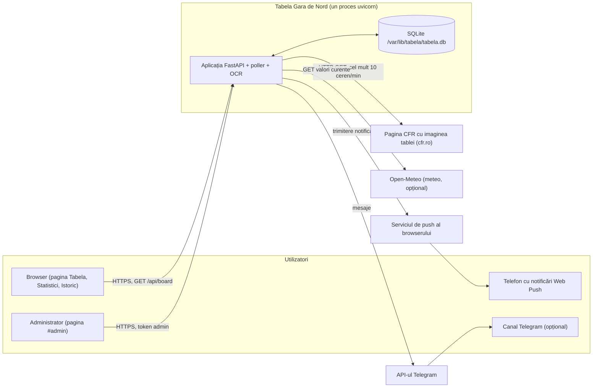
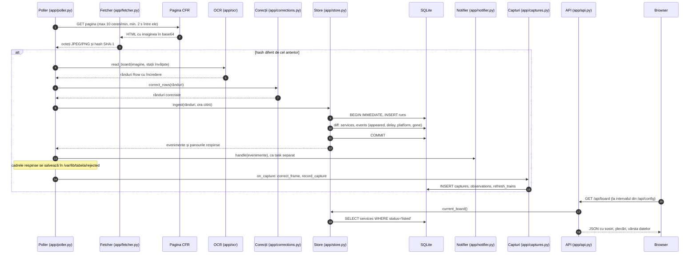
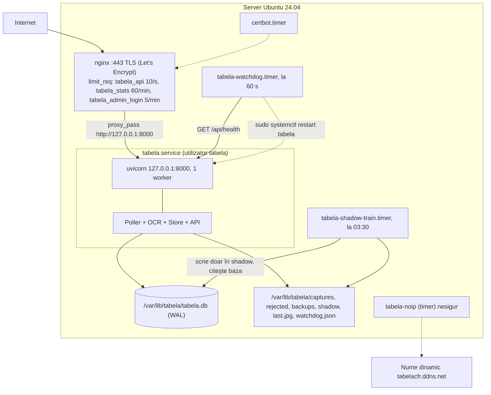

# Arhitectura Tabela Gara de Nord

Acest document descrie cum funcționează aplicația în producție: ce procese rulează, ce componente au, cum circulă o citire de la pagina CFR până în browserul utilizatorului, unde trăiesc datele și ce fișier din `app/` face ce. Pentru structura bazei de date vezi [date-si-schema.md](date-si-schema.md).

Tot ce e scris mai jos a fost verificat în cod (`app/`, `deploy/`, `scripts/`, `web/`). Acolo unde o informație nu se poate confirma din repo, apare o notă „nesigur” cu fișierul unde trebuie verificată (lista completă este în secțiunea 9).

## 1. Privire de ansamblu

Aplicația citește imaginea tablei de sosiri și plecări de la Gara de Nord București, de pe pagina publică a CFR, o transformă în date prin OCR, păstrează istoricul în SQLite și afișează tabla live, istoricul, statisticile și notificările pentru trenurile urmărite.

Principiile de bază, care apar în tot codul:

- **Un singur proces.** Serverul web și poller-ul (bucla care citește tabla) rulează în același proces `uvicorn`, cu un singur worker. Motivul e scris în `deploy/tabela.service`: „ONE worker only: the poller lives in the process”.
- **Nimic nu se șterge din istoric.** Ghosturile (citiri greșite) sunt marcate, nu șterse. Ștergerea și comasarea există doar în scripturi reversibile, cu arhivă (vezi `date-si-schema.md`).
- **O citire greșită nu strică starea.** Fiecare panou (sosiri, plecări) e judecat separat. Un cadru incomplet sau suspect e respins, iar starea anterioară rămâne.
- **Fără cron.** Toate lucrările periodice sunt fie task-uri asincrone în procesul aplicației, fie timere systemd. Nu am găsit niciun `crontab` sau fișier cron în repo.

## 2. Contextul sistemului

Dependențe externe:

| Serviciu | Cui folosește | Cum se folosește | Unde e configurat |
|---|---|---|---|
| Pagina CFR cu imaginea tablei | poller (sursa datelor) | cerere GET; imaginea e extrasă din HTML (base64) | `SOURCE_URL` în `app/config.py` (implicit pagina cfr.ro pentru București Nord) |
| Open-Meteo | `app/weather.py` | valorile curente și seria orară (`forecast_days = 2`, adică până la 48 h) | `WEATHER_*`, pornit implicit; `WEATHER_INTERVAL_S` implicit 900 s |
| Web Push (VAPID) | `app/notifier.py` | notificări către browserele abonate | `VAPID_PRIVATE_KEY`, `VAPID_PUBLIC_KEY`, `VAPID_SUBJECT` |
| Telegram Bot API | `app/telegram.py` | alerte pentru trenurile urmărite | `TELEGRAM_BOT_TOKEN`, `TELEGRAM_CHAT_ID`, opțional `TELEGRAM_STATE_PATH` |

## 3. Procese și componente

### 3.1 Unități systemd și timere

| Unitate | Tip | Utilizator | Ce face | Când rulează |
|---|---|---|---|---|
| `tabela.service` | `Type=simple` | `tabela` | Pornește `uvicorn app.main:create --factory --host 127.0.0.1 --port 8000 --workers 1 --proxy-headers --forwarded-allow-ips 127.0.0.1`. În proces rulează API-ul, poller-ul, notificările, retenția capturilor și weather-ul. | Permanent. `Restart=always`, `RestartSec=5`, `TimeoutStopSec=30`. Citește `/etc/tabela.env`. |
| `tabela-watchdog.service` + `tabela-watchdog.timer` | `oneshot`, pornit de timer | `tabela` | Rulează `python -m app.watchdog`: verifică `http://127.0.0.1:8000/api/health` și, după probleme repetate, repornește `tabela`. | Timerul declanșează prima rulare la 2 minute după pornirea sistemului (`OnBootSec=2min`), apoi la fiecare 60 s (`OnUnitActiveSec=60s`). |
| `tabela-shadow-train.service` + `.timer` | `oneshot`, pornit de timer | `tabela` | Rulează `scripts/nightly_shadow_train.py`: antrenare zilnică în „mod umbră” a clasificatorului de cifre. Nu promovează nimic în producție; scrie în `/var/lib/tabela/shadow`. | Zilnic la 03:30 (`OnCalendar=*-*-* 03:30:00`, `Persistent=true`), `Nice=19`, `IOSchedulingClass=idle`, `TimeoutStartSec=2h`. |
| `tabela-noip` (timer) | nesigur | nesigur | Menține actualizată adresa dinamică a domeniului `tabelacfr.ddns.net`. | Nesigur: nu există în repo (vezi secțiunea 9). |
| `certbot.timer` | extern (certbot) | nesigur | Reînnoiește certificatul Let's Encrypt (README, secțiunea Deploy). | Gestionat de certbot. |
| nginx | serviciu de sistem | nesigur | Termină TLS, limitează cererile și trimite traficul către `127.0.0.1:8000`. | Permanent. Configurația e în `deploy/nginx-tabela.conf` și `deploy/tabela-limits.conf`. |

Securitatea unității `tabela.service` (din `deploy/tabela.service`): `NoNewPrivileges=true`, `ProtectSystem=strict` cu `ReadWritePaths=/var/lib/tabela` (singurul loc scris), `PrivateTmp=true`, `ProtectHome=true`, `PrivateDevices=true`, `RestrictAddressFamilies=AF_INET AF_INET6 AF_UNIX`, `UMask=0027`.

Watchdog-ul rulează ca `tabela`, nu ca root. Singura permisiune de root este o regulă sudoers care permite doar `systemctl restart tabela` (`deploy/tabela-watchdog.sudoers`).

### 3.2 Componente logice

| Componentă | Unde e în cod | Rol |
|---|---|---|
| Poller | `app/poller.py` | Buclă asincronă: cere pagina, compară hash-ul imaginii cu cel anterior, apelează OCR-ul la o imagine nouă și predă rândurile citite mai departe. Are limite ferme: cel puțin 2 s între cereri și cel mult 10 cereri în 60 s (`MIN_GAP`, `MAX_PER_MIN`). |
| Fetcher | `app/fetcher.py` | Descarcă pagina, extrage imaginea (JPEG sau PNG în base64), refuză peste 10 MB (`MAX_BYTES`) și calculează hash-ul. |
| Motor OCR | `app/ocr/` | OpenCV pentru preprocesare și Tesseract pentru text, cu șabloane pentru cifre. Produce `Row` cu încredere. `PROCESSING_VERSION` (în `app/observations.py`) este `ocr-tess-grid-5`. |
| Store | `app/store.py` | Singura poartă spre SQLite pentru starea tablei. Migrează schema (`SCHEMA_VERSION = 9`), aplică `ingest` (diff cu starea, evenimente) și construiește tabla LIVE (`current_board`). |
| Corecții manuale | `app/corrections.py` | Reguli înguste care corectează o valoare citită greșit, pe cadre noi și retroactiv. |
| Capturi și observații | `app/captures.py`, `app/observations.py` | Salvează imaginea fiecărui cadru nou (pe disc), o observație per rând OCR și catalogul de trenuri. |
| Calitate | `app/quality.py` | Reguli de validare (întârzieri confirmate, peroane, fantome, evenimente suspecte) și tabelele de calitate. |
| API public | `app/api.py` și modulele `*_api.py`, `stats*.py`, `stations.py`, `journeys.py` | Rutele HTTP pentru tabla live, istoric, statistici, catalog și export. |
| API admin | `app/admin.py`, `app/admin_tools.py`, `app/admin_settings.py`, `app/corrections_api.py`, `app/backup_api.py` | Autentificare cu `ADMIN_TOKEN`, CSRF, pagina Setări, corecții, copii de siguranță. |
| Frontend static | `web/` | HTML, CSS, JavaScript și service worker (`sw.js`), servite de FastAPI din `WEB_DIR` la rădăcină (`StaticFiles`, `html=True`). |
| Notificări | `app/notifier.py`, `app/telegram.py` | Web Push pentru trenurile urmărite; Telegram ca al doilea canal, opțional. |
| Meteo | `app/weather.py` | Client Open-Meteo, scrie în `weather_observations`. Are propria sarcină asincronă, independentă de poller. |
| Watchdog | `app/watchdog.py` | Verificarea `/api/health` și repornirea controlată a serviciului. |
| Restaurare și copii | `app/dbbackup.py`, `app/backup_api.py`, `app/restore.py` | Copie înainte de migrare, copie online verificată, restaurare din copie. |
| Scripturi de întreținere | `scripts/` | Curățări reversibile, restaurare, evaluare OCR, antrenare în umbră. Vezi secțiunea 6.3. |

Starea în memorie: Store-ul ține în RAM câteva structuri (cache-uri, contoare de cadre, candidați în așteptare) care se reconstruiesc după o repornire din datele persistente. Detaliile sunt în `date-si-schema.md`, secțiunea 5.

## 4. Fluxul unui ciclu de sondare

Diagrama de mai jos arată un ciclu complet, când imaginea s-a schimbat. Pașii sunt în ordinea din `app/poller.py` și `app/api.py` (funcția `on_rows` din `lifespan`).

Ce se întâmplă, pe scurt:

1. **Programarea cererilor.** Poller-ul estimează în al câtelea secund din minut se schimbă imaginea (`PhaseTracker`, mediana circulară a ultimelor 5 schimbări, `HISTORY = 5`). Cere pagina în fereastra în care se așteaptă schimbarea. Dacă nu a văzut schimbări de peste 300 s (`STALE_AFTER`), trece pe un ritm rar de 30 s (`STALE_DELAY`). Erorile de rețea și de fetch intră în backoff exponențial de la 5 s, plafonat la 300 s.
2. **Imaginea nouă.** Dacă hash-ul diferă, imaginea se salvează în `LAST_IMAGE_PATH` (implicit `/var/lib/tabela/last.jpg` pe server) și se trimite la OCR. Stațiile deja învățate din istoric (`known_stations`) ajută la canonicalizarea numelor.
3. **OCR eșuat.** Dacă OCR-ul aruncă o eroare, cadrul se salvează în `rejected`, iar captura se înregistrează fără rânduri, cu eroarea în câmpul `error`.
4. **Corecții manuale.** `correct_rows` aplică regulile active (`app/corrections.py`) înainte ca datele să ajungă în Store.
5. **Ingest.** Store-ul judecă fiecare panou separat. Un panou cu prea puține rânduri, sau o citire parțială (sub jumătate din numărul de rânduri de la ultima citire bună), e respins, iar serviciile lui rămân neschimbate. Dacă niciun panou nu e acceptat, cadrul devine `ok=0` în `runs`. Detaliile sunt în `date-si-schema.md`, secțiunea 4.
6. **Notificări.** Evenimentele (`appeared`, `delay`, `platform`, `gone`) pornesc un task asincron. O eroare de notificare nu oprește poller-ul.
7. **Capturi.** După ingest, cadrul (chiar și unul cu OCR eșuat) se salvează ca `captures`, cu o `observations` per rând OCR. Pentru o imagine deja văzută (același SHA-1) se actualizează doar `last_seen_at`.
8. **Browserul.** Pagina încarcă `/api/board` și reîmprospătează la intervalul `refresh_s` din `/api/config`. Răspunsul e marcat `stale` dacă ultima citire bună are peste `STALE_S = 180` s.

## 5. Diagrama de deployment

Diagrama arată serverul așa cum e descris în repo și în instrucțiunile de lucru. Gazda concretă (serverul de acasă, cu IP privat) nu apare aici. README descrie încă un server Ubuntu 24.04 cu firewall Azure NSG (vezi secțiunea 9).

Detalii de configurare din `deploy/nginx-tabela.conf`:

- `client_max_body_size 8k` și `server_tokens off`; gzip pentru JSON, CSS și JavaScript.
- `/api/follows` are `access_log off`, pentru că adresa de push (endpoint) apare în query string.
- Limitările sunt în `deploy/tabela-limits.conf`: `tabela_api` (10 cereri/s), `tabela_stats` (60/min, pentru statisticile care parcurg tot istoricul), `tabela_admin_login` (5/min). Respingerile (429) se loghează la nivelul `warn`.
- Rutele `/api/stats`, `/api/trains/stats`, `/api/trains/{no}/journeys`, `/api/stations` și `/api/journeys` au zona de limitare mai strictă.

## 6. Unde trăiesc datele

### 6.1 Căi pe server

| Cale | Ce conține | Cine scrie | Retenție | Vezi |
|---|---|---|---|---|
| `/opt/tabela/app` | codul (checkout git) | `deploy/install.sh`, `deploy/update.sh` | nu se aplică | `deploy/install.sh` |
| `/opt/tabela/venv` | mediul Python | `deploy/install.sh` | nu se aplică | `deploy/install.sh` |
| `/etc/tabela.env` | variabile de mediu (root:root, 600), fără în git | `install.sh`, administratorul | nu se aplică | `app/config.py` |
| `/var/lib/tabela/tabela.db` (+ `-wal`, `-shm`) | baza principală SQLite | aplicația | permanentă, cu excepția scripturilor reversibile | `date-si-schema.md` |
| `/var/lib/tabela/backups/` | copii ale bazei (înainte de migrare, de restaurare, de curățare) | `app/dbbackup.py`, `app/backup_api.py`, `deploy/update.sh` | ultimele 5 (`BACKUP_KEEP = 5`), la scripturile de comasare ultimele 10 | `app/dbbackup.py` |
| `/var/lib/tabela/backups-fallback/` | copie de rezervă dacă directorul principal nu e scriibil | `app/dbbackup.py` | ultimele 5 | `app/dbbackup.py` |
| `/var/lib/tabela/captures/YYYY/MM/DD/HHMMSS-<hash8>.jpg` | imaginile cadrelor (UTC) | `app/captures.py`, `app/observations.py` | fișierele: `CAPTURE_RETENTION_DAYS` (implicit 7). Rândurile din `captures` rămân. | `app/captures.py` |
| `/var/lib/tabela/rejected/` | ultimele cadre respinse (imagine și JSON) | `app/rejected.py` | ultimele 40 (`REJECTED_KEEP = 40`) | `app/rejected.py` |
| `/var/lib/tabela/last.jpg` | ultima imagine descărcată (pentru depanare) | `app/poller.py` | suprascrisă | `app/poller.py` |
| `/var/lib/tabela/watchdog.json` | starea watchdog-ului | `app/watchdog.py` | suprascrisă | `app/watchdog.py` |
| `/var/lib/tabela/shadow/` | raport și model din antrenarea în umbră | `scripts/nightly_shadow_train.py` | nesigur (de verificat în script) | `scripts/nightly_shadow_train.py` |
| `data/telegram_sent.json` (implicit, relativ la directorul de lucru) | cheile alertelor Telegram deja trimise | `app/telegram.py` | cheile de ieri și de azi (`KEEP_DAYS = 2`) | `app/telegram.py` |

Atenție: `tabela.service` are `ProtectSystem=strict` și scrie doar în `/var/lib/tabela`. Calea implicită a stării Telegram, `data/telegram_sent.json`, e relativă la `/opt/tabela/app`, adică în afara acestui loc. Pe server trebuie deci setată `TELEGRAM_STATE_PATH` în `/etc/tabela.env`, altfel scrierea eșuează. Nesigur: nu am văzut `/etc/tabela.env`, deci nu știu dacă variabila e setată (vezi secțiunea 9).

### 6.2 Date în memorie

Starea aplicației care nu e în baza de date (cadrul anterior, contoarele de citiri, candidații care așteaptă o a doua citire, cache-ul stațiilor) e în RAM. După o repornire, Store-ul o reconstruiește din `services` și din ultimul `runs` cu `ok=1` (`_last_count`, `_last_ok_ts`). Consecința e documentată în cod: după repornire, „nimic nu e ascuns până nu se citește din nou un cadru complet” (`Store._complete`).

### 6.3 Scripturi (`scripts/`)

| Script | Rol | Scrie în baza live? |
|---|---|---|
| `scripts/purge_ghosts.py` | Șterge reversibil fantomele: servicii scurte sau duplicate ale unei citiri greșite. Implicit dry run. | Da, doar cu `--apply`, cu copie prealabilă |
| `scripts/merge_number_dups.py` | Comasează numerele de tren duplicate și aliasurile de stații. Implicit dry run. | Da, doar cu `--apply`, cu copie prealabilă |
| `scripts/restore_db.py` | Restaurează baza dintr-o copie (confirmare `RESTAUREZ`). | Da, înlocuiește baza. Serviciul trebuie oprit. |
| `scripts/nightly_shadow_train.py` | Antrenare zilnică în umbră a clasificatorului de cifre. | Nu, doar citește baza și scrie în `shadow/` |
| `scripts/ocr_eval.py`, `scripts/backtest_delay.py`, `scripts/ambiguous_pairs.py` | Evaluare OCR, backtest, rapoarte. | Nu (antetul spune read-only) |
| `scripts/ocr_digit_clf.py` | Set de adevăr „silver” și clasificator de cifre (experimental, după antet). | Nesigur: nu l-am citit integral; verificați înainte de a-l rula pe baza live |
| `scripts/contrast_audit.py` | Audit automat de contrast (WCAG 2.x, 1.4.3) într-un browser real. | Nu |
| `scripts/dev_seed.py` | Umple o bază de dezvoltare dintr-un cadru din fixturi. | Doar baza indicată |
| `scripts/make_icons.py` | Generează iconițele aplicației. | Nu |

## 7. Modulele `app/`, pe straturi

Lista acoperă toate modulele din `app/` (inclusiv `app/ocr/`). Descrierile vin din docstring-urile modulelor, unde există, și din verificarea codului.

### 7.1 Achiziție și citire (OCR)

- `app/poller.py`: bucla de sondare. Cere pagina, detectează imaginile noi, apelează OCR-ul și predă rândurile la `on_rows` și la `on_capture`, cu backoff la erori.
- `app/fetcher.py`: descarcă pagina CFR și extrage imaginea base64. Refuză peste 10 MB și calculează hash-ul imaginii.
- `app/models.py`: dataclass-urile `Row` (un rând citit, cu cheia `(board, train_no, sched_time)`) și `Event` (o schimbare, cu data serviciului).
- `app/normalize.py`: normalizează textul OCR: confuziile cifrelor (O/0, l/1), orele, tipul trenului (`IR`, `IRN`, `R`, `RE`, `RM`, `IC`, `EC`, `EN`, `D`), întârzierea (cel mult `MAX_DELAY = 999`), peronul (`PLATFORM_MAX`) și asteriscul de marcaj.
- `app/ocr/__init__.py`: pachetul OCR. Expune `read_board`, care întoarce rândurile ambelor panouri.
- `app/ocr/engine.py`: interfața motorului OCR. Implicit e Tesseract.
- `app/ocr/preprocess.py`: mască de culoare, împărțirea tablei pe panouri și detectarea rândurilor.
- `app/ocr/reader.py`: citește fiecare coloană cu Tesseract pe masca de text. Recitește rândurile nelizibile (tip, număr, oră) cu alte preprocesări, cu o limită de 8 s pe cadru.
- `app/ocr/digits.py`: potrivire de șabloane pentru câmpurile numerice. Tabla folosește un singur font fix.
- `app/ocr/glare.py`: decide ce se poate completa dintr-o celulă afectată de reflexii sau de săgeata tablei, și ce nu.
- `app/ocr/order.py`: orele de pe un panou sunt în ordine cronologică. O oră în afara ordinii e tratată ca o eroare de citire.
- `app/ocr/stats.py`: statistici OCR în memorie (rânduri pe panou, recitiri), expuse în `/api/health`.
- `app/ocr/truth.py`: măsoară acuratețea câmpurilor față de setul de adevăr etichetat manual. Folosit de `scripts/ocr_eval.py`.

### 7.2 Validare, corecții și calitate

- `app/quality.py`: regulile de validare (câte citiri consecutive sunt necesare pentru o schimbare de întârziere sau de peron, detectarea fantomelor, evenimentele suspecte, „flapping” gone/appeared sub 180 s) și backfill-ul tabelelor de calitate (schema v7).
- `app/corrections.py`: reguli manuale înguste `(board, field, wrong_value) → correct_value`, cu plan, aplicare retroactivă cu arhivă, restaurare și jurnal de audit (schema v9).
- `app/corrections_api.py`: API-ul admin al regulilor (`/api/admin/corrections*`), cu token și CSRF.
- `app/canonical.py`: nume canonice pentru stații și operatori, prin potrivire fuzzy (difflib). Listele provin din `data/`, care conține doar nume văzute pe tablă.
- `app/consensus.py`: consensul pe tren al cadrelor recente. Valoarea afișată e votul citirilor, nu ultima citire. Nu schimbă schema.
- `app/rejected.py`: salvează cadrele respinse (imagine și JSON), păstrând ultimele 40.
- `app/captures.py`: setările capturilor (`CAPTURE_ENABLED`, `CAPTURE_DIR`, `CAPTURE_RETENTION_DAYS`), căile sigure, retenția zilnică a fișierelor și citirea capturilor pentru pagina admin.
- `app/observations.py`: capturile, observațiile per rând OCR și catalogul `trains` (schema v5). Leagă fiecare observație de serviciul potrivit. Are și `PROCESSING_VERSION`.

### 7.3 Stocare, copii și restaurare

- `app/store.py`: SQLite. Migrarea versiunilor (`migrate`), ingestul (diff cu starea și evenimente), tabla LIVE (`current_board`), istoricul, stațiile învățate și abonările push.
- `app/dbbackup.py`: copie de siguranță înainte de orice migrare a unei baze cu date. Dacă nu se poate face nicio copie, acceptă markerul lăsat de `deploy/update.sh` (dacă e recent și se potrivește), iar altfel refuză migrarea.
- `app/backup_api.py`: copie online verificată (integrity check), cu retenție de 5 copii. Folosită de admin și de restaurare.
- `app/restore.py`: restaurarea bazei dintr-o copie. Cere confirmarea `RESTAUREZ`, refuză dacă `tabela` rulează și înlocuiește baza atomic.
- `app/admin_settings.py`: setările editabile din pagina Setări (retenția capturilor, pragul de spațiu liber), în tabelul `settings`.
- `app/endpoints.py`: validarea adreselor Web Push (protecție împotriva SSRF).

### 7.4 Pornire și API public

- `app/main.py`: punctul de intrare ASGI. Aplicația se creează leneș, la primul acces, iar importul nu pornește poller-ul.
- `app/config.py`: dataclass-ul `Settings`, construit din variabilele de mediu.
- `app/api.py`: aplicația FastAPI. Conține `lifespan` (creează `Store`, rulează migrarea, pornește poller-ul, notificările, retenția și weather-ul), rutele publice și antetele de securitate (CSP, `nosniff`, `Referrer-Policy`, `X-Frame-Options`). Pentru fișierele statice trimite `Cache-Control: no-cache`.
- `app/trains_api.py`: catalogul public al trenurilor (`/api/trains`, `/api/trains/{no}`), doar în citire.
- `app/journeys.py`: călătoriile (un rând din `services`) și rezultatul lor final.
- `app/stations.py`: pagini de stație: trenurile care vin de la o stație (sosiri) sau pleacă spre ea (plecări).
- `app/history_all.py`: istoricul tuturor zilelor pentru un tren, sau pentru toate trenurile într-o zi.
- `app/export.py`: exportul CSV al istoricului. Intervalul e de cel mult `MAX_DAYS = 366` zile.
- `app/stats.py`: funcții pure de statistică a întârzierilor (agregări peste călătorii).
- `app/stats_api.py`: rutele publice de statistici și clasamente, în JSON, sau CSV cu `format=csv`.
- `app/stats_overview.py`: payload-ul agregat al paginii Statistici (`/api/stats/overview`). Pragurile de date suficiente sunt în cod (de exemplu `HISTORY_MIN_DAYS = 7`).
- `app/stats_problems.py`: secțiunea „Probleme” din Statistici, cu constatări deterministe (fără model de limbaj).
- `app/seasons.py`: comparația meteo pe sezoane. Sub `SEASON_MIN_DAYS = 30` zile eligibile nu afișează cifre.
- `app/predict.py`: predicția întârzierii finale. Nu se publică nimic până nu sunt cel puțin `MIN_GOOD_DAYS = 30` zile de date bune și backtestul trece pragurile.
- `app/weather.py`: clientul Open-Meteo. Ia valorile curente la `WEATHER_INTERVAL_S` (implicit 900 s, minimum 300 s) și scrie în `weather_observations`. Eșecurile nu afectează starea de sănătate a aplicației.
- `app/system_api.py`: rutele paginii „Sistem”: `GET /api/system` (public, minimal) și `GET /api/admin/system` (admin, cu detalii).
- `app/system_status.py`: datele paginii „Sistem”: dacă panoul e viu, ultima citire bună, starea OCR, spațiul pe disc și mărimea bazei.
- `app/version.py`: versiunea aplicației (din fișierul `VERSION`) și istoricul din `CHANGELOG.md`, servit la `/api/changelog`.

### 7.5 Administrare, notificări și supraveghere

- `app/admin.py`: autentificarea administratorului cu `ADMIN_TOKEN`, protecția CSRF pentru cererile care schimbă date, limitarea încercărilor eșuate și API-ul „Capturi OCR”, care rămâne privat.
- `app/admin_tools.py`: unelte din pagina admin, după autentificare (de exemplu copia verificată a bazei în directorul de backup).
- `app/notifier.py`: notificările Web Push pentru trenurile urmărite. O tranziție repetată pentru același serviciu, în aceeași zi de serviciu, nu se trimite din nou (docstring-ul modulului).
- `app/telegram.py`: canalul Telegram opțional, cu același tip de alerte. Ține un jurnal JSON al alertelor trimise, ca să nu le retrimită după o repornire.
- `app/watchdog.py`: verifică `/api/health` la fiecare minut. După `THRESHOLD = 3` verificări eșuate la rând repornește `tabela`, cel mult o dată la `RESTART_COOLDOWN_S = 600` s.

## 8. Decizii de design și motivele lor

| Decizie | Motiv (din cod sau din CHANGELOG) |
|---|---|
| Un singur worker uvicorn | Poller-ul trăiește în proces (scris în `deploy/tabela.service`). Un al doilea worker ar porni un al doilea poller. Consecința (un al doilea poller ar citi tabla de două ori) e o deducție din structura codului, nu o afirmație din repo. |
| SQLite în modul WAL, cu `synchronous=NORMAL` și `busy_timeout=5000` | Setările sunt în `Store.__init__`. Motivul nu e scris explicit în cod; WAL permite citiri în paralel cu scrierea, iar `busy_timeout` așteaptă un lacăt eliberat în loc să eșueze imediat. |
| Migrări aditive, fiecare pas atomic cu versiunea | Un pas eșuat lasă versiunea veche. Re-rularea e sigură. Nu se renumerotează niciun pas. (`Store.migrate`) |
| Copie înainte de migrare, altfel refuz | După incidentul din Beta 1.29 (directorul de backup nu era citibil de utilizatorul serviciului), migrarea nu se face fără copie cunoscută. (`app/dbbackup.py`, CHANGELOG, Beta 1.31 și 1.29) |
| Judecată pe panou, nu pe cadru | Un panou citit parțial nu trebuie să șteargă trenurile celuilalt panou. (`app/store.py`, docstring) |
| Confirmare a schimbărilor de întârziere și peron | OCR-ul confundă cifrele și „+” cu o cifră. O schimbare se aplică doar după mai multe citiri identice. (`app/quality.py`, `delay_needs`) |
| Dispariție după `GONE_AFTER_MISSES = 3` cadre, nu imediat | Cadrele alternează între variante OCR. Fără prag, un tren ar apărea și dispărea la fiecare cadru. (`app/store.py`) |
| Ghosturi marcate, nu șterse | Verdictul de fantomă poate fi greșit. Marcajul se poate schimba, ștergerea nu. (`app/quality.py`, docstring) |
| Imaginile expiră, rândurile din `captures` și `observations` nu | Imaginile sunt mari, istoricul de observații e util pentru calitate și catalog. (`app/captures.py`, docstring) |
| Niciun cron | Lucrările periodice sunt task-uri asincrone în proces sau timere systemd. Motivul nu e scris explicit în repo. |
| Watchdog fără root | Doar `systemctl restart tabela` e permis prin sudoers. (`deploy/tabela-watchdog.sudoers`, CHANGELOG, Beta 1.43) |
| Limitări de cereri în nginx și în aplicație | Statisticile parcurg tot istoricul și sunt costisitoare. Pagina de admin are o limită strictă. (`deploy/tabela-limits.conf`) |

## 9. Ce nu am putut verifica

- **Timerul `tabela-noip`.** Nu există în `deploy/`, în README sau în CHANGELOG. Verificați pe server cu `systemctl list-timers` și cu `systemctl cat` pentru unitatea respectivă.
- **Gazda curentă.** README (secțiunea Deploy) descrie un server Ubuntu 24.04 cu firewall Azure NSG. Instrucțiunile de lucru spun că serverul live este cel de acasă. Diagrama de deployment din secțiunea 5 urmează instrucțiunile. Confirmați gazda și actualizați README.
- **Conținutul `/etc/tabela.env`.** Nu e în repo. Nu știu dacă `TELEGRAM_STATE_PATH`, `CAPTURE_DIR` sau `REJECTED_DIR` sunt setate pe server. Verificați în `/etc/tabela.env` (fără a afișa valorile secrete).
- **Scriptul de antrenare în umbră.** Nu am citit `scripts/nightly_shadow_train.py` integral. Calea `/var/lib/tabela/shadow` e confirmată din antet și din `DEFAULT_WORKDIR`, dar modul de rotație al fișierelor din `shadow/` nu e verificat.
- **Forma exactă a câmpurilor din `observations.fields_json`.** Am verificat că e un dicționar cu câmpuri, dar nu structura internă a fiecărei intrări. Verificați în `app/ocr/reader.py`.
- **Semnificația asteriscului (`flagged`).** Codul îl citește din tipul trenului (`app/normalize.py`, `strip_flag`). Ce înseamnă pentru călători nu e spus în cod. Verificați în README sau în documentația CFR.

## 10. Legături

- Structura bazei de date, versiunile de schemă, regulile de identitate, retenția și restaurarea: [date-si-schema.md](date-si-schema.md).
- Procedura de actualizare și de deploy: README, secțiunea Deploy.
- Istoricul versiunilor: `CHANGELOG.md`.
