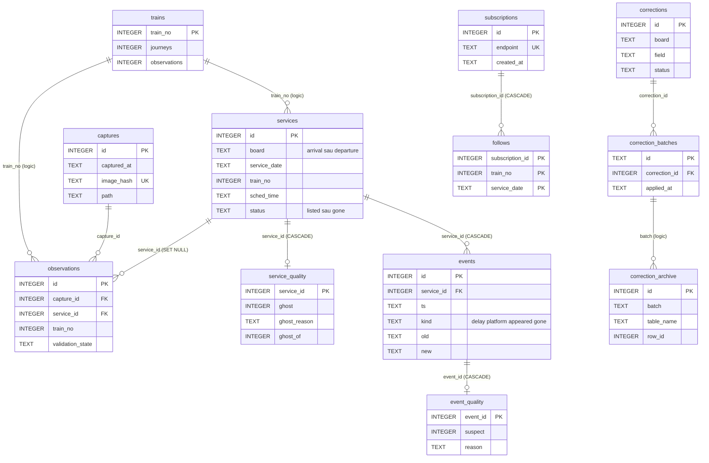

# Date și schema bazei de date

Acest document descrie baza SQLite a aplicației Tabela Gara de Nord: fiecare tabel, fiecare coloană, constrângerile și indecșii, istoricul versiunilor de schemă, calea prin care o citire a tablei devine servicii, evenimente și observații, regulile de identitate, retenția și restaurarea.

Fișierul bazei pe server este `/var/lib/tabela/tabela.db` (vezi `deploy/install.sh`). Structura de mai jos a fost verificată în două feluri: citind codul (`app/store.py`, `app/observations.py`, `app/quality.py`, `app/corrections.py`, `app/dbbackup.py`, `app/backup_api.py`, `app/restore.py`, `app/captures.py`, `scripts/*.py`) și creând o bază nouă cu `Store.migrate()` într-un director temporar, apoi citind `sqlite_master`, `PRAGMA table_info`, `PRAGMA foreign_key_list` și `PRAGMA index_list`. Acolo unde ceva nu se poate confirma, apare o notă „nesigur”, cu fișierul de verificat.

Pentru arhitectura generală (procese, componente, deployment) vezi [arhitectura.md](arhitectura.md).

## 1. Privire de ansamblu

Baza are două straturi:

| Strat | Tabele | Ce conțin | Cine le scrie |
|---|---|---|---|
| Istoric și stare | `runs`, `services`, `events`, `subscriptions`, `follows`, `weather_observations` | ce s-a citit de pe tablă, ce s-a schimbat, abonările la notificări, meteo | `Store.ingest` și metodele lui |
| Capturi, calitate și corecții | `captures`, `observations`, `trains`, `dq_meta`, `service_quality`, `event_quality`, `quality_periods`, `corrections`, `correction_batches`, `correction_archive`, `correction_audit` | imaginile cadrelor, observațiile per rând OCR, catalogul de trenuri, verdictele de calitate, regulile manuale și jurnalul lor | `app/observations.py`, `app/quality.py`, `app/corrections.py` |

Principiul care guvernează tot: **nu se șterge nimic din istoric** în codul aplicației. Verdictele de calitate sunt tabele separate care se pot recalcula; corecțiile sunt reversibile; ștergerile și comasările există doar în scripturi, cu arhivă și restaurare (secțiunea 8).

Setări SQLite folosite de `Store` (`app/store.py`, `__init__`): `journal_mode = WAL`, `synchronous = NORMAL`, `busy_timeout = 5000`, `foreign_keys = ON` (pe conexiunea aplicației; scripturile nu se bazează pe ele, vezi secțiunea 8).

## 2. Versiunea schemei

Versiunea e în `PRAGMA user_version`. Valoarea curentă e `SCHEMA_VERSION = 9` (`app/store.py`, linia 54). Există și o a doua „versiune”, `dq_meta.version`, care e versiunea stratului de calitate (`DQ_VERSION = "1"`, `app/quality.py`) și nu are legătură cu `user_version`.

`Store.migrate()` aplică pașii în ordine. Fiecare pas e aditiv, atomic împreună cu creșterea versiunii, și se poate reface fără efecte (vezi docstring-ul metodei: „Never renumber a step”).

| De la → la | Ce adaugă | Cod | Beta (CHANGELOG.md) |
|---|---|---|---|
| bază nouă (0) → 3 | tabelele `runs`, `services`, `events`, `subscriptions`, `follows`, cu tot ce au în versiunea 3 | `Store._migrate_to_3` (ramura `version == 0`) | nesigur (nu am găsit în CHANGELOG) |
| 1 → 2 | coloana `services.last_read` (comentariul din cod spune „v2”) | `_ADDED_COLUMNS` | nesigur |
| 2 → 3 | coloanele `services.operator_raw`, `services.station_raw`, `services.uncertain`; re-rularea `_SCHEMA` (`CREATE ... IF NOT EXISTS`) | `Store._migrate_to_3` | nesigur |
| 3 → 4 | tabelul `weather_observations` | `Store._migrate_to_4` | Beta 1.01 |
| 4 → 5 | tabelele `captures`, `observations`, `trains`; catalogul `trains` se reconstruiește din `services` | `app/observations.migrate_to_5` | Beta 1.01 |
| 5 → 6 | coloana `services.delay_read_at`, indexul `ix_events_kind_service`, completarea lui `delay_read_at` din observațiile reale | `Store._migrate_to_6`, `_backfill_delay_read_at` | Beta 1.04 |
| 6 → 7 | tabelele `dq_meta`, `service_quality`, `event_quality`, `quality_periods`; `dq_meta.live_since` | `app/quality.migrate_to_7` | Beta 1.06 |
| 7 → 8 | opt coloane noi în `weather_observations` (umiditate, ploaie, rafale etc.) | `Store._migrate_to_8` | Beta 1.25 |
| 8 → 9 | tabelele `corrections`, `correction_batches`, `correction_archive`, `correction_audit` | `app/corrections.migrate_to_9` | Beta 1.29 |

Note despre versiunile vechi:

- Pentru pașii 1→2 și 2→3 nu există cod separat în repo. Logica actuală adaugă orice coloană lipsă din `_ADDED_COLUMNS` (`PRAGMA table_info`), deci orice bază cu versiune mai mică de 3 ajunge la forma curentă. Nesigur: forma exactă a bazelor v1 și v2 de altădată; verificați cu `git log -p -- app/store.py`.
- Pentru pașii 4 și 5, CHANGELOG (linia 574) spune că „datele istorice nu se șterg”.
- Versiunea 9 a adus tabelele de corecții. CHANGELOG spune că Beta 1.29 (cu schema v9) n-a putut porni pe server, deoarece copia de siguranță nu putea fi citită de utilizatorul serviciului. Beta 1.29 și 1.30 au intrat pe server împreună, în Beta 1.31 (CHANGELOG, Beta 1.31).

**Backup înainte de migrare.** Dacă baza are o versiune mai mică decât `SCHEMA_VERSION` și nu e goală, `Store.migrate()` apelează întâi `app/dbbackup.ensure()`. Ordinea de încercare (din cod):

1. o copie recentă (mai nouă de 24 h, `RECENT_S`) a aceleiași versiuni, în directorul de backup;
2. aceeași verificare în `backups-fallback`, lângă bază;
3. o copie nouă în directorul de backup; dacă nu se poate, o copie nouă în `backups-fallback`;
4. markerul `.pre-migration-backup` lăsat de `deploy/update.sh`, dacă e recent și se potrivește cu versiunea și baza.

Dacă nimic din acestea nu reușește, migrarea se oprește cu `BackupUnavailable`, iar baza nu se atinge (`app/dbbackup.py`; CHANGELOG, Beta 1.31).

## 3. Tabelele

Mai jos sunt toate tabelele pe care le creează `Store.migrate()` pe o bază nouă (verificat: 17 tabele, `user_version = 9`), plus tabelele care apar în alte momente (secțiunea 3.3).

Convenții: „NN” înseamnă `NOT NULL`. „DEF” e valoarea implicită. „FK” e cheia străină, cu acțiunea din `ON DELETE`. Timpii din `services`, `events` și `runs` sunt ora locală Europe/Bucharest cu offset (`isoformat()` din `_local`). Timpii din `observations`, `captures` și `weather_observations` sunt UTC (`app/observations.py`, docstring: „All timestamps written here are UTC ISO 8601”).

### 3.1 Tabelele de bază (`app/store.py`)

#### `runs`: un rând per cadru procesat

| Coloană | Tip | Constrângeri | Sens |
|---|---|---|---|
| `id` | INTEGER | PK | identificatorul cadrului |
| `ts` | TEXT | NN | momentul citirii (ora locală, cu offset) |
| `image_hash` | TEXT | NN, DEF `''` | hash-ul imaginii. În calea live, `on_rows` trimite șirul gol (`api.py`), deci coloana rămâne goală. |
| `ok` | INTEGER | NN | `1` dacă cel puțin un panou a fost acceptat, `0` dacă niciunul |
| `n_rows` | INTEGER | NN | numărul de rânduri primite de la OCR (inclusiv cele cu încredere mică) |

Index: `ix_runs_ok_ts (ok, ts)`. Folosit pentru „ultima citire bună” (`Store._last_ok_ts`).

Retenție: nu există. Nu găsesc niciun `DELETE FROM runs` în `app/` sau `scripts/`.

#### `services`: un serviciu = un tren, o zi de serviciu, un panou

| Coloană | Tip | Constrângeri | Sens |
|---|---|---|---|
| `id` | INTEGER | PK | identificatorul serviciului |
| `board` | TEXT | NN, CHECK `board IN ('arrival','departure')` | panoul: sosiri sau plecări |
| `service_date` | TEXT | NN | data de serviciu (ISO, `YYYY-MM-DD`), calculată din ora programată, vezi secțiunea 6 |
| `train_type` | TEXT | NN | tipul trenului (`IR`, `IRN`, `R`, `RE`, `RM`, `IC`, `EC`, `EN`, `D`, din `app/normalize.py`) |
| `train_no` | INTEGER | NN | numărul trenului |
| `station` | TEXT | NN | stația, cu numele canonic când s-a potrivit (`uncertain = 0`) |
| `operator` | TEXT | NN | operatorul, canonic când s-a potrivit |
| `sched_time` | TEXT | NN | ora programată, `HH:MM` |
| `first_seen` | TEXT | NN | prima citire (ora locală). Pentru un serviciu cu citire nesigură de început, e momentul primei citiri din secvența de confirmare |
| `last_seen` | TEXT | NN | ultima apariție pe tablă, inclusiv citirile cu încredere mică |
| `last_delay` | INTEGER | NN, DEF `0` | ultima întârziere confirmată, în minute. La un serviciu nou fără citire a întârzierii, valoarea e `0` și nu înseamnă „fără întârziere”; de aceea există `delay_read_at`. |
| `last_platform` | INTEGER | nullable | ultimul peron confirmat |
| `flagged` | INTEGER | NN, DEF `0` | `1` dacă tipul trenului are asterisc (`strip_flag` în `app/normalize.py`). Semnificația pentru călători nu e în cod (secțiunea 9). |
| `status` | TEXT | NN, DEF `'listed'`, CHECK `status IN ('listed','gone')` | `listed` = pe tablă; `gone` = a ieșit de pe tablă |
| `miss_count` | INTEGER | NN, DEF `0` | câte cadre acceptate la rând nu l-au citit. Ajunge la `GONE_AFTER_MISSES = 3` → `gone`. |
| `last_read` | TEXT | nullable | ultima citire confidentă potrivită cu serviciul (nu o citire cu încredere mică) |
| `operator_raw` | TEXT | NN, DEF `''` | operatorul așa cum a fost citit de OCR |
| `station_raw` | TEXT | NN, DEF `''` | stația așa cum a fost citită de OCR |
| `uncertain` | INTEGER | NN, DEF `0` | `1` dacă stația sau operatorul nu s-a potrivit cu un nume cunoscut |
| `delay_read_at` | TEXT | nullable | momentul ultimei întârzieri citite cu adevărat (dovada citirii). `NULL` = întârziere necunoscută, nu zero. Vezi `DELAY_LAST_READ_MAX_S = 900` în `app/store.py`. |

Constrângeri de unicitate și indecși:

- `UNIQUE (board, service_date, train_no, sched_time)`: este cheia de identitate a unui serviciu (secțiunea 6).
- `ix_services_date (service_date)`
- `ix_services_train (train_no, service_date)`
- `ix_services_status (status)`

Nu există cheie străină pe `services`. Legătura cu `observations` (`service_id`) și cu `service_quality` e prin valori, iar ștergerea unui serviciu nu propagă automat decât prin `ON DELETE` declarat pe tabelele copil.

#### `events`: schimbările unui serviciu

| Coloană | Tip | Constrângeri | Sens |
|---|---|---|---|
| `id` | INTEGER | PK | identificatorul evenimentului |
| `service_id` | INTEGER | NN, FK → `services(id)` ON DELETE CASCADE | serviciul |
| `ts` | TEXT | NN | momentul evenimentului (ora locală) |
| `kind` | TEXT | NN, CHECK `kind IN ('delay','platform','appeared','gone')` | tipul schimbării |
| `old` | TEXT | nullable | valoarea veche: minute pentru `delay`, peron pentru `platform`, `NULL` pentru `appeared` și `gone` |
| `new` | TEXT | nullable | valoarea nouă, același format |

Indecși:

- `ix_events_service (service_id, ts)`
- `ix_events_kind_service (kind, service_id)` (adăugat în versiunea 6, folosit de statistici)

Evenimentele `flap` (gone urmat de appeared în mai puțin de `FLAP_S = 180` s) nu sunt șterse. Sunt marcate în `event_quality` cu motivul `flap` (secțiunea 3.2).

#### `subscriptions`: abonările Web Push

| Coloană | Tip | Constrângeri | Sens |
|---|---|---|---|
| `id` | INTEGER | PK | identificatorul abonării |
| `endpoint` | TEXT | NN, UNIQUE | adresa de push a browserului. E sensibilă: nu se publică. |
| `p256dh` | TEXT | NN | cheia publică a abonării (validată la `subscribe`, cel mult `MAX_KEY_LEN = 256` caractere) |
| `auth` | TEXT | NN | secretul de autentificare al abonării (același tip de validare) |
| `created_at` | TEXT | NN | momentul abonării (ora locală) |

Un `UNIQUE` pe `endpoint` (indexul `sqlite_autoindex_subscriptions_1`) face ca un nou abonament pe același endpoint să actualizeze cheile. Abonările se șterg doar la dezabonare (`Store.unsubscribe`); în cod nu există o curățare a abonărilor vechi.

#### `follows`: ce tren urmărește ce abonare, pentru o zi

| Coloană | Tip | Constrângeri | Sens |
|---|---|---|---|
| `subscription_id` | INTEGER | PK (parte), NN, FK → `subscriptions(id)` ON DELETE CASCADE | abonarea |
| `train_no` | INTEGER | PK (parte), NN | trenul urmărit |
| `service_date` | TEXT | PK (parte), NN | ziua de serviciu urmărită |

Constrângeri și indecși: `PRIMARY KEY (subscription_id, train_no, service_date)`; `ix_follows_train (train_no, service_date)`.

Limita: `MAX_FOLLOWS = 20` trenuri pe abonare. Urmăririle mai vechi decât ieri (`today - 1`) se șterg leneș, la următoarea urmărire (`Store.follow`).

#### `weather_observations`: meteo curent (Open-Meteo)

| Coloană | Tip | Constrângeri | Sens |
|---|---|---|---|
| `id` | INTEGER | PK | identificatorul |
| `observed_at` | TEXT | NN, UNIQUE | momentul observației, UTC. Un singur rând per moment. |
| `fetched_at` | TEXT | NN | când a fost descărcată observația |
| `source` | TEXT | NN, DEF `'open-meteo'` | sursa |
| `kind` | TEXT | NN, DEF `'model_current'` | tipul observației |
| `latitude`, `longitude` | REAL | nullable | coordonatele |
| `temperature_c` | REAL | nullable | temperatura, în °C |
| `apparent_temperature_c` | REAL | nullable | temperatura resimțită |
| `precipitation_mm` | REAL | nullable | precipitațiile |
| `weather_code` | INTEGER | nullable | codul meteo |
| `wind_speed_kmh` | REAL | nullable | viteza vântului |
| `wind_direction_deg` | REAL | nullable | direcția vântului |
| `units_json` | TEXT | nullable | unitățile raportate de API |
| `raw_json` | TEXT | nullable | răspunsul brut |
| `relative_humidity_pct` | REAL | nullable | umiditatea relativă (versiunea 8) |
| `is_day` | INTEGER | nullable | zi sau noapte (versiunea 8) |
| `rain_mm` | REAL | nullable | ploaia (versiunea 8) |
| `showers_mm` | REAL | nullable | averse (versiunea 8) |
| `snowfall_cm` | REAL | nullable | ninsoarea (versiunea 8) |
| `surface_pressure_hpa` | REAL | nullable | presiunea (versiunea 8) |
| `wind_gusts_kmh` | REAL | nullable | rafalele (versiunea 8) |
| `hourly_json` | TEXT | nullable | seria orară a următoarelor 24 h; păstrată doar pe cea mai nouă observație (versiunea 8) |

Valorile lipsă sunt `NULL`, niciodată `0` (comentariul din `app/store.py`). Rândurile vechi, din dinaintea versiunii 8, au `NULL` în coloanele noi, nu zero.

Retenție: permanentă. Codul spune „History is permanent (~96 rows/day)”. Nu există `DELETE` pe această tabelă.

### 3.2 Tabelele de observații și catalog (`app/observations.py`, versiunea 5)

#### `captures`: o imagine a tablei, așa cum a fost descărcată

| Coloană | Tip | Constrângeri | Sens |
|---|---|---|---|
| `id` | INTEGER | PK | identificatorul capturii |
| `captured_at` | TEXT | NN | momentul capturii, UTC |
| `last_seen_at` | TEXT | nullable | ultima oară când aceeași imagine a fost văzută din nou |
| `image_hash` | TEXT | NN, UNIQUE | SHA-1 al octeților imaginii. O imagine apare o singură dată. |
| `path` | TEXT | nullable | calea relativă a fișierului sub `CAPTURE_DIR`. `NULL` după ce fișierul a fost șters de retenție, sau dacă nu s-a salvat. |
| `width`, `height` | INTEGER | nullable | dimensiunile imaginii |
| `bytes` | INTEGER | nullable | mărimea fișierului |
| `ok` | INTEGER | NN | `1` dacă OCR-ul a reușit (`error IS NULL`) |
| `n_rows` | INTEGER | NN, DEF `0` | rândurile OCR din captură |
| `processing_version` | TEXT | nullable | versiunea de procesare (`PROCESSING_VERSION = "ocr-tess-grid-5"`) |
| `duration_ms` | INTEGER | nullable | durata OCR-ului |
| `error` | TEXT | nullable | eroarea, trunchiată la 500 de caractere |
| `expires_at` | TEXT | nullable | `captured_at` plus retenția din momentul salvării. Este doar afișată în lista admin (`app/captures.py`); retenția nu o citește. |

Index: `ix_captures_at (captured_at)`. Retenția folosește `captured_at`, nu `expires_at`.

#### `observations`: o linie OCR dintr-o captură

| Coloană | Tip | Constrângeri | Sens |
|---|---|---|---|
| `id` | INTEGER | PK | identificatorul observației |
| `capture_id` | INTEGER | NN, FK → `captures(id)` (fără acțiune la ștergere) | captura din care vine |
| `service_id` | INTEGER | FK → `services(id)` ON DELETE SET NULL | serviciul căruia i s-a potrivit rândul. `NULL` dacă rândul e `incomplete` sau nu s-a potrivit. |
| `board` | TEXT | NN, CHECK `board IN ('arrival','departure')` | panoul |
| `row_index` | INTEGER | NN | poziția rândului pe panou |
| `observed_at` | TEXT | NN | momentul, UTC |
| `raw_text` | TEXT | NN, DEF `''` | textul brut al rândului |
| `fields_json` | TEXT | NN, DEF `'{}'` | câmpurile OCR, cu valorile brute și normalizate. Structura internă a fiecărei intrări nu e verificată (secțiunea 9). |
| `train_no` | INTEGER | nullable | numărul citit |
| `sched_time` | TEXT | nullable | ora programată citită |
| `delay_min` | INTEGER | nullable | întârzierea, doar dacă `delay_read = 1` |
| `delay_read` | INTEGER | NN, DEF `0` | `1` dacă celula întârzierii a fost citită |
| `platform` | INTEGER | nullable | peronul citit |
| `station`, `station_raw` | TEXT | nullable | stația canonică și cea citită |
| `operator`, `operator_raw` | TEXT | nullable | operatorul canonic și cel citit |
| `row_conf` | REAL | nullable | încrederea rândului, rotunjită la 4 zecimale |
| `uncertain` | INTEGER | NN, DEF `0` | `1` dacă rândul e incert |
| `validation_state` | TEXT | NN, CHECK `IN ('ok','uncertain','rejected_low_conf','incomplete')` | starea de validare (regulile sunt mai jos) |
| `processing_version` | TEXT | NN | `PROCESSING_VERSION` plus sufixe pentru ce s-a reîncercat sau s-a completat (`line_version` în `app/observations.py`) |

Regula de stare (`validation_state`, `app/observations.py`):

| Condiție (în ordine) | Stare |
|---|---|
| nu există rând sau nu are `train_no` | `incomplete` |
| `confidence < MIN_CONFIDENCE` (0,5) | `rejected_low_conf` |
| `uncertain` sau `delay_read` fals | `uncertain` |
| altfel | `ok` |

Indecși: `ix_observations_service (service_id)`, `ix_observations_observed (observed_at)`, `ix_observations_capture (capture_id)`, `ix_observations_train (train_no, observed_at)`, `ix_observations_train_state (train_no, validation_state, observed_at)`.

Retenție: permanentă. Nu există `DELETE FROM observations` în aplicație. Scripturile de comasare și de curățare modifică `service_id` (mută observațiile), dar nu le șterg.

#### `trains`: catalogul numerelor de tren

| Coloană | Tip | Constrângeri | Sens |
|---|---|---|---|
| `train_no` | INTEGER | PK | numărul trenului |
| `first_seen`, `last_seen` | TEXT | nullable | prima și ultima apariție |
| `operators_json` | TEXT | NN, DEF `'[]'` | operatorii pe care i-a avut |
| `routes_json` | TEXT | NN, DEF `'[]'` | traseele |
| `journeys` | INTEGER | NN, DEF `0` | câte servicii (călătorii) nefantomă are |
| `observations` | INTEGER | NN, DEF `0` | câte observații utilizabile (`ok` sau `uncertain`) are |

Index: `ix_trains_last_seen (last_seen)`.

Un număr de tren cu zero călătorii rămâne stocat, dar nu apare în catalogul public (`app/observations.py`, docstring). Fantomele și observațiile lor nu se numără.

#### `dq_meta`: metadatele stratului de calitate

| Coloană | Tip | Constrângeri | Sens |
|---|---|---|---|
| `key` | TEXT | PK | cheia: `version` sau `live_since` |
| `value` | TEXT | NN | valoarea. `version = "1"` (`DQ_VERSION`). `live_since` = momentul de la care validarea e „live” (prima migrare la versiunea 7). |

Cheia `live_since` se scrie o singură dată (`INSERT OR IGNORE`). `backfill` o folosește ca să calculeze verdictele de întârziere doar pentru serviciile văzute înainte de validarea live. Cele apărute după sunt validate live, la ingest. Dacă lipsește, backfill-ul consideră că toată istoria e „dinainte” (`app/quality.py`, `backfill`).

#### `service_quality`: verdictul de calitate al unui serviciu

| Coloană | Tip | Constrângeri | Sens |
|---|---|---|---|
| `service_id` | INTEGER | PK, FK → `services(id)` ON DELETE CASCADE | serviciul |
| `ghost` | INTEGER | NN, DEF `0` | `1` = fantomă: exclusă de la tabla live, catalog și statistici. Verdictul se calculează la ingest, când serviciul iese de pe tablă. |
| `ghost_reason` | TEXT | nullable | motivul: `short` (trăit sub `GHOST_MIN_LIFE_S = 120` s), `near_dup` (duplicat al unui serviciu mai lung, cu o diferență de un caracter), `minority_dup` (varianta minoritară a unei citiri alternante) |
| `ghost_of` | INTEGER | nullable (fără FK) | serviciul real căruia i se potrivește duplicatul |
| `low_quality` | INTEGER | NN, DEF `0` | `1` dacă serviciul a fost văzut în perioada de calitate redusă (`quality_periods`) |
| `delay_checked` | INTEGER | NN, DEF `0` | `1` după verificarea retroactivă a întârzierilor |
| `max_delay_clean` | INTEGER | nullable | cea mai mare întârziere confirmată. `NULL` = necunoscut, nu zero. |
| `last_delay_clean` | INTEGER | nullable | ultima întârziere confirmată, același regim |
| `station_canonical` | TEXT | nullable | numele canonic al stației, când diferă de cel stocat |
| `operator_canonical` | TEXT | nullable | operatorul canonic, când diferă |
| `updated_at` | TEXT | NN | ultima recalculare |

Indexul `ix_service_quality_ghost (ghost)`. Verdictul de fantomă e calculat de `app/quality.judge_ghost` când serviciul iese de pe tablă (`status = gone`), în timpul ingestului. Un serviciu care revine pe tablă își pierde verdictul (`clear_ghost`).

Celelalte coloane (`delay_checked`, `max_delay_clean`, `last_delay_clean`, `station_canonical`, `operator_canonical`, `low_quality`) se completează prin `backfill` din `app/quality.py`. Acesta nu rulează automat în aplicație: se rulează manual, cu `python -m app.quality` (`main` din `app/quality.py`, de exemplu cu `--dry-run`), cum arată și README. Verificați cu `grep -rn "backfill(" app scripts`: singurul apel în cod e din `main`.

#### `event_quality`: evenimentele suspecte

| Coloană | Tip | Constrângeri | Sens |
|---|---|---|---|
| `event_id` | INTEGER | PK, FK → `events(id)` ON DELETE CASCADE | evenimentul |
| `suspect` | INTEGER | NN, DEF `1` | `1` = suspect, exclus din calcule |
| `reason` | TEXT | NN | motivul (vezi mai jos) |

Motivele care apar în cod (`app/quality.py`):

| Motiv | Ce înseamnă |
|---|---|
| `plus_misread` | o întârziere care pare „+” citit ca o cifră în plus (de exemplu 25 → 425) |
| `unconfirmed` | o valoare care nu a rămas suficient de mult pe tablă pentru a fi confirmată |
| `revert` | revenirea la valoarea de dinainte, după un eveniment suspect |
| `flap` | `gone` urmat de `appeared` în mai puțin de `FLAP_S = 180` s (OCR-ul a pâlpâit) |
| `cleared` | suspiciunea a fost ridicată la o recalculare (`suspect = 0`) |

Motivele `plus_misread`, `unconfirmed`, `revert`, `flap` și `cleared` sunt scrise de `backfill` (`python -m app.quality`), nu de ingest. Până se rulează backfill-ul, evenimentele nu au rând aici și sunt tratate ca nesuspecte.

#### `quality_periods`: perioade de calitate redusă

| Coloană | Tip | Constrângeri | Sens |
|---|---|---|---|
| `id` | INTEGER | PK | identificatorul |
| `start_ts`, `end_ts` | TEXT | NN, UNIQUE (împreună) | intervalul |
| `label` | TEXT | NN | eticheta, de exemplu `beta` |
| `note` | TEXT | nullable | o explicație |

Singura perioadă din cod (`LOW_QUALITY_PERIODS`, `app/quality.py`): de la `2026-10-21T00:00:00+03:00` până la `2026-10-21T11:31:51+03:00`, pentru Beta 1.00, înainte de capturi și observații. Statisticile publice o exclud, dacă nu e setat `STATS_INCLUDE_LOW_QUALITY=1`.

### 3.3 Tabelele de corecții manuale (`app/corrections.py`, versiunea 9)

#### `corrections`: regulile

| Coloană | Tip | Constrângeri | Sens |
|---|---|---|---|
| `id` | INTEGER | PK | identificatorul regulii |
| `board` | TEXT | NN, CHECK `board IN ('arrival','departure')` | panoul |
| `field` | TEXT | NN, CHECK `field IN ('type','no','station','operator','time','platform','delay')` | câmpul corectat |
| `wrong_value` | TEXT | NN | valoarea citită greșit. `""` pentru `platform` și `delay` înseamnă „celula nu a fost citită”. |
| `correct_value` | TEXT | NN | valoarea corectă |
| `station` | TEXT | nullable | restricție: doar pentru această stație |
| `sched_time` | TEXT | nullable | restricție: doar pentru această oră programată |
| `date_from`, `date_to` | TEXT | nullable | restricție: un interval de zile de serviciu |
| `note` | TEXT | NN, DEF `''` | observația administratorului (între `NOTE_MIN = 3` și `NOTE_MAX = 500` caractere) |
| `source_capture_id` | INTEGER | nullable | captura din care a fost creată regula, dacă există |
| `source_row_index` | INTEGER | nullable | rândul din captură |
| `status` | TEXT | NN, DEF `'active'`, CHECK `status IN ('active','deleted')` | ștergerea e logică |
| `created_at` | TEXT | NN | momentul creării |
| `created_by` | TEXT | NN, DEF `'admin'` | cine a creat-o |
| `deleted_at` | TEXT | nullable | momentul ștergerii logice |

Index: `ix_corrections_status (status, board, field)`. Limita: `MAX_ACTIVE_RULES = 500` reguli active.

#### `correction_batches`: aplicările unei reguli

| Coloană | Tip | Constrângeri | Sens |
|---|---|---|---|
| `id` | TEXT | PK | identificatorul lotului, de forma `CR<UTC>-<rid>` |
| `correction_id` | INTEGER | NN, FK → `corrections(id)` | regula |
| `applied_at` | TEXT | NN | momentul aplicării |
| `applied_by` | TEXT | NN, DEF `'admin'` | cine a aplicat |
| `summary_json` | TEXT | NN, DEF `'{}'` | rezumatul: câte rânduri s-au schimbat |
| `restored_at` | TEXT | nullable | momentul restaurării, dacă lotul a fost restaurat |

Index: `ix_correction_batches_rule (correction_id)`.

#### `correction_archive`: valorile dinainte și de după, pe rând

| Coloană | Tip | Constrângeri | Sens |
|---|---|---|---|
| `id` | INTEGER | PK | identificatorul |
| `batch` | TEXT | NN | lotul (fără FK; se leagă logic de `correction_batches.id`) |
| `table_name` | TEXT | NN | ce s-a modificat: `services`, `quality` (coloanele din `service_quality`), `observations` sau `events` (valorile din `_archive` din `app/corrections.py`) |
| `row_id` | INTEGER | NN | rândul modificat |
| `data_json` | TEXT | NN | JSON cu `{"before": ..., "after": ...}` |

Index: `ix_correction_archive_batch (batch)`.

#### `correction_audit`: jurnalul tuturor acțiunilor

| Coloană | Tip | Constrângeri | Sens |
|---|---|---|---|
| `id` | INTEGER | PK | identificatorul |
| `ts` | TEXT | NN | momentul |
| `actor` | TEXT | NN | cine a făcut acțiunea |
| `ip` | TEXT | nullable | adresa IP a cererii. Este o dată personală: nu o publicați. |
| `action` | TEXT | NN | `create`, `apply`, `restore`, `delete` (regulile), sau `setting` (modificările din pagina Setări) |
| `correction_id` | INTEGER | nullable | regula implicată |
| `batch` | TEXT | nullable | lotul implicat |
| `detail_json` | TEXT | NN, DEF `'{}'` | detaliile, fără valori secrete |

Index: `ix_correction_audit_ts (ts)`. Jurnalul nu se curăță.

### 3.4 Tabelele care nu sunt în schema versionată

Acestea nu apar în `migrate()` și nu schimbă `user_version`.

#### `settings`: setările din pagina Setări

Creat de `app/admin_settings.py` (`_DDL`), la prima citire sau scriere, nu de `migrate()`. Din acest motiv nu apare într-o bază nouă după `migrate()`.

| Coloană | Tip | Constrângeri | Sens |
|---|---|---|---|
| `key` | TEXT | PK | cheia: `capture_retention_days` sau `capture_min_free_mb` |
| `value` | TEXT | NN | valoarea (text) |
| `updated_at` | TEXT | NN | momentul |

Limitele (`SPECS`): `capture_retention_days` între 1 și 30, implicit 7; `capture_min_free_mb` între 256 și 102400, implicit 2048. Dacă nu există rând, se folosește variabila de mediu. O valoare invalidă cade pe mediu.

#### `purged_rows` și `merged_rows`: arhivele scripturilor

Sunt create de scripturi, la `--apply`, nu de aplicație. Descrierea lor e în secțiunea 8.

| Tabel | Creat de | Coloane |
|---|---|---|
| `purged_rows` | `scripts/purge_ghosts.py` (`ARCHIVE`) | `id` PK, `batch` NN, `table_name` NN, `row_id` NN, `data_json` NN, `purged_at` NN |
| `merged_rows` | `scripts/merge_number_dups.py` (`ARCHIVE`) | `id` PK, `batch` NN, `table_name` NN, `row_id` NN, `data_json` NN, `merged_at` NN |

#### Telegram: nu este în baza de date

Jurnalul alertelor Telegram e un fișier JSON, nu un tabel. Calea implicită e `data/telegram_sent.json`, iar `TELEGRAM_STATE_PATH` o poate schimba (`app/telegram.py`). Cheile se păstrează pentru azi și ieri (`KEEP_DAYS = 2`).

## 4. Calea unei citiri: de la OCR la servicii și evenimente

Această secțiune descrie ce face `Store.ingest(rows, ts, image_hash)` (`app/store.py`) și cine îl apelează. Apelantul e `on_rows` din `app/api.py`: întâi `corrections.correct_rows` aplică regulile manuale, apoi `ingest`, apoi `observations.refresh_catalog`, apoi `notifier.handle` ca task separat.

**Pasul 1: tranzacția.** Ingestul începe cu `BEGIN IMMEDIATE`. Toate scrierile (runs, services, events) sunt într-o singură tranzacție.

**Pasul 2: încrederea.** `_split` separă rândurile:

- „bune”: cu încredere cel puțin `MIN_CONFIDENCE = 0.5`. Dacă două rânduri au aceeași cheie `(board, train_no, sched_time)`, câștigă cel bun (`setdefault`).
- „slabe”: sub 0,5, și numai dacă nu există un rând bun cu aceeași cheie.

**Pasul 3: judecata pe panou.** `_judge` evaluează fiecare panou separat:

| Condiție | Rezultat pentru panou |
|---|---|
| mai puțin de `MIN_BOARD_ROWS = 2` rânduri bune | respins: „too few rows” |
| baza are cel puțin `PARTIAL_BASE = 6` rânduri, iar acum sunt mai puțin de `PARTIAL_FRAC = 0.5` din ele, și nu s-a ajuns la `PARTIAL_ACCEPT_AFTER = 10` cadre consecutive de acest fel | respins: „partial read” |
| totalul panourilor acceptate e sub `MIN_ROWS = 4` | ambele respinse: „frame too small” |

Dacă niciun panou nu e acceptat, se scrie `runs` cu `ok = 0`, nu se modifică nimic și se întoarce o listă goală. Panourile respinse păstrează starea lor anterioară; nimic de pe ele nu trece în `gone`. Motivul e scris în docstring-ul modulului: „a panel with too few rows ... keeps its last good state”.

**Pasul 4: potrivirea rândurilor cu serviciile.** Pentru panourile acceptate, `_diff` încearcă, în această ordine:

1. **Cheia exactă** `(board, service_date, train_no, sched_time)`.
2. **Cheia majoritară.** Dacă OCR-ul alternează între două chei pentru același rând de tablă, citirea merge la serviciul cu mai multe citiri (`_majority_partner`).
3. **Jitter pe ora programată.** Un serviciu listat, al aceluiași tren, cu o oră la cel mult `JITTER_MIN = 10` minute distanță. Perechile se revendică global, după cea mai mică diferență.
4. **Greșeală de un caracter.** Dacă există exact un serviciu listat, aflat la o distanță mică (`_near_dup`: pentru numărul de tren, o editare, sau două dacă lungimile diferă, de exemplu 9209/92011; pentru oră, cel mult două caractere la același număr), cu aceeași stație, și nu sunt două trenuri reale citite împreună în aceeași „slot” (`_coexist`), rândul e tratat ca o citire greșită a lui (`_fuzzy_match`).

**Pasul 5: votul și redenumirea.** Fiecare potrivire e un vot pentru serviciu. Dacă o cheie diferită devine clar majoritară, serviciul se redenumește (`_maybe_rename`): cel puțin `RENAME_AFTER = 3` citiri, din ultimele `RENAME_WINDOW = 10`, cu o pondere de cel puțin `RENAME_SHARE = 0.7`. Pentru un număr mai scurt, pragurile sunt mai dure (`RENAME_FEWER_AFTER = 8`, `RENAME_FEWER_SHARE = 0.9`). Redenumirea nu se face niciodată spre o cheie care există deja.

**Pasul 6: servicii noi.** Un rând nepotrivit devine serviciu nou (`INSERT INTO services`, cu `status = 'listed'`) și primește un eveniment `appeared`. Dacă rândul are încredere sub `CONFIRM_CONFIDENCE = 0.7`, serviciul nu se creează la prima citire: e reținut în `_pending_new` și creat doar dacă se citește și la cadrul următor.

**Pasul 7: servicii existente.**

- Dacă serviciul era `gone` și revine după mai mult de `REAPPEAR_QUIET_MIN = 10` minute, se emite `appeared`. O absență mai scurtă (OCR-ul a pâlpâit) nu emite nimic.
- Întârzierea se schimbă doar după confirmare. `quality.delay_needs` cere 2 citiri identice (`DELAY_CONFIRM`), 3 pentru o valoare de cel puțin 100 de minute care diferă cu cel puțin 60 (`DELAY_BIG_CONFIRM`), sau 5 pentru o valoare care pare „+” citit ca cifră (`DELAY_PLUS_CONFIRM`). O schimbare confirmată emite `delay`.
- Peronul: `quality.platform_needs` cere 2 citiri (`PLATFORM_CONFIRM`), 3 pentru perechile confundate de OCR (`PLATFORM_CONFUSED_CONFIRM`). Prima apariție a unui peron (de la „nimic” la o valoare) e imediată. O schimbare confirmată emite `platform`.
- Dacă întârzierea nu s-a citit (`delay_read` fals), valoarea veche rămâne și nu se emite nimic.
- `last_seen`, `last_read`, `miss_count = 0` și `flagged` se actualizează. `delay_read_at` se setează doar când valoarea aplicată vine dintr-o citire reală.

**Pasul 8: rândurile slabe.** Un rând sub 0,5 nu creează și nu schimbă nimic. Doar prelungește viața unui serviciu care are deja exact aceeași cheie (`last_seen`, `miss_count = 0`).

**Pasul 9: servicii care nu mai apar.** Pentru fiecare serviciu listat, în panourile acceptate, care nu a fost văzut în cadrul curent:

| Condiție | Rezultat |
|---|---|
| `last_seen` mai vechi de `STALE_MIN = 30` minute | `status = 'gone'`, fără eveniment (downtime) |
| `miss_count + 1 ≥ GONE_AFTER_MISSES = 3` | `status = 'gone'`. Dacă `judge_ghost` îl declară fantomă, nu se emite nimic. Altfel se emite `gone`. |
| altfel | `miss_count` crește cu 1 |

Un serviciu care iese poate fi judecat fantomă (`app/quality.judge_ghost`). Verdictul se scrie în `service_quality`. Nu se șterge nimic.

**Pasul 10: commit.** `COMMIT`, apoi starea din memorie (contoare, candidați în așteptare) se actualizează. Evenimentele se întorc apelantului, care le trimite către notificări.

**Ce se scrie după ingest.** `observations.refresh_catalog` recalculează `trains` pentru numerele citite. Apoi `captures.make_on_capture` înregistrează captura: `captures`, `observations` (cu `service_id` găsit de `_link`, care cere aceeași ora de citire, același număr și o diferență de cel mult `JITTER_MIN` minute), apoi `refresh_trains`.

## 5. Starea din memorie și reconstruirea ei

Store-ul ține în RAM câteva structuri care nu sunt persistate. Cele mai importante:

| Structură | Ce ține | Efect după repornire |
|---|---|---|
| `_good_count`, `_board_ok`, `_partial_streak` | numărul de rânduri acceptat per panou, ultima citire bună, cadrele parțiale consecutive | reconstruit din `services` (numărul de servicii listate) și din ultimul `runs` cu `ok = 1` |
| `_complete` | dacă ultimul cadru al panoului a fost complet (`PANEL_ROWS = 12` rânduri) | gol: nimic nu e ascuns până se citește un cadru complet |
| `_pending_new`, `_cand` | candidați care așteaptă o a doua citire | pierduți; se reconstruiesc din cadrele următoare |
| `_votes`, `_nreads` | voturile pentru redenumire și numărul de citiri | `_nreads` se completează din `observations` la cerere |
| `_delay_read` | dacă întârzierea ultimei citiri a fost reală | în memorie, `True` implicit |
| `_together`, `_apart` | coexistența numerelor de tren în același panou și la aceeași oră | reconstruite la cerere, din `observations` |

Limitele de memorie (toate în `app/store.py`): `_delay_read` 4000 de intrări, `_votes` 4000, `_nreads` 4000, `_apart` și `_together` 4000 fiecare. Peste limită, structura se golește.

## 6. Reguli de identitate

### 6.1 Ce este un serviciu

Un serviciu este identificat de tuplul `(board, service_date, train_no, sched_time)`, cu constrângerea `UNIQUE` din `services`. Asta înseamnă:

- **Panoul** contează: același tren poate fi pe sosiri și pe plecări, ca două servicii diferite.
- **Ziua de serviciu** contează: același tren, zi după zi, e câte un serviciu pe zi.
- **Ora programată** contează: două trenuri cu același număr, dar ore diferite (sau același tren, cu două ore în aceeași zi), sunt servicii diferite.
- **Stația nu face parte din cheie.** Două citiri cu aceeași cheie, dar cu stații scrise diferit, se tratează ca același serviciu. Stația se actualizează (dacă e cazul) din citirea nouă.

### 6.2 Ziua de serviciu

Funcția `service_date(sched_time, now)` (`app/store.py`) dă ziua de serviciu a unei ore programate, luând ca referință momentul citirii:

- ora programată din aceeași zi calendaristică;
- dacă ea e cu mai mult de 12 ore în fața momentului citirii, aparține zilei precedente;
- dacă e cu mai mult de 12 ore în urma momentului citirii, aparține zilei următoare.

Exemplu din docstring: `00:05` citit la `23:58` aparține zilei următoare.

### 6.3 Cum se potrivește o citire cu un serviciu existent

Ordinea și pragurile sunt în secțiunea 4, pașii 4 și 5. Pe scurt: cheie exactă, apoi cheia majoritară, apoi jitter de cel mult 10 minute, apoi o greșeală de un caracter, cu excepția trenurilor citite împreună în aceeași oră pe același panou.

### 6.4 Alte identități

| Entitate | Cheie | Notă |
|---|---|---|
| `runs` | `id` | fără cheie naturală |
| `captures` | `image_hash` (SHA-1 al imaginii, UNIQUE) | aceeași imagine nu se stochează de două ori; se actualizează `last_seen_at` |
| `observations` | `id` | legată de serviciu prin `service_id`, dacă s-a potrivit |
| `trains` | `train_no` | catalogul numerelor de tren |
| `weather_observations` | `observed_at` (UNIQUE) | o observație per moment; `add_weather` nu suprascrie (`ON CONFLICT DO NOTHING`) |
| `subscriptions` | `endpoint` (UNIQUE) | o abonare per adresă de push |
| `follows` | `(subscription_id, train_no, service_date)` | o urmărire per abonare, tren și zi |
| `corrections` | `id` | regula; identitatea ei logică e `(board, field, wrong_value)` plus restricțiile, dar nu există un UNIQUE pe ele |
| `correction_batches` | `id` (text) | de forma `CR<UTC>-<rid>` |

Legătura dintre tabelul `services` și `trains` e logică: `services.train_no` nu are cheie străină spre `trains`. Scripturile de comasare și curățare țin cele două în sincron prin `refresh_trains`.

## 7. Retenție

| Date | Regulă | Unde | Valoare |
|---|---|---|---|
| Fișierele imaginilor (`captures.path`) | șterse după `CAPTURE_RETENTION_DAYS` (cutoff după `captured_at`); rândul rămâne, cu `path = NULL` | `app/captures.run_retention`, zilnic | implicit 7 zile (variabilă de mediu, cel mult 3650); în Setări, între 1 și 30 |
| Rândurile `captures` și `observations` | nu se șterg | — | permanent |
| Pragul de spațiu liber pentru imagini | nu se scrie nicio imagine dacă spațiul liber scade sub prag | `app/observations._disk_ok` | implicit `CAPTURE_MIN_FREE_MB = 2048`; în Setări, între 256 și 102400 |
| Retenția 0 | nu se păstrează nicio imagine | `record_capture`, `retention_days > 0` | `CAPTURE_RETENTION_DAYS=0` |
| Cadrele respinse | ultimele 40 | `app/rejected.prune` | `REJECTED_KEEP = 40` |
| Copii ale bazei (`backups/`) | ultimele 5 | `app/dbbackup._prune`, `app/backup_api.make_backup` | `BACKUP_KEEP = 5` |
| Copii înainte de comasare | ultimele 10 | `scripts/merge_number_dups.py` | `BACKUP_KEEP = 10` |
| Copii înainte de curățare fantome | nu am găsit curățare automată | `scripts/purge_ghosts.py` | nesigur, de verificat |
| Abonări Web Push | se șterg doar la dezabonare | `Store.unsubscribe` | — |
| Urmăriri (`follows`) | șterse leneș, cele mai vechi decât ieri | `Store.follow` | `MAX_FOLLOWS = 20` pe abonare |
| Weather | permanent | — | ~96 rânduri pe zi (comentariul din cod) |
| Jurnalul Telegram | cheile pentru azi și ieri | `app/telegram.py` | `KEEP_DAYS = 2` |
| `runs`, `services`, `events` | nu se șterg în aplicație | — | fantomele se marchează, nu se șterg |
| `correction_audit` | nu se curăță | — | permanent |
| `correction_archive` | nu se șterge; lotul e marcat restaurat | `app/corrections.restore` | permanent |

Ce înseamnă „șters” în această aplicație: singurele ștergeri de rânduri din istoric se fac în scripturi, cu `--apply`, după o copie a bazei și cu arhivă în `purged_rows` sau `merged_rows`. Ștergerile de imagini le face doar retenția.

## 8. Arhive, curățări și restaurare

### 8.1 Principiul

Orice modificare a istoricului făcută de scripturi:

1. nu rulează decât cu `--apply` (implicit e dry run);
2. întâi scrie o copie a bazei (`sqlite3 backup`, verificată cu `PRAGMA integrity_check`, cu modul fișierului `600`);
3. într-o singură tranzacție, copiază fiecare rând pe care îl modifică sau îl șterge în tabelul de arhivă, ca JSON, sub un identificator de lot;
4. are o comandă `--restore [--batch ID]`, care readuce rândurile.

Serviciul trebuie oprit înainte de `--apply` și de `--restore` (`systemctl stop tabela`), cum scrie în antetele scripturilor.

### 8.2 `scripts/purge_ghosts.py`: fantomele

Criteriile (toate obligatorii, din antet): `service_quality.ghost = 1`; `status = 'gone'`; ultima apariție mai veche de `--min-age-min` minute (implicit 60).

Ce face `--apply`:

| Pas | Ce se întâmplă | Tabel de arhivă, `table_name` |
|---|---|---|
| evenimente suspecte | șterge evenimentele `flap` și cele cu întârzieri imposibile (≥ 100), dacă serviciul lor rămâne | `events`, `event_quality` |
| ultima întârziere | o întârziere stocată greșit (≥ 100) primește valoarea confirmată | `service_last_delay` |
| observațiile fantomei | le mută pe serviciul real (`ghost_of`), dacă acesta rămâne; altfel le desparte (`service_id = NULL`), fără să le șteargă | `observation_links` |
| serviciul | îl șterge, cu evenimentele și rândul din `service_quality` | `services`, `events`, `event_quality`, `service_quality` |
| catalog | șterge rândurile din `trains` fără nicio călătorie | `trains` |

Verificarea reală: `ghost_of` nu se urmărește în lanț. Din antet: „Never transitive: a ghost's real service (ghost_of) is its DIRECT partner”.

Restaurarea: `--restore [--batch ID]` reinserează fiecare rând arhivat, cu `INSERT OR IGNORE`; `observation_links` pune înapoi `service_id`; `service_last_delay` pune înapoi `last_delay`; apoi se recalculează `trains`. La final, rândurile din `purged_rows` ale lotului se șterg, deci un lot nu se poate restaura de două ori.

Lotul are identificatorul `YYYYMMDDTHHMMSSZ` (UTC). Copia prealabilă se numește `tabela-before-purge-<stamp>.db` în directorul dat cu `--backup-dir`. Nesigur: scriptul nu șterge copiile vechi (nu am găsit cod de retenție în `purge_ghosts.py`).

### 8.3 `scripts/merge_number_dups.py`: comasarea numerelor duplicate

Ce face `--apply` (din antet):

1. **Aliasuri de stații.** `"KIEV -CHISINAU"` → `"KIEV - CHISINAU"` și `"VATRA DORNEI BA"` → `"VATRA DORNEI BAI"`, în `services.station`, `observations.station` și `service_quality.station_canonical`. Arhive: `service_station`, `observation_station`, `quality_station`.
2. **Comasare.** Două servicii din aceeași „slot” (zi, panou, stație, oră programată) cu numere care diferă doar prin cifra „1” (costul de editare ≤ 1,5, `MAX_COST = 3` în unități de 0,5) sau printr-o trunchiere, și care nu au fost citite împreună niciodată. Câștigătorul e numărul văzut în mai multe zile, apoi cu mai multe observații, apoi cu id mai mic. Observațiile pierdentului se mută la câștigător. Arhive: `observation_links`, `service_fields` (valorile vechi ale câștigătorului), `services`, `events`, `event_quality`, `service_quality`.
3. **Numere cu ore divergente** (același număr, aceeași zi, altă oră). Doar se listează, cu dovezi. Nu se comasează niciodată; decizia e a utilizatorului.

Copia prealabilă: `tabela-before-merge-<stamp>.db`, cu retenție de 10 (`BACKUP_KEEP = 10`). Lotul are identificatorul `MD` + `YYYYMMDDTHHMMSSZ`. După `--apply`, din antet: rulați `python -m app.quality` pentru a actualiza verdictele câștigătorilor.

Restaurarea parcurge tabelele de arhivă într-o ordine fixă (`services`, `events`, `event_quality`, `service_quality`, `observation_links`, `service_fields`, `service_station`, `observation_station`, `quality_station`, `trains_before`). `services` și celelalte se reinserează cu `INSERT OR IGNORE`, `trains_before` cu `INSERT OR REPLACE`. Rândurile din `merged_rows` ale lotului se șterg la final.

Separare: `merged_rows` și `purged_rows` sunt tabele diferite. Restaurarea unui script nu atinge arhiva celuilalt (din antet).

### 8.4 Corecțiile manuale: `correction_archive`

`app/corrections.py` are propriul mecanism: `plan` (dry run), `apply` (o tranzacție, cu `correction_archive` și `correction_batches`), `restore` (readuce valorile, doar acolo unde rândul mai are încă valoarea corectată).

Detalii din cod:

- Arhiva are `data_json` cu `{"before": ..., "after": ...}`.
- Restaurarea unui lot deja restaurat răspunde 409 („Lotul a fost deja restaurat.”).
- Rândurile schimbate între timp sunt sărite și numărate în `skipped`.
- Lotul nu se șterge; primește `restored_at`.
- Ștergerea regulii e logică (`status = 'deleted'`). Un `soft_delete` poate restaura și loturile, dacă i se cere (`restore_batches`).

### 8.5 Restaurarea întregii baze: `scripts/restore_db.py` și `app/restore.py`

Comanda, din `scripts/restore_db.py`:

```
sudo systemctl stop tabela
python scripts/restore_db.py COPIE.db --db /var/lib/tabela/tabela.db --confirm RESTAUREZ
sudo systemctl start tabela
```

Pașii din `app/restore.restore()`, în ordine:

| Pas | Verificare | Dacă eșuează |
|---|---|---|
| 1 | confirmarea trebuie să fie exact `RESTAUREZ` | `RestoreRefused`, nimic nu se atinge |
| 2 | serviciul `tabela` nu rulează (`systemctl is-active`); fără systemd, un lacăt de scriere pe bază | refuz |
| 3 | copia trece `backup_api.verify_backup` (integritate) | refuz, baza nu se atinge |
| 4 | se copiază fișierul în `baza.restore-tmp` și se verifică din nou | refuz |
| 5 | starea curentă se salvează cu `backup_api.make_backup` în directorul de backup (cu retenția obișnuită) | — |
| 6 | fișierele `-wal` și `-shm` vechi se șterg | — |
| 7 | înlocuire atomică (`os.replace`) | — |

La următoarea pornire, dacă copia are o versiune mai mică decât `SCHEMA_VERSION`, `Store.migrate()` o migrează, cu copia de siguranță de la secțiunea 2. Motivul pasului 6 e scris în docstring: „altfel SQLite ar aplica pagini din baza înlocuită peste copia restaurată”.

Restaurarea nu există din interfața web (`app/restore.py`, docstring).

## 9. Diagrama entităților

Diagrama arată cheile principale și relațiile. Coloanele complete sunt în secțiunea 3. Relațiile marcate „logic” nu au cheie străină în schemă.



Tabele fără relații în diagramă: `runs`, `weather_observations`, `dq_meta`, `quality_periods`, `correction_audit`, `settings`, `purged_rows`, `merged_rows`.

## 10. Ce nu am putut verifica

- **Forma bazelor v1 și v2.** Repo-ul nu are cod separat pentru aceste versiuni, iar CHANGELOG nu le descrie. Structura lor exactă e necunoscută. Verificați cu `git log -p -- app/store.py` și cu `tests/test_store.py` (testele pornesc de la `PRAGMA user_version = 1` și `= 2`).
- **Curățarea copiilor din `purge_ghosts.py`.** Nu am găsit cod care să păstreze doar ultimele copii. Verificați `scripts/purge_ghosts.py`, funcția `backup`.
- **`ensure_schema` în `app/quality.py`.** Funcția există și e documentată ca apelată de `Store.migrate`, dar în cod doar `migrate_to_7` e apelată. Nesigur dacă mai e folosită în alt loc (`grep` în `app/` și `scripts/` nu arată alte apeluri). Verificați cu `grep -rn ensure_schema`.
- **Structura lui `fields_json`.** Am verificat că e un dicționar cu câmpurile OCR. Structura internă a fiecărei intrări (`raw`, `norm` și altele) nu e documentată în detaliu. Verificați în `app/ocr/reader.py` și `app/observations.record_capture`.
- **Semnificația lui `flagged`.** Codul citește asteriscul de pe tipul trenului (`app/normalize.py`, `strip_flag`). Ce înseamnă pentru călători nu e spus în cod. Verificați în README sau în documentația CFR.
- **Curățarea abonărilor Web Push moarte.** În cod, abonările se șterg doar la dezabonare. Nu am verificat dacă `app/notifier.py` tratează răspunsurile „410 Gone” ale serviciului de push. Verificați `app/notifier.py`.
- **Rotația fișierelor din `shadow/`.** Nu am citit `scripts/nightly_shadow_train.py` integral. Verificați ce scrie acolo și dacă curăță ceva.
- **Ce conține `/etc/tabela.env` pe server.** Nu e în repo. Nu știu dacă `TELEGRAM_STATE_PATH` e setat. Fără el, `data/telegram_sent.json` e relativ la `/opt/tabela/app`, în afara `ReadWritePaths`.
- **Baza de pe server.** Am verificat schema unei baze create de la zero cu `Store.migrate()`, nu baza live. Dacă baza de pe server a trecut prin migrări vechi, forma coloanelor poate diferi; comparați cu `PRAGMA table_info` pe o copie.

## 11. Legături

- Arhitectura, procesele și deployment-ul: [arhitectura.md](arhitectura.md).
- Istoricul versiunilor aplicației: `CHANGELOG.md`.
- Procedura de actualizare cu copie de siguranță: README, secțiunea Deploy.
