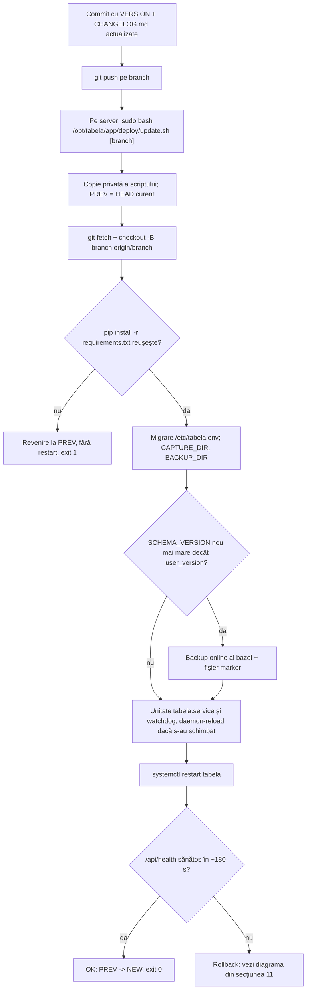
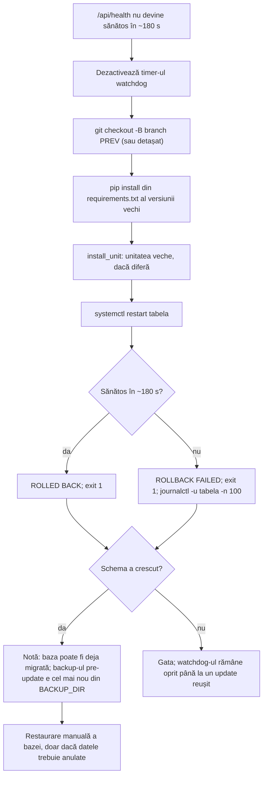

# Deploy și configurare

Această pagină descrie cum ajunge codul pe serverul Ubuntu, ce setări citește aplicația, ce fac scripturile `deploy/install.sh` și `deploy/update.sh`, ce unități systemd și ce configurare nginx sunt în repo, cum se face o versiune nouă și cum se revine la una veche.

Pagina a fost scrisă din codul și fișierele de configurare din repo, la versiunea `Beta 1.43` (fișierul `VERSION`). Acolo unde o afirmație nu s-a putut verifica din repo (de exemplu, ce există pe server și nu e în git), este marcată cu **nesigur** și se spune ce fișier sau ce comandă trebuie verificată.

Convenții:

- **Secret**: valoare care nu trebuie afișată, copiată în chat, pusă în git sau în log. În exemple apar doar substituenți de forma `<...>`.
- Căile de pe server sunt cele din scripturi: codul în `/opt/tabela/app`, venv-ul în `/opt/tabela/venv`, datele în `/var/lib/tabela`, configurarea în `/etc/tabela.env`.

## Cuprins

1. [Privire de ansamblu](#1-privire-de-ansamblu)
2. [Configurare: fișierul /etc/tabela.env și variabilele](#2-configurare-fișierul-etctabelaenv-și-variabilele)
3. [install.sh, pas cu pas](#3-installsh-pas-cu-pas)
4. [update.sh, pas cu pas](#4-updatesh-pas-cu-pas)
5. [Unități systemd](#5-unități-systemd)
6. [nginx](#6-nginx)
7. [Firewall](#7-firewall)
8. [Certificate TLS (Let's Encrypt)](#8-certificate-tls-lets-encrypt)
9. [DNS dinamic (No-IP)](#9-dns-dinamic-no-ip)
10. [Procesul de release](#10-procesul-de-release)
11. [Rollback](#11-rollback)
12. [Observații și lucruri de verificat](#12-observații-și-lucruri-de-verificat)

## 1. Privire de ansamblu

Aplicația rulează ca un singur proces uvicorn, sub userul de sistem `tabela`, ascultând doar pe `127.0.0.1:8000`. În același proces rulează și poller-ul care citește tabla CFR, deci nu se pornesc mai mulți workeri (vezi `deploy/tabela.service`, linia cu `--workers 1`). În fața aplicației stă nginx, care termină TLS pe portul 443 și trimite cererile la aplicație.

Componentele, cu fișierele lor:

| Componentă | Fișier în repo | Rol |
|---|---|---|
| Aplicația (FastAPI + poller OCR) | `deploy/tabela.service`, `app/` | Serviciul `tabela`, pe `127.0.0.1:8000` |
| Reverse proxy și TLS | `deploy/nginx-tabela.conf`, `deploy/tabela-limits.conf` | Site-ul nginx și zonele de rate limit |
| Instalare inițială | `deploy/install.sh` | Pachete, utilizator, venv, `/etc/tabela.env`, systemd, nginx |
| Actualizare cu rollback | `deploy/update.sh` | Deploy, migrare, verificare de sănătate, rollback |
| Watchdog | `deploy/tabela-watchdog.service`, `deploy/tabela-watchdog.timer`, `deploy/tabela-watchdog.sudoers`, `app/watchdog.py` | Repornește `tabela` dacă `/api/health` eșuează |
| Antrenare umbră (nocturnă) | `deploy/tabela-shadow-train.service`, `deploy/tabela-shadow-train.timer`, `scripts/nightly_shadow_train.py` | Antrenare zilnică a clasificatorului de cifre, fără promovare automată |
| DNS dinamic | nu e în repo; vezi [secțiunea 9](#9-dns-dinamic-no-ip) | Ține hostname-ul pe IP-ul public curent |
| Certificate | Let's Encrypt prin certbot; vezi [secțiunea 8](#8-certificate-tls-lets-encrypt) | TLS pentru `tabelacfr.ddns.net` |

Fluxul de deploy, de la commit până la verificarea de sănătate:



## 2. Configurare: fișierul /etc/tabela.env și variabilele

### 2.1 Fișierul

- Calea: `/etc/tabela.env`. Este citit de systemd prin `EnvironmentFile=/etc/tabela.env` din `deploy/tabela.service`. Nu este în git (în repo există doar modelul `.env.example`, fără valori reale).
- Permisiuni: proprietar `root:root`, mod `600`. Scriptul `install.sh` le setează la creare și la fiecare rulare (`chown root:root`, `chmod 600`). Scriptul `update.sh` folosește același tipar, cu fișier temporar și `mv`, ca să nu existe o clipă în care fișierul are alte permisiuni.
- Motivul: fișierul conține cheia privată VAPID și, la nevoie, `ADMIN_TOKEN` și tokenul Telegram. Un utilizator obișnuit nu trebuie să-l poată citi.
- Format: linii `CHEIE=valoare`, fără `export`, fără spații în jurul `=`. Fiecare linie se termină cu newline. Scripturile au grijă ca o linie nouă să nu se lipească de ultima linie fără newline (vezi `env_add_missing` în `update.sh` și `env_rewrite` în `install.sh`).
- Modificare: `sudo nano /etc/tabela.env`, apoi `sudo systemctl restart tabela` (variabilele se citesc la pornire). Nu se modifică fișierul prin `update.sh`, cu excepția adăugării automate a variabilelor lipsă (vezi secțiunea 4).

### 2.2 Variabile citite de app/config.py

Funcția `get_settings()` din `app/config.py` construiește obiectul `Settings`. Tabelul de mai jos conține fiecare variabilă citită acolo, cu valoarea implicită din cod (cea folosită când variabila lipsește sau e goală, acolo unde codul o tratează așa), sensul și comportamentul când lipsește.

| Variabilă | Tip | Implicit în cod | Sens | Interval valid | Dacă lipsește sau e invalidă |
|---|---|---|---|---|---|
| `DB_PATH` | șir (cale) | `tabela.db` | Fișierul bazei SQLite. Pe server, `install.sh` scrie `/var/lib/tabela/tabela.db`. | Cale scriptibilă de utilizatorul `tabela`. | Implicitul este relativ, deci se rezolvă față de directorul de lucru `/opt/tabela/app`, care e read-only pentru serviciu (`ProtectSystem=strict`). Nu e configurația dorită. Pe server trebuie să fie setată. |
| `SOURCE_URL` | șir (URL) | `https://cfr.ro/gari/camereweb/index.php?statie=BucurestiNord` | Adresa de unde poller-ul ia imaginea tablei (`app/poller.py`, `fetch_board_image`). | URL HTTP(S) valid. | Se folosește implicitul, care este sursa de producție. |
| `VAPID_PRIVATE_KEY` | **Secret** (șir base64url) | `""` | Cheia privată VAPID pentru notificările push. Format: scalarul P-256 de 32 de octeți, codat base64url fără padding (așa cum îl citesc `py_vapid` și `pywebpush`). | Ambele chei VAPID trebuie să fie setate. | Notificările push sunt dezactivate. Aplicația se pornește și scrie un avertisment în log: „VAPID keys not configured; push notifications are disabled”. |
| `VAPID_PUBLIC_KEY` | șir (base64url) | `""` | Cheia publică VAPID, trimisă browserului pentru abonare de `GET /api/push/key` (`app/api.py`; fără cheie, ruta răspunde 404). Nu e secretă, dar se ține împreună cu cea privată. | Punctul public necomprimat P-256, codat base64url. | Ca mai sus: push dezactivat. |
| `VAPID_SUBJECT` | șir | `https://tabelacfr.ddns.net` | Subiectul din JWT-ul VAPID. `install.sh` scrie aceeași valoare pe serverul nou. | `mailto:` sau URL `https:`. | Implicitul din cod, `.env.example` și `install.sh` au aceeași valoare; `tests/test_deploy_static.py` verifică asta. |
| `TESSERACT_CMD` | șir (cale sau nume) | `tesseract` | Executabilul Tesseract, folosit prin `pytesseract` (`app/ocr/engine.py`). | Nume în `PATH` sau cale absolută. Timeout de 10 s per apel (`TESSERACT_TIMEOUT`). | Se caută `tesseract` în `PATH`. Dacă nu există, citirea OCR eșuează cu `OcrError`, iar verificarea Tesseract din administrare (`tesseract_status`, `app/admin.py`) o arată. |
| `POLLER_RESTART_BACKOFF` | real (secunde) | `5` | Prima pauză înainte de repornirea poller-ului după un crash. Se dublează la fiecare eșec, până la `POLLER_MAX_BACKOFF` = 300 s (`app/api.py`). | Orice număr; valorile negative sunt aduse la 0 la utilizare. | Se folosește 5 s. Dacă valoarea există, dar nu e număr, `float()` ridică eroare la `get_settings()` și aplicația nu pornește. |
| `POLLER_ENABLED` | booleană | `1` | `0` sau `false`, `no`, `off` (fără diferență între majuscule și minuscule) oprește poller-ul: aplicația servește doar ultima stare stocată. Folosit pentru dezvoltare. | `1` pornește, `0` oprește. | Poller pornit. |
| `LAST_IMAGE_PATH` | șir (cale) | `data/last.jpg` | Unde se salvează ultima imagine a tablei, pentru depanare OCR. Pe server: `/var/lib/tabela/last.jpg`. | Cale scriptibilă. Valoarea goală dezactivează salvarea (devine `None`). | Se folosește `data/last.jpg`, relativ la directorul de lucru, deci nescriptibil pe server. `update.sh` adaugă `LAST_IMAGE_PATH` dacă lipsește. |
| `REJECTED_DIR` | șir (cale) | `/var/lib/tabela/rejected` | Directorul cu ultimele cadre respinse (citiri parțiale sau OCR eșuat). Se păstrează ultimele 40 (`REJECTED_KEEP` în `app/rejected.py`). | Cale scriptibilă. Valoarea goală dezactivează salvarea. | Se folosește `/var/lib/tabela/rejected`. |
| `WEATHER_ENABLED` | booleană | `1` | Pornește sau oprește modulul meteo (`app/weather.py`, `config_from_env`). Valorile de oprire sunt `0`, `false`, `no`, `off`. | `1` sau `0` (și alternativele de mai sus). | Meteo pornit. |
| `WEATHER_URL` | șir (URL) | `https://api.open-meteo.com/v1/forecast` | Adresa API-ului Open-Meteo. | URL HTTP(S). Valoarea goală înseamnă implicitul. | Se folosește implicitul. |
| `WEATHER_LAT` | real (grade) | `44.4323` | Latitudinea punctului pentru prognoză. | Între `-90` și `90`. În afara intervalului se folosește implicitul. | Se folosește `44.4323`. |
| `WEATHER_LON` | real (grade) | `26.1063` | Longitudinea punctului pentru prognoză. | Între `-180` și `180`. În afara intervalului se folosește implicitul. | Se folosește `26.1063`. |
| `WEATHER_INTERVAL_S` | întreg (secunde) | `900` | Cât de des se cere prognoza. | Doar cifre. Minimul este `300` (`MIN_INTERVAL_S`): valorile mai mici sunt ridicate la 300. | Se folosește `900`. Valorile care nu sunt doar cifre se ignoră și se folosește implicitul. |

Observații despre tabel:

- Când `WEATHER_ENABLED` este oprit, `get_settings()` pune `weather=None`, iar modulul meteo nu pornește deloc.
- Motivul limitei de 300 s pentru `WEATHER_INTERVAL_S` este scris în cod: `MIN_INTERVAL_S = 300  # never more than one request per 5 minutes`.
- Pe server, `/etc/tabela.env` trebuie să suprascrie implicitele relative (`DB_PATH`, `LAST_IMAGE_PATH`), pentru că serviciul nu poate scrie în directorul codului.

### 2.3 Variabile citite în alte module

`app/config.py` nu e singurul loc unde se citesc variabile de mediu. Următoarele sunt citite direct din module, deci nu apar în `Settings`. Valorile implicite sunt cele din cod, la data scrierii paginii.

| Variabilă | Fișier | Implicit | Sens |
|---|---|---|---|
| `ADMIN_TOKEN` | `app/admin.py` | nesetată (administrarea dezactivată) | **Secret.** Cheia pentru zona de administrare (`/#ocr` și rutele `/api/admin/`). Trebuie să aibă cel puțin 12 caractere (`MIN_TOKEN_LEN`), altfel administrarea rămâne dezactivată. Nu se compară în text clar: comparația e în timp constant. |
| `ADMIN_TOKEN_STRICT` | `app/admin.py`, `app/main.py` | `0` | Dacă este `1`, `true`, `yes` sau `on`, cheia trebuie să aibă cel puțin 24 de caractere (`STRICT_TOKEN_LEN`). La pornire, `check_startup()` refuză să pornească aplicația dacă cheia prezentă e mai scurtă. Mesajul de eroare nu conține cheia. |
| `DELAY_THRESHOLDS` | `app/api.py` | `5,15,30` | Pragurile de culoare pentru întârzieri, în minute, ca `low,mid,high`. Trebuie să fie trei numere întregi strict crescătoare, între 1 și 1440. Altfel se folosesc implicitele. |
| `CAPTURE_ENABLED` | `app/captures.py` | `1` | Salvarea capturilor OCR (imaginile cadrelor). Valorile de oprire ca la celelalte booleene. |
| `CAPTURE_DIR` | `app/captures.py` | `/var/lib/tabela/captures` dacă `/var/lib/tabela` există, altfel `data/captures` | Directorul capturilor. `update.sh` îl adaugă și creează directorul, cu proprietar `tabela`, mod `750`, dacă e sub `/var/lib/tabela`. |
| `CAPTURE_RETENTION_DAYS` | `app/captures.py` | `7` | După câte zile se șterg imaginile capturilor (metadatele rămân). Valorile sunt limitate la intervalul 0 până la 3650; `0` nu păstrează nicio imagine. Valorile care nu sunt întregi dau `7`. |
| `CAPTURE_MIN_FREE_MB` | `app/observations.py` | `2048` | Pragul de spațiu liber, în MB, folosit când pagina Setări a aplicației nu are un prag propriu (`min_free_bytes(store)`). Valorile care nu sunt întregi dau `2048`; cele negative devin `0`. |
| `BACKUP_DIR` | `app/dbbackup.py` | `<directorul bazei>/backups` | Directorul backup-urilor făcute înainte de migrări. Pe server, implicitul este `/var/lib/tabela/backups`. |
| `OCR_FRAME_BUDGET_S` | `app/ocr/reader.py` | `8.0` | Timpul maxim de OCR pe cadru, inclusiv recitirile. Nu e negativ (valoarea negativă devine 0). |
| `FINAL_READ_MAX_GAP_MIN` | `app/journeys.py` | `15` | Parametru de timp, în minute, la stabilirea stării finale a unei călătorii (`final_gap_min()`). Valorile în afara intervalului 1–240 și cele care nu sunt întregi dau `15`. Sensul exact al intervalului: nesigur, citește `app/journeys.py`. |
| `STATS_INCLUDE_LOW_QUALITY` | `app/quality.py` | `0` | Dacă este `1`, perioada de calitate redusă (`quality_periods`) intră în statistici. Implicit, este exclusă. |
| `STATS_CACHE_TTL_S` | `app/stats_overview.py` | `60` | Cât timp se păstrează rezultatul agregatelor statistice (un singur calcul simultan). |
| `STATS_MIN_SAMPLE` | `app/stats.py` | `5` | Sub acest număr de observații nu se afișează procente. |
| `ON_TIME_MAX_MIN` | `app/stats.py` | `5` | Întârzierea maximă, în minute, considerată „la timp”. Interval acceptat: 0 până la 60. |
| `TELEGRAM_BOT_TOKEN` | `app/telegram.py` | `""` | **Secret.** Tokenul botului Telegram pentru alerte. Canalul e activ doar dacă sunt setate și tokenul și `TELEGRAM_CHAT_ID`. Tokenul nu apare în log și nu e returnat de API. |
| `TELEGRAM_CHAT_ID` | `app/telegram.py` | `""` | Identificatorul conversației care primește alertele. |
| `TELEGRAM_STATE_PATH` | `app/telegram.py` | `data/telegram_sent.json` | Fișierul cu evenimentele deja trimise, ca să nu se retrimită după repornire. Implicitul este relativ; pe server, `deploy/tabela.service` îl setează la `/var/lib/tabela/telegram_sent.json` (singurul loc scriptibil). |

Variabile folosite doar de scripturi și de utilitare din `scripts/` (nu de serviciu):

| Variabilă | Unde | Sens |
|---|---|---|
| `DB_PATH` | `app/quality.py`, `scripts/purge_ghosts.py`, `scripts/merge_number_dups.py`, `scripts/ambiguous_pairs.py` | Implicit pentru argumentul `--db`. |
| `TESSERACT_CMD` | `scripts/dev_seed.py`, `scripts/ocr_eval.py`, `scripts/ocr_digit_clf.py` | Dacă nu e setată, scripturile încearcă `C:\Program Files\Tesseract-OCR\tesseract.exe` (Windows). |
| `OCR_TRUTH_DIR` | `scripts/ocr_eval.py`, `tests/ocr_truth_images.py` | Directorul cu capturile private ale setului de adevăr. Implicit `tests/fixtures/ocr_truth/private/`. |
| `NPROC` | `scripts/ocr_eval.py`, `scripts/ocr_digit_clf.py` | Numărul de procese paralele. |
| `OMP_THREAD_LIMIT` | `scripts/ocr_eval.py`, `scripts/ocr_digit_clf.py` | Setată de script la `1`. |

### 2.4 Comparație: cod, install.sh și .env.example

Trei surse dau valori pentru aceleași variabile. Tabelul arată diferențele.

| Variabilă | Implicit în cod | Scris de `install.sh` pe server nou | În `.env.example` |
|---|---|---|---|
| `DB_PATH` | `tabela.db` (relativ) | `/var/lib/tabela/tabela.db` | `/var/lib/tabela/tabela.db` |
| `LAST_IMAGE_PATH` | `data/last.jpg` | `/var/lib/tabela/last.jpg` | `/var/lib/tabela/last.jpg` |
| `POLLER_ENABLED` | `1` | `1` | `1` |
| `VAPID_SUBJECT` | `https://tabelacfr.ddns.net` | `https://tabelacfr.ddns.net` | `https://tabelacfr.ddns.net` |
| `REJECTED_DIR` | `/var/lib/tabela/rejected` | absentă (se folosește implicitul) | `/var/lib/tabela/rejected` |
| `CAPTURE_DIR` | `/var/lib/tabela/captures` (dacă directorul există) | absentă; `update.sh` o adaugă | `/var/lib/tabela/captures` |
| `CAPTURE_RETENTION_DAYS` | `7` | absentă | `7` |
| `CAPTURE_MIN_FREE_MB` | `2048` | absentă | `2048` |
| `VAPID_PRIVATE_KEY`, `VAPID_PUBLIC_KEY` | `""` | generate la prima instalare | goale |
| `ADMIN_TOKEN` | nesetată | absentă (se pune manual) | goală |

Concluzie: la prima instalare, `install.sh` nu scrie `CAPTURE_DIR`, `CAPTURE_RETENTION_DAYS`, `CAPTURE_MIN_FREE_MB` și `REJECTED_DIR`. Acestea funcționează cu implicitele din cod, dar sunt diferite de ce arată `.env.example`. Diferența de `VAPID_SUBJECT` nu strică funcționarea, dar trebuie știută la o eventuală reinstalare.

### 2.5 Valorile de placeholder pentru documentație

Când scrii documentație sau un fișier de exemplu, folosește substituenți:

```ini
DB_PATH=/var/lib/tabela/tabela.db
VAPID_PRIVATE_KEY=<cheie-privată-VAPID, generată de install.sh, SECRET>
VAPID_PUBLIC_KEY=<cheie-publică-VAPID, generată de install.sh>
VAPID_SUBJECT=https://<domeniul-site-ului>
ADMIN_TOKEN=<cheie-administrare, minim 12 caractere, SECRET>
TELEGRAM_BOT_TOKEN=<token-bot, SECRET>
```

Niciodată nu se scriu valori reale în documentație, în CHANGELOG, în commit sau în chat.

## 3. install.sh, pas cu pas

Scriptul este pentru prima instalare, dar poate fi rulat și peste o instalare existentă, fiind idempotent. Se rulează ca root:

```bash
sudo bash install.sh [branch]
```

Antetul scriptului spune ce nu face: nu pornește `ufw` (firewall-ul este NSG-ul din cloud, conform comentariului din cod), iar cheia privată VAPID nu se afișează niciodată. Variabilele `REPO_URL` (implicit `https://github.com/Andy217Ace/tabela-gara-de-nord.git`) și `APP_DIR` (implicit `/opt/tabela/app`) pot fi suprascrise prin mediu.

Pașii, în ordinea din cod:

1. **Alegerea branch-ului.** Dacă se dă argument, acela e branch-ul. Altfel, se ia branch-ul curent din `/opt/tabela/app` (dacă există un checkout). Dacă checkout-ul e pe HEAD detașat, scriptul oprește cu eroare și cere argumentul. Dacă nu există checkout și nu e dat argument, scriptul oprește cu eroare. Variabila `BRANCH_ONLY=1` oprește scriptul după acest pas (folosită de teste).
2. **Verificarea rolului.** Scriptul cere `id -u` egal cu 0. Verificarea vine după alegerea branch-ului.
3. **Pachete.** `apt-get update`, apoi `apt-get install -y` pentru `tesseract-ocr`, `tesseract-ocr-ron`, `python3-venv`, `git`, `curl`, `sqlite3`. Cu `DEBIAN_FRONTEND=noninteractive`, ca să nu ceară confirmări.
4. **Utilizator și directoare.** Creează utilizatorul de sistem `tabela` (fără login, `nologin`, directorul home `/var/lib/tabela`), dacă nu există. Creează `/opt/tabela` (`root:root`, `755`) și `/var/lib/tabela` (`tabela:tabela`, `750`).
5. **Codul.** Dacă `/opt/tabela/app` nu e un repo git, face `git clone --branch <branch>`. Dacă există, face `git fetch --prune origin <branch>` și `git checkout -B <branch> origin/<branch>`. Afișează ultimul commit.
6. **Venv.** Creează `/opt/tabela/venv` dacă nu există, face upgrade la `pip`, apoi `pip install -r requirements.txt`.
7. **Fișierul de configurare.** Dacă `/etc/tabela.env` nu există, îl creează cu `umask 077` și patru linii: `DB_PATH`, `LAST_IMAGE_PATH`, `POLLER_ENABLED=1`, `VAPID_SUBJECT=https://tabelacfr.ddns.net`. Apoi setează `root:root` și `600`.
8. **Migrarea unei instalări vechi.** Dacă lipsește `LAST_IMAGE_PATH`, o adaugă (cu rescriere atomă a fișierului).
9. **Chei VAPID.** Dacă nu există `VAPID_PRIVATE_KEY` cu valoare, generează o pereche P-256 și scrie ambele chei. Dacă există cheia privată, dar lipsește cea publică, o derivă din cea privată. Cheia privată existentă nu se regenerează niciodată, pentru că ar invalida toate abonările push existente (motivul este scris în comentariul scriptului și în README). Din tot scriptul, doar cheia publică se afișează.
10. **systemd, serviciul principal.** Copiază `deploy/tabela.service` în `/etc/systemd/system/`, face `daemon-reload`, `enable`, apoi `restart` pe `tabela`.
11. **systemd, watchdog.** Copiază `tabela-watchdog.service` și `tabela-watchdog.timer` în `/etc/systemd/system/`, face `daemon-reload` și `enable --now` pe timer. **Scriptul nu instalează regula sudoers a watchdog-ului** (`deploy/tabela-watchdog.sudoers`). Vezi secțiunea 12.
12. **nginx.** Creează `/root/backup-<data>` (mod `700`) și copiază acolo site-ul și `tabela-limits.conf` actuale, dacă există. Instalează `deploy/tabela-limits.conf` în `/etc/nginx/conf.d/tabela-limits.conf` și `deploy/nginx-tabela.conf` în `/etc/nginx/sites-available/tabela`, creează symlink-ul în `sites-enabled`, rulează `nginx -t`.
    - Dacă `nginx -t` reușește, face `systemctl reload nginx`.
    - Dacă eșuează, restaurează copiile de backup (sau șterge fișierele, la prima instalare), rulează din nou `nginx -t` și reîncarcă, apoi iese cu cod `1`.
13. **Verificarea de sănătate.** Până la 90 de încercări, la fiecare 2 secunde (în total, cam 180 s), cere `http://127.0.0.1:8000/api/health` și caută `"ok":true`. Dacă reușește, afișează „healthy after ... s” și iese cu `0`. Dacă nu, afișează „not healthy after 180 s; see: journalctl -u tabela -n 100” și iese cu `1`. Spre deosebire de `update.sh`, **nu** face rollback.

Concluzie practică: primul `install.sh` cere ca certificatele Let's Encrypt să existe deja, pentru că fișierul nginx din repo referă `/etc/letsencrypt/live/tabelacfr.ddns.net/`. Fără ele, `nginx -t` eșuează și scriptul șterge site-ul pe care tocmai l-a instalat.

## 4. update.sh, pas cu pas

Scriptul actualizează codul de pe server. Se rulează ca root, după ce commit-ul cu versiunea nouă este pe branch:

```bash
sudo bash /opt/tabela/app/deploy/update.sh [branch]
```

Fără argument, folosește branch-ul curent din checkout. Pe HEAD detașat oprește cu eroare și cere branch-ul explicit. Scriptul se copiază într-un fișier temporar și rulează din copie, pentru că `git checkout` înlocuiește fișierul de pe disc în timpul rulării. Copia este ștearsă la ieșire (`trap ... EXIT`).

### 4.1 Variabilele care pot fi suprascrise

Valorile implicite sunt cele de producție. Testele din `tests/test_update_sh.py` le suprascriu pentru a simula un server.

| Variabilă | Implicit | Rol |
|---|---|---|
| `APP_DIR` | `/opt/tabela/app` | Checkout-ul aplicației |
| `VENV` | `/opt/tabela/venv` | Venv-ul; `PIP` și `PYTHON` se derivă din el |
| `ENV_FILE` | `/etc/tabela.env` | Fișierul de configurare |
| `DATA_DIR` | `/var/lib/tabela` | Directorul datelor |
| `BACKUP_DIR` | `$DATA_DIR/backups` | Directorul backup-urilor de bază de date |
| `BACKUP_KEEP` | `5` | Câte backup-uri se păstrează |
| `SVC_OWNER` | `tabela` | Proprietarul directoarelor de capturi și backup; gol înseamnă utilizatorul curent |
| `HEALTH_URL` | `http://127.0.0.1:8000/api/health` | Adresa verificată |
| `HEALTH_CMD` | `curl -fs $HEALTH_URL` | Comanda care cere sănătatea |
| `HEALTH_TRIES` | `90` | Numărul de încercări |
| `HEALTH_SLEEP` | `2` | Secunde între încercări |
| `HEALTH_MODE` | `strict` | `strict` sau `up` (vezi 4.3) |
| `SYSTEMCTL`, `PIP`, `PYTHON`, `CHOWN`, `CHMOD` | comenzile reale | Înlocuite în teste |
| `UNIT_SRC`, `UNIT_DST` | `deploy/tabela.service`, `/etc/systemd/system/tabela.service` | Unitatea principală |
| `WD_UNIT_DIR`, `WD_SUDOERS_DST` | `/etc/systemd/system`, `/etc/sudoers.d/tabela-watchdog` | Destinațiile watchdog-ului |
| `REQUIRE_ROOT` | `1` | Dacă e `0`, scriptul nu cere root (doar pentru teste) |
| `TABELA_UPDATE_COPY` | setat intern | Calea copiei private a scriptului |

### 4.2 Pașii, în ordinea din cod

1. **Starea curentă.** Stabilește branch-ul și înregistrează `PREV`, commit-ul care rulează acum. Afișează `== current: ...`.
2. **Validarea modului de sănătate.** `HEALTH_MODE` trebuie să fie `strict` sau `up`, altfel oprește.
3. **Avertisment pre-deploy.** Dacă modul este `strict`, cere sănătatea înainte de orice modificare. Dacă răspunsul conține `"ok":false`, afișează un avertisment: poarta strictă nu va trece, iar scriptul va face rollback. Recomandă `HEALTH_MODE=up` pentru o redistribuire de urgență. Este doar un avertisment, nu oprește scriptul.
4. **Fetch și checkout.** `git fetch --prune origin <branch>`, apoi `git checkout -q -B <branch> origin/<branch>`. Dacă oricare dintre ele eșuează, scriptul se oprește (`set -e`) înainte de a atinge serviciul. Serviciul rămâne pe codul vechi.
5. **pip install.** `pip install -q -r requirements.txt`. Dacă eșuează, apelează `abort_before_restart`: pune înapoi `PREV` (sau detașează HEAD-ul dacă era detașat), reinstalează dependențele vechi (ignorând eroarea), iese cu `1`. **Serviciul nu este repornit.** Codul care rulează rămâne cel vechi.
6. **Variabile lipsă din /etc/tabela.env.** Adaugă `LAST_IMAGE_PATH=$DATA_DIR/last.jpg` și `CAPTURE_DIR=$DATA_DIR/captures` dacă lipsesc (funcția `env_add_missing`, care nu lipește linia de ultimul rând fără newline). Dacă scrierea eșuează, abort înainte de restart.
7. **Directorul de capturi.** Citește `CAPTURE_DIR` din fișier (ultima apariție, fără ghilimele). Dacă e gol, nu face nimic. Dacă e sub `$DATA_DIR/`, îl creează, îl dă lui `SVC_OWNER` și `750`. Dacă e în afara `$DATA_DIR`, scrie un avertisment: serviciul nu poate scrie acolo (`ReadWritePaths`). Dacă pregătirea eșuează, abort înainte de restart.
8. **Directorul de backup.** Avertisment dacă `BACKUP_DIR` nu e sub `$DATA_DIR`. Apoi `prepare_backup_dir`: dacă e symlink, oprește cu eroare (un symlink nu se predă utilizatorului serviciului, ca să nu se schimbe proprietarul unui loc arbitrar). Altfel, îl creează cu umask `077`, apoi `chown -h SVC_OWNER:SVC_OWNER` și `chmod 750`. Motivul: aplicația listează directorul la pornire, înainte de migrare, iar un director `root:root 0700` a oprit pornirea versiunii Beta 1.29 (comentariul din cod). Fișierele existente își păstrează proprietarul.
9. **Verificarea versiunii schemei.** Calculează `OLD_V` = `PRAGMA user_version` al bazei live (`0` dacă fișierul nu există, citit în mod read-only). Calculează `NEW_V` = `SCHEMA_VERSION` din `app/store.py`. Dacă baza există și `NEW_V > OLD_V`, face backup înainte de restart. Dacă citirea versiunii eșuează, abort.
10. **Backup la migrare.** `backup_db`:
    - face o copie online cu `sqlite3 -readonly ... ".backup"` (dacă `sqlite3` lipsește, folosește API-ul de backup din Python);
    - scrie în `tabela-<AAAALLZZ-HHMMSS>-v<OLD_V>.db.tmp` (`AAAALLZZ` este data, `HHMMSS` ora);
    - verifică `PRAGMA integrity_check` pe copie;
    - redenumește în `.db` doar după verificare; un eșec nu lasă fișier parțial;
    - păstrează doar ultimele `BACKUP_KEEP` fișiere `tabela-*.db`;
    - scrie fișierul marker `.pre-migration-backup` lângă baza de date (cu `version`, `backup`, `db`). Dacă scrierea markerului eșuează, doar avertizează. Aplicația folosește markerul ca dovadă a backup-ului când nu poate vedea directorul de backup (`app/dbbackup.py`).
    
    Dacă backup-ul eșuează, abort înainte de restart.
11. **Unitatea systemd principală.** `install_unit` copiază `deploy/tabela.service` în `/etc/systemd/system/` doar dacă diferă și face `daemon-reload`.
12. **Watchdog.** `install_watchdog`:
    - validează `deploy/tabela-watchdog.sudoers` cu `visudo -cf`; dacă e invalid, abort (un fișier sudoers stricat ar strica `sudo` pe tot serverul); altfel îl instalează ca `/etc/sudoers.d/tabela-watchdog` cu mod `440`, doar dacă diferă;
    - dacă există `$DATA_DIR/watchdog.json`, îl dă lui `SVC_OWNER`, pentru că îl scrie watchdog-ul ca utilizatorul `tabela`;
    - copiază `tabela-watchdog.service` și `tabela-watchdog.timer` dacă diferă; dacă s-a schimbat ceva, face `daemon-reload`;
    - dacă fișierul timer-ului există în checkout, face `enable --now tabela-watchdog.timer`.
    
    Fiecare eșec aici face abort înainte de restart.
13. **Restart.** `systemctl restart tabela`.
14. **Verificarea de sănătate.** `healthy()` încearcă de `HEALTH_TRIES` ori, cu pauze de `HEALTH_SLEEP` secunde. Cu valorile implicite, asta înseamnă 90 de încercări, adică aproximativ 180 s. În modul `strict`, răspunsul trebuie să conțină `"ok":true`. În modul `up`, este suficient ca răspunsul să conțină `"ok":` (adică aplicația răspunde, indiferent dacă CFR e citit).
    - Dacă reușește: afișează `OK: <PREV> -> <NEW> (<versiunea din VERSION>)` și iese cu `0`.
    - Dacă nu: intră în rollback (secțiunea 4.4).

### 4.3 Moduri de sănătate

- **`strict`** (implicit): aplicația trebuie să fie pornită și să fi citit tabla CFR recent. `/api/health` returnează `ok: true` doar dacă ultima citire reușită este mai nouă de 180 s (`STALE_S` în `app/api.py`). Dacă CFR nu răspunde, nicio versiune nu trece poarta, deci nici rollback-ul nu ajută: de aceea scriptul avertizează înainte.
- **`up`**: suficient ca `/api/health` să răspundă cu un JSON care conține `"ok":`. Se folosește doar pentru redistribuiri de urgență, când problema este la CFR, nu la cod. Exemplu: `sudo HEALTH_MODE=up bash /opt/tabela/app/deploy/update.sh <branch>`.

### 4.4 Rollback automat în update.sh

Dacă poarta de sănătate eșuează după restart, scriptul face următoarele, în ordine:

1. Dezactivează timer-ul watchdog-ului (`disable --now tabela-watchdog.timer`, eroarea e ignorată dacă unitatea lipsește). Motivul din cod: watchdog-ul nu trebuie să repornească versiunea veche, pe care poate nu o cunoaște.
2. Revine la `PREV`, pe branch-ul inițial: `git checkout -B <branch> <PREV>`, sau detașează HEAD-ul dacă era detașat.
3. Reinstalează dependențele din `requirements.txt` ale versiunii vechi. Eșecul este doar avertisment.
4. Aplică unitatea systemd veche, dacă diferă (`install_unit`).
5. Repornește `tabela` și așteaptă sănătatea cu aceleași limite.
6. Dacă revenirea reușește, afișează `ROLLED BACK: running <commit> again (failed: <NEW>)`. Dacă nu, afișează `ROLLBACK FAILED` și trimite la `journalctl -u tabela`.
7. Dacă versiunea schemei a crescut (`NEW_V > OLD_V`), afișează o notă: codul nou poate fi migrat deja baza la `v<NEW_V>`, iar codul vechi ignoră coloanele noi. Backup-ul pre-update este cel mai nou fișier din `BACKUP_DIR`.

Scriptul iese cu `1` în toate cazurile de eșec, inclusiv când rollback-ul a reușit. Ce **nu** face rollback-ul: nu restaurează baza de date, nu reinstalează `sudoers` (rămâne cel nou), nu restaurează unitățile watchdog-ului și nu reactivează timer-ul watchdog-ului. Timer-ul rămâne oprit până la următorul `update.sh` reușit. Testul `test_rollback_disables_watchdog_timer_even_when_unit_is_missing` din `tests/test_update_sh.py` verifică dezactivarea.

### 4.5 Eșecuri înainte de restart

Pentru toate eșecurile dinaintea restart-ului (pip, variabile din env, directoare, backup, watchdog), `abort_before_restart` pune înapoi codul vechi (`PREV`) și reinstalează dependențele vechi. **Serviciul nu este repornit**, deci procesul care rulează nu e atins. Nota din cod explică motivul: fișierele statice sunt servite de pe disc, deci trebuie să rămână în acord cu procesul care rulează.

Limitare: dacă eșecul apare după ce `install_unit` a schimbat unitatea `tabela.service` (pasul 11) și înainte de restart (de exemplu, la pasul de watchdog), unitatea nouă rămâne instalată, pentru că `abort_before_restart` nu o restaurează. Vezi secțiunea 12.

## 5. Unități systemd

### 5.1 tabela.service (aplicația)

Fișier: `deploy/tabela.service`, instalat ca `/etc/systemd/system/tabela.service`.

| Directivă | Valoare | Sens |
|---|---|---|
| `After` / `Wants` | `network-online.target` | Pornește după rețea |
| `Type` | `simple` | Procesul principal este uvicorn |
| `User` / `Group` | `tabela` / `tabela` | Nu rulează ca root |
| `WorkingDirectory` | `/opt/tabela/app` | Directorul codului |
| `EnvironmentFile` | `/etc/tabela.env` | Variabilele din secțiunea 2 |
| `ExecStart` | `/opt/tabela/venv/bin/uvicorn app.main:create --factory --host 127.0.0.1 --port 8000 --workers 1 --proxy-headers --forwarded-allow-ips 127.0.0.1` | Un singur worker; ascultă doar local; acceptă antetele de proxy doar de la `127.0.0.1` |
| `Restart` / `RestartSec` | `always` / `5` | Repornire automată la orice oprire, după 5 s |
| `TimeoutStopSec` | `30` | Timp pentru oprire grațioasă (poller și notificări) |
| `NoNewPrivileges` | `true` | Procesul nu poate câștiga privilegii |
| `ProtectSystem` | `strict` | Sistemul de fișiere e read-only, cu excepțiile de mai jos |
| `ReadWritePaths` | `/var/lib/tabela` | Singurul loc scriptibil |
| `PrivateTmp` | `true` | Un `/tmp` propriu |
| `ProtectHome` | `true` | Fără acces la directoarele home |
| `PrivateDevices` | `true` | Fără acces la dispozitive |
| `ProtectKernelTunables`, `ProtectKernelModules`, `ProtectControlGroups` | `true` | Fără modificări ale kernelului și cgroup-urilor |
| `RestrictSUIDSGID` | `true` | Fără crearea de fișiere SUID/SGID |
| `LockPersonality` | `true` | Fără schimbarea modului de execuție |
| `RestrictAddressFamilies` | `AF_INET AF_INET6 AF_UNIX` | Doar familiile de adrese necesare |
| `UMask` | `0027` | Fișierele create nu sunt citibile de alții |

Notă: `ReadWritePaths` este singurul loc scriptibil. De aceea `CAPTURE_DIR`, `BACKUP_DIR` și `REJECTED_DIR` trebuie să fie sub `/var/lib/tabela`, iar `update.sh` avertizează când nu sunt.

### 5.2 Watchdog-ul

Fișiere: `deploy/tabela-watchdog.service`, `deploy/tabela-watchdog.timer`, `deploy/tabela-watchdog.sudoers`, cod în `app/watchdog.py`.

- **Serviciul** (`Type=oneshot`, `User=tabela`, `Group=tabela`, `WorkingDirectory=/opt/tabela/app`) rulează `python -m app.watchdog --state /var/lib/tabela/watchdog.json --url http://127.0.0.1:8000/api/health --service tabela`. Nu are directive de hardening în unitate. `TimeoutStartSec=90`.
- **Timer-ul** pornește serviciul o dată pe minut: `OnBootSec=2min`, `OnUnitActiveSec=60s`, `AccuracySec=5s`. Este activat cu `WantedBy=timers.target`.
- **Logica** (constante din `app/watchdog.py`): fiecare rulare face o verificare HTTP a `/api/health` (timeout 20 s, `CHECK_TIMEOUT_S`). Răspunsul trebuie să fie HTTP 200 cu JSON-obiect. Starea (numărul de eșecuri consecutive și ultima repornire) se păstrează în `watchdog.json` între rulări.
  - După `THRESHOLD = 3` verificări eșuate la rând, repornește `tabela`.
  - Cel mult o repornire la `RESTART_COOLDOWN_S = 600` secunde. Dacă al treilea eșec cade în perioada de cooldown, nu face nimic și scrie „restart skipped (cooldown)”.
  - Nu atinge nginx, pentru că o problemă de rețea nu trebuie mascată.
- **Repornirea** se face prin `sudo -n /bin/systemctl restart tabela`. Watchdog-ul rulează ca `tabela`, deci nu poate reporni serviciul direct. Regula `deploy/tabela-watchdog.sudoers` permite exact această comandă, fără parolă: `tabela ALL=(root) NOPASSWD: /bin/systemctl restart tabela`. Nu permite alte comenzi.
- **De ce fără root**: CHANGELOG-ul (Beta 1.42) spune că watchdog-ul „rulează ca userul `tabela` și are voie doar să repornească serviciul `tabela`, prin sudoers”. Are deci un singur drept, pe o singură comandă.

### 5.3 Antrenarea umbră (nocturnă)

Fișiere: `deploy/tabela-shadow-train.service`, `deploy/tabela-shadow-train.timer`, cod în `scripts/nightly_shadow_train.py`.

- **Serviciul** (`Type=oneshot`, `User=tabela`) rulează `/opt/tabela/venv/bin/python /opt/tabela/app/scripts/nightly_shadow_train.py`. Are `Nice=19`, `IOSchedulingClass=idle` și `TimeoutStartSec=2h`.
- **Hardening**: la fel ca serviciul principal, plus `ReadOnlyPaths=/opt/tabela` (codul nu poate fi modificat). `RestrictAddressFamilies=AF_UNIX`, deci nu are acces la rețea. Are `ReadWritePaths=/var/lib/tabela`, pentru că SQLite în mod citire are nevoie de fișierele `-wal` și `-shm`.
- **Timer-ul**: `OnCalendar=*-*-* 03:30:00`, `Persistent=true`. Dacă serverul era oprit la ora programată, rularea se face la următoarea pornire.
- **Ce face**: antrenează un clasificator de cifre în mod umbră. Scrie raportul și modelul în `/var/lib/tabela/shadow`. Nu promovează nimic în producție (comentariul din unitate și docstring-ul scriptului). Baza de date este deschisă doar în citire.
- **Instalare**: nici `install.sh`, nici `update.sh` nu copiază sau activează aceste unități. Ele trebuie instalate manual. Nesigur: verifică pe server cu `systemctl list-timers | grep shadow` și `ls /etc/systemd/system/tabela-shadow-train.*`. Nu e clar dacă directorul `/var/lib/tabela/shadow` este creat de cineva; verifică existența lui.

### 5.4 Ce instalează fiecare script

| Unitate | install.sh | update.sh | Manual |
|---|---|---|---|
| `tabela.service` | da (copiază, `enable`, `restart`) | da (dacă diferă, `daemon-reload`) | |
| `tabela-watchdog.service` și `.timer` | da (copiază, `enable --now`) | da (dacă diferă, `enable --now`) | |
| regula sudoers a watchdog-ului | **nu** | da (`visudo -cf`, apoi `install -m 440`) | |
| `tabela-shadow-train.service` și `.timer` | nu | nu | da (nesigur, vezi mai sus) |
| site nginx și `tabela-limits.conf` | da | nu | |
| `tabela-noip` (DNS dinamic) | nu | nu | da (vezi secțiunea 9) |

## 6. nginx

### 6.1 Site-ul

Fișier: `deploy/nginx-tabela.conf`, instalat ca `/etc/nginx/sites-available/tabela` și legat în `sites-enabled`. Blocurile de server:

- **Serverul HTTPS** (`listen 443 ssl` și `listen [::]:443 ssl ipv6only=on`), pentru `tabelacfr.ddns.net`. Certificatele sunt în `/etc/letsencrypt/live/tabelacfr.ddns.net/`. Include `/etc/letsencrypt/options-ssl-nginx.conf` și `ssl_dhparam /etc/letsencrypt/ssl-dhparams.pem`, deci versiunile de TLS și cifrurile sunt cele din fișierele certbot. Nesigur: conținutul acestor fișiere nu e în repo; verifică pe server cu `cat /etc/letsencrypt/options-ssl-nginx.conf`.
- **Serverul HTTP** (`listen 80`, `server_name tabelacfr.ddns.net`): redirecționează cu `301` spre HTTPS când `Host` este `tabelacfr.ddns.net`; în rest răspunde `404` (`return 404`). Cererile cu alt `Host` nu ajung la acest bloc decât dacă nginx le alege ca server implicit. Liniile sunt marcate „managed by Certbot”.

Setări în serverul HTTPS:

| Directivă | Valoare | Sens |
|---|---|---|
| `client_max_body_size` | `8k` | Corpul cererilor e mic: aplicația nu primește upload-uri mari |
| `server_tokens` | `off` | Versiunea nginx nu apare în antete și pagini de eroare |
| `gzip` | `on`, `gzip_min_length 512`, `gzip_proxied any` | Compresie pentru text, JSON, CSS, JS, manifest, SVG |
| `Strict-Transport-Security` | `max-age=31536000` (`always`) | HSTS pentru un an. Nu are `includeSubDomains` |
| `proxy_http_version` | `1.1` | |
| `proxy_set_header Host` | `$host` | |
| `X-Real-IP` | `$remote_addr` | |
| `X-Forwarded-For` | `$proxy_add_x_forwarded_for` | |
| `X-Forwarded-Proto` | `$scheme` | Aplicația știe dacă cererea a venit prin HTTPS |
| `proxy_read_timeout` | `30s` | |
| `proxy_connect_timeout` | `5s` | |
| `limit_req_status` | `429` | Cererile respinse primesc 429, nu 503 |

Antetele de securitate (`X-Content-Type-Options: nosniff`, `Referrer-Policy: no-referrer`, `X-Frame-Options: DENY` și `Content-Security-Policy`) sunt puse de aplicație, în middleware-ul din `app/api.py`, nu de nginx. Comentariul din site spune asta.

### 6.2 Locațiile și zonele de rate limit

Ordinea de potrivire contează: nginx încearcă mai întâi potrivirea exactă (`=`), apoi regex-urile (în ordinea din fișier), apoi prefixul cel mai lung.

| Locație | Zonă `limit_req` | Burst | Particularități |
|---|---|---|---|
| `= /api/follows` | `tabela_api` | 20 (`nodelay`) | `access_log off`. Endpoint-ul de abonare push are datele în query string, deci nu se loghează |
| `= /api/admin/login` | `tabela_admin_login` | 5 (`nodelay`) | Limită strictă pentru autentificarea administratorului |
| `~ ^/api/(stats\|trains/stats\|trains/[0-9]+/journeys\|stations\|journeys)(/\|$)` | `tabela_stats` | 20 (`nodelay`) | Agregate calculate pe întreg istoricul |
| `/api/` | `tabela_api` | 20 (`nodelay`) | Restul API-ului |
| `/` | nicio limită | | Fișierele statice, servite de aplicație |

Zonele sunt definite în `deploy/tabela-limits.conf`, instalat ca `/etc/nginx/conf.d/tabela-limits.conf` (context `http`):

| Zonă | Cheie | Memorie | Rată | Motiv |
|---|---|---|---|---|
| `tabela_api` | `$binary_remote_addr` (IP) | 10 MB | 10 cereri/s | Limita generală pentru API |
| `tabela_admin_login` | IP | 1 MB | 5 cereri/min | Protecție împotriva ghicirii cheii de administrare. Aplicația răspunde și ea 429 după 5 eșecuri |
| `tabela_stats` | IP | 10 MB | 60 cereri/min (1/s) | Statisticile sunt calculate pe tot istoricul, deci sunt scumpe |

`limit_req_log_level warn` (în același fișier) face ca respingerile 429 să se logheze la nivelul `warn`, sub `error`. Motivul din comentariu: o respingere de `limit_req` poate scrie linia cererii, cu query string-ul, în `error.log`. Pentru `/api/follows` asta ar expune endpoint-ul de push. Nu coborî nivelul `error_log` la `warn` sau `info` fără să ții cont de asta (vezi și README, secțiunea de log-uri).

Testul `test_nginx_admin_login_rate_limited_and_certbot_untouched` din `tests/test_ocr_static.py` verifică textul fișierelor: zona `tabela_admin_login` cu `rate=5r/m`, `burst=5` pe `/api/admin/login`, `location = /api/admin/login` înaintea `location /api/`, și exact 8 linii „managed by Certbot”.

### 6.3 Ce este cache-uit

- **nginx nu cache-uiește nimic**: nu există `proxy_cache`, `proxy_cache_path` sau `expires` în `deploy/nginx-tabela.conf` și `deploy/tabela-limits.conf`. Singura optimizare de transfer este `gzip`.
- **Aplicația** setează antetele de cache:
  - fișierele statice (tot ce nu e sub `/api/`): `Cache-Control: no-cache`, adică browserul revalidează cu ETag. Motivul din cod: un deploy să fie văzut imediat (`app/api.py`);
  - `/sw.js` și `/manifest.webmanifest`: `no-cache` (`app/api.py`; `test_web_static.py` verifică `/sw.js`);
  - `/api/changelog`: `no-cache`;
  - exportul CSV al istoricului și erorile lui: `no-store` (`app/api.py`); răspunsurile de administrare au `Cache-Control: private, no-store` (`app/admin.py`);
  - pentru restul `/api/`, aplicația nu setează `Cache-Control` implicit;
- **Cache-ul de statistici** este în proces, nu în nginx: rezultatul agregatelor se păstrează `STATS_CACHE_TTL_S` secunde (implicit 60). Vezi tabelul din secțiunea 2.3.
- **Service worker-ul** (`web/sw.js`) cache-uiește fișierele din `SHELL` în două cache-uri, `tabela-shell-<VERSION>` și `tabela-board-<VERSION>`. Comentariul din fișier spune: „Bump VERSION when the shell list changes; old caches are deleted on activate.” Regula de bump este în secțiunea 10.

## 7. Firewall

Ce spune documentația (de verificat pe server):

- README (secțiunea de deploy): „`ufw` nu se activează: firewall-ul e NSG-ul Azure.” Acesta este singurul text din repo despre firewall-ul serverului. Atenție: dacă serverul actual nu mai este pe Azure, această propoziție este depășită. Nesigur: verifică ce firewall e activ pe mașina reală.
- Antetul `deploy/install.sh`: „Never enables ufw (the cloud NSG is the firewall).”
- Planul de implementare `docs/superpowers/plans/2026-10-20-tabela-gara-de-nord.md`, pasul 2 al instalării, menționează `ufw allow 80,443`. Este un plan, nu o procedură verificată, și nu se regăsește în README sau CHANGELOG.

Porturi necesare, din configurare:

| Port | Expus public | Motiv |
|---|---|---|
| 80 (TCP) | da | Redirecționare spre HTTPS pentru `tabelacfr.ddns.net` și `404` pentru restul cererilor HTTP din acest bloc (`listen 80` în `nginx-tabela.conf`) |
| 443 (TCP) | da | Site-ul HTTPS |
| 8000 (TCP) | nu | Uvicorn ascultă doar pe `127.0.0.1` (`--host 127.0.0.1` în `tabela.service`) |
| SSH (de obicei 22) | nesigur | Nu apare în repo. Verifică pe server |

Recomandare de verificare, fără a modifica nimic: `sudo ufw status verbose` (dacă ufw e instalat) și `sudo ss -tlnp` (ca să confirmi că 8000 ascultă doar pe loopback).

## 8. Certificate TLS (Let's Encrypt)

- Certificatele sunt emise de Let's Encrypt, cu certbot. Calea lor este `/etc/letsencrypt/live/tabelacfr.ddns.net/` (`fullchain.pem` și `privkey.pem`).
- Liniile marcate „managed by Certbot” din `deploy/nginx-tabela.conf` sunt scrise de certbot. Comentariul din fișier cere să rămână așa: `certbot renew` modifică doar fișierele din `/etc/letsencrypt`.
- Reînnoirea este automată, prin `certbot.timer`, unitatea pe care o instalează pachetul certbot. README spune asta. Nesigur: frecvența exactă și comanda de verificare nu sunt în repo. Verifică cu `systemctl list-timers | grep certbot` și cu `sudo certbot renew --dry-run`.
- Dacă reînnoirea eșuează, certificatul expiră după aproximativ 90 de zile de la emitere (regula Let's Encrypt). Nesigur: nu există în repo o alertă pentru expirare.
- Schimbarea certificatului nu cere `update.sh`. Pentru a reîncărca nginx după o reînnoire manuală: `sudo nginx -t && sudo systemctl reload nginx`.

## 9. DNS dinamic (No-IP)

Stare: updaterul DNS dinamic (unitatea numită `tabela-noip` în notele de operare, de verificat pe server) **nu este în repo** și **nu este instalat de `update.sh`**. A fost instalat manual pe server. Nu există nimic în repo despre el: nici fișier de unitate, nici script, nici credențiale. Acest lucru este deliberat, pentru că un updater de DNS are nevoie de credențiale care nu se pun în git.

Descriere generică a rolului: serverul are un IP public care se poate schimba. Un client de DNS dinamic raportează periodic IP-ul curent serviciului No-IP, pentru hostname-ul `tabelacfr.ddns.net`. Clientul rulează ca un serviciu systemd, programat cu un timer, iar credențialele lui stau într-un fișier local protejat, nu în repo.

Verificări pe server (fără a afișa credențiale):

```bash
systemctl status tabela-noip.service      # nesigur: numele exact al unității
systemctl list-timers | grep -i noip       # programarea
```

Dacă DNS-ul nu se actualizează, hostname-ul nu mai indică spre IP-ul serverului. Validarea Let's Encrypt se bazează pe acel nume, deci reînnoirea certificatului poate eșua. Nesigur: metoda de validare folosită de certbot pe server nu e în repo.

## 10. Procesul de release

Fiecare deploy aduce o versiune nouă. Schema versiunilor: `Beta 1.NN`, unde `NN` crește cu 1 la fiecare deploy (`VERSION`, `app/version.py`, README). Pașii:

1. **`VERSION`**: se trece `Beta 1.NN` cu `NN` mărit cu 1 (de exemplu, `Beta 1.42` devine `Beta 1.43`). Testul `test_version_file_follows_scheme` cere regex-ul `^Beta 1\.\d{2}$` și că `VERSION` este egal cu versiunea din cod.
2. **`CHANGELOG.md`**: sus, o secțiune nouă `## Beta 1.NN — AAAA-LL-ZZ`, cu grupurile `### Adăugat`, `### Schimbat`, `### Reparat` (sau altele, în română), și puncte `- ...`. Testele cer:
   - prima secțiune să fie versiunea din `VERSION` (`test_changelog_newest_first_and_current_version_documented`);
   - data să aibă forma `AAAA-LL-ZZ`;
   - cel puțin 5 puncte în prima secțiune;
   - versiunile să fie în ordine descrescătoare și fără goluri neexplicate. Un gol se explică printr-o notă „Beta 1.NN nu a fost publicată separat” (`test_version.py`, `_check_gaps`).
   - Motivul: `/api/changelog` și pagina „Versiuni” afișează chiar acest fișier, iar `update.sh` afișează versiunea din `VERSION`.
3. **`web/sw.js`**: se mărește `var VERSION = "vNN";` (service worker-ul). Motivul (comentariul din `web/sw.js`): cache-urile sunt legate de `VERSION` și cele vechi se șterg la activare. Fără bump, clienții ar folosi fișierele vechi din `SHELL`. Testele verifică doar că există și că e peste un prag minim (`test_ui2_static.py`: `>= 27`; `test_ui3_static.py`: `>= 28`; `test_statistici_static.py`: `>= 17`). **Nu verifică** că a fost incrementat la fiecare versiune.
4. **`web/ui2.js`**: `var CHARTS_V = "1.NN";` trebuie să fie **exact** egal cu `VERSION` fără prefixul `Beta `. Este folosit ca parametru de cache (`charts3.js?v=...`, `charts3.css?v=...`). Testul `test_lazy_not_in_precache_and_loader_matches_the_version` (în `tests/test_ui3_static.py`) verifică egalitatea. Acesta este singurul test care verifică strict o valoare de versiune.
5. **Testele**: `python -m pytest` din rădăcina repo-ului (vezi `docs/testare.md`). Repo-ul nu are fișiere de CI (`.github/` lipsește). Verificarea este deci locală.
6. **Commit**: CHANGELOG-ul și `VERSION` se comit **înainte** de rularea `update.sh` (comentariul din `update.sh`). Mesajul de commit este la alegerea autorului.
7. **Push** pe branch-ul de deploy.
8. **Tag**: în worktree-ul de lucru există tag-uri `beta-1.01` până la `beta-1.43`, deci convenția `beta-1.NN` este folosită. Nesigur: nu există în repo niciun script care le creează; se creează manual.
9. **Release pe GitHub**: README spune că versiunile și notele sunt în Releases. Nesigur: procesul de publicare nu este automatizat în repo.
10. **Deploy pe server**: `sudo bash /opt/tabela/app/deploy/update.sh [branch]`. La final, scriptul afișează `OK: <PREV> -> <NEW> (Beta 1.NN)`.
11. **Verificare post-deploy**: `curl -s http://127.0.0.1:8000/api/health` pe server, câmpul `version` trebuie să fie noua versiune, iar `ok` trebuie să fie `true`. Verificarea din exterior: `https://tabelacfr.ddns.net`, footerul afișează versiunea.

Ce teste protejează regulile de release:

| Test | Fișier | Ce verifică |
|---|---|---|
| `test_version_file_follows_scheme`, `test_changelog_newest_first_and_current_version_documented` | `tests/test_version.py` | `VERSION` ↔ `CHANGELOG.md` ↔ `/api/health` |
| `test_gap_check_*`, `test_changelog_explains_gap_1_22` | `tests/test_version.py` | Ordinea și golurile versiunilor |
| `test_deploy_docs_require_version_bump` | `tests/test_version.py` | README și `update.sh` cer `CHANGELOG.md` și `VERSION` |
| `test_lazy_not_in_precache_and_loader_matches_the_version` | `tests/test_ui3_static.py` | `CHARTS_V` = versiunea |
| `test_wiring_index_and_service_worker` | `tests/test_ui2_static.py` | `sw.js` există, `VERSION` peste prag |
| `test_service_worker_served_as_js_no_cache` | `tests/test_web_static.py` | `sw.js` are `VERSION`, fișierele din `SHELL` există |

## 11. Rollback

Există trei niveluri, în ordinea în care se folosesc:

1. **Rollback automat** (`update.sh`): se declanșează când `/api/health` nu devine sănătos în timpul deploy-ului. Vezi secțiunea 4.4.
2. **Rollback manual de cod**: când versiunea nouă pare sănătoasă, dar are o problemă descoperită ulterior. Este procedura de la secțiunea „Primul deploy al valului 1” din README, generalizată:

   ```bash
   # 1. Notează SHA-ul versiunii care trebuie reluată (din CHANGELOG sau din git log)
   git -C /opt/tabela/app log --oneline -5

   # 2. Revino la commit-ul vechi, pe branch-ul de deploy
   sudo git -C /opt/tabela/app checkout -B <branch> <SHA-vechi>

   # 3. Dependențele versiunii vechi
   sudo /opt/tabela/venv/bin/pip install -r /opt/tabela/app/requirements.txt

   # 4. Repornire și verificare
   sudo systemctl restart tabela
   curl -s http://127.0.0.1:8000/api/health

   # 5. Reactivează watchdog-ul, dacă a fost dezactivat de un rollback automat
   sudo systemctl enable --now tabela-watchdog.timer
   ```

   Nu se schimbă baza de date în acest pas. Dacă versiunea nouă a migrat schema, codul vechi poate ignora coloanele noi (vezi nivelul 3).

3. **Restaurarea bazei de date** dintr-un backup: necesară doar dacă datele de după migrare trebuie anulate. README descrie procedura, care se face cu serviciul oprit:

   ```bash
   sudo systemctl stop tabela && \
   sudo rm -f /var/lib/tabela/tabela.db-wal /var/lib/tabela/tabela.db-shm && \
   sudo install -o tabela -g tabela -m 640 <backup.db> /var/lib/tabela/tabela.db && \
   sudo systemctl start tabela
   ```

   Regulile:
   - Nu copia un fișier peste o bază deschisă și nu lăsa fișierele `-wal` și `-shm` vechi lângă ea (baza e în mod WAL).
   - Backup-urile sunt în `/var/lib/tabela/backups/` (sau în `BACKUP_DIR`), cu numele `tabela-AAAALLZZ-HHMMSS-v<N>.db`. Numărul `N` este versiunea schemei înainte de migrare. Restaurează doar un backup al cărui `N` este compatibil cu codul pe care îl rulezi.
   - Backup-ul se verifică înainte de folosire: `sqlite3 <backup.db> "PRAGMA integrity_check"` trebuie să returneze `ok`.

### 11.1 Diagrama căii de rollback



Notă la diagramă: rollback-ul automat nu restaurează baza și nu reactivează watchdog-ul. Ambele se fac manual, dacă e nevoie.

## 12. Observații și lucruri de verificat

Acestea sunt diferențe între cod, configurare și documentație, găsite la scrierea paginii. Nu sunt modificate aici.

1. **Regula sudoers a watchdog-ului nu e instalată de `install.sh`.** Pe o instalare nouă, `install.sh` activează timer-ul watchdog-ului, dar nu copiază `deploy/tabela-watchdog.sudoers`. Dacă watchdog-ul ar trebui să repornească serviciul, comanda `sudo -n systemctl restart tabela` eșuează (mesajul din `app/watchdog.py`: „sudo restart of tabela failed”) până rulează `update.sh`, care instalează regula. Testul `test_install_sh_installs_watchdog_units` verifică doar textul scriptului pentru unitățile watchdog-ului, nu și regula sudoers.
2. **Rollback-ul automat lasă watchdog-ul oprit.** `update.sh` dezactivează timer-ul înainte de rollback și nu îl mai reactivează. Watchdog-ul rămâne oprit până la următorul `update.sh` reușit. Procedura manuală de mai sus include reactivarea.
3. **Eșec după schimbarea unității, înainte de restart.** Dacă `install_unit` schimbă `tabela.service`, iar pasul următor (watchdog) eșuează, `abort_before_restart` restaurează codul, dar nu unitatea. Unitatea nouă rămâne instalată, deși procesul rulează codul vechi. La următoarea rulare a scriptului se aliniază.
4. **Unitățile de antrenare umbră nu sunt instalate de niciun script.** Trebuie instalate manual. Vezi secțiunea 5.3.
5. **Firewall-ul documentat.** README spune că firewall-ul este NSG-ul Azure. Dacă serverul nu mai este pe Azure, documentația trebuie actualizată. Nesigur: verifică firewall-ul efectiv pe server (secțiunea 7).
6. **`VAPID_SUBJECT`** are valori diferite în cod, în `install.sh` și în `.env.example` (secțiunea 2.4). Nu strică funcționarea, dar trebuie știută.
7. **`TELEGRAM_STATE_PATH`** are implicitul relativ `data/telegram_sent.json` în cod (dev și teste). Unitul `tabela.service` îl setează la `/var/lib/tabela/telegram_sent.json`, singurul loc scriptibil sub `ProtectSystem=strict`; `tests/test_deploy_static.py` verifică asta.
8. **Certificatele trebuie să existe înainte de `install.sh`** (secțiunea 3, final). Altfel `nginx -t` eșuează.
9. **README** spune că `install.sh` instalează `tesseract-ocr`, `tesseract-ocr-ron`, `python3-venv` și `git`. Scriptul instalează în plus `curl` și `sqlite3`. Diferența nu strică, dar lista din README este incompletă.
10. **Unele comentarii din CHANGELOG sunt depășite.** Intrarea Beta 1.31 spune că unitatea watchdog rulează ca root. Din Beta 1.42, unitatea rulează ca `tabela`. Textul istoric nu se rescrie, dar nu se trage concluzia din el.
11. **Poarta strictă de sănătate.** `update.sh` cere `"ok":true` în modul `strict`. Dacă CFR este picat, nicio versiune nu trece poarta, iar rollback-ul nu ajută. Procedura de urgență este `HEALTH_MODE=up` (secțiunea 4.3).
12. **Cache intermediar.** Nu există cache între clienți și nginx. Dacă se adaugă un CDN sau un alt proxy în față, antetele `Cache-Control` ale aplicației (secțiunea 6.3) trebuie revizuite.
13. **Nu există test automat pentru `deploy/nginx-tabela.conf`.** Testele statice verifică doar anumite aspecte (de exemplu, `test_ocr_static.py` verifică limitele zonei de administrare, iar `test_web_static.py` verifică antetele `sw.js`). Sintaxa completă se verifică doar cu `nginx -t` pe server.
