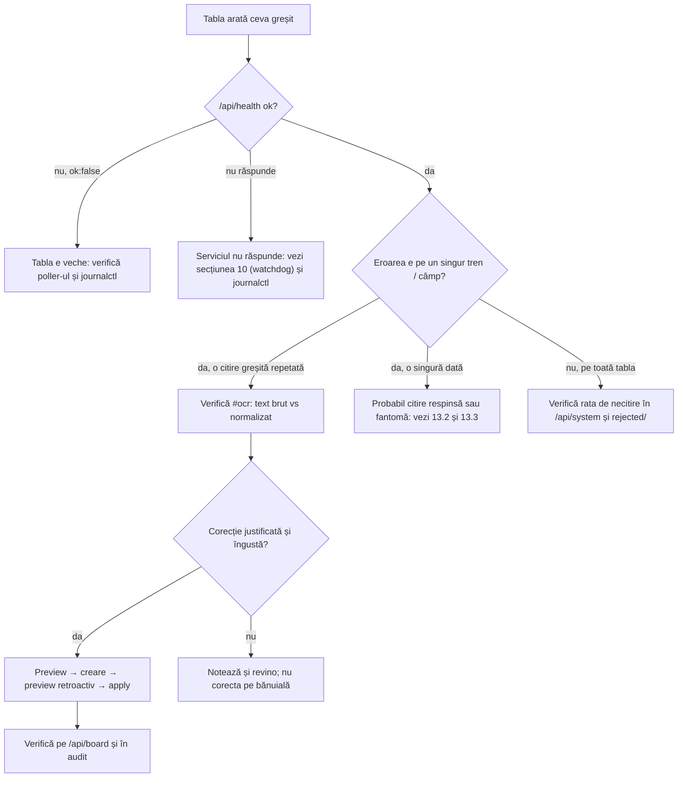
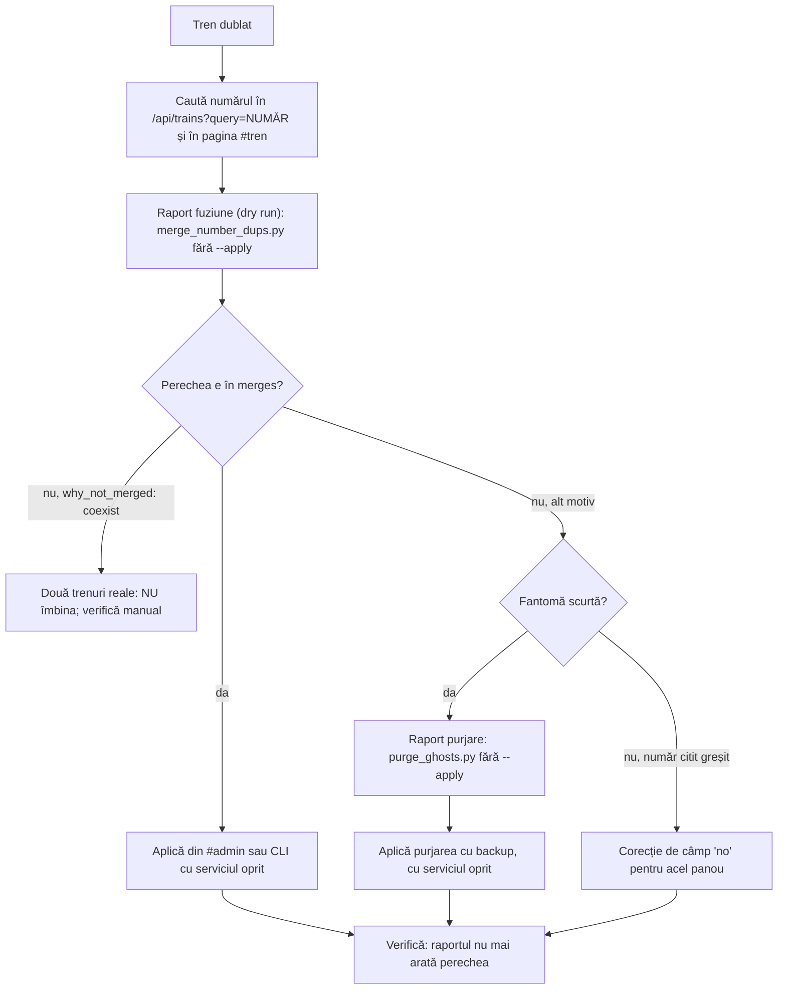
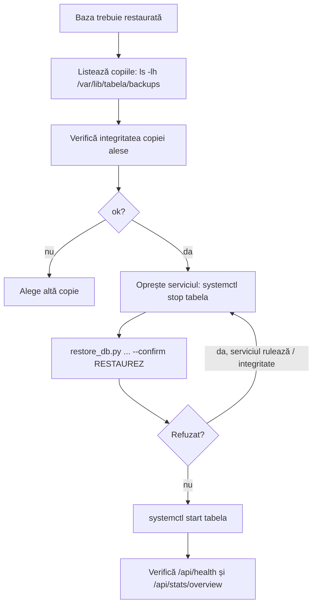

# Administration and operations: runbooks

This page is for whoever operates Tabela Gara de Nord on the server. It describes the administration functions (the `#admin` page, corrections, merging and purging duplicate trains, backups and restore, Telegram alerts, push notifications, server state, the watchdog, rejected files) and the steps for the four frequent situations.

Conventions:

- On the server, the application runs as the `tabela` service (`deploy/tabela.service`): code in `/opt/tabela/app`, interpreter in `/opt/tabela/venv/bin/python`, the database in `/var/lib/tabela/tabela.db`, the backups in `/var/lib/tabela/backups`, the configuration in `/etc/tabela.env` (root, 600).
- The commands below are given on the server, in the operator's SSH session.
- No secret appears on this page. Where a secret value is needed, write `<ADMIN_TOKEN>`, `<TELEGRAM_CHAT_ID>` etc. Do not type them in clear in the terminal and do not put them in the repo, the CHANGELOG or a log.
- For the administration key, see `docs/admin-rotatie-cheie.md`.

## Contents

1. [Access to the administration and authentication](#1-access-to-the-administration-and-authentication)
2. [Administration pages and endpoints](#2-administration-pages-and-endpoints)
3. [Manual corrections (`app/corrections.py`, `app/corrections_api.py`)](#3-manual-corrections)
4. [Merging duplicate trains (`scripts/merge_number_dups.py`)](#4-merging-duplicate-trains)
5. [Purging ghosts (`scripts/purge_ghosts.py`)](#5-purging-ghosts)
6. [Database backup and restore](#6-database-backup-and-restore)
7. [Telegram alerts (`app/telegram.py`, `app/notifier.py`)](#7-telegram-alerts)
8. [Web push notifications and VAPID keys](#8-web-push-notifications-and-vapid-keys)
9. [Server state (`app/system_status.py`, `app/system_api.py`, `app/admin_tools.py`)](#9-server-state)
10. [The watchdog (`app/watchdog.py`)](#10-the-watchdog)
11. [Rejected files (`app/rejected.py`)](#11-rejected-files)
12. [OCR captures and disk space](#12-ocr-captures-and-disk-space)
13. [Runbooks](#13-runbooks)
14. [What I could not verify and inconsistencies](#14-what-i-could-not-verify-and-inconsistencies)

---

## 1. Access to the administration and authentication

Source: `app/admin.py`.

| Element | Value from the code |
|---|---|
| The variable | `ADMIN_TOKEN` in `/etc/tabela.env` |
| Minimum length | 12 characters (`MIN_TOKEN_LEN`). Below this length, all `/api/admin/*` answer **503** "Administrare dezactivată." (Administration disabled.) |
| Strict mode | `ADMIN_TOKEN_STRICT=1` requires at least 24 characters (`STRICT_TOKEN_LEN`). If the key is too short, the service **does not start** and prints a message without the key |
| Authentication | `Authorization: Bearer <ADMIN_TOKEN>` or the `tabela_admin` cookie obtained from `POST /api/admin/login` |
| Cookie | `HttpOnly`, `Secure`, `SameSite=Strict`, valid for 12 hours (`SESSION_S`). It contains the expiry and an HMAC keyed with the token, not the token |
| Invalidation | changing `ADMIN_TOKEN` invalidates all sessions |
| Limiting | 5 wrong attempts per minute per IP (`FAIL_LIMIT`), then 429; 30 wrong attempts per minute from all sources (`GLOBAL_FAIL_LIMIT`); each mistake delays the response by 0.5 s (`FAIL_DELAY_S`) |
| CSRF | Modifying requests with a cookie require `X-CSRF-Token` (from `GET /api/admin/csrf`) and, if the browser sends `Origin`, the same host. Requests with `Bearer` do not require CSRF |
| Header | admin responses have `Cache-Control: private, no-store` |

Nginx additionally limits `POST /api/admin/login` (the `tabela_admin_login` zone in `deploy/tabela-limits.conf`; README: 5 per minute).

A quick check that the administration is active (on the server, without displaying the key):

```bash
sudo systemctl is-active tabela
curl -s http://127.0.0.1:8000/api/admin/session
# {"enabled": true, "authenticated": false} = cheie validă (≥ 12 caractere), fără sesiune
# {"enabled": false, ...} = ADMIN_TOKEN lipsă sau prea scurt; toate celelalte rute admin dau 503
```

`GET /api/admin/session` always answers 200 and does not count a wrong attempt (`admin.py`).

For the calls in the runbooks, load the token from the file into the shell, without displaying it:

```bash
set -a; . /etc/tabela.env; set +a
curl -s -H "Authorization: Bearer $ADMIN_TOKEN" http://127.0.0.1:8000/api/admin/tools/server
```

Note: `Bearer` bypasses CSRF, so it has the same rights as the session. Use it only on the server, through `127.0.0.1`.

---

## 2. Administration pages and endpoints

| Page (hash) | File | What it does | Access |
|---|---|---|---|
| `#ocr` "OCR captures" | `web/ocr.js` | list of captures, image with the OCR rectangles, raw text versus normalized text, **manual corrections**, OCR state | admin |
| `#setari` | `web/setari.js` | capture retention and the free-space threshold (`app/admin_settings.py`) | admin |
| `#admin` "Administration" | `web/admin.js` | "Duplicate train numbers" (report, apply, restore) and "Server (live)" | admin |
| `#sistem` | `web/sistem.js` | server state; the details appear only for admin | public, with details for admin |

Endpoints (all under `/api/admin/`, except those marked):

| Method and route | Role |
|---|---|
| `POST /login`, `POST /logout`, `GET /session` | the session (cookie) |
| `GET /csrf` | the CSRF token for the current session |
| `GET /captures`, `GET /captures/{cid}`, `GET /captures/{cid}/image`, `GET /captures/{cid}/overlay.png` | the OCR captures |
| `GET /stats` | OCR and capture statistics |
| `GET /settings`, `POST /settings` | the editable settings (`capture_retention_days`, `capture_min_free_mb`) |
| `GET /tools/dupes` | the duplicate merge report (read only) |
| `POST /tools/dupes/apply` | applying the merge (requires `"confirm": "APLICA"`) |
| `POST /tools/dupes/restore` | restoring the merges (requires `"confirm": "RESTAUREAZA"`) |
| `GET /tools/server` | the server state (read only) |
| `GET /system` | the details of the server state (`app/system_api.py`) |
| `GET /api/system` | **public**: the minimal server state |
| `GET/POST/DELETE /api/admin/corrections…` | the manual corrections, see section 3 (`…/audit`, `…/preview`, `…/{rid}/preview`, `…/{rid}/apply`, `…/batches/{batch}/restore`) |

The settings (`POST /api/admin/settings`) accept only the keys in `admin_settings.SPECS`:

| Key | Minimum | Maximum | Default (if the environment has no valid value) |
|---|---|---|---|
| `capture_retention_days` | 1 | 30 | 7 |
| `capture_min_free_mb` | 256 | 102400 | 2048 |

The value in the `settings` table has priority over the environment (`CAPTURE_RETENTION_DAYS`, `CAPTURE_MIN_FREE_MB`). Each change reaches `correction_audit` with `action = 'setting'`. The request body is at most 1024 bytes.

---

## 3. Manual corrections

Source: `app/corrections.py` (the logic), `app/corrections_api.py` (the API). Schema v9.

### What a rule is

A rule corrects a value that the OCR repeatedly reads wrongly. Example from the code: IR 1584 on the board is actually IR 1581.

The form: `(board, field, value read) → correct value`, optionally limited to a station, a scheduled time and a range of service dates.

| Parameter | Allowed values |
|---|---|
| `board` | `arrival` (arrivals) or `departure` (departures) |
| `field` | `type`, `no`, `station`, `operator`, `time`, `platform`, `delay` |
| `wrong_value` | the value read. The empty string `""` means "unread" and is allowed **only** for `platform` and `delay` |
| `correct_value` | the correct value, validated per field (types from `normalize._TYPES`, `no` 1–99999, station 2–60 characters, operator 2–40, time `HH:MM`, platform up to `PLATFORM_MAX`, delay up to `MAX_DELAY`) |
| `station`, `sched_time` | optional; they limit the rule |
| `date_from`, `date_to` | optional, `AAAA-LL-ZZ`; the range is at most 3660 days (`MAX_SPAN_DAYS`) |
| `note` | mandatory, 3–500 characters (`NOTE_MIN`, `NOTE_MAX`) |
| `source_capture_id`, `source_row_index` | optional, for the link to the row in the capture |

Limits: at most **500** active rules (`MAX_ACTIVE_RULES`); the request body at most 8192 bytes; correct values identical to the ones read are rejected.

### The three effects

1. **On new frames.** `correct_frame` rewrites the OCR rows that match, before ingest. The observation carries the `+corr:<id>` marker in the processing version; the raw text stays in `fields_json`.
2. **Retroactive, reversible.** `plan` (dry run, does not write) → `apply` (one transaction; each modified row is archived with the values from before and after, in `correction_archive`, under a `batch`) → `restore` (brings the values back, only on rows that still have the corrected value).
3. **Deactivation.** The rule is logically deleted (`status = 'deleted'`). It no longer acts on new frames.

All state changes go into `correction_audit` (action, actor, IP, batch, details). The actor is always `admin`.

Nothing from the corrections appears on the public endpoints.

### The correct order (preview before apply)

1. **Preview** the new rule: `POST /api/admin/corrections/preview` (validates, does not write). The response has `services.count`, `conflicts.count`, `observations.count`, `events.count`, `plan_hash` and examples (up to 50 of each kind).
2. **Create** the rule: `POST /api/admin/corrections` (201). The rule acts immediately on new frames.
3. **Preview retroactively**: `POST /api/admin/corrections/{rid}/preview`. Note the `plan_hash`.
4. **Apply** with the hash: `POST /api/admin/corrections/{rid}/apply` with the body `{"plan_hash": "<hash>"}`. If the data changed in the meantime, the response is **409** ("Previzualizarea nu mai este valabilă", the preview is no longer valid) and step 3 must be repeated. If there is nothing to apply, 409 ("Nimic de aplicat", nothing to apply).
5. **Undo** a batch, if needed: `POST /api/admin/corrections/batches/{batch}/restore`.
6. **Delete** the rule: `DELETE /api/admin/corrections/{rid}`. If it has applied and unrestored batches, the response is 409. With `?restore=1` it restores the batches first.

Examples (on the server, with the token loaded from `/etc/tabela.env` as above):

```bash
# previzualizare a unei reguli noi (nu scrie)
curl -s -H "Authorization: Bearer $ADMIN_TOKEN" -H "Content-Type: application/json" \
  -X POST http://127.0.0.1:8000/api/admin/corrections/preview \
  -d '{"board":"arrival","field":"no","wrong_value":"1584","correct_value":"1581","note":"OCR confunda 1581 cu 1584"}'

# lista regulilor active, și jurnalul
curl -s -H "Authorization: Bearer $ADMIN_TOKEN" "http://127.0.0.1:8000/api/admin/corrections?status=active"
curl -s -H "Authorization: Bearer $ADMIN_TOKEN" "http://127.0.0.1:8000/api/admin/corrections/audit?limit=50"
```

The `status` parameter of the list: `active` (default), `deleted` or `all`. The audit limit: 1–500, default 100.

For creating and applying from the interface, use the `#ocr` page (the corrections are on the same screen, with the same rules).

---

## 4. Merging duplicate trains

Source: `scripts/merge_number_dups.py` (the logic, CLI) and `app/admin_tools.py` + `web/admin.js` (the interface in `#admin`).

### What it does

A physical row on the board was read with a different number (for example RE 9209 and RE 92011, as an extra "1" noise). So a single slot (day, board, station, scheduled time) became two services. The script merges the two services **only** when all the conditions in the docstring are met:

- the same station, after the station aliases;
- the number difference is "1" noise (weighted cost ≤ 1.5, different lengths), or digit truncation, with a stricter rule (the long number with at least 2 days, the short number with no life of its own);
- never seen together in the same capture, on the same board (two rows in one frame are two real trains). Guard: `coexisting_numbers`;
- ghosts are ignored (`purge_ghosts.py` handles them).

The script does two more things:

- **Station aliases**: for example `KIEV -CHISINAU` → `KIEV - CHISINAU` and `VATRA DORNEI BA` → `VATRA DORNEI BAI` (`ALIASES`), in `services`, `observations` and `service_quality`.
- **Divergent times** for the same number, on the same day and on the same board: only **listed**, never merged (the decision is the user's).

The loser moves its observations to the winner. The loser's row, events and quality rows are archived in the `merged_rows` table and deleted. The winner gets the first and last seen of both. The platform and the delay are filled in only if missing (a stored reading is never replaced).

### CLI modes

```bash
cd /opt/tabela/app
# 1. raport (dry run; conexiune doar-citire; nu scrie nimic)
/opt/tabela/venv/bin/python scripts/merge_number_dups.py --db /var/lib/tabela/tabela.db

# 2. aplicare: copie de siguranță întâi, apoi îmbinarea (oprește serviciul înainte, vezi mai jos)
sudo systemctl stop tabela
/opt/tabela/venv/bin/python scripts/merge_number_dups.py --db /var/lib/tabela/tabela.db \
  --apply --backup-dir /var/lib/tabela/backups
sudo systemctl start tabela

# 3. restaurare (anulare) a unui lot, sau a tuturor
sudo systemctl stop tabela
/opt/tabela/venv/bin/python scripts/merge_number_dups.py --db /var/lib/tabela/tabela.db --restore --batch <ID_LOT>
sudo systemctl start tabela
```

The batch has the identifier `MD<AAAAMMZZTHHMMSSZ>` (UTC), shown in the report. `--min-age-min` (default 60) postpones the pairs seen more recently than that.

Operational rules from the docstring:

- The script requires `--backup-dir` at `--apply`. The copy (`sqlite3 backup`, with `integrity_check`) is made **before** any write and is named `tabela-before-merge-<AAAAMMZZ-HHMMSS-micro>.db`. The last **10** copies of this type are kept in the directory (`BACKUP_KEEP = 10`).
- Stop the service before `--apply` and `--restore` (docstring). The path from the interface (`#admin`) does not require stopping, because it works under the store lock (see below).
- After merging, run `python -m app.quality` (idempotent) to refresh the winners' quality rows.

### The path from the `#admin` interface

1. `GET /api/admin/tools/dupes` shows the report (dry run).
2. `POST /api/admin/tools/dupes/apply` with `{"confirm": "APLICA", "min_age_min": 60}`. The server first makes the backup (`_backup`), then applies, all under `store._lock`, so the poller does not write during the operation. The response has `batch`, `summary` and `backup` (the file name, not the path).
3. `POST /api/admin/tools/dupes/restore` with `{"confirm": "RESTAUREAZA", "batch": "<ID_LOT>"}` (or without `batch` for all batches). It also makes the backup first.

The confirmation `RESTAUREAZA` is the one for restoring merges from `#admin`. Full database restore has a different word (`RESTAUREZ`, section 6).

---

## 5. Purging ghosts

Source: `scripts/purge_ghosts.py`. Ghosts are rows wrongly read by the OCR, with no real train (the verdicts are in `service_quality.ghost`, see `docs/statistici-calatorii-calitate.md`, section 12).

### Criteria (all required)

- `service_quality.ghost = 1`;
- `status = 'gone'` (a service still on the board is not deleted);
- last seen more than `--min-age-min` (default 60) minutes ago.

Besides the ghosts, the script also cleans, archived and reversibly: the ghost's observations are moved to the real service (`ghost_of`), impossible delay events (for example 10 → 410 → 10), "gone → appeared" pairs under 180 seconds (flapping), a wrong `last_delay` replaced with `last_delay_clean`, and the rows in `trains` left without any journey.

Idempotent: a second `--apply` run finds nothing, and a second `--restore` finds nothing.

### Commands

```bash
cd /opt/tabela/app
# dry run (implicit): arată ce ar șterge, pe motive și exemple
/opt/tabela/venv/bin/python scripts/purge_ghosts.py --db /var/lib/tabela/tabela.db

# aplicare: oprește serviciul; copie de siguranță (tabela-before-purge-*.db) și apoi purjarea
sudo systemctl stop tabela
/opt/tabela/venv/bin/python scripts/purge_ghosts.py --db /var/lib/tabela/tabela.db \
  --apply --backup-dir /var/lib/tabela/backups
sudo systemctl start tabela

# restaurare: un lot (ID-ul e data UTC AAAAMMZZTHHMMSSZ din raport) sau toate
sudo systemctl stop tabela
/opt/tabela/venv/bin/python scripts/purge_ghosts.py --db /var/lib/tabela/tabela.db --restore --batch <ID_LOT>
sudo systemctl start tabela
```

The JSON report has `would_remove` (the plan), `by_reason` (the count per reason: `short`, `near_dup`, `minority_dup`) and `examples` (up to 25). After `--apply`, it adds `backup` and `batch`.

Differences from merging, which must be known:

- The purge script does **not** call the backup retention: each `--apply` leaves a `tabela-before-purge-*.db` file in the directory.
- The `--restore` command does not make a backup beforehand. If you want this safety net, make a manual copy (section 6) first.

---

## 6. Database backup and restore

### The backups

| Who makes the backup | When | Name | Retention |
|---|---|---|---|
| `deploy/update.sh` | before a deploy that raises the schema version | `tabela-<AAAAMMZZ-HHMMSS>-v<schema>.db` in `/var/lib/tabela/backups` (or `BACKUP_DIR`) | the last 5 (`BACKUP_KEEP`) |
| `app/dbbackup.py` (`ensure`) | before a schema migration, if there is no recent copy (24 hours) | `tabela-<stamp>-v<schema>.db` | the last 5 (`BACKUP_KEEP = 5`) |
| `app/backup_api.py` (`make_backup`) | at restore, the copy of the current state | `tabela-<stamp microseconds>-v<schema>.db` | the last 5 |
| `scripts/merge_number_dups.py` | before `--apply` | `tabela-before-merge-*.db` | the last 10 |
| `scripts/purge_ghosts.py` | before `--apply` | `tabela-before-purge-*.db` | no retention |
| `#admin` (merge) | before apply or restore | as for merging | as for merging |

All the copies are made online (`sqlite3 backup`), checked with `PRAGMA integrity_check` and written as a temporary file, then renamed. The files have mode 600.

The backup directory is `BACKUP_DIR` (default `<database directory>/backups`, that is, `/var/lib/tabela/backups`).

The list of backups:

```bash
ls -lh /var/lib/tabela/backups/
```

Checking a backup (without touching the database):

```bash
/opt/tabela/venv/bin/python -c "import sqlite3,sys; c=sqlite3.connect('file:'+sys.argv[1]+'?mode=ro', uri=True); print(c.execute('PRAGMA integrity_check').fetchone()[0])" /var/lib/tabela/backups/<NUME_COPIE>.db
# trebuie să scrie: ok
```

Mind the retention: `dbbackup._prune` (used by `make_backup` and by migrations) deletes any `tabela-*.db` file in the directory beyond the first 5 in name order. The `tabela-before-merge-*` and `tabela-before-purge-*` copies have the same prefix, so they can be deleted by these routines, and the newest merge copies may be among those affected. See section 14.

### Restore

There is no restore from the web interface. Restore is done from the command line (`scripts/restore_db.py`, which calls `app/restore.py`):

1. **The confirmation**: the word `RESTAUREZ` (`restore.CONFIRM`) is mandatory, as the `--confirm` parameter. Without it nothing is done.
2. **The service must be stopped**: `restore.service_active` checks `systemctl is-active tabela`; if the service is running, the restore is refused.
3. **Checking the copy**: `integrity_check` on the source copy and on a working copy.
4. **The copy of the current state**: the live database is saved in the backup directory, with the path shown in the log.
5. **The replacement**: the `-wal` and `-shm` files of the database are deleted, then the working copy replaces the database atomically (`os.replace`).

If the restored copy has an older schema, `Store` migrates it at the next startup.

The full command:

```bash
sudo systemctl stop tabela
cd /opt/tabela/app
sudo -u tabela /opt/tabela/venv/bin/python scripts/restore_db.py \
  /var/lib/tabela/backups/<NUME_COPIE>.db --db /var/lib/tabela/tabela.db --confirm RESTAUREZ
sudo systemctl start tabela
```

The confirmation words, so they are not confused:

| Word | Where | What it does |
|---|---|---|
| `RESTAUREZ` | `scripts/restore_db.py`, `app/restore.py` | restores the **whole database** from a copy |
| `RESTAUREAZA` | `#admin` → "Restore merges" (`/api/admin/tools/dupes/restore`) | undoes a merge batch (`merged_rows`) |
| `APLICA` | `#admin` → "Apply the merge" | applies the duplicate merge |

---

## 7. Telegram alerts

Source: `app/telegram.py` and `app/notifier.py`. An additional channel, next to Web Push, for the administrator only.

### When an alert goes out

All the conditions:

1. The event is of type `delay`, `platform` (track) or `gone` (left the board). `appeared` is never sent.
2. The change was **confirmed**: it was seen in at least **2** successful readings (`Notifier(confirm=2)`). A reading wrong for one frame sends nothing.
3. The train is **followed** by at least one subscriber (`followers` is not empty). Telegram alerts do not go out for unfollowed trains.
4. The event key (`event_key`: date, board, number, time, type, new value) has not already been sent.

The message (`format_text`), without the token: `Gara de Nord: <TYPE> <NUMBER>: întârziere +<N> min. Ora citirii: HH:MM.` (the message text itself is in Romanian; "întârziere" = delay, "Ora citirii" = reading time). Variants: `la timp` (on time), `linia <N>` (track), `a ieșit de pe panou` (left the board).

Failure behavior:

- No retry. Each attempt is recorded **before** sending, in the state file; so an event attempted once is not resent after a restart.
- Network errors or an HTTP status other than 200 are logged at most once every 10 minutes (`ERROR_LOG_EVERY = 600`). The token never appears in the log or in exceptions.
- The keys are kept for two days (`KEEP_DAYS = 2`).
- A 10-second timeout for the request, and the notifier's timeout (`SEND_TIMEOUT = 10`).

### Configuration

The channel is **off** if either of the two variables is missing.

| Variable | Value | Note |
|---|---|---|
| `TELEGRAM_BOT_TOKEN` | `<TELEGRAM_BOT_TOKEN>` | the bot token; not put in the repo, the CHANGELOG or a log |
| `TELEGRAM_CHAT_ID` | `<TELEGRAM_CHAT_ID>` | a single chat, the administrator's |
| `TELEGRAM_STATE_PATH` | default `data/telegram_sent.json` | the file with the keys sent |

On the server, the service runs with `ProtectSystem=strict` and only `/var/lib/tabela` is writable (`deploy/tabela.service`). The default `data/telegram_sent.json` is relative to the working directory `/opt/tabela/app`, which is not writable. So put in `/etc/tabela.env`:

```
TELEGRAM_STATE_PATH=/var/lib/tabela/telegram_sent.json
```

Without this line, writing the state fails, "telegram state not saved" is logged and the deduplication does not survive a restart. I have not seen this variable in `deploy/` or in the README; to be verified (section 14).

### Verification

```bash
sudo journalctl -u tabela --since "1 hour ago" --no-pager | grep -i telegram
```

There is no test route in the interface. The real test is done by following a test train in `#tren` and waiting for a delay change, or temporarily with an event from the log. Do not write a test that sends real messages without warning the person who receives the alerts.

### Disabling

Delete `TELEGRAM_BOT_TOKEN` or `TELEGRAM_CHAT_ID` from `/etc/tabela.env`, then `sudo systemctl restart tabela`.

---

## 8. Web push notifications and VAPID keys

Source: `app/notifier.py`, `app/api.py` (`_make_sender`, `/api/push/*`), `app/config.py`, `deploy/install.sh`.

### Variables

| Variable | Default in the code | Value in deploy |
|---|---|---|
| `VAPID_PRIVATE_KEY` | empty | generated by `install.sh`; **secret** |
| `VAPID_PUBLIC_KEY` | empty | derived from the private key; public (appears in `GET /api/push/key`) |
| `VAPID_SUBJECT` | `https://tabelacfr.ddns.net` | `install.sh` writes `https://tabelacfr.ddns.net` |

If either of the two keys is missing, push notifications are **disabled**: "VAPID keys not configured; push notifications are disabled" is logged once, and the rest of the application works.

### How it is generated

- At installation, `deploy/install.sh` generates the pair **only if** `VAPID_PRIVATE_KEY` is missing from `/etc/tabela.env`. The private key is `ec` P-256, in base64url format (32 bytes), and the public key is the uncompressed point, also base64url.
- If the private key exists but the public one is missing, `install.sh` derives it from the private one.
- The script displays **only** the public key. The private key is not displayed, not logged and does not enter the repo.
- **Never regenerate** the pair if there are subscriptions: all existing push subscriptions become invalid.

For a manual generation, use the Python block in `deploy/install.sh` (lines 95–110), with the output redirected directly into `/etc/tabela.env`, not to the terminal.

### Verification

```bash
curl -s http://127.0.0.1:8000/api/push/key
# întoarce cheia publică; dacă lipsește, notificările sunt dezactivate
```

Subscriptions are made from the browser (`POST /api/push/subscribe`, `POST /api/push/unsubscribe`). The subscriptions are in the database; do not copy them into documents and do not put them in a log.

If a push service answers 404 or 410, the subscription is deleted automatically. The push deduplication state is in memory: it is lost on restart.

---

## 9. Server state

Sources: `app/system_status.py` (the data), `app/system_api.py` (the routes), `app/admin_tools.py` (`server_status`, only for `#admin`), `web/sistem.js` (the page).

### What is measured

Public, `GET /api/system` (minimal fields, with no paths, tokens or raw errors):

| Field | Source | Rule |
|---|---|---|
| `stare` | the last successful reading of the board | `live` if it is at most **600 s** old (`STALE_PANEL_S`); `date_vechi` if older; `necunoscut` if it was never read |
| `poller.last_ok_age_s` | `store.last_ok_age` | the age of the last successful reading |
| `poller.last_error` | the poller's last error | a short code: `fetch`, `ocr`, `store` or `other` |
| `ocr.unread_rate_1h` | `app/ocr/stats.py` | the percentage of text lines left unread in the last hour; `null` when nothing was read (not 0) |
| `ocr.n` | | the number of frames in the one-hour window |
| `ocr.insufficient` | | `true` if there are fewer than **10** frames (`OCR_MIN_FRAMES`); then the rate does not make sense yet |
| `disk.free_gb` | `shutil.disk_usage` on the database directory | |
| `db.size_mb`, `db.wal_mb` | the file sizes | a missing `-wal` means 0 MB (normal after a checkpoint) |
| `version`, `schema`, `uptime_s` | | |

Details, for admin only (`GET /api/admin/system`): `poller.last_error_age_s`, `ocr.expected_rows`, `ocr_window`, `disk.total_gb`.

For `#admin`, `GET /api/admin/tools/server` adds: `load` (`/proc/loadavg`, plus the number of cores), `memory` (`MemTotal`, `MemAvailable`, swap), `disk`, `uptime_s`, `process.rss_mb`, `services` (`systemctl is-active` for `tabela`, `tabela-watchdog.timer` and `nginx`; `unknown` if it cannot be determined) and `watchdog` (the number of failures and the last restart from `watchdog.json`). On Windows or without `/proc`, the missing fields are `null`.

### What "healthy" means

| Check | Threshold | Source |
|---|---|---|
| `/api/health` → `ok` | age of the last reading ≤ **180 s** (`STALE_S`) | `app/api.py` |
| `/api/system` → `stare` | `live` ≤ 600 s | `system_status.py` |
| The unread rate | informative, if `insufficient` is `false` | `system_status.py` |

### Commands

```bash
curl -s http://127.0.0.1:8000/api/health
curl -s http://127.0.0.1:8000/api/system
set -a; . /etc/tabela.env; set +a
curl -s -H "Authorization: Bearer $ADMIN_TOKEN" http://127.0.0.1:8000/api/admin/system
curl -s -H "Authorization: Bearer $ADMIN_TOKEN" http://127.0.0.1:8000/api/admin/tools/server
sudo systemctl status tabela --no-pager
sudo journalctl -u tabela -n 200 --no-pager
```

---

## 10. The watchdog

Source: `app/watchdog.py`, `deploy/tabela-watchdog.service`, `deploy/tabela-watchdog.timer`, `deploy/tabela-watchdog.sudoers`.

### What it does

- A systemd timer starts, every 60 seconds (`OnUnitActiveSec=60s`, the first time 2 minutes after boot), a short process, `python -m app.watchdog --state /var/lib/tabela/watchdog.json --url http://127.0.0.1:8000/api/health --service tabela`.
- The process runs as the `tabela` user. A check succeeds if `/api/health` answers with **HTTP 200 and a JSON object**. The content does not matter.
- After **3** consecutive failed checks (`THRESHOLD = 3`), it restarts the `tabela` service through `sudo -n /bin/systemctl restart tabela`.

### The limits of the rule (to know)

| Situation | What the watchdog does |
|---|---|
| The service does not answer, 20 s timeout (`CHECK_TIMEOUT_S`), HTTP other than 200 or invalid JSON | counts as a failure; after 3, it restarts |
| The service answers 200 JSON, but `ok: false` (the board is stale) | does **not** restart. An `ok: false` answer is not a failure for the watchdog |
| A restart was already done in the last **600 s** (`RESTART_COOLDOWN_S`) | does not restart; logs "restart skipped (cooldown)" and returns |
| Nginx is down | restarts nothing (written in the docstring: "nginx is left alone") |
| `sudo` refuses | logs the restart error; sudoers allows only `systemctl restart tabela` |

The state (`failures`, `last_restart`) lives in `/var/lib/tabela/watchdog.json` and is read in `#admin`.

### Verification

```bash
systemctl list-timers tabela-watchdog.timer --no-pager
cat /var/lib/tabela/watchdog.json
sudo journalctl -u tabela-watchdog.service -n 50 --no-pager
```

---

## 11. Rejected files

Source: `app/rejected.py`, `app/poller.py`, `app/config.py`.

- **What they are**: the board images that the poller rejected, either for one panel (the reason comes from `on_rows`) or for the whole frame (the OCR failed). The purpose: diagnosing wrong readings.
- **Where**: `REJECTED_DIR` (default `/var/lib/tabela/rejected`). An empty `REJECTED_DIR=` disables saving.
- **What is written**: for each frame, a `.jpg` (the image as downloaded) and a `.json` with `ts` and `reasons` (the panel → the reason). The name: `AAAAMMZZTHHMMSSmmmZ`.
- **How many are kept**: the last **40** frames (`REJECTED_KEEP`). The oldest `.jpg` + `.json` pairs are deleted.
- **Permissions**: the directory is created with mode 0750. A symlink or a file in place of the directory is refused.
- **Error**: any `OSError` is logged ("could not save rejected frame"), and the poller continues.

Commands:

```bash
ls -lt /var/lib/tabela/rejected | head
cat /var/lib/tabela/rejected/<NUME>.json
```

---

## 12. OCR captures and disk space

Source: `app/captures.py`, `app/observations.py`, `app/admin_settings.py`.

- The capture images are in `CAPTURE_DIR` (on the server `/var/lib/tabela/captures`). Only the image files expire, after `CAPTURE_RETENTION_DAYS` (default **7**; `0` keeps no images). The rows in `captures` and `observations` stay, with `path` `NULL` after deletion.
- If the free space on the captures disk drops below `CAPTURE_MIN_FREE_MB` (default **2048** MB, `MIN_FREE_MB_DEFAULT`), no image is written any more. The database and the live board stay on the same disk, so a full disk would stop the board.
- Both values can be changed from `#setari` (see section 2), which has priority over the environment.
- The captures are private (admin only) and are not redistributed.

Space check:

```bash
df -h /var/lib/tabela
du -sh /var/lib/tabela/captures /var/lib/tabela/backups /var/lib/tabela/rejected 2>/dev/null
```

---

## 13. Runbooks

Each procedure has: symptoms, checks (with commands), remediation, verification after remediation and rollback.

### 13.1 "The board shows something wrong"

**Symptoms.** A wrong delay, track, operator or time appears on the site or on the panel; a train appears with another number or another type; or the board looks frozen.



**Checks.**

```bash
curl -s http://127.0.0.1:8000/api/health
curl -s http://127.0.0.1:8000/api/system            # stare, last_ok_age_s, unread_rate_1h
sudo journalctl -u tabela -n 200 --no-pager | grep -iE "rejected|ocr|error" | tail -n 40
ls -lt /var/lib/tabela/rejected | head              # cadre respinse recent
```

Then open `#ocr`, find the capture from the wrong moment and compare the raw text with the normalized one on the field in question. If the mistake repeats for the same train or the same station, it is a candidate for a correction.

**Remediation.**

1. If the mistake is only in one capture, do nothing: the next reading corrects it.
2. If it is a repeated OCR mistake, create a **narrow** rule (with a station, time or range of days when possible), following the order in section 3: `preview` → `POST /api/admin/corrections` → `POST /{rid}/preview` (note the `plan_hash`) → `POST /{rid}/apply`.
3. If the rule would touch too much (for example a large `conflicts.count` or an unexpected `services.count`), do not apply. Narrow the rule or delete it.

**Verification.** `curl -s http://127.0.0.1:8000/api/board` shows the correct value for that train. In `GET /api/admin/corrections/audit?limit=20` the `create`, `apply` or `restore` action appears, with the IP and the batch.

**Rollback.**

- A batch applied wrongly: `POST /api/admin/corrections/batches/<LOT>/restore` (it brings the values back, only where the row was not changed in the meantime; changed rows are skipped and counted in `skipped`).
- A wrong rule: `DELETE /api/admin/corrections/<ID>?restore=1` (it restores the batches first, then logically deletes the rule).

### 13.2 "A train appears duplicated"

**Symptoms.** The same train appears twice at the same time, with nearly identical numbers (for example 9209 and 92011), or a train appears as a ghost (it disappears after a few seconds).



**Checks.**

```bash
curl -s "http://127.0.0.1:8000/api/trains?query=<NUMĂR>"
cd /opt/tabela/app
/opt/tabela/venv/bin/python scripts/merge_number_dups.py --db /var/lib/tabela/tabela.db
/opt/tabela/venv/bin/python scripts/purge_ghosts.py --db /var/lib/tabela/tabela.db
```

Both commands are dry runs (they only read). In the merge report, each pair either has a place in `merges` or a `why_not_merged` with the reason (for example "coexist: …").

**Remediation.**

- For the pairs in `merges`: apply from `#admin` ("Apply the merge", with `APLICA`), or from the CLI (section 4), with the service stopped.
- For ghosts: `purge_ghosts.py --apply --backup-dir /var/lib/tabela/backups`, with the service stopped.
- For the pairs marked "coexist": **do not merge them**. They are two real trains, read in the same frame. If the number is nonetheless read wrongly in a single row, use a correction rule on the `no` field.

**Verification.** Run the dry runs again: the pair no longer appears. `GET /api/trains?query=<NUMĂR>` shows a single train on that slot. The merge report has an empty `merges` for that number.

**Rollback.**

- Merge: `#admin` → "Restore merges" (`RESTAUREAZA`, with the batch ID), or the CLI with `--restore --batch <ID_LOT>`, with the service stopped.
- Purge: `purge_ghosts.py --restore --batch <ID_LOT>`, with the service stopped. Make a manual copy first (section 6), because the CLI restore does not make a copy.

### 13.3 "The database must be restored"

**Symptoms.** The database is corrupt (`integrity_check` does not give `ok`), a migration failed, or you applied a wrong operation that cannot be undone with a batch.



**Checks.**

```bash
sudo systemctl status tabela --no-pager
ls -lh /var/lib/tabela/backups/
/opt/tabela/venv/bin/python -c "import sqlite3,sys; c=sqlite3.connect('file:'+sys.argv[1]+'?mode=ro', uri=True); print(c.execute('PRAGMA integrity_check').fetchone()[0])" /var/lib/tabela/backups/<NUME_COPIE>.db
/opt/tabela/venv/bin/python -c "import sqlite3,sys; c=sqlite3.connect('file:'+sys.argv[1]+'?mode=ro', uri=True); print(c.execute('PRAGMA integrity_check').fetchone()[0])" /var/lib/tabela/tabela.db
```

**Remediation.**

```bash
sudo systemctl stop tabela
cd /opt/tabela/app
sudo -u tabela /opt/tabela/venv/bin/python scripts/restore_db.py \
  /var/lib/tabela/backups/<NUME_COPIE>.db --db /var/lib/tabela/tabela.db --confirm RESTAUREZ
sudo systemctl start tabela
```

Restore first saves the current state in a new copy in `/var/lib/tabela/backups`; the path appears in the log ("starea curentă salvată în …", current state saved in …).

**Verification.**

```bash
curl -s http://127.0.0.1:8000/api/health
curl -s "http://127.0.0.1:8000/api/stats/overview" | head -c 300
```

Also check the date of the last reading in `/api/system`: it must be recent (the poller continues from the copy).

**Rollback.** If the restore picked the wrong copy, restore the copy saved automatically beforehand (its name appears in the log), with the same steps and with `RESTAUREZ`. The data written between the chosen copy and the moment of restore is lost if it is not in the rollback copy.

### 13.4 "The admin key was compromised"

The complete procedure is in `docs/admin-rotatie-cheie.md`. Do not duplicate it here and do not write the key in any document.

A summary for orientation, without secrets:

1. Change `ADMIN_TOKEN` in `/etc/tabela.env` (the procedure in `docs/admin-rotatie-cheie.md`), then `sudo systemctl restart tabela`. All sessions are invalidated.
2. Check the log for recent authentication failures: `sudo journalctl -u tabela --since "7 days ago" --no-pager | grep "wrong credentials"`. The log contains only the IPs, not the attempts.
3. Check the corrections log for unexpected actions: `GET /api/admin/corrections/audit?limit=200` (IP and action on each line).
4. If there were unauthorized actions, use sections 3 and 4 to undo them, by batch, and section 6 for a restore if needed.
5. If the Telegram token or the VAPID private key was also compromised, rotate them separately. The VAPID private key is not regenerated without invalidating the push subscriptions; see section 8.

**Verification.** With the new key, `GET /api/admin/tools/server` with `Authorization: Bearer` answers 200; with the old key it answers 401 and is counted as a wrong attempt. The details are in `docs/admin-rotatie-cheie.md`.

---

## 14. What I could not verify and inconsistencies

**Uncertain or to verify on the server:**

- The `/etc/tabela.env` file and the real behavior of the service (I have no access to the server). The procedures above come from the code and scripts in the repo.
- Whether `TELEGRAM_STATE_PATH` must be set on the server (section 7). There is no mention in `deploy/`, in the README or in `.env.example`; check `app/telegram.py` (`config_from_env`) and `deploy/tabela.service` (`ProtectSystem=strict`, `ReadWritePaths=/var/lib/tabela`).
- The interpreter path: I assume `/opt/tabela/venv/bin/python` from `deploy/tabela.service` and `deploy/update.sh`. Check on the server.
- The exact location of `last.jpg` and of the README's `LAST_IMAGE_PATH` (I did not verify in the code).

**Retention risk (to verify with a test):**

- `app/dbbackup.py` `_prune` (used by `backup_api.make_backup` and by migrations) deletes any `tabela-*.db` in the backup directory, beyond the first 5 in name order, in descending order. The `tabela-before-merge-*.db` and `tabela-before-purge-*.db` copies have the same prefix, and "before" sorts ahead of the digits, so they are considered the newest. Possible effect: the merge and purge copies may be deleted by the restore and migration routines, and conversely, `scripts/merge_number_dups.py` keeps 10 copies of its own prefix. I did not run this scenario.
- `scripts/purge_ghosts.py` has no retention for its copies.

**Inconsistencies between code and documentation:**

- The confirmation word for restoring the database is `RESTAUREZ` (`app/restore.py`, `scripts/restore_db.py`). `RESTAUREAZA` is the word for restoring merges from `#admin` (`app/admin.py`, `web/admin.js`). The documentation requirement associated both with restoring the database; the code distinguishes them.
- The README, the "Meteo" section, said "one row per observation hour"; it has been corrected. The code stores one row per observation, with a 15-minute cadence (`DEFAULT_INTERVAL_S = 900`).
- The README and `deploy/install.sh` do not mention the `TELEGRAM_*` variables, although the channel exists in the code.
- Backups: `deploy/update.sh` keeps 5 (`BACKUP_KEEP`), `app/dbbackup.py` 5, `scripts/merge_number_dups.py` 10. The documentation does not say this everywhere.

**Not verified in a browser:** the `#admin`, `#ocr`, `#setari`, `#sistem` pages and their exports (I read the JavaScript code and the API).
