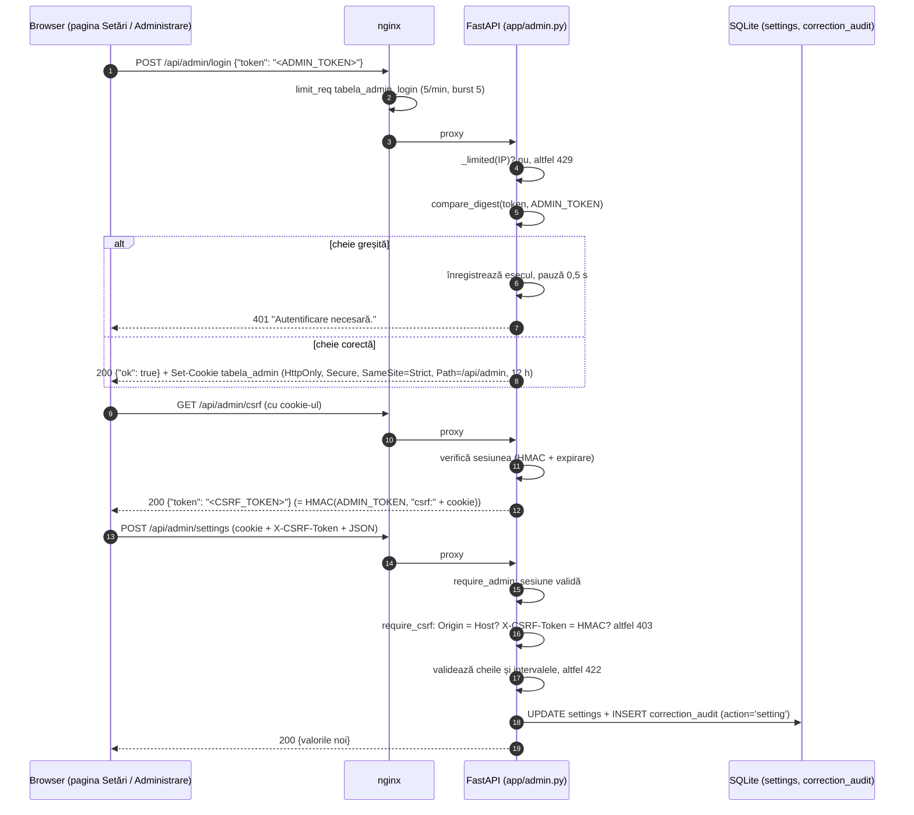

# HTTP API — Tabela Gara de Nord

© 2026 Andy217Ace

The complete documentation of all the application's HTTP routes: the public endpoints (used by
the live page, by History, by Statistics and by the others) and the administration endpoints
(`/api/admin/*`). For each route you will find the method, the path, the authentication, the parameters with types
and default values, the shape of the response, the error codes, the cache headers and the request limits.

The document describes version **Beta 1.65** (schema 10) (`VERSION`). The interface is described in
`docs/interfata.md`; deploy and nginx are described in `README.md`.

## How this document was verified

- The shape of the responses, the status codes and the headers were obtained through `fastapi.testclient.TestClient`
  on a temporary SQLite database, created with the application code (`create_app`, `Store.ingest`,
  `observations.refresh_catalog`), with four test services. The examples are copied from these
  runs and then truncated; where a field is missing from an example, the full shape is in the code.
- The parameters, default values and limits were read from the source code (`app/api.py`,
  `app/admin.py`, `app/stats_api.py`, `app/trains_api.py`, `app/system_api.py`,
  `app/corrections_api.py`, `app/export.py`, `app/endpoints.py` and the modules they call).
- The request and body size limits come from `deploy/nginx-tabela.conf` and
  `deploy/tabela-limits.conf`.
- The examples use test data. The keys, tokens and cookies in the examples are replaced with
  `<ADMIN_TOKEN>`, `<CSRF_TOKEN>` and `<SESIUNE>`.
- The `detail` messages and other text strings returned by the server are in Romanian (they are API data); they are
  quoted as they are, and an English gloss is given in parentheses where it matters.

## Contents

1. [General conventions](#1-general-conventions)
2. [Endpoint summary](#2-endpoint-summary)
3. [Request and size limits](#3-request-and-size-limits)
4. [Cache headers](#4-cache-headers)
5. [Public endpoints](#5-public-endpoints)
6. [The administration security model](#6-the-administration-security-model)
7. [Administration endpoints](#7-administration-endpoints)
8. [Error codes](#8-error-codes)
9. [Unclear points or items to verify](#9-unclear-points-or-items-to-verify)

---

## 1. General conventions

| Subject | The rule | Source |
|---|---|---|
| Format | JSON (`application/json; charset=utf-8`), except for the CSV exports and the images. | `app/api.py`, `app/stats_api.py` |
| Time zone | All dates and times are in `Europe/Bucharest`. | `app/store.py` (`TZ`) |
| Dates | `AAAA-LL-ZZ` (ISO). Any other form gives 422. | `_parse_date` in `app/api.py` |
| Times | `HH:MM`, from `00:00` to `23:59`. | `_HHMM` in `app/api.py` |
| Train number | An integer between 1 and 999999 (in some routes, 99999 in the export). | `_parse_train` |
| Board | `arrival` (Arrivals) or `departure` (Departures). Any other value gives 422. | `BOARDS`, `stats.BOARDS` |
| Validation errors | 422 with `detail` in Romanian. Unclear FastAPI validation errors get `"Parametri invalizi."` (Invalid parameters). | `app/api.py` (`validation_error`) |
| JSON body | At most 4,096 bytes for push and follow (`MAX_BODY`); over the limit: 413. | `_json_body` |
| OpenAPI documentation | Disabled: `/docs`, `/redoc` and `/openapi.json` do not exist. | `FastAPI(docs_url=None, redoc_url=None, openapi_url=None)` |
| Non-existent route | `/api/<anything else>` gives 404 `{"detail": "Nu există."}` (It does not exist). If the route exists but the method does not, it gives 405 with the `Allow` header. | `api_not_found` in `app/api.py` |

**The common statistics parameters** (used by `/api/journeys`, `/api/trains/stats`,
`/api/trains/{no}/journeys`, `/api/stats`, `/api/stats/overview`, `/api/stats/rankings`,
`/api/stations`, `/api/stations/{name}`, `/api/stations/{name}/journeys` and `/api/stats/seasons`):

| Parameter | Type | Default | Range | Effect |
|---|---|---|---|---|
| `prag` | integer | `5` (env `ON_TIME_MAX_MIN`) | 0–60 | The maximum delay (minutes) that means "on time". |
| `min` | integer | `5` (env `STATS_MIN_SAMPLE`) | 1–1000 | The minimum sample below which no percentages are shown. |
| `board` | text | — (all) | `arrival`, `departure` | Filters by board. Another value: 422. |
| `from` | `AAAA-LL-ZZ` | — | — | The start date (inclusive). |
| `to` | `AAAA-LL-ZZ` | — | — | The end date (inclusive). `from` cannot be after `to`. |
| `doar_confirmate` | `0` / `1` | `0` | — | Only journeys with a confirmed result. |

The statistics responses always include a `params` block with the effective values (for example
`"on_time_max_min": 5, "min_sample": 5, "include_low_quality": false, "final_read_max_gap_min": 15`).
The `include_low_quality` parameter cannot be changed from the request: the low-quality period (the initial
beta) is left out of the statistics unless the environment variable `STATS_INCLUDE_LOW_QUALITY=1` is enabled
(`app/quality.py`).

---

## 2. Endpoint summary

Authentication legend: **nothing** = public; **admin** = session cookie or
`Authorization: Bearer` (see section 6); **CSRF** = also requires the `X-CSRF-Token` header.

### Public

| Method | Path | Authentication | What it returns | Section |
|---|---|---|---|---|
| GET | `/api/board` | nothing | The live board: arrivals and departures | 5.1 |
| GET | `/api/health` | nothing | The service state (used by `update.sh`) | 5.2 |
| GET | `/api/changelog` | nothing | The version history from `CHANGELOG.md` | 5.3 |
| GET | `/api/config` | nothing | The interface settings (thresholds, refresh) | 5.4 |
| GET | `/api/weather` | nothing | The last weather observation (Open-Meteo model) | 5.5 |
| GET | `/api/history` | nothing | The history of a day or, with `all=1`, of all days | 5.6 |
| GET | `/api/train/{no}` | nothing | A train's events on a day | 5.7 |
| GET | `/api/follows` | nothing (`endpoint` parameter) | The trains followed by a subscriber | 5.8 |
| GET | `/api/push/key` | nothing | The public VAPID key for notifications | 5.9 |
| POST | `/api/push/subscribe` | nothing | Subscribe to notifications | 5.10 |
| POST | `/api/push/unsubscribe` | nothing | Unsubscribe | 5.11 |
| POST | `/api/follow` | nothing | Follow a train on a day | 5.12 |
| DELETE | `/api/follow` | nothing | Stop following | 5.12 |
| GET | `/api/journeys` | nothing | The journeys (the final result) | 5.13 |
| GET | `/api/journeys/{jid}` | nothing | The detail of a journey | 5.13 |
| GET | `/api/trains` | nothing | The public train catalog | 5.14 |
| GET | `/api/trains/{no}` | nothing | The detail of a train in the catalog | 5.14 |
| GET | `/api/trains/stats` | nothing | Statistics per train × board | 5.15 |
| GET | `/api/trains/{no}/journeys` | nothing | A train's statistical profile | 5.15 |
| GET | `/api/stats` | nothing | The general statistics (JSON, no CSV) | 5.16 |
| GET | `/api/stats/overview` | nothing | Everything the Statistics page shows | 5.16 |
| GET | `/api/stats/seasons` | nothing | Seasons and weather comparison | 5.16 |
| GET | `/api/stats/rankings` | nothing | Rankings (the most delayed, the most punctual) | 5.17 |
| GET | `/api/stations` | nothing | The list of stations | 5.18 |
| GET | `/api/stations/{name}` | nothing | The detail of a station | 5.18 |
| GET | `/api/stations/{name}/journeys` | nothing | A station's journeys (paginated) | 5.18 |
| GET | `/api/system` | nothing (details for admin only) | The system state, the version, the disk | 5.19 |
| GET | `/api/export/history.csv` | nothing | CSV export of the history over a range | 5.20 |
| GET | `/api/stats/changes` | nothing | "What changed this week" and the threshold alerts | 5.21 |
| GET | `/api/stats/heatmap` | nothing | Mean delay by weekday and hour | 5.21 |
| GET | `/api/stats/reliable` | nothing | The most reliable trains | 5.21 |
| GET | `/api/stats/dwell` | nothing | How long a train stays on the board | 5.21 |
| GET | `/api/stats/platform-changes` | nothing | Platform changes | 5.21 |
| GET | `/api/predict/peron` | nothing | Platform estimates for trains without an announced platform | 5.21 |
| GET | `/api/trains/{no}/prediction` | nothing | Final-delay estimate for one train (hidden from the OpenAPI schema) | 5.21 |

### Administration

| Method | Path | Authentication | What it does | Section |
|---|---|---|---|---|
| GET | `/api/admin/session` | nothing | The authentication state (always 200) | 7.1 |
| POST | `/api/admin/login` | nothing (limited) | Opens the session | 7.1 |
| POST | `/api/admin/logout` | nothing | Closes the session | 7.1 |
| GET | `/api/admin/csrf` | admin | The session's CSRF token | 7.2 |
| GET | `/api/admin/captures` | admin | The list of OCR captures | 7.3 |
| GET | `/api/admin/captures/{cid}` | admin | The detail of a capture | 7.3 |
| GET | `/api/admin/captures/{cid}/image` | admin | The capture image (JPEG) | 7.3 |
| GET | `/api/admin/captures/{cid}/overlay.png` | admin | The image with the OCR rectangles (PNG) | 7.3 |
| GET | `/api/admin/stats` | admin | The state of the captures and of the OCR | 7.4 |
| GET | `/api/admin/settings` | admin | The editable settings | 7.5 |
| POST | `/api/admin/settings` | admin + CSRF | Modifies the settings | 7.5 |
| GET | `/api/admin/corrections` | admin | The correction rules | 7.6 |
| GET | `/api/admin/corrections/audit` | admin | The audit log | 7.6 |
| POST | `/api/admin/corrections/preview` | admin + CSRF | Previews a new rule (does not write) | 7.6 |
| POST | `/api/admin/corrections` | admin + CSRF | Creates a rule | 7.6 |
| POST | `/api/admin/corrections/{rid}/preview` | admin + CSRF | Previews an existing rule | 7.6 |
| POST | `/api/admin/corrections/{rid}/apply` | admin + CSRF | Applies a rule retroactively | 7.6 |
| POST | `/api/admin/corrections/batches/{batch}/restore` | admin + CSRF | Restores an applied batch | 7.6 |
| DELETE | `/api/admin/corrections/{rid}` | admin + CSRF | Deletes (soft) a rule | 7.6 |
| GET | `/api/admin/tools/dupes` | admin | The duplicate numbers report (dry run) | 7.7 |
| POST | `/api/admin/tools/dupes/apply` | admin + CSRF | Merges the duplicates (with a safety copy) | 7.7 |
| POST | `/api/admin/tools/dupes/restore` | admin + CSRF | Restores the merges | 7.7 |
| GET | `/api/admin/security` | admin | Security: banned IPs (fail2ban), ban history, requests/probes over 24 h and 7 days — from `security/snapshot.json` written by the root exporter; `available:false` + `reason` (`missing`/`invalid`/`stale`, with `age_s`) | — |
| GET | `/api/admin/tools/server` | admin | The server state (load, memory, services) | 7.8 |
| GET | `/api/admin/system` | admin | The details of the System page | 7.9 |
| GET | `/api/admin/tools/nvme` | admin | NVMe disk state (from `nvme.json`) | 7.10 |
| GET | `/api/admin/ocr-alt` | admin | The alternative-OCR journal (`#ocr2` page) | 7.10 |
| GET | `/api/admin/ocr-alt/crop/{eid}/{col}` | admin | The crop of one cell (PNG) | 7.10 |
| POST | `/api/admin/ocr-alt/{eid}/verdict` | admin + CSRF | The administrator's verdict for one event | 7.10 |
| GET | `/api/admin/quality-daily/confirmation` | admin | Daily journey-confirmation rate | 7.10 |
| GET | `/api/admin/quality-daily/reading` | admin | Daily reading quality | 7.10 |
| GET | `/api/admin/quality-daily/coverage` | admin | Hourly board coverage | 7.10 |

**Backups.** There is no HTTP route for downloading or creating a copy of the database.
The backup is made only inside `POST /api/admin/tools/dupes/apply` and
`POST /api/admin/tools/dupes/restore` (the copy stays on the server), and the `app/backup_api.py` module
is used internally by `app/restore.py` and by tests. See section 7.7.

---

## 3. Request and size limits

The limits are applied in two layers: nginx (before the application, per client IP) and
the FastAPI application. If nginx refuses a request, the response has code 429 and does not reach the application.

### 3.1 nginx (`deploy/tabela-limits.conf` and `deploy/nginx-tabela.conf`)

| Zone (`limit_req_zone`) | Rate | What it covers | Burst |
|---|---|---|---|
| `tabela_api` (10 MB) | 10 requests/s per IP | All `/api/*` that have no zone of their own, including `/api/board`, `/api/history`, `/api/follow`, `/api/export/history.csv` and the admin routes (except login) | 20 (`nodelay`) |
| `tabela_stats` (10 MB) | 60 requests/min (1/s) per IP | `/api/stats…`, `/api/trains/stats`, `/api/trains/{nr}/journeys`, `/api/stations…`, `/api/journeys…` (aggregates over the whole history) | 20 (`nodelay`) |
| `tabela_admin_login` (1 MB) | 5 requests/min per IP | exactly `POST /api/admin/login` | 5 (`nodelay`) |

Other settings in nginx:

- `limit_req_status 429`: limited requests get 429.
- `limit_req_log_level warn`: limited requests are logged in `error.log` at the `warn` level,
  with the request line. For `/api/follows` the line contains the push endpoint address, which is why
  `location = /api/follows` has `access_log off`.
- `client_max_body_size 8k`: bodies larger than 8 KB get 413 from nginx (nginx's default
  HTML page, not the application's JSON).
- `proxy_read_timeout 30s`, `proxy_connect_timeout 5s`.

The location matching order: `location = /api/follows`, `location = /api/admin/login`, then
the regex `^/api/(stats|trains/stats|trains/[0-9]+/journeys|stations|journeys)(/|$)`, then
`location /api/`, then `location /` (the static page).

### 3.2 Application

| Limit | Value | Where | Response |
|---|---|---|---|
| Wrong administration attempts | 5 per IP in 60 s (`FAIL_LIMIT`) | `app/admin.py` | 429, `Retry-After: 60` |
| Wrong attempts, all clients | 30 in 60 s (`GLOBAL_FAIL_LIMIT`) | `app/admin.py` | 429 |
| Delay on a wrong key | 0.5 s (`FAIL_DELAY_S`) | `app/admin.py` | — (the response comes later) |
| CSV export | 30 requests per IP in 60 s (`RATE_LIMIT`) | `app/export.py` | 429 `{"detail": "Prea multe cereri de export; încearcă mai târziu."}` (Too many export requests; try again later) |
| CSV export: range | at most 366 days (`MAX_DAYS`) | `app/export.py` | 422 |
| CSV export: rows | at most 50,000 (`MAX_ROWS`) | `app/export.py` | 200 with `X-Truncated: 1` |
| History (`/api/history`) | at most 500 services per day (`HISTORY_MAX`) | `app/store.py` | 200 with `X-Truncated: 1` |
| Followed trains per subscriber | 20 (`MAX_FOLLOWS`) | `app/store.py` | 422 |
| Public JSON body | 4,096 bytes (`MAX_BODY`) | `app/api.py` | 413 |
| Admin body: login | 1,024 bytes | `app/admin.py` | 413 |
| Admin body: settings | 1,024 bytes (`MAX_SETTINGS_BODY`) | `app/admin.py` | 413 |
| Admin body: tools | 512 bytes (`MAX_TOOLS_BODY`) | `app/admin.py` | 413 |
| Admin body: corrections | 8,192 bytes (`MAX_BODY`) | `app/corrections_api.py` | 413 |
| Search length | 40 characters (`MAX_QUERY`) | `app/stats_api.py`, `app/trains_api.py` | 422 |
| Station name length in `/api/history` | 64 characters (`MAX_STATION_LEN`) | `app/api.py` | 422 |
| Push endpoint length | 500 characters (`MAX_ENDPOINT_LEN`) | `app/endpoints.py` | 422 |

**Why the limits exist.** The statistics and the catalog scan the whole history, which is why they have a separate,
stricter nginx zone (1 request/s). The export and the password attempts have their own limits in the
application, because nginx does not see when a request is slow or when the password is wrong. IP
limiting works only because uvicorn runs with `--proxy-headers --forwarded-allow-ips 127.0.0.1`
(`deploy/tabela.service`): otherwise all requests would come from `127.0.0.1`.

---

## 4. Cache headers

| Route | Header | Reason |
|---|---|---|
| All `/api/admin/*` (responses and errors) | `Cache-Control: private, no-store`, `Pragma: no-cache` | Private data; they do not go through the browser's or the service worker's cache. |
| `/api/admin/captures/{cid}/image` and `/overlay.png` | the same headers | Images of real boards; they are not kept in cache. |
| `/api/export/history.csv` | `Cache-Control: no-store` | Export generated on request. |
| `/api/changelog` | `Cache-Control: no-cache` | The version changes on every deploy. |
| `/sw.js` and `/manifest.webmanifest` | `Cache-Control: no-cache` | A deploy must reach the client immediately. |
| Static files (HTML, CSS, JS, images) | `Cache-Control: no-cache` + `ETag` (from `StaticFiles`) | Revalidation on every request; a 304 is sent if nothing changed. Set by the `security_headers` middleware in `app/api.py`. |
| The rest of the public `/api/*` | no `Cache-Control` header | The data is live. The browser does not keep it, and the service worker caches no `/api/*`, except `/api/board` (see below). |

**Server-side cache:**

- `GET /api/stats/overview`: each response is kept `STATS_CACHE_TTL_S` seconds (default 60,
  range 0–3600); the `cache_ttl_s` field shows it (`app/stats_overview.py`).
- `GET /api/history?all=1`: the aggregates are kept 60 s (`AGG_TTL_S`) or until a data change
  (`app/history_all.py`).
- Weather: the Open-Meteo model is queried every 15 minutes (`DEFAULT_INTERVAL_S = 900`), at most
  once every 5 minutes (`MIN_INTERVAL_S = 300`) (`app/weather.py`).

**Service worker** (`web/sw.js`): `/api/board` is network-first; the last good board is kept in
the `tabela-board-<version>` cache and served offline, with `"sw_offline": true` and
`"sw_cached_at"` (milliseconds) in the JSON. The rest of `/api/*` is never cached.

---

## 5. Public endpoints

### 5.1 `GET /api/board`

The live board. It is requested every 10 seconds by the main page (`refresh_s` from `/api/config`).

- **Authentication:** nothing.
- **Parameters:** none.
- **Errors:** none specific; the route does not return 503 even if the poller is stopped (then
  `stale` becomes `true`).

**Response (200), a fragment from the test:**

```json
{
  "updated_at": "2026-10-31T22:50:17.970276+02:00",
  "arrivals": [
    {"delay_last_read_age_s": 0, "train_type": "IR", "train_no": 1636, "station": "BRASOV",
     "operator": "CFR Călători", "sched_time": "12:10", "delay_min": 5, "platform": 3,
     "flagged": false, "status": "listed", "service_date": "2026-10-31",
     "uncertain": false, "delay_read": true}
  ],
  "departures": [ "…" ],
  "age_s": 0.009059,
  "stale": false,
  "boards": {
    "arrivals":   {"age_s": 0.009059, "ok": true, "stale": false},
    "departures": {"age_s": 0.009059, "ok": true, "stale": false}
  },
  "attribution": {"source": "CFR", "url": "https://cfr.ro", "author": "Andy217Ace"}
}
```

Important fields:

- `age_s` and `stale`: the age of the board's last accepted reading. `stale` is `true` if the age
  exceeds `STALE_S = 180` seconds or readings are missing.
- `boards`: the same per board. A board can be stale on its own, for example when its
  frames are rejected as partial readings.
- `delay_min`: the delay read (minutes); `null` means it was never read (not 0).
- `platform`: the track, or `null` if it was not read.
- `uncertain`: `true` when the text read is under the confidence threshold; `delay_read`: the delay was
  actually read.
- A row can also have `status` (for example `listed`) and `flagged`.

### 5.2 `GET /api/health`

The service state. Used by `deploy/update.sh` after a restart (see `README.md`).

- **Authentication:** nothing.
- **Response (200):**

```json
{
  "ok": true,
  "age_s": 0.004525,
  "version": "Beta 1.65",
  "boards": {
    "arrivals":   {"age_s": 0.004525, "ok": true, "stale": false},
    "departures": {"age_s": 0.004525, "ok": true, "stale": false}
  },
  "ocr": {"expected_rows": 12, "last": null,
          "window": {"frames": 0, "full_frames": 0, "frames_retried": 0,
                     "lines_retried": 0, "lines_recovered": 0,
                     "duration_ms_max": null, "duration_ms_p50": null, "retry_ms_max": null}},
  "weather_age_s": null
}
```

- `ok` is `true` if the last accepted reading is at most 180 seconds old.
- `weather_age_s` is `null` if there is no weather observation. The weather does not influence `ok`.
- `GET` and `HEAD` give the same status; external uptime monitors use `HEAD` by default (the response has no body).

### 5.3 `GET /api/changelog`

The version history, read from `CHANGELOG.md` (the `changelog()` function in `app/version.py`).

- **Authentication:** nothing. **Header:** `Cache-Control: no-cache`.
- **Response (200):**

```json
{
  "version": "Beta 1.65",
  "entries": [
    {"version": "Beta 1.65", "date": "2026-11-23",
     "groups": [{"title": "Schimbat", "items": ["**Capturi scoase din git:** …"]}]}
  ]
}
```

Only the lines `## <version> — <date>`, `### <group>` and `- <item>` are kept. The text is
sent unchanged; the interface displays it with `textContent`, so markdown appears as text.
The list is newest first. If the file is missing, `entries` is `[]`.

### 5.4 `GET /api/config`

The interface settings. It is the only source for the color thresholds and for the refresh.

- **Authentication:** nothing.
- **Response (200):**

```json
{
  "delay_thresholds": {"low": 5, "mid": 15, "high": 30},
  "stale_after_s": 180,
  "refresh_s": 10,
  "weather": {"enabled": false, "stale_after_s": 2700, "refresh_s": 300}
}
```

- `delay_thresholds` comes from the environment variable `DELAY_THRESHOLDS="low,mid,high"`. The values
  must be integers, strictly increasing, between 1 and 1440. Otherwise `5,15,30` is used.
- `weather.enabled` is `true` if the weather service is configured (`WEATHER_*`, on by default).

### 5.5 `GET /api/weather`

The last weather observation (Open-Meteo model, "Current conditions"). The page requests no other weather data.

- **Authentication:** nothing.
- **Without an observation:** `{"available": false, "kind": "model_current", "label_ro": "Condiții curente (model Open-Meteo)", "observed_at": null, "age_s": null, "stale": true, "attribution": {…}}`
  (verified in a test).
- **With an observation:** the fields `available: true`, `observed_at` (UTC, `Z`), `observed_local`
  (`HH:MM`, Bucharest), `fetched_at`, `age_s`, `stale` (`true` after 2,700 s), `temperature_c`,
  `apparent_temperature_c`, `precipitation_mm`, `weather_code`, `condition_ro`, `icon`, `is_day`,
  `wind_speed_kmh`, `wind_direction_deg`, `wind_direction_ro`, `wind_gusts_kmh`,
  `relative_humidity_pct`, `surface_pressure_hpa`, `rain_mm`, `showers_mm`, `snowfall_cm`,
  `hourly` (the 24-hour hourly series, or `null`) and `attribution`.
- **Mandatory attribution:** `attribution` must be displayed (CC BY 4.0), see `web/index.html`.

### 5.6 `GET /api/history`

The history of the services shown on the board, for a day, or for all days with `all=1`.

**Parameters (default mode, `all` absent or `0`):**

| Parameter | Type | Default | Validation | Effect |
|---|---|---|---|---|
| `date` | `AAAA-LL-ZZ` | today (Bucharest) | format and a real date | The day. |
| `train` | integer | — | 1–999999 | Only this train. |
| `board` | text | — | `arrival` or `departure` | Only one board. |
| `station` | text | — | at most 64 characters | A substring of the station name (`LIKE '%…%'`, on the canonical name). |
| `from` | `HH:MM` | — | format | The scheduled time from (inclusive). |
| `to` | `HH:MM` | — | format; not before `from` | The scheduled time to (inclusive). |
| `all` | `0` / `1` | `0` | another value: 422 | `1` switches to "all days" mode. |

**Parameters (`all=1` mode):** `train`, `date` (optional; without it, all days), `board`,
`station`, `from`, `to`, `limit` (integer 1–200, default 200), `cursor` (from the previous page,
of the form `AAAA-LL-ZZ_HH:MM_id`), `doar_confirmate` (`0`/`1`, default `0`), `prag` (0–60) and `min`
(1–1000) with the same defaults as in section 1. An invalid cursor gives 422
`"Cursor de paginare invalid."` (Invalid pagination cursor).

**Response, default mode (200):**

```json
{
  "date": "2026-10-31",
  "services": [
    {"id": 1, "delay_known": true, "delay_seen": true, "board": "arrival",
     "train_type": "IR", "train_no": 1636, "station": "BRASOV", "operator": "CFR Călători",
     "sched_time": "12:10", "max_delay": 5, "final_delay": 5, "platform": 3,
     "status": "listed", "first_seen": "2026-10-31T22:50:17.970276+02:00",
     "last_seen": "2026-10-31T22:50:17.970276+02:00", "uncertain": false,
     "low_quality": false}
  ]
}
```

If the result has more than 500 services, the first 500 are sent and the header
`X-Truncated: 1`.

**Response, `all=1` mode (200), fragment:**

```json
{
  "mode": "all", "train": null,
  "params": {"on_time_max_min": 5, "min_sample": 5, "board": null, "from": null, "to": null,
             "confirmed_only": false, "include_low_quality": false,
             "final_read_max_gap_min": 15},
  "total": 4,
  "period": {"first": "2026-10-31", "last": "2026-10-31", "days": 1},
  "quality": {"journeys": 4, "finished": 0, "delay_known": 0, "delay_known_pct": null,
              "states": {"in_progress": 4, "confirmed": 0, "unconfirmed": 0, "unknown": 0},
              "uncertain_names": 0},
  "summary": {"arrival":   {"n": 0, "mean": null, "median": null, "p90": null, "max": null,
                            "on_time": 0, "on_time_pct": null, "over_30": 0,
                            "over_30_pct": null, "sufficient": false},
              "departure": {"…": "aceeași structură"}},
  "n": 2,
  "next": "2026-10-31_12:30_3",
  "journeys": [ "…" ],
  "date": null
}
```

`next` is `null` on the last page. `summary` is computed over the whole filtered set and is
cached for 60 s (`AGG_TTL_S`), and `total` is the total number of filtered journeys.

**Errors:** 422 for `all`, `board`, `date`, `from`/`to`, a `station` that is too long, an invalid `cursor`,
an invalid `train` or when `from` is after `to`.

### 5.7 `GET /api/train/{no}`

A train's events on a day (appearances, delay changes, track changes, disappearances).

- **Parameters:** `no` (path, 1–999999); `date` (query, `AAAA-LL-ZZ`, default today).
- **Response (200):** `{"train": 1636, "date": "2026-10-31", "events": [{"ts": "…", "kind": "appeared", "old": null, "new": null, "board": "arrival", "sched_time": "12:10", "station": "BRASOV"}]}`.
- A train with no events gets `"events": []`, not 404.
- **Errors:** 422 `"Număr de tren invalid."` (Invalid train number), 422 for the date.

### 5.8 `GET /api/follows`

The trains followed by a push subscription. It is called by the "Followed trains" page.

- **Parameters:** `endpoint` (query, mandatory). It must pass the validation in section 5.10.
- **Response (200):** `{"follows": [{"train_no": 1636, "date": "2026-10-31", "on_board": true, "delay_min": 5, "delay_read": true}]}`.
- **Errors:** 422 `"Endpoint de notificare invalid."` (Invalid notification endpoint; also for a missing parameter).
- **Privacy:** the push endpoint address appears in the query string; nginx does not write it to the
  access log (`access_log off`). The error log may contain it on a 429.

### 5.9 `GET /api/push/key`

- **Response (200):** `{"key": "<VAPID public key>"}`.
- **Without VAPID keys:** 404 `{"detail": "Notificările push nu sunt configurate."}` (Push notifications are not configured) (verified).

### 5.10 `POST /api/push/subscribe`

Registers a Web Push subscription.

- **JSON body** (at most 4,096 bytes):

| Field | Type | Mandatory | Rules |
|---|---|---|---|
| `endpoint` | text | yes | HTTPS, no authentication data, port absent or 443, host on the allowed list (see below), at most 500 characters, no spaces or control characters. |
| `keys` | object | yes | Must contain `p256dh` and `auth`. |

- **Allowed hosts** (`app/endpoints.py`): `fcm.googleapis.com`, `updates.push.services.mozilla.com`,
  `web.push.apple.com`, and the suffixes `.push.services.mozilla.com`, `.notify.windows.com`,
  `.push.apple.com`. IP addresses and local names are rejected. The reason: the server makes
  HTTP requests to the endpoint sent by the browser, so without an allowed list it could be used for
  requests to the internal network (SSRF).
- **Response (200):** `{"ok": true}`.
- **Errors:** 422 `"Endpoint de notificare invalid."`, 422 `"Cheile abonării lipsesc."` (The subscription keys are missing), 422
  `"Abonare invalidă."` (Invalid subscription; keys too short or the wrong shape), 413 over 4,096 bytes.

### 5.11 `POST /api/push/unsubscribe`

- **Body:** `{"endpoint": "<the same endpoint>"}`.
- **Response (200):** `{"ok": true}`. Unsubscribing also deletes the train follows.
- **Errors:** 422 for an invalid endpoint.

### 5.12 `POST /api/follow` and `DELETE /api/follow`

Follow or stop following a train for a day. The notification comes when the delay or the track
changes or when the train disappears from the board.

- **Body (both methods):** `{"endpoint": "…", "train": 1636, "date": "2026-10-31"}`.

| Field | Rules |
|---|---|
| `endpoint` | As in 5.10. The subscription must already exist. |
| `train` | An integer 1–999999 (or numeric text). |
| `date` | Mandatory, `AAAA-LL-ZZ`. On `POST` it must be today or later (time zone `Europe/Bucharest`). |

- **Response (200):** `{"ok": true}` (for both methods).
- **Errors on POST:**
  - 422 `"Data trebuie să fie azi sau mai târziu."` (The date must be today or later) (for a day in the past);
  - 422 `"Abonare necunoscută; activează întâi notificările."` (Unknown subscription; enable notifications first);
  - 422 `"Limită de 20 de trenuri."` (Limit of 20 trains) (from 20 active follows; follows from past days are not
    counted);
  - 422 `"Cerere invalidă."` (Invalid request) or another validation message.
- **DELETE** does not check the date and returns `{"ok": true}` even if the follow did not exist.
- The body for `DELETE` is JSON; it is not a query parameter.

### 5.13 `GET /api/journeys` and `GET /api/journeys/{jid}`

Journeys: one appearance of a train on a board, with the final result (confirmed, unconfirmed,
in progress or unknown). It is the basis for the statistics.

**`GET /api/journeys` — parameters:**

| Parameter | Type | Default | Validation |
|---|---|---|---|
| `train` | integer | — | 1–999999 |
| `station` | text | — | at most 40 characters; it is canonicalized (`stations.canonical`) |
| `state` | text | — | `in_progress`, `confirmed`, `unconfirmed`, `unknown`; another value: 422 `"Stare invalidă."` (Invalid state) |
| `limit` | integer | 500 | 1–5000 |
| `format` | text | `json` | `json` or `csv` (file `calatorii.csv`) |
| + the common statistics parameters | | | section 1 |

**Response (200), fragment:**

```json
{
  "params": {"on_time_max_min": 5, "min_sample": 5, "board": null, "from": null, "to": null,
             "confirmed_only": false, "include_low_quality": false,
             "final_read_max_gap_min": 15},
  "n": 2,
  "total": 4,
  "truncated": true,
  "journeys": [
    {"id": 1, "board": "arrival", "service_date": "2026-10-31", "train_type": "IR",
     "train_no": 1636, "station": "BRASOV", "operator": "CFR Călători", "sched_time": "12:10",
     "status": "listed", "platform": 3, "uncertain": false,
     "result": {"state": "in_progress", "label": "În desfășurare (încă pe tabelă)",
                "reason": null, "delay_known": true, "observed_delay": 5,
                "final_delay": null, "delay_read_at": "2026-10-31T22:50:17.970276+02:00",
                "sched_at": "2026-10-31T12:10:00+02:00",
                "estimated_at": "2026-10-31T12:15:00+02:00", "disappeared_at": null}}
  ]
}
```

`truncated` is `true` when there are more results than `limit`. Then `total` is the full
number. To get more, increase `limit` (up to 5,000) or narrow the filters.

**`GET /api/journeys/{jid}`:** `jid` must be digits, at most 12. The response adds
`events`, `delay_series` (a `{t, delay, source}` series) and `final_read_max_gap_min` (default 15, env
`FINAL_READ_MAX_GAP_MIN`). Without the requested journey: 404 `{"detail": "Călătoria nu există."}` (The journey does not exist).

### 5.14 `GET /api/trains` and `GET /api/trains/{no}`

The public train catalog: one row for each number and board observed. No images and
no raw OCR text. The number of journeys (`journeys`, services) and the number of OCR observations
(`observations`) are reported separately.

**`GET /api/trains` — parameters:**

| Parameter | Type | Default | Validation |
|---|---|---|---|
| `query` | text | — | at most 40 characters; a number prefix (digits) or a substring in station or operator, case-insensitive |
| `limit` | integer | 50 | 1–200 (`TRAINS_MAX`); otherwise 422 `"Limită invalidă (1–200)."` (Invalid limit) |

**Response (200), a fragment after an ingest and `observations.refresh_catalog`:**

```json
{
  "trains": [
    {"train_no": 531, "first_seen": "2026-10-31T20:50:45+00:00",
     "last_seen": "2026-10-31T20:50:45+00:00",
     "operators": [{"operator": "CFR Călători", "journeys": 1}],
     "routes": [{"board": "departure", "station": "CONSTANTA", "journeys": 1}],
     "journeys": 1, "observations": 0}
  ],
  "n": 3
}
```

The rows are in "most recently seen first" order. Trains with no real journey do not appear
(only ghosts or isolated readings).

**`GET /api/trains/{no}`:** adds `journeys_list` (up to `JOURNEYS_MAX` = 200 entries, the
newest first; with `journeys_truncated`) and keeps `operators`, `routes`, `journeys`,
`observations`. Errors: 422 `"Număr de tren invalid."` (non-digits, 0, over 999999); 404
`{"detail": "Trenul nu a fost observat."}` (The train was not observed).

### 5.15 `GET /api/trains/stats` and `GET /api/trains/{no}/journeys`

**`GET /api/trains/stats`:** statistics per train × board (the common parameters from section 1 and
`query`, `format`). The response has `params`, `n` and `trains` (each with `train_no`, `board`,
`train_type`, `station`, `operator`, `stations`, `journeys`, `first_date`, `last_date`,
`observations`, `quality`, `stats`). `format=csv` gives `trenuri.csv`.

**`GET /api/trains/{no}/journeys`:** `no` validated as in 5.14 (422 `"Număr de tren invalid."`);
404 `{"detail": "Trenul nu a fost observat."}`. The response has `params`, `train_no`, `observations`,
`operators`, `entries` (one entry per station/board), `distribution` and `journeys`.
`format=csv` gives `tren-<no>.csv`.

### 5.16 `GET /api/stats`, `GET /api/stats/overview`, `GET /api/stats/seasons`

**`GET /api/stats`:** the general statistics (the common parameters). The response has `params`, `period`
(`first`, `last`, `days`), `trains`, `observations`, `quality`, `boards` (per board: `n`, `mean`,
`median`, `p90`, `max`, `on_time`, `on_time_pct`, `over_30`, `over_30_pct`, `sufficient`),
`distribution`, `by_time`. It does **not** accept `format=csv`: it answers 422 with
`"Pentru export CSV folosiți /api/journeys?format=csv sau /api/trains/stats?format=csv."` (For CSV export use /api/journeys?format=csv or /api/trains/stats?format=csv).

**`GET /api/stats/overview`:** everything the Statistics page shows, in a single response (with a
60 s cache, see section 4).

| Parameter | Type | Default | Validation |
|---|---|---|---|
| `perioada` | text | `all` | `1`, `7`, `30` or `all`; another value: 422 `"Perioadă invalidă (1, 7, 30 sau all)."` (Invalid period) |
| `operator` | text | — | at most 40 characters |
| `tip` | text | — | at most 40 characters (the train type, for example `IR`) |
| `from`, `to` | `AAAA-LL-ZZ` | — | not combined with `perioada` ≠ `all` (422) |
| `format` | `json` / `csv` | `json` | |
| `set` | text | — | mandatory for CSV; the values are `distribution`, `hourly`, `heatmap`, `daily`, `operators`, `types`, `routes`, `traffic`, `platforms`, `weather`; anything else: 422 with the list |

The top-level keys of the JSON response: `params`, `options`, `coverage`, `history`,
`boards`, `insights`, `problems`, `distribution`, `hourly`, `heatmap`, `daily`, `operators`,
`types`, `routes`, `traffic`, `platforms`, `weather`, `quality`, `generated_at`, `cache_ttl_s`.
`format=csv&set=<name>` gives `statistici-<name>.csv`.

**`GET /api/stats/seasons`:** the comparison of seasons and weather (it does not appear in OpenAPI, because
the route is declared with `include_in_schema=False`). The parameters are those of `/api/stats/overview`.
The response contains `min_days` (30), `group_min` (30), `day_obs_min` (48), `timetable_changes`,
`timetable_margin_days` (7), `timetable_excluded_days`, a `note` that says it is about
correlation and not causation, and `boards` (per board: `seasons`, …).

### 5.17 `GET /api/stats/rankings`

Rankings: the most delayed and the most punctual trains and stations, only with a sufficient
sample.

- **Parameters:** the common parameters; `limit` (integer 1–50, default 10); `format` (`json`/`csv`,
  file `clasamente.csv`).
- **Response (200), with no data:** `{"params": {…}, "eligible": 0, "below_min": 0, "most_delayed": [], "most_punctual": [], "stations": {"eligible": 0, "below_min": 0, "most_delayed": [], "most_punctual": []}}`.
- With data, `most_delayed` and `most_punctual` are lists of `{train_no, board, station, stats}`.

### 5.18 `GET /api/stations`, `GET /api/stations/{name}`, `GET /api/stations/{name}/journeys`

The stations shown on the board: the trains' origin on arrivals and the destination on departures. The delay
is the one shown on the București Nord board, not that of the destination station (text included in the response).

**`GET /api/stations`:** `query` (at most 40 characters), `limit` (1–500, default 100),
`format` (`csv` gives `statii.csv` with the columns `name, journeys, arrivals, departures, trains,
delay_known, first_date, last_date, uncertain_only`).

```json
{"n": 3, "stations": [
  {"name": "BRASOV", "journeys": 2, "arrivals": 1, "departures": 1, "trains": 2,
   "delay_known": 0, "first_date": "2026-10-31", "last_date": "2026-10-31",
   "uncertain_only": false}
]}
```

**`GET /api/stations/{name}`:** `name` (path) has at most 40 characters, then it is canonicalized.
An invalid name: 422 `"Nume de stație invalid."` (Invalid station name); not seen on the board: 404
`{"detail": "Stația nu a fost observată pe tabelă."}` (The station was not observed on the board). The response has `params`, `name`, `note`,
`journeys`, `trains`, `uncertain_names`, `first_seen`, `last_seen`, `period`, `quality`,
`boards`, `by_time`. `format=csv` gives `statie-<slug>.csv`.

**`GET /api/stations/{name}/journeys`:** `limit` (1–500, default 100) and `before` (journey
id, for the next page). The response: `params`, `name`, `n`, `next_before` (`null` on the
last page), `journeys`. `format=csv` gives `statie-<slug>-calatorii.csv`.

### 5.19 `GET /api/system`

The system state, for the System page. The public variant is minimal.

- **Response (200), public:**

```json
{"version": "Beta 1.65", "schema": 10, "uptime_s": 0, "stare": "live", "stale_after_s": 600,
 "poller": {"last_ok_age_s": 0, "last_error": null},
 "ocr": {"unread_rate_1h": null, "n": 0, "insufficient": true},
 "disk": {"free_gb": 291.2}, "db": {"size_mb": 0.0, "wal_mb": 0.3}, "admin": false}
```

- `admin` is `true` only if the request has a valid Bearer token or a valid session. Then
  the page also requests `GET /api/admin/system` (section 7.9). The check never produces 401 or
  503 for ordinary visitors.
- `stare` can be `live`, but also other values (`app/system_status.py`).

### 5.20 `GET /api/export/history.csv`

CSV export of the history, for a range of days.

- **Parameters:**

| Parameter | Type | Mandatory | Rules |
|---|---|---|---|
| `from` | `AAAA-LL-ZZ` | yes | A real date. |
| `to` | `AAAA-LL-ZZ` | yes | A real date, not before `from`. |
| `train` | integer | no | 1–99999 (otherwise 422 `"Numărul trenului este invalid."`, the train number is invalid). |

- **Limits:** at most 366 days between `from` and `to` (their difference in days; 422 `"Intervalul este mai mare de 366 de zile."`, the range is longer than 366 days);
  at most 50,000 rows (over the limit: `X-Truncated: 1`); 30 requests per minute per IP
  (429).
- **Response (200):** `text/csv; charset=utf-8`, with `Content-Disposition: attachment; filename="istoric-<from>-<to>.csv"` and `Cache-Control: no-store`.
  The CSV header is fixed: `data,ora,tren,stație,întârziere_min,peron`. The delay is empty if it was
  never read (not 0). Example:

```
data,ora,tren,stație,întârziere_min,peron
2026-10-31,12:10,1636,BRASOV,5,3
2026-10-31,12:20,3001,PLOIESTI SUD,0,
```

- The export contains only public data (what is shown on the History page), with no manual corrections
  and no administration notes.

### 5.21 Advanced statistics and estimates

All are public, read-only and answer JSON. Results are cached briefly (60 s for statistics, 300 s for
estimates).

| Path | Parameters | Returns |
|---|---|---|
| `GET /api/stats/changes` | `perioada` (`1`, `7`, `30`, `all`), `board`, `operator`, `tip`, `doar_confirmate`, `prag`, `min` (as for `/api/stats/overview`) | Routes and operators compared over the last 7 days against the 7 before (% on time), plus the threshold alerts (median > 15 min). Under the minimum number of history days: `status: "insufficient"`, no lists. |
| `GET /api/stats/heatmap` | same | Mean delay by weekday (0 = Monday) and hour (0-23), per board, with one scale. A cell without a read delay has mean `null`, never 0. |
| `GET /api/stats/reliable` | same | "The most reliable trains": at least 10 journeys with a read delay. |
| `GET /api/stats/dwell` | `perioada`, `board` | How long a train stays on the board (median, mean, p90) by type and station; finished services only. It is the observed consultation window, not the real timetable. |
| `GET /api/stats/platform-changes` | `perioada`, `board` | How often the announced platform changes. |
| `GET /api/predict/peron` | none | Platform estimates for the trains on the board without an announced platform, from the observed history. The body has `estimates` (`arrivals`, `departures`), `note`, `backtest` (the measured accuracy) and `threshold`. Cached 300 s. Not official CFR information. |
| `GET /api/trains/{no}/prediction` | `no`: integer | The final-delay estimate: `label`, `note`, `train_no`, `published`, `reason` and `estimates` (per board and station: `delay_min`, `low`, `high`, `n`, `basis`). If the quality gate is not passed: `published: false`, no figures. Cached 300 s. The route is declared with `include_in_schema=False`. |

Invalid period: 422 `"Perioadă invalidă (1, 7, 30 sau all)."`; invalid board: 422
`"Panou invalid (arrival sau departure)."`.

---

## 6. The administration security model

### 6.1 The key: `ADMIN_TOKEN`

- It is read from the environment variable `ADMIN_TOKEN` (on the server, in `/etc/tabela.env`). It must
  have at least **12 characters** (`MIN_TOKEN_LEN`). If it is missing or too short, all
  `/api/admin/*` routes (except `GET /api/admin/session`, which answers 200 with `enabled: false`) answer **503** `"Administrare dezactivată."` (Administration disabled), and the public site
  works normally.
- `ADMIN_TOKEN_STRICT=1` requires **at least 24 characters** (`STRICT_TOKEN_LEN`). If it is too
  short, the application refuses to start (`check_startup`), and the message does not contain the key.
- Recommended generation (from `README.md`): `python -c "import secrets;print(secrets.token_urlsafe(32))"`.
- The key is not logged and does not appear in responses. Comparisons are done with `hmac.compare_digest`.
- Key rotation is described in `docs/admin-rotatie-cheie.md`.

### 6.2 The two authentication modes

1. **`Authorization: Bearer <ADMIN_TOKEN>`**, for scripts and tools. There is no cookie, so
   there is no CSRF-type risk; that is why requests with Bearer do not require `X-CSRF-Token`
   (`require_csrf` lets them through).
2. **The session cookie** `tabela_admin`, obtained through `POST /api/admin/login`. The administration
   page uses this mode.

### 6.3 The `tabela_admin` cookie

The value in the login response (an example with values replaced):

```
Set-Cookie: tabela_admin=<SESIUNE>; HttpOnly; Max-Age=43200; Path=/api/admin; SameSite=strict; Secure
```

| Attribute | Value | What it means |
|---|---|---|
| `HttpOnly` | yes | JavaScript in the page cannot read the cookie (protection against theft through XSS). |
| `Secure` | yes | The cookie is sent only over HTTPS. |
| `SameSite` | `Strict` | The browser does not send the cookie from requests initiated by other sites. |
| `Path` | `/api/admin` | The cookie reaches only the administration routes. |
| `Max-Age` | `43200` (12 hours) | The browser's duration. |
| The content | `<Unix expiry>.<HMAC-SHA256>` | The expiry in Unix seconds and `HMAC-SHA256(ADMIN_TOKEN, "session:<expiry>")`. The token does not appear in the cookie. |

Session validation (`check_session`): the value has at most 200 characters, the expiry is in the
future and the signature is compared with `hmac.compare_digest`. Changing `ADMIN_TOKEN` invalidates
all sessions, because the signature is made with the key.

On logout, the response sends the same cookie with `Max-Age=0`. The session also expires on the server, regardless
of whether the browser sends the cookie.

### 6.4 Protection against key guessing

- Each wrong attempt (login or Bearer) is recorded per IP. After **5 wrong attempts in
  60 seconds** from the same IP, the response is 429 `"Prea multe încercări. Reîncearcă peste un minut."` (Too many attempts. Try again in a minute)
  with `Retry-After: 60`.
- The global limit: **30 wrong attempts in 60 seconds**, from all clients. The purpose is not to
  bypass the IP limit by rotating addresses.
- Each wrong attempt is delayed by 0.5 seconds.
- nginx additionally limits `POST /api/admin/login` to 5 per minute per IP (burst 5).
- Session checking (`GET /api/admin/session`) is not counted as a wrong attempt.

### 6.5 The CSRF token (`X-CSRF-Token`)

Modifying requests (POST and DELETE on the routes marked "CSRF" in section 2) require an
`X-CSRF-Token` header that is:

```
token_csrf = HMAC-SHA256(ADMIN_TOKEN, "csrf:" + valoarea_cookie_ului_de_sesiune)
```

The token is obtained through `GET /api/admin/csrf` (with the session cookie). For a request with
Bearer, the response contains `""` and no token is needed.

The rules in `require_csrf` (`app/admin.py`), in order:

1. If the request has `Authorization: Bearer`, it is accepted with no additional checks.
2. If the browser sends the `Origin` header, its host must be the same as the `Host` header
   (without the port). Otherwise: 403 `"Origine nepermisă."` (Origin not allowed). This is the second line of defense, after
   `SameSite=Strict`.
3. The session cookie must exist and `X-CSRF-Token` must equal the computed
   token. Otherwise: 403 `"Token CSRF lipsă sau invalid."` (CSRF token missing or invalid).

The token changes with the session and with `ADMIN_TOKEN`. The "OCR captures" page retries once with
a new token if it receives 403 (`web/ocr.js`).

### 6.6 Confirmation words and confirmations in the interface

Destructive actions require the `confirm` field in the body, with a fixed word. The server checks
the word (otherwise 422 `"Confirmarea lipsește."`, the confirmation is missing); the interface also asks the user to type it.

| Action | Route | Word |
|---|---|---|
| Applying the duplicate merge | `POST /api/admin/tools/dupes/apply` | `APLICA` |
| Restoring the merges | `POST /api/admin/tools/dupes/restore` | `RESTAUREAZA` |

For corrections there is no confirmation word. Applying first requires a preview and
sends `plan_hash`; the server recomputes the plan and refuses if the data changed (409).
Deleting and restoring a batch are confirmed in the interface with `window.confirm` (`web/ocr.js`),
not by the server.

### 6.7 What is recorded

| Event | Where | What it contains |
|---|---|---|
| A wrong authentication attempt | `log.warning` in the application log | "admin: wrong credentials from <IP>" (no key). |
| A settings change | `log.info` | "admin: settings updated from <IP>" (no values) and a line in `correction_audit` with `action='setting'`, with `key`, `old`, `new`. |
| Duplicate merge / restore | `log.info` | "admin: dupes apply/restore from <IP>" (no values). |
| Correction create, preview, apply, restore, delete | `correction_audit` (SQLite table) | `ts`, `actor` (`admin`), `ip`, `action`, `correction_id`, `batch`, `detail` (the rule's values). |
| A successful login | — | It is not logged separately. |

The audit log is read with `GET /api/admin/corrections/audit?limit=` (default 100, maximum 500).
Admin responses do not go through the browser cache (`no-store`).

### 6.8 Diagram: login, CSRF and a change



Each state change follows the same shape: `GET /api/admin/csrf`, then POST/DELETE with
`X-CSRF-Token`. For a request with Bearer, the CSRF step is skipped.

---

## 7. Administration endpoints

All the routes below (except `session`, `login` and `logout`) require admin authentication.
The responses have `Cache-Control: private, no-store`. Common errors are described in section 8.

### 7.1 The session: `GET /api/admin/session`, `POST /api/admin/login`, `POST /api/admin/logout`

**`GET /api/admin/session`** — no authentication, always 200. Used by the interface to
decide what to show. It does not count as a wrong attempt.

```json
{"enabled": true, "authenticated": false}
```

`enabled` is `false` when `ADMIN_TOKEN` is missing or too short; then `authenticated` is `false` too.

**`POST /api/admin/login`** — body `{"token": "<ADMIN_TOKEN>"}` (at most 1,024 bytes; JSON
with an object that contains a `token` of type text). The order of checks: the administration is enabled
(503) → the IP limit (429) → the body (413) → the key comparison (401 if wrong or the body is
not JSON).

- **200:** the body `{"ok": true}` and the `Set-Cookie` header described in 6.3.
- **401:** `{"detail": "Autentificare necesară."}` (Authentication required) with `WWW-Authenticate: Bearer`.
- **429:** `{"detail": "Prea multe încercări. Reîncearcă peste un minut."}` with `Retry-After: 60`.

Verified in a test: the sixth consecutive wrong attempt gives 429 (the sequence 401, 401, 401, 401, 401,
429, 429).

**`POST /api/admin/logout`** — no body. It returns `{"ok": true}` and a cookie that deletes
the session (`Max-Age=0`). It does not require CSRF: without a valid cookie, a cross-site request does not send the cookie
(`SameSite=Strict`), so it has no effect.

### 7.2 `GET /api/admin/csrf`

- **Authentication:** admin.
- **Response (200):** `{"token": "<CSRF_TOKEN>"}`. With Bearer, `token` is `""`.
- The token is used in the `X-CSRF-Token` header (see 6.5).

### 7.3 The OCR captures

A capture is an image of the board, kept to verify the OCR reading. The images are private
and are not visible publicly; no public endpoint reads the captures tables.

**`GET /api/admin/captures`** — `limit` (integer 1–200, default 50), `before` (id; the next
page). Response:

```json
{"captures": [
  {"id": 12, "captured_at": "2026-10-31T22:40:00+02:00", "last_seen_at": "…",
   "hash8": "1a2b3c4d", "has_image": true, "width": 1280, "height": 720, "bytes": 84210,
   "ok": true, "n_rows": 8, "processing_version": "ocr-tess-grid-5", "duration_ms": 412,
   "error": null, "expires_at": "2026-11-07T22:40:00+02:00",
   "boards": {"arrivals": {"lines": 12, "rows": 8, "empty": 2, "unread": 2,
                           "retried": 1, "recovered": 1},
              "departures": {"lines": 12, "rows": 9, "empty": 1, "unread": 2,
                             "retried": 0, "recovered": 0}}}
 ],
 "next_before": 12}
```

`next_before` is `null` when the page has fewer than `limit` rows. With IDs, `hash8` is the
first 8 characters of the image hash (not the image). The values in the example are illustrative
(the shape is the one in `app/captures.py`, `_cap` and `_board_counts`); the list was empty in the test run.

**`GET /api/admin/captures/{cid}`** — the detail of a capture: the same fields plus `boards` and
the observations (`observations`) per row. 404 `{"detail": "Captura nu există."}` (The capture does not exist); 422 if `cid` is not a
positive integer.

**`GET /api/admin/captures/{cid}/image`** — `image/jpeg`, `Cache-Control: private, no-store`. 404
`{"detail": "Imaginea nu mai este disponibilă (retenție expirată)."}` (The image is no longer available; retention expired) after retention.

**`GET /api/admin/captures/{cid}/overlay.png`** — `image/png`, with the OCR rectangles drawn
(green ≥ 80, yellow 50–79, red < 50, according to the `web/ocr.js` interface). 422 `"Imaginea nu poate fi
decodată."` (The image cannot be decoded).

Image retention: `capture_retention_days` (section 7.5, default 7). The metadata stays even
after the image is deleted.

### 7.4 `GET /api/admin/stats`

The state of the captures and of the OCR. Used by the "Server (live)" card and by the OCR captures page.

The response keys (verified in a test): `disk_free_bytes`, `last_capture_attempt`,
`last_capture_ok`, `last_ocr_run`, `duration_ms` (`n`, `avg`, `p95`), `errors_24h`, `rows_24h`,
`rows_with_errors_24h`, `db_bytes`, `images` (`count`, `bytes`, `oldest`, `captures_total`),
`live_age_s`, `ocr` (`expected_rows` = 12, `last`, `window`), `tesseract` (`available`,
`version`, cache 300 s), `capture` (`enabled`, `retention_days`), `source` (`last_image_age_s`,
`available` — `true` if the last image is at most 300 s old —, `poller_enabled`).

### 7.5 The settings: `GET /api/admin/settings`, `POST /api/admin/settings`

The editable settings are only non-secret values. The administration key is not here.

| Key | Type | Range | Default (when there is no value) | Effect |
|---|---|---|---|---|
| `capture_retention_days` | integer | 1–30 | 7 (env `CAPTURE_RETENTION_DAYS`) | The days the images are kept. |
| `capture_min_free_mb` | integer | 256–102400 | 2048 (env `CAPTURE_MIN_FREE_MB`) | Below this free space, new captures are saved only as metadata. |

- **GET** answers: `{"capture_retention_days": {"value": 7, "min": 1, "max": 30}, "capture_min_free_mb": {"value": 2048, "min": 256, "max": 102400}}`.
- **POST** (admin + CSRF) requires a JSON object of at most 1,024 bytes and **only** keys from
  the list above. The values must be integers (not strings, not booleans), in range. Any
  unknown key, empty body or wrong value gives 422 `"Parametri invalizi."` (Invalid parameters), and nothing is
  written (validation is before writing). Response 200 with the same structure as GET, with the new
  values.
- Each changed value is written to `correction_audit` (`action='setting'`, with `key`, `old`,
  `new`).
- Verified in a test: `capture_retention_days=5` gives 200; the body `{"foo": 1}` gives 422; without CSRF it gives
  403.
- The values from the environment stay valid until a value is saved in the database.

### 7.6 Manual corrections: `/api/admin/corrections…`

Corrections are rules that repair a value wrongly read by the OCR, for example `IR 1584`, which
on the board is `IR 1581`. A rule has: a board (`board`), a field (`field`), the wrongly read value
(`wrong_value`), the correct value (`correct_value`) and, optionally, restrictions: the station (`station`), the scheduled
time (`sched_time`), the range of days (`date_from`, `date_to`), the note (`note`) and the
reference to the capture (`source_capture_id`, `source_row_index`).

**A rule body** (POST on `/api/admin/corrections` and `/preview`; at most 8,192 bytes;
foreign fields give 422 `"Câmpuri necunoscute: …"`, unknown fields):

| Field | Mandatory | Rules |
|---|---|---|
| `board` | yes | `arrival` or `departure` (otherwise 422 `"Panou invalid (Sosiri sau Plecări)."`, invalid board). |
| `field` | yes | `type`, `no`, `station`, `operator`, `time`, `platform` or `delay` (otherwise 422 `"Câmp invalid."`, invalid field). |
| `wrong_value` | yes (may be `""`) | The value read. `""` means "the cell was not read" (only for `platform` and `delay`). |
| `correct_value` | yes | It cannot be identical to `wrong_value` (422). |
| `station` | no | 2–60 characters. |
| `sched_time` | no | `HH:MM`. |
| `date_from`, `date_to` | no | `AAAA-LL-ZZ`; `date_from` not after `date_to`; at most 3,660 days between them. |
| `note` | yes | 3–500 characters, no control characters. |
| `source_capture_id`, `source_row_index` | no | Integers. |

**Routes:**

| Route | What it does | Body | Response (200 or 201) |
|---|---|---|---|
| `GET /api/admin/corrections?status=` | Lists the rules. `status`: `active` (default), `deleted`, `all`. | — | `{"corrections": [ … ]}` |
| `GET /api/admin/corrections/audit?limit=` | The audit log (1–500, default 100). | — | `{"audit": [ … ]}` |
| `POST /api/admin/corrections/preview` | Validates a new rule and shows what it would change. It does not write. | the rule | `{"rule": {…}, "preview": {…}}` |
| `POST /api/admin/corrections` | Creates the rule (active and in force immediately on new frames). | the rule | **201** `{"correction": {…}}` |
| `POST /api/admin/corrections/{rid}/preview` | The preview of an existing rule. | — | `{"preview": {…}}` |
| `POST /api/admin/corrections/{rid}/apply` | Applies the rule retroactively. | `{"plan_hash": "<hash>"}` (8–64 characters) | `{…}` the result of the application |
| `POST /api/admin/corrections/batches/{batch}/restore` | Restores a batch. `batch`: 1–60 alphanumeric characters, `-` or `.`. | — | the result of the restore |
| `DELETE /api/admin/corrections/{rid}?restore=1` | Deletes the rule (soft, `status='deleted'`). With `restore=1` (or `true`) it first restores the applied batches. | — | `{"id": 1, "status": "deleted", "restored": []}` |

**The retroactive application flow:**

1. `POST …/{rid}/preview` returns `plan_hash` (a short hash of the plan: services, observations,
   events that would be changed).
2. `POST …/{rid}/apply` with the same `plan_hash`. The server recomputes the plan in the same transaction.
   If the hash no longer matches: 409 `"Previzualizarea nu mai este valabilă (datele s-au schimbat). Previzualizează din nou."` (The preview is no longer valid; the data changed. Preview again).
   If there is nothing to change: 409 `"Nimic de aplicat: nicio înregistrare nu se potrivește."` (Nothing to apply: no record matches).
3. Each changed row is archived with the old values, under a batch id. Restore puts the old
   values back only where the row still has the corrected value.

**Specific errors:** 404 `"Regula nu există."` (The rule does not exist), 409 `"Regula este ștearsă."` (The rule is deleted), 409 `"Prea multe reguli active."` (Too many active rules; the limit is 500), 409 on creation if an identical active rule already exists (`"Există deja regula activă #<id> …"`), 409 `"Regula are <n> lot(uri) aplicate retroactiv. Restaurează-le sau șterge cu restaurare."` (The rule has n batches applied retroactively; restore them or delete with restore) on delete without `restore=1`, 404 `"Lotul nu există."` (The batch does not exist), 409 `"Lotul a fost deja restaurat."` (The batch was already restored).

**A verified example (create, 201):**

```json
{"correction": {"id": 1, "board": "arrival", "field": "no", "wrong_value": "1584",
  "correct_value": "1581", "station": null, "sched_time": null, "date_from": null,
  "date_to": null, "note": "exemplu de nota", "source_capture_id": null,
  "source_row_index": null, "status": "active", "created_at": "2026-10-31T20:50:19+00:00",
  "created_by": "admin", "deleted_at": null}}
```

**A verified example (delete, 200):** `{"id":1,"status":"deleted","restored":[]}`.

**A verified example (preview with no matches):** `{"rule": {…}, "preview": {"services": {"count": 0, "sample": []}, "conflicts": {"count": 0, "sample": []}, "observations": {"count": 0, "captures": 0, "sample": []}, "events": {"count": 0}, "trains_refreshed": [1581], "plan_hash": "bd255dd5d8d94c3c", "empty": true}}`.

**Why the corrections are not public.** No public route reads the corrections tables. The log
and the notes are for the administrator only (`app/corrections.py`).

### 7.7 Tools: duplicate numbers

Some trains are wrongly written by the OCR with two numbers (for example noise or a truncated number).
Merging unites them, with a reversible archive. The logic is in `scripts/merge_number_dups.py`.

| Route | Body | Response |
|---|---|---|
| `GET /api/admin/tools/dupes` | — | `{"report": {…}, "generated_at": "…"}`. Dry run: it writes nothing. |
| `POST /api/admin/tools/dupes/apply` | `{"confirm": "APLICA", "min_age_min": 60}` | `{"batch": "…", "summary": {…}, "backup": "<file name>"}` |
| `POST /api/admin/tools/dupes/restore` | `{"confirm": "RESTAUREAZA", "batch": "…"}` (`batch` optional, 1–64 characters) | `{"restored": …, "backup": "<file name>"}` |

- `min_age_min`: an integer 1–1440, default 60 (the default value from `scripts/merge_number_dups.py`).
  I did not verify the exact meaning in the merge logic (uncertain, see the scripts). Outside the range: 422.
- A wrong or missing `confirm`: 422 `"Confirmarea lipsește."`.
- **Safety copy:** before each apply or restore a verified copy of the
  database is made, in the backup directory (`BACKUP_DIR` or `backups/` next to the database). The response contains
  the file name. If the copy fails, nothing is written and the response is 500
  `"Copia de siguranță a eșuat."` (The safety copy failed).
- Each call with the correct `confirm` is logged (`admin: dupes apply/restore from <IP>`).
- The interface (`web/admin.js`) requires typing the word, and for restore it warns that all
  batches are restored.

### 7.8 `GET /api/admin/tools/server`

The server state, read-only, no CSRF. The keys from the test: `generated_at`, `load`, `memory`,
`disk` (`total_gb`, `free_gb`), `uptime_s`, `process` (`rss_mb`), `services` (`tabela`,
`tabela-watchdog.timer`, `nginx`, each `active`, `inactive`, `failed` or `unknown`), `watchdog`
(`failures`, `last_restart`). On a system without `/proc` and `systemctl` (for example in tests, on
Windows), the fields are `null` or `unknown`. The service names are fixed (`SERVICE_UNITS`), they do not
come from the request.

### 7.9 `GET /api/admin/system`

The details of the System page. The same fields as `/api/system`, plus `disk.total_gb`,
`ocr.expected_rows`, `poller.last_error_age_s` and `ocr_window`. For visitors without admin
the route returns 401, and the page does not request it.

### 7.10 Alternative OCR (`#ocr2`), daily quality and NVMe

All need an admin session (or `Bearer`); only `POST …/verdict` also needs `X-CSRF-Token`.

- **`GET /api/admin/ocr-alt`**: the journal of the readings made by the alternative OCR (the `#ocr2`
  page). Parameters: `limit` (1-200, default 50), `before` (an event id, for the next page), `only`
  (`all` or `unverified`); otherwise 422 `"Parametri invalizi."`. Response: `state` (`enabled`, `shadow`,
  `model_path`, `model_loaded`, `since_start`), `totals`, `events` (each with `crops`, the crop URLs) and
  `next`.
- **`GET /api/admin/ocr-alt/crop/{eid}/{col}`**: the PNG crop of one cell; 404 `"Decupaj inexistent."`;
  `Cache-Control: private, max-age=86400`.
- **`POST /api/admin/ocr-alt/{eid}/verdict`**: the body is exactly `{"verdict": "correct" | "wrong" |
  "unclear" | null}` (`null` clears the verdict; at most 1024 bytes). 422 `"Verdict invalid."`, 404
  `"Eveniment necunoscut."`; response `{"ok": true, "verdict": …, "totals": …}`.
- **`GET /api/admin/quality-daily/confirmation`** and **`/reading`**: `days` (1-90, default 14): the daily
  journey-confirmation rate and the daily reading quality, with a trend.
- **`GET /api/admin/quality-daily/coverage`**: `days` (1-90, default 7) and `threshold` (0-1, default
  0.9): successful captures against expected ones (60/hour), per hour, with the gaps under the threshold.
- **`GET /api/admin/tools/nvme`**: the NVMe disk state read from `nvme.json` (written by the root
  collector); `available: false` if the file is missing or invalid; `generated_at`.

---

## 8. Error codes

| Code | When | Body (`detail`) | Remarks |
|---|---|---|---|
| 401 | No admin authentication or wrong key | `"Autentificare necesară."` | With `WWW-Authenticate: Bearer`. |
| 403 | CSRF missing/wrong or a different origin | `"Token CSRF lipsă sau invalid."`, `"Origine nepermisă."` | The administration page retries once with a new token. |
| 404 | Non-existent resource | `"Nu există."` (unknown `/api/…` route), `"Trenul nu a fost observat."`, `"Călătoria nu există."`, `"Stația nu a fost observată pe tabelă."`, `"Captura nu există."`, `"Regula nu există."`, `"Lotul nu există."`, `"Notificările push nu sunt configurate."` | For static pages, 404 comes from `StaticFiles`. |
| 405 | Method not allowed | `"Metodă nepermisă."` with `Allow` | For `PUT` on `/api/board` the response is the FastAPI default, `"Method Not Allowed"`, with `Allow: GET, HEAD` (see section 9). |
| 409 | Conflict with the corrections state | the messages in 7.6 | |
| 413 | Body too large | `"Cererea este prea mare (maxim 4 KB)."` (public), `"Cererea este prea mare."` (admin) | nginx gives 413 for over 8 KB, with its HTML page. |
| 422 | Validation | `"Parametri invalizi."` and the specific messages in each route | The response always has `detail` in Romanian. |
| 429 | Request limit | `"Prea multe încercări…"`, `"Prea multe cereri de export…"`; nginx gives HTML 429 | `Retry-After: 60` header for admin. |
| 500 | Backup error in the tools | `"Copia de siguranță a eșuat."` | |
| 503 | Administration disabled | `"Administrare dezactivată."` | `ADMIN_TOKEN` is missing or too short. |

---

## 9. Unclear points or items to verify

1. **The `station` filter in `/api/history`** is a substring (`LIKE '%…%'`) applied to the canonical name,
   not an exact match. The interface sends the text entered by the user; a short station may
   bring more results (`app/store.py`, `history`).
2. **`PUT` on `GET` routes.** `PUT /api/board` answers with the default message in English
   (`"Method Not Allowed"`), while `POST /api/board` answers with the Romanian message `"Metodă nepermisă."`. The reason:
   the `/api/{rest:path}` catch-all accepts only GET, POST and DELETE (`app/api.py`). It is not a
   functional error, but the responses are different. Uncertain whether it is intentional.
3. **Login and logout without CSRF.** Login is protected by limiting and by the key check;
   logout does not require a token. For a cross-site attacker, `SameSite=Strict` prevents sending the
   cookie. Uncertain whether it was an explicit choice; to verify in `app/admin.py`.
4. **IP limiting behind nginx.** Correct only if uvicorn receives the headers from
   `127.0.0.1` (`deploy/tabela.service`). If the service were started without `--proxy-headers`,
   all per-IP limits would apply to `127.0.0.1`.
5. **`GET /api/admin/tools/server` and `systemctl`.** On the server, the `services` values depend on
   `systemctl is-active`; I could not verify here. See `app/admin_tools.py` (`_unit_state`).
6. **The real capture.** The example in 7.3 is illustrative: the test had no captures, and the structure is
   the one in `app/captures.py`. I did not use or copy real images.
7. **`/api/stats/seasons` and `/api/export/history.csv`** do not appear in OpenAPI (disabled anyway),
   and `README.md` does not list them. This documentation is their source.
8. **Two different precache budgets in tests.** `tests/test_ui3_static.py` enforces 650,000 bytes,
   and `tests/test_brand_theme.py` enforces 660,000. The real sum of the files in `SHELL` (without
   `offline.html`) is about 632,000 bytes, so both pass. It is not an API bug, but
   it is worth aligning.
9. **The `stare` key in `/api/system`** may have more values than `live`; the exact list is in
   `app/system_status.py` (uncertain, I did not verify all the branches).
10. **The search length in `/api/stations/{name}`.** The `MAX_QUERY` of 40 is not used for
    `/api/history` (there it is 64). The difference is intentional (`app/api.py` vs `app/stats_api.py`), but
    it is not documented in `README.md`.
