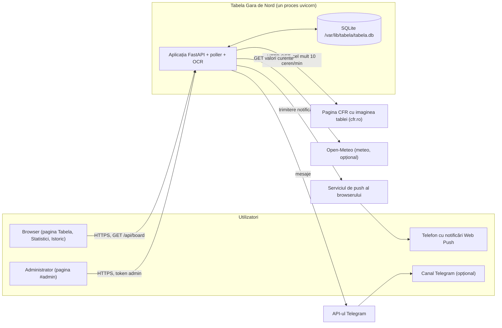
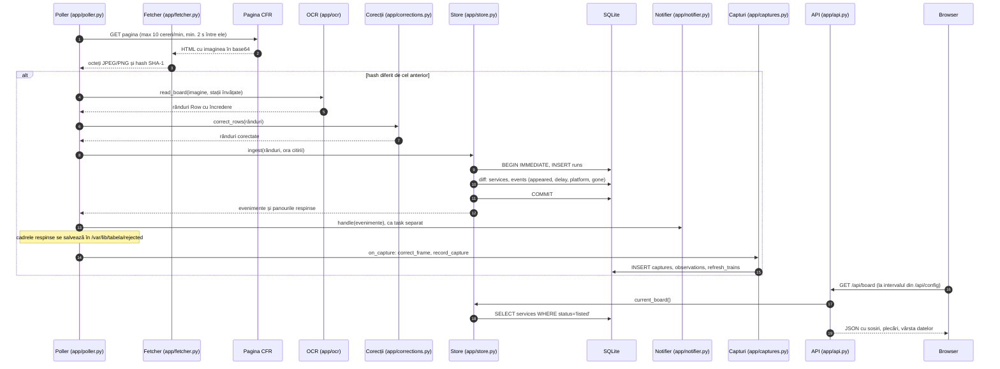
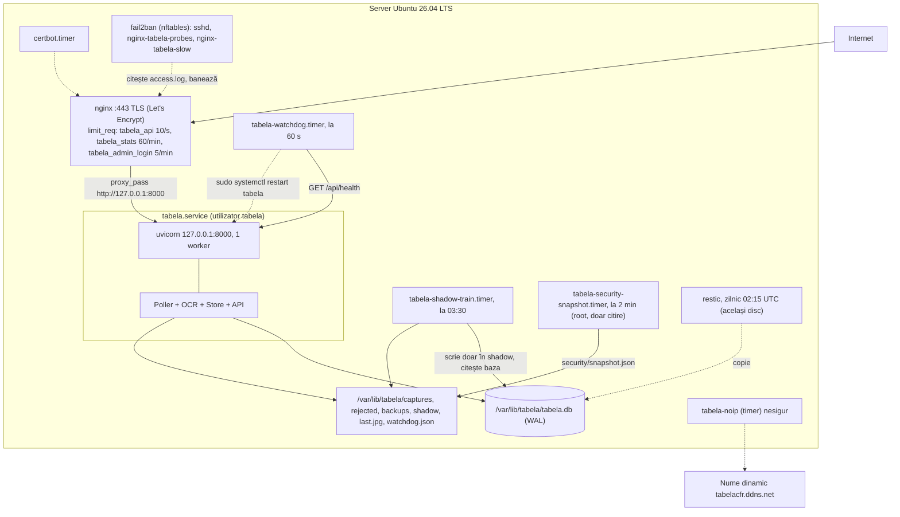

# Tabela Gara de Nord Architecture

This document describes how the application works in production: which processes run, what components they have, how a reading travels from the CFR page to the user's browser, where the data lives and which file in `app/` does what. For the database structure see [date-si-schema.md](date-si-schema.md).

Everything written below was verified in the code (`app/`, `deploy/`, `scripts/`, `web/`). Where a piece of information cannot be confirmed from the repo, an "uncertain" note appears with the file where it must be checked (the full list is in section 9).

## 1. Overview

The application reads the image of the arrivals and departures board at Gara de Nord București, from the public CFR page, turns it into data through OCR, keeps the history in SQLite and shows the live board, the history, the statistics and the notifications for followed trains.

The basic principles, which appear throughout the code:

- **A single process.** The web server and the poller (the loop that reads the board) run in the same `uvicorn` process, with a single worker. The reason is written in `deploy/tabela.service`: "ONE worker only: the poller lives in the process".
- **Nothing is deleted from the history.** Ghosts (wrong readings) are marked, not deleted. Deletion and merging exist only in reversible scripts, with an archive (see `date-si-schema.md`).
- **A wrong reading does not break the state.** Each panel (arrivals, departures) is judged separately. An incomplete or suspicious frame is rejected, and the previous state stays.
- **No cron.** All periodic work is either asynchronous tasks in the application process or systemd timers. I found no `crontab` or cron file in the repo.

## 2. System context

External dependencies:

| Service | Who uses it | How it is used | Where it is configured |
|---|---|---|---|
| The CFR page with the board image | poller (the data source) | GET request; the image is extracted from the HTML (base64) | `SOURCE_URL` in `app/config.py` (by default the cfr.ro page for București Nord) |
| Open-Meteo | `app/weather.py` | the current values and the hourly series (`forecast_days = 2`, that is, up to 48 h) | `WEATHER_*`, on by default; `WEATHER_INTERVAL_S` defaults to 900 s |
| Web Push (VAPID) | `app/notifier.py` | notifications to subscribed browsers | `VAPID_PRIVATE_KEY`, `VAPID_PUBLIC_KEY`, `VAPID_SUBJECT` |
| Telegram Bot API | `app/telegram.py` | alerts for followed trains | `TELEGRAM_BOT_TOKEN`, `TELEGRAM_CHAT_ID`, optionally `TELEGRAM_STATE_PATH` |

## 3. Processes and components

### 3.1 systemd units and timers

| Unit | Type | User | What it does | When it runs |
|---|---|---|---|---|
| `tabela.service` | `Type=simple` | `tabela` | Starts `uvicorn app.main:create --factory --host 127.0.0.1 --port 8000 --workers 1 --proxy-headers --forwarded-allow-ips 127.0.0.1`. The process runs the API, the poller, the notifications, the capture retention and the weather. | Permanently. `Restart=always`, `RestartSec=5`, `TimeoutStopSec=30`. Reads `/etc/tabela.env`. |
| `tabela-watchdog.service` + `tabela-watchdog.timer` | `oneshot`, started by a timer | `tabela` | Runs `python -m app.watchdog`: checks `http://127.0.0.1:8000/api/health` and, after repeated problems, restarts `tabela`. | The timer triggers the first run 2 minutes after system boot (`OnBootSec=2min`), then every 60 s (`OnUnitActiveSec=60s`). |
| `tabela-shadow-train.service` + `.timer` | `oneshot`, started by a timer | `tabela` | Runs `scripts/nightly_shadow_train.py`: daily training of the digit classifier in "shadow mode". It promotes nothing to production; it writes to `/var/lib/tabela/shadow`. | Daily at 03:30 (`OnCalendar=*-*-* 03:30:00`, `Persistent=true`), `Nice=19`, `IOSchedulingClass=idle`, `TimeoutStartSec=2h`. |
| `tabela-noip` (timer) | uncertain | uncertain | Keeps the dynamic address of the `tabelacfr.ddns.net` domain up to date. | Uncertain: it does not exist in the repo (see section 9). |
| `certbot.timer` | external (certbot) | uncertain | Renews the Let's Encrypt certificate (README, Deploy section). | Managed by certbot. |
| nginx | system service | uncertain | Terminates TLS, limits requests and forwards traffic to `127.0.0.1:8000`. | Permanently. The configuration is in `deploy/nginx-tabela.conf` and `deploy/tabela-limits.conf`. |

The security of the `tabela.service` unit (from `deploy/tabela.service`): `NoNewPrivileges=true`, `ProtectSystem=strict` with `ReadWritePaths=/var/lib/tabela` (the only writable place), `PrivateTmp=true`, `ProtectHome=true`, `PrivateDevices=true`, `RestrictAddressFamilies=AF_INET AF_INET6 AF_UNIX`, `UMask=0027`.

The watchdog runs as `tabela`, not as root. The only root permission is a sudoers rule that allows only `systemctl restart tabela` (`deploy/tabela-watchdog.sudoers`).

### 3.2 Logical components

| Component | Where it is in the code | Role |
|---|---|---|
| Poller | `app/poller.py` | Asynchronous loop: requests the page, compares the image hash with the previous one, calls the OCR on a new image and passes the rows read further on. It has firm limits: at least 2 s between requests and at most 10 requests in 60 s (`MIN_GAP`, `MAX_PER_MIN`). |
| Fetcher | `app/fetcher.py` | Downloads the page, extracts the image (JPEG or PNG in base64), refuses anything over 10 MB (`MAX_BYTES`) and computes the hash. |
| OCR engine | `app/ocr/` | OpenCV for preprocessing and Tesseract for text, with templates for digits. It produces `Row` with confidence. `PROCESSING_VERSION` (in `app/observations.py`) is `ocr-tess-grid-5`. |
| Store | `app/store.py` | The only gateway to SQLite for the board state. It migrates the schema (`SCHEMA_VERSION = 10`), applies `ingest` (diff against the state, events) and builds the LIVE board (`current_board`). |
| Manual corrections | `app/corrections.py` | Narrow rules that correct a wrongly read value, on new frames and retroactively. |
| Captures and observations | `app/captures.py`, `app/observations.py` | Save the image of each new frame (on disk), one observation per OCR row and the train catalog. |
| Quality | `app/quality.py` | Validation rules (confirmed delays, platforms, ghosts, suspicious events) and the quality tables. |
| Public API | `app/api.py` and the `*_api.py`, `stats*.py`, `stations.py`, `journeys.py` modules | The HTTP routes for the live board, history, statistics, catalog and export. |
| Admin API | `app/admin.py`, `app/admin_tools.py`, `app/admin_settings.py`, `app/corrections_api.py`, `app/backup_api.py` | Authentication with `ADMIN_TOKEN`, CSRF, the Settings page, corrections, backups. |
| Static frontend | `web/` | HTML, CSS, JavaScript and the service worker (`sw.js`), served by FastAPI from `WEB_DIR` at the root (`StaticFiles`, `html=True`). |
| Notifications | `app/notifier.py`, `app/telegram.py` | Web Push for followed trains; Telegram as a second, optional channel. |
| Weather | `app/weather.py` | Open-Meteo client, writes to `weather_observations`. It has its own asynchronous task, independent of the poller. |
| Watchdog | `app/watchdog.py` | Checking `/api/health` and the controlled restart of the service. |
| Restore and backups | `app/dbbackup.py`, `app/backup_api.py`, `app/restore.py` | A copy before migration, a verified online copy, restore from a copy. |
| Maintenance scripts | `scripts/` | Reversible cleanups, restore, OCR evaluation, shadow training. See section 6.3. |

In-memory state: the Store keeps a few structures in RAM (caches, frame counters, pending candidates) that are rebuilt after a restart from the persistent data. The details are in `date-si-schema.md`, section 5.

## 4. The flow of a polling cycle

The diagram below shows a complete cycle, when the image has changed. The steps follow the order in `app/poller.py` and `app/api.py` (the `on_rows` function in `lifespan`).

What happens, in short:

1. **Request scheduling.** The poller estimates at which second of the minute the image changes (`PhaseTracker`, the circular median of the last 5 changes, `HISTORY = 5`). It requests the page in the window in which the change is expected. If it has seen no changes for over 300 s (`STALE_AFTER`), it switches to a slow pace of 30 s (`STALE_DELAY`). Network and fetch errors go into an exponential backoff from 5 s, capped at 300 s.
2. **The new image.** If the hash differs, the image is saved to `LAST_IMAGE_PATH` (by default `/var/lib/tabela/last.jpg` on the server) and sent to OCR. The stations already learned from the history (`known_stations`) help canonicalize the names.
3. **OCR failure.** If the OCR raises an error, the frame is saved in `rejected`, and the capture is recorded with no rows, with the error in the `error` field.
4. **Manual corrections.** `correct_rows` applies the active rules (`app/corrections.py`) before the data reaches the Store.
5. **Ingest.** The Store judges each panel separately. A panel with too few rows, or a partial reading (under half the number of rows from the last good reading), is rejected, and its services stay unchanged. If no panel is accepted, the frame becomes `ok=0` in `runs`. The details are in `date-si-schema.md`, section 4.
6. **Notifications.** The events (`appeared`, `delay`, `platform`, `gone`) start an asynchronous task. A notification error does not stop the poller.
7. **Captures.** After ingest, the frame (even one with a failed OCR) is saved as `captures`, with one `observations` per OCR row. For an image already seen (the same SHA-1) only `last_seen_at` is updated.
8. **The browser.** The page loads `/api/board` and refreshes at the `refresh_s` interval from `/api/config`. The response is marked `stale` if the last good reading is older than `STALE_S = 180` s.

## 5. Deployment diagram

The diagram shows the server as described in the repo and in the working instructions. The concrete host (the home server, with a private IP) does not appear here.

Configuration details from `deploy/nginx-tabela.conf`:

- `client_max_body_size 8k` and `server_tokens off`; gzip for JSON, CSS and JavaScript.
- `/api/follows` has `access_log off`, because the push address (endpoint) appears in the query string.
- The limits are in `deploy/tabela-limits.conf`: `tabela_api` (10 requests/s), `tabela_stats` (60/min, for the statistics that scan the whole history), `tabela_admin_login` (5/min). Rejections (429) are logged at the `warn` level.
- The routes `/api/stats`, `/api/trains/stats`, `/api/trains/{no}/journeys`, `/api/stations` and `/api/journeys` have the stricter limit zone.

## 6. Where the data lives

### 6.1 Paths on the server

| Path | What it contains | Who writes | Retention | See |
|---|---|---|---|---|
| `/opt/tabela/app` | the code (git checkout) | `deploy/install.sh`, `deploy/update.sh` | not applicable | `deploy/install.sh` |
| `/opt/tabela/venv` | the Python environment | `deploy/install.sh` | not applicable | `deploy/install.sh` |
| `/etc/tabela.env` | environment variables (root:root, 600), not in git | `install.sh`, the administrator | not applicable | `app/config.py` |
| `/var/lib/tabela/tabela.db` (+ `-wal`, `-shm`) | the main SQLite database | the application | permanent, except for the reversible scripts | `date-si-schema.md` |
| `/var/lib/tabela/backups/` | database copies (before migration, restore, cleanup) | `app/dbbackup.py`, `app/backup_api.py`, `deploy/update.sh` | the last 5 (`BACKUP_KEEP = 5`), for the merge scripts the last 10 | `app/dbbackup.py` |
| `/var/lib/tabela/backups-fallback/` | a fallback copy if the main directory is not writable | `app/dbbackup.py` | the last 5 | `app/dbbackup.py` |
| `/var/lib/tabela/captures/YYYY/MM/DD/HHMMSS-<hash8>.jpg` | the frame images (UTC) | `app/captures.py`, `app/observations.py` | the files: `CAPTURE_RETENTION_DAYS` (default 7). The rows in `captures` stay. | `app/captures.py` |
| `/var/lib/tabela/rejected/` | the last rejected frames (image and JSON) | `app/rejected.py` | the last 40 (`REJECTED_KEEP = 40`) | `app/rejected.py` |
| `/var/lib/tabela/last.jpg` | the last downloaded image (for debugging) | `app/poller.py` | overwritten | `app/poller.py` |
| `/var/lib/tabela/watchdog.json` | the watchdog state | `app/watchdog.py` | overwritten | `app/watchdog.py` |
| `/var/lib/tabela/shadow/` | report and model from the shadow training | `scripts/nightly_shadow_train.py` | uncertain (to verify in the script) | `scripts/nightly_shadow_train.py` |
| `data/telegram_sent.json` (default, relative to the working directory) | the keys of the Telegram alerts already sent | `app/telegram.py` | yesterday's and today's keys (`KEEP_DAYS = 2`) | `app/telegram.py` |

Note: `tabela.service` has `ProtectSystem=strict` and writes only to `/var/lib/tabela`. The default path of the Telegram state, `data/telegram_sent.json`, is relative to `/opt/tabela/app`, that is, outside this place. On the server, `TELEGRAM_STATE_PATH` must therefore be set in `/etc/tabela.env`, otherwise the write fails. Uncertain: I have not seen `/etc/tabela.env`, so I do not know whether the variable is set (see section 9).

### 6.2 In-memory data

The application state that is not in the database (the previous frame, the reading counters, the candidates waiting for a second reading, the station cache) is in RAM. After a restart, the Store rebuilds it from `services` and from the last `runs` with `ok=1` (`_last_count`, `_last_ok_ts`). The consequence is documented in the code: after a restart, "nothing is hidden until a complete frame is read again" (`Store._complete`).

### 6.3 Scripts (`scripts/`)

| Script | Role | Writes to the live database? |
|---|---|---|
| `scripts/purge_ghosts.py` | Reversibly deletes ghosts: short or duplicate services from a wrong reading. Dry run by default. | Yes, only with `--apply`, with a prior copy |
| `scripts/merge_number_dups.py` | Merges duplicate train numbers and station aliases. Dry run by default. | Yes, only with `--apply`, with a prior copy |
| `scripts/restore_db.py` | Restores the database from a copy (confirmation `RESTAUREZ`). | Yes, it replaces the database. The service must be stopped. |
| `scripts/nightly_shadow_train.py` | Daily shadow training of the digit classifier. | No, it only reads the database and writes to `shadow/` |
| `scripts/ocr_eval.py`, `scripts/backtest_delay.py`, `scripts/ambiguous_pairs.py` | OCR evaluation, backtest, reports. | No (the header says read-only) |
| `scripts/ocr_digit_clf.py` | "Silver" ground-truth set and digit classifier (experimental, according to the header). | Uncertain: I did not read it in full; check before running it on the live database |
| `scripts/contrast_audit.py` | Automatic contrast audit (WCAG 2.x, 1.4.3) in a real browser. | No |
| `scripts/dev_seed.py` | Fills a development database from a frame in the fixtures. | Only the database indicated |
| `scripts/make_icons.py` | Generates the application icons. | No |

## 7. The `app/` modules, by layer

The list covers all the modules in `app/` (including `app/ocr/`). The descriptions come from the module docstrings, where they exist, and from checking the code.

### 7.1 Acquisition and reading (OCR)

- `app/poller.py`: the polling loop. It requests the page, detects new images, calls the OCR and passes the rows to `on_rows` and `on_capture`, with backoff on errors.
- `app/fetcher.py`: downloads the CFR page and extracts the base64 image. It refuses anything over 10 MB and computes the image hash.
- `app/models.py`: the dataclasses `Row` (a row read, with the key `(board, train_no, sched_time)`) and `Event` (a change, with the service date).
- `app/normalize.py`: normalizes the OCR text: digit confusions (O/0, l/1), times, the train type (`IR`, `IRN`, `R`, `RE`, `RM`, `IC`, `EC`, `EN`, `D`), the delay (at most `MAX_DELAY = 999`), the platform (`PLATFORM_MAX`) and the marker asterisk.
- `app/ocr/__init__.py`: the OCR package. It exposes `read_board`, which returns the rows of both panels.
- `app/ocr/engine.py`: the OCR engine interface. The default is Tesseract.
- `app/ocr/preprocess.py`: color mask, splitting the board into panels and row detection.
- `app/ocr/reader.py`: reads each column with Tesseract on the text mask. It rereads the unreadable rows (type, number, time) with other preprocessings, with an 8 s limit per frame.
- `app/ocr/digits.py`: template matching for numeric fields. The board uses a single fixed font.
- `app/ocr/glare.py`: decides what can be filled in from a cell affected by glare or by the board's arrow, and what cannot.
- `app/ocr/order.py`: the times on a panel are in chronological order. A time out of order is treated as a reading error.
- `app/ocr/stats.py`: in-memory OCR statistics (rows per panel, rereads), exposed in `/api/health`.
- `app/ocr/truth.py`: measures the accuracy of the fields against the manually labeled ground-truth set. Used by `scripts/ocr_eval.py`.

### 7.2 Validation, corrections and quality

- `app/quality.py`: the validation rules (how many consecutive readings are needed for a delay or platform change, ghost detection, suspicious events, gone/appeared "flapping" under 180 s) and the backfill of the quality tables (schema v7).
- `app/corrections.py`: narrow manual rules `(board, field, wrong_value) → correct_value`, with a plan, retroactive application with an archive, restore and an audit log (schema v9).
- `app/corrections_api.py`: the admin API of the rules (`/api/admin/corrections*`), with token and CSRF.
- `app/canonical.py`: canonical names for stations and operators, through fuzzy matching (difflib). The lists come from `data/`, which contains only names seen on the board.
- `app/consensus.py`: the per-train consensus of recent frames. The displayed value is the vote of the readings, not the last reading. It does not change the schema.
- `app/rejected.py`: saves rejected frames (image and JSON), keeping the last 40.
- `app/captures.py`: the capture settings (`CAPTURE_ENABLED`, `CAPTURE_DIR`, `CAPTURE_RETENTION_DAYS`), safe paths, the daily retention of the files and reading the captures for the admin page.
- `app/observations.py`: the captures, the observations per OCR row and the `trains` catalog (schema v5). It links each observation to the matching service. It also holds `PROCESSING_VERSION`.

### 7.3 Storage, backups and restore

- `app/store.py`: SQLite. Version migration (`migrate`), ingest (diff against the state and events), the LIVE board (`current_board`), the history, the learned stations and the push subscriptions.
- `app/dbbackup.py`: a safety copy before any migration of a database with data. If no copy can be made, it accepts the marker left by `deploy/update.sh` (if it is recent and matches), otherwise it refuses the migration.
- `app/backup_api.py`: a verified online copy (integrity check), with a retention of 5 copies. Used by the admin and by restore.
- `app/restore.py`: restoring the database from a copy. It requires the `RESTAUREZ` confirmation, refuses if `tabela` is running and replaces the database atomically.
- `app/admin_settings.py`: the settings editable from the Settings page (capture retention, free-space threshold), in the `settings` table.
- `app/endpoints.py`: validation of Web Push addresses (protection against SSRF).

### 7.4 Startup and public API

- `app/main.py`: the ASGI entry point. The application is created lazily, on first access, and importing it does not start the poller.
- `app/config.py`: the `Settings` dataclass, built from the environment variables.
- `app/api.py`: the FastAPI application. It contains `lifespan` (creates `Store`, runs the migration, starts the poller, the notifications, the retention and the weather), the public routes and the security headers (CSP, `nosniff`, `Referrer-Policy`, `X-Frame-Options`). For static files it sends `Cache-Control: no-cache`.
- `app/trains_api.py`: the public train catalog (`/api/trains`, `/api/trains/{no}`), read-only.
- `app/journeys.py`: the journeys (a row from `services`) and their final result.
- `app/stations.py`: station pages: the trains that come from a station (arrivals) or leave toward it (departures).
- `app/history_all.py`: the history of all days for a train, or for all trains in a day.
- `app/export.py`: the CSV export of the history. The range is at most `MAX_DAYS = 366` days.
- `app/stats.py`: pure delay-statistics functions (aggregations over journeys).
- `app/stats_api.py`: the public statistics and rankings routes, in JSON, or CSV with `format=csv`.
- `app/stats_overview.py`: the aggregated payload of the Statistics page (`/api/stats/overview`). The thresholds for sufficient data are in the code (for example `HISTORY_MIN_DAYS = 7`).
- `app/stats_problems.py`: the "Problems" section of Statistics, with deterministic findings (no language model).
- `app/seasons.py`: the weather comparison by season. Under `SEASON_MIN_DAYS = 30` eligible days it shows no figures.
- `app/predict.py`: the prediction of the final delay. Nothing is published until there are at least `MIN_GOOD_DAYS = 30` days of good data and the backtest passes the thresholds.
- `app/weather.py`: the Open-Meteo client. It takes the current values every `WEATHER_INTERVAL_S` (default 900 s, minimum 300 s) and writes to `weather_observations`. Failures do not affect the application's health state.
- `app/system_api.py`: the routes of the "System" page: `GET /api/system` (public, minimal) and `GET /api/admin/system` (admin, with details).
- `app/system_status.py`: the data of the "System" page: whether the board is live, the last good reading, the OCR state, disk space and the database size.
- `app/version.py`: the application version (from the `VERSION` file) and the history from `CHANGELOG.md`, served at `/api/changelog`.

### 7.5 Administration, notifications and supervision

- `app/admin.py`: administrator authentication with `ADMIN_TOKEN`, CSRF protection for requests that change data, limiting of failed attempts and the "OCR captures" API, which stays private.
- `app/admin_tools.py`: tools in the admin page, after authentication (for example the verified copy of the database into the backup directory).
- `app/notifier.py`: Web Push notifications for followed trains. A repeated transition for the same service, on the same service date, is not sent again (the module docstring).
- `app/telegram.py`: the optional Telegram channel, with the same kind of alerts. It keeps a JSON log of the alerts sent, so as not to resend them after a restart.
- `app/watchdog.py`: checks `/api/health` every minute. After `THRESHOLD = 3` failed checks in a row it restarts `tabela`, at most once per `RESTART_COOLDOWN_S = 600` s.

## 8. Design decisions and their reasons

| Decision | Reason (from the code or the CHANGELOG) |
|---|---|
| A single uvicorn worker | The poller lives in the process (written in `deploy/tabela.service`). A second worker would start a second poller. The consequence (a second poller would read the board twice) is a deduction from the code structure, not a statement from the repo. |
| SQLite in WAL mode, with `synchronous=NORMAL` and `busy_timeout=5000` | The settings are in `Store.__init__`. The reason is not written explicitly in the code; WAL allows reads in parallel with writes, and `busy_timeout` waits for a released lock instead of failing immediately. |
| Additive migrations, each step atomic with the version | A failed step leaves the old version. Re-running is safe. No step is renumbered. (`Store.migrate`) |
| A copy before migration, otherwise refusal | After the Beta 1.29 incident (the backup directory was not readable by the service user), the migration is not done without a known copy. (`app/dbbackup.py`, CHANGELOG, Beta 1.31 and 1.29) |
| Judging per panel, not per frame | A partially read panel must not delete the trains of the other panel. (`app/store.py`, docstring) |
| Confirmation of delay and platform changes | The OCR confuses digits and "+" with a digit. A change is applied only after several identical readings. (`app/quality.py`, `delay_needs`) |
| Disappearance after `GONE_AFTER_MISSES = 3` frames, not immediately | The frames alternate between OCR variants. Without a threshold, a train would appear and disappear on every frame. (`app/store.py`) |
| Ghosts marked, not deleted | The ghost verdict may be wrong. The mark can be changed, deletion cannot. (`app/quality.py`, docstring) |
| Images expire, rows in `captures` and `observations` do not | Images are large; the observation history is useful for quality and the catalog. (`app/captures.py`, docstring) |
| No cron | Periodic work is asynchronous tasks in the process or systemd timers. The reason is not written explicitly in the repo. |
| Watchdog without root | Only `systemctl restart tabela` is allowed through sudoers. (`deploy/tabela-watchdog.sudoers`, CHANGELOG, Beta 1.43) |
| Rate limits in nginx and in the application | The statistics scan the whole history and are expensive. The admin page has a strict limit. (`deploy/tabela-limits.conf`) |

## 9. What I could not verify

- **The `tabela-noip` timer.** It does not exist in `deploy/`, in the README or in the CHANGELOG. Check on the server with `systemctl list-timers` and with `systemctl cat` for that unit.
- **The contents of `/etc/tabela.env`.** It is not in the repo. I do not know whether `TELEGRAM_STATE_PATH`, `CAPTURE_DIR` or `REJECTED_DIR` are set on the server. Check in `/etc/tabela.env` (without printing the secret values).
- **The shadow training script.** I did not read `scripts/nightly_shadow_train.py` in full. The path `/var/lib/tabela/shadow` is confirmed from the header and from `DEFAULT_WORKDIR`, but the rotation mode of the files in `shadow/` is not verified.
- **The exact shape of the fields in `observations.fields_json`.** I verified that it is a dictionary with fields, but not the internal structure of each entry. Check in `app/ocr/reader.py`.
- **The meaning of the asterisk (`flagged`).** The code reads it from the train type (`app/normalize.py`, `strip_flag`). What it means for travelers is not stated in the code. Check in the README or in the CFR documentation.

## 10. Links

- The database structure, schema versions, identity rules, retention and restore: [date-si-schema.md](date-si-schema.md).
- The update and deploy procedure: README, Deploy section.
- The version history: `CHANGELOG.md`.

## 11. Addresses and search engines (SEO)

**The chosen scheme.** The public pages have their own address (`/statistici`, `/tren/1636`, `/statie/BRASOV`), served by FastAPI (`app/seo.py`, routes in `app/api.py`). English stays `?lang=en`, the existing mechanism: `theme-init.js` and `i18n.js` already read it and the server already served the English head for it. No route is duplicated (`/en/...` would have needed a second set of routes in the server, the router and the service worker). `hreflang`: ro = the address without a query, en = `?lang=en`, `x-default` = ro; `canonical` points to the page's language version and ignores the filters in the query.

**What a crawler without JavaScript gets.** `index.html` with `<title>`, description, Open Graph/Twitter, `canonical`, `hreflang`, JSON-LD and a `<section class="ssr">` block at the start of `<main>`: on `/` the next 20 departures and arrivals (a table linking to `/tren/…` and `/statie/…`), on `/trenuri` and `/statii` the lists of links, on the detail pages a summary from the catalog. The block always carries the note "data read via OCR, may contain errors; not affiliated with CFR". When the app runs, `theme-init.js` sets `data-view` on `<html>` and `style.css` hides the block (`html[data-view] .ssr`), so nothing flashes; on boot `app.js` removes it from the DOM. Pages are kept 60 s in memory; the data comes only from our own database (board and catalog), never from Infofer.

**JSON-LD.** One `@graph`: `Organization` (the independent project, not CFR), `WebSite`, `TrainStation` București Nord (with coordinates), `WebPage` with `BreadcrumbList`, and on `/tren/<nr>` a `TrainTrip` (number, departure/arrival station from the most frequent route, operator). No `SearchAction` (Google dropped the sitelinks search box in 2024). It is a data block (`application/ld+json`), which CSP does not block; `<`, `>` and `&` are escaped so it cannot close the tag.

**The client.** `web/app.js` reads the route from the path (`/tren/1636` → `tren`, `nr=1636`). An old `#statistici?…` link is rewritten with `history.replaceState` to `/statistici?…`; the private pages (`#admin`, `#ocr`, `#ocr2`, `#infofer`, `#sistem`, `#setari`) stay fragment-only (`/#admin`), not indexed. A click on a route link (path or `#…`) does `pushState` and fires the `hashchange` event every page already listens to; back/forward (`popstate`) as well. Pages write their filters into the address through `TabelaApp.syncUrl`. `<base href="/">` makes relative resources load from the root on any address. The service worker did not change: any offline navigation gets the cached `/` shell, and the router shows the page from the path.

**robots.txt and sitemap.xml.** See [api.md](api.md) §5.22. `/api/*` has `X-Robots-Tag: noindex`; any unknown path gets a 404 HTML page with `noindex`.

**Search Console / Bing.** The optional variables `GOOGLE_SITE_VERIFICATION` and `BING_SITE_VERIFICATION` in `/etc/tabela.env` add the verification meta tag. To get the token: Google Search Console → *Add property* → *URL prefix* `https://tabelacfr.ddns.net/` → *HTML tag* method; copy only the `content="…"` value. Bing Webmaster Tools → *Add site* → *HTML Meta Tag* (`msvalidate.01`); copy the `content` value. Then `sudo systemctl restart tabela`, *Verify* in the console and submit `https://tabelacfr.ddns.net/sitemap.xml`. The token is not secret, but it does not go into the repo.
