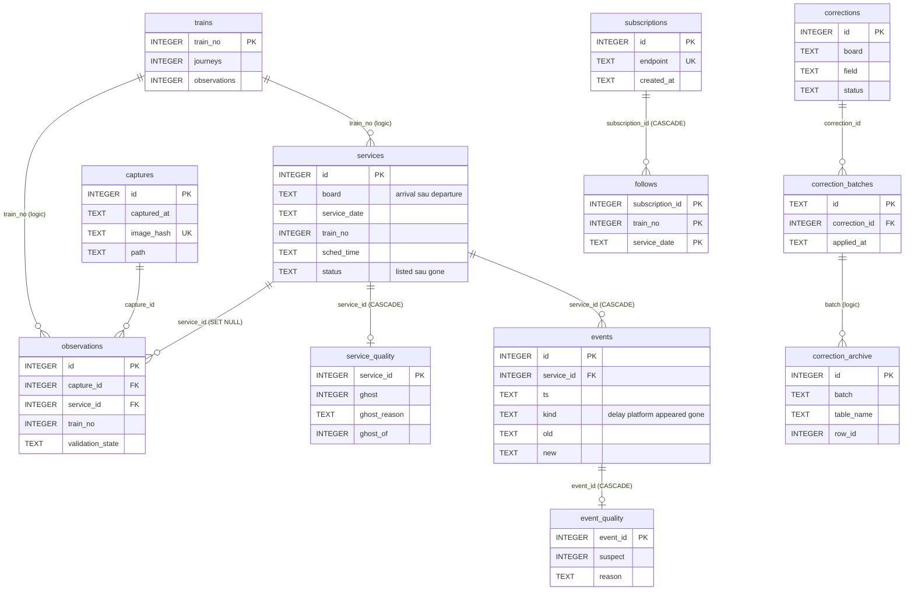

# Data and database schema

This document describes the SQLite database of the Tabela Gara de Nord application: each table, each column, the constraints and indexes, the history of schema versions, the path by which a board reading becomes services, events and observations, the identity rules, retention and restore.

The database file on the server is `/var/lib/tabela/tabela.db` (see `deploy/install.sh`). The structure below was verified in two ways: by reading the code (`app/store.py`, `app/observations.py`, `app/quality.py`, `app/corrections.py`, `app/dbbackup.py`, `app/backup_api.py`, `app/restore.py`, `app/captures.py`, `scripts/*.py`) and by creating a new database with `Store.migrate()` in a temporary directory, then reading `sqlite_master`, `PRAGMA table_info`, `PRAGMA foreign_key_list` and `PRAGMA index_list`. Where something cannot be confirmed, an "uncertain" note appears, with the file to check.

For the general architecture (processes, components, deployment) see [arhitectura.md](arhitectura.md).

## 1. Overview

The database has two layers:

| Layer | Tables | What they contain | Who writes them |
|---|---|---|---|
| History and state | `runs`, `services`, `events`, `subscriptions`, `follows`, `weather_observations` | what was read from the board, what changed, the notification subscriptions, the weather | `Store.ingest` and its methods |
| Captures, quality and corrections | `captures`, `observations`, `trains`, `dq_meta`, `service_quality`, `event_quality`, `quality_periods`, `corrections`, `correction_batches`, `correction_archive`, `correction_audit` | the frame images, the observations per OCR row, the train catalog, the quality verdicts, the manual rules and their log | `app/observations.py`, `app/quality.py`, `app/corrections.py` |

The principle that governs everything: **nothing is deleted from the history** in the application code. The quality verdicts are separate tables that can be recomputed; corrections are reversible; deletions and merges exist only in scripts, with an archive and restore (section 8).

SQLite settings used by `Store` (`app/store.py`, `__init__`): `journal_mode = WAL`, `synchronous = NORMAL`, `busy_timeout = 5000`, `foreign_keys = ON` (on the application's connection; the scripts do not rely on them, see section 8).

## 2. The schema version

The version is in `PRAGMA user_version`. The current value is `SCHEMA_VERSION = 9` (`app/store.py`, line 54). There is also a second "version", `dq_meta.version`, which is the version of the quality layer (`DQ_VERSION = "1"`, `app/quality.py`) and is unrelated to `user_version`.

`Store.migrate()` applies the steps in order. Each step is additive, atomic together with the version increase, and can be redone without effects (see the method docstring: "Never renumber a step").

| From → to | What it adds | Code | Beta (CHANGELOG.md) |
|---|---|---|---|
| new database (0) → 3 | the tables `runs`, `services`, `events`, `subscriptions`, `follows`, with everything they have in version 3 | `Store._migrate_to_3` (the `version == 0` branch) | uncertain (not found in the CHANGELOG) |
| 1 → 2 | the `services.last_read` column (the comment in the code says "v2") | `_ADDED_COLUMNS` | uncertain |
| 2 → 3 | the columns `services.operator_raw`, `services.station_raw`, `services.uncertain`; re-running `_SCHEMA` (`CREATE ... IF NOT EXISTS`) | `Store._migrate_to_3` | uncertain |
| 3 → 4 | the `weather_observations` table | `Store._migrate_to_4` | Beta 1.01 |
| 4 → 5 | the tables `captures`, `observations`, `trains`; the `trains` catalog is rebuilt from `services` | `app/observations.migrate_to_5` | Beta 1.01 |
| 5 → 6 | the `services.delay_read_at` column, the index `ix_events_kind_service`, filling in `delay_read_at` from the real observations | `Store._migrate_to_6`, `_backfill_delay_read_at` | Beta 1.04 |
| 6 → 7 | the tables `dq_meta`, `service_quality`, `event_quality`, `quality_periods`; `dq_meta.live_since` | `app/quality.migrate_to_7` | Beta 1.06 |
| 7 → 8 | eight new columns in `weather_observations` (humidity, rain, gusts etc.) | `Store._migrate_to_8` | Beta 1.25 |
| 8 → 9 | the tables `corrections`, `correction_batches`, `correction_archive`, `correction_audit` | `app/corrections.migrate_to_9` | Beta 1.29 |

Notes about the old versions:

- For steps 1→2 and 2→3 there is no separate code in the repo. The current logic adds any missing column from `_ADDED_COLUMNS` (`PRAGMA table_info`), so any database with a version lower than 3 reaches the current shape. Uncertain: the exact shape of the former v1 and v2 databases; check with `git log -p -- app/store.py`.
- For steps 4 and 5, the CHANGELOG (line 574) says that "historical data is not deleted".
- Version 9 brought the corrections tables. The CHANGELOG says Beta 1.29 (with schema v9) could not start on the server, because the backup could not be read by the service user. Beta 1.29 and 1.30 went to the server together, in Beta 1.31 (CHANGELOG, Beta 1.31).

**Backup before migration.** If the database has a version lower than `SCHEMA_VERSION` and is not empty, `Store.migrate()` first calls `app/dbbackup.ensure()`. The order of attempts (from the code):

1. a recent copy (newer than 24 h, `RECENT_S`) of the same version, in the backup directory;
2. the same check in `backups-fallback`, next to the database;
3. a new copy in the backup directory; if that is not possible, a new copy in `backups-fallback`;
4. the `.pre-migration-backup` marker left by `deploy/update.sh`, if it is recent and matches the version and the database.

If none of these succeeds, the migration stops with `BackupUnavailable`, and the database is not touched (`app/dbbackup.py`; CHANGELOG, Beta 1.31).

## 3. The tables

Below are all the tables that `Store.migrate()` creates on a new database (verified: 17 tables, `user_version = 9`), plus the tables that appear at other times (section 3.3).

Conventions: "NN" means `NOT NULL`. "DEF" is the default value. "FK" is the foreign key, with the `ON DELETE` action. The times in `services`, `events` and `runs` are Europe/Bucharest local time with offset (`isoformat()` from `_local`). The times in `observations`, `captures` and `weather_observations` are UTC (`app/observations.py`, docstring: "All timestamps written here are UTC ISO 8601").

### 3.1 The base tables (`app/store.py`)

#### `runs`: one row per processed frame

| Column | Type | Constraints | Meaning |
|---|---|---|---|
| `id` | INTEGER | PK | the frame identifier |
| `ts` | TEXT | NN | the reading moment (local time, with offset) |
| `image_hash` | TEXT | NN, DEF `''` | the image hash. In the live path, `on_rows` sends the empty string (`api.py`), so the column stays empty. |
| `ok` | INTEGER | NN | `1` if at least one panel was accepted, `0` if none |
| `n_rows` | INTEGER | NN | the number of rows received from the OCR (including those with low confidence) |

Index: `ix_runs_ok_ts (ok, ts)`. Used for the "last good reading" (`Store._last_ok_ts`).

Retention: none. I find no `DELETE FROM runs` in `app/` or `scripts/`.

#### `services`: a service = one train, one service date, one panel

| Column | Type | Constraints | Meaning |
|---|---|---|---|
| `id` | INTEGER | PK | the service identifier |
| `board` | TEXT | NN, CHECK `board IN ('arrival','departure')` | the board: arrivals or departures |
| `service_date` | TEXT | NN | the service date (ISO, `YYYY-MM-DD`), computed from the scheduled time, see section 6 |
| `train_type` | TEXT | NN | the train type (`IR`, `IRN`, `R`, `RE`, `RM`, `IC`, `EC`, `EN`, `D`, from `app/normalize.py`) |
| `train_no` | INTEGER | NN | the train number |
| `station` | TEXT | NN | the station, with the canonical name when it matched (`uncertain = 0`) |
| `operator` | TEXT | NN | the operator, canonical when it matched |
| `sched_time` | TEXT | NN | the scheduled time, `HH:MM` |
| `first_seen` | TEXT | NN | the first reading (local time). For a service with an uncertain initial reading, it is the moment of the first reading in the confirmation sequence |
| `last_seen` | TEXT | NN | the last appearance on the board, including the low-confidence readings |
| `last_delay` | INTEGER | NN, DEF `0` | the last confirmed delay, in minutes. For a new service with no delay reading, the value is `0` and does not mean "no delay"; that is why `delay_read_at` exists. |
| `last_platform` | INTEGER | nullable | the last confirmed platform |
| `flagged` | INTEGER | NN, DEF `0` | `1` if the train type has an asterisk (`strip_flag` in `app/normalize.py`). The meaning for travelers is not in the code (section 9). |
| `status` | TEXT | NN, DEF `'listed'`, CHECK `status IN ('listed','gone')` | `listed` = on the board; `gone` = left the board |
| `miss_count` | INTEGER | NN, DEF `0` | how many consecutive accepted frames did not read it. It reaches `GONE_AFTER_MISSES = 3` → `gone`. |
| `last_read` | TEXT | nullable | the last confident reading matched to the service (not a low-confidence reading) |
| `operator_raw` | TEXT | NN, DEF `''` | the operator as read by the OCR |
| `station_raw` | TEXT | NN, DEF `''` | the station as read by the OCR |
| `uncertain` | INTEGER | NN, DEF `0` | `1` if the station or the operator did not match a known name |
| `delay_read_at` | TEXT | nullable | the moment of the last delay actually read (the proof of reading). `NULL` = unknown delay, not zero. See `DELAY_LAST_READ_MAX_S = 900` in `app/store.py`. |

Uniqueness constraints and indexes:

- `UNIQUE (board, service_date, train_no, sched_time)`: it is the identity key of a service (section 6).
- `ix_services_date (service_date)`
- `ix_services_train (train_no, service_date)`
- `ix_services_status (status)`

There is no foreign key on `services`. The link to `observations` (`service_id`) and to `service_quality` is by value, and deleting a service does not propagate automatically except through the `ON DELETE` declared on the child tables.

#### `events`: the changes of a service

| Column | Type | Constraints | Meaning |
|---|---|---|---|
| `id` | INTEGER | PK | the event identifier |
| `service_id` | INTEGER | NN, FK → `services(id)` ON DELETE CASCADE | the service |
| `ts` | TEXT | NN | the event moment (local time) |
| `kind` | TEXT | NN, CHECK `kind IN ('delay','platform','appeared','gone')` | the type of change |
| `old` | TEXT | nullable | the old value: minutes for `delay`, platform for `platform`, `NULL` for `appeared` and `gone` |
| `new` | TEXT | nullable | the new value, same format |

Indexes:

- `ix_events_service (service_id, ts)`
- `ix_events_kind_service (kind, service_id)` (added in version 6, used by the statistics)

The `flap` events (gone followed by appeared in less than `FLAP_S = 180` s) are not deleted. They are marked in `event_quality` with the reason `flap` (section 3.2).

#### `subscriptions`: the Web Push subscriptions

| Column | Type | Constraints | Meaning |
|---|---|---|---|
| `id` | INTEGER | PK | the subscription identifier |
| `endpoint` | TEXT | NN, UNIQUE | the browser's push address. It is sensitive: it is not published. |
| `p256dh` | TEXT | NN | the subscription's public key (validated at `subscribe`, at most `MAX_KEY_LEN = 256` characters) |
| `auth` | TEXT | NN | the subscription's authentication secret (the same kind of validation) |
| `created_at` | TEXT | NN | the subscription moment (local time) |

A `UNIQUE` on `endpoint` (the index `sqlite_autoindex_subscriptions_1`) means that a new subscription on the same endpoint updates the keys. Subscriptions are deleted only on unsubscribe (`Store.unsubscribe`); there is no cleanup of old subscriptions in the code.

#### `follows`: which train a subscription follows, for a day

| Column | Type | Constraints | Meaning |
|---|---|---|---|
| `subscription_id` | INTEGER | PK (part), NN, FK → `subscriptions(id)` ON DELETE CASCADE | the subscription |
| `train_no` | INTEGER | PK (part), NN | the followed train |
| `service_date` | TEXT | PK (part), NN | the followed service date |

Constraints and indexes: `PRIMARY KEY (subscription_id, train_no, service_date)`; `ix_follows_train (train_no, service_date)`.

The limit: `MAX_FOLLOWS = 20` trains per subscription. Follows older than yesterday (`today - 1`) are deleted lazily, at the next follow (`Store.follow`).

#### `weather_observations`: current weather (Open-Meteo)

| Column | Type | Constraints | Meaning |
|---|---|---|---|
| `id` | INTEGER | PK | the identifier |
| `observed_at` | TEXT | NN, UNIQUE | the observation moment, UTC. A single row per moment. |
| `fetched_at` | TEXT | NN | when the observation was downloaded |
| `source` | TEXT | NN, DEF `'open-meteo'` | the source |
| `kind` | TEXT | NN, DEF `'model_current'` | the observation type |
| `latitude`, `longitude` | REAL | nullable | the coordinates |
| `temperature_c` | REAL | nullable | the temperature, in °C |
| `apparent_temperature_c` | REAL | nullable | the apparent ("feels like") temperature |
| `precipitation_mm` | REAL | nullable | the precipitation |
| `weather_code` | INTEGER | nullable | the weather code |
| `wind_speed_kmh` | REAL | nullable | the wind speed |
| `wind_direction_deg` | REAL | nullable | the wind direction |
| `units_json` | TEXT | nullable | the units reported by the API |
| `raw_json` | TEXT | nullable | the raw response |
| `relative_humidity_pct` | REAL | nullable | relative humidity (version 8) |
| `is_day` | INTEGER | nullable | day or night (version 8) |
| `rain_mm` | REAL | nullable | rain (version 8) |
| `showers_mm` | REAL | nullable | showers (version 8) |
| `snowfall_cm` | REAL | nullable | snowfall (version 8) |
| `surface_pressure_hpa` | REAL | nullable | pressure (version 8) |
| `wind_gusts_kmh` | REAL | nullable | gusts (version 8) |
| `hourly_json` | TEXT | nullable | the hourly series of the next 24 h; kept only on the newest observation (version 8) |

Missing values are `NULL`, never `0` (the comment in `app/store.py`). The old rows, from before version 8, have `NULL` in the new columns, not zero.

Retention: permanent. The code says "History is permanent (~96 rows/day)". There is no `DELETE` on this table.

### 3.2 The observations and catalog tables (`app/observations.py`, version 5)

#### `captures`: an image of the board, as downloaded

| Column | Type | Constraints | Meaning |
|---|---|---|---|
| `id` | INTEGER | PK | the capture identifier |
| `captured_at` | TEXT | NN | the capture moment, UTC |
| `last_seen_at` | TEXT | nullable | the last time the same image was seen again |
| `image_hash` | TEXT | NN, UNIQUE | the SHA-1 of the image bytes. An image appears only once. |
| `path` | TEXT | nullable | the relative path of the file under `CAPTURE_DIR`. `NULL` after the file was deleted by retention, or if it was not saved. |
| `width`, `height` | INTEGER | nullable | the image dimensions |
| `bytes` | INTEGER | nullable | the file size |
| `ok` | INTEGER | NN | `1` if the OCR succeeded (`error IS NULL`) |
| `n_rows` | INTEGER | NN, DEF `0` | the OCR rows in the capture |
| `processing_version` | TEXT | nullable | the processing version (`PROCESSING_VERSION = "ocr-tess-grid-5"`) |
| `duration_ms` | INTEGER | nullable | the OCR duration |
| `error` | TEXT | nullable | the error, truncated to 500 characters |
| `expires_at` | TEXT | nullable | `captured_at` plus the retention at the moment of saving. It is only shown in the admin list (`app/captures.py`); retention does not read it. |

Index: `ix_captures_at (captured_at)`. Retention uses `captured_at`, not `expires_at`.

#### `observations`: an OCR line from a capture

| Column | Type | Constraints | Meaning |
|---|---|---|---|
| `id` | INTEGER | PK | the observation identifier |
| `capture_id` | INTEGER | NN, FK → `captures(id)` (no action on delete) | the capture it comes from |
| `service_id` | INTEGER | FK → `services(id)` ON DELETE SET NULL | the service the row was matched to. `NULL` if the row is `incomplete` or did not match. |
| `board` | TEXT | NN, CHECK `board IN ('arrival','departure')` | the board |
| `row_index` | INTEGER | NN | the position of the row on the panel |
| `observed_at` | TEXT | NN | the moment, UTC |
| `raw_text` | TEXT | NN, DEF `''` | the raw text of the row |
| `fields_json` | TEXT | NN, DEF `'{}'` | the OCR fields, with raw and normalized values. The internal structure of each entry is not verified (section 9). |
| `train_no` | INTEGER | nullable | the number read |
| `sched_time` | TEXT | nullable | the scheduled time read |
| `delay_min` | INTEGER | nullable | the delay, only if `delay_read = 1` |
| `delay_read` | INTEGER | NN, DEF `0` | `1` if the delay cell was read |
| `platform` | INTEGER | nullable | the platform read |
| `station`, `station_raw` | TEXT | nullable | the canonical station and the one read |
| `operator`, `operator_raw` | TEXT | nullable | the canonical operator and the one read |
| `row_conf` | REAL | nullable | the row confidence, rounded to 4 decimals |
| `uncertain` | INTEGER | NN, DEF `0` | `1` if the row is uncertain |
| `validation_state` | TEXT | NN, CHECK `IN ('ok','uncertain','rejected_low_conf','incomplete')` | the validation state (the rules are below) |
| `processing_version` | TEXT | NN | `PROCESSING_VERSION` plus suffixes for what was retried or filled in (`line_version` in `app/observations.py`) |

The state rule (`validation_state`, `app/observations.py`):

| Condition (in order) | State |
|---|---|
| there is no row or it has no `train_no` | `incomplete` |
| `confidence < MIN_CONFIDENCE` (0.5) | `rejected_low_conf` |
| `uncertain` or `delay_read` false | `uncertain` |
| otherwise | `ok` |

Indexes: `ix_observations_service (service_id)`, `ix_observations_observed (observed_at)`, `ix_observations_capture (capture_id)`, `ix_observations_train (train_no, observed_at)`, `ix_observations_train_state (train_no, validation_state, observed_at)`.

Retention: permanent. There is no `DELETE FROM observations` in the application. The merge and cleanup scripts modify `service_id` (they move the observations), but do not delete them.

#### `trains`: the catalog of train numbers

| Column | Type | Constraints | Meaning |
|---|---|---|---|
| `train_no` | INTEGER | PK | the train number |
| `first_seen`, `last_seen` | TEXT | nullable | the first and last appearance |
| `operators_json` | TEXT | NN, DEF `'[]'` | the operators it has had |
| `routes_json` | TEXT | NN, DEF `'[]'` | the routes |
| `journeys` | INTEGER | NN, DEF `0` | how many non-ghost services (journeys) it has |
| `observations` | INTEGER | NN, DEF `0` | how many usable observations (`ok` or `uncertain`) it has |

Index: `ix_trains_last_seen (last_seen)`.

A train number with zero journeys stays stored, but does not appear in the public catalog (`app/observations.py`, docstring). Ghosts and their observations are not counted.

#### `dq_meta`: the metadata of the quality layer

| Column | Type | Constraints | Meaning |
|---|---|---|---|
| `key` | TEXT | PK | the key: `version` or `live_since` |
| `value` | TEXT | NN | the value. `version = "1"` (`DQ_VERSION`). `live_since` = the moment from which validation is "live" (the first migration to version 7). |

The `live_since` key is written only once (`INSERT OR IGNORE`). `backfill` uses it to compute the delay verdicts only for services seen before live validation. Those that appeared afterward are validated live, at ingest. If it is missing, the backfill considers the whole history to be "from before" (`app/quality.py`, `backfill`).

#### `service_quality`: the quality verdict of a service

| Column | Type | Constraints | Meaning |
|---|---|---|---|
| `service_id` | INTEGER | PK, FK → `services(id)` ON DELETE CASCADE | the service |
| `ghost` | INTEGER | NN, DEF `0` | `1` = ghost: excluded from the live board, catalog and statistics. The verdict is computed at ingest, when the service leaves the board. |
| `ghost_reason` | TEXT | nullable | the reason: `short` (lived under `GHOST_MIN_LIFE_S = 120` s), `near_dup` (a duplicate of a longer service, with a one-character difference), `minority_dup` (the minority variant of an alternating reading) |
| `ghost_of` | INTEGER | nullable (no FK) | the real service the duplicate matches |
| `low_quality` | INTEGER | NN, DEF `0` | `1` if the service was seen in the low-quality period (`quality_periods`) |
| `delay_checked` | INTEGER | NN, DEF `0` | `1` after the retroactive delay check |
| `max_delay_clean` | INTEGER | nullable | the largest confirmed delay. `NULL` = unknown, not zero. |
| `last_delay_clean` | INTEGER | nullable | the last confirmed delay, same regime |
| `station_canonical` | TEXT | nullable | the canonical station name, when it differs from the stored one |
| `operator_canonical` | TEXT | nullable | the canonical operator, when it differs |
| `updated_at` | TEXT | NN | the last recomputation |

The index `ix_service_quality_ghost (ghost)`. The ghost verdict is computed by `app/quality.judge_ghost` when the service leaves the board (`status = gone`), during ingest. A service that returns to the board loses its verdict (`clear_ghost`).

The other columns (`delay_checked`, `max_delay_clean`, `last_delay_clean`, `station_canonical`, `operator_canonical`, `low_quality`) are filled in through `backfill` from `app/quality.py`. It does not run automatically in the application: it is run manually, with `python -m app.quality` (`main` in `app/quality.py`, for example with `--dry-run`), as the README also shows. Check with `grep -rn "backfill(" app scripts`: the only call in the code is from `main`.

#### `event_quality`: the suspect events

| Column | Type | Constraints | Meaning |
|---|---|---|---|
| `event_id` | INTEGER | PK, FK → `events(id)` ON DELETE CASCADE | the event |
| `suspect` | INTEGER | NN, DEF `1` | `1` = suspect, excluded from computations |
| `reason` | TEXT | NN | the reason (see below) |

The reasons that appear in the code (`app/quality.py`):

| Reason | What it means |
|---|---|
| `plus_misread` | a delay that looks like a "+" read as an extra digit (for example 25 → 425) |
| `unconfirmed` | a value that did not stay long enough on the board to be confirmed |
| `revert` | the return to the value from before, after a suspect event |
| `flap` | `gone` followed by `appeared` in less than `FLAP_S = 180` s (the OCR flickered) |
| `cleared` | the suspicion was lifted at a recomputation (`suspect = 0`) |

The reasons `plus_misread`, `unconfirmed`, `revert`, `flap` and `cleared` are written by `backfill` (`python -m app.quality`), not by ingest. Until the backfill is run, the events have no row here and are treated as non-suspect.

#### `quality_periods`: low-quality periods

| Column | Type | Constraints | Meaning |
|---|---|---|---|
| `id` | INTEGER | PK | the identifier |
| `start_ts`, `end_ts` | TEXT | NN, UNIQUE (together) | the interval |
| `label` | TEXT | NN | the label, for example `beta` |
| `note` | TEXT | nullable | an explanation |

The only period in the code (`LOW_QUALITY_PERIODS`, `app/quality.py`): from `2026-10-21T00:00:00+03:00` to `2026-10-21T11:31:51+03:00`, for Beta 1.00, before captures and observations. The public statistics exclude it, unless `STATS_INCLUDE_LOW_QUALITY=1` is set.

### 3.3 The manual corrections tables (`app/corrections.py`, version 9)

#### `corrections`: the rules

| Column | Type | Constraints | Meaning |
|---|---|---|---|
| `id` | INTEGER | PK | the rule identifier |
| `board` | TEXT | NN, CHECK `board IN ('arrival','departure')` | the board |
| `field` | TEXT | NN, CHECK `field IN ('type','no','station','operator','time','platform','delay')` | the corrected field |
| `wrong_value` | TEXT | NN | the wrongly read value. `""` for `platform` and `delay` means "the cell was not read". |
| `correct_value` | TEXT | NN | the correct value |
| `station` | TEXT | nullable | restriction: only for this station |
| `sched_time` | TEXT | nullable | restriction: only for this scheduled time |
| `date_from`, `date_to` | TEXT | nullable | restriction: a range of service dates |
| `note` | TEXT | NN, DEF `''` | the administrator's note (between `NOTE_MIN = 3` and `NOTE_MAX = 500` characters) |
| `source_capture_id` | INTEGER | nullable | the capture from which the rule was created, if any |
| `source_row_index` | INTEGER | nullable | the row in the capture |
| `status` | TEXT | NN, DEF `'active'`, CHECK `status IN ('active','deleted')` | deletion is logical |
| `created_at` | TEXT | NN | the creation moment |
| `created_by` | TEXT | NN, DEF `'admin'` | who created it |
| `deleted_at` | TEXT | nullable | the logical deletion moment |

Index: `ix_corrections_status (status, board, field)`. The limit: `MAX_ACTIVE_RULES = 500` active rules.

#### `correction_batches`: the applications of a rule

| Column | Type | Constraints | Meaning |
|---|---|---|---|
| `id` | TEXT | PK | the batch identifier, of the form `CR<UTC>-<rid>` |
| `correction_id` | INTEGER | NN, FK → `corrections(id)` | the rule |
| `applied_at` | TEXT | NN | the application moment |
| `applied_by` | TEXT | NN, DEF `'admin'` | who applied it |
| `summary_json` | TEXT | NN, DEF `'{}'` | the summary: how many rows were changed |
| `restored_at` | TEXT | nullable | the restore moment, if the batch was restored |

Index: `ix_correction_batches_rule (correction_id)`.

#### `correction_archive`: the values from before and after, per row

| Column | Type | Constraints | Meaning |
|---|---|---|---|
| `id` | INTEGER | PK | the identifier |
| `batch` | TEXT | NN | the batch (no FK; it links logically to `correction_batches.id`) |
| `table_name` | TEXT | NN | what was modified: `services`, `quality` (the columns of `service_quality`), `observations` or `events` (the values in `_archive` in `app/corrections.py`) |
| `row_id` | INTEGER | NN | the modified row |
| `data_json` | TEXT | NN | JSON with `{"before": ..., "after": ...}` |

Index: `ix_correction_archive_batch (batch)`.

#### `correction_audit`: the log of all actions

| Column | Type | Constraints | Meaning |
|---|---|---|---|
| `id` | INTEGER | PK | the identifier |
| `ts` | TEXT | NN | the moment |
| `actor` | TEXT | NN | who performed the action |
| `ip` | TEXT | nullable | the IP address of the request. It is personal data: do not publish it. |
| `action` | TEXT | NN | `create`, `apply`, `restore`, `delete` (the rules), or `setting` (changes from the Settings page) |
| `correction_id` | INTEGER | nullable | the rule involved |
| `batch` | TEXT | nullable | the batch involved |
| `detail_json` | TEXT | NN, DEF `'{}'` | the details, without secret values |

Index: `ix_correction_audit_ts (ts)`. The log is not cleaned.

### 3.4 Tables that are not in the versioned schema

These do not appear in `migrate()` and do not change `user_version`.

#### `settings`: the settings from the Settings page

Created by `app/admin_settings.py` (`_DDL`), at the first read or write, not by `migrate()`. For this reason it does not appear in a new database after `migrate()`.

| Column | Type | Constraints | Meaning |
|---|---|---|---|
| `key` | TEXT | PK | the key: `capture_retention_days` or `capture_min_free_mb` |
| `value` | TEXT | NN | the value (text) |
| `updated_at` | TEXT | NN | the moment |

The limits (`SPECS`): `capture_retention_days` between 1 and 30, default 7; `capture_min_free_mb` between 256 and 102400, default 2048. If there is no row, the environment variable is used. An invalid value falls back to the environment.

#### `purged_rows` and `merged_rows`: the scripts' archives

They are created by the scripts, at `--apply`, not by the application. Their description is in section 8.

| Table | Created by | Columns |
|---|---|---|
| `purged_rows` | `scripts/purge_ghosts.py` (`ARCHIVE`) | `id` PK, `batch` NN, `table_name` NN, `row_id` NN, `data_json` NN, `purged_at` NN |
| `merged_rows` | `scripts/merge_number_dups.py` (`ARCHIVE`) | `id` PK, `batch` NN, `table_name` NN, `row_id` NN, `data_json` NN, `merged_at` NN |

#### Telegram: it is not in the database

The Telegram alert log is a JSON file, not a table. The default path is `data/telegram_sent.json`, and `TELEGRAM_STATE_PATH` can change it (`app/telegram.py`). The keys are kept for today and yesterday (`KEEP_DAYS = 2`).

## 4. The path of a reading: from OCR to services and events

This section describes what `Store.ingest(rows, ts, image_hash)` (`app/store.py`) does and who calls it. The caller is `on_rows` in `app/api.py`: first `corrections.correct_rows` applies the manual rules, then `ingest`, then `observations.refresh_catalog`, then `notifier.handle` as a separate task.

**Step 1: the transaction.** Ingest starts with `BEGIN IMMEDIATE`. All writes (runs, services, events) are in a single transaction.

**Step 2: confidence.** `_split` separates the rows:

- "good": with a confidence of at least `MIN_CONFIDENCE = 0.5`. If two rows have the same key `(board, train_no, sched_time)`, the good one wins (`setdefault`).
- "weak": below 0.5, and only if there is no good row with the same key.

**Step 3: judging per panel.** `_judge` evaluates each panel separately:

| Condition | Result for the panel |
|---|---|
| fewer than `MIN_BOARD_ROWS = 2` good rows | rejected: "too few rows" |
| the base has at least `PARTIAL_BASE = 6` rows, and now there are fewer than `PARTIAL_FRAC = 0.5` of them, and `PARTIAL_ACCEPT_AFTER = 10` consecutive frames of this kind have not been reached | rejected: "partial read" |
| the total of the accepted panels is under `MIN_ROWS = 4` | both rejected: "frame too small" |

If no panel is accepted, `runs` is written with `ok = 0`, nothing is modified and an empty list is returned. Rejected panels keep their previous state; nothing on them goes to `gone`. The reason is written in the module docstring: "a panel with too few rows ... keeps its last good state".

**Step 4: matching the rows to services.** For the accepted panels, `_diff` tries, in this order:

1. **The exact key** `(board, service_date, train_no, sched_time)`.
2. **The majority key.** If the OCR alternates between two keys for the same board row, the reading goes to the service with more readings (`_majority_partner`).
3. **Jitter on the scheduled time.** A listed service of the same train, with a time at most `JITTER_MIN = 10` minutes away. The pairs are claimed globally, by the smallest difference.
4. **A one-character mistake.** If there is exactly one listed service at a small distance (`_near_dup`: for the train number, one edit, or two if the lengths differ, for example 9209/92011; for the time, at most two characters at the same number), with the same station, and they are not two real trains read together in the same "slot" (`_coexist`), the row is treated as a misreading of it (`_fuzzy_match`).

**Step 5: voting and renaming.** Each match is a vote for the service. If a different key clearly becomes the majority, the service is renamed (`_maybe_rename`): at least `RENAME_AFTER = 3` readings, out of the last `RENAME_WINDOW = 10`, with a share of at least `RENAME_SHARE = 0.7`. For a shorter number, the thresholds are stricter (`RENAME_FEWER_AFTER = 8`, `RENAME_FEWER_SHARE = 0.9`). Renaming is never done to a key that already exists.

**Step 6: new services.** An unmatched row becomes a new service (`INSERT INTO services`, with `status = 'listed'`) and gets an `appeared` event. If the row has a confidence under `CONFIRM_CONFIDENCE = 0.7`, the service is not created at the first reading: it is held in `_pending_new` and created only if it is also read in the next frame.

**Step 7: existing services.**

- If the service was `gone` and returns after more than `REAPPEAR_QUIET_MIN = 10` minutes, `appeared` is emitted. A shorter absence (the OCR flickered) emits nothing.
- The delay changes only after confirmation. `quality.delay_needs` requires 2 identical readings (`DELAY_CONFIRM`), 3 for a value of at least 100 minutes that differs by at least 60 (`DELAY_BIG_CONFIRM`), or 5 for a value that looks like a "+" read as a digit (`DELAY_PLUS_CONFIRM`). A confirmed change emits `delay`.
- The platform: `quality.platform_needs` requires 2 readings (`PLATFORM_CONFIRM`), 3 for the pairs confused by the OCR (`PLATFORM_CONFUSED_CONFIRM`). The first appearance of a platform (from "nothing" to a value) is immediate. A confirmed change emits `platform`.
- If the delay was not read (`delay_read` false), the old value stays and nothing is emitted.
- `last_seen`, `last_read`, `miss_count = 0` and `flagged` are updated. `delay_read_at` is set only when the applied value comes from a real reading.

**Step 8: weak rows.** A row under 0.5 creates and changes nothing. It only extends the life of a service that already has exactly the same key (`last_seen`, `miss_count = 0`).

**Step 9: services that no longer appear.** For each listed service, in the accepted panels, that was not seen in the current frame:

| Condition | Result |
|---|---|
| `last_seen` older than `STALE_MIN = 30` minutes | `status = 'gone'`, with no event (downtime) |
| `miss_count + 1 ≥ GONE_AFTER_MISSES = 3` | `status = 'gone'`. If `judge_ghost` declares it a ghost, nothing is emitted. Otherwise `gone` is emitted. |
| otherwise | `miss_count` increases by 1 |

A service that leaves may be judged a ghost (`app/quality.judge_ghost`). The verdict is written in `service_quality`. Nothing is deleted.

**Step 10: commit.** `COMMIT`, then the in-memory state (counters, pending candidates) is updated. The events are returned to the caller, which sends them to the notifications.

**What is written after ingest.** `observations.refresh_catalog` recomputes `trains` for the numbers read. Then `captures.make_on_capture` records the capture: `captures`, `observations` (with the `service_id` found by `_link`, which requires the same reading time, the same number and a difference of at most `JITTER_MIN` minutes), then `refresh_trains`.

## 5. The in-memory state and its reconstruction

The Store keeps in RAM a few structures that are not persisted. The most important:

| Structure | What it holds | Effect after a restart |
|---|---|---|
| `_good_count`, `_board_ok`, `_partial_streak` | the accepted row count per panel, the last good reading, the consecutive partial frames | rebuilt from `services` (the number of listed services) and from the last `runs` with `ok = 1` |
| `_complete` | whether the panel's last frame was complete (`PANEL_ROWS = 12` rows) | empty: nothing is hidden until a complete frame is read |
| `_pending_new`, `_cand` | candidates waiting for a second reading | lost; rebuilt from the following frames |
| `_votes`, `_nreads` | the votes for renaming and the number of readings | `_nreads` is filled in from `observations` on demand |
| `_delay_read` | whether the delay of the last reading was real | in memory, `True` by default |
| `_together`, `_apart` | the coexistence of train numbers in the same panel and at the same time | rebuilt on demand, from `observations` |

Memory limits (all in `app/store.py`): `_delay_read` 4000 entries, `_votes` 4000, `_nreads` 4000, `_apart` and `_together` 4000 each. Above the limit, the structure is emptied.

## 6. Identity rules

### 6.1 What a service is

A service is identified by the tuple `(board, service_date, train_no, sched_time)`, with the `UNIQUE` constraint in `services`. This means:

- **The board** matters: the same train can be on arrivals and on departures, as two different services.
- **The service date** matters: the same train, day after day, is one service per day.
- **The scheduled time** matters: two trains with the same number but different times (or the same train, with two times on the same day) are different services.
- **The station is not part of the key.** Two readings with the same key but with differently written stations are treated as the same service. The station is updated (if needed) from the new reading.

### 6.2 The service date

The function `service_date(sched_time, now)` (`app/store.py`) gives the service date of a scheduled time, taking the reading moment as the reference:

- the scheduled time on the same calendar day;
- if it is more than 12 hours ahead of the reading moment, it belongs to the previous day;
- if it is more than 12 hours behind the reading moment, it belongs to the next day.

Example from the docstring: `00:05` read at `23:58` belongs to the next day.

### 6.3 How a reading is matched to an existing service

The order and the thresholds are in section 4, steps 4 and 5. In short: exact key, then the majority key, then jitter of at most 10 minutes, then a one-character mistake, except for trains read together at the same time on the same panel.

### 6.4 Other identities

| Entity | Key | Note |
|---|---|---|
| `runs` | `id` | no natural key |
| `captures` | `image_hash` (the image SHA-1, UNIQUE) | the same image is not stored twice; `last_seen_at` is updated |
| `observations` | `id` | linked to the service through `service_id`, if it matched |
| `trains` | `train_no` | the catalog of train numbers |
| `weather_observations` | `observed_at` (UNIQUE) | one observation per moment; `add_weather` does not overwrite (`ON CONFLICT DO NOTHING`) |
| `subscriptions` | `endpoint` (UNIQUE) | one subscription per push address |
| `follows` | `(subscription_id, train_no, service_date)` | one follow per subscription, train and day |
| `corrections` | `id` | the rule; its logical identity is `(board, field, wrong_value)` plus the restrictions, but there is no UNIQUE on them |
| `correction_batches` | `id` (text) | of the form `CR<UTC>-<rid>` |

The link between the `services` and `trains` tables is logical: `services.train_no` has no foreign key to `trains`. The merge and cleanup scripts keep the two in sync through `refresh_trains`.

## 7. Retention

| Data | Rule | Where | Value |
|---|---|---|---|
| The image files (`captures.path`) | deleted after `CAPTURE_RETENTION_DAYS` (cutoff by `captured_at`); the row stays, with `path = NULL` | `app/captures.run_retention`, daily | default 7 days (environment variable, at most 3650); in Settings, between 1 and 30 |
| The `captures` and `observations` rows | not deleted | — | permanent |
| The free-space threshold for images | no image is written if the free space drops below the threshold | `app/observations._disk_ok` | default `CAPTURE_MIN_FREE_MB = 2048`; in Settings, between 256 and 102400 |
| Retention 0 | no image is kept | `record_capture`, `retention_days > 0` | `CAPTURE_RETENTION_DAYS=0` |
| Rejected frames | the last 40 | `app/rejected.prune` | `REJECTED_KEEP = 40` |
| Database copies (`backups/`) | the last 5 | `app/dbbackup._prune`, `app/backup_api.make_backup` | `BACKUP_KEEP = 5` |
| Copies before merging | the last 10 | `scripts/merge_number_dups.py` | `BACKUP_KEEP = 10` |
| Copies before ghost cleanup | I found no automatic cleanup | `scripts/purge_ghosts.py` | uncertain, to verify |
| Web Push subscriptions | deleted only on unsubscribe | `Store.unsubscribe` | — |
| Follows (`follows`) | deleted lazily, those older than yesterday | `Store.follow` | `MAX_FOLLOWS = 20` per subscription |
| Weather | permanent | — | ~96 rows per day (the comment in the code) |
| The Telegram log | the keys for today and yesterday | `app/telegram.py` | `KEEP_DAYS = 2` |
| `runs`, `services`, `events` | not deleted in the application | — | ghosts are marked, not deleted |
| `correction_audit` | not cleaned | — | permanent |
| `correction_archive` | not deleted; the batch is marked restored | `app/corrections.restore` | permanent |

What "deleted" means in this application: the only deletions of rows from the history are done in scripts, with `--apply`, after a database copy and with an archive in `purged_rows` or `merged_rows`. Image deletions are done only by retention.

## 8. Archives, cleanups and restore

### 8.1 The principle

Any modification of the history made by scripts:

1. runs only with `--apply` (the default is a dry run);
2. first writes a database copy (`sqlite3 backup`, checked with `PRAGMA integrity_check`, with the file mode `600`);
3. in a single transaction, copies each row it modifies or deletes into the archive table, as JSON, under a batch identifier;
4. has a `--restore [--batch ID]` command, which brings the rows back.

The service must be stopped before `--apply` and `--restore` (`systemctl stop tabela`), as written in the script headers.

### 8.2 `scripts/purge_ghosts.py`: the ghosts

The criteria (all mandatory, from the header): `service_quality.ghost = 1`; `status = 'gone'`; the last appearance older than `--min-age-min` minutes (default 60).

What `--apply` does:

| Step | What happens | Archive table, `table_name` |
|---|---|---|
| suspect events | deletes the `flap` events and those with impossible delays (≥ 100), if their service stays | `events`, `event_quality` |
| the last delay | a wrongly stored delay (≥ 100) gets the confirmed value | `service_last_delay` |
| the ghost's observations | moves them to the real service (`ghost_of`), if it stays; otherwise it detaches them (`service_id = NULL`), without deleting them | `observation_links` |
| the service | deletes it, with the events and the row in `service_quality` | `services`, `events`, `event_quality`, `service_quality` |
| catalog | deletes the rows in `trains` with no journey | `trains` |

The real check: `ghost_of` is not followed in a chain. From the header: "Never transitive: a ghost's real service (ghost_of) is its DIRECT partner".

Restore: `--restore [--batch ID]` reinserts each archived row, with `INSERT OR IGNORE`; `observation_links` puts `service_id` back; `service_last_delay` puts `last_delay` back; then `trains` is recomputed. At the end, the batch's rows in `purged_rows` are deleted, so a batch cannot be restored twice.

The batch has the identifier `YYYYMMDDTHHMMSSZ` (UTC). The prior copy is named `tabela-before-purge-<stamp>.db` in the directory given with `--backup-dir`. Uncertain: the script does not delete old copies (I found no retention code in `purge_ghosts.py`).

### 8.3 `scripts/merge_number_dups.py`: merging duplicate numbers

What `--apply` does (from the header):

1. **Station aliases.** `"KIEV -CHISINAU"` → `"KIEV - CHISINAU"` and `"VATRA DORNEI BA"` → `"VATRA DORNEI BAI"`, in `services.station`, `observations.station` and `service_quality.station_canonical`. Archives: `service_station`, `observation_station`, `quality_station`.
2. **Merging.** Two services from the same "slot" (day, board, station, scheduled time) with numbers that differ only by the digit "1" (edit cost ≤ 1.5, `MAX_COST = 3` in units of 0.5) or by truncation, and that were never read together. The winner is the number seen on more days, then with more observations, then with the lower id. The loser's observations are moved to the winner. Archives: `observation_links`, `service_fields` (the winner's old values), `services`, `events`, `event_quality`, `service_quality`.
3. **Numbers with divergent times** (the same number, the same day, another time). They are only listed, with evidence. They are never merged; the decision is the user's.

The prior copy: `tabela-before-merge-<stamp>.db`, with a retention of 10 (`BACKUP_KEEP = 10`). The batch has the identifier `MD` + `YYYYMMDDTHHMMSSZ`. After `--apply`, from the header: run `python -m app.quality` to update the winners' verdicts.

Restore goes through the archive tables in a fixed order (`services`, `events`, `event_quality`, `service_quality`, `observation_links`, `service_fields`, `service_station`, `observation_station`, `quality_station`, `trains_before`). `services` and the others are reinserted with `INSERT OR IGNORE`, `trains_before` with `INSERT OR REPLACE`. The batch's rows in `merged_rows` are deleted at the end.

Separation: `merged_rows` and `purged_rows` are different tables. Restoring one script does not touch the other's archive (from the header).

### 8.4 Manual corrections: `correction_archive`

`app/corrections.py` has its own mechanism: `plan` (dry run), `apply` (one transaction, with `correction_archive` and `correction_batches`), `restore` (brings the values back, only where the row still has the corrected value).

Details from the code:

- The archive has `data_json` with `{"before": ..., "after": ...}`.
- Restoring an already restored batch answers 409 ("Lotul a fost deja restaurat.", the batch was already restored).
- Rows changed in the meantime are skipped and counted in `skipped`.
- The batch is not deleted; it gets `restored_at`.
- Deleting the rule is logical (`status = 'deleted'`). A `soft_delete` can also restore the batches, if asked (`restore_batches`).

### 8.5 Restoring the whole database: `scripts/restore_db.py` and `app/restore.py`

The command, from `scripts/restore_db.py`:

```
sudo systemctl stop tabela
python scripts/restore_db.py COPIE.db --db /var/lib/tabela/tabela.db --confirm RESTAUREZ
sudo systemctl start tabela
```

The steps in `app/restore.restore()`, in order:

| Step | Check | If it fails |
|---|---|---|
| 1 | the confirmation must be exactly `RESTAUREZ` | `RestoreRefused`, nothing is touched |
| 2 | the `tabela` service is not running (`systemctl is-active`); without systemd, a write lock on the database | refusal |
| 3 | the copy passes `backup_api.verify_backup` (integrity) | refusal, the database is not touched |
| 4 | the file is copied to `database.restore-tmp` and checked again | refusal |
| 5 | the current state is saved with `backup_api.make_backup` in the backup directory (with the usual retention) | — |
| 6 | the old `-wal` and `-shm` files are deleted | — |
| 7 | atomic replacement (`os.replace`) | — |

At the next startup, if the copy has a version lower than `SCHEMA_VERSION`, `Store.migrate()` migrates it, with the safety copy from section 2. The reason for step 6 is written in the docstring: "otherwise SQLite would apply pages from the replaced database over the restored copy" (the original text is Romanian: "altfel SQLite ar aplica pagini din baza înlocuită peste copia restaurată").

Restore does not exist from the web interface (`app/restore.py`, docstring).

## 9. The entity diagram

The diagram shows the main keys and the relationships. The full columns are in section 3. The relationships marked "logic" have no foreign key in the schema.



Tables with no relationships in the diagram: `runs`, `weather_observations`, `dq_meta`, `quality_periods`, `correction_audit`, `settings`, `purged_rows`, `merged_rows`.

## 10. What I could not verify

- **The shape of the v1 and v2 databases.** The repo has no separate code for these versions, and the CHANGELOG does not describe them. Their exact structure is unknown. Check with `git log -p -- app/store.py` and with `tests/test_store.py` (the tests start from `PRAGMA user_version = 1` and `= 2`).
- **Cleaning up the copies from `purge_ghosts.py`.** I found no code that keeps only the last copies. Check `scripts/purge_ghosts.py`, the `backup` function.
- **`ensure_schema` in `app/quality.py`.** The function exists and is documented as called by `Store.migrate`, but in the code only `migrate_to_7` is called. It is uncertain whether it is still used elsewhere (`grep` in `app/` and `scripts/` shows no other calls). Check with `grep -rn ensure_schema`.
- **The structure of `fields_json`.** I verified that it is a dictionary with the OCR fields. The internal structure of each entry (`raw`, `norm` and others) is not documented in detail. Check in `app/ocr/reader.py` and `app/observations.record_capture`.
- **The meaning of `flagged`.** The code reads the asterisk from the train type (`app/normalize.py`, `strip_flag`). What it means for travelers is not stated in the code. Check in the README or in the CFR documentation.
- **Cleaning up dead Web Push subscriptions.** In the code, subscriptions are deleted only on unsubscribe. I did not verify whether `app/notifier.py` handles the push service's "410 Gone" responses. Check `app/notifier.py`.
- **The rotation of the files in `shadow/`.** I did not read `scripts/nightly_shadow_train.py` in full. Check what it writes there and whether it cleans anything.
- **What `/etc/tabela.env` contains on the server.** It is not in the repo. I do not know whether `TELEGRAM_STATE_PATH` is set. Without it, `data/telegram_sent.json` is relative to `/opt/tabela/app`, outside `ReadWritePaths`.
- **The database on the server.** I verified the schema of a database created from scratch with `Store.migrate()`, not the live database. If the server's database went through old migrations, the shape of the columns may differ; compare with `PRAGMA table_info` on a copy.

## 11. Links

- The architecture, processes and deployment: [arhitectura.md](arhitectura.md).
- The application version history: `CHANGELOG.md`.
- The update procedure with a safety copy: README, Deploy section.
