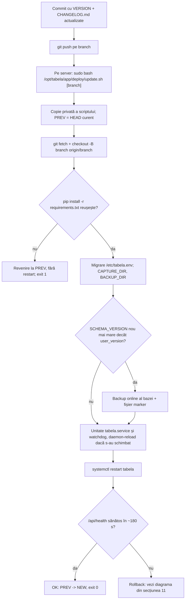
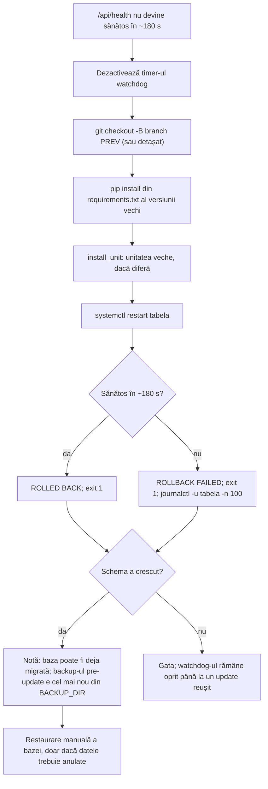

# Deploy and configuration

This page describes how the code reaches the Ubuntu server, what settings the application reads, what the scripts `deploy/install.sh` and `deploy/update.sh` do, which systemd units and which nginx configuration are in the repo, how a new version is made and how to go back to an old one.

The page was written from the code and the configuration files in the repo, initially at version `Beta 1.43`, updated for `Beta 1.72` (the `VERSION` file). Where a statement could not be verified from the repo (for example, what exists on the server and is not in git), it is marked **uncertain** and the file or command to check is named.

Conventions:

- **Secret**: a value that must not be displayed, pasted into chat, put into git or into a log. In examples only placeholders of the form `<...>` appear.
- The paths on the server are the ones from the scripts: the code in `/opt/tabela/app`, the venv in `/opt/tabela/venv`, the data in `/var/lib/tabela`, the configuration in `/etc/tabela.env`.

## Contents

1. [Overview](#1-overview)
2. [Configuration: the /etc/tabela.env file and the variables](#2-configuration-the-etctabelaenv-file-and-the-variables)
3. [install.sh, step by step](#3-installsh-step-by-step)
4. [update.sh, step by step](#4-updatesh-step-by-step)
5. [systemd units](#5-systemd-units)
6. [nginx](#6-nginx)
7. [Firewall](#7-firewall)
8. [TLS certificates (Let's Encrypt)](#8-tls-certificates-lets-encrypt)
9. [Dynamic DNS (No-IP)](#9-dynamic-dns-no-ip)
10. [The release process](#10-the-release-process)
11. [Rollback](#11-rollback)
12. [Observations and things to verify](#12-observations-and-things-to-verify)

## 1. Overview

The application runs as a single uvicorn process, under the `tabela` system user, listening only on `127.0.0.1:8000`. The poller that reads the CFR board runs in the same process, so multiple workers are not started (see `deploy/tabela.service`, the line with `--workers 1`). In front of the application sits nginx, which terminates TLS on port 443 and forwards the requests to the application.

The components, with their files:

| Component | File in the repo | Role |
|---|---|---|
| The application (FastAPI + OCR poller) | `deploy/tabela.service`, `app/` | The `tabela` service, on `127.0.0.1:8000` |
| Reverse proxy and TLS | `deploy/nginx-tabela.conf`, `deploy/tabela-limits.conf` | The nginx site and the rate limit zones |
| Initial installation | `deploy/install.sh` | Packages, user, venv, `/etc/tabela.env`, systemd, nginx |
| Update with rollback | `deploy/update.sh` | Deploy, migration, health check, rollback |
| Watchdog | `deploy/tabela-watchdog.service`, `deploy/tabela-watchdog.timer`, `deploy/tabela-watchdog.sudoers`, `app/watchdog.py` | Restarts `tabela` if `/api/health` fails |
| Shadow training (nightly) | `deploy/tabela-shadow-train.service`, `deploy/tabela-shadow-train.timer`, `scripts/nightly_shadow_train.py` | Daily training of the digit classifier, with no automatic promotion |
| Security snapshot | `deploy/tabela-security-snapshot.service`, `deploy/tabela-security-snapshot.timer`, `scripts/security_snapshot.py` | Every 2 minutes, as root and read-only: fail2ban + the nginx log → `/var/lib/tabela/security/snapshot.json` for the "Security" card in `#admin` |
| NVMe collector | `deploy/tabela-nvme.service`, `deploy/tabela-nvme.timer`, `scripts/nvme_collect.py` | Every 2 minutes, as root and read-only: the disk health → `/var/lib/tabela/nvme.json` |
| Internal Infofer spike (temporary) | `deploy/tabela-infofer.service`, `deploy/tabela-infofer.timer` | Every 3 minutes, one request to the Infofer map into a separate database (`docs/en/administrare-operare.md`, section 16) |
| fail2ban | `deploy/fail2ban/` | Jails, filters and the `ignorecommand` script (section 7.1) |
| Dynamic DNS | not in the repo; see [section 9](#9-dynamic-dns-no-ip) | Keeps the hostname on the current public IP |
| Certificates | Let's Encrypt through certbot; see [section 8](#8-tls-certificates-lets-encrypt) | TLS for `tabelagn.online` (and `tabelacfr.ddns.net`, for the redirect); see [section 9.1](#91-the-tabelagnonline-domain) |

The deploy flow, from commit to the health check:



## 2. Configuration: the /etc/tabela.env file and the variables

### 2.1 The file

- The path: `/etc/tabela.env`. It is read by systemd through `EnvironmentFile=/etc/tabela.env` in `deploy/tabela.service`. It is not in git (the repo has only the `.env.example` template, with no real values).
- Permissions: owner `root:root`, mode `600`. The `install.sh` script sets them at creation and on every run (`chown root:root`, `chmod 600`). The `update.sh` script uses the same pattern, with a temporary file and `mv`, so there is no moment in which the file has other permissions.
- The reason: the file contains the VAPID private key and, when needed, `ADMIN_TOKEN` and the Telegram token. An ordinary user must not be able to read it.
- Format: `KEY=value` lines, with no `export`, no spaces around `=`. Each line ends with a newline. The scripts take care that a new line does not get glued to the last line that has no newline (see `env_add_missing` in `update.sh` and `env_rewrite` in `install.sh`).
- Changing it: `sudo nano /etc/tabela.env`, then `sudo systemctl restart tabela` (the variables are read at startup). The file is not modified by `update.sh`, except for the automatic addition of missing variables (see section 4).

### 2.2 Variables read by app/config.py

The `get_settings()` function in `app/config.py` builds the `Settings` object. The table below contains every variable read there, with the default value from the code (the one used when the variable is missing or empty, where the code treats it that way), the meaning and the behavior when it is missing.

| Variable | Type | Default in the code | Meaning | Valid range | If missing or invalid |
|---|---|---|---|---|---|
| `DB_PATH` | string (path) | `tabela.db` | The SQLite database file. On the server, `install.sh` writes `/var/lib/tabela/tabela.db`. | A path writable by the `tabela` user. | The default is relative, so it resolves against the working directory `/opt/tabela/app`, which is read-only for the service (`ProtectSystem=strict`). It is not the intended configuration. On the server it must be set. |
| `SOURCE_URL` | string (URL) | `https://cfr.ro/gari/camereweb/index.php?statie=BucurestiNord` | The address from which the poller takes the board image (`app/poller.py`, `fetch_board_image`). | A valid HTTP(S) URL. | The default is used, which is the production source. |
| `VAPID_PRIVATE_KEY` | **Secret** (base64url string) | `""` | The VAPID private key for push notifications. Format: the 32-byte P-256 scalar, encoded base64url without padding (as `py_vapid` and `pywebpush` read it). | Both VAPID keys must be set. | Push notifications are disabled. The application starts and writes a warning in the log: "VAPID keys not configured; push notifications are disabled". |
| `VAPID_PUBLIC_KEY` | string (base64url) | `""` | The VAPID public key, sent to the browser for subscription by `GET /api/push/key` (`app/api.py`; without a key, the route answers 404). It is not secret, but it is kept together with the private one. | The uncompressed P-256 public point, encoded base64url. | As above: push disabled. |
| `VAPID_SUBJECT` | string | `https://tabelagn.online` | The subject in the VAPID JWT. `install.sh` writes the same value on a new server. | `mailto:` or an `https:` URL. | The default in the code, `.env.example` and `install.sh` have the same value; `tests/test_deploy_static.py` checks this. |
| `TESSERACT_CMD` | string (path or name) | `tesseract` | The Tesseract executable, used through `pytesseract` (`app/ocr/engine.py`). | A name in `PATH` or an absolute path. Timeout of 10 s per call (`TESSERACT_TIMEOUT`). | `tesseract` is looked up in `PATH`. If it does not exist, OCR reading fails with `OcrError`, and the Tesseract check in the administration (`tesseract_status`, `app/admin.py`) shows it. |
| `POLLER_RESTART_BACKOFF` | float (seconds) | `5` | The first pause before restarting the poller after a crash. It doubles on each failure, up to `POLLER_MAX_BACKOFF` = 300 s (`app/api.py`). | Any number; negative values are brought to 0 on use. | 5 s is used. If the value exists but is not a number, `float()` raises an error in `get_settings()` and the application does not start. |
| `POLLER_ENABLED` | boolean | `1` | `0` or `false`, `no`, `off` (case-insensitive) stops the poller: the application serves only the last stored state. Used for development. | `1` starts, `0` stops. | The poller is on. |
| `LAST_IMAGE_PATH` | string (path) | `data/last.jpg` | Where the last board image is saved, for OCR debugging. On the server: `/var/lib/tabela/last.jpg`. | A writable path. An empty value disables saving (it becomes `None`). | `data/last.jpg` is used, relative to the working directory, so not writable on the server. `update.sh` adds `LAST_IMAGE_PATH` if it is missing. |
| `REJECTED_DIR` | string (path) | `/var/lib/tabela/rejected` | The directory with the last rejected frames (partial readings or failed OCR). The last 40 are kept (`REJECTED_KEEP` in `app/rejected.py`). | A writable path. An empty value disables saving. | `/var/lib/tabela/rejected` is used. |
| `WEATHER_ENABLED` | boolean | `1` | Turns the weather module on or off (`app/weather.py`, `config_from_env`). The off values are `0`, `false`, `no`, `off`. | `1` or `0` (and the alternatives above). | Weather on. |
| `WEATHER_URL` | string (URL) | `https://api.open-meteo.com/v1/forecast` | The Open-Meteo API address. | An HTTP(S) URL. An empty value means the default. | The default is used. |
| `WEATHER_LAT` | float (degrees) | `44.4323` | The latitude of the forecast point. | Between `-90` and `90`. Outside the range the default is used. | `44.4323` is used. |
| `WEATHER_LON` | float (degrees) | `26.1063` | The longitude of the forecast point. | Between `-180` and `180`. Outside the range the default is used. | `26.1063` is used. |
| `WEATHER_INTERVAL_S` | integer (seconds) | `900` | How often the forecast is requested. | Digits only. The minimum is `300` (`MIN_INTERVAL_S`): smaller values are raised to 300. | `900` is used. Values that are not digits only are ignored and the default is used. |
| `SITE_URL` | string (URL) | `https://tabelagn.online` | Base of the absolute URLs in `canonical`, `hreflang`, JSON-LD, `robots.txt` and `sitemap.xml` (`app/seo.py`). | URL without a trailing slash. | The default is used. |
| `GOOGLE_SITE_VERIFICATION` | string | empty | Adds `<meta name="google-site-verification">` to the pages (Search Console, see [arhitectura.md](arhitectura.md) §11). | Only the `content` value given by Google. | No meta tag. |
| `BING_SITE_VERIFICATION` | string | empty | Adds `<meta name="msvalidate.01">` (Bing Webmaster Tools). | Only the `content` value given by Bing. | No meta tag. |

Remarks about the table:

- When `WEATHER_ENABLED` is off, `get_settings()` sets `weather=None`, and the weather module does not start at all.
- The reason for the 300 s limit for `WEATHER_INTERVAL_S` is written in the code: `MIN_INTERVAL_S = 300  # never more than one request per 5 minutes`.
- On the server, `/etc/tabela.env` must override the relative defaults (`DB_PATH`, `LAST_IMAGE_PATH`), because the service cannot write in the code directory.

### 2.3 Variables read in other modules

`app/config.py` is not the only place where environment variables are read. The following are read directly from modules, so they do not appear in `Settings`. The default values are the ones in the code, at the time the page was written.

| Variable | File | Default | Meaning |
|---|---|---|---|
| `ADMIN_TOKEN` | `app/admin.py` | not set (administration disabled) | **Secret.** The key for the administration area (`/#ocr` and the `/api/admin/` routes). It must have at least 12 characters (`MIN_TOKEN_LEN`), otherwise the administration stays disabled. It is not compared in plain text: the comparison is constant-time. |
| `ADMIN_TOKEN_STRICT` | `app/admin.py`, `app/main.py` | `0` | If it is `1`, `true`, `yes` or `on`, the key must have at least 24 characters (`STRICT_TOKEN_LEN`). At startup, `check_startup()` refuses to start the application if the present key is shorter. The error message does not contain the key. |
| `DELAY_THRESHOLDS` | `app/api.py` | `5,15,30` | The color thresholds for delays, in minutes, as `low,mid,high`. They must be three strictly increasing integers, between 1 and 1440. Otherwise the defaults are used. |
| `CAPTURE_ENABLED` | `app/captures.py` | `1` | Saving the OCR captures (the frame images). The off values are as for the other booleans. |
| `CAPTURE_DIR` | `app/captures.py` | `/var/lib/tabela/captures` if `/var/lib/tabela` exists, otherwise `data/captures` | The captures directory. `update.sh` adds it and creates the directory, with owner `tabela`, mode `750`, if it is under `/var/lib/tabela`. |
| `CAPTURE_RETENTION_DAYS` | `app/captures.py` | `7` | After how many days the capture images are deleted (the metadata stays). Values are clamped to the range 0 to 3650; `0` keeps no image. Values that are not integers give `7`. |
| `CAPTURE_MIN_FREE_MB` | `app/observations.py` | `2048` | The free-space threshold, in MB, used when the application's Settings page has no threshold of its own (`min_free_bytes(store)`). Values that are not integers give `2048`; negative ones become `0`. |
| `BACKUP_DIR` | `app/dbbackup.py` | `<database directory>/backups` | The directory of the backups made before migrations. On the server, the default is `/var/lib/tabela/backups`. |
| `OCR_FRAME_BUDGET_S` | `app/ocr/reader.py` | `8.0` | The maximum OCR time per frame, including rereads. It is not negative (a negative value becomes 0). |
| `FINAL_READ_MAX_GAP_MIN` | `app/journeys.py` | `15` | A time parameter, in minutes, when establishing the final state of a journey (`final_gap_min()`). Values outside the range 1–240 and those that are not integers give `15`. The exact meaning of the interval: uncertain, read `app/journeys.py`. |
| `STATS_INCLUDE_LOW_QUALITY` | `app/quality.py` | `0` | If it is `1`, the low-quality period (`quality_periods`) is included in the statistics. By default, it is excluded. |
| `STATS_CACHE_TTL_S` | `app/stats_overview.py` | `60` | How long the result of the statistical aggregates is kept (a single computation at a time). |
| `STATS_MIN_SAMPLE` | `app/stats.py` | `5` | Below this number of observations no percentages are shown. |
| `ON_TIME_MAX_MIN` | `app/stats.py` | `5` | The maximum delay, in minutes, considered "on time". Accepted range: 0 to 60. |
| `TELEGRAM_BOT_TOKEN` | `app/telegram.py` | `""` | **Secret.** The Telegram bot token for alerts. The channel is active only if both the token and `TELEGRAM_CHAT_ID` are set. The token does not appear in the log and is not returned by the API. |
| `TELEGRAM_CHAT_ID` | `app/telegram.py` | `""` | The identifier of the conversation that receives the alerts. |
| `TELEGRAM_STATE_PATH` | `app/telegram.py` | `data/telegram_sent.json` | The file with the events already sent, so they are not resent after a restart. The default is relative; on the server, `deploy/tabela.service` sets it to `/var/lib/tabela/telegram_sent.json` (the only writable place). |

Variables used only by scripts and utilities in `scripts/` (not by the service):

| Variable | Where | Meaning |
|---|---|---|
| `DB_PATH` | `app/quality.py`, `scripts/purge_ghosts.py`, `scripts/merge_number_dups.py`, `scripts/ambiguous_pairs.py` | The default for the `--db` argument. |
| `TESSERACT_CMD` | `scripts/dev_seed.py`, `scripts/ocr_eval.py`, `scripts/ocr_digit_clf.py` | If it is not set, the scripts try `C:\Program Files\Tesseract-OCR\tesseract.exe` (Windows). |
| `OCR_TRUTH_DIR` | `scripts/ocr_eval.py`, `tests/ocr_truth_images.py` | The directory with the private captures of the ground-truth set. Default `tests/fixtures/ocr_truth/private/`. |
| `NPROC` | `scripts/ocr_eval.py`, `scripts/ocr_digit_clf.py` | The number of parallel processes. |
| `OMP_THREAD_LIMIT` | `scripts/ocr_eval.py`, `scripts/ocr_digit_clf.py` | Set by the script to `1`. |

### 2.4 Comparison: code, install.sh and .env.example

Three sources give values for the same variables. The table shows the differences.

| Variable | Default in the code | Written by `install.sh` on a new server | In `.env.example` |
|---|---|---|---|
| `DB_PATH` | `tabela.db` (relative) | `/var/lib/tabela/tabela.db` | `/var/lib/tabela/tabela.db` |
| `LAST_IMAGE_PATH` | `data/last.jpg` | `/var/lib/tabela/last.jpg` | `/var/lib/tabela/last.jpg` |
| `POLLER_ENABLED` | `1` | `1` | `1` |
| `VAPID_SUBJECT` | `https://tabelagn.online` | `https://tabelagn.online` | `https://tabelagn.online` |
| `REJECTED_DIR` | `/var/lib/tabela/rejected` | absent (the default is used) | `/var/lib/tabela/rejected` |
| `CAPTURE_DIR` | `/var/lib/tabela/captures` (if the directory exists) | absent; `update.sh` adds it | `/var/lib/tabela/captures` |
| `CAPTURE_RETENTION_DAYS` | `7` | absent | `7` |
| `CAPTURE_MIN_FREE_MB` | `2048` | absent | `2048` |
| `VAPID_PRIVATE_KEY`, `VAPID_PUBLIC_KEY` | `""` | generated on first installation | empty |
| `ADMIN_TOKEN` | not set | absent (set manually) | empty |

Conclusion: on the first installation, `install.sh` does not write `CAPTURE_DIR`, `CAPTURE_RETENTION_DAYS`, `CAPTURE_MIN_FREE_MB` and `REJECTED_DIR`. They work with the defaults from the code, but they differ from what `.env.example` shows. The `VAPID_SUBJECT` difference does not break operation, but it must be known in case of a reinstall.

### 2.5 Placeholder values for documentation

When you write documentation or an example file, use placeholders:

```ini
DB_PATH=/var/lib/tabela/tabela.db
VAPID_PRIVATE_KEY=<cheie-privată-VAPID, generată de install.sh, SECRET>
VAPID_PUBLIC_KEY=<cheie-publică-VAPID, generată de install.sh>
VAPID_SUBJECT=https://<domeniul-site-ului>
ADMIN_TOKEN=<cheie-administrare, minim 12 caractere, SECRET>
TELEGRAM_BOT_TOKEN=<token-bot, SECRET>
```

Real values are never written in documentation, in the CHANGELOG, in a commit or in chat.

## 3. install.sh, step by step

The script is for the first installation, but it can also be run over an existing installation, being idempotent. It is run as root:

```bash
sudo bash install.sh [branch]
```

The script header says what it does not do: it does not start `ufw` (the firewall is configured once, by hand; see section 7), and the VAPID private key is never displayed. The variables `REPO_URL` (default `https://github.com/Andy217Ace/tabela-gara-de-nord.git`) and `APP_DIR` (default `/opt/tabela/app`) can be overridden through the environment.

The steps, in the order of the code:

1. **Choosing the branch.** If an argument is given, that is the branch. Otherwise, the current branch from `/opt/tabela/app` is taken (if a checkout exists). If the checkout is on a detached HEAD, the script stops with an error and asks for the argument. If there is no checkout and no argument is given, the script stops with an error. The variable `BRANCH_ONLY=1` stops the script after this step (used by tests).
2. **Checking the role.** The script requires `id -u` to be 0. The check comes after the branch is chosen.
3. **Packages.** `apt-get update`, then `apt-get install -y` for `tesseract-ocr`, `tesseract-ocr-ron`, `python3-venv`, `git`, `curl`, `sqlite3`. With `DEBIAN_FRONTEND=noninteractive`, so that it does not ask for confirmations.
4. **User and directories.** It creates the `tabela` system user (no login, `nologin`, home directory `/var/lib/tabela`), if it does not exist. It creates `/opt/tabela` (`root:root`, `755`) and `/var/lib/tabela` (`tabela:tabela`, `750`).
5. **The code.** If `/opt/tabela/app` is not a git repo, it does `git clone --branch <branch>`. If it exists, it does `git fetch --prune origin <branch>` and `git checkout -B <branch> origin/<branch>`. It prints the last commit.
6. **Venv.** It creates `/opt/tabela/venv` if it does not exist, upgrades `pip`, then `pip install -r requirements.txt`.
7. **The configuration file.** If `/etc/tabela.env` does not exist, it creates it with `umask 077` and four lines: `DB_PATH`, `LAST_IMAGE_PATH`, `POLLER_ENABLED=1`, `VAPID_SUBJECT=https://tabelagn.online`. Then it sets `root:root` and `600`.
8. **Migrating an old installation.** If `LAST_IMAGE_PATH` is missing, it adds it (with an atomic rewrite of the file).
9. **VAPID keys.** If there is no `VAPID_PRIVATE_KEY` with a value, it generates a P-256 pair and writes both keys. If the private key exists but the public one is missing, it derives it from the private one. An existing private key is never regenerated, because that would invalidate all the existing push subscriptions (the reason is written in the script comment and in the README). Of the whole script, only the public key is displayed.
10. **systemd, the main service.** It copies `deploy/tabela.service` to `/etc/systemd/system/`, does `daemon-reload`, `enable`, then `restart` on `tabela`.
11. **systemd, watchdog.** It copies `tabela-watchdog.service` and `tabela-watchdog.timer` to `/etc/systemd/system/`, does `daemon-reload` and `enable --now` on the timer. Before that, it validates the watchdog's sudoers rule (`deploy/tabela-watchdog.sudoers`) with `visudo -cf` and installs it as `/etc/sudoers.d/tabela-watchdog` (mode `440`), like `update.sh`; an invalid rule stops the script.
    Then, optionally, the security exporter: it creates `/var/lib/tabela/security` (`root:tabela`, `750`), copies `tabela-security-snapshot.service` and `.timer` and does `enable --now` on the timer; a failure is only a warning.
12. **nginx.** It creates `/root/backup-<date>` (mode `700`) and copies there the current site and `tabela-limits.conf`, if they exist. It installs `deploy/tabela-limits.conf` to `/etc/nginx/conf.d/tabela-limits.conf` and `deploy/nginx-tabela.conf` to `/etc/nginx/sites-available/tabela`, creates the symlink in `sites-enabled`, runs `nginx -t`.
    - If `nginx -t` succeeds, it does `systemctl reload nginx`.
    - If it fails, it restores the backup copies (or deletes the files, on the first installation), runs `nginx -t` again and reloads, then exits with code `1`.
13. **The health check.** Up to 90 attempts, every 2 seconds (about 180 s in total), it requests `http://127.0.0.1:8000/api/health` and looks for `"ok":true`. If it succeeds, it prints "healthy after ... s" and exits with `0`. If not, it prints "not healthy after 180 s; see: journalctl -u tabela -n 100" and exits with `1`. Unlike `update.sh`, it does **not** roll back.

Practical conclusion: the first `install.sh` requires the Let's Encrypt certificates to already exist, because the nginx file in the repo refers to `/etc/letsencrypt/live/tabelagn.online/` and `/etc/letsencrypt/live/tabelacfr.ddns.net/`. Without them, `nginx -t` fails and the script deletes the site it has just installed.

## 4. update.sh, step by step

The script updates the code on the server. It is run as root, after the commit with the new version is on the branch:

```bash
sudo bash /opt/tabela/app/deploy/update.sh [branch]
```

Without an argument, it uses the current branch from the checkout. On a detached HEAD it stops with an error and asks for the explicit branch. The script copies itself to a temporary file and runs from the copy, because `git checkout` replaces the file on disk while it runs. The copy is deleted on exit (`trap ... EXIT`).

### 4.1 Variables that can be overridden

The default values are the production ones. The tests in `tests/test_update_sh.py` override them to simulate a server.

| Variable | Default | Role |
|---|---|---|
| `APP_DIR` | `/opt/tabela/app` | The application checkout |
| `VENV` | `/opt/tabela/venv` | The venv; `PIP` and `PYTHON` are derived from it |
| `ENV_FILE` | `/etc/tabela.env` | The configuration file |
| `DATA_DIR` | `/var/lib/tabela` | The data directory |
| `BACKUP_DIR` | `$DATA_DIR/backups` | The directory of the database backups |
| `BACKUP_KEEP` | `5` | How many backups are kept |
| `SVC_OWNER` | `tabela` | The owner of the captures and backup directories; empty means the current user |
| `HEALTH_URL` | `http://127.0.0.1:8000/api/health` | The address checked |
| `HEALTH_CMD` | `curl -fs $HEALTH_URL` | The command that requests the health |
| `HEALTH_TRIES` | `90` | The number of attempts |
| `HEALTH_SLEEP` | `2` | Seconds between attempts |
| `HEALTH_MODE` | `strict` | `strict` or `up` (see 4.3) |
| `SYSTEMCTL`, `PIP`, `PYTHON`, `CHOWN`, `CHMOD` | the real commands | Replaced in tests |
| `UNIT_SRC`, `UNIT_DST` | `deploy/tabela.service`, `/etc/systemd/system/tabela.service` | The main unit |
| `WD_UNIT_DIR`, `WD_SUDOERS_DST` | `/etc/systemd/system`, `/etc/sudoers.d/tabela-watchdog` | The watchdog destinations |
| `REQUIRE_ROOT` | `1` | If `0`, the script does not require root (for tests only) |
| `TABELA_UPDATE_COPY` | set internally | The path of the script's private copy |

### 4.2 The steps, in the order of the code

1. **The current state.** It determines the branch and records `PREV`, the commit that is running now. It prints `== current: ...`.
2. **Validating the health mode.** `HEALTH_MODE` must be `strict` or `up`, otherwise it stops.
3. **Pre-deploy warning.** If the mode is `strict`, it requests the health before any change. If the answer contains `"ok":false`, it prints a warning: the strict gate will not pass, and the script will roll back. It recommends `HEALTH_MODE=up` for an emergency redeploy. It is only a warning; it does not stop the script.
4. **Fetch and checkout.** `git fetch --prune origin <branch>`, then `git checkout -q -B <branch> origin/<branch>`. If either fails, the script stops (`set -e`) before touching the service. The service stays on the old code.
5. **pip install.** `pip install -q -r requirements.txt`. If it fails, it calls `abort_before_restart`: it puts `PREV` back (or detaches HEAD if it was detached), reinstalls the old dependencies (ignoring the error), exits with `1`. **The service is not restarted.** The running code stays the old one.
6. **Missing variables from /etc/tabela.env.** It adds `LAST_IMAGE_PATH=$DATA_DIR/last.jpg` and `CAPTURE_DIR=$DATA_DIR/captures` if they are missing (the `env_add_missing` function, which does not glue the line onto a last row that has no newline). If the write fails, abort before restart.
7. **The captures directory.** It reads `CAPTURE_DIR` from the file (the last occurrence, without quotes). If empty, it does nothing. If it is under `$DATA_DIR/`, it creates it, gives it to `SVC_OWNER` and `750`. If it is outside `$DATA_DIR`, it writes a warning: the service cannot write there (`ReadWritePaths`). If the preparation fails, abort before restart.
8. **The backup directory.** A warning if `BACKUP_DIR` is not under `$DATA_DIR`. Then `prepare_backup_dir`: if it is a symlink, it stops with an error (a symlink is not handed to the service user, so the ownership of an arbitrary location is not changed). Otherwise, it creates it with umask `077`, then `chown -h SVC_OWNER:SVC_OWNER` and `chmod 750`. The reason: the application lists the directory at startup, before migration, and a `root:root 0700` directory stopped the startup of version Beta 1.29 (the comment in the code). Existing files keep their owner.
9. **Checking the schema version.** It computes `OLD_V` = `PRAGMA user_version` of the live database (`0` if the file does not exist, read in read-only mode). It computes `NEW_V` = `SCHEMA_VERSION` from `app/store.py`. If the database exists and `NEW_V > OLD_V`, it makes a backup before the restart. If reading the version fails, abort.
10. **Migration backup.** `backup_db`:
    - makes an online copy with `sqlite3 -readonly ... ".backup"` (if `sqlite3` is missing, it uses the backup API from Python);
    - writes to `tabela-<AAAALLZZ-HHMMSS>-v<OLD_V>.db.tmp` (`AAAALLZZ` is the date, `HHMMSS` the time);
    - checks `PRAGMA integrity_check` on the copy;
    - renames to `.db` only after verification; a failure leaves no partial file;
    - keeps only the last `BACKUP_KEEP` `tabela-*.db` files;
    - writes the marker file `.pre-migration-backup` next to the database (with `version`, `backup`, `db`). If writing the marker fails, it only warns. The application uses the marker as proof of the backup when it cannot see the backup directory (`app/dbbackup.py`).
    
    If the backup fails, abort before restart.
11. **The main systemd unit.** `install_unit` copies `deploy/tabela.service` to `/etc/systemd/system/` only if it differs and does `daemon-reload`.
12. **Watchdog.** `install_watchdog`:
    - validates `deploy/tabela-watchdog.sudoers` with `visudo -cf`; if invalid, abort (a broken sudoers file would break `sudo` on the whole server); otherwise it installs it as `/etc/sudoers.d/tabela-watchdog` with mode `440`, only if it differs;
    - if `$DATA_DIR/watchdog.json` exists, it gives it to `SVC_OWNER`, because the watchdog writes it as the `tabela` user;
    - copies `tabela-watchdog.service` and `tabela-watchdog.timer` if they differ; if anything changed, it does `daemon-reload`;
    - if the timer file exists in the checkout, it does `enable --now tabela-watchdog.timer`.
    
    Each failure here causes an abort before restart.
13. **Restart.** `systemctl restart tabela`.
14. **The health check.** `healthy()` tries `HEALTH_TRIES` times, with pauses of `HEALTH_SLEEP` seconds. With the default values, that means 90 attempts, about 180 s. In `strict` mode, the answer must contain `"ok":true`. In `up` mode, it is enough for the answer to contain `"ok":` (that is, the application answers, regardless of whether CFR is read).
    - If it succeeds: it installs the security exporter (`install_security_snapshot`: the `tabela-security-snapshot.*` units, the directory `/var/lib/tabela/security` `root:tabela 750`; any failure is only a warning), prints `OK: <PREV> -> <NEW> (<version from VERSION>)` and exits with `0`.
    - If not: it enters rollback (section 4.4).

### 4.3 Health modes

- **`strict`** (default): the application must be up and must have read the CFR board recently. `/api/health` returns `ok: true` only if the last successful reading is newer than 180 s (`STALE_S` in `app/api.py`). If CFR does not answer, no version passes the gate, so even the rollback does not help: that is why the script warns beforehand.
- **`up`**: it is enough for `/api/health` to answer with JSON that contains `"ok":`. It is used only for emergency redeploys, when the problem is at CFR, not in the code. Example: `sudo HEALTH_MODE=up bash /opt/tabela/app/deploy/update.sh <branch>`.

### 4.4 Automatic rollback in update.sh

If the health gate fails after the restart, the script does the following, in order:

1. It disables the watchdog timer (`disable --now tabela-watchdog.timer`, the error is ignored if the unit is missing). The reason from the code: the watchdog must not restart the old version, which it may not know.
2. It returns to `PREV`, on the initial branch: `git checkout -B <branch> <PREV>`, or detaches HEAD if it was detached.
3. It reinstalls the `requirements.txt` dependencies of the old version. A failure is only a warning.
4. It applies the old systemd unit, if it differs (`install_unit`).
5. It restarts `tabela` and waits for health with the same limits.
6. If the return succeeds, it prints `ROLLED BACK: running <commit> again (failed: <NEW>)`. If not, it prints `ROLLBACK FAILED` and points to `journalctl -u tabela`.
7. If the schema version increased (`NEW_V > OLD_V`), it prints a note: the new code may have already migrated the database to `v<NEW_V>`, and the old code ignores the new columns. The pre-update backup is the newest file in `BACKUP_DIR`.

The script exits with `1` in all failure cases, including when the rollback succeeded. What the rollback does **not** do: it does not restore the database, does not reinstall `sudoers` (the new one stays), does not restore the watchdog units and does not re-enable the watchdog timer. The timer stays off until the next successful `update.sh`. The test `test_rollback_disables_watchdog_timer_even_when_unit_is_missing` in `tests/test_update_sh.py` checks the disabling.

### 4.5 Failures before restart

For all the failures before the restart (pip, env variables, directories, backup, watchdog), `abort_before_restart` puts the old code (`PREV`) back and reinstalls the old dependencies. **The service is not restarted**, so the running process is not touched. The note in the code explains the reason: the static files are served from disk, so they must stay consistent with the running process.

Limitation: if the failure occurs after `install_unit` has changed the `tabela.service` unit (step 11) and before the restart (for example, at the watchdog step), the new unit stays installed, because `abort_before_restart` does not restore it. See section 12.

## 5. systemd units

### 5.1 tabela.service (the application)

File: `deploy/tabela.service`, installed as `/etc/systemd/system/tabela.service`.

| Directive | Value | Meaning |
|---|---|---|
| `After` / `Wants` | `network-online.target` | Starts after the network |
| `Type` | `simple` | The main process is uvicorn |
| `User` / `Group` | `tabela` / `tabela` | It does not run as root |
| `WorkingDirectory` | `/opt/tabela/app` | The code directory |
| `EnvironmentFile` | `/etc/tabela.env` | The variables from section 2 |
| `ExecStart` | `/opt/tabela/venv/bin/uvicorn app.main:create --factory --host 127.0.0.1 --port 8000 --workers 1 --proxy-headers --forwarded-allow-ips 127.0.0.1` | A single worker; it listens only locally; it accepts proxy headers only from `127.0.0.1` |
| `Restart` / `RestartSec` | `always` / `5` | Automatic restart on any stop, after 5 s |
| `TimeoutStopSec` | `30` | Time for a graceful stop (poller and notifications) |
| `NoNewPrivileges` | `true` | The process cannot gain privileges |
| `ProtectSystem` | `strict` | The file system is read-only, with the exceptions below |
| `ReadWritePaths` | `/var/lib/tabela` | The only writable place |
| `PrivateTmp` | `true` | Its own `/tmp` |
| `ProtectHome` | `true` | No access to home directories |
| `PrivateDevices` | `true` | No access to devices |
| `ProtectKernelTunables`, `ProtectKernelModules`, `ProtectControlGroups` | `true` | No changes to the kernel and the cgroups |
| `RestrictSUIDSGID` | `true` | No creation of SUID/SGID files |
| `LockPersonality` | `true` | No changing of the execution mode |
| `RestrictAddressFamilies` | `AF_INET AF_INET6 AF_UNIX` | Only the necessary address families |
| `UMask` | `0027` | Created files are not readable by others |

Note: `ReadWritePaths` is the only writable place. That is why `CAPTURE_DIR`, `BACKUP_DIR` and `REJECTED_DIR` must be under `/var/lib/tabela`, and `update.sh` warns when they are not.

The unit sets `Environment=OMP_THREAD_LIMIT=1`: Tesseract is called from a thread, and without the limit OpenMP would occupy every core on each call. `update.sh` installs the unit on every deploy (`UNIT_SRC` → `UNIT_DST`).

### 5.2 The watchdog

Files: `deploy/tabela-watchdog.service`, `deploy/tabela-watchdog.timer`, `deploy/tabela-watchdog.sudoers`, code in `app/watchdog.py`.

- **The service** (`Type=oneshot`, `User=tabela`, `Group=tabela`, `WorkingDirectory=/opt/tabela/app`) runs `python -m app.watchdog --state /var/lib/tabela/watchdog.json --url http://127.0.0.1:8000/api/health --service tabela`. It has no hardening directives in the unit. `TimeoutStartSec=90`.
- **The timer** starts the service once a minute: `OnBootSec=2min`, `OnUnitActiveSec=60s`, `AccuracySec=5s`. It is enabled with `WantedBy=timers.target`.
- **The logic** (constants from `app/watchdog.py`): each run makes an HTTP check of `/api/health` (timeout 20 s, `CHECK_TIMEOUT_S`). The answer must be HTTP 200 with a JSON object. The state (the number of consecutive failures and the last restart) is kept in `watchdog.json` between runs.
  - After `THRESHOLD = 3` failed checks in a row, it restarts `tabela`.
  - At most one restart per `RESTART_COOLDOWN_S = 600` seconds. If the third failure falls in the cooldown period, it does nothing and writes "restart skipped (cooldown)".
  - It does not touch nginx, because a network problem must not be masked.
- **The restart** is done through `sudo -n /bin/systemctl restart tabela`. The watchdog runs as `tabela`, so it cannot restart the service directly. The rule `deploy/tabela-watchdog.sudoers` allows exactly this command, with no password: `tabela ALL=(root) NOPASSWD: /bin/systemctl restart tabela`. It allows no other commands.
- **Why no root**: the CHANGELOG (Beta 1.42) says the watchdog "runs as the `tabela` user and is only allowed to restart the `tabela` service, through sudoers". So it has a single right, on a single command.

### 5.3 Shadow training (nightly)

Files: `deploy/tabela-shadow-train.service`, `deploy/tabela-shadow-train.timer`, code in `scripts/nightly_shadow_train.py`.

- **The service** (`Type=oneshot`, `User=tabela`) runs `/opt/tabela/venv/bin/python /opt/tabela/app/scripts/nightly_shadow_train.py`. It has `Nice=19`, `IOSchedulingClass=idle` and `TimeoutStartSec=2h`.
- **Hardening**: the same as the main service, plus `ReadOnlyPaths=/opt/tabela` (the code cannot be modified). `RestrictAddressFamilies=AF_UNIX`, so it has no network access. It has `ReadWritePaths=/var/lib/tabela`, because SQLite in read mode needs the `-wal` and `-shm` files.
- **The timer**: `OnCalendar=*-*-* 03:30:00`, `Persistent=true`. If the server was off at the scheduled time, the run is made at the next startup.
- **What it does**: it trains a digit classifier in shadow mode. It writes the report and the model to `/var/lib/tabela/shadow`. It promotes nothing to production (the comment in the unit and the script docstring). The database is opened read-only.
- **Installation**: neither `install.sh` nor `update.sh` copies or enables these units. They must be installed manually. Uncertain: check on the server with `systemctl list-timers | grep shadow` and `ls /etc/systemd/system/tabela-shadow-train.*`. It is not clear whether the `/var/lib/tabela/shadow` directory is created by anyone; check that it exists.

### 5.4 What each script installs

| Unit | install.sh | update.sh | Manual |
|---|---|---|---|
| `tabela.service` | yes (copies, `enable`, `restart`) | yes (if it differs, `daemon-reload`) | |
| `tabela-watchdog.service` and `.timer` | yes (copies, `enable --now`) | yes (if it differs, `enable --now`) | |
| the watchdog sudoers rule | yes (`visudo -cf`, then `install -m 440`) | yes (`visudo -cf`, then `install -m 440`) | |
| `tabela-security-snapshot.service` and `.timer` | yes (optional) | yes (after the health check, optional) | |
| `tabela-shadow-train.service` and `.timer` | no | no | yes (uncertain, see above) |
| `tabela-nvme.service` and `.timer` | no | no | yes |
| `tabela-infofer.service` and `.timer` (temporary) | no | no | yes (`docs/en/administrare-operare.md`, section 16) |
| `tabela-ops-alerts.service` and `.timer` | no | no | yes (`docs/en/administrare-operare.md`, section 17) |
| the files in `deploy/fail2ban/` | no | no | yes (section 7.1) |
| the nginx site and `tabela-limits.conf` | yes | no | |
| `tabela-noip` (dynamic DNS) | no | no | yes (see section 9) |

### 5.5 Tesseract

On the server: Tesseract **5.5.0**, Ubuntu 26.04, apt package (`tesseract-ocr`, `tesseract-ocr-ron`), only the official `eng`, `ron` and `osd` models; users cannot upload models. The version and loaded languages are in `GET /api/system` (`tesseract.version`, `tesseract.langs`, read once at the first request), and `security_updates` shows the pending Ubuntu security updates (from `/var/lib/update-notifier/updates-available`; `null` if the file is missing). Manual check: `tesseract --version` and `tesseract --list-langs`. Update: `sudo apt-get update && sudo apt-get install --only-upgrade tesseract-ocr tesseract-ocr-ron`, then restart the service (the version is read at startup) and re-measure OCR (`docs/ocr.md`), because a new version can change the reading.

### 5.6 Resource limits (cgroup)

Every `tabela*.service` unit has `MemoryHigh`, `MemoryMax`, `CPUQuota` and `TasksMax`. The goal is containment (a leak or a loop does not choke the server), not throttling normal operation. The server: Intel i5-10400 (6 cores / 12 threads), 15 GiB RAM, 4 GiB swap. `MemoryHigh` slows the process down (reclaim), `MemoryMax` stops it (OOM inside the cgroup); `tabela.service` restarts on its own (`Restart=always`).

| Unit | MemoryHigh / MemoryMax | CPUQuota | TasksMax |
|---|---|---|---|
| `tabela.service` (one worker + OCR) | 3G / 4G | 400% | 512 |
| `tabela-shadow-train.service` (~4.8 GB measured) | 6G / 7G (like the server's `memory.conf` drop-in) | 400% | 256 |
| `tabela-watchdog.service` | 192M / 256M | 50% | 32 |
| `tabela-security-snapshot.service` | 192M / 256M | 50% | 32 |
| `tabela-infofer.service` | 192M / 256M | 50% | 16 |
| `tabela-nvme.service` | 96M / 128M | 25% | 16 |
| `tabela-ops-alerts.service` | 96M / 128M | 25% | 16 |

The values for `tabela.service` are chosen with headroom, without a measurement of the peak RSS: check after the deploy with `systemctl status tabela` (the `Memory:` line, with "high"/"max") or `process.rss_mb` in `#admin`. If memory approaches `MemoryHigh` in normal operation, raise both values. The units installed by `update.sh` (`tabela`, watchdog, security) get the limits on deploy; the others (shadow-train, nvme, Infofer, ops-alerts) are reinstalled by hand: `sudo install -m 644 /opt/tabela/app/deploy/tabela-<name>.service /etc/systemd/system/ && sudo systemctl daemon-reload`.

## 6. nginx

### 6.1 The site

File: `deploy/nginx-tabela.conf`, installed as `/etc/nginx/sites-available/tabela` and linked in `sites-enabled`. The server blocks:

- **The HTTPS server** (`listen 443 ssl` and `listen [::]:443 ssl ipv6only=on`), for `tabelagn.online`. The certificates are in `/etc/letsencrypt/live/tabelagn.online/`. It includes `/etc/letsencrypt/options-ssl-nginx.conf` and `ssl_dhparam /etc/letsencrypt/ssl-dhparams.pem`, so the TLS versions and ciphers are the ones in the certbot files. Uncertain: the content of these files is not in the repo; check on the server with `cat /etc/letsencrypt/options-ssl-nginx.conf`.
- **The HTTPS redirects**: `www.tabelagn.online` and `tabelacfr.ddns.net` answer `301` to `https://tabelagn.online` with the same path (the old domain keeps the Google/Bing verification files; see section 9.1).
- **The HTTP server** (`listen 80`, every name and the LAN IPs): `301` to `https://tabelagn.online`, except `/.well-known/acme-challenge/` (certificate renewal).

Settings in the HTTPS server:

| Directive | Value | Meaning |
|---|---|---|
| `client_max_body_size` | `8k` | The request body is small: the application does not receive large uploads |
| `server_tokens` | `off` | The nginx version does not appear in headers and error pages |
| `gzip` | `on`, `gzip_min_length 512`, `gzip_proxied any` | Compression for text, JSON, CSS, JS, manifest, SVG |
| `Strict-Transport-Security` | `max-age=31536000` (`always`) | HSTS for one year. It has no `includeSubDomains` |
| `proxy_http_version` | `1.1` | |
| `proxy_set_header Host` | `$host` | |
| `X-Real-IP` | `$remote_addr` | |
| `X-Forwarded-For` | `$proxy_add_x_forwarded_for` | |
| `X-Forwarded-Proto` | `$scheme` | The application knows whether the request came over HTTPS |
| `proxy_read_timeout` | `30s` | |
| `proxy_connect_timeout` | `5s` | |
| `limit_req_status` | `429` | Rejected requests get 429, not 503 |

The security headers (`X-Content-Type-Options: nosniff`, `Referrer-Policy: no-referrer`, `X-Frame-Options: DENY` and `Content-Security-Policy`) are set by the application, in the middleware in `app/api.py`, not by nginx. The comment in the site says so.

### 6.2 Locations and rate limit zones

The matching order matters: nginx first tries the exact match (`=`), then the regexes (in the order of the file), then the longest prefix.

| Location | `limit_req` zone | Burst | Particularities |
|---|---|---|---|
| `= /api/follows` | `tabela_api` | 20 (`nodelay`) | `access_log off`. The push subscription endpoint has its data in the query string, so it is not logged |
| `= /api/admin/login` | `tabela_admin_login` | 5 (`nodelay`) | A strict limit for administrator authentication |
| `~ ^/api/(stats\|trains/stats\|trains/[0-9]+/journeys\|stations\|journeys)(/\|$)` | `tabela_stats` | 20 (`nodelay`) | Aggregates computed over the whole history |
| `/api/` | `tabela_api` | 20 (`nodelay`) | The rest of the API |
| `/` | no limit | | The static files, served by the application |

The zones are defined in `deploy/tabela-limits.conf`, installed as `/etc/nginx/conf.d/tabela-limits.conf` (`http` context):

| Zone | Key | Memory | Rate | Reason |
|---|---|---|---|---|
| `tabela_api` | `$binary_remote_addr` (IP) | 10 MB | 10 requests/s | The general limit for the API |
| `tabela_admin_login` | IP | 1 MB | 5 requests/min | Protection against guessing the admin key. The application also answers 429 after 5 failures |
| `tabela_stats` | IP | 10 MB | 60 requests/min (1/s) | The statistics are computed over the whole history, so they are expensive |

`limit_req_log_level warn` (in the same file) makes the 429 rejections log at the `warn` level, below `error`. The reason from the comment: a `limit_req` rejection may write the request line, with the query string, in `error.log`. For `/api/follows` that would expose the push endpoint. Do not lower the `error_log` level to `warn` or `info` without taking this into account (see also the README, the logs section).

The test `test_nginx_admin_login_rate_limited_and_certbot_untouched` in `tests/test_ocr_static.py` checks the text of the files: the `tabela_admin_login` zone with `rate=5r/m`, `burst=5` on `/api/admin/login`, `location = /api/admin/login` before `location /api/`, and exactly 8 lines "managed by Certbot".

### 6.3 What is cached

- **nginx caches nothing**: there is no `proxy_cache`, `proxy_cache_path` or `expires` in `deploy/nginx-tabela.conf` and `deploy/tabela-limits.conf`. The only transfer optimization is `gzip`.
- **The application** sets the cache headers:
  - the static files (everything not under `/api/`): `Cache-Control: no-cache`, that is, the browser revalidates with ETag. The reason from the code: a deploy should be seen immediately (`app/api.py`);
  - `/sw.js` and `/manifest.webmanifest`: `no-cache` (`app/api.py`; `test_web_static.py` checks `/sw.js`);
  - `/api/changelog`: `no-cache`;
  - the CSV export of the history and its errors: `no-store` (`app/api.py`); the administration responses have `Cache-Control: private, no-store` (`app/admin.py`);
  - for the rest of `/api/`, the application does not set `Cache-Control` by default;
- **The statistics cache** is in the process, not in nginx: the result of the aggregates is kept for `STATS_CACHE_TTL_S` seconds (default 60). See the table in section 2.3.
- **The service worker** (`web/sw.js`) caches the files in `SHELL` in two caches, `tabela-shell-<VERSION>` and `tabela-board-<VERSION>`. The comment in the file says: "Bump VERSION when the shell list changes; old caches are deleted on activate." The bump rule is in section 10.

## 7. Firewall

The production server is the home server (Ubuntu 26.04 LTS), not a cloud machine. The firewall is `ufw`, active, with the default policy "deny incoming", configured once, by hand (`install.sh` does not enable `ufw`):

| Port | Who has access | Reason |
|---|---|---|
| 80 (TCP) | the internet | `301` redirect to `https://tabelagn.online` and the ACME challenges (`listen 80` in `nginx-tabela.conf`) |
| 443 (TCP) | the internet | The HTTPS site |
| 22 (TCP, SSH) | only the local network `192.168.1.0/24` | Administration |
| 3389 (TCP, RDP) | only the local network `192.168.1.0/24` | Administration |
| 8000 (TCP) | nobody from outside | Uvicorn listens only on `127.0.0.1` (`--host 127.0.0.1` in `tabela.service`) |

Check commands, without changes: `sudo ufw status verbose` and `sudo ss -tlnp` (8000 must listen only on loopback).

### 7.1 fail2ban

Three active jails: `sshd`, `nginx-tabela-probes` and `nginx-tabela-slow`. The probe filter (obvious scanner requests, answered with 4xx; `/.well-known/` is excluded) is in `deploy/fail2ban/nginx-tabela-probes.local`. `install.sh` does not install fail2ban. The manual steps (package, copying the filter to `/etc/fail2ban/filter.d/`, the jail definition in `/etc/fail2ban/jail.d/`, restart, check with `fail2ban-client status`) are in `docs/en/administrare-operare.md`, section 15. The server's real configuration is in `deploy/fail2ban/` (versioned: `jail.local` → `/etc/fail2ban/jail.local`, `jail-tabela.local` → `/etc/fail2ban/jail.d/tabela.local`, the filters `nginx-tabela-probes.local` and `nginx-tabela-slow.local` → `/etc/fail2ban/filter.d/`, the script `f2b-ignore-own-public-ip` → `/usr/local/sbin/`, used as `ignorecommand`; see `docs/en/administrare-operare.md`, section 15): probes 3 in 10 min → 24 h; `nginx-tabela-slow` 5 in 24 h → 7 days; `sshd` 5 in 10 min → 1 h; increasing bans for repeat offenders (max 5 weeks); the LAN, the home public IP and real visitors are ignored (`ignorecommand`).

### 7.2 Headers and limits

HSTS (`max-age=31536000`) and the `limit_req` limits (`tabela_api` 10 requests/s, burst 20, on `/api/`; `tabela_stats` 60 requests/min on the statistics routes; `tabela_admin_login` 5 requests/min) are in `deploy/nginx-tabela.conf` and `deploy/tabela-limits.conf` (section 6.2). The CSP and the other security headers are set in `app/api.py`.

## 8. TLS certificates (Let's Encrypt)

- The certificates are issued by Let's Encrypt, with certbot. There are two: `/etc/letsencrypt/live/tabelagn.online/` and `/etc/letsencrypt/live/tabelacfr.ddns.net/` (`fullchain.pem` and `privkey.pem`); see section 9.1.
- The lines marked "managed by Certbot" in `deploy/nginx-tabela.conf` are written by certbot. The comment in the file asks that they stay that way: `certbot renew` modifies only the files in `/etc/letsencrypt`.
- Renewal is automatic, through `certbot.timer`, the unit installed by the certbot package. The README says so. Uncertain: the exact frequency and the verification command are not in the repo. Check with `systemctl list-timers | grep certbot` and with `sudo certbot renew --dry-run`.
- If the renewal fails, the certificate expires about 90 days after issuance (the Let's Encrypt rule). Uncertain: there is no expiry alert in the repo.
- Changing the certificate does not require `update.sh`. To reload nginx after a manual renewal: `sudo nginx -t && sudo systemctl reload nginx`.

## 9. Dynamic DNS (No-IP)

### 9.1 The tabelagn.online domain

The official address is `https://tabelagn.online`. The old name `tabelacfr.ddns.net` stays in use, only as a DNS target and as a redirect.

- **DNS.** The domain is registered at GoDaddy, with the nameservers switched to Cloudflare. In Cloudflare: `CNAME @ → tabelacfr.ddns.net` and `CNAME www → tabelacfr.ddns.net` (Cloudflare flattens the CNAME at the apex). `tabelacfr.ddns.net` is still updated by No-IP (below), so the new domain follows the dynamic IP with no other setup.
- **"DNS only" (grey cloud), not proxied.** With the Cloudflare proxy (orange cloud), nginx would see Cloudflare's IPs instead of the visitors': fail2ban would ban Cloudflare, and the `limit_req` limits (on `$binary_remote_addr`) would be shared by all visitors.
- **Certificates.** Two Let's Encrypt certificates: `/etc/letsencrypt/live/tabelagn.online/` (for `tabelagn.online` and `www.tabelagn.online`) and the old one, `/etc/letsencrypt/live/tabelacfr.ddns.net/`, which must be kept as long as the old domain serves the redirect over HTTPS. Renewal goes through port 80: the HTTP block leaves `/.well-known/acme-challenge/` served from `/var/www/html` (webroot); the certificate issued with the nginx plugin sets up its own temporary configuration. Check: `sudo certbot renew --dry-run`.
- **Redirects** (`deploy/nginx-tabela.conf`, all `301`, same path): `www.tabelagn.online` → `https://tabelagn.online`; `tabelacfr.ddns.net` (80 and 443) → `https://tabelagn.online`; any HTTP request (including on the LAN IPs `192.168.1.150`/`.149`) → `https://tabelagn.online`. Exceptions: `/.well-known/acme-challenge/` (on 80) and the verification files `/googled34693806887f80a.html` and `/BingSiteAuth.xml`, still served on the old domain, because the Search Console "Change of address" tool needs the old site to stay verified.

### 9.2 The No-IP updater

State: the dynamic DNS updater (the unit named `tabela-noip` in the operating notes, to verify on the server) is **not in the repo** and is **not installed by `update.sh`**. It was installed manually on the server. There is nothing in the repo about it: no unit file, no script, no credentials. This is deliberate, because a DNS updater needs credentials that are not put in git.

A generic description of the role: the server has a public IP that can change. A dynamic DNS client periodically reports the current IP to the No-IP service, for the hostname `tabelacfr.ddns.net`. The client runs as a systemd service, scheduled with a timer, and its credentials sit in a protected local file, not in the repo.

Checks on the server (without displaying credentials):

```bash
systemctl status tabela-noip.service      # nesigur: numele exact al unității
systemctl list-timers | grep -i noip       # programarea
```

If the DNS is not updated, the hostname no longer points to the server's IP. Let's Encrypt validation relies on that name, so certificate renewal may fail. Uncertain: the validation method used by certbot on the server is not in the repo.

## 10. The release process

Each deploy brings a new version. The version scheme: `Beta 1.NN`, where `NN` grows by 1 on every deploy (`VERSION`, `app/version.py`, README). The steps:

1. **`VERSION`**: write `Beta 1.NN` with `NN` increased by 1 (for example, `Beta 1.42` becomes `Beta 1.43`). The test `test_version_file_follows_scheme` requires the regex `^Beta 1\.\d{2}$` and that `VERSION` equals the version in the code.
2. **`CHANGELOG.md`**: at the top, a new section `## Beta 1.NN — AAAA-LL-ZZ`, with the groups `### Adăugat`, `### Schimbat`, `### Reparat` (or others, in Romanian), and bullets `- ...`. The tests require:
   - the first section to be the version in `VERSION` (`test_changelog_newest_first_and_current_version_documented`);
   - the date to have the form `AAAA-LL-ZZ`;
   - at least 5 bullets in the first section;
   - versions to be in descending order and with no unexplained gaps. A gap is explained by a note "Beta 1.NN nu a fost publicată separat" (Romanian, "was not published separately"; `test_version.py`, `_check_gaps`).
   - The reason: `/api/changelog` and the "Version history" page display exactly this file, and `update.sh` displays the version from `VERSION`.
3. **`web/sw.js`**: increase `var VERSION = "vNN";` (the service worker). The reason (the comment in `web/sw.js`): the caches are tied to `VERSION` and the old ones are deleted on activation. Without a bump, clients would use the old files from `SHELL`. The tests check only that it exists and that it is above a minimum threshold (`test_ui2_static.py`: `>= 27`; `test_ui3_static.py`: `>= 28`; `test_statistici_static.py`: `>= 17`). They **do not check** that it was incremented in every version.
4. **`web/ui2.js`**: `var CHARTS_V = "1.NN";` must be **exactly** equal to `VERSION` without the `Beta ` prefix. It is used as a cache parameter (`charts3.js?v=...`, `charts3.css?v=...`). The test `test_lazy_not_in_precache_and_loader_matches_the_version` (in `tests/test_ui3_static.py`) checks the equality. It is the only test that strictly checks a version value.
5. **The tests**: `python -m pytest` from the repo root (see `docs/en/testare.md`) and `python scripts/check_release.py` (`VERSION` = the first CHANGELOG section, which has Romanian bullets and an `### English` subsection, and `CHARTS_V` = the version). The GitHub CI runs the same checks on every pull request (section 10.1); a PR is merged only with green CI.
6. **Commit**: the CHANGELOG and `VERSION` are committed **before** running `update.sh` (the comment in `update.sh`). The commit message is at the author's choice.
7. **Push** to the deploy branch.
8. **Tag**: `beta-1.NN` on the published commit (the convention has been used since `beta-1.01`). No script or workflow in the repo creates the tag; it is created manually.
9. **GitHub release**: every version has a Release `Beta 1.NN` on the tag `beta-1.NN`, with the CHANGELOG notes. It is published manually (for example `gh release create`); no workflow creates it.
10. **Deploy on the server**: `sudo bash /opt/tabela/app/deploy/update.sh [branch]`. At the end, the script prints `OK: <PREV> -> <NEW> (Beta 1.NN)`.
11. **Post-deploy check**: `curl -s http://127.0.0.1:8000/api/health` on the server, the `version` field must be the new version, and `ok` must be `true`. The check from outside: `https://tabelagn.online`, the footer shows the version.

The tests that protect the release rules:

| Test | File | What it checks |
|---|---|---|
| `test_version_file_follows_scheme`, `test_changelog_newest_first_and_current_version_documented` | `tests/test_version.py` | `VERSION` ↔ `CHANGELOG.md` ↔ `/api/health` |
| `test_gap_check_*`, `test_changelog_explains_gap_1_22` | `tests/test_version.py` | The order and the gaps of the versions |
| `test_deploy_docs_require_version_bump` | `tests/test_version.py` | The README and `update.sh` require `CHANGELOG.md` and `VERSION` |
| `test_lazy_not_in_precache_and_loader_matches_the_version` | `tests/test_ui3_static.py` | `CHARTS_V` = the version |
| `test_wiring_index_and_service_worker` | `tests/test_ui2_static.py` | `sw.js` exists, `VERSION` above the threshold |
| `test_service_worker_served_as_js_no_cache` | `tests/test_web_static.py` | `sw.js` has `VERSION`, the files in `SHELL` exist |

### 10.1 CI (GitHub Actions)

Three workflows in `.github/workflows/`:

| Workflow | When it runs | What it does |
|---|---|---|
| `ci.yml`, the `test` job | on every pull request, on push to `main`, weekly (Monday) and by hand | Python 3.14; installs `tesseract-ocr` and `tesseract-ocr-ron`; `pip install --require-hashes -r requirements.lock`, then `pip install -r requirements-dev.txt`; installs Playwright with Chromium, Firefox and WebKit (the browser tests run instead of skipping); `scripts/check_release.py`; then `python -m pytest -q` |
| `ci.yml`, the `fail2ban` job | the same | Installs fail2ban, checks the filters in `deploy/fail2ban/` with `fail2ban-regex` against `tests/fixtures/fail2ban/` (scanner lines must all match, normal traffic none) and that the jail files load (`fail2ban-client -t`) |
| `codeql.yml` | on pull requests to `main`, on push to `main` and weekly | CodeQL analysis (`security-extended`) for Python and JavaScript; the results appear in the Security tab |
| `lock.yml` | on Dependabot (pip) PRs that change `requirements.txt` | Regenerates `requirements.lock` with `uv pip compile`, pushes it to the PR branch and re-runs CI; it executes no code from the PR |

Dependabot (`.github/dependabot.yml`) proposes pip updates weekly (grouped minor/patch; `opencv-python-headless` and `numpy` patch only, because they change OCR) and GitHub Actions updates monthly.

Dependencies: `requirements.txt` (runtime, pinned: `fastapi`, `uvicorn[standard]`, `opencv-python-headless`, `numpy`, `pytesseract`, `pywebpush`, `py-vapid`, `cryptography`, `httpx`, `tzdata`), `requirements-dev.txt` (adds `pytest`, `pytest-asyncio`, `playwright`) and `requirements.lock` (transitive dependencies too, generated with `uv pip compile`; the command is in `CONTRIBUTING.md`). The server installs only `requirements.txt`.

## 11. Rollback

There are three levels, in the order in which they are used:

1. **Automatic rollback** (`update.sh`): triggered when `/api/health` does not become healthy during the deploy. See section 4.4.
2. **Manual code rollback**: when the new version looks healthy but has a problem discovered later. It is the procedure from the README section "Primul deploy al valului 1", generalized:

   ```bash
   # 1. Notează SHA-ul versiunii care trebuie reluată (din CHANGELOG sau din git log)
   git -C /opt/tabela/app log --oneline -5

   # 2. Revino la commit-ul vechi, pe branch-ul de deploy
   sudo git -C /opt/tabela/app checkout -B <branch> <SHA-vechi>

   # 3. Dependențele versiunii vechi
   sudo /opt/tabela/venv/bin/pip install -r /opt/tabela/app/requirements.txt

   # 4. Repornire și verificare
   sudo systemctl restart tabela
   curl -s http://127.0.0.1:8000/api/health

   # 5. Reactivează watchdog-ul, dacă a fost dezactivat de un rollback automat
   sudo systemctl enable --now tabela-watchdog.timer
   ```

   The database is not changed in this step. If the new version migrated the schema, the old code can ignore the new columns (see level 3).

3. **Restoring the database** from a backup: needed only if the data after the migration must be undone. The README describes the procedure, which is done with the service stopped:

   ```bash
   sudo systemctl stop tabela && \
   sudo rm -f /var/lib/tabela/tabela.db-wal /var/lib/tabela/tabela.db-shm && \
   sudo install -o tabela -g tabela -m 640 <backup.db> /var/lib/tabela/tabela.db && \
   sudo systemctl start tabela
   ```

   The rules:
   - Do not copy a file over an open database and do not leave the old `-wal` and `-shm` files next to it (the database is in WAL mode).
   - The backups are in `/var/lib/tabela/backups/` (or in `BACKUP_DIR`), with the name `tabela-AAAALLZZ-HHMMSS-v<N>.db`. The number `N` is the schema version before the migration. Restore only a backup whose `N` is compatible with the code you are running.
   - The backup is checked before use: `sqlite3 <backup.db> "PRAGMA integrity_check"` must return `ok`.

### 11.1 The rollback path diagram



Note on the diagram: the automatic rollback does not restore the database and does not re-enable the watchdog. Both are done manually, if needed.

## 12. Observations and things to verify

These are differences between code, configuration and documentation, found when the page was written. They are not modified here.

1. **The watchdog's sudoers rule** is now installed by `install.sh` too (validated with `visudo -cf`), not only by `update.sh`; a fresh installation can restart the service from the watchdog from the start.
2. **The automatic rollback leaves the watchdog off.** `update.sh` disables the timer before the rollback and does not re-enable it. The watchdog stays off until the next successful `update.sh`. The manual procedure above includes the re-enabling.
3. **Failure after the unit changes, before restart.** If `install_unit` changes `tabela.service` and the next step (watchdog) fails, `abort_before_restart` restores the code but not the unit. The new unit stays installed, although the process runs the old code. It is aligned the next time the script runs.
4. **The shadow training, NVMe and Infofer units are not installed by any script.** They must be installed manually. See sections 5.3 and 5.4.
5. **The firewall.** Documented in section 7 (ufw active, fail2ban with three jails). The fail2ban configuration is versioned in `deploy/fail2ban/`.
6. **`VAPID_SUBJECT`** has different values in the code, in `install.sh` and in `.env.example` (section 2.4). It does not break operation, but it must be known.
7. **`TELEGRAM_STATE_PATH`** has the relative default `data/telegram_sent.json` in the code (dev and tests). The `tabela.service` unit sets it to `/var/lib/tabela/telegram_sent.json`, the only writable place under `ProtectSystem=strict`; `tests/test_deploy_static.py` checks this.
8. **The certificates must exist before `install.sh`** (section 3, the end). Otherwise `nginx -t` fails.
9. **The `install.sh` packages** (`tesseract-ocr`, `tesseract-ocr-ron`, `python3-venv`, `git`, `curl`, `sqlite3`) are the same in the README and in section 3.
10. **Some comments in the CHANGELOG are out of date.** The Beta 1.31 entry says the watchdog unit runs as root. Since Beta 1.42, the unit runs as `tabela`. The historical text is not rewritten, but no conclusion should be drawn from it.
11. **The strict health gate.** `update.sh` requires `"ok":true` in `strict` mode. If CFR is down, no version passes the gate, and the rollback does not help. The emergency procedure is `HEALTH_MODE=up` (section 4.3).
12. **Intermediate cache.** There is no cache between clients and nginx. If a CDN or another proxy is added in front, the application's `Cache-Control` headers (section 6.3) must be reviewed.
13. **There is no automatic test for `deploy/nginx-tabela.conf`.** The static tests check only certain aspects (for example, `test_ocr_static.py` checks the limits of the admin zone, and `test_web_static.py` checks the `sw.js` headers). The full syntax is checked only with `nginx -t` on the server.
