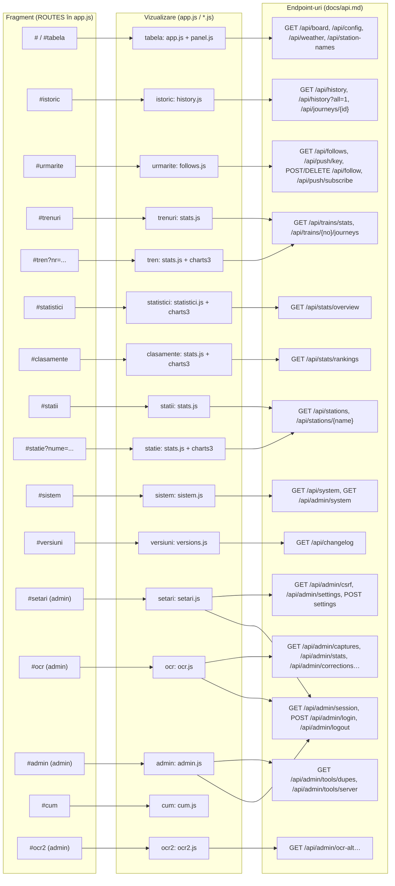

# The Interface — Tabela Gara de Nord

© 2026 Andy217Ace

Frontend documentation: the pages and routes (address fragments `#…`), what each
page shows and for whom, navigation, the theme, the service worker, the PWA manifest, the content
security policy (CSP) and its reasons, the chart layer, the accessibility decisions and the way
static files are served.

The document describes version **Beta 1.72** (`VERSION`). The endpoints that the
pages call are described in `docs/api.md`.

## How this document was verified

All statements were read from the code: `web/index.html`, `web/app.js` (the `ROUTES` and
`VIEWS` tables), `web/theme-init.js`, `web/style.css`, `web/ui2.js`, `web/ui2.css`, `web/charts3.js`,
`web/sw.js`, `web/manifest.webmanifest`, `web/offline.html`, `web/history.js`, `web/stats.js`,
`web/statistici.js`, `web/follows.js`, `web/panel.js`, `web/weather.js`, `web/versions.js`,
`web/sistem.js`, `web/setari.js`, `web/ocr.js`, `web/admin.js`, `web/cum.js`, `web/i18n/i18n.js`,
`web/polish.css`, `web/print.css`, plus `app/api.py` (CSP, static
serving), `deploy/nginx-tabela.conf` and the tests in `tests/` that check the rules (for example
`tests/test_ui3_static.py` for `CHARTS_V`). The byte count in section 4 was measured
on the files in `web/`. I did not run the interface in a browser for this document.

Interface labels are given in English, as they appear in the English interface; the Romanian
original is given in parentheses where it helps to find it in the code.

## Contents

1. [Pages and routes](#1-pages-and-routes)
2. [Navigation: the top bar and the phone bottom bar](#2-navigation-the-top-bar-and-the-phone-bottom-bar)
3. [Light and dark theme](#3-light-and-dark-theme)
4. [Service worker and offline mode](#4-service-worker-and-offline-mode)
5. [The PWA manifest](#5-the-pwa-manifest)
6. [Content Security Policy (CSP)](#6-content-security-policy-csp)
7. [The chart layer](#7-the-chart-layer)
8. [Accessibility](#8-accessibility)
9. [Serving static files](#9-serving-static-files)
10. [Diagram: route → view → API call](#10-diagram-route--view--api-call)
11. [What I did not verify](#11-what-i-did-not-verify)

---

## 1. Pages and routes

The application has a single HTML page (`web/index.html`). The pages are `<section class="view">` sections
that are shown or hidden depending on the address fragment (`location.hash`). The routes are
defined in `ROUTES` in `web/app.js`; `parseHash()` cuts the part after `?` and takes the page name
from `ROUTES`. If the route is not known, the Board is shown.

The views register in `window.TabelaApp.views` (`app.js`, `history.js`, `stats.js`,
`statistici.js`, `follows.js`, `versions.js`, `sistem.js`, `setari.js`, `ocr.js`, `admin.js`).
Each has a `show(params)` function called when the page changes.

| Fragment | Page (`VIEWS`) | HTML section | For whom | In the menu | The script that implements it |
|---|---|---|---|---|---|
| `#` or no fragment | **Board** (`tabela`) | `#view-tabela` | everyone | yes ("Board") | `app.js` (+ `panel.js`, `weather.js`) |
| `#istoric` | **History** | `#view-istoric` | everyone | yes | `history.js` |
| `#urmarite` | **Followed trains** | `#view-urmarite` | everyone (notifications depend on the browser) | yes (on a phone under "More") | `follows.js` |
| `#trenuri` | **Trains** | `#view-trenuri` | everyone | yes | `stats.js` (the `trenuri` view) |
| `#tren?nr=<number>` | **Train** | `#view-tren` | everyone | no (falls under "Trains") | `stats.js` (`tren`) |
| `#statistici` | **Statistics** | `#view-statistici` | everyone | yes | `statistici.js` |
| `#clasamente` | **Rankings** | `#view-clasamente` | everyone | yes (on a phone under "More") | `stats.js` (`clasamente`) |
| `#statii` | **Stations** | `#view-statii` | everyone | yes (on a phone under "More") | `stats.js` (`statii`) |
| `#statie?nume=<name>` | **Station** | `#view-statie` | everyone | no (falls under "Stations") | `stats.js` (`statie`) |
| `#sistem` | **System** | `#view-sistem`, created by `sistem.js` | everyone (details for admin) | yes (on a phone under "More") | `sistem.js` (loaded on the first visit) |
| `#versiuni` | **Version history** | `#view-versiuni` | everyone | no (link in the footer; on a phone under "More") | `versions.js` |
| `#cum` | **How it works** | `#view-cum`, created by `cum.js` | everyone | no (link in the footer; on a phone under "More") | `cum.js` (+ `cum.css`), loaded on the first visit |
| `#setari` | **Settings** | `#view-setari` | admin | no (only under "More", on a phone) | `setari.js` (loaded on the first visit) |
| `#ocr` | **OCR captures** | created by `app.js` (`view-ocr`) | admin | no | `ocr.js` (+ `ocr.css`), loaded on demand |
| `#ocr2` | **OCR alternative** | created by `ocr2.js` (`view-ocr2`) | admin | no | `ocr2.js` (+ `ocr2.css`), loaded on the first visit |
| `#admin` | **Administration** | created by `app.js` (`view-admin`) | admin | no | `admin.js` (+ `admin.css`), loaded on demand; the login form is shared with `#ocr`, `#ocr2`, `#infofer`: `admin_login.js` (on demand, with a 2FA code field when the server asks for it) |

Remarks:

- The routes `#sistem`, `#setari`, `#cum`, `#ocr`, `#ocr2` and `#admin` are loaded on the first visit (`loadLazyPage`,
  `loadOcrView`, `loadAdminView`). They are not in the service worker precache, "so the
  budget does not grow", as written in `app.js`.
- **Per-page styles.** `stats.css` (Trains, Train, Stations, Station, Rankings) and `statistici.css`
  (Statistics) load only when the page is opened (`PAGE_CSS` in `app.js`); the page appears once
  its style is ready, without a flash. The Board does not wait for the Statistics stylesheets.
- **Pages you leave free their memory**: on return, the page is redrawn from the kept data,
  with the filters unchanged.
- **System**: the page shows the public state (including the reading quality over the last 24 h and
  7 days and the speed: OCR cycle duration and p50/p95 API times, measured in memory); if the visitor
  has an admin session (`admin: true`), it also reads `GET /api/admin/system` (Tesseract version,
  languages, pending security updates).
- **Administration** (`#admin`) has the cards "Duplicate train numbers", "Server (live)", "NVMe disk
  (live)", "Security (fail2ban)", "Online visitors" and "Push notification test"; they are described
  in `docs/en/administrare-operare.md`, section 2.
- **Settings** has no login form. If there is no session, it shows "Authentication required
  for settings." Authentication is done from the "OCR captures" or "Administration" page, because the
  cookie is shared.
- **OCR captures** and **Administration** do not appear in the menu. The test `tests/test_admin_static.py` checks
  that they appear neither in the menu nor in the precache.
- The **Board** page does not change on navigation: `route()` does not call `enterView` for it and does not
  play an entry animation (`app.js`), so that it stays exactly as it was.
- The page title (`document.title`) changes: "History · Tabela Gara de Nord" etc.
  The Train page can change its own title (`stats.js`).

**The Board page** (the most important): it shows the arrivals and departures at București Nord, read from the
CFR board. It has:

- two tabs (`Arrivals`, `Departures`) with left/right arrow navigation; the chosen tab is kept in
  `localStorage` under the key `tabela.tab`;
- a warning banner (`#banner`) when the data is stale;
- a loading screen (`#boot`) until the first data arrives;
- the "Panel" mode (`web/panel.js`), with the `Panel` / `Cards` switch and the `Full screen` button
  (the keys `tabela.view`, `tabela.panel.board`, `tabela.panel.cols`, `tabela.fav` in `localStorage`);
- delays colored by the thresholds from `/api/config` (`delay_thresholds`: 5, 15, 30 minutes, with
  the defaults from `app.js`);
- "follow" buttons for each train (`follows.js`), when notification support exists.
- the text "uncertain reading" (the `UNSURE` constant in `app.js`) for values that are not certain, instead of an invented value;
- the "Show estimated platform" switch (`#pe-toggle`, off by default): the `peron_est.js`/`.css`
  layer loads only when it is on and is not precached.

**Station names** appear with diacritics on every page (Brașov, Aeroport Henri Coandă), from
`GET /api/station-names` (`I18N.station()` in `web/i18n/i18n.js`; an unknown key is shown in
Title Case). The keys in URLs, statistics and exports stay as CFR writes them.

**The History page:** a form with the day (`#h-date`, or "All days"), the train number, the station, the
from and to time, the board and the "Reset" button. The filters are written into the address (`syncHash`), so a
link keeps the filters. The results come from `GET /api/history`; with "All days", from
`GET /api/history?all=1` (with pagination: "Load more", with the number left). A click on a row opens a
`<dialog>` (`#h-detail`) with the journey details (`GET /api/journeys/{id}`). In "all days" mode the interface shows how many rows are displayed ("showing N (newest)", class `h-truncated`). The `X-Truncated` header of the single-day mode is not read by `history.js` (uncertain: check whether there is another branch).

**The Followed trains page:** the "Notifications on this device" switch (`#f-switch`) that asks for permission
and subscribes the browser to Web Push; the list of followed trains (`GET /api/follows`); an error and
explanations when the browser does not support notifications. On iPhone/iPad, push notifications work
only for an app added to the home screen (`isIOS()` and `isStandalone()` in `follows.js`);
the page says so in `#f-ios`.

**The Trains, Train, Stations, Station and Rankings pages:** pages from `stats.js`, with tables, filters and
CSV/JSON exports (the links point directly to the `format=csv` routes). On Train, Station and Rankings
the chart layer is loaded too (section 7). Trains (like History) draws 50 rows at a time, with a
"Load 50 more" button; sorting and filters work on all the data. On a phone, the History and Trains
filters sit behind a "Filters (n)" button (`filterToggle` in `app.js`).

**The Statistics page:** a single response from `GET /api/stats/overview`, with the filters `perioada`
(`Today`, `7 days`, `30 days`, `Whole history`), `board`, `operator`, `tip`, `doar_confirmate`.
It has a summary, questions (`insights`), problems, charts and exports per dataset. The text at the top says
that the delay is the one read on the București Nord board, and that arrivals and departures are always
separate. On a phone, the sections first show only as headings and open on tap; the charts are
drawn as you scroll (when printing or following a direct link to a chart, all at once).

**The Version history page:** the list from `GET /api/changelog`; it is the footer link ("Versions") and the one in
`/api/health`. Only the newest version starts open.

**The How it works page** (`#cum`): in plain language, where the data comes from (the CFR webcam
read with OCR), what "delay" means, how history and statistics are built, the limits, privacy and
where to report a problem. Static text (`cum.js`), no API calls.

---

## 2. Navigation: the top bar and the phone bottom bar

**The top bar** (`header.topbar`): the logo and title, the clock and the weather (`#hdr-clockwx`, `weather.js`),
the theme button (`#theme-btn`) and the "Live / Source: CFR" indicator.

**The main menu** (`nav.mainnav`, under the header) has 8 entries: Board, History, Followed trains, Trains,
Statistics, Rankings, Stations, System. Each has `data-route` and, for the active page,
`aria-current="page"`. The `Train` page highlights "Trains", and `Station` highlights "Stations"
(`NAV_PARENT` in `app.js`).

**Tablet and desktop (over 700 px).** The menu is the top bar, sticky at the top, with the
language button (`EN` / `RO`) at its end:

- `.mainnav` has `overflow-x: auto` and `scrollbar-width: none`: when it does not fit, it scrolls
  horizontally **inside the bar**, not the page. `revealActiveNav()` brings the active page into view,
  without moving the page.
- On touch screens (`(pointer: coarse)`), `--topnav-h` and `.nav-item` have a minimum height of 46 px
  (`style.css`).
- **"Desktop site" on a phone.** When the phone's browser shows the page at a width
  much larger than the screen, `theme-init.js` puts the class `zoomed-out` on `<html>`. Then the menu
  becomes larger (`min-height: 88px` on elements, `font-size: 1.75rem`, `style.css` ~line 668).
  The check is done only on touch screens, so that on desktop zooming does not change the menu. In
  this mode the top bar stays (the page is laid out at ~980 px).

**Phone (700 px or less).** From CSS, from the first paint (no layout shift), the menu bar moves to
the bottom (`position: fixed`, with the screen's safe areas) and shows only **Board, History,
Trains, Statistics** (`NAV_BAR` in `app.js`) plus the **"More"** button (`nav.nav-more`,
`#nav-more-btn`). The "More" menu (`#nav-more-menu`) is filled by `initMoreNav()` from the same list
of routes: Followed trains, Rankings, Stations, System, then Version history, Settings and How it
works, and on a phone the language button moves here too. The button has `aria-expanded`; the menu
closes when a page is chosen, on `Escape` (focus returns to the button), on a click outside, on a
page change and when keyboard focus leaves it. When the current page is in the menu, the "More"
button is highlighted.

**Language (RO / EN).** `web/i18n/i18n.js` picks the language in the order `?lang=` → `localStorage`
(`tabela-lang`) → Romanian. The texts are in `web/i18n/ro.json` and `en.json` (the same keys); the
elements have `data-i18n` / `data-i18n-attr`. The `[data-lang-toggle]` button switches the language
without a reload (the `i18n:change` event), and `<html lang>` follows the chosen language.
`ro.json` is precached; `en.json` is cached on first use. The private pages' texts (`admin.*`, `ocr.*`,
`ocr2.*`, `infofer.*`) live apart, in `ro.admin.json` / `en.admin.json` (the same keys): they are not
precached, `app.js` loads them with `I18N.loadExtra("admin")` before the page's script, and switching
the language reloads them for the new language.

---

## 3. Light and dark theme

**Three modes:** `auto` (follows the system setting), `light` and `dark`.
The button in the header cycles: auto → light → dark → auto. Its label (`aria-label`,
`title`) states the current mode.

**Where the theme is decided (`web/theme-init.js`):**

- The script is loaded **synchronously**, in `<head>`, before the stylesheets, so that there is no color "flash"
  on load. For the same reason it is not inline: the CSP forbids inline scripts
  (section 6).
- The choice is saved in `localStorage` under the key `tabela.theme` (the values `light` and `dark`;
  for `auto` the key is deleted). If `localStorage` is not available, the theme lasts until reload.
- Application: `<html data-theme="light">` or `<html data-theme="dark">`; for `auto` the attribute
  is absent. `<meta name="theme-color">` gets `#0f172a` (dark) or `#f1f5f9` (light).
- On every change the event `tabela:theme` is dispatched, on which the button label is redrawn.

**Tokens (`web/style.css`):** colors are never written directly in components. There are three layers:

1. **primitive** `--ref-*` (for example `--ref-slate-900: #0f172a`, `--ref-amber-400`, `--ref-chart-arr-d`);
2. **semantic** `--bg`, `--surface`, `--text`, `--text-2`, `--accent`, `--focus`, `--ok`, `--warn`,
   `--bad`, `--info`, `--lvl-ok`, `--lvl-low`, `--lvl-mid`, `--lvl-high`, `--c-arr`, `--c-dep`, `--c-seq` etc.;
3. **component** `--board-*`, `--btn-*`, `--card-*` etc.

The design system is described in `design-system/tabela-gara-de-nord/MASTER.md`.

**The rules for applying the theme** (the comment in `style.css`, section 2b–2c):

- by default (without `data-theme`) the theme is **dark** (`:root`);
- `@media (prefers-color-scheme: light)` with `:root:not([data-theme="dark"])` gives the light theme
  when the system asks for it;
- `:root[data-theme="light"]` forces the light one (identical to the one in the media query);
- `:root[data-theme="dark"]` forces the dark one; both set `color-scheme`, so that scrollbars
  and native controls look right.

`panel.css` (the Panel mode) follows the same rules, so that the Panel does not have its own theme.

**Polish (`web/polish.css`, loaded after `style.css` and `ui2.css`).** Looks only, tokens only: the
train category badges (IR, IC, R, RE…) with a light fill and a contrast of at least 4.5:1 in both
themes (IC has its own colour), a more compact "What changed" list and subtle transitions on buttons
and links, set **only** under `@media (prefers-reduced-motion: no-preference)`.

**Printing (`web/print.css`, `media="print"`).** Board, History, Trains and Statistics print black on
white, without the menu, header, filters, forms, dialogs or buttons (only the buttons that carry data
stay: train number, headings, sort columns), with rows not split across pages. On the Board, the
selected tab (Arrivals or Departures) stays as the sheet title.

---

## 4. Service worker and offline mode

The file is `web/sw.js`, with scope `/`, and it is registered by `app.js` (`registerSW`) only on secure
origins (HTTPS or localhost).

**Caches:**

- `tabela-shell-<VERSION>` — the "shell" files (precache);
- `tabela-board-<VERSION>` — the last board received (`/api/board`).

**Precache (`SHELL`).** The list has 30 files, plus `/` (the main page, as a navigation) and
`/offline.html`. It includes: `theme-init.js`, `i18n/i18n.js`, `i18n/ro.json`, `offline.js`, `style.css`,
`panel.css`, `app.js`, `history.js`, `follows.js`, `panel.js`, `weather.css`, `weather.js`, `stats.js`,
`stat_weekdays.js`, `statistici.js`, `stat_platform.js`, `stat_dwell.js`, `ui2.css`, `polish.css`,
`print.css`, `ui2.js`, `manifest.webmanifest`, `favicon.ico`, the icons from `icons/` and the fonts
`fonts/fira-sans-400.woff2`, `fonts/fira-code.woff2`.

- **Not** included: `ocr.*`, `ocr2.*`, `admin.*`, `sistem.*`, `setari.js`, `cum.*`
  (the administration pages and the ones loaded on demand), `versions.js` (a `defer` script in `index.html`), `stats.css` and `statistici.css` (they
  load with their page and are cached on first use), `peron_est.*`, the other `stat_*` modules
  loaded on demand, `i18n/en.json` and `i18n/*.admin.json` (cached on first use), `charts3.js`/`charts3.css` (charts),
  `icon-512` and `icon-maskable-512` (the browser takes them from the manifest), nor any `/api/*`
  endpoint other than the board.
- The budget: the sum of the files in `SHELL` is about **0.8 MB** uncompressed; `ro.json` (~100 KB)
  is the largest part. `tests/test_ui3_static.py` enforces `PRECACHE_LIMIT = 800_000`, and
  `tests/test_brand_theme.py` enforces `825_000` (counted differently). See also section 11.
- The Fira Sans 500/600/700 fonts are loaded on demand and are not in the precache; offline they fall back to
  the 400 weight (synthetic bold), as written in `sw.js`.

**The strategies (`fetch`):**

| Request | Strategy |
|---|---|
| `GET /api/board` | network-first. If the network fails, the last board from `tabela-board-*` is served, with `"sw_offline": true` and `"sw_cached_at"` (milliseconds). |
| other `GET /api/*` | never cached (history, follows, push and weather are always live). |
| navigation (`mode === "navigate"`) | network-first; if the network fails, the main page from the cache (the application shows the last board), and the last resort is `/offline.html`. |
| file from `SHELL` | network-first, with the cache as a fallback. |
| other origin (fonts etc.) | the browser's default behavior. |

**The offline page** (`web/offline.html`): "You are offline" (`Ești offline`), with the explanation that the last saved data appears
automatically when the main page is in the cache, and a "Try again" button to `/`. It has its own `<head>`
with the theme and the CSS, so it respects the theme.

**Install and activation:** on `install`, the files in `SHELL` are put in the cache with `cache: "reload"`
(it bypasses the HTTP cache), then `skipWaiting()`. On `activate`, all the `tabela-*` caches
that are not `SHELL_CACHE` or `BOARD_CACHE` are deleted, and `clients.claim()`.

**The rule for `VERSION` (`var VERSION = "vNN"` in `sw.js`):**

- It is increased when the `SHELL` list or any file in it changes. This is written in the header of
  `sw.js` ("Bump VERSION when the shell list changes; old caches are deleted on activate"), and
  the practice in `CHANGELOG.md` shows it was also increased for changes in `ui2.js`, `app.js`,
  `statistici.js` and `stats.js` (for example "v28 only for the changes in …").
- The technical reason (standard browser behavior): the browser checks for a service worker
  update by comparing the bytes of `sw.js`. If they do not change, it does not reinstall and does not
  redo the precache, so the offline cache stays the old one.
- The tests check only a minimum (`VERSION >= v28` in `test_ui3_static.py`, `>= v27` in `test_ui2_static.py`,
  `>= v17` in `test_statistici_static.py`). At Beta 1.72 the value is `v51`.

**Push notifications.** `push` shows `title` (or "Gara de Nord"), `body`, `tag` (with `renotify`),
the icon `icons/icon-192.png` and `lang: "ro"`. The click (`notificationclick`) brings an open window of the app to the
front and navigates to `url`, or opens a new one. The address is accepted only if it is of the
same origin (`sameOriginUrl`).

---

## 5. The PWA manifest

The file is `web/manifest.webmanifest`, served with `application/manifest+json` and `Cache-Control: no-cache`:

| Field | Value |
|---|---|
| `name` | "Tabela Gara de Nord" |
| `short_name` | "Gara de Nord" |
| `lang` / `dir` | `ro` / `ltr` |
| `id`, `start_url`, `scope` | `/` |
| `display` | `standalone` (without the browser bar) |
| `orientation` | `any` |
| `theme_color` / `background_color` | `#0f172a` (the dark one) |
| `categories` | `travel`, `navigation` |
| `icons` | `icons/icon-192.png` (any), `icons/icon-512.png` (any), `icons/icon-maskable-512.png` (maskable) |

`index.html` also has the iOS metadata (`apple-touch-icon`, `apple-mobile-web-app-title`
"Gara de Nord"), the theme in two variants (`theme-color` for dark and light), Open Graph and Twitter
Card. The preview image is `icons/og-image.png` (1,200 × 630).

---

## 6. Content Security Policy (CSP)

The CSP is sent by the application, in the `security_headers` middleware in `app/api.py`, on **every**
response (both for the API and for static files):

```
default-src 'self'; script-src 'self'; style-src 'self'; font-src 'self';
img-src 'self' data:; connect-src 'self'; manifest-src 'self'; worker-src 'self';
object-src 'none'; base-uri 'self'; form-action 'self'; frame-ancestors 'none'
```

The other security headers sent by the application: `X-Content-Type-Options: nosniff`,
`Referrer-Policy: no-referrer`, `X-Frame-Options: DENY`. nginx adds `Strict-Transport-Security:
max-age=31536000` (`deploy/nginx-tabela.conf`).

**What it means for the code:**

- **`script-src 'self'`**: no inline `<script>`, no `onclick="…"`, no `eval`. All scripts
  are files from the same site. That is why `theme-init.js` is a separate file, not inline, even though
  that would be simpler.
- **`style-src 'self'`**: no inline `<style>` and no `style="…"` attribute. Colors and
  sizes come from the stylesheets. The only writes to style are through the CSSOM (`el.style.transform`
  in `charts3.js`), which the CSP allows; the code does not build any `style=` as text.
- **`connect-src 'self'`**: the page talks only to its own server; that is why `weather.js` requests
  `/api/weather` and not Open-Meteo directly, and the Open-Meteo attribution is only text and a link.
- **`img-src 'self' data:`**: images are loaded from the same site; `data:` is allowed, but I did not
  find any `data:` uses in `web/` (uncertain).
- **`form-action 'self'`** and **`frame-ancestors 'none'`**: a form cannot be submitted to another
  site, and the page cannot be put in an iframe (protection against clickjacking).

**The `textContent` / `createElement` rule.** The header of `web/app.js` says: "DOM is built with
createElement/textContent only (no HTML strings: API data never reaches the parser)". The reason:
the data comes from CFR and from the administrator's corrections (notes), so it is data that we do not
fully control. If it went into `innerHTML`, a malicious text could become code
(XSS). With `textContent`, any text stays text. A search in `web/*.js` finds no `innerHTML`,
`insertAdjacentHTML`, `outerHTML` or `document.write`. The same is said in the header of `app.js`,
`admin.js` and `setari.js`.

**The CSP test in the browser.** `tests/test_csp_browser.py` opens the main page, `#statistici`,
`#trenuri` and `#statii` in a real browser and checks that no "Content Security Policy" messages appear
and that the Fira Sans font loads. I did not run it here.

---

## 7. The chart layer

The charts are **SVG and custom code**, with no external library. The reasons are written in
`README.md` (the "Grafica paginilor" section): the security policy (`script-src 'self'`, no inline
styles), the light and dark themes, the accessible alternative for each chart
(legend, table, CSV) and the weight (the custom code is ~18 KB gzip).

**Two files:**

- **`web/ui2.js` + `web/ui2.css`** (in the precache). Helpers for all the non-live pages: `donut`
  (a circular chart with a center, legend and tooltip), `meter` and `spark` (SVG bars and mini-charts),
  `countUp` (a counting number, stopped by `prefers-reduced-motion`), `gauge`, `empty` (empty state),
  `hero`, `skeleton` (loading skeletons), `enterView` (page entry), `transition`
  (View Transitions, if the browser has them), `decorate`, `stagger`. It exposes `window.TabelaApp.ui2`.
- **`web/charts3.js` + `web/charts3.css`** (**not** in the precache, loaded on demand). The
  interactive layer: `bind(svg)` (tooltip on hover, on touch and with the keyboard, with a crosshair), `legend`
  (the legend becomes a toggle: hover highlights the series, click hides/shows it), `tools` ("Copy
  link", "Full screen" with the table alongside), `toc` (section chips that track scrolling),
  `snapshot`/`morph` (the data transition when a filter changes), `calendar` (one square per day).
  It exposes `window.TabelaApp.charts3`.

**Loading on demand.** `App.ui2.charts()` adds a `<link>` and a `<script>` with `?v=CHARTS_V`
and promises that at the end `App.charts3` exists (or `null` if the files cannot be loaded). The page
asks for charts only if it has them: `stats.js` for `tren`, `clasamente` and `statie` (`charts: true`),
and `statistici.js`. `charts3.js` says the same in its header.

**The `CHARTS_V` rule.** `CHARTS_V = "1.72"` in `ui2.js` must be equal to the version number in
`VERSION` (`Beta 1.72` → `1.72`). The test `test_lazy_not_in_precache_and_loader_matches_the_version`
in `tests/test_ui3_static.py` checks this: `CHARTS_V` changes at every deploy. The reason
written by the authors is "cache-buster": if the browser remembers an old `charts3.js`, the parameter
forces the new version. With the `no-cache` + `ETag` headers from the application, the exact role is a safeguard;
I did not find a more detailed explanation in the code (uncertain, see `CHANGELOG.md` for each version
that changed `CHARTS_V`).

**Content rules (the header of `ui2.js`):**

- next to every figure appears **N** (the number of observations it is computed from);
- a missing value is shown as "—", never as 0;
- color is not the only carrier of information: the legend has text, and each chart slice has
  its own pattern;
- `prefers-reduced-motion` stops the animations.

---

## 8. Accessibility

The accessibility decisions, with the place where they are implemented:

| Decision | Implementation |
|---|---|
| Skipping the menu | A "Skip to the board" link (`.skip-link`, appears on focus) to `#main`. `<main tabindex="-1">`. |
| Language | `<html lang>` follows the chosen language (`ro` by default, `en`), set by `theme-init.js` and `app.js`. |
| Page title | A single `h1` per page (sometimes `sr-only`, for example `#board-heading` on the Board) and no skipped heading levels (including Settings and Statistics). |
| Menu | `<nav aria-label="Main navigation">`, `aria-current="page"` on the active page; on a phone "More" is a separate navigation landmark (`<nav aria-label="More">`), with `aria-expanded`, `Escape` and closing when focus leaves. |
| Tabs (Arrivals / Departures) | `role="tablist"`, `role="tab"`, `aria-selected`, `aria-controls`, `role="tabpanel"`; left/right arrows move the tab (`app.js`). |
| Announcements | `#sr-status` and `#h-count` with `role="status"` and `aria-live="polite"`; errors with `role="alert"` (`#h-error`, `#v-error`). "Board is up to date" is not announced on load, and Statistics is not re-read on every redraw; problems and recoveries are announced. |
| Dialogs | The History details are `<dialog>` (`showModal`), with a close button `aria-label="Close the details"`. |
| Visible focus | `:focus-visible` with the `--focus` outline (`style.css`); also for the switches and the theme button. |
| Touch targets | Every link or button is at least 24 × 24 px (WCAG 2.2 AA, criterion 2.5.8; the "a11y 2.5.8" block in `style.css`: station and train links, sort buttons, inputs, checkboxes); `--tap: 44px` on touch screens; the "follow" buttons are 44 × 44 px on a phone. |
| Reduced motion | The system "Reduce motion" setting (`prefers-reduced-motion: reduce`) turns off all animations and transitions: per-component blocks plus a catch-all block at the end of `style.css`; the `polish.css` transitions exist only with `no-preference`; `ui2.js` checks the same media query. |
| Forced contrast | `@media (forced-colors: active)` puts outlines (`CanvasText`) on the important elements. |
| Color | The charts have a legend with text and a pattern on each slice (`ui2.js`); `ocr-conf` (the OCR captures page) also uses text ("≥ 80", "50–79", "< 50"). |
| Images | Decorative icons have `aria-hidden="true"` and `focusable="false"`; logos have a descriptive `alt` or `alt=""` when decorative. |
| Missing data | "—" and "uncertain reading", not 0 and not empty. |
| Keyboard on charts | `charts3.bind` shows the tooltip with the keyboard too; `tools` offers the table as a text alternative. |

How they are verified: the `tests/test_*_browser.py` tests (for example `test_touch_targets_browser`,
`test_empty_states_browser`, `test_nav_browser`, `test_a11y_browser`, `test_contrast_browser`), the
Firefox and WebKit check in `test_cross_browser.py` and `design-system/` (I did not run them here).

### 8.1 WCAG 2.2 AA: new criteria and automated checks

`tests/test_axe_wcag22_browser.py` runs axe-core 4.10.2 (a pinned copy in `tests/vendor/`, SHA256-checked; MPL-2.0; the app does not serve it and loads nothing from a CDN) with the tags `wcag2a, wcag2aa, wcag21a, wcag21aa, wcag22aa` on 12 routes (Board, History, Followed, Trains, Stations, Statistics, Rankings, Versions, System, Settings, How it works, Admin with its login form), in the light and dark theme, at 1280 and 390 px. No rule is disabled; result when written: 0 violations. Contrast is still also checked separately by `test_contrast_browser`.

| Criterion (level) | Status | Verified by |
|---|---|---|
| 2.4.11 Focus Not Obscured (AA) | **Fixed**: on phones keyboard focus could land under the fixed bottom nav bar; `html { scroll-padding-bottom }` in the <= 700 px block of `style.css` | `test_focus_obscured_browser` (Tab through 11 routes, 390 px) |
| 2.5.7 Dragging Movements (AA) | N/A: nothing requires dragging; the chart tooltip (`charts3.js`) is just press/hover, with a keyboard alternative and a table | reading `web/*.js` (no `draggable`, `dragstart`, `touchmove`, sliders) |
| 2.5.8 Target Size (AA) | Pass on all public routes | `test_a11y_browser`, `test_touch_targets_browser`, axe `target-size` |
| 3.2.6 Consistent Help (A) | Pass: the "How it works?" link is in the shared footer, same relative position on every page | `test_consistent_help_link_on_every_route` |
| 3.3.7 Redundant Entry (A) | N/A: no multi-step flows; filters keep their values within the page | reading the forms in `index.html` |
| 3.3.8 Accessible Authentication (AA) | Pass: the Admin login is a single labelled password field, `autocomplete="current-password"`, paste allowed, no cognitive test or captcha | `web/admin.js` (`showLogin`) + axe on `#admin`; I did not run a real password-manager login |
| 4.1.1 Parsing | Removed in WCAG 2.2 | N/A |

Status per page: all 12 routes pass axe (both themes, both widths), 24 px targets and focus-not-obscured (phone, Admin excluded). Not verified: real screen readers, 400 % zoom, axe on Firefox/WebKit.

Frontend performance: `tests/test_perf_budgets_browser.py` and `tests/perf_budgets.json` (see `docs/testare.md`).

---

## 9. Serving static files

- The FastAPI application mounts `web/` with `StaticFiles(directory=WEB_DIR, html=True)` at `/`, last
  in the route order, so the `/api/*` routes have priority (`app/api.py`). If the directory is missing,
  the application starts without an interface and writes a warning in the log.
- `/` serves `index.html`. Files are requested by their path (`/style.css`, `/icons/logo-96.png`).
- **Explicit routes** for `/sw.js` (`text/javascript`) and `/manifest.webmanifest`
  (`application/manifest+json`), both with `Cache-Control: no-cache`, so that they do not depend on the MIME
  type table of the operating system.
- **Fonts:** `font/woff2` is registered explicitly (`mimetypes.add_type`), because some systems
  do not have it, and with `nosniff` the wrong type would block the font.
- **Cache:** any path outside `/api/` gets `Cache-Control: no-cache` (the `security_headers`
  middleware, with `setdefault`), and `StaticFiles` adds `ETag` and `Last-Modified`. So the
  browser revalidates, and a deploy arrives immediately (the comment in the code: "always revalidate
  (ETag) so a deploy is picked up at once").
- **The fonts** are self-hosted (`web/fonts/`, the OFL license in `OFL-*.txt`), with
  `font-display: swap`; the two critical ones have `<link rel="preload">` in `index.html`.
- **nginx** (`deploy/nginx-tabela.conf`) sends everything through `proxy_pass` to `127.0.0.1:8000`,
  including `/`. It compresses with gzip: `text/css`, `application/javascript`, `text/javascript`,
  `application/json`, `application/manifest+json`, `image/svg+xml`, `text/plain` (`text/html` is
  compressed by nginx by default). It does not set cache headers for static files; it gets them from the application.

---

## 10. Diagram: route → view → API call

Each route (hash) node leads to the view that displays it and to the endpoints that it
calls. The endpoint names are the ones in `docs/api.md`.



Notes:

- The Board page and the weather in the header request `/api/board` every 10 seconds (`refresh_s` from `/api/config`);
  `weather.js` requests `/api/weather` every 5 minutes (`refresh_s` 300).
- The `ocr` and `admin` views call `GET /api/admin/session` on opening, to decide whether to
  show the login form or the data. `setari` does not call `session`; it requests `GET /api/admin/settings` directly.
- When a journey is opened from the Train or Station page, `stats.js` uses the public function
  `openJourney` from `history.js`, which requests `GET /api/journeys/{id}`.
- In `web/stats.js` I did not find a call to `GET /api/trains/{no}` without `/journeys`; the Train page
  uses `/api/trains/{no}/journeys` (line ~887).

---

## 11. What I did not verify

- **The browser tests** (`tests/test_*_browser.py`, `test_csp_browser`) were not run; the statements
  about behavior in the browser (for example the tab key, the dialogs, "Desktop site")
  come from the code, not from execution.
- **The precache budget.** The sum is ≈ 0.8 MB. The tests enforce 800,000 in `tests/test_ui3_static.py`
  (on disk) and 825,000 in `tests/test_brand_theme.py` (as served, with `/` and `/offline.html`); the
  margin is small, so any new file in `SHELL` needs a budget decision.
- **The exact explanation of `CHARTS_V`.** The code says "cache-buster", but with `no-cache` + `ETag` the role is
  a safeguard. To verify in the `CHANGELOG.md` history whether there was a real problem.
- **The `zoomed-out` behavior** on real phones depends on the browser; the rule in `theme-init.js`
  uses `screen.width`/`height` and `innerWidth`, which may vary.
- **The `#sistem` page** has no section in `index.html`: `sistem.js` creates `#view-sistem` on the first
  visit (`ensureSection`). I did not verify what happens if the script does not load (for example offline).
- **Push notifications on iOS** depend on the iOS version and on installing the app; I could not
  verify on a device.
- **Charts on `#statistici`** are loaded by `statistici.js` through `App.ui2.charts()`; I did not follow
  all the branches in which `charts3` may be missing (after `null`, the page falls back to a table).
