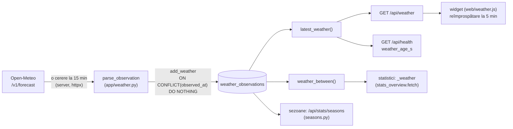

# Weather

This page describes the weather layer of Tabela Gara de Nord: where the data comes from, what is stored, how often it is requested, how the widget looks, how the weather enters the statistics and what happens when the source goes down. The statements come from the code; the files are named as we go.

## What it is and what it is not

- **Source:** [Open-Meteo.com](https://open-meteo.com/), license **CC BY 4.0** (the attribution appears in the widget, in the page footer and in the panel credit). The `ATTRIBUTION` constant in `app/weather.py`.
- **The values are model values, not station values.** The `current` values are the model's latest value for the grid cell around the coordinates, not measurements from a weather station. Each row has `kind = "model_current"`, and the interface writes "Current conditions (Open-Meteo model)" (`LABEL_RO`).
- **The same weather for all stations.** A single coordinate pair (Bucharest by default) serves all the statistics.
- **No causality is claimed.** The comparisons in the statistics and in the seasons carry the note "Correlation, not causation" (`stats_overview._weather` and `seasons.NOTE`).
- **It does not affect the board.** The weather runs in its own asyncio task, independent of the CFR poller. A weather error does not change the board and does not change `ok` in `/api/health` (verified: `/api/health` returns only `weather_age_s`).

## Data flow

The browser does not request Open-Meteo directly. The CSP keeps `connect-src 'self'`, and the server makes the request.

## What is requested

The request (`request_params`, `app/weather.py`):

| Parameter | Value |
|---|---|
| `latitude`, `longitude` | `WEATHER_LAT` and `WEATHER_LON`, with 4 decimals (default `44.4323` and `26.1063`, Bucharest) |
| `current` | `temperature_2m,relative_humidity_2m,apparent_temperature,is_day,precipitation,rain,showers,snowfall,weather_code,surface_pressure,wind_speed_10m,wind_direction_10m,wind_gusts_10m` |
| `hourly` | `temperature_2m` |
| `timezone` | `UTC` |
| `forecast_days` | `2` |
| `User-Agent` | with the application name and the attribution |

Base URL: `WEATHER_URL` (default `https://api.open-meteo.com/v1/forecast`).

## Frequency and limits

| Constant | Value | Meaning |
|---|---|---|
| `DEFAULT_INTERVAL_S` | 900 (15 min) | interval after a success; the Open-Meteo resolution |
| `MIN_INTERVAL_S` | 300 (5 min) | no request more often than every 5 minutes, not even after a restart |
| `MAX_BACKOFF_S` | 1800 (30 min) | cap of the error backoff |
| `TIMEOUT_S` | 10 s | timeout per request |
| `MAX_BYTES` | 64 KiB | larger response: error |
| `STALE_AFTER_S` | 2700 (45 min) | older observation: "stale data" |
| `UI_REFRESH_S` | 300 (5 min) | interval at which the widget requests `/api/weather` |

On the first start, the first call waits until at least 5 minutes have passed since the last stored reading (`start` in `app/weather.py`), so a restart does not trigger an immediate request.

Configuration from the environment (`config_from_env`):

| Variable | Default | Rule |
|---|---|---|
| `WEATHER_ENABLED` | `1` | `0`, `false`, `no` or `off` stops the service; `/api/config` marks the widget as disabled |
| `WEATHER_INTERVAL_S` | `900` | digits only; the effective minimum is 300 |
| `WEATHER_LAT` | `44.4323` | between -90 and 90; otherwise the default |
| `WEATHER_LON` | `26.1063` | between -180 and 180; otherwise the default |
| `WEATHER_URL` | the Open-Meteo address | empty string → default |

The service starts only when the application starts the poller too (`start_poller` in `app/api.py`, line ~282). In tests or in the no-poller mode no request is made.

## What is stored

The `weather_observations` table (`app/store.py`):

- One row per **observation**, with `observed_at` (UTC, `YYYY-MM-DDTHH:MM:SSZ`) **unique**. The 15-minute cadence gives about 96 rows per day. The insert is `ON CONFLICT(observed_at) DO NOTHING`: an observation that is already stored is not overwritten and `add_weather` returns `False`.
- The base columns (schema v4): `observed_at`, `fetched_at`, `source` (`open-meteo`), `kind` (`model_current`), `latitude`, `longitude`, `temperature_c`, `apparent_temperature_c`, `precipitation_mm`, `weather_code`, `wind_speed_kmh`, `wind_direction_deg`, `units_json`, `raw_json`.
- The columns from schema v8 (additive, nullable; old rows stay `NULL`): `relative_humidity_pct`, `is_day`, `rain_mm`, `showers_mm`, `snowfall_cm`, `surface_pressure_hpa`, `wind_gusts_kmh`, `hourly_json`.
- `raw_json` keeps the response without the hourly series. The units are kept in `units_json`.

**The hourly series** (`hourly_json`): up to 25 points, from the observation hour forward by 24 hours, as compact JSON `{"start", "step_s": 3600, "t": [...]}`, with `null` for missing hours and with the tail values trimmed. It is kept only on the **newest** observation: `add_weather` deletes it from the others. It is a forecast shown now, not history.

**Missing values:** they stay `NULL`, never 0. A precipitation of 0.0 mm is a real value and is kept as such.

## Parsing and units

`parse_observation` validates the response:

- The `current` block is missing → error (`WeatherError`), the observation is not saved.
- `current.time` missing or invalid → error. If the time has no time zone, `utc_offset_seconds` is applied.
- A response larger than 64 KiB, an HTTP status other than 200, invalid JSON or an `error` field → error.
- The units are converted to the internal units (°C, km/h, mm, cm, hPa, %). An unknown unit causes that value to be discarded, with a warning in the log, not guessed.
- `relative_humidity_pct` is kept only between 0 and 100. `is_day` is accepted only if it is 0 or 1.
- Errors in an `hourly` block do not stop the observation: `_hourly_series` returns `None` and the observation is saved without a series.

## What the user sees

**The widget** (next to the clock, in the header and in the panel bar; `web/weather.js`):

- the icon by `weather_code` (a day or night variant by `is_day`, with a fallback to the astronomical computation `is_daytime` if `is_day` is missing);
- the temperature and "feels like";
- on tap or hover, a popover with humidity, pressure, wind (speed, direction in words and gusts), precipitation (rain, showers and snow appear only when above 0), the temperature chart for the next 24 hours with minimum, maximum and the "now" marker, the observation time and the source;
- after 45 minutes, the state turns gray ("stale data"); if the refresh fails, the same happens.

The wind direction (`wind_direction_ro`) is the **direction the wind blows from**, in 8 sectors of 45° (N, NE, E, SE, S, SV, V, NV).

**API:**

- `GET /api/weather`: `available`, `observed_at`, `observed_local`, `fetched_at`, `age_s`, `stale`, `kind`, `label_ro`, the current values, `condition_ro`, `icon`, `is_day`, `wind_direction_ro`, `hourly` (`start_utc`, `step_s`, `temperature_c`, `min_c`, `max_c`) and `attribution`. With no row: `available = false`, `stale = true`.
- `GET /api/config` → `weather` block: `enabled`, `stale_after_s`, `refresh_s`.
- `GET /api/health` → `weather_age_s` (no effect on `ok`).

## Weather in the statistics

The weather enters in two places, both only as an association.

### The Statistics page (`app/stats_overview.py`)

- Each counted journey (the statistics section of `docs/statistici-calatorii-calitate.md`) gets the nearest weather observation, **at most ±30 min** (`WEATHER_MATCH_MIN = 30`), relative to the scheduled time.
- The scheduled time is the one in `journeys.sched_at` with no reference moment; on the night of the clock change, the same local hour appears twice and the wrong occurrence may be picked. The seasons (next section) use the reading moment as the reference instead.
- The groups: precipitation (`dry` = 0 mm, `wet` = above 0 mm) and temperature (below 5 °C, 5–15 °C, 15–25 °C, 25 °C or more).
- The section appears as "still being collected" until there are **at least 7 days** (`WEATHER_MIN_DAYS`) with matched journeys and at least **two groups** with N ≥ `STATS_MIN_SAMPLE` (default 5).
- The per-board architecture: arrivals and departures are analyzed separately; the response has `status`, `matched`, `days`, `needed_days`, `observations`, `note` and `boards`.
- To read the weather, the statistics use a read-only SQLite connection, with the observations from the start of the period minus one day.

### Seasons (`app/seasons.py`)

`GET /api/stats/seasons` compares the meteorological seasons (Dec–Feb, Mar–May, Jun–Aug, Sep–Nov) by precipitation and temperature groups. The rules:

| Constant | Value |
|---|---|
| `WEATHER_DAY_OBS` | 96 observations expected per day |
| `WEATHER_DAY_MIN_SHARE` | 0.5: a day is eligible with at least 48 observations |
| `SEASON_MIN_DAYS` | 30 eligible days per season, otherwise "insufficient data" |
| `SEASON_GROUP_MIN` | 30 journeys per group, for comparison |
| `TIMETABLE_MARGIN_DAYS` | 7 days excluded around timetable changes |

The details about the seasons and about the date of the December timetable change (the `TIMETABLE_CHANGE_DATES` list is empty) are in `docs/statistici-calatorii-calitate.md`, section 13.

## Failures and behavior

| Situation | What happens |
|---|---|
| Open-Meteo answers with an HTTP status other than 200, invalid JSON, a transport error or a timeout | `WeatherError`, a warning in the log, `failures` increases; nothing is saved |
| Error streak (consecutive `failures`) | pause of 5, 10, 20, then 30 min (cap), then it resumes |
| Success after errors | the interval returns to `WEATHER_INTERVAL_S` |
| Unexpected exception in the loop | `supervise_weather` records it and restarts the loop, with a backoff starting at 5 s, doubled up to 30 min |
| The loop stops unexpectedly | restart, with the same policy |
| Application shutdown | `WeatherService.stop` sets the event and waits 10 s; then it cancels |
| The database has no rows | `/api/weather` returns `available: false`; the widget shows "stale data" or the lack of data |
| A value is missing | `NULL`, displayed as "—", not 0 |
| The observation is old (over 45 min) | `stale: true`; the widget shows it gray |

The limits are the ones in the code: one request at most every 5 minutes, including after a restart.

## What is not claimed

- It is not claimed that the weather "caused" a delay. The notes in the code and in the interface say so explicitly.
- It is not claimed that the values are measurements from a weather station. They are Open-Meteo model data.
- The precision of the hourly forecast is not claimed; it is kept only as a display series.
- It is not claimed that the weather of the grid cell is the weather on the platform or at each station of the network.
- A success rate of the requests to Open-Meteo is not claimed: from the code read, weather errors are not kept in the database; the signals are the log and `weather_age_s`.

## Checks and uncertainties

- The README ("Weather" section) said "one row per observation hour"; it has been corrected. The code stores one row per observation, with a 15-minute cadence (`DEFAULT_INTERVAL_S = 900`), so about 96 per day.
- The path of the environment file `/etc/tabela.env` is cited in the README; I did not verify it on the server (to verify on the production server: the systemd unit file or the deploy script).
- The ±30 min window and the group thresholds in the statistics are verified in `app/stats_overview.py` and `app/seasons.py`; I did not verify how the charts render on a phone (to verify in `web/statistici.js` with a browser).
