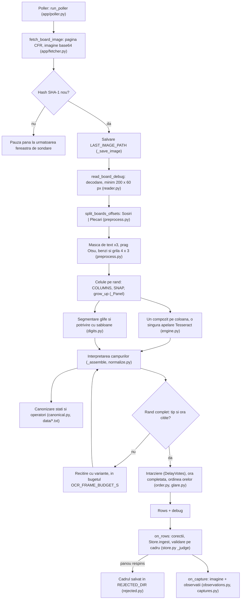
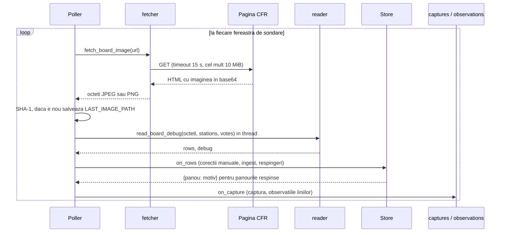

# The OCR pipeline of the Gara de Nord board

This document describes, step by step, how an image of the CFR board at Gara de Nord becomes
train rows (number, type, time, delay, platform, station, operator). Every statement is backed by a
constant or a function in the code; where the documentation in `README.md` or in
`CHANGELOG.md` says something different, the difference is noted explicitly.

The pipeline is: **Tesseract** (OCR engine, for text) + **OpenCV** (preprocessing, segmentation)
+ **numpy** (digit templates, `digit_templates.npz`). There is no neural network in production.

> This document contains no images of the board and no personal data. The real captures are
> private; see `docs/capturi-si-confidentialitate.md`.

## Contents

1. [File map](#1-file-map)
2. [Overview diagram](#2-overview-diagram)
3. [Stage 1: capturing the frame (poller and fetcher)](#3-stage-1-capturing-the-frame)
4. [Stage 2: decoding and splitting into two panels](#4-stage-2-decoding-and-splitting-into-two-panels)
5. [Stage 3: preprocessing (`app/ocr/preprocess.py`)](#5-stage-3-preprocessing)
6. [Stage 4: the 4×3 grid on each panel (12 rows)](#6-stage-4-the-43-grid)
7. [Stage 5: extracting the cells](#7-stage-5-extracting-the-cells)
8. [Stage 6: the Tesseract call and the OMP_THREAD_LIMIT rule](#8-stage-6-tesseract)
9. [Stage 7: digit segmentation (`digits.segment_spans`)](#9-stage-7-digit-segmentation)
10. [Stage 8: template matching (`app/ocr/digits.py`)](#10-stage-8-template-matching)
11. [Stage 9: interpreting the fields](#11-stage-9-interpreting-the-fields)
12. [The delay: the complete rules](#12-the-delay)
13. [The scheduled time: filling in from context and the order of times](#13-the-scheduled-time-filling-in-from-context-and-the-order-of-times)
14. [The platform and the band cut](#14-the-platform-and-the-band-cut)
15. [Canonicalization of stations and operators](#15-canonicalization)
16. [The complete row, the validation state and the confidence](#16-the-complete-row)
17. [The re-read budget (`OCR_FRAME_BUDGET_S`)](#17-the-re-read-budget)
18. [Per-frame validation and rejected frames](#18-per-frame-validation)
19. [The experimental classifier and shadow-mode training](#19-the-experimental-classifier)
20. [How accuracy is measured](#20-how-accuracy-is-measured)
21. [Open problems, known](#21-open-problems)
22. [Discrepancies between the code, the README and the CHANGELOG](#22-discrepancies)

---

## 1. File map

| File | Role in the pipeline |
|---|---|
| `app/poller.py` | The polling loop: when a new image arrives, it sends it to OCR and to validation. |
| `app/fetcher.py` | Downloads the CFR page and extracts the image (base64) from the HTML. |
| `app/ocr/reader.py` | Orchestration: panels, cells, Tesseract, interpretation, re-reading, delay. |
| `app/ocr/preprocess.py` | The text mask, the detection of panels, of the row bands and of the 4×3 grid. |
| `app/ocr/engine.py` | The `OcrEngine` interface and the `TesseractEngine` implementation. |
| `app/ocr/digits.py` | Glyph segmentation and template matching (`DigitMatcher`). |
| `app/ocr/digit_templates.npz` | The 12 templates (`+0123456789:`), 32×32 px, built from the arrivals panel. |
| `app/ocr/glare.py` | What can be filled in from a cell covered by glare or by the platform arrow. |
| `app/ocr/order.py` | Checking the chronological order of the times on a panel. |
| `app/ocr/stats.py` | In-memory statistics about the last 60 frames (for `/api/health`). |
| `app/ocr/truth.py` | The hand-written ground-truth set: loading, scoring, table. |
| `app/normalize.py` | Text analysis: time, delay, platform, train type, station. |
| `app/canonical.py` | The canonical form of stations and operators (fuzzy matching). |
| `data/operators.txt`, `data/stations_seed.txt` | The lists of known names (those actually seen on the board). |
| `app/rejected.py` | Saving the last 40 rejected frames, with the reasons. |
| `app/store.py` | Per-frame validation (`_judge`), the services history, the stations learned from the history. |
| `app/observations.py` | Storing the OCR observations (one line = one observation) and the processing version. |
| `app/captures.py` | Image storage, retention, the overlay in the administration. |
| `scripts/ocr_eval.py` | Measuring accuracy on the ground-truth set. |
| `scripts/ocr_digit_clf.py` | An experimental digit classifier (not used in production). |
| `scripts/nightly_shadow_train.py` | Daily training in shadow mode (it promotes nothing). |
| `tests/test_ocr*.py`, `tests/ocr_truth_images.py` | Regression tests on real frames, the accuracy thresholds. |

## 2. Overview diagram



The complete sequence, between polling and storage:



The important point: **the OCR runs in a separate thread** (`asyncio.to_thread`) and does not block the
server. The polling loop and the per-frame validation are separate from the statistics and the captures, which
can fail without stopping the board (`poller.py`: exceptions from `on_capture` are logged and ignored).

---

## 3. Stage 1: capturing the frame

### 3.1 Downloading (`app/fetcher.py`)

1. The CFR page (`SOURCE_URL`, by default `https://cfr.ro/gari/camereweb/index.php?statie=BucurestiNord`)
   contains the board image as `data:image/jpeg;base64,...` (or PNG).
2. `_DATA_URI` (a regex) looks for the first such image; the base64 string is decoded, and the bytes must
   start with the JPEG signature (`\xff\xd8`) or the PNG one (`\x89PNG`), otherwise it is rejected.
3. `image_hash` = the SHA-1 of the bytes. The same hash means the same image.

| Constant | Value | Reason (from the code) |
|---|---|---|
| `TIMEOUT` | 15.0 s | HTTP request, each |
| `MAX_BYTES` | 10 MiB | "the CFR page embeds the image in base64; I refuse anything larger" (the original comment is in Romanian) |
| `USER_AGENT` | `tabela-gara-de-nord/1.0 (...)` | Clear identification to CFR |

Responses with a code ≥ 300 are download errors. The comment in the code says redirects
are not followed (`fetcher.py`, "errors and (unfollowed) redirects"); I did not verify the configuration
of the HTTP client in `poller`/`api`, so it is uncertain whether following them is nonetheless enabled.

### 3.2 When it polls (`app/poller.py`)

The CFR board changes its image once a minute, at an approximately fixed second. The poller learns
this "phase" and polls only around it.

- `PhaseTracker` keeps the last `HISTORY = 5` moments at which the image changed (the second within the
  minute). The phase is the circular mean (so as not to average between :59 and :00).
- The polling window is `[phase − WINDOW_BEFORE, phase + WINDOW_AFTER]` = `[−1 s, +20 s]`.
- Inside the window it polls at `IN_WINDOW_DELAY = 2.5 s`. Before learning the phase: `NO_PHASE_DELAY = 10 s`.
- If the image has not changed for `STALE_AFTER = 300 s`, polling slows to `STALE_DELAY = 30 s`.
- After a change already seen in the window, the poller waits until the start of the next window.

The hard limits, regardless of the learned phase:

| Limit | Value | Reason |
|---|---|---|
| `MIN_GAP` | 2.0 s | No more often than one request every 2 s |
| `MAX_PER_MIN` | 10 | At most 10 requests in any 60 s window |
| `Backoff.fail` | 5 s × 2^n, cap 300 s | After a download error |

### 3.3 What happens with a new image

1. If the hash differs from the previous one, the image is **saved** to `LAST_IMAGE_PATH`
   (by default `data/last.jpg`, on the server `/var/lib/tabela/last.jpg`). The file is overwritten on
   every new image. It is not subject to retention (see `docs/capturi-si-confidentialitate.md`).
2. The hash is retained **even if the OCR fails**: "no retry every 2 s" (from the code).
3. The first image after startup is not counted as a "change" for the tracker's phase.
4. `read_board_debug` runs in a thread. If `OcrError` or `ValueError` appears (an
   undecodable image), the frame is saved in `REJECTED_DIR` with the reason `OCR failed: <type>`, and the capture
   receives the error.

---

## 4. Stage 2: decoding and splitting into two panels

### 4.1 Decoding (`reader._decode`)

- `cv2.imdecode` in `IMREAD_COLOR`. Images smaller than **`MIN_WIDTH = 200` × `MIN_HEIGHT = 60`**
  px are rejected (`ValueError`): they cannot contain the board layout.

### 4.2 Two panels: Arrivals (left) and Departures (right)

`BOARDS = ("arrival", "departure")` (`reader.py`). The reading order is left to right.

`preprocess.split_boards_offsets` does:

1. It splits the image into two halves: `HALVES = ((0.0, 0.5), (0.5, 1.0))`.
2. In each half, it computes an "edge profile" (`_edge_mask`): the blue pixels of the
   panel (see 5.1), whose value level exceeds `_EDGE_REL = 0.3` of the difference between the
   surrounding darkness (the 10th percentile) and the lit panel (the 90th percentile).
3. A column belongs to the panel if at least `_PANEL_MIN_FRAC = 0.25` of the pixels are blue.
4. If the interval found is over half the width of the half, the half is narrowed to the
   interval, with a margin of `_EDGE_PAD = 0.004` of the width.

It returns `(panel image, x offset)`. The offset is kept so the cell boxes can be mapped
back onto the original image (for the overlay in the administration).

---

## 5. Stage 3: preprocessing

File: `app/ocr/preprocess.py`. Everything is expressed as fractions of the image or deduced from
its pixels, so that it also works at another resolution.

### 5.1 The blue mask and the panel rows

The panel's pixels are identified in HSV (OpenCV, H in 0..179):

| Constant | Value | Role |
|---|---|---|
| `_BLUE_H` | (95, 135) | The blue hue of the panel |
| `_BLUE_S` | 90 | Minimum saturation |
| `_BLUE_V` | 40 | Minimum value |
| `_BLUE_V_REL` | 0.4 | For rows: a value of at least 40% of the panel's 90th percentile (the exposure varies) |

`panel_rows`: an image row belongs to the panel if `_PANEL_MIN_FRAC = 0.25` of the pixels are
blue; blue groups shorter than `_MIN_GROUP_FRAC = 0.06` of the height are ignored
(the thin band of the column header).

### 5.2 The text mask

- The text brightness = `min(G, R)` (`_brightness`). White and yellow text has high values;
  the blue background and the red watermark have low green and drop out.
- The image is enlarged **`SCALE = 3`** times (`INTER_CUBIC`). All the text masks are at x3.
- The text threshold, `text_level`, is **Otsu** on the panel's pixels, but at least `max(40, percentile 50 + 20)`
  and at most 200 (`_LEVEL_MIN = 40`, `_LEVEL_MAX = 200`; half of `_MIN_TEXT_CONTRAST` is 20).
  If the difference between the 50th and 99.5th percentiles is under `_MIN_TEXT_CONTRAST = 40`, the panel is considered
  to have no text (threshold 255).

Why Otsu and not a fixed threshold: the CFR camera exposure varies (day, evening, auto adjustment). A fixed
threshold thins the digits or turns separators into text. The comment in the code says the same.

### 5.3 Removing vertical lines

`_drop_vertical_lines`: vertical lines longer than `_VLINE_FRAC = 0.6` of the average height of the
blue group are erased from the **layout** mask (the one that decides the bands and the columns).
They are reflections and joints between the board's modules. The **text** mask keeps them (a line touched by
a "1" must not erase the digit).

### 5.4 The row bands (`row_bands`)

The horizontal ink histogram, with hysteresis:

- The row cores: rows with ink ≥ `max(low, _GAP_REL × P75)`, where `low = max(2, 0.004 × width)` and `_GAP_REL = 0.15`.
- Each core grows up and down over the rows with ink ≥ `_GROW_REL × rel` (`_GROW_REL = 1.0`), so the tops and bases of the digits are not cut.
- Two interpenetrating bands are cut at the emptiest row between them.
- Thin fragments (under 0.5 of the median height, e.g. diacritics) are merged with the nearest neighbor if the distance is ≤ `0.35 × median`.
- Bands that are too tall (> 1.6 × the median) are split into `k` equal parts (`k = round(h / median)`).

### 5.5 Bands validated on the 4×3 structure

See stage 4.

### 5.6 The preprocessing variants (used only for re-reading)

`VARIANTS = ("vline", "lvl-", "x4", "lvl+", "adapt", "wide")`, tried in this order
(`preprocess.variant_mask` and `reader._variant_cells`):

| Variant | What it changes | The purpose (from docstrings and from `_reread`) |
|---|---|---|
| `vline` | Also erases the vertical reflection lines from the text mask | Vertical reflection over a digit |
| `lvl-` | A threshold 15% lower (`max(30, 0.85 × threshold)`) | Thinned digits |
| `x4` | The cells are enlarged from x3 to x4 (`_X4 = 4/3`) before Tesseract | Tesseract reads larger glyphs; in the code there is no measurement confirming the effect |
| `lvl+` | A threshold 15% higher (`min(250, 1.15 × threshold)`) | Bright background, thickened digits |
| `adapt` | Gaussian adaptive threshold (block 51, C = −12), combined with `0.6 × threshold` | Uneven exposure |
| `wide` | A wider vertical crop (by at most half the space between rows) | Tops or bases cut by the band |

---

## 6. Stage 4: the 4×3 grid

**The physical structure**: each panel has **4 blue groups of 3 rows each = 12 rows**
(`GROUPS = 4`, `ROWS_PER_GROUP = 3`, `EXPECTED_ROWS = 12`). The comment in `preprocess.py`
says the structure was verified on 1143–1148 of 1149 frames from 21–22.10.2026.

`structured_bands(layout, rows)`:

1. The bands found by projection (5.4) are grouped into the 4 blue groups.
2. A group that contains **exactly 3** bands keeps the bands (the "calibrated" path).
3. Any other number (a weak line, an empty one, two rows merged, a split line) means the group
   gets **its fixed grid**: `grid_bands`.
4. `grid_bands` splits each group into three, at the emptiest row near the thirds
   (window `_CUT_WIN = 0.12` of the group height), then cuts each band to its ink
   (an empty band stays whole: it is an empty row, not a missing one).

Grid validations:

| Constant | Value | What it rejects |
|---|---|---|
| `_GROUP_SPREAD` | 1.35 | Groups of heights that are too different (it is not the 4×3 layout) |
| `_MIN_LINE_PX` | 4 px (×3 = 12 px in the mask) | Blobs instead of a row |

The reason: the grid is derived from the panel **image**, not from the text. A weak or empty row
keeps its place and does not disappear, nor stick to its neighbor. This keeps the `row_index`
(0–11) of each row fixed, used later for the order of times and for re-reading.

`reader._Panel` counted `repaired` = the number of repaired groups; it appears in the statistics (`groups_repaired`).

---

## 7. Stage 5: extracting the cells

### 7.1 The columns

Each row has 7 columns, given as fractions of the panel width (`reader.COLUMNS`, calibrated
on `board_1.jpg`; both panels have the same layout):

| Column | Fractions (from, to) | Content |
|---|---|---|
| `type` | 0.000 – 0.090 | The train type (IR, R, RE, RM, IC, …) |
| `no` | 0.090 – 0.200 | The train number |
| `station` | 0.200 – 0.510 | The station |
| `operator` | 0.510 – 0.755 | The operator |
| `time` | 0.755 – 0.866 | The scheduled time |
| `delay` | 0.866 – 0.946 | The delay |
| `platform` | 0.946 – 1.000 | The platform |

### 7.2 The edges between columns (`_cell_edges`)

The inner edges can move, for each row, by at most `SNAP = 0.012` of the panel
width, toward the **emptiest** pixel column (text sometimes touches the next column).
The ink is measured only within the row band.

### 7.3 The cells of a row (`_Panel.cells`)

- Each cell = the row band × the column interval, from the x3 text mask.
- For the **platform** (`GROW_UP = ("platform",)`) and for the second variant of the **time** (`GROW_ALT = ("time",)`),
  a "grown upward" copy is also computed (`grow_up`, by at most `PLATFORM_UP = 0.35` of the
  row height). The key of the time copy is `time^` (`ALT = "^"`).
- Why: on the right side of the board the platform digit sits higher than the row (perspective), and the
  band cuts it. The grown copy keeps only the ink that touches the original cell, so that the digit of the row above
  does not get in. The comment with "audit OCR13: 8 → 3, 9 → 3, 6 → 5" describes the
  case that motivated the change.

### 7.4 The boxes (`_Panel.boxes`, for the overlay)

The box of each cell = the real interval of the glyphs (`cell_span`, extended over the ink that
goes out of the band, `extend_span`, by at most `_EXTEND_MAX = 0.35` of the band height) plus
`BOX_MARGIN = 1` px. The boxes are saved in the debug output (`fields.*.bbox`) and drawn on the
"OCR captures" page.

### 7.5 The composite: one Tesseract call per column

`_Composite` puts the cells of a column **one under another**, with a fixed step `pitch = 1.5 × the maximum
height`, with a white margin `_PAD = 12` px. Tesseract runs **once per column** for
all 24 rows (12 per panel), not once per cell. The words returned are put
back on rows by the center of the box: `slot = (top + height/2 − _PAD) // pitch`.

The result per column is (text, mean confidence) per slot, with the words in reading order.

---

## 8. Stage 6: Tesseract

### 8.1 The call (`app/ocr/engine.py`)

`TesseractEngine.read_cells` calls `pytesseract.image_to_data` with:

- `config = "--psm 6"` (a uniform block of text: the composite), plus `-c tessedit_char_whitelist=...` when the column has an allowed list;
- `timeout = TESSERACT_TIMEOUT = 10` s per call (during re-reading it is reduced to the rest of the budget, minimum 1 s);
- errors (`RuntimeError` for timeout, `TesseractError`, `OSError` for a missing binary) become `OcrError`.

`reader._TESS` (the allowed list and the language, per column):

| Column | Allowed list | Language |
|---|---|---|
| `type` | `*IRNECMD` | `eng` |
| `no` | `0123456789` | `eng` |
| `station` | (none) | `ron+eng` |
| `operator` | (none) | `ron+eng` |
| `time` | `0123456789:` | `eng` |
| `delay` | `0123456789+` | `eng` |
| `platform` | `0123456789` | `eng` |

On the server `tesseract-ocr` and `tesseract-ocr-ron` are installed (`deploy/install.sh`). The path
of the binary comes from `TESSERACT_CMD` (default `tesseract`).

The engine is replaceable: `read_board(image, engine=...)`. Preprocessing and interpretation do not
depend on the engine (`engine.py`, docstring).

### 8.2 Tesseract does not decide alone

For the numeric columns, Tesseract is the **second** reader. Its text is accepted only when the
templates are not sure and Tesseract confirms (see stage 9). For the type column, the station and the
operator, the Tesseract text is used as is, but the station and the operator go through canonicalization
(stage 15).

### 8.3 The OMP_THREAD_LIMIT=1 rule

The rule is: **Tesseract runs with `OMP_THREAD_LIMIT=1`**, especially on the server (**known gap**: the production unit does not set it, see below), and **not**
in unlimited parallel. The reason, from `scripts/ocr_eval.py` and from the working plan
`docs/superpowers/plans/2026-10-27-backlog-wave.md`: "a parallel run blocked the live OCR for 16 min" (the original is in Romanian).

How it is respected:

- `scripts/ocr_eval.py` sets `os.environ["OMP_THREAD_LIMIT"] = "1"` and runs in `NPROC` processes (default 4).
- `scripts/ocr_digit_clf.py` sets `setdefault("OMP_THREAD_LIMIT", "1")`, and `NPROC` defaults to 3.
- `tests/test_corrections_browser.py` and `tests/test_ocr_platform_cut.py` specify it in the environment.
- **The production service does not set it**: `deploy/tabela.service` has only `EnvironmentFile=/etc/tabela.env`,
  and in the `app/` code there is no assignment of the variable. The rule is therefore a run procedure,
  not one enforced by the code. Uncertain: whether `/etc/tabela.env` on the server contains it; to verify on the server.

---

## 9. Stage 7: digit segmentation

The function `digits.segment_spans(cell)` splits a cell (black on white) into normalized glyphs.
It is the same as `segment`, plus the x interval of each glyph and a "fused" indicator.

Steps:

1. **Connected components** (`connectivity=8`) on the ink. Components under `0.015 × h_ref²` (noise)
   are ignored, `h_ref` being the tallest component.
2. **Merging components that overlap** horizontally over half the width of the narrowest one
   (`:` is two dots; a digit can be two components).
3. **Gluing the digit cut by the seam** (`_glue_seam_split`). The seam between the board's modules
   sometimes cuts the last digit of the number in two. The constants:

   | Constant | Value | What it means |
   |---|---|---|
   | `SEAM_SPAN` | 0.85 | The two pieces together are at most 0.85 of the row height (a digit is ~0.75) |
   | `SEAM_GAP` | 0.13 | The pieces are at most 0.13 of the height from each other |
   | `STEM_MIN_H` | 0.75 | The stem of a "1" has almost the whole row height |
   | `FLAG_MAX_H`, `FLAG_MAX_TOP`, `FLAG_MAX_GAP` | 0.45, 0.35, 0.10 | The "1" flag: short, high, attached to the stem |
   | `STEM_MAX_W` | 0.40 | The stem is thin |
   | `BAR_MAX_TOP` | 0.10 | The top bar of a "7" cut by the seam |

   The reason, from the docstring: without gluing, "3021" became "302", "1661" became "166", "9101"
   became "9104", and "7909" became "79091" (or "79111" when the seam was 2–4 px).
4. **Null fragments** (under 0.15 of the row height both in height and in width) are removed. So are
   the thin vertical fragments (`SEAM_MAX_W = 0.08`) that sit between two glyphs: they are the seam, not a digit.
   Fragments at the end of the text are **not** removed (it could be a "1" next to a reflection).
5. **Touching digits** (`_split_touching`): a component wider than `WIDE = 1.0` × the row
   height contains several glyphs. The number of glyphs is `round(w / (PITCH × h))`, with
   `PITCH = 0.78` (the font's fixed pitch), and the cuts are at the thinnest columns.
6. **Normalization**: each glyph, by height, to `GLYPH_H = 32` px, centered on a width of `GLYPH_W = 32`.

The "fused" flag (`fused`) is true when the glyph was cut from a component with several
glyphs (for example from a reflection blob). Such glyphs require a stricter threshold
(`FUSED_MIN_SCORE = 0.80`, `FUSED_MIN_MARGIN = 0.10`, in `glare.py`).

---

## 10. Stage 8: template matching

### 10.1 The templates (`app/ocr/digits.py`, `digit_templates.npz`)

- The **12 classes**: `+0123456789:` (`labels`), each a mean template of 32×32 px (`templates`).
- Built from the **arrivals panel** (`boards = ['arrival']`). The departures panel was left untouched,
  as a check on unseen data (`DEFAULT_BOARDS`, the test `test_digit_templates_generalise_to_held_out_board`).
- Rebuilding: `python -m app.ocr.digits IMAGINE GOLDEN_JSON [panou ...]`. `build_templates` averages
  the glyphs by class, from cells whose segmentation length equals the known text.

### 10.2 The score

`DigitMatcher._scores`: `cv2.matchTemplate(..., TM_CCOEFF_NORMED)` for each template allowed
by the column, on the glyph with a margin of `_SHIFT = 2` px (the alignment tolerance). The score is the
correlation, between 0 and 1.

`classify` returns (the best character, its score, the **margin** relative to the second).

| Constant | Value | What it means |
|---|---|---|
| `MIN_SCORE` | 0.60 | Correlation below which a glyph is not believed |
| `MIN_MARGIN` | 0.04 | Difference below which the second template is a "tie" (5 vs 6 split by a row line) |

`glyph_trusted(score, margin) = score ≥ 0.60 and margin ≥ 0.04`.

`DigitMatcher.near(glyph)` returns **all the characters** with a score within `MIN_MARGIN` of the
best. These are the "ties" in which the templates cannot decide.

`DigitMatcher.read(cell)` returns `(text, weakest score, trusted)`: `trusted` is true
only when **all** the glyphs are trusted.

### 10.3 If the templates cannot be loaded

`reader._get_matcher` catches `OSError, KeyError, ValueError`, writes a warning and continues
with `matcher = None`. Then the numeric fields come only from Tesseract, and the three-digit
delay becomes unread. The warning says "accuracy will drop".

---

## 11. Stage 9: interpreting the fields

The central function is `reader._assemble`, which receives the Tesseract text `tess` and the cells
`cells` and returns the line's debug entry. For each field: `raw` (the text as the OCR
read it), `norm` (the normalized value), `conf` (0–100), `bbox`.

### 11.1 The numeric fields: `no`, `time`, `platform` (`_numeric`, `_numeric_read`)

The order, for a numeric field:

1. `matcher.read(cell)` gives the text from the templates and the `trusted` flag.
2. If the text is empty **and** the cell has no ink, the result is empty (not a digit invented by Tesseract).
3. If the templates are not sure and a grown copy (`alt`) exists, it is tried too (only if it is trusted and, for the time, if it is a valid time).
4. **Trusted templates**: the templates' text is taken. If Tesseract says the same, its confidence is taken too; otherwise the confidence is the weakest score × 100.
5. **Untrusted templates**:
   - if `_confirmed` (Tesseract confirms each untrusted glyph, at the same position), the templates' text is taken;
   - for `no` with a last "sliver" glyph (`_edge_sliver`), the Tesseract text is taken;
   - for `no` and `platform` (`NEAR_TIE_ONLY`), the Tesseract text is taken **only** if it is a tie
     between templates (`_near_tie`); otherwise the field is unread;
   - for `time`, the Tesseract text is taken.

Constants of these rules:

| Constant | Value | Reason (from the docstring) |
|---|---|---|
| `NEAR_TIE_ONLY` | `("platform", "no")` | The comment in the code (Task 2.3): out of the labeled numbers, 20 of 1415 were wrong, and in all cases it was Tesseract text not validated over an untrusted glyph |
| `SLIVER_MAX_SCORE` | 0.40 | A final "glyph" that does not resemble any digit… |
| `SLIVER_MAX_W` | 0.15 | …and is narrow (× the cell height) |
| `FRAGMENT_MAX_H` | 0.25 | A "glyph" with ink under 25% of the row height is a sliver, not a digit |
| `LOST_INK` | 0.08 | Segmentation loses at most 8% of the ink (above: the cell is unread) |
| `SPECK_MAX_H` | 0.30 | A glyph under 30% of the cell height is a speck, not a digit |
| `NO_FLOOR` (comment) | `MIN_SCORE` | For the number, Tesseract does not confirm a glyph that resembles no template |

**The time** (`_time_colon`, `normalize.parse_time`): three digits become `H:MM` (the colon is lost
by segmentation). A reading from the templates that is not a valid time does not replace a valid Tesseract time.
`parse_time` accepts `H:MM`, `HH:MM` or `HHMM`, with the confusions `O→0`, `l/I/|→1`, `S→5`, `B→8`
applied only in numeric fields. The time must have `h ≤ 23` and `mm ≤ 59`.

**The number** (`no`): `_train_no` takes the digits; zero means `None`. The number must be read
for the row to be complete (`_complete`).

### 11.2 The train type (`normalize.resolve_type`, `strip_flag`)

- The asterisk (`*`, from the start or the end) is removed and marks the row `flagged`.
- `normalize_type`: uppercase, with `l | 1 → I` and `0 → O`. The valid types: `IR, IRN, R, RE, RM, IC, EC, EN, D`.
- Two corrections, **measured on live data** (report of 21.10.2026):
  - `I` on a **3-digit** number becomes `IC` (531, 536, 553, 571, 581, where in all the other readings it is IC);
  - `RN`, `RND`, `RNE`, `RIM`, `RR` on a `79xx` number become `RM` (the airport shuttle).
- Anything else stays unread. Nothing is guessed.

### 11.3 The platform (`normalize.parse_platform`, `reader._platform_checked`)

- `parse_platform`: digits, a value between **1 and `PLATFORM_MAX = 14`** (the tracks at Gara de Nord).
  Anything else is a misreading and stays unread.
- The shape check (`_platform_checked`), detailed in stage 14.

### 11.4 The station and the operator

- `clean_station`: NFKD, no diacritics, uppercase, single spaces, no characters at the edges.
- `clean_operator`: NFKD, single spaces, no punctuation characters at the edges (it is not put
  in uppercase; the canonical form comes from `data/operators.txt`).
- Then canonicalization (stage 15).

---

## 12. The delay

This is the most delicate part: a wrongly read delay (for example "+465" instead of "+65")
appears publicly as truth. The basic rule: **an unread delay stays unread, it does not become 0 and
is not guessed**.

### 12.1 What a delay cell means

- The board shows **"+" and 1–3 digits** (`DELAY_MAX_DIGITS = 3`, that is, 1 to 999 min).
- **An empty cell means "on time"**: `parse_delay("")` returns **0**. It is a real reading, not a gap.
- `None` means unread. There is no intermediate state on the `delay` field.
- A text that contains no digit ("SOS") is not a delay, but `None`.
- The maximum value accepted: `MAX_DELAY = 999`.

### 12.2 The steps in `reader._delay_cell`

1. Without templates: only Tesseract. Three digits → unread (`three_digits`); otherwise its text.
2. Without glyphs (an empty cell): `""`, that is 0 (on time).
3. **The first glyph must be "+"**, trusted or with the cross shape (`digits.is_plus`). Otherwise `no_plus`.
4. Two "+" in the cell: `plus_twice`.
5. The number of digits (the glyphs after "+") must be between 1 and 3: otherwise `digits`.
6. The digits: an **untrusted** digit is accepted only if Tesseract reads it at the same position;
   a digit cut from a blob (`fused`) must be **clearly** matched
   (`FUSED_MIN_SCORE = 0.80`, `FUSED_MIN_MARGIN = 0.10`, in `glare.py`).
7. **Three digits** (≥ 100 min) require all the glyphs to be trusted **and** the two readings to agree (`three_digits`).

### 12.3 The reasons for being unread (`fields.delay.check`)

| Reason | When it appears | Effect |
|---|---|---|
| `no_plus` | The first glyph is not "+" | Unread; the Tesseract text seen is kept as `seen` (for the "hidden +" vote) |
| `plus_twice` | Two "+" | Unread |
| `digits` | A number of digits outside 1–3 | Unread |
| `three_digits` | Three digits without full agreement | Unread; it may have a `candidate` (see 12.5) |
| `glare` | A digit cut from a blob, untrusted | Unread |
| `count` | Tesseract does not have the same number of digits | Unread |
| `disagree` | An untrusted digit that Tesseract reads differently | Unread |
| `not_step` | The delay is not a multiple of 5 | Unread (`DELAY_UNREAD`, `None`) |

`DELAY_UNREAD = "+?"` is the text of an unread cell; `parse_delay` turns it into `None`.

**`DELAY_STEP = 5`**: the board counts delays in **steps of 5 minutes**. The constant is justified in
the code: "every delay in the ground-truth set and 99.8% of the live readings". A value not divisible by
5 is a wrongly read digit (for example "+46", "+26", "+6" from the live audit of 21–26.10).

### 12.4 Re-reading the delay (`_reread_delays`)

The unread delay cells (with a reason set) are re-read with the variants
`DELAY_VARIANTS = ("lvl+", "vline", "lvl-", "adapt")`, as long as at least **1 s** of the
frame budget remains. A new reading is accepted **only if it passes the same rules** as the first pass.
Otherwise it stays unread and receives `retry = {attempts, variant: None}`.

### 12.5 A delay of 100–199 min (`_hundreds_candidate`, `DelayVotes`)

The problem: on the reflective board, the white blob covers the top of the middle digit and a single frame gives
alternately 100, 160 or 180 (CHANGELOG, Beta 1.17). A single frame is not reliable.

- **`_hundreds_candidate`** produces a "+1xy" candidate only when the cell has exactly 4 glyphs, "+" and
  "1" are trusted and not fused, the last digit is trusted, and Tesseract reads three digits that
  start with "1". The candidate **is not a reading**.
- **`DelayVotes.apply`** (for the whole duration of the poller, in memory): for each train (key
  `(board, number, scheduled time)`) it keeps the last `VOTE_WINDOW = 7` frames. The candidate becomes a
  delay only if it appears **at least `VOTE_MIN = 4` times and in a strict majority**
  (`2 × n > len(history)`). The example from the class docstring: on the real frames of train IRN 401 (+100 on the board, 23.10),
  the candidates were 100 eight times, 160 three times and 150 once. The value 160 never wins.

### 12.6 The "+" hidden under the platform arrow (`_seen_value`, `_vote_seen`)

When the train gets a platform, the board draws an arrow over the "+", and "+15" appears as "◄5".
The digits that Tesseract sees, voted over the last `SEEN_WINDOW = 12` frames, are the delay
if:

- `SEEN_MIN = 8` frames out of 12 say the same value (1–2 digits, a multiple of 5, > 0);
- the value is not smaller than the last delay read reliably (`_last`): a delay does not shrink
  to a recovered value.

The rule applies **only** to the `no_plus` reason, not to `glare`. The comment says why: with a blob,
both readings may agree on a wrongly hidden digit (6 → 8).

The docstring cites the live audit of 21–26.10: 20 of 23 "unconfirmed" cases fit
this rule.

### 12.7 A delay covered by glare: the "last reading" (`_infer`)

When the cell is rejected for **`glare`** or **`no_plus`** and the units digit (0 or 5)
is clearly visible (`glare.delay_tail`: the last trusted glyph from {0, 5}, confirmed by Tesseract),
the delay is the one from the earlier frames, if **the last `INFER_STABLE = 3`** reliable readings of the
train are **the same value** ending in that digit.

| Constant | Value | Role |
|---|---|---|
| `INFER_CHECKS` | `("glare", "no_plus")` | The reasons for which it applies |
| `INFER_STABLE` | 3 | How many real readings must be equal |
| `INFER_MAX_RUN` | 30 | At most 30 consecutive frames deduced |
| `INFER_CONF` | 55.0 | The field confidence (amber on the overlay) |
| `INFERRED` | `glare_inferred` | A marker in `fields.delay.check` and in the processing version |

The row becomes `uncertain`. The tens area under the blob is **never** read ("+15" gave
45, 75, 465, 85 in the history). The assumption "hidden + = plus" is justified by the data in the code:
"on arrivals there are no negative delays (0 of 101,532 readings)".

A train with no history stays unread.

### 12.8 The vote memory between frames

`DelayVotes` is created in `run_poller` and lives as long as the process. It is lost on restart.
The state kept per train:

| Structure | What it holds | When it is cleared |
|---|---|---|
| `_hist` | the last 7 candidates | the train disappears from the board |
| `_seen` | the last 12 values seen | same |
| `_last` | the last delay read reliably | same |
| `_reads` | the last 3 real readings | same |
| `_run` | how many consecutive frames were deduced | same |
| `_times` | the last 6 clean times per (board, number) | after 12 frames without the train |

---

## 13. The scheduled time: filling in from context and the order of times

### 13.1 The time filled in (`reader._fill_times`, `glare.py`)

The case: the row has a type and a number, but the **time** cannot be read, because a blob covers two dots
("7:37" becomes "7▪37"). Until now the row was unread and the train was missing from the board.

The steps (`glare.time_candidates`, `pick_time`):

1. Each glyph is **trusted** or a **wildcard** (at most `MAX_WILDCARDS = 1` digit wildcard; two dots
   can be anything, because they are the blob). At least `MIN_TRUSTED = 2` trusted glyphs.
2. From the glyphs, "H:MM" or "HH:MM" candidates result, with all the wildcard's digits (0–9).
3. The candidates must fit between the **neighbors** above and below (the chronological order
   of the panel, `glare.fits`). If there is a time "hinted" by the train's history
   (`time_hint`, at least 3 identical readings out of the last 6 frames), it wins only if it is the only one
   compatible.
4. The result is accepted only if it is **unique**. A candidate with a digit wildcard remains only when
   **both** neighbors bound it (`pick_time`). Otherwise: unread.

The filled-in row is `uncertain`, with the confidence limited to `REPAIRED_CONFIDENCE = 0.65` (below
the 0.7 threshold for a new service, `CONFIRM_CONFIDENCE`), and `fields.time.check = "glare_filled"`.

### 13.2 Chronological order (`app/ocr/order.py`)

The trains on a panel are sorted chronologically, with a single "wrap" at midnight. A time read
wrongly (5/6, 3/8, 0/8) goes out of order.

- `out_of_order`: the indices of the rows that are not part of the **longest non-decreasing sequence**
  (an O(n²) computation over the 12 rows). A wrong neighbor does not condemn the surrounding rows.
- `_repair`: **one** digit change is tried between the pairs in `CONFUSABLE`
  (`08, 38, 56, 35, 68, 89, 09, 17, 14`), which fits between the nearest neighbors
  that are not condemned by the order. If exactly one exists, the time is repaired and marked `order_fixed` (confidence at most `REPAIRED_CONFIDENCE = 0.65`).
- Otherwise: `order` and confidence at most `SUSPECT_CONFIDENCE = 0.6`. A service name
  already stored is never changed; the row is only marked.

Data from the docstring: "283 of 81,823 interior rows were out of order, almost all mistakes".

---

## 14. The platform and the band cut

This is the largest open problem (see stage 21). A short explanation:

1. **The physical cause**: the seam between the board's modules sometimes cuts the platform digit, and the reflection covers
   the top of the digit, especially on the right side, where the digit sits higher than the row (perspective).
2. **What the code does**:
   - the platform cell is extended upward (`grow_up`, stage 7.3);
   - reading is done with **templates**; Tesseract only **chooses between nearly equal templates**
     (`_near_tie`) and only when the templates have a score ≥ `MIN_SCORE` (CHANGELOG, Beta 1.39);
   - a "sliver" glyph (under `FRAGMENT_MAX_H`) is not a digit;
   - a blob stretched into a glyph (`_speck`) makes the cell unread;
   - an "8" requires the bottom hole (`_signature` and `_fits`, rule R22 in the code), so a blob does not become "8";
   - if the glyphs do not align with the segmentation, the cell is unread (`test_glyphs_not_aligned…`).
3. **Recovery**: an unread cell receives the templates' digit only if there is **a single
   plausible candidate**. With several, it stays unread (CHANGELOG, Beta 1.39: "with several candidates, the cell stays unread").

What can be verified on the data saved in the repo (`tests/fixtures/ocr_truth/baseline-1.31.json`,
measured with commit `c81b602`, `ocr-tess-grid-5`):

- platform, on the 42 frames added in Task 2.1 (11 local and 31 from the server): **986 correct, 13 unread, 8 wrong**;
- the `platform_cut` list contains **19 frames** (in agreement with `NOTE-2026-10-27.md`).

---

## 15. Canonicalization

Files: `app/canonical.py`, `app/normalize.py`, `data/operators.txt`, `data/stations_seed.txt`.

### 15.1 The lists

| File | Content | Number of entries (without comments) |
|---|---|---|
| `data/operators.txt` | Operators: official name `|` board aliases | 7 |
| `data/stations_seed.txt` | Stations seen on the board, in `clean_station` form | 46 |

The operators (official names): `CFR Călători`, `Regio Călători`, `Transferoviar Călători`,
`InterRegional Călători`, `Astra Trans Carpatic`, `Softrans`, `Ferotrafic TFI`. The truncated board
text (`CFR Calatori`, `Astra Trans Ca`, `Softrans Calat`...) is kept as an alias. Accepted: score >= 0.82, or
0.65-0.82 with a margin >= 0.10 over the second-best operator (measured on 823,912 readings).

The stations **learned** from the history (`Store.known_stations`):

- only names saved exactly as the OCR read them (`station = station_raw`);
- seen on at least **2 distinct trains** (`min_services = 2`) and on at least **2 distinct days** (`min_days = 2`);
  - at most `KNOWN_STATIONS_MAX = 2000`, filtered by `_protect_learned`: no odd characters
    (letters, digits, spaces, hyphens), and no names that are one OCR mistake away (`near_name`) from a station
    in the clean list or from a more frequently learned name;
  - recomputed once an hour (a cache per day and hour), because the poller requests them before every image.

### 15.2 The matching (`canonical._best`)

| Case | Score | Condition |
|---|---|---|
| Identical by key | 1.0 | `_key` (ASCII, lowercase, no punctuation) |
| Wrong spacing | `SPACING_SCORE = 0.95` | The same letters, spaces moved ("AD JUD" → ADJUD) |
| An extra character at the end | `TAIL_SCORE = 0.90` | "ARAD E" → ARAD, "RUSE I" → RUSE |
| Otherwise | `difflib.SequenceMatcher.ratio()` | Only if `_same_words` passes (for stations) |

`_same_words` (for stations only) rejects a match that changes the words: it must have the same
number of words, and each word may deviate by at most `max(1, length // 5)` edits
(one letter more or fewer only for words of at least 6 letters). The docstring examples
that are **rejected**: "VATRA DORNEI" for "VATRA DORNEI BAI", "CLUJ NAPOCA EST" for "CLUJ NAPOCA",
"PITESTI SUD" for "PLOIESTI SUD", "CRAIOVITA" for "CRAIOVA". **Accepted**: "BRASOY" → "BRASOV"
and a last word cut at the cell edge ("VATRA DORNEI BA" → "VATRA DORNEI BAI").

**The threshold**: `DEFAULT_THRESHOLD = 0.82`, for stations and for operators.

- Above the threshold: the canonical form is taken. If the score is under 1.0, the row is `uncertain` (`s_score < 1.0`).
- Below the threshold: the text read (cleaned) is kept, and the score is marked as such. The raw text
  stays in `station_raw`/`operator_raw` and in the database (schema v3).

Stations: first the clean list (`preferred`), then the learned list. So a mistake that has entered
the history ("BRASOY") still resolves to the clean form.

Operators: the same idea, but **without** `_same_words` (their list is shorter).

---

## 16. The complete row

### 16.1 When a row exists (`reader._assemble`)

- `row` exists if the **type** and the **time** are read (`train_type` and `sched` nonzero).
- `_complete` (the train number read) decides only whether the line can be re-read and whether it enters
  the time-filling branch. **Uncertain**: a row with a type and a time, but no number (`train_no = 0`),
  is returned by `read_board_debug` as a `row` and reaches `Store.ingest` if the confidence is ≥ 0.5.
  I found no filter on `train_no = 0` in `reader.py` or in `Store._split`; to verify in `store.py` (`ingest`, `_judge`).
  The observation's validation state is, instead, `incomplete` for a row without a number (see 16.3).
- `delay_min` = `delay` or 0 when `delay` is `None`, with `delay_read = (delay is not None)`.
  A row with an unread delay has `delay_read = False`.

### 16.2 The confidence

`conf` = the mean of the fields' confidences (Tesseract or templates, `/100`), clamped to [0, 1].
`uncertain` becomes true when the station was corrected (`s_score < 1.0`), the operator is under the threshold,
the time was filled in from context, or the order marked it.

### 16.3 The observation's validation state (`observations.validation_state`)

| State | When | Effect |
|---|---|---|
| `incomplete` | There is no complete row | Observation kept, with no link to a service |
| `rejected_low_conf` | `confidence < MIN_CONFIDENCE = 0.5` | It does not create or change services |
| `uncertain` | `uncertain` or an unread delay | It is shown marked |
| `ok` | Otherwise | Used for statistics |

`MIN_CONFIDENCE = 0.5` is in `store.py`, and `CONFIRM_CONFIDENCE = 0.7`: a **new** service
read under 0.7 requires a second consecutive reading.

---

## 17. The re-read budget

### 17.1 What is re-read

A row **with text**, but without a type, number or time (`_RETRY_COLS = ("type", "no", "time")`),
is re-read with the variants from 5.6, on the **columns in question** (not on the whole row).

`MAX_RETRY_LINES = 4`: if a panel has more than 4 unread rows, the frame is considered
broken (a truncated JPEG, a glitch) and is **not** re-read, because re-reading would invent
rows. That is what the code says.

### 17.2 The budget

- **`FRAME_BUDGET_S = 8.0`** seconds of OCR per frame, **including** re-reads. The environment variable
  `OCR_FRAME_BUDGET_S` overrides it (`frame_budget()`; an invalid value → the default).
- The whole frame lasts about 60 s, because images arrive once a minute (the `FRAME_BUDGET_S` comment).
- Before each variant the cost is estimated (`est`, initially `first_pass × 3/7`) and it
  stops if `t + est > budget`.
- Each Tesseract call gets as its timeout at most the rest of the budget, but at least 1 s.
- A re-read stopped by the budget leaves the lines as `unread`. Nothing is invented.

### 17.3 What is accepted from a re-read (`_merge`)

- **Only** the columns that did not read on the first pass can receive a new value. A value already
  read is not replaced.
- If a variant **loses a glyph** of the first pass (`_lost_ink`: the start or the end of the
  glyphs is more than half a height inside), the variant is rejected. The reason from the
  docstring: a reflection remnant on the first digit disappears under "lvl+", and the rest is read as
  a reliable but wrong value (the example in the code: "4:37" becomes "7:37").
- The re-read row must be **complete** and **must not duplicate** another row of the same panel
  (`_duplicate`: the same number as another row = the neighbor's reading, not this one's).
- The values read on the first pass must stay unchanged.

Re-reads have `retry = {attempts, variant}` in the debug output. `variant = None` means no variant
succeeded. The observation's processing version keeps this information
(`+retry:<variant>:<attempts>`).

---

## 18. Per-frame validation

Two levels: the validation of rows (in the OCR) and the validation of the panel (in `store.py`).

### 18.1 The panel, in `Store._judge`

A frame is judged **per panel**. A rejected panel keeps its previous good state, and
its trains do not disappear ("GONE").

| Constant | Value | The rule |
|---|---|---|
| `MIN_ROWS` | 4 | An accepted frame has at least 4 reliable rows on the accepted panels |
| `MIN_BOARD_ROWS` | 2 | Each accepted panel has at least 2 rows |
| `PARTIAL_BASE` | 6 | The partial-reading guard is active from 6 rows |
| `PARTIAL_FRAC` | 0.5 | A panel that drops below half the previous good count is "partial" |
| `PARTIAL_ACCEPT_AFTER` | 10 | …but after 10 frames equally small it is accepted (it really did empty) |
| `PANEL_ROWS` | 12 | The board always has 12 rows |
| `GONE_AFTER_MISSES` | 3 | A train disappears after 3 readings in which it is missing |

The reason (CHANGELOG, Beta 1.18): the LIVE panel sometimes showed 13 trains, although the board has 12 rows;
a train that disappears is marked "departed" only after 3 readings, so that a wrong reading does not remove it
and bring it back. This rule is in `GONE_AFTER_MISSES`.

### 18.2 The rejected frame, saved (`app/rejected.py`)

A rejected panel or a frame that failed in the OCR is saved in `REJECTED_DIR`
(by default `/var/lib/tabela/rejected`, on the server; `REJECTED_DIR=""` disables it):

- the image (the downloaded bytes) + a JSON with `ts` and `reasons` (e.g. `"arrival": "partial read (3 of 12 rows)"`);
- the file name: `AAAAMMDDTHHMMSSmmmZ.jpg` (UTC, with milliseconds);
- the last **`REJECTED_KEEP = 40`** pairs are kept; the rest are deleted by count (not by age).

The purpose, from `rejected.py`: "diagnosing OCR mistakes (partial readings, unread panels)" (the original is in Romanian).
The directory is created with `0750`; a symlink or a file in place of the directory is refused.

---

## 19. The experimental classifier

### 19.1 What it is and what it is **not**

- `scripts/ocr_digit_clf.py` is an **experimental digit classifier** (a small MLP, numpy),
  trained on glyphs extracted from captures.
- **It does not affect the live board.** Checks from the code:
  - no line in `app/` imports `ocr_digit_clf` or `nightly_shadow_train` (a search across all of `app/`, `deploy/`, `web/`);
  - `app/ocr/digit_templates.npz` is not written by the classifier (`nightly_shadow_train.py`, docstring: "Nu se atinge: app/ (inclusiv app/ocr/digit_templates.npz)", it does not touch app/);
  - `decide()` in `nightly_shadow_train.py` always returns `promovez: False`, `decizie: "nu promovez"` (do not promote).
- The only automatic run path is the `tabela-shadow-train.service` service (ExecStart: `scripts/nightly_shadow_train.py`),
  started by `tabela-shadow-train.timer` at **03:30**, with `Persistent=true`, `Nice=19`, `IOSchedulingClass=idle`, timeout 2 h.

### 19.2 The steps (`ocr_digit_clf.py`)

| Command | What it does |
|---|---|
| `extract IMG_ROOT DB_JSON OUT_DIR` | Reads each capture with the current reader (`read_board_debug`, budget 60 s), extracts the numeric cells (`no`, `time`, `delay`, `platform`) and the glyphs, and links them to `observations` |
| `label OUT_DIR [VERIFIED.csv]` | The "silver" label |
| `verify OUT_DIR [N]` | A human verification list of the contested cells |
| `truth OUT_DIR` | The glyphs of the hand-written ground-truth set |
| `train OUT_DIR` | Trains the MLP and reports the accuracy |

### 19.3 The labeling rules (`label`)

The silver label = the reader's current reading = the reading saved in the observation, **in a valid format**
(`_format_ok`: `no` 3–5 digits, `time` `H:MM`/`HH:MM`, `delay` `+N`, `platform` 1–2 digits), and the number
of glyphs equals the length of the text. Cells that do not meet this are **contested**, with
a reason: `dezacord` (disagreement), `segmentare` (segmentation), `slab` (weak), `format`, `pete` (blobs), `recitit` (re-read), `fara observatie` (no observation), `nelizibil` (illegible)
(marked `?`). A glyph is "weak" if the score < 0.60 or the margin < 0.04 (values written directly in
`label`, not imported from `digits.py`).

**An important limit** (also written in `LIMITS` in `nightly_shadow_train.py`): the silver label is not
an independent check, but the agreement between the **same** reader and the saved observations. It is not
verified by a human.

### 19.4 The model

`mlp_fit`: a hidden layer of **128** units (ReLU), output on the 12 classes, Adam
(`lr = 2e-3`, β 0.9/0.999), `wd = 1e-4`, batch 256, **30 epochs**, fixed seeds (`seed=0`).
`TEST_SHARE = 5`: one frame in 5 (by the hash of the frame name) goes into the test set.

### 19.5 What the nightly series writes

`nightly_shadow_train.run` writes in `WORKDIR` (by default `/var/lib/tabela/shadow`):

- `export.json` (the captures and observations read from the database, `mode=ro`);
- `run/` (glyphs and labels; deleted on every run);
- `model-AAAA-LL-ZZ.npz` (weights);
- `report-AAAA-LL-ZZ.json` (accuracies, the decision, the limits).

The report compares the classifier with the engine on the hand-written set, with `SIGNIFICANT = 0.005`
(0.5 percentage points). The decision is always "do not promote", with the reason written.

### 19.6 The alternative OCR in the journal (`#ocr2`)

Besides the experimental classifier, `app/ocr/alt_reader.py` can read the number and time cells again
when Tesseract does not read them. It is off by default (`OCR_ALT=1` turns it on; `OCR_ALT_SHADOW=1` runs
it "in the shadow": it writes to the journal what it would have filled in, but changes nothing). The
model (`OCR_ALT_MODEL`, a `model-*.npz` file) has a mandatory fingerprint: a model without one is not
loaded.

`app/ocr/alt_journal.py` writes one event per proposed row (both in the shadow and when the alternative is
active), with the cell crops (PNG x3), in `<database directory>/ocr_alt/` (`OCR_ALT_JOURNAL_DIR`).
Events with the same train identity are not duplicated in the journal. 30 days and at most 5000 events are
kept. `record` never raises: an error is logged and the poller carries on.

The administration page `#ocr2` (`web/ocr2.js`) shows the alternative's state, the totals, the events and
the crops, and lets the administrator give a verdict per event (`correct`, `wrong`, `unclear` or none)
through `/api/admin/ocr-alt*` (see `docs/api.md`, section 7.10). The verdicts are the evidence for the
decision to move the alternative from the shadow to active.

---

## 20. How accuracy is measured

### 20.1 The hand-written ground-truth set (`tests/fixtures/ocr_truth/truth.json`)

- **59 frames**, **1416 lines** (24 per frame: 12 per panel). Each field was checked
  by eye against the image, not taken from the database nor from the reader.
- The frame keys are the paths without `.jpg` (e.g. `ocr12/...`, `glare/...`, `ocr_truth/srv/...`).
  The `ocr_truth/` prefix means a **private** image (see `docs/capturi-si-confidentialitate.md`).
- The conventions:
  - `"?"` (or a missing field): not scored (it cannot be seen in the image either: glass, motion);
  - `null` for the platform: the cell is empty on the board (platform not yet determined);
  - `delay: 0`: no delay shown.
- The number of labeled values per field (computed on the file): `no` 1415, `time` 1409, `type` 1413,
  `platform` 1415, `delay` 1412, `station` 1416, `operator` 1416.

### 20.2 The score (`app/ocr/truth.py`)

For each labeled cell:

- **ok**: the value read equals the label (including `None` == `None`, that is, "empty" correctly read);
- **unread** (`unread`): the reader gives `None` where the board shows a value;
- **wrong** (`wrong`): any other value, including a value invented on an empty cell.

A field's accuracy is `ok / (ok + unread + wrong)`. A frame or a line missing from the predictions
counts as unread on each field with a value (and as ok on a field whose label is empty,
because `None == None`). The comment in `truth.py` says that an unread is honest, while a wrong one
is published, which is why the mistakes are counted separately.

### 20.3 The tools

```text
python scripts/ocr_eval.py predict OUT.json [IMG_DIR]   # citește fiecare cadru din setul de adevăr
python scripts/ocr_eval.py score   OUT.json [INAINTE.json]   # tabel, cu comparație înainte/după
```

- The images are looked for in `tests/fixtures/<path>.jpg` or, for `ocr_truth/...`, in `OCR_TRUTH_DIR`
  (default `tests/fixtures/ocr_truth/private/`).
- `predict` runs in `NPROC` processes (default 4), with `OMP_THREAD_LIMIT=1`. **A difference from production**:
  `ocr_eval` uses `budget_s=60.0`, not the server's 8 s. The measurement figures are therefore not
  identical to what the live board sees (documented in the code, not in the README).
- `score` shows for each field: `n`, `ok`, `unread`, `wrong`, `accuracy`, and the list of mistakes.

### 20.4 The regression tests

- `tests/test_ocr_regression.py` (regression suite, Beta 1.75) runs the production reader on **two**
  sets and compares, on each field (`no`, `time`, `type`, `platform`, `delay`, `station`, `operator`),
  with the versioned baseline `tests/fixtures/ocr_truth/regression-baseline.json`: wrong ≤ baseline
  (no tolerance), ok ≥ baseline − 3, unread ≤ baseline + 3 (3 lines for another Tesseract/OpenCV
  build, as `test_ocr14.py` did before).

  Baseline `ocr-tess-grid-5` (28.11.2026): `truth` = 59 frames / 1416 lines (development, used for tuning),
  `holdout` = 20 frames / 480 lines (independent validation):

  | Field | truth ok | unread | wrong | holdout ok | unread | wrong |
  |---|---|---|---|---|---|---|
  | `no` | 1408 | 7 | 0 | 479 | 1 | 0 |
  | `time` | 1405 | 0 | 4 | 480 | 0 | 0 |
  | `type` | 1411 | 0 | 2 | 479 | 0 | 1 |
  | `platform` | 1396 | 19 | 0 | 478 | 2 | 0 |
  | `delay` | 1392 | 20 | 0 | 475 | 3 | 1 |
  | `station` | 1413 | 0 | 3 | 477 | 0 | 3 |
  | `operator` | 1416 | 0 | 0 | 480 | 0 | 0 |

- The baseline is rewritten **only on purpose** (after a measured improvement or new labels), with the
  captures present: `OCR_RECORD_REGRESSION=1 OMP_THREAD_LIMIT=1 pytest tests/test_ocr_regression.py`.
  The baseline keeps the sha256 fingerprint of each set's labels: a changed label or an added frame
  without re-recording fails in CI (`test_baseline_matches_the_labels`).
- **In CI** (no images: the captures are not in the repo) only the part without OCR runs: the label
  fingerprint, the disjointness of the sets (section 20.5) and their exclusion from shadow training
  (19). Under one second. The image part skips with a reason when any capture of a set is missing; it
  runs locally and wherever the captures exist (`OCR_TRUTH_DIR`). Local duration: ≈ 8 minutes for both sets (79 frames, 60 s budget per frame).
- `test_ocr14.py` no longer has the whole-set `MAX_WRONG`/`MIN_OK`/`MAX_UNREAD` thresholds (moved to
  the baseline); it keeps the 8 s budget test and the seam cases.

- `tests/test_ocr_platform_cut.py`: records `baseline-1.31.json` (`OCR_RECORD_BASELINE=1`, only
  intentionally) and checks each cut-platform frame, the number of departures at rows 9 and 11, and
  a series of unit tests on the shape of the digits (`_fits`, `_signature`, `_decided`, `is_plus`).
- `tests/test_ocr.py`: on `board_1.jpg` with `board_1.json` (24 rows), the accuracy on numeric
  and text fields, plus tests of bands, of the text mask and of the threshold level.
- `tests/test_ocr13.py`, `test_ocr12.py`, `test_glare.py` etc.: frames with measured cases.

### 20.5 The verification set on unseen data (hold-out)

- `tests/fixtures/ocr_truth/holdout/holdout.json`: **21 frames, 504 lines**, from the server (22–27.10.2026),
  labeled **blind** by a labeler distinct from those who wrote the code. Each frame is at
  least 60 minutes from the frames in `truth.json`. According to `holdout/README.md`, for
  choosing the frames only the images were looked at, not the reader's result.
- **Leak found** (Beta 1.75): the frame `ocr_truth/holdout/2026_10_24_160005-57702940` was copied into
  `truth.json` (commit `5d8e0af`, Beta 1.39) and used to tune the platform reading, so it is no longer
  unseen. Validation excludes it: the independent validation set has **20 frames, 480 lines**.
  The `LEAKED` list in `tests/test_ocr_regression.py` is closed: any other hold-out frame showing up in
  `truth.json` fails `test_holdout_is_disjoint_from_the_truth_set`, which also checks the capture
  identity (hash8 of the image) and the minimum distance of 60 minutes.
- The hold-out score is now reproducible from the repo (`tests/test_ocr_regression.py`, set `holdout`);
  the external script mentioned in `holdout/README.md` is no longer needed.
- **Separation from training**: `scripts/nightly_shadow_train.py` excludes from training every server
  capture whose identity (hash8 of `YYYY/MM/DD/HHMMSS-<hash8>.jpg`) appears in `truth.json`,
  `holdout.json` or `WORKDIR/truth.json` (`training_frames`, tested in
  `test_shadow_training_never_sees_an_evaluation_frame`).

### 20.6 Statistics in operation (`app/ocr/stats.py`)

They do not measure accuracy, but **the state over the last 60 frames** (`WINDOW = 60`, "about an hour"):

- `unread_rate_1h`: the proportion of text lines left unread (empty rows do not count);
- `full_frames`: how many frames had 12/12 rows on both panels;
- the OCR duration (p50, max) and the re-read time.

It is in memory (it resets on restart) and appears in `/api/health` and in the administration page.

### 20.7 Daily accuracy monitoring (`scripts/ocr_accuracy_daily.py`)

Live frames have no hand-written labels, so the **confirmed** value of a field in a reading is the
consensus (`app.consensus.winner`: strict majority, at least 3 votes) of the other readings of the same
service around it (7 before, 7 after; the reading itself does not vote). Only published readings
(`validation_state` `ok`/`uncertain`) are scored, per service day, with the same categories as the truth
set (ok / unread / wrong). Without consensus, the field is not scored.

```text
python scripts/ocr_accuracy_daily.py [--db /var/lib/tabela/tabela.db] [--date YYYY-MM-DD] [--days N] [--out DIR]
```

Default: yesterday, one JSON line per day on stdout; with `--out`, also `ocr-accuracy-YYYY-MM-DD.json`.
The database is opened read-only. **Limit**: it measures consistency, not truth: a stable misread (the
same digit in every frame, see 21.1) shows as ok. Use the day-to-day trend; the truth remains the
regression suite (20.4). It has no admin view yet (the validation states per day are already in
`/api/admin/quality-daily`).

---

## 21. Open problems

The list below is gathered from `CHANGELOG.md` and from the tests with "left wrong" thresholds. Each
item indicates the source. It is not a complete list: the unknown wrong frames are not here.

### 21.1 Stably wrong train numbers: IR 1584 instead of 1581

- **Symptom**: the same wrong digit in all the frames, so voting over time does not correct it.
  Examples from the documentation: `IR 1584` instead of `IR 1581`, `7911` instead of `7914`, `1574` instead of `1571`.
- **Source**: CHANGELOG, Beta 1.27 (the line about "vote per character: not delivered", "stably wrong
  numbers … are the same in all the frames") and Beta 1.24 ("require a per-character vote"); Beta 1.29 (the line about
  the manual correction in the administration, "for numbers that the OCR always reads equally wrong").
- **State**: **unresolved in the code**. There is a manual correction from the "OCR captures" page (`corrections`), which
  does not change the raw OCR text, but applies a rule.
- **Data**: in the ground-truth set, `no` has `MAX_WRONG = 0` in `test_ocr14.py`, but the comment says
  "number under glare (4)" left wrong. See 22.4 and 22.5.
- **Data from the CHANGELOG (Beta 1.27)**: 9 frames out of 69,030 had a different number from the service's.

### 21.2 Cut or covered platform: about 15 trains?

- **I did not find** the "~15 trains" figure in `CHANGELOG.md` or `README.md`. The documentation says
  that "the platform column read cut/covered by reflections (frame 7028) cannot be read" (CHANGELOG, Beta 1.24).
- The measured figures are those in section 14: 19 frames in the `platform_cut` list, 13 unread and 8 wrong
  on the 42 frames added in Task 2.1. **Uncertain**: whether "15 trains" comes from an operating report that is not in the repo.
- On 42 frames measured at `c81b602`, the 8 platform mistakes are listed in `test_ocr_platform_cut.py`
  (`CUT_WRONG`), and the test now requires "the correct label or `None`", not a wrong value.

### 21.3 The confusion of "8" with "3" (and 6 with 5)

- **Source**: CHANGELOG, Beta 1.16 (partially solved through `grow_up`) and the comment in `test_ocr14.py`:
  "Left wrong: number under glare (4), 8 read 3 (time 2, platform 1)".
- **Inconsistency**: the comment says "platform 1", but `MAX_WRONG["platform"] = 0`. Uncertain
  whether it is an old remnant or whether the platform test does not pass yet.
- The cause: the top of the "8" digit is cut by the band or blotched, and the bottom hole is not visible. Rule R22
  (`_fits`) and `_signature` prevent turning into "8" without the bottom hole, but do not prevent "8" → "3"
  when the bottom hole is not visible at all.

### 21.4 Glare and delays

- Delays of 100+ min covered by glare: they are read only with a vote over 4 of 7 frames
  (CHANGELOG, Beta 1.17). On real frames, 100 is read in 5 of 12 frames, and 160 and 180 are
  never accepted.
- "+65 → +465" and "+20 → +240" (the blob stuck to the "+", two digits): they stay refused, with no vote candidate.
- Empty cells under glare: they stay empty (CHANGELOG, Beta 1.39). On the first row of arrivals, the reflection
  of the clock in the glass (27.10, ~07:30–07:50) covered "+" and the first digit (CHANGELOG, Beta 1.27).
- No anti-glare preprocessing: the reflection pixels have the same brightness as the text
  ("min(R,G,B) 200–240"), they cannot be separated (CHANGELOG, Beta 1.27).

### 21.5 The order of times and filling in

- A time filled in from context has confidence 0.65 and is marked `uncertain`. On a single
  neighbor, a hidden digit is not filled in (the rule in `pick_time`).
- There is no measure in the repo of how often the order check wrongly repairs or condemns a correct
  row. **Uncertain**; to verify on the frames in the ground-truth set.

### 21.6 The classifier

- It is not promoted and not used. Its results cannot be compared with the production reader
  until the silver label is verified by a human (`LIMITS`).

---

## 22. Discrepancies

Verified in the code. Points 1, 2, 4 and 5 were corrected in `README.md` and in `tests/test_ocr14.py`; point 6 is documented as a gap in 8.3. `CHANGELOG.md` is not modified (it is history).

1. **The learned stations** (corrected in `README.md`): the old version said "seen on at least 2 services"
   (seen at least 2 services). The code (`store.known_stations`) requires **2 distinct trains** and
   **2 distinct service dates** (`COUNT(DISTINCT train_no) >= 2 AND COUNT(DISTINCT service_date) >= 2`).
2. **The processing version** (corrected in `README.md`, the example is now `ocr-tess-grid-5`): the old version was `ocr-tess-grid-2`. The code has
   `PROCESSING_VERSION = "ocr-tess-grid-5"` (`app/observations.py`), and the comment there
   says that version 5 is from Beta 1.31.
3. **The seed stations**: `CHANGELOG`, Beta 1.06, says "the list of known stations now has 45 real names".
   The file `data/stations_seed.txt` has **46** lines that are not comments (counted with `grep -v '^\s*#'`). The README does not cite the figure. The difference of one
   is not explained by the documentation. **Uncertain**: whether a station was added after the CHANGELOG.
4. **The docstring in `test_ocr14.py`** (corrected): it said 16 captures / 384 lines; the set in `truth.json`
   has **59 frames / 1416 lines**. The thresholds stayed unchanged. See 20.4.
5. **The "platform 1" comment in `test_ocr14.py`** (corrected): "1" is the number from Beta 1.16; the current limit is `MAX_WRONG["platform"] = 0`. See 21.3.
6. **The OMP_THREAD_LIMIT=1 rule**: documented in `ocr_eval.py` and in the working plan as a rule for the server,
   but `deploy/tabela.service` does not set it, and the code in `app/` does not apply it (verified). A known gap, to
   be closed with a human decision (the systemd unit is not modified in this correction). See 8.3.
7. **Hold-out** (solved in Beta 1.75): the score is reproducible from the repo with `tests/test_ocr_regression.py`;
   one hold-out frame had leaked into `truth.json` and is excluded from validation (20.5).
## How to reproduce a local measurement

1. Install Tesseract with the Romanian language (`tesseract-ocr`, `tesseract-ocr-ron`) and set `TESSERACT_CMD` if needed.
2. Put the set's images in `tests/fixtures/` (the public ones) and in `OCR_TRUTH_DIR` (the private ones).
   The repo contains no `.jpg`: without images, the tests that use them skip with a reason.
3. `OMP_THREAD_LIMIT=1 python scripts/ocr_eval.py predict /tmp/rezultat.json` (on the development machine;
   on the server it is not run in parallel, see 8.3). Use the output path in a temporary directory, not in the repo.
4. `python scripts/ocr_eval.py score /tmp/rezultat.json` for the table; with a second run as
   the second argument, for a before/after comparison.
5. `pytest tests/test_ocr_regression.py tests/test_ocr14.py tests/test_ocr_platform_cut.py` for regression.

Do not run `OCR_RECORD_BASELINE=1` except intentionally: it rewrites `baseline-1.31.json`.
