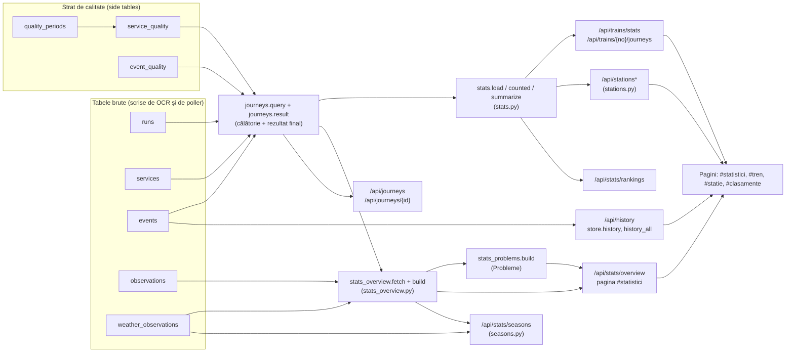

# Statistics, journeys and data quality

This page describes how the figures in Tabela Gara de Nord are built: the train catalog, the journeys and their final result, the stations, the statistics and their formulas, the charts on the `#statistici` page, the exports, the prediction (which is not public), the consensus vote and the data quality layer. Every threshold and every formula cited comes from the code; the source file is indicated next to each section.

Common principles, valid everywhere:

- **The delay is the one read on the București Nord board**, not the real delay at other stations and not the real arrival or departure time.
- **The absence of a reading does not mean 0.** An unread delay appears as `null`, "unknown" or "—", never as 0.
- **Arrivals and departures are never mixed** in a figure or in a ranking.
- **Every figure has an N** (the number of journeys behind it).
- **Below the minimum sample threshold** only raw figures are shown (count, mean, median, maximum); percentages and p90 are withdrawn.
- **Ghosts** (rows wrongly read by the OCR, with no real train) and, by default, the **low-quality period** are excluded from all public statistics.
- **Correlation, not causation.** No page claims that a factor (weather, operator, train type) produces the delay.

## Contents

1. [How data flows: the general scheme](#1-how-data-flows-the-general-scheme)
2. [The train catalog (`/api/trains*`)](#2-the-train-catalog-apitrains)
3. [Journeys and the final result (`app/journeys.py`)](#3-journeys-and-the-final-result-appjourneyspy)
4. [Stations (`app/stations.py`, `/api/stations*`)](#4-stations-appstationspy-apistations)
5. [Statistics: formulas, thresholds, N (`app/stats.py`)](#5-statistics-formulas-thresholds-n-appstatspy)
6. [The Statistics page: the charts one by one](#6-the-statistics-page-the-charts-one-by-one)
7. [The "Problems" section (`app/stats_problems.py`)](#7-the-problems-section-appstats_problemspy)
8. [History: `/api/history` and all days](#8-history-apihistory-and-all-days)
9. [CSV exports](#9-csv-exports)
10. [The last reliable delay reading](#10-the-last-reliable-delay-reading)
11. [The 15-reading consensus (`app/consensus.py`)](#11-the-15-reading-consensus-appconsensuspy)
12. [The data quality layer (`app/quality.py`, schema v7)](#12-the-data-quality-layer-appqualitypy-schema-v7)
13. [Seasons and the weather comparison (`app/seasons.py`)](#13-seasons-and-the-weather-comparison-appseasonspy)
14. [Final delay prediction (`app/predict.py`) — not public](#14-final-delay-prediction-apppredictpy--not-public)
15. [Known limitation: the statistics read `services` directly](#15-known-limitation-the-statistics-read-services-directly)
16. [Environment variables](#16-environment-variables)

---

## 1. How data flows: the general scheme

The diagram below shows from which tables each figure is computed and by which path it reaches the page. The tables `services`, `events`, `runs` and `observations` are written by the OCR; `service_quality`, `event_quality` and `quality_periods` are the quality layers (see section 12); `weather_observations` comes from Open-Meteo.



Two code rules stand behind the diagram:

- All public queries filter with `quality.public_services_where()` (`app/quality.py`): they exclude ghosts (`service_quality.ghost = 1`) and, if `STATS_INCLUDE_LOW_QUALITY` is not `1`, the low-quality period too (`low_quality = 1`).
- The `#statistici` page reads through a **separate, read-only SQLite connection** (`file:…?mode=ro`, `app/stats_overview.py`, the `_reader` function), so as not to block OCR ingest. For an in-memory database (tests) the store's connection is used, under a lock.

---

## 2. The train catalog (`/api/trains*`)

Source: `app/trains_api.py` and `app/observations.py` (the "public catalog reads" section).

The catalog is public and read-only. It contains no images and no raw OCR text. `journeys` (journeys, from `services`) and `observations` (OCR readings) are reported as **separate numbers**.

### Endpoints

| Method and route | What it returns | Parameters and limits |
|---|---|---|
| `GET /api/trains` | `{"trains": [...], "n": N}`, most recently seen first | `query` (max. 40 characters): a number prefix if it is digits only, otherwise a substring in stations or operators. `limit` default 50, between 1 and 200 (`TRAINS_MAX`). Error 422 for invalid values. |
| `GET /api/trains/{no}` | the train's catalog plus `journeys_list` (at most 200, `JOURNEYS_MAX`), newest first, and `journeys_truncated` | `no`: digits, at most 6 characters, between 1 and 999999. 404 if the train was not observed. |

An element of `trains` has the fields `train_no`, `first_seen`, `last_seen`, `operators`, `routes`, `journeys` and `observations`. Only trains with `journeys > 0` are included: trains that existed only as ghosts or chance readings are hidden.

For `/api/trains/{no}`, each journey in `journeys_list` has `board`, `service_date`, `train_type`, `sched_time`, `station`, `operator`, `status`, `observations` (the number of OCR readings of the journey) and `low_quality`. Unlike the statistics, **the catalog does not exclude the low-quality period**: it marks it with `low_quality: true`. Ghosts are excluded (`COALESCE(q.ghost, 0) = 0`).

### Per-train statistics endpoints

These are in `app/stats_api.py` and use the same parameters as `/api/stats/overview` (see section 5):

| Route | Content |
|---|---|
| `GET /api/trains/stats` | One row per (train number, board): N, the quality, the statistics and the 14-day trend. The `query` parameter (max. 40): digits = number prefix; text = station or operator (LIKE with escape). `format=csv` produces `trenuri.csv`. |
| `GET /api/trains/{no}/journeys` | A train's profile: `entries` (per board), `distribution`, `operators` and all the journeys, newest first. `format=csv` produces `tren-{no}.csv`. 404 if the train has no public journeys. |

---

## 3. Journeys and the final result (`app/journeys.py`)

### What a journey is

A **journey** is **a single appearance** of a train on a board (arrivals or departures at București Nord) for **a single service date**. It is a row of `services`. A numbered train usually has one journey per day and per board.

Public fields (`as_dict`): `id`, `board`, `service_date`, `train_type`, `train_no`, `station` (canonical, if the corrected form exists), `operator`, `sched_time`, `platform` (the last track read), `status` (`listed` or `gone`), `first_seen`, `last_seen`, `uncertain` and `result`.

The station and the operator use `COALESCE(q.station_canonical, s.station)` and `COALESCE(q.operator_canonical, s.operator)`: the canonical form is used when it exists, the raw form stays in the database.

### How a journey's delay is built

- `last_delay` is the **last delay read** on the board: `s.last_delay`, or, for retroactively checked journeys, `q.last_delay_clean` (the last confirmed value).
- A delay is considered **read** only if there is proof of reading: `delay_read_at` is not `NULL`. For retroactively checked journeys, if no value was confirmed, `delay_read_at` becomes `NULL` (`_CHECKED_NONE` in `JOURNEY_SQL`).
- Delay events marked suspect (`event_quality.suspect = 1`) are not readings (`_NOT_SUSPECT`).

### The final result rule: "confirmed only with proof"

The `journeys.result()` function decides the state, in the order below. The reason text is the one from the code (in Romanian; the English meaning is given in parentheses).

| State | When it is chosen (in order) | The reason shown |
|---|---|---|
| `in_progress` ("În desfășurare (încă pe tabelă)", in progress, still on the board) | `status != 'gone'`: the train is still listed | — |
| `unknown` ("Rezultat necunoscut", unknown result) | `status = 'gone'`, but the delay was never read | "Întârzierea nu a fost citită niciodată pentru această călătorie." (the delay was never read for this journey) |
| `unconfirmed` ("Rezultat neconfirmat", unconfirmed result) | the disappearance from the board **was not observed** (`disappeared` is missing) | "Dispariția de pe tabelă nu a fost observată (citirea tabelei a fost întreruptă)." (the disappearance was not observed; board reading was interrupted) |
| `unconfirmed` | the disappearance is **before the estimated time** (`disappeared < est`) | "A dispărut de pe tabelă înainte de ora estimată (HH:MM)." (it disappeared before the estimated time) |
| `unconfirmed` | the last delay read is **older than `FINAL_READ_MAX_GAP_MIN`** minutes relative to the disappearance | "Ultima întârziere citită (HH:MM) este cu peste N min mai veche decât dispariția." (the last delay read is more than N min older than the disappearance) |
| `confirmed` ("Rezultat final confirmat", confirmed final result) | otherwise: an observed disappearance, after the estimated time, with the delay read at most `FINAL_READ_MAX_GAP_MIN` before | — |

The definitions from the code:

- `disappeared` = the moment of the last `gone` event, if `status = 'gone'` and (there is no `appeared` or `gone ≥ appeared`). Otherwise `NULL`.
- `est` (the estimated time) = the scheduled time (`sched_at`) + `observed_delay` minutes. The arithmetic is done in UTC, so it is not off by an hour at the switch to winter time.
- `sched_at` chooses, at the clock change (03:00–03:59 on the change day), the occurrence closest to the observed moment (`ref` = `gone` or `delay_read_at`).
- `final_gap_min()` reads `FINAL_READ_MAX_GAP_MIN` (default **15**; accepted between 1 and 240; otherwise it returns to 15).

The fields returned by `result()`: `state`, `label`, `reason`, `delay_known`, `observed_delay` (the last delay read), `final_delay` (equal to `observed_delay` **only** if `state = confirmed`, otherwise `null`), `delay_read_at`, `sched_at`, `estimated_at`, `disappeared_at`.

What enters the statistics (`stats.counted`, section 5): by default, the state `confirmed` or `unconfirmed`, but **only** with a delay read. With `doar_confirmate=1`, only `confirmed`.

### How a journey's delay chart is built (`delay_series`)

The chart points are **readings**, in chronological order, from three sources, deduplicated by moment:

1. The OCR observations with `delay_read = 1`, a nonzero `delay_min` and `validation_state` in `ok` or `uncertain`. An observation enters only if the value was applied (it appears in an event or in the stored value) or if the next reading confirms it. Confirmation by two readings **does not apply** for values ≥ `DELAY_BIG` (100).
2. The delay events (`events.kind = 'delay'`), with the new value as a reading. Values that are a "+" misread (for example 410 after 10) are removed.
3. The last proven value (`last_read`).

Unclear readings do not become points.

### The state of the values in a journey's detail

`GET /api/journeys/{id}` (`journeys.detail`) returns everything above plus `events` (the non-suspect events, with `ts`, `kind`, `old`, `new`), `delay_series` and `final_read_max_gap_min`. `id` has at most 12 digits; 404 if it does not exist.

### The journeys list (`/api/journeys`)

`GET /api/journeys` accepts `train`, `station`, `state` (`in_progress`, `confirmed`, `unconfirmed`, `unknown`), `limit` (default 500, maximum 5000, `JOURNEYS_MAX`) plus the common parameters (section 5). The response has `n` (returned), `total` (matched before the limit) and `truncated`. `format=csv` produces `calatorii.csv` (section 9).

---

## 4. Stations (`app/stations.py`, `/api/stations*`)

A journey's station is the train's **origin** (on the arrivals board) or its **destination** (on the departures board), as the board shows it. Passes through the station, shown with another origin or destination, are **not** attributed to the station.

The note shown on the station page (`NOTE` in `app/stations.py`) says exactly that: the delay is the one on the București Nord board, not the one at that station.

| Route | Content | Limits |
|---|---|---|
| `GET /api/stations` | The list of stations with `journeys`, `arrivals`, `departures`, `trains`, `delay_known`, `first_date`, `last_date`, `uncertain_only`. Sorted by `journeys` descending, then name. | `query` (max. 40), `limit` default 100, maximum 500 (`LIST_MAX`). |
| `GET /api/stations/{name}` | The station detail: `journeys`, `trains`, `period`, `quality`, `boards` (per board: `stats`, `quality`, `distribution`, `trains`, `rank`), `by_time`, `note`. | Name max. 40 characters, canonicalized; 404 if the station does not appear on the board. |
| `GET /api/stations/{name}/journeys` | The station's journeys, newest first, paginated by `id`: `next_before` | `limit` default 100, maximum 500 (`JOURNEYS_PAGE_MAX`); `before` = `next_before` from the previous page. |

`rank.position` is the position among the stations with at least `min` journeys, ordered by mean (the most delayed = 1), and `rank.of` is the total number of stations ranked on that board.

The names are canonical (uppercase, without diacritics; `clean_station` in `app/normalize.py`).

---

## 5. Statistics: formulas, thresholds, N (`app/stats.py`)

### The common parameters

All the statistics endpoints receive the same parameters (`app/stats_api.py`, the `params` function):

| Parameter | Values | Default | Effect |
|---|---|---|---|
| `prag` | 0–60 | `ON_TIME_MAX_MIN` (5) | "On time" = delay ≤ threshold |
| `min` | 1–1000 | `STATS_MIN_SAMPLE` (5) | Below this N: no percentages and no p90 |
| `board` | `arrival` or `departure` | both | A single board |
| `from`, `to` | `AAAA-LL-ZZ` | no limit | A range of service dates (`from` ≤ `to`) |
| `doar_confirmate` | `0` or `1` | `0` | `1`: only the `confirmed` results |

On `/api/stats/overview`, `perioada` also appears (`1`, `7`, `30` or `all`, default `all`; not combined with `from`/`to`), `operator` and `tip` (max. 40 characters).

The effective values are returned in `params` (`on_time_max_min`, `min_sample`, `include_low_quality`, `final_read_max_gap_min` etc.).

### The formulas in `summarize()` (`app/stats.py`)

For a list of delays read `v` (sorted), `n = len(v)`:

| Field | Formula | Condition |
|---|---|---|
| `n` | the number of values | — |
| `mean` | sum / n, rounded to 1 decimal | — |
| `median` | the 0.5 percentile (linear interpolation between the nearby ranks) | — |
| `p90` | the 0.9 percentile, with the same interpolation | only if `n ≥ min` |
| `max` | the largest value | — |
| `on_time` | the number of values `≤ threshold` | — |
| `on_time_pct` | `100 · on_time / n`, one decimal | only if `n ≥ min` |
| `over_30` | the number of values `> 30` | — |
| `over_30_pct` | `100 · over_30 / n`, one decimal | only if `n ≥ min` |
| `sufficient` | `n ≥ min` | — |

With no values, `n = 0` and all fields are `null` or 0. The percentile: `k = (len − 1) · q`, interpolation between `v[⌊k⌋]` and `v[⌊k⌋+1]`.

### What enters the statistics (`counted`, `delays`)

- By default: the state `confirmed` or `unconfirmed`, **and** `delay_known = true`. `in_progress` and `unknown` journeys do not enter.
- With `doar_confirmate=1`: only `confirmed`.
- The delay used is `observed_delay`, that is, the last one read on the board.
- Ghosts and (by default) the low-quality period are excluded in SQL (`Params.where`).

### The distribution by intervals (`distribution`)

The intervals (label, lower bound, upper bound), inclusive:

| Label | Interval (minutes) |
|---|---|
| `0` | 0 |
| `1–5` | 1 to 5 |
| `6–15` | 6 to 15 |
| `16–30` | 16 to 30 |
| `31–60` | 31 to 60 |
| `> 60` | over 60 |

In the interface, the percentage of each interval is `100 · n_interval / total` and appears only when `total ≥ min`.

### Quality (`quality()`)

- `journeys` = all the journeys in the filter.
- `finished` = `journeys − in_progress`.
- `delay_known` = journeys with `delay_known` and `status = 'gone'`.
- `delay_known_pct` = `100 · delay_known / finished` (only if `finished > 0`).
- `states` = the count over the four states.
- `uncertain_names` = journeys with an uncertainly read station or operator name.

### Aggregates by board, day, hour, month (`by_time`, `daily_trend`)

- `by_time` (per board): `hour` (by scheduled hour, 0–23), `weekday` (by service date, 0 = Monday) and `month` (`AAAA-LL`). Each group has a full `summarize`.
- `daily_trend`: the mean of the delay read per day, for the last **14 days** (`TREND_DAYS`) ending on the last day with data. A day with no value is `null`, not 0, and `n` shows how many journeys stand behind each value.

### Rankings (`rankings`, `/api/stats/rankings`)

- Only trains (per board) with `n ≥ min` enter. `eligible` = their number. `below_min` = how many have `0 < n < min`.
- `most_delayed`: sorted by **mean descending**, then median descending, then the train number.
- `most_punctual`: sorted by **% on time descending**, then mean ascending.
- The same kind of ranking exists for stations (`stations.rank_stations`). The `limit` limit is 10 by default, maximum 50 (`RANK_MAX`).

Note: the `#statistici` page orders differently (see section 6). The `/api/stats/rankings` rankings use the mean, as in this function.

### The statistics page: `/api/stats/overview`

`stats_overview.build()` produces a single JSON, which feeds the page. The main keys:

| Key | Content |
|---|---|
| `params` | the effective parameters, plus `perioada`, `operator`, `tip`, `today` |
| `options` | the operators and train types encountered (with N), for the filters |
| `coverage` | the first and last day, days, journeys, trains, `finished`, `delay_known` (and %), `observations`, `excluded` |
| `history` | `first`, `last`, `days`, `needed_days` (7), `sufficient` |
| `boards` | `journeys` plus `summarize` per board |
| `insights` | sentences generated deterministically from figures (for example "out of N journeys…") |
| `problems` | the "Problems" section (section 7) |
| `distribution`, `hourly`, `heatmap`, `daily`, `operators`, `types`, `routes`, `traffic`, `platforms` | the chart datasets (section 6) |
| `weather` | the weather comparison (section 6, the "Weather and delays" chart) |
| `quality` | `quality()` plus `observations` (ok, uncertain, rejected_low_conf, incomplete), `excluded` (ghost, low_quality) and `counters_scope` |
| `generated_at`, `cache_ttl_s` | moment and TTL |

**Cache.** Two levels (`stats_overview.overview`): the database read (`fetch`) is kept per period, board and thresholds, and the payload built per filter (LRU). The TTL comes from `STATS_CACHE_TTL_S` (default **60** seconds, accepted between 0 and 3600). The read cache has `CACHE_MAX = 32` entries, the payload one `BUILT_MAX = 64`. A single computation runs per key.

**Export.** `format=csv&set=<name>` with `set` from: `distribution`, `hourly`, `heatmap`, `daily`, `operators`, `types`, `routes`, `traffic`, `platforms`, `weather` (section 9). `format=csv` without a valid `set` returns 422.

**Small sample in text.** The generated sentences state explicitly "too few for percentages (minimum N)" when `n < min`. Comparisons with figures are made only between sufficient groups.

---

## 6. The Statistics page: the charts one by one

The `#statistici` page (`web/statistici.js`) reads only `/api/stats/overview`. Each question has a card with a title, "How to read it" (fixed text, in the code, in the `how` argument of each figure), the chart, the legend, N, the small-sample warning, the "See the data" table and the CSV export of the same dataset. The order below is the one in `render()`.

At the top, before the charts, appear: **"Problems"** (section 7), **"What goes well"** (up to 6 sentences generated from figures with sufficient N), then **"Problems in detail"** (the seven detail sections, also from `problems`) and **"Detail charts"**. When there is no data, the page shows "No data yet for the chosen filters" and the glossary.

| # | Title (on the page) | What it represents | Data source |
|---|---|---|---|
| 1 | "How much are the trains delayed?" | Columns: how many (or what percentage of) journeys with a delay read fall in each interval of `distribution`, per board. | `distribution` (from `delays`, with `counted`). The percentage only if both boards have sufficient N. |
| 2 | "How are the journeys split?" | Donuts: arrivals versus departures (all journeys, with or without a delay read), then the train type (at most 6 slices + "Others") and the operator (at most 5 slices + "Others"), per board. | `boards[b].journeys`, `types`, `operators` |
| 3 | "At what time are trains most delayed?" | Line: the median delay by scheduled hour (00–23), with the "on time ≤ threshold" reference line; a band with N per hour. Empty circles: N below the minimum. | `hourly` |
| 4 | "Which days and hours are the most problematic?" | A 7 days × 24 hours heat map, per board. Color = the mean, in thresholds of 2, 5, 10, 20 min and above. Gray = N below the minimum; "delay not read"; "no journey". | `heatmap` |
| 5 | "What does each day look like?" (calendar) | One square per service date, by weeks, colored by the day's mean. It appears only if there are at least 7 distinct days. | `daily` (drawn by `charts3.js`) |
| 6 | "How has punctuality evolved from one day to the next?" | Line: % on time per service date (days with N below the minimum are missing); dotted line = the period's mean; a band with N per day. | `daily`, `boards` |
| 7 | "Which operators are the most punctual?" | Bars: % on time per operator, no bar if N is below the minimum. | `operators` |
| 8 | "Which train types are more punctual?" | As for 7, by train type (R, RM, RE, IR, IRN, IC). | `types` |
| 9 | "Which directions are delayed the most — and which are the most punctual?" | Lists: the most delayed (by mean) and the most punctual (by %), with N, per board. The station is the origin (arrivals) or the destination (departures). | `routes` |
| 10 | "When is the station busiest?" | Columns: journeys scheduled per hour, on average per day with data, per board. It includes all journeys. | `traffic` |
| 11 | "Which tracks (platforms) are used most often?" | Columns: how many journeys each track had (the last read), plus the row "Track not read" (separate, not track 0). | `platforms` |
| 12 | "Weather and delays" | Bars: the mean delay by precipitation groups (none or > 0 mm) and temperature groups. It appears only if the analysis has status `ok`; otherwise a "still being collected" message. The note: correlation, not causation. | `weather` |
| 13 | "How good is the data?" | Donuts: the journey results (confirmed, unconfirmed, unknown, in progress) and the OCR observation states (complete, uncertain, rejected, incomplete). A note about excluded ghosts and low quality. | `quality` |

The glossary (`glossary`) defines: delay read, on time, journey, train–journey–observation, confirmed result, unconfirmed, unknown, N, small sample, median and p90, ghost. The thresholds in the glossary are the effective ones of the request.

### The "Problems in detail" sections (the seven)

| Title | What it shows | Source |
|---|---|---|
| "Which trains are delayed day after day?" | Trains delayed on all the days they were seen (section 7, "recurrent"), with a sparkline by day | `problems.recurrent` |
| "At what hours and on which days do delays build up?" | 3-hour windows: the percentage of journeys over 15 min; "critical" and episodes | `problems.windows`, `problems.episodes` |
| "Arrivals and departures, face to face" | The same measures on the two boards, with the possible station "mix" | `problems.boards` |
| "How often do very large delays occur?" | The number over 30 and over 60 min and the largest cases (at most 5, the first 3 shown) | `problems.big` |
| "Which directions have the most delays?" | Stations ordered by median, only with sufficient N and at least 2 trains | `problems.routes` |
| "Does the delay grow after the first announcement?" | The first delay shown (above 0) compared with the final one | `problems.growth` |
| "Is it improving or getting worse?" | Punctuality by day; the trend only with at least 7 days of history | `problems.trend` |

---

## 7. The "Problems" section (`app/stats_problems.py`)

The "Problems" section is deterministic (no AI). It computes a few findings, orders them and shows the first 10. The text at the top of the section, from `web/statistici.js` (`problemsSection`), says (in English): "What stands out in the delays read on the board, ranked by severity × how many journeys it affects × confidence in the figures. A deterministic computation from the data (no AI). "On time" = at most threshold min; groups are compared by median, not by mean; below min journeys no percentages appear."

### The thresholds in the code

| Constant | Value | Role |
|---|---|---|
| `LATE` | 15 | "significant delay": the impact counts use > 15 min |
| `BIG` | 30 | "large": > 30 min |
| `HUGE` | 60 | "very large": > 60 min |
| `REC_MIN_DAYS` | 3 | a train is "recurrent" only if it was seen on at least 3 days |
| `GROUP_MIN_TRAINS` | 2 | a route with a single train is that train, not a pattern |
| `TYPE_MIN_TRAINS` | 3 | a train type must have at least 3 trains |
| `WINDOW_H` | 3 | 3-hour windows: 00–03, 03–06 … |
| `TOP_TRAINS` | 8 | recurrent trains kept in detail |
| `TOP_ROUTES` | 5 | routes kept in detail |
| `MAX_ITEMS` | 10 | findings shown |
| `MAX_EPISODES` | 3 | episodes shown |
| `GAP_MIN` | 10 | a reading pause longer than 10 min = a gap |
| `TREND_MIN_DAYS` | 7 | the trend requires 7 days of history |
| `SEV_W` | high 3, medium 2, low 1 | the severity weight |
| `CONF_W` | high 1.0; medium 0.7; low 0.4 | the confidence weight |

### The score and the ordering

`score = SEV_W[severity] · CONF_W[confidence] · √impact`, rounded to 2 decimals, where the impact is the number of journeys affected. The findings are sorted descending by score, then by `id`.

### Severity and confidence

- The **severity** of a group by median: `high` (`mare`) if the median ≥ 30, `medium` (`medie`) if ≥ 15, otherwise `low` (`mică`) (`severity_of`).
- The **confidence** of a group (`_conf_group`): `high` (`ridicată`) if `n ≥ 2 · min`, trains > `min_trains` (that is, at least `min_trains + 1`) and at least 3 days; otherwise `medium`.

(The code values `mare`, `medie`, `mică`, `ridicată`, `scăzută` are Romanian words kept as the API values: high, medium, low, high, low respectively.)

### Conditions for each type of finding

| Type (`kind`) | When it appears | Severity and confidence |
|---|---|---|
| `boards` (arrival vs. departure) | both boards with sufficient N and the difference in % on time ≥ 20 points | severity: `mare` (high) < 50 % on time, `medie` (medium) < 75 %, otherwise `mică` (low); confidence `ridicată` (high) if both have ≥ 3 days |
| `route` | a station in the top 2 (by median) with an eligible group and a median ≥ 15 or ≤ 50 % on time | severity by median; confidence `_conf_group` |
| `type` | a train type with % on time ≤ the board's percentage − 25 | as above, with `TYPE_MIN_TRAINS` |
| `recurrent` | there are recurrent trains (on every day seen, delayed on at least 3 days) | `mare` if ≥ 5 trains over 15 min every day, otherwise `medie`; `ridicată` if each train has ≥ `min` days |
| `window` | a "critical" 3-hour window | critical: sufficient N, over 15 min ≥ 3, ≥ 2 days with a delay over 15 min, and the over-15 ratio ≥ max(0.2; 1.3 × the board's ratio). Severity: `mare` if ≥ 40 % over 15 min, `medie` if ≥ 25 % |
| `episode` | a day × a window with many delays | N ≥ min, over 30 min ≥ 3, ratio ≥ max(0.25; 2 × the board's ratio). Severity `mare` if ≥ 5 over 30 min. Confidence `medie` if `unconfirmed · 2 ≤ over 30`, otherwise `scăzută` (low) |
| `big` | over 60 min ≥ 1 or over 30 min ≥ 3 | `mare` if there is over 60 min, otherwise `medie` |
| `growth` | at least 3 journeys where the first delay shown grew, and ≥ 30 % of N | severity `mică`; confidence `ridicată` if N ≥ 2 · min |

Code notes:

- The `boards` finding also gives the "mix": if a single station dominates the board (at least 15 % of journeys and at least `min`) and the difference in % on time from the rest is ≥ 30 points, the page shows the figures without it.
- The `route` and `type` findings use only counted journeys (`counted`).
- `trend` (direction): with at least 6 complete and eligible days, the first half is compared with the second half of the on-time percentage. The difference `diff_pp` ≥ 10 points: "better"; ≤ −10: "worse"; otherwise "stable". Partial days (the current day, excluded hours, long gaps) do not enter.

### Data coverage (`coverage`)

The coverage level: `insufficient` if there are under 3 days of history, `partial` if under 7, otherwise `good`. The page also shows the partial days (with the reason: the current day, journeys excluded for low quality, at least 60 min with no reading), the gaps longer than 10 minutes (at most 20 listed, with a total) and what cannot be concluded yet.

If no board has sufficient N, `status` is `insufficient` and the findings list is empty, with the message "Insufficient data" (`Date insuficiente`).

### The "What goes well" findings

At most 6 sentences: boards with at least 90 % on time (with sufficient N), the two most punctual routes per board (with sufficient N and at least 90 % on time) and the most punctual train type per board.

---

## 8. History: `/api/history` and all days

Source: `app/api.py` (the `/api/history` routes, `_history_all`), `app/store.py` (`history`) and `app/history_all.py`.

### One day (default)

`GET /api/history?date=AAAA-LL-ZZ` (default the current day) with optional filters `train`, `board`, `station` (max. 64 characters), `from` and `to` (times `HH:MM`, `from` ≤ `to`).

- The response: `{"date": …, "services": [...]}`.
- The limit: `HISTORY_MAX = 500` rows (`app/store.py`). The store reads 501 rows to detect overflow; if there are more, the first 500 are returned and the header `X-Truncated: 1` is set.
- The row order: scheduled time, board, train number.
- Ghosts do not appear; the low-quality period appears (with a marker).

### All days (`all=1`)

`GET /api/history?all=1` with `train` (optional), `date` (optional, a single day), `board`, `station`, `from`, `to`, plus `limit` (default and maximum `PAGE_MAX = 200`), `cursor`, `doar_confirmate`, `prag`, `min`.

- The order: newest first, by `(service_date, sched_time, id)` descending.
- **Pagination by cursor**: the cursor form is `AAAA-LL-ZZ_HH:MM_id` (regex in `history_all._CURSOR`). The `next` field in the response is the cursor for the next page (`null` if there is nothing more). The cursor is of the "keyset" type: new readings do not shift pages.
- With `train=N`: all the train's journeys are loaded and sorted in Python (at most a few per day).
- Without `train`: the page is read with SQL (`LIMIT`), and `total` and `period` are computed with an SQL aggregate, always fresh.
- `total`, `period`, `quality`, `low_quality_excluded` and `summary` describe **the whole filtered result**, not the page. `summary` (per board: `summarize`) excludes the low-quality period, if `STATS_INCLUDE_LOW_QUALITY` is not `1`. The aggregates are cached for `AGG_TTL_S = 60` seconds (or until the data changes, if that is longer).
- Each journey has `max_read_delay`: the largest delay read (it ignores suspect events and wrongly read "+" values). If the retroactive check confirmed no value, the result is `null` (unknown).

---

## 9. CSV exports

The exports from the statistics (`stats.to_csv`, `stats_overview.to_csv`) are CSV with a UTF-8 BOM and `CRLF` terminators, so Excel displays diacritics correctly. A cell that starts with `=`, `+`, `-`, `@`, tab or carriage return is prefixed with `'` (protection against formula injection, `_cell`). The file name comes from `Content-Disposition`.

**Exception:** the history export (`app/export.py`) has no BOM, does not apply the formula protection and uses the default `csv.writer`; diacritics open correctly only if the reading application assumes UTF-8.

| Route | File | Columns |
|---|---|---|
| `GET /api/journeys?format=csv` | `calatorii.csv` | `id, service_date, board, train_type, train_no, station, operator, sched_time, platform, status, result, observed_delay_min, final_delay_min, delay_read_at, disappeared_at, reason` |
| `GET /api/trains/stats?format=csv` | `trenuri.csv` | `train_no, board, train_type, station, operator, journeys, delay_known, confirmed, unknown, first_date, last_date` + `n, mean, median, p90, max, on_time, on_time_pct, over_30, over_30_pct, sufficient` |
| `GET /api/trains/{no}/journeys?format=csv` | `tren-{no}.csv` | as `calatorii.csv` |
| `GET /api/stations?format=csv` | `statii.csv` | `name, journeys, arrivals, departures, trains, delay_known, first_date, last_date, uncertain_only` |
| `GET /api/stations/{name}?format=csv` | `statie-{slug}.csv` | as `trenuri.csv` (for all boards) |
| `GET /api/stations/{name}/journeys?format=csv` | `statie-{slug}-calatorii.csv` | as `calatorii.csv` |
| `GET /api/stats/rankings?format=csv` | `clasamente.csv` | `list, rank, train_no, board, station` + the statistics columns |
| `GET /api/stats/overview?format=csv&set=<name>` | `statistici-<name>.csv` | depends on the set (see below) |
| `GET /api/export/history.csv?from=&to=&train=` | `istoric-<from>-<to>.csv` | `data, ora, tren, stație, întârziere_min, peron` |

The CSV sets of the statistics (`stats_overview.SETS`): `distribution` (`board, bucket_min, n, pct`), `hourly`, `heatmap`, `daily`, `operators`, `types`, `routes`, `traffic`, `platforms` and `weather`. An invalid `set` returns 422.

The history export (`app/export.py`):

- A range of at most **366 days** (`MAX_DAYS`); over the limit, 422.
- At most **50,000 rows** (`MAX_ROWS`); if there are more, the first ones are returned and `X-Truncated: 1` is set.
- A rate limit of **30 requests per minute per client** (`RATE_LIMIT`, `RATE_WINDOW_S = 60`), in memory; over the limit, 429.
- The delay is empty when it was never read (not 0). The export contains neither the corrections nor the administration notes.
- The database is opened in `mode=ro`.
- The columns are fixed (`HEADER`): `data, ora, tren, stație, întârziere_min, peron`.

---

## 10. The last reliable delay reading

`app/store.py`, the constant `DELAY_LAST_READ_MAX_S = 15 * 60` (900 seconds). The `_last_read_age` function returns the age of the reading only if it is between 0 and 900 seconds; otherwise `None`.

Effect: when a train can no longer be read (an unread row on the board), the panel shows the train's last reliable delay only as long as it is less than 15 minutes old. After that, "unread" appears. The reason: trains move on the board, and an old reading may be wrong. This threshold is separate from `FINAL_READ_MAX_GAP_MIN` (section 3), which decides the final result.

---

## 11. The 15-reading consensus (`app/consensus.py`)

A train stays on the board for dozens of captures (about one per minute). A wrong reading of one frame must not decide the value.

The parameters from the code:

| Constant | Value | Meaning |
|---|---|---|
| `WINDOW` | 15 | the last 15 useful readings of a journey |
| `MIN_VOTES` | 3 | at least 3 votes for a field |
| `VOTING_STATES` | `ok`, `uncertain` | `rejected_low_conf` and `incomplete` do not vote |
| `FIELDS` | `type, no, station, operator, time, delay, platform` | the fields decided |

The rule (`winner`): the winning value must have a **strict majority** of the votes cast for the field (`2 · n > total`), at least `MIN_VOTES`, and there must be no tie for first place. Otherwise the field is not decided, and the caller keeps the stored value (nothing is invented).

Additional rules:

- An unread reading (`norm: null`) does not vote.
- A field filled in or deduced by the OCR (it has `check`: delay deduced from glare, time filled in, delay deduced from the digits seen) **does not vote**, so that it does not vote for itself.
- A `fields_json` that is not JSON does not vote.

Where it is used: `Store.current_board` (the live board, `store.py`, around line 986) and `Store.history` (a day's history, around line 1142). **The consensus does not enter the statistics on this page** (see section 15).

---

## 12. The data quality layer (`app/quality.py`, schema v7)

The quality layer does not delete or modify the raw data. The verdicts live in side tables, created by `migrate_to_7` (schema v7), called by `Store.migrate` (`app/store.py`, line ~435) after v6. The `ensure_schema` function exists in `app/quality.py`, but nothing in the application calls it (verified by searching `app/`); to verify whether it is kept only for compatibility. The layer's version is `dq_meta.version = "1"` (`DQ_VERSION`).

### The tables

| Table | Key | Important columns |
|---|---|---|
| `dq_meta` | `key` | `version`, `live_since` (the moment from which validation runs live; written only once) |
| `service_quality` | `service_id` | `ghost`, `ghost_reason` (`short`, `near_dup`, `minority_dup`), `ghost_of`, `low_quality`, `delay_checked`, `max_delay_clean`, `last_delay_clean` (`NULL` = unknown, never 0), `station_canonical`, `operator_canonical`, `updated_at` |
| `event_quality` | `event_id` | `suspect` (1 = not a reading), `reason` (`plus_misread`, `unconfirmed`, `revert`, `flap`, `cleared`) |
| `quality_periods` | (`start_ts`, `end_ts`) | `label`, `note`; the low-quality periods |

### The low-quality period

`LOW_QUALITY_PERIODS` contains a single period: from `2026-10-21T00:00:00+03:00` to `2026-10-21T11:31:51+03:00` (the label "beta", "Beta 1.00: pipeline vechi, înainte de capturi/observații", old pipeline, before captures/observations). Journeys whose `first_seen` falls in the interval get `low_quality = 1`. They are excluded from the statistics, but appear marked in the history and in the catalog.

### Delay validation rules

Constants (`app/quality.py`):

| Constant | Value | Meaning |
|---|---|---|
| `DELAY_CONFIRM` | 2 | a delay change is applied after 2 consecutive identical readings |
| `DELAY_BIG` | 100 | values of at least 100 are "large" |
| `DELAY_BIG_JUMP` | 60 | … and are at least 60 away from the confirmed value |
| `DELAY_BIG_CONFIRM` | 3 | … and require 3 consecutive readings |
| `DELAY_PLUS_CONFIRM` | 5 | a value that is the confirmed one with an extra digit (25 → 425: "+" read as a digit) requires 5 readings |

The function `delay_needs(value, confirmed)` chooses the number of readings: `DELAY_PLUS_CONFIRM` if the value is the "+" misreading of the confirmed one, `DELAY_BIG_CONFIRM` for large values with a big jump, otherwise `DELAY_CONFIRM`.

For the retrospective (`classify_delays`): each value lasts from its event until the next one (the last until `last_seen`). The number of frames = the number of successful readings in the interval. A value is confirmed if it lasted at least `delay_needs` frames and is not a "+" misreading of its neighbors. Unconfirmed values are marked `suspect`, with a reason.

### Platform rules

| Constant | Value |
|---|---|
| `PLATFORM_CONFIRM` | 2 |
| `PLATFORM_CONFUSED_CONFIRM` | 3 |
| `PLATFORM_CLEAR_CONFIRM` | 5 |
| `PLATFORM_CONFUSION` | pairs confused by the OCR: {5, 6}, {1, 4, 11, 14}, {3, 8}, {2, 5} |

The first platform shown (from "nothing" to a value) is immediate (1 reading). A change within a confused pair requires 3 readings, otherwise 2. Clearing (an empty reading) requires 5: the digits 6/8 and two-digit platforms, their tops cut by the band, stay unread for 2-4 frames.

### Ghosts

Constants:

| Constant | Value | Meaning |
|---|---|---|
| `GHOST_MIN_LIFE_S` | 120 | a service seen for less than 2 minutes is not a reliable train |
| `GHOST_MAX_OBS` | 1 | a duplicate with at most 1 observation is a misreading |
| `GHOST_MAJORITY` | 2 | … or a variant with at least 2 times more observations |

Reasons (`ghost_verdict`), in the order of checking:

1. `near_dup`: the service has at most `GHOST_MAX_OBS` observations and a partner (the same board and the same service date) lives longer and differs by one character (`_near_dup`, for example R 9209 versus 92011). The partner becomes `ghost_of`.
2. `minority_dup`: a variant with one different character, in the same time slot, has at least `GHOST_MAJORITY` times the service's observations. Example from the code: R 92011 with 90 observations versus R 9209 with 160 stays undecided.
3. `short`: it lives under `GHOST_MIN_LIFE_S` seconds or has a single observation (one frame, even when a re-served old image stretched its `last_seen`).

A service still listed on the board is never judged (`status = listed`). The coexistence guard (`coexisting_numbers`) prevents confusion with two real trains read in the same capture, at the same scheduled time (for example 5011 and 5014): a partner with a coexisting number is not the "true" train. The guard does not apply to the `short` reason.

### Flapping

`FLAP_S = 180`: a `gone` event followed by `appeared` in under 180 seconds for the same service is OCR flapping, not a train that leaves and returns. Both events get `event_quality.suspect = 1`, `reason = 'flap'`.

### Backfill (recomputing the verdicts)

```
python -m app.quality --db <CALE_BAZA> [--dry-run]
```

- It computes all the verdicts from the stored data and writes the result in a single `BEGIN IMMEDIATE` transaction. On the live path, ghost verdicts are taken when the service leaves the board (`Store._judge_ghost`), and the delay and platform rules apply on every reading (see below). It is idempotent: the result is a pure function of `services`, `events`, `runs` and `observations`.
- It deletes nothing and does not modify the raw columns.
- The retroactive delay verdicts cover the `gone` services seen **before** `dq_meta.live_since` (newer services were validated on the live path). If `live_since` is missing, the default is `9999-12-31`, so the whole history is treated as "from before".

**The live path.** A new delay value is applied only after it is confirmed by `quality.delay_needs(value, confirmed)` (`Store`, `app/store.py` line ~867, through `_confirmed`). The platform uses `quality.platform_needs` (line ~879). The thresholds are the ones in the section above. I did not verify all the branches of the live path step by step; to verify in `app/store.py`, the function that processes the readings (lines ~850–880).
- `--dry-run` computes and then does `ROLLBACK`. Without `--dry-run` it actually writes. The command prints JSON with `before`, `after`, `changed` and `dry_run`.

> Operational note: the command without `--dry-run` **modifies** the quality tables. Run `--dry-run` first and compare `before` and `after`.

---

## 13. Seasons and the weather comparison (`app/seasons.py`)

The route: `GET /api/stats/seasons`, with the same parameters as `/api/stats/overview` (section 5). The `web/sezoane.js` page uses it.

Rules from the code:

| Constant | Value | Meaning |
|---|---|---|
| `WEATHER_DAY_OBS` | 96 | weather observations expected per day (every 15 minutes) |
| `WEATHER_DAY_MIN_SHARE` | 0.5 | a day is eligible with at least 48 observations |
| `SEASON_MIN_DAYS` | 30 | a season with fewer than 30 eligible days has no figures ("insufficient data") |
| `SEASON_GROUP_MIN` | 30 | a group (precipitation or temperature) is comparable only with at least 30 journeys |
| `MATCH_MIN` | 30 | the journey gets the nearest weather observation, at most ±30 min |
| `TIMETABLE_MARGIN_DAYS` | 7 | days within ±7 days of a timetable change are excluded |
| `TIMETABLE_CHANGE_DATES` | `()` (empty) | the dates of the CFR timetable changes |

The seasons (`season_of`): Dec–Feb (winter, with December belonging to the winter that starts in that year, for example "winter 2026/27"), Mar–May (spring), Jun–Aug (summer), Sep–Nov (autumn).

The comparison is made by precipitation groups (none or > 0 mm) and temperature groups (below 5, 5–15, 15–25, above 25 °C). Missing weather values stay missing. The note in the response: "Corelație, nu cauzalitate … Vremea este modelul Open-Meteo, aceeași pentru toate stațiile." (Correlation, not causation … The weather is the Open-Meteo model, the same for all stations.)

### The open decision for December

`TIMETABLE_CHANGE_DATES` is **empty**: no day is excluded from the comparison. The comment in the code says that the dates of the December 2026 CFR timetable changes must be confirmed by the user, and that the exact date must be added (for example `date(2026, 12, D)`) before the first comparison is published. Until then, the days around the timetable change enter the comparison, with the risk that the new timetable distorts the winter season. The decision remains open.

The response exposes `timetable_changes` (the list, empty now), `timetable_margin_days` (7) and `timetable_excluded_days` (the number of excluded days).

---

## 14. Final delay prediction (`app/predict.py`) — not public

### What it does

`predict.py` estimates the **final** delay of a journey as the median of the confirmed delays of the same train or the same station, with the P25–P75 interval and N. It is an **estimate, not a reading**. It writes nothing to the database (it reads `services`, `service_quality` and `events`).

The hierarchy (the first variant with sufficient N):

| Level | Group | Minimum N |
|---|---|---|
| `a` | train + station + board + weekday | `MIN_N_TRAIN = 10` |
| `b` | train + board | `MIN_N_TRAIN = 10` |
| `c` | station + board + scheduled hour + weekday | `MIN_N_STATION = 30` |

Below the threshold there is no prediction (`None`). The P25–P75 interval is computed with `statistics.quantiles(n=4, method="inclusive")`.

### What data it uses: an important finding

`predict.load_journeys` takes only the services with `service_quality.delay_checked = 1` and a nonzero `last_delay_clean`. Verification in the code:

- `delay_checked` is written **only** by `quality.backfill` (`app/quality.py`, line ~523), and only for `gone` services whose `last_seen` is **before** `dq_meta.live_since`.
- The live path (`app/store.py`) does not set `delay_checked`. Services seen after `live_since` therefore do not enter the prediction, however long the application runs, unless the backfill is run again and extends the verdicts.

Conclusion: the prediction's population does not grow with the live data. The fix (for example, also setting `delay_checked` and `last_delay_clean` in the live path, or a separate source for the prediction) is a development decision; it is not implemented and is not documented in the CHANGELOG.

### What it does NOT do

- **It is not published.** No endpoint in `app/api.py` or `app/stats_api.py` calls `predict`. The CHANGELOG says the same: "Predicția nu are rută publică" (the prediction has no public route) and the route `GET /api/trains/{no}/prediction` does not exist.
- It does not use unconfirmed delays and does not use readings in progress.
- It guarantees nothing: it is a historical median.

### The publication gate (`gate`)

The prediction is shown publicly **only** if its backtest beats the baseline "last delay read":

| Condition | Value | Reason shown |
|---|---|---|
| Days with good data | ≥ `MIN_GOOD_DAYS = 30` | "nepublicat: N zile de date bune (minim 30)" (not published: N days of good data, minimum 30) |
| Predictions evaluated in the backtest | ≥ `MIN_BACKTEST_N = 100` | "nepublicat: backtest cu N predicții (minim 100)" (not published: backtest with N predictions, minimum 100) |
| Prediction MAE | strictly lower than the baseline MAE | "nepublicat: MAE estimare … nu bate linia de bază …" (not published: estimate MAE … does not beat the baseline …) |

### The backtest

`predict.walk_forward` evaluates each day using only the strictly earlier days (no leakage from the future). The day becomes history only after it has received its predictions.

Script: `scripts/backtest_delay.py`. It is read-only and explicitly refuses the production database (`/var/lib/tabela/tabela.db`). It is run on a **copy**:

```
C:\Users\Irina Profir\projects\tabela-gara-de-nord\.venv\Scripts\python.exe scripts/backtest_delay.py --db <CALE_COPIE_READ_ONLY>.db
```

The copy must be made beforehand (see `docs/administrare-operare.md`, the section about backup). The script prints the days with good data, the predictions evaluated and skipped, N per level, the MAEs, the median error, the percentage in the interval and the gate decision.

---

## 15. Known limitation: the statistics read `services` directly

The statistics and the prediction do **not** use the 15-reading consensus (section 11). They read, through `journeys.JOURNEY_SQL`, the `services` table directly (`last_delay`, `delay_read_at`, `status`) and the quality layer (`service_quality`, `event_quality`). The consensus applies only to the live board (`current_board`) and to a day's history (`store.history`).

Practical effect: a wrong reading of the last frame can reach `services.last_delay`, and the statistics may count it until validation (`DELAY_CONFIRM`, section 12) or the retrospective corrects it. Therefore, the statistics are only as good as the quality layer, not as the 15-reading vote.

Note: I found no note in the code or in the README/CHANGELOG that describes this limitation explicitly. The statement above is verified by reading the code (`app/journeys.py`, `app/stats.py`, `app/store.py` at lines 986 and 1142). If it is decided that the statistics should use the consensus, the change must be made in `journeys.JOURNEY_SQL` or in `stats.load`, with tests for the final result.

---

## 16. Environment variables

| Variable | Default | Range | Effect | File |
|---|---|---|---|---|
| `ON_TIME_MAX_MIN` | 5 | 0–60 | the "on time" threshold | `app/stats.py` |
| `STATS_MIN_SAMPLE` | 5 | 1–1000 | the minimum N for percentages and rankings | `app/stats.py` |
| `FINAL_READ_MAX_GAP_MIN` | 15 | 1–240 | the maximum interval between the last reading and the disappearance, for "confirmed" | `app/journeys.py` |
| `STATS_INCLUDE_LOW_QUALITY` | `0` | `0` or `1` | includes the low-quality beta period in the statistics | `app/quality.py` |
| `STATS_CACHE_TTL_S` | 60 | 0–3600 | the TTL of the `/api/stats/overview` cache | `app/stats_overview.py` |
| `DB_PATH` | `tabela.db` | — | the database for `python -m app.quality` | `app/quality.py` |

The fixed constants (not changed from the environment): `DELAY_LAST_READ_MAX_S = 900` (`app/store.py`), `TRAINS_MAX = 200` and `JOURNEYS_MAX = 200` (`app/observations.py`), `HISTORY_MAX = 500` (`app/store.py`), `PAGE_MAX = 200` and `AGG_TTL_S = 60` (`app/history_all.py`), `MAX_ROWS = 50000` and `MAX_DAYS = 366` (`app/export.py`).

---

## What I could not verify

- The "known limitation" note from the assignment (the statistics read `services` directly): I verified the behavior in the code, but I found no explicit wording in the code, README or CHANGELOG (section 15).
- The exact shape of the "What does each day look like?" chart (calendar, `web/charts3.js`, `calendarFigure`) is described from the drawing code; I did not render it in a browser.
- The browser behavior of the `#statistici` page (the cards, "See the data", the CSV export) was not tested live; the statements about the page come from `web/statistici.js`.
- The interpreter path and the backup on the production server are not verified here (section 14 marks them).
