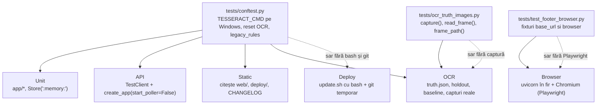

# Testing

This page describes the test suite of the Tabela Gara de Nord project: how to prepare the environment, how to run the full suite and parts of it, what test categories exist and what they check, what `tests/conftest.py` and `tests/ocr_truth_images.py` do, which tests are skipped in certain environments, and how to add a new test following the project's conventions.

The page was written from the application code and updated for Beta 1.72. Where a statement could not be verified from the repo, it is marked **uncertain**. The full suite was not run when the page was written.

Reference numbers (Beta 1.72, `pytest --collect-only -q`):

- 162 `tests/test_*.py` files, plus `tests/conftest.py`, `tests/ocr_truth_images.py` and `tests/__init__.py`;
- 2607 collected tests (parametrized cases are counted separately);
- full-suite duration: tens of minutes on a laptop, because of the browser and OCR tests. There is no versioned measurement: time it on your machine.

**CI (GitHub Actions).** `.github/workflows/ci.yml` runs on every pull request, on push to `main` and weekly: the `pytest` suite, including the browser tests (Playwright: Chromium, plus Firefox and WebKit for `test_cross_browser.py`), the `fail2ban` job (section 3.2), `gitleaks`, `bandit`, SBOM + `pip-audit` on the lock (section 3.2) and the release-consistency check (`scripts/check_release.py`: `VERSION`, `CHANGELOG.md` and the numbers in the code). `codeql.yml` runs the CodeQL security analysis (Python and JavaScript). Dependabot proposes dependency updates, and `lock.yml` regenerates `requirements.lock` on its PRs. Dependencies are pinned in `requirements.txt` (direct) and `requirements.lock` (transitive too). One test (`tests/test_docs_routes.py`) requires every route registered in the application to appear in `docs/api.md`, so the documentation cannot fall behind. The OCR regression runs on labelled frames (`tests/fixtures`, `app/ocr/truth.py`: about 59 frames and 1,416 labelled rows), with strict thresholds and a production time-budget test.

## Contents

1. [Environment setup](#1-environment-setup)
2. [pytest configuration](#2-pytest-configuration)
3. [Running the full suite](#3-running-the-full-suite)
4. [Running part of the suite](#4-running-part-of-the-suite)
5. [Test categories](#5-test-categories)
6. [Shared fixtures and conftest](#6-shared-fixtures-and-conftest)
7. [Tests with real captures and the OCR ground-truth set](#7-tests-with-real-captures-and-the-ocr-ground-truth-set)
8. [Tests that are skipped or flaky in certain environments](#8-tests-that-are-skipped-or-flaky-in-certain-environments)
9. [How to add a new test](#9-how-to-add-a-new-test)

## 1. Environment setup

The dependency files:

- `requirements.txt` (runtime, for the application): `fastapi==0.165.0`, `uvicorn[standard]==0.54.0`, `opencv-python-headless==5.1.0.95`, `numpy==2.5.5`, `pytesseract==0.3.13`, `pywebpush==2.5.0`, `py-vapid==1.9.6`, `cryptography==50.0.2`, `httpx==0.28.1`, `tzdata==2026.6`.
- `requirements-dev.txt`: includes `requirements.txt` (`-r requirements.txt`) and adds `pytest`, `pytest-asyncio` and `playwright==1.65.2`. The comment in the file says Playwright is optional: the browser tests in `tests/test_footer_browser.py` and the other `*_browser.py` files are skipped when it is missing.

Steps, from the README ("Rulare (dezvoltare)" section):

```bash
python -m venv .venv
.venv/bin/pip install -r requirements-dev.txt        # Linux / macOS
.venv\Scripts\pip install -r requirements-dev.txt    # Windows
```

External components, which are not installed by `pip`:

| Component | Why | What happens if it is missing |
|---|---|---|
| **Tesseract 5** with the `eng` and `ron` languages | The OCR engine (`TESSERACT_CMD`, by default `tesseract` in `PATH`). The README requires it for deploy. | The test `test_robust_ingest` (`test_augmented_frame_with_two_arrival_rows_is_rejected_for_arrivals`) is skipped, with the reason "tesseract not installed". The OCR tests (`test_ocr*.py`) assume Tesseract. **Uncertain**: I did not verify what exactly the OCR tests do when the binary is missing (they may fail, not skip). |
| **Firefox and WebKit for Playwright** | `tests/test_cross_browser.py`: smoke test on Firefox and WebKit (the Safari engine, iPhone users) — the main routes at 390x844 and 1280x800 render without JS errors or horizontal scroll, and the bottom bar, „Mai mult”, theme and language toggles work | The test is skipped with "firefox/webkit indisponibil". Install: `python -m playwright install firefox webkit` (CI uses `--with-deps chromium firefox webkit`). |
| **Chromium for Playwright** | The browser tests | `p.chromium.launch()` fails and the test is skipped with "Chromium indisponibil" (or "Chromium unavailable"). The browser is installed with the standard Playwright command, `python -m playwright install chromium`. **Uncertain**: the command is not documented in the repo. |
| **Node.js** | A test in `tests/test_brand_theme.py` runs a small JavaScript harness | The test `test_panel_level_never_green_without_read_delay` is skipped (`skipif(NODE is None)`). |
| **Git Bash** (Windows) or `bash` (Linux) and **git** | `tests/test_update_sh.py` runs `deploy/update.sh` with bash, in a temporary git repo | If they are missing, the whole module is skipped. On Windows, `_bash()` looks for `C:\Program Files\Git\bin\bash.exe` and `...\usr\bin\bash.exe`. |

Note for Windows: `tests/conftest.py` sets `TESSERACT_CMD` to `C:\Program Files\Tesseract-OCR\tesseract.exe`, if the variable is not set and the file exists. The scripts in `scripts/` (`dev_seed.py`, `ocr_eval.py`, `ocr_digit_clf.py`) do the same.

## 2. pytest configuration

The `pytest.ini` file (the only pytest configuration file in the repo):

```ini
[pytest]
asyncio_mode = auto
testpaths = tests
```

- `asyncio_mode = auto`: `async def` test functions run without the `@pytest.mark.asyncio` decorator.
- `testpaths = tests`: `python -m pytest` with no arguments collects only from `tests/`. The scripts in `scripts/` and the modules in `app/` are not collected.
- No markers are declared (`markers =`). There is no `-m "not browser"` style mechanism in the repo. To exclude categories, use `-k` or a list of files (see section 4).

The `tests/__init__.py` file exists, so `tests` is a package. That is why the tests import from `tests.conftest`, `tests.ocr_truth_images` and `tests.test_footer_browser` with `from tests...`. Always run pytest from the repo root.

## 3. Running the full suite

From the repo root, with the venv activated or with the full path:

```bash
python -m pytest
```

Useful variants:

```bash
python -m pytest -q                 # ieșire scurtă
python -m pytest -x                 # oprire la primul eșec
python -m pytest -rs                # afișează motivul fiecărui test sărit
python -m pytest --collect-only -q  # doar lista de teste, fără rulare
```

### 3.1 The suite lock (`.superpowers/suite.lock`)

The requirement for this page mentioned a lock-style convention: a `.superpowers/suite.lock` directory, used to avoid starting two full suites in parallel. **This convention does not exist in the repo.** Checks made:

- no file in `tests/`, `scripts/`, `app/`, `README.md` or `CHANGELOG.md` mentions `suite.lock` or contains code that creates, checks or deletes a lock directory;
- `.superpowers/` is in `.gitignore` and contains only `sdd/` (session reports).

If a lock directory exists on your machine, it belongs to your own working convention (or to an agent), not to the project. **Uncertain**: the exact reason for the convention is not written in the repo. What can be said from the code: the browser tests start uvicorn on a free port chosen by the system (`socket.bind(("127.0.0.1", 0))` in `tests/test_footer_browser.py`), and the SQLite databases are in `tmp_path`. So two parallel runs do not step on each other's ports or databases. What could conflict is the shared resource (Chromium, CPU, Tesseract), and that is not handled in the code.

### 3.2 CI: lock, security scans, fail2ban

- **`requirements.lock`.** CI installs with `--require-hashes -r requirements.lock`, so the lock must follow `requirements.txt` (`tests/test_requirements_lock.py`). Dependabot (pip) does not regenerate `uv pip compile` output, so `.github/workflows/lock.yml` does it on `dependabot/pip/*` PRs: it runs `uv pip compile` (with `UV_NO_BUILD=1`, executing no PR code), commits to the PR branch and re-runs CI via `workflow_dispatch` (a push made with `GITHUB_TOKEN` does not trigger CI by itself). It uses `pull_request_target` (write token) but runs nothing from the PR and exposes the token only to the push step. `opencv-python-headless` and `numpy` are excluded from Dependabot for minor/major (OCR-sensitive, updated by hand).
- **Hashes.** `requirements.lock` is generated with `uv pip compile --generate-hashes` (also by `lock.yml`) and installed with `pip install --require-hashes -r requirements.lock`: in CI (the `test` job), in `deploy/install.sh` and `deploy/update.sh` (every wheel/source is verified; on a rollback to an old commit whose lock has no hashes, the scripts fall back to `-r requirements.txt -c requirements.lock`). The test tools in `requirements-dev.txt` are installed without `-c` (a constraint file with hashes would force hash mode on them too), so without hashes.
- **gitleaks.** The `gitleaks` job scans for secrets: the whole history on push to `main`/weekly, only the PR's commits on pull requests. The official binary is pinned to a version and verified by SHA-256. `.gitleaks.toml` extends the default rules and holds only proven false positives (currently: the dummy token in `tests/test_system_status.py`). A real secret is rotated, never allowlisted. Locally: `gitleaks git .`.
- **bandit.** The `bandit` job runs `bandit -r app scripts -ll -iii` (medium or high severity, high confidence). A deliberate exception is written `# nosec Bxxx - reason` on that line. The version is pinned in `requirements-dev.txt`.
- **SBOM and audit.** The `supply-chain` job generates a CycloneDX SBOM from `requirements.lock` (artifact `sbom-cyclonedx`, 90 days) and runs `pip-audit` on the lock: it fails on known vulnerabilities that have a fixed version; those without a fix are only printed. To accept a vulnerability, put its id in `IGNORE` in the job's "Dependency audit" step, with a comment giving the reason.
- **fail2ban.** The `fail2ban` job in `ci.yml` installs fail2ban, runs `fail2ban-regex` with each filter in `deploy/fail2ban/` against `tests/fixtures/fail2ban/` (`should_match_probes.log` and `should_match.log` must match completely, `should_not_match.log` not at all) and validates the jails with `fail2ban-client -t`. The fixtures use the nginx `combined` format (the default; `deploy/nginx-tabela.conf` defines no `log_format`). `tests/test_fail2ban_filters.py` repeats the check with Python regexes, without fail2ban (fast local check; CI is authoritative).

## 4. Running part of the suite

```bash
python -m pytest tests/test_version.py                 # un fișier
python -m pytest tests/test_version.py::test_version_file_follows_scheme   # o funcție
python -m pytest -k "stats and not browser"            # după nume
python -m pytest tests/test_*static.py                 # toate testele statice (shell expansion)
python -m pytest tests/test_*_browser.py tests/test_footer_browser.py       # browser
python -m pytest tests/test_update_sh.py               # simularea update.sh (necesită bash și git)
```

On Windows, in PowerShell, the `tests/test_*static.py` expansion is not done by the shell; use `python -m pytest tests -k static` or list the files.

The deploy suite, for a change to `deploy/update.sh` or `deploy/install.sh`:

```bash
python -m pytest tests/test_update_sh.py tests/test_watchdog.py tests/test_version.py
```

## 5. Test categories

The categories are not marked in the code. The classification below is by file and by how the tests are written.

| Category | What it checks | Examples (files) | How it runs |
|---|---|---|---|
| **Unit** | Pure logic or with an in-memory SQLite database | `test_store.py` (fixture `store` with `Store(":memory:")`), `test_consensus.py`, `test_normalize.py`, `test_predict.py`, `test_quality.py`, `test_watchdog.py`, `test_dbbackup.py`, `test_telegram.py`, `test_trend.py`, `test_seasons.py` | Fast, no network. |
| **API** | The FastAPI routes, through `TestClient`, with `create_app(settings, start_poller=False)` | `test_api.py`, `test_admin.py`, `test_admin_tools.py`, `test_backup_api.py`, `test_weather_api.py`, `test_system_api.py`, `test_export.py`, `test_follows.py`, `test_version.py` (`/api/health`, `/api/changelog`) | Fast. The poller is off, and the tests that need it replace it (`monkeypatch` on `app.poller.run_poller`). |
| **Static** (`test_*_static.py`) | Conventions checked by reading the files in `web/`, `deploy/` and the documentation: CSP, service worker caches, precache, nginx limits, versions, DOM safety | `test_admin_static.py`, `test_ocr_static.py`, `test_panel_static.py`, `test_sistem_static.py`, `test_statistici_static.py`, `test_stats_static.py`, `test_ui2_static.py`, `test_ui3_static.py`, `test_weather_static.py`, `test_web_static.py` (10 files) | Fast. Many tests have a `client` (TestClient) to check the HTTP headers too. |
| **Browser** (Playwright) | Real behavior in Chromium: layout at 390 px and on desktop, a single footer, navigation, theme, touch targets | `test_footer_browser.py`, `test_csp_browser.py`, `test_contrast_browser.py`, `test_layout_browser.py`, `test_nav_browser.py`, `test_touch_targets_browser.py`, `test_ui2_browser.py`, `test_ui3_browser.py`, `test_statistici_browser.py`, `test_history_all_browser.py`, `test_history_nodate_browser.py`, `test_empty_states_browser.py`, `test_corrections_browser.py`, `test_weather_browser.py` (14 files, with `*_browser.py` and `test_footer_browser.py`) | Slow. They start uvicorn in a thread and Chromium. Skipped if Playwright or Chromium is missing. |
| **OCR** | Board reading accuracy on real captures, with hand-written ground-truth sets; digit, platform and glare rules | `test_ocr.py`, `test_ocr12.py`, `test_ocr13.py`, `test_ocr14.py`, `test_ocr_platform_cut.py`, `test_ocr_robust.py`, `test_ocr_debug.py`, `test_glare.py`, `test_band_boxes.py`, `test_ambiguous_pairs.py`, `test_captures.py` | Slow. Many tests use real captures (section 7). |
| **Data and migrations** | The SQLite schema, migration to new versions, data coexistence, restore | `test_schema_v6.py`, `test_observations_migration.py`, `test_store_coexist.py`, `test_store_quality.py`, `test_restore.py`, `test_dbbackup.py`, `test_merge_number_dups.py`, `test_purge_ghosts.py` | Fast. |
| **Deploy and release** | The `deploy/` scripts, the version, the CHANGELOG, the watchdog | `test_update_sh.py` (runs `update.sh` with bash and a temporary git repo), `test_watchdog.py`, `test_version.py` | Medium: needs bash and git. See section 8. |

The diagram of the test layers, with the support files:



Solid arrows show which fixtures or helpers each layer uses. Dotted arrows show where conditional skipping happens. The diagram does not show the execution order: the tests do not depend on each other.

## 6. Shared fixtures and conftest

### 6.1 `tests/conftest.py`

The only `conftest.py` in the repo. It contains four things:

1. **Tesseract on Windows**: if `TESSERACT_CMD` is not set and `C:\Program Files\Tesseract-OCR\tesseract.exe` exists, it sets it. A local effect only, on Windows. On the server, the variable comes from `/etc/tabela.env`.
2. **The `legacy_rules` fixture** (not autouse): it sets the confirmation constants in `app/quality.py` and `app/store.py` to the values from before the quality validation (Beta 1.02): a delay or platform change is applied from the first reading, a train disappears after 2 misses, and a returned train is "new". The reason from the docstring: the tests of other layers (notifications, history) were written on the old rules. It is requested explicitly, with `def test_x(legacy_rules, ...)`.
3. **The autouse fixture `_fresh_ocr_stats`**: the in-memory OCR statistics are global per process (`app/ocr/stats.py`), so they are reset before and after each test. Without this, a test would see another test's counter.
4. **The `EMPTY_OCR` constant**: the empty shape of the `ocr` response in `/api/health`, used in assertions (`test_api.py` imports it from `tests.conftest`).

### 6.2 `tests/ocr_truth_images.py`

It is not a conftest, but a helper module imported by the OCR and admin tests (`test_admin.py`, `test_captures.py`, `test_band_boxes.py`, `test_corrections_browser.py`, `test_ocr13.py`, `test_ocr14.py`, `test_ocr_platform_cut.py`, `test_glare.py`, `test_ocr_robust.py` and others). It exposes:

- `FIX = tests/fixtures/`;
- `PRIVATE = OCR_TRUTH_DIR` (the environment variable) or `tests/fixtures/ocr_truth/private/`;
- `frame_path(frame)`: the keys `ocr_truth/<path>` from `truth.json` map to `PRIVATE/<path>.jpg`; the others, to `FIX/<path>.jpg`;
- `capture(path)`: returns the path if the file exists, otherwise calls `pytest.skip` with the reason "captura reală lipsă: ...; capturile nu sunt în repo" (and, for the private directory, the hint "seteaza OCR_TRUTH_DIR");
- `read_frame(frame)`: `capture(frame_path(frame)).read_bytes()`.

### 6.3 `tests/test_footer_browser.py`: the browser fixtures

The `base_url` and `browser` fixtures are defined here and reused, by import, by the rest of the browser tests (for example `test_contrast_browser.py`, `test_csp_browser.py`, `test_empty_states_browser.py`, `test_corrections_browser.py`, `test_ui2_browser.py`, `test_ui3_browser.py`, `test_weather_browser.py` and others: 12 files in total). The import is done with a `# noqa` comment and the reason "shared fixtures".

- `base_url` (scope `module`): runs `scripts/dev_seed.py` on a temporary SQLite database, then starts `uvicorn` in a thread on a free port. The settings: `poller_enabled=False`, `source_url` on `127.0.0.1:9` (a non-existent port, so the poller never reaches CFR), `last_image_path=None`. At the end it stops the server.
- `browser` (scope `module`): `sync_playwright().chromium.launch()`. If the launch fails, the test is skipped with "Chromium indisponibil".
- `_page(browser, base_url, w, h, theme, view)` (a helper, not a fixture): creates a context with `service_workers="block"`, sets the theme and the view in `localStorage` before loading and blocks any request that does not start with `base_url`. The reason: the tests must not depend on the internet or on the service worker from earlier sessions.

### 6.4 Local fixtures

Many files have their own fixtures: `store` (`test_store.py`, `Store(":memory:")` with `migrate()`), `client` (`test_admin_static.py`, `test_version.py`, `TestClient(create_app(...))`), `server` (`test_update_sh.py`, a temporary git repo with an `origin`, fake scripts for `pip` and `systemctl`, and a real SQLite file). These are not shared; if a fixture is used in two files, move it to `conftest.py` or to the helper module.

## 7. Tests with real captures and the OCR ground-truth set

### 7.1 Why the captures are not in the repo

The real board captures are JPG images with traveler data, and the repo is public. The reason is written in `CHANGELOG.md` (Beta 1.43: "Nicio captură reală a tablei nu mai e urmărită în git") and in `.gitignore`:

```gitignore
tests/fixtures/ocr_truth/private/
tests/fixtures/ocr_truth/**/*.jpg
tests/fixtures/**/*.jpg
```

The images live only on the development machine (`tests/fixtures/ocr_truth/private/`, or in `OCR_TRUTH_DIR`) and on the server. The git history was not rewritten. In the present working clone, `tests/fixtures/ocr_truth/private/` does not exist, so all the tests that need a private capture are skipped.

### 7.2 The ground-truth sets

| File | Content | Used by |
|---|---|---|
| `tests/fixtures/ocr_truth/truth.json` | Real frames with the 12 rows per panel (arrivals and departures), checked by eye against the image. The keys are `ocr_truth/<path>` (private images) or `ocr13/<path>` (images in `tests/fixtures/`). | `test_ocr14.py` (accuracy regression assertions; `len(lines) >= 300`), `test_ocr_platform_cut.py`, `scripts/ocr_eval.py` |
| `tests/fixtures/ocr_truth/holdout/holdout.json` | A separate "hold-out" set of frames not seen by the implementers, labeled by a distinct labeler. | `test_ocr_platform_cut.py`, `scripts/ocr_eval.py` |
| `tests/fixtures/ocr_truth/baseline-1.31.json` | The result of the version 1.31 reader, recorded as a reference. The test compares the frames and the counters with `truth.json`. | `test_ocr_platform_cut.py` |
| `tests/fixtures/ocr_truth/NOTE-2026-10-27.md` | Working note: which frames were chosen and why (unread platforms, wrong numbers). | Documentation only |
| `tests/fixtures/ocr_truth/holdout/README.md` | Describes how the hold-out was made: frames from 21–27.10.2026, at least 60 minutes from any frame in `truth.json`, labeled blind. | Documentation only |

The basic rule, written in `tests/test_ocr_platform_cut.py`: adding or relabeling frames requires re-recording the baseline, because the test compares the `frames` and the counters from `truth.json` with the baseline.

### 7.3 How it is measured

`app/ocr/truth.py` has the functions `load`, `lines_of` and `score`. `score` returns, for each field, the counters `ok`, `wrong` and `unread`, plus misses for diagnosis. The accuracy test in `tests/test_ocr14.py` has thresholds:

- `MAX_WRONG[field]`: how many wrong values are allowed at most per field;
- `MIN_OK[field]`: how many correct values are required at least per field.

The test fails if the reading gets worse (`assert c["wrong"] <= MAX_WRONG[field]`), not if it improves. The test `tests/test_ocr_platform_cut.py` compares with the recorded baseline; the baseline is re-recorded explicitly, with `OCR_RECORD_BASELINE=1 pytest tests/test_ocr_platform_cut.py` (written in the file's docstring).

For a manual evaluation, `scripts/ocr_eval.py` has two subcommands, `predict` and `score` (`python scripts/ocr_eval.py predict ...`, `... score ...`). The variables `NPROC` (default 4) and `OCR_TRUTH_DIR` can be set.

### 7.4 How tests are skipped without a capture

Three forms of skip, all with a written reason:

- `capture(path)` from `tests/ocr_truth_images.py`: it skips if the file is missing (the wording from the code: "captura reală lipsă; capturile nu sunt în repo");
- `test_ocr14.py`: it skips if the `ocr14_delay100` captures are missing ("capturile reale ocr14_delay100 lipsesc (nu sunt în repo)");
- `test_ocr_platform_cut.py`: it skips if the private directory is missing ("directorul privat cu capturi lipsește ... (setează OCR_TRUTH_DIR)").

An OCR test that has no capture and does not skip explicitly would fail with `FileNotFoundError`. When you add an OCR test, use `capture()` or `read_frame()`, not `open()` directly.

If you have the captures on your machine, put them in `tests/fixtures/ocr_truth/private/` (or set `OCR_TRUTH_DIR`), and the tests that are skipped now will run.

## 8. Tests that are skipped or flaky in certain environments

### 8.1 Environment-conditional skips

| Test or module | Condition | Where | Reason and remark |
|---|---|---|---|
| All the `*_browser.py` files and `test_footer_browser.py` | `pytest.importorskip("playwright.sync_api")` | at module level | Playwright is not installed (it is optional in `requirements-dev.txt`). |
| The `browser` fixture | `p.chromium.launch()` fails | `test_footer_browser.py` and other modules | Chromium is missing or cannot start. |
| `test_sistem_static.py` | `importorskip` and Chromium unavailable | at module level and in the test | A static file with a browser check. |
| `test_brand_theme.py::test_panel_level_never_green_without_read_delay` | `NODE is None` | `test_brand_theme.py` line ~261 | Node.js is missing. |
| `test_robust_ingest.py` (one test) | `TESSERACT_CMD` not set and `tesseract` is not in `PATH` | `test_robust_ingest.py` | Tesseract is missing. |
| `test_update_sh.py` (the whole module) | `bash` or `git` are missing | `test_update_sh.py` | On Windows, it looks for Git Bash. |
| `test_update_sh.py::test_backup_dir_symlink_aborts_before_chown` | `os.symlink` raises `OSError`, or bash does not see the link | `test_update_sh.py` | On Windows, creating symlinks requires Developer Mode or administrator privileges. |
| `test_dbbackup.py::test_real_unlistable_backup_dir` | An unlistable directory cannot be made for the current user | `test_dbbackup.py` | On Windows or as `root`, the permissions do not apply the same way. |
| Tests with real captures | the capture is missing | see section 7 | Normal on a fresh clone. |

Recommendation: run `python -m pytest -rs` to see all the skip reasons. A skip with a clear reason is not a failure, but an unexpected skip must be investigated.

### 8.2 Flaky tests

The repo has no list of flaky tests and no `flaky` markers. Checks made:

- `CHANGELOG.md` (Beta 1.41) says the pixel test of the Board "is no longer flaky": the "acum N s" pill and the live data that changed between captures produced false differences. The test was fixed, not marked.
- The `flaky` names in `tests/test_api.py`, `tests/test_weather.py` and `tests/test_weather_api.py` are simulated test functions (a poller that crashes), not flaky tests.

**Uncertain**: there is no flakiness measurement in the repo. If a test fails intermittently, note it in an issue; do not mark it as `xfail` without a written reason.

### 8.3 Time-sensitive tests

- `test_dbbackup.py` uses a fake clock (`Clock`), so that each start is 5 seconds later (`RestartSec=5`), so the backup names do not collide.
- `test_follows.py` uses the real clock (`monkeypatch.undo()`) for part of the test.
- The browser tests wait for elements through Playwright (`wait_for_selector`), not through `sleep`.

When you write a test involving time, use a fake clock or `monkeypatch` on `datetime`, not `time.sleep`.

## 9. How to add a new test

The conventions, observed in the existing files:

1. **Copyright header**: the first line `# © 2026 Andy217Ace`. Most files have the header, and some tests check that the web files and the CHANGELOG have the same copyright.
2. **A short docstring, in Romanian or English**, that states the rule being tested and, if relevant, the version in which it appeared (for example, "Beta 1.28"). Many docstrings also state the reason for the rule.
3. **The file** in `tests/`, with the `test_` prefix and a name after the area tested. For a new file of an existing category, follow the model of the closest file.
4. **No real network** (a convention observed in the existing files): the tests do not call CFR, Open-Meteo or Telegram. The poller is stopped with `poller_enabled=False` and `start_poller=False`, and external calls are replaced through `monkeypatch`.
5. **No real data**: do not put train codes or data from real captures in a test. If you need a board, use `scripts/dev_seed.py` or synthetic data.
6. **Temporary databases**: `tmp_path` or `Store(":memory:")`.
7. **No secrets**: do not write real VAPID keys, tokens or passwords. Use clearly fake values (for example, `"p" * 20` for the subscription keys in `test_api.py`).

### 9.1 Examples from the suite

**Unit** (model: `tests/test_store.py`): the `store` fixture and a function with direct assertions.

```python
@pytest.fixture
def store():
    s = Store(":memory:")
    s.migrate()
    yield s
    s.close()

def test_migrate_idempotent_and_versioned(store):
    ...   # aserțiuni pe store și pe PRAGMA user_version
```

**API** (model: `tests/test_api.py`): a `settings(**kw)` helper that fills in the defaults and a `TestClient` on `create_app`.

```python
def settings(**kw):
    base = dict(db_path=":memory:", source_url="https://example.com/x",
                vapid_private_key="", vapid_public_key="", vapid_subject="mailto:a@b.c",
                tesseract_cmd="tesseract", poller_restart_backoff=0.01)
    base.update(kw)
    return Settings(**base)
```

With `start_poller=False` in `create_app`, the application does not start the poller; `TestClient` as a context manager triggers the lifespan.

**Static** (model: `tests/test_admin_static.py`): a `client` fixture and reading the files from `web/`. The assertions check safety rules, for example that `admin.js` does not use `innerHTML` or `localStorage`:

```python
def test_admin_js_served_and_safe(client):
    r = client.get("/admin.js")
    assert r.status_code == 200
    js = r.text
    assert js.startswith("// © 2026 Andy217Ace")
    for bad in ("innerHTML", "outerHTML", "insertAdjacentHTML", "document.write", "eval(", ...):
        assert bad not in js
```

**Browser** (model: `tests/test_footer_browser.py`): uses the `browser` and `base_url` fixtures and the `_page` helper. The assertions are made on the state of the real page (the number of visible elements), not on the source HTML.

```python
def test_exactly_one_visible_footer(browser, base_url, w, h, theme, view):
    page = _page(browser, base_url, w, h, theme, view)
    ...
```

For a new browser test, import the fixtures:

```python
from tests.test_footer_browser import base_url, browser  # noqa: E402,F401  (shared fixtures)
```

**OCR** (model: `tests/test_ocr13.py`, simplified excerpt): the frames are read with `capture()`, so the test skips explicitly when the capture is missing. The accuracy thresholds, when they exist, are written in the file, next to the test (see `MAX_WRONG` and `MIN_OK` in `tests/test_ocr14.py`).

```python
from tests.ocr_truth_images import capture
...
def test_unread_delay_keeps_the_row_and_reports_why():
    rows, debug = read_board_debug(
        capture(FIX / "2026_10_22_150306-764bb6bc.jpg").read_bytes(), ...)
    ...
```

### 9.2 Steps for a new test

1. Choose the category (section 5) and the closest existing file, or create `tests/test_<area>.py` with the header and the docstring.
2. Write the failing test first, then the code.
3. If the test depends on a capture, use `capture()` or `read_frame()` and accept skipping as a normal result on a fresh clone.
4. If the test touches the CSP, the service worker cache or a file in `web/`, add an assertion in the matching static file, so the rule is checked without a browser too.
5. If the test touches the version or the CHANGELOG, follow the release rules in `deploy-si-configurare.md`, section 10.
6. Run the file on its own, then `python -m pytest -rs` on that area, before committing.

### 9.3 What is not in the repo

- No `.coveragerc` or coverage report. **Uncertain**: it is not known whether coverage is measured anywhere.
- No `tox.ini`, `noxfile.py` or `Makefile`. The command is `python -m pytest`.
