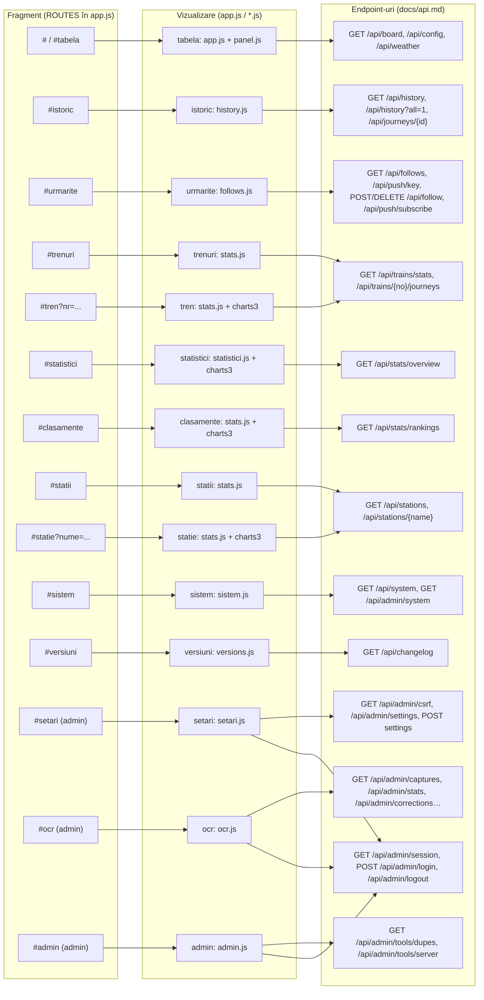

# Interfața — Tabela Gara de Nord

© 2026 Andy217Ace

Documentația frontend-ului: paginile și rutele (fragmente de adresă `#…`), ce arată fiecare
pagină și pentru cine, navigarea, tema, service worker-ul, manifestul PWA, politica de securitate
a conținutului (CSP) și motivele ei, stratul de grafice, deciziile de accesibilitate și modul în
care sunt servite fișierele statice.

Documentul descrie versiunea **Beta 1.43** (`VERSION`). Endpoint-urile pe care le apelează
paginile sunt descrise în `docs/api.md`.

## Cum a fost verificat documentul

Toate afirmațiile au fost citite din cod: `web/index.html`, `web/app.js` (tabelele `ROUTES` și
`VIEWS`), `web/theme-init.js`, `web/style.css`, `web/ui2.js`, `web/ui2.css`, `web/charts3.js`,
`web/sw.js`, `web/manifest.webmanifest`, `web/offline.html`, `web/history.js`, `web/stats.js`,
`web/statistici.js`, `web/follows.js`, `web/panel.js`, `web/weather.js`, `web/versions.js`,
`web/sistem.js`, `web/setari.js`, `web/ocr.js`, `web/admin.js`, plus `app/api.py` (CSP, servirea
statică), `deploy/nginx-tabela.conf` și testele din `tests/` care verifică regulile (de exemplu
`tests/test_ui3_static.py` pentru `CHARTS_V`). Numărul de octeți din secțiunea 4 a fost măsurat
pe fișierele din `web/`. Nu am rulat interfața într-un browser pentru acest document.

## Cuprins

1. [Pagini și rute](#1-pagini-și-rute)
2. [Navigarea: bara de sus și meniul pe telefon](#2-navigarea-bara-de-sus-și-meniul-pe-telefon)
3. [Tema luminoasă și întunecată](#3-tema-luminoasă-și-întunecată)
4. [Service worker și mod offline](#4-service-worker-și-mod-offline)
5. [Manifestul PWA](#5-manifestul-pwa)
6. [Politica de securitate a conținutului (CSP)](#6-politica-de-securitate-a-conținutului-csp)
7. [Stratul de grafice](#7-stratul-de-grafice)
8. [Accesibilitate](#8-accesibilitate)
9. [Servirea fișierelor statice](#9-servirea-fișierelor-statice)
10. [Diagrama: rută → vizualizare → apel API](#10-diagrama-rută--vizualizare--apel-api)
11. [Ce nu am verificat](#11-ce-nu-am-verificat)

---

## 1. Pagini și rute

Aplicația are o singură pagină HTML (`web/index.html`). Paginile sunt secțiuni `<section class="view">`
care sunt arătate sau ascunse în funcție de fragmentul de adresă (`location.hash`). Rutele sunt
definite în `ROUTES` din `web/app.js`; `parseHash()` taie partea de după `?` și ia numele paginii
din `ROUTES`. Dacă ruta nu e cunoscută, se afișează Tabela.

Vizualizările se înregistrează în `window.TabelaApp.views` (`app.js`, `history.js`, `stats.js`,
`statistici.js`, `follows.js`, `versions.js`, `sistem.js`, `setari.js`, `ocr.js`, `admin.js`).
Fiecare are o funcție `show(params)` apelată la schimbarea paginii.

| Fragment | Pagina (`VIEWS`) | Secțiunea HTML | Pentru cine | În meniu | Scriptul care o implementează |
|---|---|---|---|---|---|
| `#` sau fără fragment | **Tabelă** (`tabela`) | `#view-tabela` | toți | da („Tabelă”) | `app.js` (+ `panel.js`, `weather.js`) |
| `#istoric` | **Istoric** | `#view-istoric` | toți | da | `history.js` |
| `#urmarite` | **Urmărite** | `#view-urmarite` | toți (notificările depind de browser) | da | `follows.js` |
| `#trenuri` | **Trenuri** | `#view-trenuri` | toți | da | `stats.js` (vizualizarea `trenuri`) |
| `#tren?nr=<număr>` | **Tren** | `#view-tren` | toți | nu (cade sub „Trenuri”) | `stats.js` (`tren`) |
| `#statistici` | **Statistici** | `#view-statistici` | toți | da | `statistici.js` |
| `#clasamente` | **Clasamente** | `#view-clasamente` | toți | da | `stats.js` (`clasamente`) |
| `#statii` | **Stații** | `#view-statii` | toți | da | `stats.js` (`statii`) |
| `#statie?nume=<nume>` | **Stație** | `#view-statie` | toți | nu (cade sub „Stații”) | `stats.js` (`statie`) |
| `#sistem` | **Sistem** | `#view-sistem`, creată de `sistem.js` | toți (detalii pentru admin) | da | `sistem.js` (încărcat la prima vizită) |
| `#versiuni` | **Versiuni** | `#view-versiuni` | toți | nu (link din subsol) | `versions.js` |
| `#setari` | **Setări** | `#view-setari` | admin | nu (fără link în interfață) | `setari.js` (încărcat la prima vizită) |
| `#ocr` | **Capturi OCR** | creat de `app.js` (`view-ocr`) | admin | nu | `ocr.js` (+ `ocr.css`), încărcat la cerere |
| `#admin` | **Administrare** | creat de `app.js` (`view-admin`) | admin | nu | `admin.js` (+ `admin.css`), încărcat la cerere |

Observații:

- Rutele `#sistem`, `#setari`, `#ocr` și `#admin` sunt încărcate la prima vizită (`loadLazyPage`,
  `loadOcrView`, `loadAdminView`). Nu sunt în precache-ul service worker-ului, „ca să nu crească
  bugetul”, cum scrie în `app.js`.
- **Sistem**: pagina arată starea publică; dacă vizitatorul are sesiune de admin (`admin: true`),
  citește și `GET /api/admin/system`.
- **Setări** nu are formular de login. Dacă nu există sesiune, afișează „Autentificare necesară
  pentru setări.” Autentificarea se face din pagina „Capturi OCR” sau „Administrare”, pentru că
  cookie-ul este comun.
- **Capturi OCR** și **Administrare** nu apar în meniu. Testul `tests/test_admin_static.py` verifică
  că nu apar nici în meniu, nici în precache.
- Pagina **Tabelă** nu se schimbă la navigare: `route()` nu apelează `enterView` pentru ea și nu
  face animație de intrare (`app.js`), ca să rămână exact cum era.
- Titlul paginii (`document.title`) se schimbă: „Istoric · Tabela Gara de Nord” etc.
  Pagina Tren își poate schimba titlul singură (`stats.js`).

**Pagina Tabelă** (cea mai importantă): arată sosirile și plecările din București Nord, citite de pe
tabla CFR. Are:

- două file (`Sosiri`, `Plecări`) cu navigare cu săgeți stânga/dreapta; fila aleasă se ține în
  `localStorage` sub cheia `tabela.tab`;
- o bandă de avertizare (`#banner`) când datele sunt învechite;
- un ecran de încărcare (`#boot`) până sosesc primele date;
- modul „Panou” (`web/panel.js`), cu comutatorul `Panou` / `Carduri` și butonul `Ecran complet`
  (cheile `tabela.view`, `tabela.panel.board`, `tabela.panel.cols`, `tabela.fav` în `localStorage`);
- întârzierile colorate după pragurile din `/api/config` (`delay_thresholds`: 5, 15, 30 minute, cu
  valorile implicite din `app.js`);
- butoanele „urmărește” pentru fiecare tren (`follows.js`), când există suport pentru notificări.
- textul „citire nesigură” (constanta `UNSURE` din `app.js`) pentru valorile care nu sunt sigure, în loc de o valoare inventată.

**Pagina Istoric:** formular cu ziua (`#h-date`, sau „Toate zilele”), numărul trenului, stația, ora
de la și până la, panoul și butonul „Resetează”. Filtrele se scriu în adresă (`syncHash`), deci un
link păstrează filtrele. Rezultatele vin de la `GET /api/history`; cu „Toate zilele”, de la
`GET /api/history?all=1` (cu paginare: „Încarcă mai multe”). Un clic pe un rând deschide un
`<dialog>` (`#h-detail`) cu detaliile călătoriei (`GET /api/journeys/{id}`). În modul „toate zilele” interfața arată câte rânduri sunt afișate („afișate N (cele mai noi)”, clasa `h-truncated`). Antetul `X-Truncated` al modului pe o zi nu e citit de `history.js` (nesigur: verifică dacă există o altă ramură).

**Pagina Urmărite:** comutatorul „Notificări pe acest dispozitiv” (`#f-switch`) care cere permisiune
și abonează browserul la Web Push; lista trenurilor urmărite (`GET /api/follows`); eroare și
explicații când browserul nu acceptă notificările. Pe iPhone/iPad, notificările push funcționează
doar pentru aplicația adăugată pe ecranul principal (`isIOS()` și `isStandalone()` în `follows.js`);
pagina spune asta în `#f-ios`.

**Pagina Trenuri, Tren, Stații, Stație, Clasamente:** pagini din `stats.js`, cu tabele, filtre și
exporturi CSV/JSON (linkurile trimit direct la rutele `format=csv`). Pe Tren, Stație și Clasamente
se încarcă și stratul de grafice (secțiunea 7).

**Pagina Statistici:** un singur răspuns de la `GET /api/stats/overview`, cu filtrele `perioada`
(`Azi`, `7 zile`, `30 de zile`, `Tot istoricul`), `board`, `operator`, `tip`, `doar_confirmate`.
Are rezumat, întrebări (`insights`), probleme, grafice și exporturi pe seturi. Textul de sus spune
că întârzierea e cea citită pe tabla din București Nord, iar sosirile și plecările sunt mereu
separate.

**Pagina Versiuni:** lista din `GET /api/changelog`; este linkul din subsol („Versiuni”) și din
`/api/health`.

---

## 2. Navigarea: bara de sus și meniul pe telefon

**Bara de sus** (`header.topbar`): sigla și titlul, ceasul și vremea (`#hdr-clockwx`, `weather.js`),
butonul de temă (`#theme-btn`) și indicatorul „Live / Sursa: CFR”.

**Meniul principal** (`nav.mainnav`, sub antet) are 8 intrări: Tabelă, Istoric, Urmărite, Trenuri,
Statistici, Clasamente, Stații, Sistem. Fiecare are `data-route` și, pentru pagina activă,
`aria-current="page"`. Pagina `Tren` evidențiază „Trenuri”, iar `Stație` evidențiază „Stații”
(`NAV_PARENT` în `app.js`).

**Desktop și telefon.** Meniul e aceeași bară pe orice lățime:

- `.mainnav` are `overflow-x: auto` și `scrollbar-width: none`: când nu încape, se derulează
  orizontal **în interiorul barei**, nu pagina. `revealActiveNav()` aduce pagina activă în vizor,
  fără să mute pagina.
- Pe ecrane tactile (`(pointer: coarse)`), `--topnav-h` și `.nav-item` au înălțime minimă de 46 px
  (`style.css`).
- **„Site pentru desktop” pe telefon.** Când browserul telefonului afișează pagina pe o lățime
  mult mai mare decât ecranul, `theme-init.js` pune clasa `zoomed-out` pe `<html>`. Atunci meniul
  devine mai mare (`min-height: 88px` pe elemente, `font-size: 1.75rem`, `style.css` ~linia 668).
  Verificarea se face doar pe ecrane tactile, ca pe desktop zoom-ul să nu schimbe meniul.

Nu există meniu separat pentru telefon: același `nav` se derulează.

---

## 3. Tema luminoasă și întunecată

**Trei moduri:** `auto` (urmează setarea sistemului), `light` (luminoasă) și `dark` (întunecată).
Butonul din antet trece ciclic: auto → luminoasă → întunecată → auto. Eticheta lui (`aria-label`,
`title`) spune modul curent.

**Unde se decide tema (`web/theme-init.js`):**

- Scriptul e încărcat **sincron**, în `<head>`, înainte de foile de stil, ca să nu existe „flash”
  de culoare la încărcare. Din același motiv nu e inline: CSP interzice scripturile inline
  (secțiunea 6).
- Alegerea se salvează în `localStorage` sub cheia `tabela.theme` (valorile `light` și `dark`;
  pentru `auto` cheia se șterge). Dacă `localStorage` nu e disponibil, tema ține până la reîncărcare.
- Aplicarea: `<html data-theme="light">` sau `<html data-theme="dark">`; pentru `auto` atributul
  lipsește. `<meta name="theme-color">` primește `#0f172a` (întunecată) sau `#f1f5f9` (luminoasă).
- La fiecare schimbare se trimite evenimentul `tabela:theme`, la care se reafișează eticheta butonului.

**Tokeni (`web/style.css`):** culorile nu se scriu niciodată direct în componente. Sunt trei straturi:

1. **primitive** `--ref-*` (de exemplu `--ref-slate-900: #0f172a`, `--ref-amber-400`, `--ref-chart-arr-d`);
2. **semantice** `--bg`, `--surface`, `--text`, `--text-2`, `--accent`, `--focus`, `--ok`, `--warn`,
   `--bad`, `--info`, `--lvl-ok`, `--lvl-low`, `--lvl-mid`, `--lvl-high`, `--c-arr`, `--c-dep`, `--c-seq` etc.;
3. **de componentă** `--board-*`, `--btn-*`, `--card-*` etc.

Sistemul de design e descris în `design-system/tabela-gara-de-nord/MASTER.md`.

**Regulile de aplicare a temei** (comentariul din `style.css`, secțiunea 2b–2c):

- implicit (fără `data-theme`) tema e **întunecată** (`:root`);
- `@media (prefers-color-scheme: light)` cu `:root:not([data-theme="dark"])` dă tema luminoasă
  când sistemul o cere;
- `:root[data-theme="light"]` forțează luminoasa (identică cu cea din media query);
- `:root[data-theme="dark"]` forțează întunecata; ambele setează `color-scheme`, ca să arate corect
  barele de derulare și controalele native.

`panel.css` (modul Panou) urmează aceleași reguli, ca Panoul să nu aibă tema lui.

---

## 4. Service worker și mod offline

Fișierul e `web/sw.js`, cu scope `/`, și e înregistrat de `app.js` (`registerSW`) doar pe origini
sigure (HTTPS sau localhost).

**Cache-uri:**

- `tabela-shell-<VERSION>` — fișierele „shell” (precache);
- `tabela-board-<VERSION>` — ultima tablă primită (`/api/board`).

**Precache (`SHELL`).** Lista are 26 de fișiere, plus `/` (pagina principală, ca navigare) și
`/offline.html`. Include: `theme-init.js`, `style.css`, `panel.css`, `app.js`, `history.js`,
`follows.js`, `panel.js`, `weather.css`, `weather.js`, `versions.js`, `stats.css`, `stats.js`,
`statistici.css`, `statistici.js`, `ui2.css`, `ui2.js`, `manifest.webmanifest`, `favicon.ico`,
iconițele din `icons/` și fonturile `fonts/fira-sans-400.woff2`, `fonts/fira-code.woff2`.

- **Nu** intră: `ocr.*`, `admin.*`, `sistem.*`, `setari.*` (paginile de administrare și cele
  încărcate la cerere), `charts3.js`/`charts3.css` (grafice), `icon-512` și `icon-maskable-512`
  (browserul le ia din manifest), precum și niciun endpoint `/api/*` în afară de tabla.
- Bugetul: suma fișierelor din `SHELL` e de aproximativ **632 000 de octeți** necomprimat (măsurat
  pe `web/`). `tests/test_ui3_static.py` impune `PRECACHE_LIMIT = 650_000`, iar
  `tests/test_brand_theme.py` impune `660_000`. Vezi și secțiunea 11.
- Fonturile Fira Sans 500/600/700 se încarcă la cerere și nu sunt în precache; offline cad pe
  greutatea 400 (îngroșare sintetică), cum scrie în `sw.js`.

**Strategiile (`fetch`):**

| Cerere | Strategie |
|---|---|
| `GET /api/board` | network-first. Dacă rețeaua eșuează, se servește ultima tablă din `tabela-board-*`, cu `"sw_offline": true` și `"sw_cached_at"` (milisecunde). |
| alte `GET /api/*` | nu se cache-uiesc niciodată (istoric, urmărire, push și meteo sunt mereu live). |
| navigare (`mode === "navigate"`) | network-first; dacă rețeaua eșuează, pagina principală din cache (aplicația afișează ultima tablă), iar ultima soluție e `/offline.html`. |
| fișier din `SHELL` | network-first, cu cache ca rezervă. |
| altă origine (fonturi etc.) | comportamentul implicit al browserului. |

**Pagina offline** (`web/offline.html`): „Ești offline”, cu explicația că ultimele date salvate apar
automat când pagina principală e în cache, și un buton „Reîncearcă” spre `/`. Are propriul `<head>`
cu tema și CSS-ul, deci respectă tema.

**Instalare și activare:** la `install`, fișierele din `SHELL` se pun în cache cu `cache: "reload"`
(ocolește cache-ul HTTP), apoi `skipWaiting()`. La `activate`, se șterg toate cache-urile
`tabela-*` care nu sunt `SHELL_CACHE` sau `BOARD_CACHE`, și `clients.claim()`.

**Regula pentru `VERSION` (`var VERSION = "vNN"` în `sw.js`):**

- Se mărește când se schimbă lista `SHELL` sau oricare fișier din ea. Așa e scris în antetul
  `sw.js` („Bump VERSION when the shell list changes; old caches are deleted on activate”), iar
  practica din `CHANGELOG.md` arată că s-a mărit și la modificări în `ui2.js`, `app.js`,
  `statistici.js` și `stats.js` (de exemplu „v28 doar pentru schimbările din …”).
- Motivul tehnic (comportamentul standard al browserelor): browserul verifică actualizarea
  service worker-ului comparând octeții lui `sw.js`. Dacă nu se schimbă, nu reinstalează și nu
  reface precache-ul, deci cache-ul offline rămâne cel vechi.
- Testele verifică doar un minim (`VERSION >= v28` în `test_ui3_static.py`, `>= v9` în `test_stats_static.py`).

**Notificări push.** `push` afișează `title` (sau „Gara de Nord”), `body`, `tag` (cu `renotify`),
iconița `icons/icon-192.png` și `lang: "ro"`. Clicul (`notificationclick`) aduce în față o fereastră
deschisă a aplicației și navighează la `url`, sau deschide una nouă. Adresa se acceptă doar dacă e
de aceeași origine (`sameOriginUrl`).

---

## 5. Manifestul PWA

Fișierul e `web/manifest.webmanifest`, servit cu `application/manifest+json` și `Cache-Control: no-cache`:

| Câmp | Valoare |
|---|---|
| `name` | „Tabela Gara de Nord” |
| `short_name` | „Gara de Nord” |
| `lang` / `dir` | `ro` / `ltr` |
| `id`, `start_url`, `scope` | `/` |
| `display` | `standalone` (fără bara browserului) |
| `orientation` | `any` |
| `theme_color` / `background_color` | `#0f172a` (cea întunecată) |
| `categories` | `travel`, `navigation` |
| `icons` | `icons/icon-192.png` (any), `icons/icon-512.png` (any), `icons/icon-maskable-512.png` (maskable) |

În `index.html` există și metadatele pentru iOS (`apple-touch-icon`, `apple-mobile-web-app-title`
„Gara de Nord”), tema în două variante (`theme-color` pentru dark și light), Open Graph și Twitter
Card. Imaginea de previzualizare e `icons/og-image.png` (1 200 × 630).

---

## 6. Politica de securitate a conținutului (CSP)

CSP-ul e trimis de aplicație, în middleware-ul `security_headers` din `app/api.py`, la **fiecare**
răspuns (și la API, și la fișiere statice):

```
default-src 'self'; script-src 'self'; style-src 'self'; font-src 'self';
img-src 'self' data:; connect-src 'self'; manifest-src 'self'; worker-src 'self';
object-src 'none'; base-uri 'self'; form-action 'self'; frame-ancestors 'none'
```

Celelalte antete de securitate trimise de aplicație: `X-Content-Type-Options: nosniff`,
`Referrer-Policy: no-referrer`, `X-Frame-Options: DENY`. nginx adaugă `Strict-Transport-Security:
max-age=31536000` (`deploy/nginx-tabela.conf`).

**Ce înseamnă pentru cod:**

- **`script-src 'self'`**: fără `<script>` inline, fără `onclick="…"`, fără `eval`. Toate scripturile
  sunt fișiere din același site. De aceea `theme-init.js` e fișier separat, nu inline, chiar dacă
  ar fi mai simplu.
- **`style-src 'self'`**: fără `<style>` inline și fără atributul `style="…"`. Culorile și
  dimensiunile vin din foile de stil. Singurele scrieri în stil sunt prin CSSOM (`el.style.transform`
  în `charts3.js`), care CSP-ul permite; codul nu construiește niciun `style=` ca text.
- **`connect-src 'self'`**: pagina vorbește doar cu propriul server; de aceea `weather.js` cere
  `/api/weather` și nu Open-Meteo direct, iar atribuirea Open-Meteo e doar text și link.
- **`img-src 'self' data:`**: imaginile se încarcă de pe același site; `data:` e permis, dar nu am
  găsit în `web/` utilizări `data:` (nesigur).
- **`form-action 'self'`** și **`frame-ancestors 'none'`**: nu se poate trimite un formular în alt
  site, iar pagina nu poate fi pusă în iframe (protecție împotriva clickjacking).

**Regula `textContent` / `createElement`.** Antetul `web/app.js` spune: „DOM is built with
createElement/textContent only (no HTML strings: API data never reaches the parser)”. Motivul:
datele vin de la CFR și din corecțiile administratorului (note), deci sunt date pe care nu le
controlăm complet. Dacă ar intra în `innerHTML`, un text rău intenționat ar putea deveni cod
(XSS). Cu `textContent`, orice text rămâne text. Căutarea în `web/*.js` nu găsește `innerHTML`,
`insertAdjacentHTML`, `outerHTML` sau `document.write`. Același lucru se spune în antetul `app.js`,
`admin.js` și `setari.js`.

**Testul de CSP în browser.** `tests/test_csp_browser.py` deschide pagina principală, `#statistici`,
`#trenuri` și `#statii` într-un browser real și verifică să nu apară mesaje „Content Security Policy”
și că fontul Fira Sans se încarcă. Nu l-am rulat aici.

---

## 7. Stratul de grafice

Graficele sunt **SVG și cod propriu**, fără nicio bibliotecă externă. Motivele sunt scrise în
`README.md` (secțiunea „Grafica paginilor”): politica de securitate (`script-src 'self'`, fără
stiluri inline), temele luminoasă și întunecată, alternativa accesibilă pentru fiecare grafic
(legendă, tabel, CSV) și greutatea (codul propriu are ~18 KB gzip).

**Două fișiere:**

- **`web/ui2.js` + `web/ui2.css`** (în precache). Ajutoare pentru toate paginile non-live: `donut`
  (grafic circular cu centru, legendă și tooltip), `meter` și `spark` (bare și minigrafice SVG),
  `countUp` (cifră care numără, oprit cu `prefers-reduced-motion`), `gauge`, `empty` (stare goală),
  `hero`, `skeleton` (schelete de încărcare), `enterView` (intrarea în pagină), `transition`
  (View Transitions, dacă browserul le are), `decorate`, `stagger`. Expune `window.TabelaApp.ui2`.
- **`web/charts3.js` + `web/charts3.css`** (**nu** în precache, încărcate la cerere). Stratul
  interactiv: `bind(svg)` (tooltip la hover, la atingere și cu tastatura, cu crosshair), `legend`
  (legenda devine comutator: hover evidențiază seria, click o ascunde/arată), `tools` („Copiază
  linkul”, „Ecran complet” cu tabelul alături), `toc` (cipuri de secțiuni cu urmărirea derulării),
  `snapshot`/`morph` (tranziția datelor când se schimbă un filtru), `calendar` (un pătrat pe zi).
  Expune `window.TabelaApp.charts3`.

**Încărcarea la cerere.** `App.ui2.charts()` adaugă `<link>` și `<script>` cu `?v=CHARTS_V`
și promite că la final `App.charts3` există (sau `null` dacă fișierele nu se pot încărca). Pagina
cere grafice doar dacă are: `stats.js` pentru `tren`, `clasamente` și `statie` (`charts: true`),
și `statistici.js`. `charts3.js` spune același lucru în antet.

**Regula `CHARTS_V`.** `CHARTS_V = "1.43"` din `ui2.js` trebuie să fie egal cu numărul versiunii din
`VERSION` (`Beta 1.43` → `1.43`). Testul `test_lazy_not_in_precache_and_loader_matches_the_version`
din `tests/test_ui3_static.py` verifică asta: `CHARTS_V` se schimbă la fiecare deploy. Motivul
scris de autori este „cache-buster”: dacă browserul ține minte un `charts3.js` vechi, parametrul
forțează versiunea nouă. Cu antetele `no-cache` + `ETag` din aplicație, rolul exact e de siguranță;
nu am găsit o explicație mai detaliată în cod (nesigur, vezi `CHANGELOG.md` pentru fiecare versiune
care a schimbat `CHARTS_V`).

**Reguli de conținut (antetul `ui2.js`):**

- lângă fiecare cifră apare **N** (numărul de observații din care se calculează);
- lipsa unei valori se afișează ca „—”, niciodată ca 0;
- culoarea nu e singurul purtător de informație: legenda are text, iar fiecare felie de grafic are
  un model (pattern) propriu;
- `prefers-reduced-motion` oprește animațiile.

---

## 8. Accesibilitate

Deciziile de accesibilitate, cu locul unde sunt implementate:

| Decizie | Implementare |
|---|---|
| Ocolirea meniului | Link „Sari la tabelă” (`.skip-link`, apare la focalizare) către `#main`. `<main tabindex="-1">`. |
| Limba | `<html lang="ro">`. |
| Titlu de pagină | `h1` per pagină (uneori `sr-only`, de exemplu `#board-heading` pe Tabelă). |
| Meniu | `<nav aria-label="Navigare principală">`, `aria-current="page"` pe pagina activă. |
| File (Sosiri / Plecări) | `role="tablist"`, `role="tab"`, `aria-selected`, `aria-controls`, `role="tabpanel"`; săgeți stânga/dreapta mută fila (`app.js`). |
| Anunțuri | `#sr-status` și `#h-count` cu `role="status"` și `aria-live="polite"`; erorile cu `role="alert"` (`#h-error`, `#v-error`). |
| Dialoguri | Detaliile Istoricului sunt `<dialog>` (`showModal`), cu buton de închidere `aria-label="Închide detaliile"`. |
| Focus vizibil | `:focus-visible` cu contur `--focus` (`style.css`); și pentru comutatoare și butonul de temă. |
| Ținte tactile | `--tap: 44px` pe ecrane tactile; butoanele „urmărește” au 44 × 44 px pe telefon. |
| Mișcare redusă | `@media (prefers-reduced-motion: reduce)` în `style.css` oprește animațiile; `ui2.js` verifică același media query. |
| Contrast forțat | `@media (forced-colors: active)` pune contururi (`CanvasText`) pe elementele importante. |
| Culoare | Graficele au legendă cu text și model pe fiecare felie (`ui2.js`); `ocr-conf` (pagina Capturi OCR) folosește și text („≥ 80”, „50–79”, „< 50”). |
| Imagini | Iconițele decorative au `aria-hidden="true"` și `focusable="false"`; siglele au `alt` descriptiv sau `alt=""` când sunt decorative. |
| Date lipsă | „—” și „citire nesigură”, nu 0 și nu gol. |
| Tastatură pe grafice | `charts3.bind` arată tooltip-ul și cu tastatura; `tools` oferă tabelul ca alternativă textuală. |

Cum sunt verificate: testele `tests/test_*_browser.py` (de exemplu `test_touch_targets_browser`,
`test_empty_states_browser`, `test_nav_browser`) și `design-system/` (nu le-am rulat aici).

---

## 9. Servirea fișierelor statice

- Aplicația FastAPI montează `web/` cu `StaticFiles(directory=WEB_DIR, html=True)` la `/`, ultima
  în ordinea rutelor, deci rutele `/api/*` au prioritate (`app/api.py`). Dacă directorul lipsește,
  aplicația pornește fără interfață și scrie un avertisment în jurnal.
- `/` servește `index.html`. Fișierele se cer cu calea lor (`/style.css`, `/icons/logo-96.png`).
- **Rute explicite** pentru `/sw.js` (`text/javascript`) și `/manifest.webmanifest`
  (`application/manifest+json`), ambele cu `Cache-Control: no-cache`, ca să nu depindă de tabela
  de tipuri MIME a sistemului de operare.
- **Fonturi:** `font/woff2` e înregistrat explicit (`mimetypes.add_type`), fiindcă unele sisteme
  nu îl au, iar cu `nosniff` tipul greșit ar bloca fontul.
- **Cache:** orice cale din afara `/api/` primește `Cache-Control: no-cache` (middleware-ul
  `security_headers`, cu `setdefault`), iar `StaticFiles` adaugă `ETag` și `Last-Modified`. Deci
  browserul revalidează, iar un deploy ajunge imediat (comentariul din cod: „always revalidate
  (ETag) so a deploy is picked up at once”).
- **Fonturile** sunt auto-găzduite (`web/fonts/`, licența OFL în `OFL-*.txt`), cu
  `font-display: swap`; cele două critice au `<link rel="preload">` în `index.html`.
- **nginx** (`deploy/nginx-tabela.conf`) trimite tot prin `proxy_pass` către `127.0.0.1:8000`,
  inclusiv pe `/`. Comprimă cu gzip: `text/css`, `application/javascript`, `text/javascript`,
  `application/json`, `application/manifest+json`, `image/svg+xml`, `text/plain` (`text/html` e
  comprimat implicit de nginx). Nu setează antete de cache pentru statice; le primește de la aplicație.

---

## 10. Diagrama: rută → vizualizare → apel API

Fiecare nod de rută (hash) duce la vizualizarea care o afișează și la endpoint-urile pe care le
apelează. Numele endpoint-urilor sunt cele din `docs/api.md`.



Note:

- Pagina Tabelă și meteo din antet cer `/api/board` la 10 secunde (`refresh_s` din `/api/config`);
  `weather.js` cere `/api/weather` la 5 minute (`refresh_s` 300).
- Vizualizările `ocr` și `admin` apelează `GET /api/admin/session` la deschidere, ca să decidă dacă
  arată formularul de login sau datele. `setari` nu apelează `session`; cere direct `GET /api/admin/settings`.
- Când se deschide o călătorie din pagina Tren sau Stație, `stats.js` folosește funcția publică
  `openJourney` din `history.js`, care cere `GET /api/journeys/{id}`.
- În `web/stats.js` nu am găsit un apel la `GET /api/trains/{no}` fără `/journeys`; pagina Tren
  folosește `/api/trains/{no}/journeys` (linia ~887).

---

## 11. Ce nu am verificat

- **Testele de browser** (`tests/test_*_browser.py`, `test_csp_browser`) nu au fost rulate; afirmațiile
  despre comportament în browser (de exemplu tabulatorul, dialogurile, „Site pentru desktop”)
  vin din cod, nu din execuție.
- **Bugetul de precache.** Suma e măsurată pe disc (≈ 632 000 octeți). Testele impun 650 000 în
  `tests/test_ui3_static.py` și 660 000 în `tests/test_brand_theme.py`. Ambele trec cu suma actuală;
  limitele sunt diferite, de aliniat.
- **Explicația exactă a `CHARTS_V`.** Codul spune „cache-buster”, dar cu `no-cache` + `ETag` rolul e
  de siguranță. De verificat în istoricul `CHANGELOG.md` dacă a fost o problemă reală.
- **Comportamentul `zoomed-out`** pe telefoane reale depinde de browser; regula din `theme-init.js`
  folosește `screen.width`/`height` și `innerWidth`, ceea ce poate varia.
- **Pagina `#sistem`** nu are secțiune în `index.html`: `sistem.js` creează `#view-sistem` la prima
  vizită (`ensureSection`). Nu am verificat ce se întâmplă dacă scriptul nu se încarcă (de exemplu offline).
- **Notificările push pe iOS** depind de versiunea iOS și de instalarea aplicației; nu am putut
  verifica pe dispozitiv.
- **Grafice pe `#statistici`** sunt încărcate de `statistici.js` prin `App.ui2.charts()`; nu am urmărit
  toate ramurile în care `charts3` poate lipsi (după `null`, pagina cade pe tabel).
