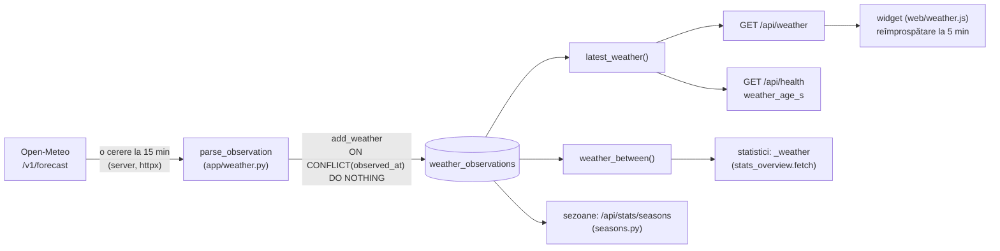

# Meteo

Această pagină descrie stratul meteo al Tabelei Gara de Nord: de unde vin datele, ce se stochează, cât de des se cere, cum apare widgetul, cum intră vremea în statistici și ce se întâmplă când sursa cade. Afirmațiile vin din cod; fișierele sunt indicate pe parcurs.

## Ce este și ce nu este

- **Sursa:** [Open-Meteo.com](https://open-meteo.com/), licență **CC BY 4.0** (atribuirea apare în widget, în subsolul paginii și în creditul panoului). Constanta `ATTRIBUTION` din `app/weather.py`.
- **Valorile sunt de model, nu de stație.** Valorile `current` sunt ultima valoare a modelului pentru celula de grilă din jurul coordonatelor, nu măsurători ale unei stații meteo. Fiecare rând are `kind = "model_current"`, iar interfața scrie „Condiții curente (model Open-Meteo)” (`LABEL_RO`).
- **Aceeași vreme pentru toate stațiile.** O singură pereche de coordonate (implicit București) servește toate statisticile.
- **Nu se afirmă nicio cauzalitate.** Comparațiile din statistici și din sezoane poartă nota „Corelație, nu cauzalitate” (`stats_overview._weather` și `seasons.NOTE`).
- **Nu influențează tabela.** Vremea rulează într-o sarcină asyncio proprie, independentă de poller-ul CFR. Eroarea meteo nu schimbă tabela și nu schimbă `ok` din `/api/health` (verificat: `/api/health` întoarce doar `weather_age_s`).

## Fluxul de date

Browserul nu cere Open-Meteo direct. Politica CSP păstrează `connect-src 'self'`, iar serverul face cererea.

## Ce se cere

Cererea (`request_params`, `app/weather.py`):

| Parametru | Valoare |
|---|---|
| `latitude`, `longitude` | `WEATHER_LAT` și `WEATHER_LON`, cu 4 zecimale (implicit `44.4323` și `26.1063`, București) |
| `current` | `temperature_2m,relative_humidity_2m,apparent_temperature,is_day,precipitation,rain,showers,snowfall,weather_code,surface_pressure,wind_speed_10m,wind_direction_10m,wind_gusts_10m` |
| `hourly` | `temperature_2m` |
| `timezone` | `UTC` |
| `forecast_days` | `2` |
| `User-Agent` | cu numele aplicației și atribuirea |

Adresa de bază: `WEATHER_URL` (implicit `https://api.open-meteo.com/v1/forecast`).

## Frecvența și limitele

| Constantă | Valoare | Sens |
|---|---|---|
| `DEFAULT_INTERVAL_S` | 900 (15 min) | interval după un succes; rezoluția Open-Meteo |
| `MIN_INTERVAL_S` | 300 (5 min) | nicio cerere mai deasă de 5 minute, nici după repornire |
| `MAX_BACKOFF_S` | 1800 (30 min) | plafonul backoff-ului la erori |
| `TIMEOUT_S` | 10 s | timeout per cerere |
| `MAX_BYTES` | 64 KiB | răspuns mai mare: eroare |
| `STALE_AFTER_S` | 2700 (45 min) | observație mai veche: „date vechi” |
| `UI_REFRESH_S` | 300 (5 min) | intervalul în care widgetul cere `/api/weather` |

La prima pornire, primul apel așteaptă până când au trecut cel puțin 5 minute de la ultima citire stocată (`start` din `app/weather.py`), deci o repornire nu declanșează o cerere imediată.

Configurarea din mediu (`config_from_env`):

| Variabilă | Implicit | Regulă |
|---|---|---|
| `WEATHER_ENABLED` | `1` | `0`, `false`, `no` sau `off` oprește serviciul; `/api/config` marchează widgetul ca dezactivat |
| `WEATHER_INTERVAL_S` | `900` | doar cifre; minimul efectiv este 300 |
| `WEATHER_LAT` | `44.4323` | între -90 și 90; altfel implicitul |
| `WEATHER_LON` | `26.1063` | între -180 și 180; altfel implicitul |
| `WEATHER_URL` | adresa Open-Meteo | șir gol → implicit |

Serviciul pornește doar când aplicația pornește și poller-ul (`start_poller` în `app/api.py`, linia ~282). În teste sau în modul fără poller nu se face nicio cerere.

## Ce se stochează

Tabela `weather_observations` (`app/store.py`):

- Un rând per **observație**, cu `observed_at` (UTC, `YYYY-MM-DDTHH:MM:SSZ`) **unic**. Cadența de 15 minute dă aproximativ 96 de rânduri pe zi. Inserarea este `ON CONFLICT(observed_at) DO NOTHING`: o observație deja stocată nu se suprascrie și `add_weather` întoarce `False`.
- Coloanele de bază (schema v4): `observed_at`, `fetched_at`, `source` (`open-meteo`), `kind` (`model_current`), `latitude`, `longitude`, `temperature_c`, `apparent_temperature_c`, `precipitation_mm`, `weather_code`, `wind_speed_kmh`, `wind_direction_deg`, `units_json`, `raw_json`.
- Coloanele din schema v8 (aditive, nullable; rândurile vechi rămân cu `NULL`): `relative_humidity_pct`, `is_day`, `rain_mm`, `showers_mm`, `snowfall_cm`, `surface_pressure_hpa`, `wind_gusts_kmh`, `hourly_json`.
- `raw_json` păstrează răspunsul fără seria orară. Unitățile se păstrează în `units_json`.

**Seria orară** (`hourly_json`): până la 25 de puncte, din ora observației înainte cu 24 de ore, ca JSON compact `{"start", "step_s": 3600, "t": [...]}`, cu `null` pentru orele lipsă și cu valorile de la coadă tăiate. Se păstrează doar pe **cea mai nouă** observație: `add_weather` îl șterge de pe celelalte. Este o prognoză afișată acum, nu istoric.

**Valori lipsă:** rămân `NULL`, niciodată 0. Precipitația 0,0 mm este o valoare reală și se păstrează ca atare.

## Parsarea și unitățile

`parse_observation` validează răspunsul:

- Lipsește blocul `current` → eroare (`WeatherError`), observația nu se salvează.
- `current.time` lipsă sau invalid → eroare. Dacă ora nu are fus, se aplică `utc_offset_seconds`.
- Răspunsul mai mare de 64 KiB, un HTTP diferit de 200, JSON invalid sau câmpul `error` → eroare.
- Unitățile se convertesc la unitățile interne (°C, km/h, mm, cm, hPa, %). O unitate necunoscută face ca valoarea respectivă să fie aruncată, cu avertisment în log, nu ghicită.
- `relative_humidity_pct` este păstrată doar între 0 și 100. `is_day` este acceptată doar dacă e 0 sau 1.
- Erorile unui bloc `hourly` nu oprește observația: `_hourly_series` întoarce `None` și observația se salvează fără serie.

## Ce vede utilizatorul

**Widgetul** (lângă ceas, în antet și în bara panoului; `web/weather.js`):

- pictograma după `weather_code` (variantă de zi sau de noapte după `is_day`, cu fallback la calculul astronomic `is_daytime` dacă `is_day` lipsește);
- temperatura și „se simte”;
- la apăsare sau hover, un popover cu umiditate, presiune, vânt (viteză, direcție în cuvinte și rafale), precipitații (ploaie, averse și zăpadă apar doar când sunt peste 0), graficul de temperatură pentru următoarele 24 de ore cu minim, maxim și marcajul „acum”, ora observației și sursa;
- după 45 de minute, starea devine gri („date vechi”); dacă reîmprospătarea eșuează, la fel.

Direcția vântului (`wind_direction_ro`) este **direcția din care bate**, în 8 sectoare de 45° (N, NE, E, SE, S, SV, V, NV).

**API:**

- `GET /api/weather`: `available`, `observed_at`, `observed_local`, `fetched_at`, `age_s`, `stale`, `kind`, `label_ro`, valorile curente, `condition_ro`, `icon`, `is_day`, `wind_direction_ro`, `hourly` (`start_utc`, `step_s`, `temperature_c`, `min_c`, `max_c`) și `attribution`. Fără rând: `available = false`, `stale = true`.
- `GET /api/config` → bloc `weather`: `enabled`, `stale_after_s`, `refresh_s`.
- `GET /api/health` → `weather_age_s` (fără efect asupra `ok`).

## Vremea în statistici

Vremea intră în două locuri, ambele doar ca asociere.

### Pagina Statistici (`app/stats_overview.py`)

- Fiecare călătorie numărată (secțiunea de statistici din `docs/statistici-calatorii-calitate.md`) primește cea mai apropiată observație meteo, **cel mult ±30 min** (`WEATHER_MATCH_MIN = 30`), față de ora programată.
- Ora programată este cea din `journeys.sched_at` fără moment de referință; în noaptea schimbării orei, aceeași oră locală apare de două ori și se poate alege apariția greșită. Sezoanele (secțiunea următoare) folosesc în schimb momentul citirii ca referință.
- Grupele: precipitații (`dry` = 0 mm, `wet` = peste 0 mm) și temperatură (sub 5 °C, 5–15 °C, 15–25 °C, 25 °C sau mai mult).
- Secțiunea apare ca „în curs de adunare” până când sunt **cel puțin 7 zile** (`WEATHER_MIN_DAYS`) cu călătorii potrivite și cel puțin **două grupe** cu N ≥ `STATS_MIN_SAMPLE` (implicit 5).
- Arhitectura pe panouri: sosirile și plecările se analizează separat; răspunsul are `status`, `matched`, `days`, `needed_days`, `observations`, `note` și `boards`.
- Pentru citirea meteo, statisticile folosesc o conexiune SQLite read-only, cu observațiile de la începutul perioadei minus o zi.

### Sezoane (`app/seasons.py`)

`GET /api/stats/seasons` compară sezoanele meteorologice (dec–feb, mar–mai, iun–aug, sep–nov) pe grupe de precipitații și temperatură. Regulile:

| Constantă | Valoare |
|---|---|
| `WEATHER_DAY_OBS` | 96 observații așteptate pe zi |
| `WEATHER_DAY_MIN_SHARE` | 0,5: o zi e eligibilă cu cel puțin 48 de observații |
| `SEASON_MIN_DAYS` | 30 zile eligibile per sezon, altfel „date insuficiente” |
| `SEASON_GROUP_MIN` | 30 călătorii per grupă, pentru comparație |
| `TIMETABLE_MARGIN_DAYS` | 7 zile excluse în jurul schimbărilor de orar |

Detaliile despre sezoane și despre data schimbării de orar din decembrie (lista `TIMETABLE_CHANGE_DATES` este goală) sunt în `docs/statistici-calatorii-calitate.md`, secțiunea 13.

## Eșecuri și comportament

| Situație | Ce se întâmplă |
|---|---|
| Open-Meteo răspunde cu HTTP diferit de 200, JSON invalid, eroare de transport sau timeout | `WeatherError`, avertisment în log, `failures` crește; nu se salvează nimic |
| Eroare în serie (`failures` consecutive) | pauză de 5, 10, 20, apoi 30 min (plafon), apoi reia |
| Succes după erori | intervalul revine la `WEATHER_INTERVAL_S` |
| Excepție neprevăzută în buclă | `supervise_weather` o înregistrează și repornește bucla, cu backoff pornind de la 5 s, dublat până la 30 min |
| Bucla se oprește neașteptat | repornire, cu aceeași politică |
| Oprirea aplicației | `WeatherService.stop` setează evenimentul și așteaptă 10 s; apoi anulează |
| Baza nu are rânduri | `/api/weather` întoarce `available: false`; widgetul arată „date vechi” sau lipsa datelor |
| Lipsește o valoare | `NULL`, afișată „—”, nu 0 |
| Observația e veche (peste 45 min) | `stale: true`; widgetul o arată gri |

Limitele sunt cele din cod: o cerere la cel mult 5 minute, inclusiv după repornire.

## Ce nu se afirmă

- Nu se afirmă că vremea „a cauzat” o întârziere. Notele din cod și din interfață o spun explicit.
- Nu se afirmă că valorile sunt măsurători ale unei stații meteo. Sunt date de model ale Open-Meteo.
- Nu se afirmă precizia prognozei orare, care e păstrată doar ca serie de afișare.
- Nu se afirmă că vremea de pe celula de grilă este cea de pe peron sau de la fiecare stație din rețea.
- Nu se afirmă o rată de succes a cererilor către Open-Meteo: din codul citit, erorile meteo nu se păstrează în baza de date; semnalele sunt logul și `weather_age_s`.

## Verificări și nesiguranțe

- README (secțiunea „Meteo”) spune că se stochează „un rând per oră de observație”. Codul stochează un rând per observație, cu cadența de 15 minute (`DEFAULT_INTERVAL_S = 900`), deci aproximativ 96 pe zi. Este o nepotrivire între README și cod; de corectat în README, nu în cod.
- Calea fișierului de mediu `/etc/tabela.env` este citată în README; nu am verificat-o pe server (de verificat pe serverul de producție: fișierul de unit systemd sau scriptul de deploy).
- Fereastra de ±30 min și pragurile de grupe din statistici sunt verificate în `app/stats_overview.py` și `app/seasons.py`; nu am verificat cum se randează graficele pe telefon (de verificat în `web/statistici.js` cu un browser).
