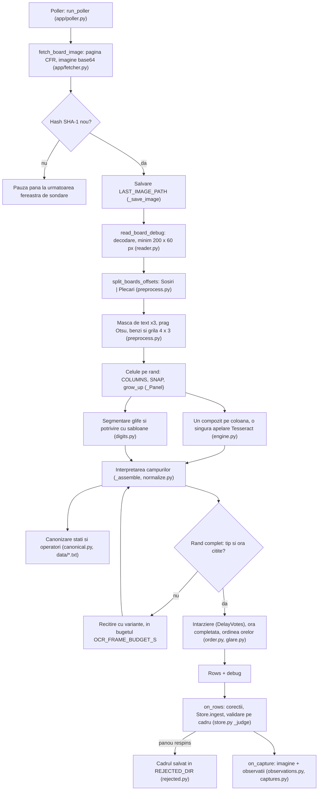
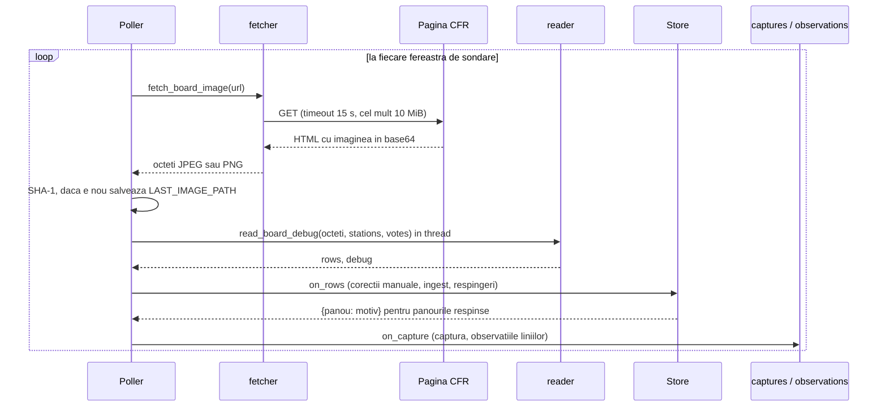

# Pipeline-ul OCR al tablei Gara de Nord

Acest document descrie, pas cu pas, cum ajunge o imagine a tablei CFR din Gara de Nord să devină
rânduri de tren (număr, tip, oră, întârziere, peron, stație, operator). Fiecare afirmație are în
spate o constantă sau o funcție din cod; acolo unde documentația din `README.md` sau din
`CHANGELOG.md` spune altceva, diferența e notată explicit.

Pipeline-ul este: **Tesseract** (motor OCR, pentru text) + **OpenCV** (preprocesare, segmentare)
+ **numpy** (șabloane de cifre, `digit_templates.npz`). Nu există rețea neuronală în producție.

> Acest document nu conține imagini ale tablei și nici date personale. Capturile reale sunt
> private; vezi `docs/capturi-si-confidentialitate.md`.

## Cuprins

1. [Harta fișierelor](#1-harta-fișierelor)
2. [Diagrama de ansamblu](#2-diagrama-de-ansamblu)
3. [Etapa 1: capturarea cadrului (poller și fetcher)](#3-etapa-1-capturarea-cadrului)
4. [Etapa 2: decodarea și împărțirea în două panouri](#4-etapa-2-decodarea-și-împărțirea-în-două-panouri)
5. [Etapa 3: preprocesarea (`app/ocr/preprocess.py`)](#5-etapa-3-preprocesarea)
6. [Etapa 4: grila 4×3 pe fiecare panou (12 rânduri)](#6-etapa-4-grila-43)
7. [Etapa 5: extragerea celulelor](#7-etapa-5-extragerea-celulelor)
8. [Etapa 6: apelul Tesseract și regula OMP_THREAD_LIMIT](#8-etapa-6-tesseract)
9. [Etapa 7: segmentarea cifrelor (`digits.segment_spans`)](#9-etapa-7-segmentarea-cifrelor)
10. [Etapa 8: potrivirea cu șabloane (`app/ocr/digits.py`)](#10-etapa-8-potrivirea-cu-șabloane)
11. [Etapa 9: interpretarea câmpurilor](#11-etapa-9-interpretarea-câmpurilor)
12. [Întârzierea: regulile complete](#12-întârzierea)
13. [Ora programată: completare din context și ordinea orelor](#13-ora-programată-completare-din-context-și-ordinea-orelor)
14. [Peronul și tăierea de bandă](#14-peronul-și-tăierea-de-bandă)
15. [Canonizarea stațiilor și operatorilor](#15-canonizarea)
16. [Rândul complet, starea de validare și încrederea](#16-rândul-complet)
17. [Bugetul de recitire (`OCR_FRAME_BUDGET_S`)](#17-bugetul-de-recitire)
18. [Validarea pe cadru și cadrele respinse](#18-validarea-pe-cadru)
19. [Clasificatorul experimental și antrenarea în mod umbră](#19-clasificatorul-experimental)
20. [Cum se măsoară acuratețea](#20-cum-se-măsoară-acuratețea)
21. [Probleme deschise, cunoscute](#21-probleme-deschise)
22. [Neconcordanțe între cod, README și CHANGELOG](#22-neconcordanțe)

---

## 1. Harta fișierelor

| Fișier | Rol în pipeline |
|---|---|
| `app/poller.py` | Buclă de sondare: când sosește o imagine nouă, o trimite la OCR și la validare. |
| `app/fetcher.py` | Descarcă pagina CFR și extrage imaginea (base64) din HTML. |
| `app/ocr/reader.py` | Orchestrarea: panouri, celule, Tesseract, interpretare, recitire, întârziere. |
| `app/ocr/preprocess.py` | Masca de text, detecția panourilor, a benzilor de rânduri și a grilei 4×3. |
| `app/ocr/engine.py` | Interfața `OcrEngine` și implementarea `TesseractEngine`. |
| `app/ocr/digits.py` | Segmentarea glifelor și potrivirea cu șabloane (`DigitMatcher`). |
| `app/ocr/digit_templates.npz` | Cele 12 șabloane (`+0123456789:`), 32×32 px, construite din panoul de sosiri. |
| `app/ocr/glare.py` | Ce se poate completa dintr-o celulă acoperită de reflexie sau de săgeata peronului. |
| `app/ocr/order.py` | Verificarea ordinii cronologice a orelor pe un panou. |
| `app/ocr/stats.py` | Statistici în memorie despre ultimele 60 de cadre (pentru `/api/health`). |
| `app/ocr/truth.py` | Setul de adevăr scris de mână: încărcare, scor, tabel. |
| `app/normalize.py` | Analiza textului: ora, întârzierea, peronul, tipul trenului, stația. |
| `app/canonical.py` | Forma canonică a stațiilor și operatorilor (potrivire fuzzy). |
| `data/operators.txt`, `data/stations_seed.txt` | Listele de nume cunoscute (cele văzute efectiv pe tablă). |
| `app/rejected.py` | Salvarea ultimelor 40 de cadre respinse, cu motivele. |
| `app/store.py` | Validarea pe cadru (`_judge`), istoricul serviciilor, stațiile învățate din istoric. |
| `app/observations.py` | Stocarea observațiilor OCR (o linie = o observație) și versiunea de procesare. |
| `app/captures.py` | Stocarea imaginii, retenția, overlay-ul din administrare. |
| `scripts/ocr_eval.py` | Măsurarea acurateței pe setul de adevăr. |
| `scripts/ocr_digit_clf.py` | Clasificator experimental de cifre (nu e folosit în producție). |
| `scripts/nightly_shadow_train.py` | Antrenare zilnică în mod umbră (nu promovează nimic). |
| `tests/test_ocr*.py`, `tests/ocr_truth_images.py` | Teste de regresie pe cadre reale, pragurile de acuratețe. |

## 2. Diagrama de ansamblu



Secvența completă, între sondare și stocare:



Punctul important: **OCR-ul rulează în thread separat** (`asyncio.to_thread`) și nu blochează
serverul. Bucla de sondare și validarea pe cadru sunt separate de statisticile și capturile, care
pot eșua fără să oprească tabela (`poller.py`: excepțiile din `on_capture` sunt înregistrate și ignorate).

---

## 3. Etapa 1: capturarea cadrului

### 3.1 Descărcarea (`app/fetcher.py`)

1. Pagina CFR (`SOURCE_URL`, implicit `https://cfr.ro/gari/camereweb/index.php?statie=BucurestiNord`)
   conține imaginea tablei ca `data:image/jpeg;base64,...` (sau PNG).
2. `_DATA_URI` (regex) caută prima astfel de imagine; șirul base64 este decodat, iar octeții trebuie
   să înceapă cu semnătura JPEG (`\xff\xd8`) sau PNG (`\x89PNG`), altfel este respinsă.
3. `image_hash` = SHA-1 al octeților. Același hash înseamnă aceeași imagine.

| Constantă | Valoare | Motiv (din cod) |
|---|---|---|
| `TIMEOUT` | 15.0 s | Cerere HTTP, fiecare |
| `MAX_BYTES` | 10 MiB | „pagina CFR încorporează imaginea în base64; refuz orice mai mare” |
| `USER_AGENT` | `tabela-gara-de-nord/1.0 (...)` | Identificare clară către CFR |

Răspunsurile cu cod ≥ 300 sunt erori de descărcare. Comentariul din cod spune că redirecționările
nu sunt urmate (`fetcher.py`, „errors and (unfollowed) redirects”); nu am verificat configurația
clientului HTTP din `poller`/`api`, deci nesigur dacă e totuși activată urmărirea lor.

### 3.2 Când se sondează (`app/poller.py`)

Tabla CFR își schimbă imaginea o dată pe minut, la o secundă aproximativ fixă. Poller-ul învață
această „fază” și sondează doar în jurul ei.

- `PhaseTracker` ține ultimele `HISTORY = 5` momente în care imaginea s-a schimbat (secunda din
  minut). Faza este media circulară (ca să nu se facă media între :59 și :00).
- Fereastra de sondare este `[faza − WINDOW_BEFORE, faza + WINDOW_AFTER]` = `[−1 s, +20 s]`.
- În fereastră se sondează la `IN_WINDOW_DELAY = 2.5 s`. Înainte de a învăța faza: `NO_PHASE_DELAY = 10 s`.
- Dacă imaginea nu s-a schimbat de `STALE_AFTER = 300 s`, sondarea încetinește la `STALE_DELAY = 30 s`.
- După o schimbare deja văzută în fereastră, poller-ul așteaptă până la începutul ferestrei următoare.

Limitele dure, indiferent de faza învățată:

| Limită | Valoare | Motiv |
|---|---|---|
| `MIN_GAP` | 2.0 s | Nu mai des de o cerere la 2 s |
| `MAX_PER_MIN` | 10 | Cel mult 10 cereri în orice fereastră de 60 s |
| `Backoff.fail` | 5 s × 2^n, plafon 300 s | După o eroare de descărcare |

### 3.3 Ce se întâmplă cu o imagine nouă

1. Dacă hash-ul diferă de cel precedent, imaginea este **salvată** în `LAST_IMAGE_PATH`
   (implicit `data/last.jpg`, pe server `/var/lib/tabela/last.jpg`). Fișierul este suprascris la
   fiecare imagine nouă. Nu este supus retenției (vezi `docs/capturi-si-confidentialitate.md`).
2. Hash-ul este reținut **chiar dacă OCR-ul eșuează**: „fără reîncercare la fiecare 2 s”.
3. Prima imagine după pornire nu este contorizată ca „schimbare” pentru faza tracker-ului.
4. `read_board_debug` rulează în thread. Dacă apare `OcrError` sau `ValueError` (imagine
   nedecodabilă), cadrul e salvat în `REJECTED_DIR` cu motivul `OCR failed: <tip>`, iar captura
   primește eroarea.

---

## 4. Etapa 2: decodarea și împărțirea în două panouri

### 4.1 Decodare (`reader._decode`)

- `cv2.imdecode` în `IMREAD_COLOR`. Imagini mai mici de **`MIN_WIDTH = 200` × `MIN_HEIGHT = 60`**
  px sunt respinse (`ValueError`): nu pot conține maketa tablei.

### 4.2 Două panouri: Sosiri (stânga) și Plecări (dreapta)

`BOARDS = ("arrival", "departure")` (`reader.py`). Ordinea de citire este stânga-dreapta.

`preprocess.split_boards_offsets` face:

1. Împarte imaginea în două jumătăți: `HALVES = ((0.0, 0.5), (0.5, 1.0))`.
2. În fiecare jumătate, calculează un „profil de margine” (`_edge_mask`): pixelii albaștri ai
   panoului (vezi 5.1), al căror nivel de valoare depășește `_EDGE_REL = 0.3` din diferența dintre
   întunericul din jur (percentila 10) și panoul luminat (percentila 90).
3. O coloană aparține panoului dacă cel puțin `_PANEL_MIN_FRAC = 0.25` din pixeli sunt albaștri.
4. Dacă intervalul găsit are peste jumătate din lățimea jumătății, jumătatea e restrânsă la
   interval, cu o margine de `_EDGE_PAD = 0.004` din lățime.

Returnează `(imagine panou, offset x)`. Offset-ul este păstrat ca să poată fi mapate casetele
celulelor înapoi pe imaginea originală (pentru overlay-ul din administrare).

---

## 5. Etapa 3: preprocesarea

Fișier: `app/ocr/preprocess.py`. Totul se exprimă ca fracțiuni din imagine sau se deduce din
pixelii ei, ca să funcționeze și la altă rezoluție.

### 5.1 Masca albastră și rândurile panoului

Pixelii panoului sunt identificați în HSV (OpenCV, H în 0..179):

| Constantă | Valoare | Rol |
|---|---|---|
| `_BLUE_H` | (95, 135) | Nuanța albastră a panoului |
| `_BLUE_S` | 90 | Saturație minimă |
| `_BLUE_V` | 40 | Valoare minimă |
| `_BLUE_V_REL` | 0.4 | Pentru rânduri: valoare de cel puțin 40% din percentila 90 a panoului (expunerea variază) |

`panel_rows`: un rând de imagine aparține panoului dacă `_PANEL_MIN_FRAC = 0.25` din pixeli sunt
albaștri; grupurile albastre mai scurte de `_MIN_GROUP_FRAC = 0.06` din înălțime sunt ignorate
(banda subțire a antetului de coloane).

### 5.2 Masca de text

- Luminozitatea textului = `min(G, R)` (`_brightness`). Textul alb și galben are valori mari;
  fundalul albastru și filigranul roșu au verde scăzut și cad.
- Imaginea este mărită de **`SCALE = 3`** ori (`INTER_CUBIC`). Toate măștile de text sunt la x3.
- Pragul de text, `text_level`, este **Otsu** pe pixelii panoului, dar cel puțin `max(40, percentila 50 + 20)`
  și cel mult 200 (`_LEVEL_MIN = 40`, `_LEVEL_MAX = 200`; jumătatea lui `_MIN_TEXT_CONTRAST` este 20).
  Dacă diferența dintre percentilele 50 și 99.5 e sub `_MIN_TEXT_CONTRAST = 40`, panoul e considerat
  fără text (prag 255).

De ce Otsu și nu un prag fix: expunerea camerei CFR variază (zi, seară, reglaj automat). Un prag
fix subțiază cifrele sau transformă separatoarele în text. Comentariul din cod spune același lucru.

### 5.3 Îndepărtarea liniilor verticale

`_drop_vertical_lines`: liniile verticale mai lungi de `_VLINE_FRAC = 0.6` din înălțimea medie a
grupului albastru sunt șterse din masca de **layout** (cea care decide benzile și coloanele).
Sunt reflexii și rosturi între modulele tablei. Masca de **text** le păstrează (o linie atinsă de
un „1” nu trebuie să șteargă cifra).

### 5.4 Benzile de rânduri (`row_bands`)

Histograma orizontală a cernelii, cu histerezis:

- Miezurile de rând: rânduri cu cerneală ≥ `max(low, _GAP_REL × P75)`, unde `low = max(2, 0.004 × lățime)` și `_GAP_REL = 0.15`.
- Fiecare miez crește în sus și în jos peste rândurile cu cerneală ≥ `_GROW_REL × rel` (`_GROW_REL = 1.0`), ca să nu fie tăiate vârfurile și bazele cifrelor.
- Două benzi care se întrepătrund sunt tăiate în rândul cel mai gol dintre ele.
- Fragmentele subțiri (sub 0.5 din mediana înălțimii, de ex. diacritice) sunt unite cu vecinul cel mai apropiat dacă distanța e ≤ `0.35 × mediana`.
- Benzile prea înalte (> 1.6 × mediana) sunt împărțite în `k` părți egale (`k = round(h / mediana)`).

### 5.5 Benzile validate pe structura 4×3

Vezi etapa 4.

### 5.6 Variantele de preprocesare (folosite doar la recitire)

`VARIANTS = ("vline", "lvl-", "x4", "lvl+", "adapt", "wide")`, încercate în ordinea aceasta
(`preprocess.variant_mask` și `reader._variant_cells`):

| Variantă | Ce schimbă | Scopul (din docstring-uri și din `_reread`) |
|---|---|---|
| `vline` | Șterge și liniile verticale de reflexie din masca de text | Reflexie verticală peste cifră |
| `lvl-` | Prag cu 15% mai mic (`max(30, 0.85 × prag)`) | Cifre subțiate |
| `x4` | Celulele sunt mărite de la x3 la x4 (`_X4 = 4/3`) înainte de Tesseract | Tesseract citește glife mai mari; în cod nu există o măsurătoare care să-i confirme efectul |
| `lvl+` | Prag cu 15% mai mare (`min(250, 1.15 × prag)`) | Fundal luminos, cifre îngroșate |
| `adapt` | Prag adaptiv gaussian (bloc 51, C = −12), combinat cu `0.6 × prag` | Expunere neuniformă |
| `wide` | Decupaj mai larg pe verticală (cu cel mult jumătate din spațiul dintre rânduri) | Vârfuri sau baze tăiate de bandă |

---

## 6. Etapa 4: grila 4×3

**Structura fizică**: fiecare panou are **4 grupuri albastre a câte 3 rânduri = 12 rânduri**
(`GROUPS = 4`, `ROWS_PER_GROUP = 3`, `EXPECTED_ROWS = 12`). Comentariul din `preprocess.py`
spune că structura a fost verificată pe 1143–1148 din 1149 de cadre din 21–22.10.2026.

`structured_bands(layout, rows)`:

1. Benzile găsite prin proiecție (5.4) sunt grupate pe cele 4 grupuri albastre.
2. Un grup care conține **exact 3** benzi păstrează benzile (calea „calibrată”).
3. Orice alt număr (linie slabă, goală, două rânduri unite, linie despicată) înseamnă că grupul
   primește **grila sa fixă**: `grid_bands`.
4. `grid_bands` împarte fiecare grup în trei, la rândul cel mai gol apropiat de treimi
   (fereastră `_CUT_WIN = 0.12` din înălțimea grupului), apoi taie fiecare bandă la cerneala ei
   (o bandă goală rămâne întreagă: e un rând gol, nu unul lipsă).

Validări ale grilei:

| Constantă | Valoare | Ce respinge |
|---|---|---|
| `_GROUP_SPREAD` | 1.35 | Grupuri de înălțimi prea diferite (nu e aspectul 4×3) |
| `_MIN_LINE_PX` | 4 px (×3 = 12 px în mască) | Pete în loc de rând |

Motivul: grila este derivată din **imaginea** panoului, nu din text. Un rând slab sau gol își
păstrează locul și nu dispare, nici nu se lipește de vecin. Așa rămâne fix indexul `row_index`
(0–11) al fiecărui rând, folosit mai târziu la ordinea orelor și la recitire.

`reader._Panel` număra `repaired` = numărul de grupuri reparate; apare în statistici (`groups_repaired`).

---

## 7. Etapa 5: extragerea celulelor

### 7.1 Coloanele

Fiecare rând are 7 coloane, date ca fracțiuni din lățimea panoului (`reader.COLUMNS`, calibrate
pe `board_1.jpg`; ambele panouri au același layout):

| Coloană | Fracții (de la, până la) | Conținut |
|---|---|---|
| `type` | 0.000 – 0.090 | Tipul trenului (IR, R, RE, RM, IC, …) |
| `no` | 0.090 – 0.200 | Numărul trenului |
| `station` | 0.200 – 0.510 | Stația |
| `operator` | 0.510 – 0.755 | Operatorul |
| `time` | 0.755 – 0.866 | Ora programată |
| `delay` | 0.866 – 0.946 | Întârzierea |
| `platform` | 0.946 – 1.000 | Peronul |

### 7.2 Marginile dintre coloane (`_cell_edges`)

Marginile interne se pot muta, pentru fiecare rând, cu cel mult `SNAP = 0.012` din lățimea
panoului, către coloana de pixeli **cea mai goală** (textul uneori atinge coloana următoare).
Cerneala se măsoară doar în banda rândului.

### 7.3 Celulele unui rând (`_Panel.cells`)

- Fiecare celulă = banda rândului × intervalul coloanei, din masca de text x3.
- Pentru **peron** (`GROW_UP = ("platform",)`) și pentru a doua variantă a **orei** (`GROW_ALT = ("time",)`),
  se calculează și o copie „crescută în sus” (`grow_up`, cu cel mult `PLATFORM_UP = 0.35` din
  înălțimea rândului). Cheia copiei de oră este `time^` (`ALT = "^"`).
- De ce: pe partea dreaptă a tablei cifra peronului stă mai sus decât rândul (perspectivă), iar
  banda o taie. Copia crescută păstrează doar cerneala care atinge celula originală, ca să nu
  intre cifra rândului de deasupra. Comentariul cu „audit OCR13: 8 → 3, 9 → 3, 6 → 5” descrie
  cazul care a motivat schimbarea.

### 7.4 Casetele (`_Panel.boxes`, pentru overlay)

Caseta fiecărei celule = intervalul real al glifelor (`cell_span`, extins peste cerneala care
iese din bandă, `extend_span`, cu cel mult `_EXTEND_MAX = 0.35` din înălțimea benzii) plus
`BOX_MARGIN = 1` px. Casetele sunt salvate în debug (`fields.*.bbox`) și desenate în
pagina „Capturi OCR”.

### 7.5 Compozitul: o apelare Tesseract pe coloană

`_Composite` pune celulele unei coloane **una sub alta**, cu pas fix `pitch = 1.5 × înălțimea
maximă`, cu margine albă `_PAD = 12` px. Tesseract rulează **o singură dată pe coloană** pentru
toate cele 24 de rânduri (12 pe panou), nu o dată pe celulă. Cuvintele returnate sunt puse
înapoi pe linii după centrul casetei: `slot = (top + height/2 − _PAD) // pitch`.

Rezultatul pe coloană este (text, încredere medie) pe slot, cu cuvintele în ordinea de citire.

---

## 8. Etapa 6: Tesseract

### 8.1 Apelul (`app/ocr/engine.py`)

`TesseractEngine.read_cells` apelează `pytesseract.image_to_data` cu:

- `config = "--psm 6"` (un bloc uniform de text: compozitul), plus `-c tessedit_char_whitelist=...` când coloana are listă permisă;
- `timeout = TESSERACT_TIMEOUT = 10` s per apel (în cadrul recitirii se reduce la restul bugetului, minimum 1 s);
- erorile (`RuntimeError` pentru timeout, `TesseractError`, `OSError` pentru binar lipsă) devin `OcrError`.

`reader._TESS` (lista permisă și limba, per coloană):

| Coloană | Listă permisă | Limbă |
|---|---|---|
| `type` | `*IRNECMD` | `eng` |
| `no` | `0123456789` | `eng` |
| `station` | (fără) | `ron+eng` |
| `operator` | (fără) | `ron+eng` |
| `time` | `0123456789:` | `eng` |
| `delay` | `0123456789+` | `eng` |
| `platform` | `0123456789` | `eng` |

Pe server se instalează `tesseract-ocr` și `tesseract-ocr-ron` (`deploy/install.sh`). Calea
binarului vine din `TESSERACT_CMD` (implicit `tesseract`).

Motorul este înlocuibil: `read_board(imagine, engine=...)`. Preprocesarea și interpretarea nu
depind de motor (`engine.py`, docstring).

### 8.2 Tesseract nu decide singur

Pentru coloanele numerice, Tesseract este **al doilea** cititor. Textul lui e acceptat doar când
șabloanele nu sunt sigure și Tesseract confirmă (vezi etapa 9). Pentru coloana tipului, stația și
operatorul, textul Tesseract este folosit ca atare, dar stația și operatorul trec prin canonizare
(etapa 15).

### 8.3 Regula OMP_THREAD_LIMIT=1

Regula este: **Tesseract rulează cu `OMP_THREAD_LIMIT=1`**, mai ales pe server, și **nu**
în paralel nelimitat. Motivul, din `scripts/ocr_eval.py` și din planul de lucru
`docs/superpowers/plans/2026-10-27-backlog-wave.md`: „o rulare paralelă a blocat OCR-ul live 16 min”.

Cum este respectată:

- `scripts/ocr_eval.py` setează `os.environ["OMP_THREAD_LIMIT"] = "1"` și rulează în `NPROC` procese (implicit 4).
- `scripts/ocr_digit_clf.py` setează `setdefault("OMP_THREAD_LIMIT", "1")`, iar `NPROC` implicit este 3.
- `tests/test_corrections_browser.py` și `tests/test_ocr_platform_cut.py` îl precizează în mediu.
- **Serviciul de producție nu îl setează**: `deploy/tabela.service` are doar `EnvironmentFile=/etc/tabela.env`,
  iar în codul `app/` nu există nicio atribuire a variabilei. Regula este deci o procedură de rulare,
  nu una aplicată de cod. Nesigur: dacă `/etc/tabela.env` de pe server o conține; de verificat pe server.

---

## 9. Etapa 7: segmentarea cifrelor

Funcția `digits.segment_spans(cell)` împarte o celulă (negru pe alb) în glife normalizate.
Este același lucru ca `segment`, plus intervalul x al fiecărei glife și un indicator „fuzionată”.

Pași:

1. **Componente conexe** (`connectivity=8`) pe cerneală. Componentele sub `0.015 × h_ref²` (zgomot)
   sunt ignorate, `h_ref` fiind cea mai înaltă componentă.
2. **Unirea componentelor care se suprapun** orizontal peste jumătate din lățimea celei mai înguste
   (`:` sunt două puncte; o cifră poate fi două componente).
3. **Lipirea cifrei tăiate de rost** (`_glue_seam_split`). Rostul dintre modulele tablei taie
   uneori ultima cifră a numărului în două. Constantele:

   | Constantă | Valoare | Ce înseamnă |
   |---|---|---|
   | `SEAM_SPAN` | 0.85 | Cele două bucăți împreună au cel mult 0.85 din înălțimea rândului (o cifră are ~0.75) |
   | `SEAM_GAP` | 0.13 | Bucățile sunt la cel mult 0.13 din înălțime una de alta |
   | `STEM_MIN_H` | 0.75 | Piciorul unui „1” are aproape toată înălțimea rândului |
   | `FLAG_MAX_H`, `FLAG_MAX_TOP`, `FLAG_MAX_GAP` | 0.45, 0.35, 0.10 | Steagul „1”: scurt, sus, lipit de picior |
   | `STEM_MAX_W` | 0.40 | Piciorul e subțire |
   | `BAR_MAX_TOP` | 0.10 | Bara de sus a unui „7” tăiat de rost |

   Motivul, din docstring: fără lipire, „3021” devenea „302”, „1661” devenea „166”, „9101”
   devenea „9104”, iar „7909” devenea „79091” (sau „79111” când rostul era de 2–4 px).
4. **Fragmente nule** (sub 0.15 din înălțimea rândului atât pe înălțime, cât și pe lățime) sunt eliminate. La fel
   fragmentele subțiri verticale (`SEAM_MAX_W = 0.08`) care stau între două glife: sunt rostul, nu o cifră.
   Fragmentele de la capătul textului **nu** se elimină (ar putea fi un „1” lângă o reflexie).
5. **Cifre lipite** (`_split_touching`): o componentă mai lată de `WIDE = 1.0` × înălțimea
   rândului conține mai multe glife. Numărul de glife este `round(w / (PITCH × h))`, cu
   `PITCH = 0.78` (pasul fix al fontului), iar tăierile sunt la coloanele cele mai subțiri.
6. **Normalizare**: fiecare glifă, pe înălțime, la `GLYPH_H = 32` px, centrată pe lățime `GLYPH_W = 32`.

Flag-ul „fuzionată” (`fused`) este adevărat când glifa a fost tăiată dintr-o componentă cu mai
multe glife (de exemplu dintr-o pată de reflexie). Astfel de glife cer un prag mai strict
(`FUSED_MIN_SCORE = 0.80`, `FUSED_MIN_MARGIN = 0.10`, în `glare.py`).

---

## 10. Etapa 8: potrivirea cu șabloane

### 10.1 Șabloanele (`app/ocr/digits.py`, `digit_templates.npz`)

- Cele **12 clase**: `+0123456789:` (`labels`), fiecare un șablon mediu de 32×32 px (`templates`).
- Construite din **panoul de sosiri** (`boards = ['arrival']`). Panoul de plecări a rămas neatins,
  ca verificare pe date nevăzute (`DEFAULT_BOARDS`, testul `test_digit_templates_generalise_to_held_out_board`).
- Refacerea: `python -m app.ocr.digits IMAGINE GOLDEN_JSON [panou ...]`. `build_templates` face
  media glifelor pe clase, din celule a căror lungime a segmentării este egală cu textul cunoscut.

### 10.2 Scorul

`DigitMatcher._scores`: `cv2.matchTemplate(..., TM_CCOEFF_NORMED)` pentru fiecare șablon permis
de coloană, pe glifă cu o margine de `_SHIFT = 2` px (toleranța de aliniere). Scorul este
corelația, între 0 și 1.

`classify` întoarce (cel mai bun caracter, scorul lui, **marja** față de al doilea).

| Constantă | Valoare | Ce înseamnă |
|---|---|---|
| `MIN_SCORE` | 0.60 | Corelație sub care o glifă nu e crezută |
| `MIN_MARGIN` | 0.04 | Diferență sub care al doilea șablon e un „egal” (5 vs 6 despicat de o linie de rând) |

`glyph_trusted(score, margin) = score ≥ 0.60 and margin ≥ 0.04`.

`DigitMatcher.near(glifă)` întoarce **toate caracterele** cu scorul în `MIN_MARGIN` față de cel
mai bun. Acestea sunt „egalurile” în care șabloanele nu se pot decide.

`DigitMatcher.read(celulă)` întoarce `(text, cel mai slab scor, trusted)`: `trusted` este adevărat
doar când **toate** glifele sunt sigure.

### 10.3 Dacă șabloanele nu pot fi încărcate

`reader._get_matcher` prinde `OSError, KeyError, ValueError`, scrie un avertisment și continuă
cu `matcher = None`. Atunci câmpurile numerice vin doar de la Tesseract, iar întârzierea cu trei
cifre devine necitită. Avertismentul spune că „acuratețea va scădea”.

---

## 11. Etapa 9: interpretarea câmpurilor

Funcția centrală este `reader._assemble`, care primește textul Tesseract `tess` și celulele
`cells` și întoarce intrarea de debug a liniei. Pentru fiecare câmp: `raw` (text ca l-a citit
OCR-ul), `norm` (valoarea normalizată), `conf` (0–100), `bbox`.

### 11.1 Câmpurile numerice: `no`, `time`, `platform` (`_numeric`, `_numeric_read`)

Ordinea, pentru un câmp numeric:

1. `matcher.read(celulă)` dă textul din șabloane și flag-ul `trusted`.
2. Dacă textul e gol **și** celula nu are cerneală, rezultatul este gol (nu cifra inventată de Tesseract).
3. Dacă șabloanele nu sunt sigure și există o copie crescută (`alt`), se încearcă și aceasta (doar dacă e sigură și, la oră, dacă e o oră validă).
4. **Șabloane sigure**: se ia textul șabloanelor. Dacă Tesseract spune la fel, se ia și încrederea lui; altfel încrederea e cel mai slab scor × 100.
5. **Șabloane nesigure**:
   - dacă `_confirmed` (Tesseract confirmă fiecare glifă nesigură, la aceeași poziție), se ia textul șabloanelor;
   - la `no` cu o ultimă glifă „fâșie” (`_edge_sliver`), se ia textul Tesseract;
   - pentru `no` și `platform` (`NEAR_TIE_ONLY`), textul Tesseract se ia **doar** dacă e o egalitate
     între șabloane (`_near_tie`); altfel câmpul e necitit;
   - pentru `time`, se ia textul Tesseract.

Constante ale acestor reguli:

| Constantă | Valoare | Motiv (din docstring) |
|---|---|---|
| `NEAR_TIE_ONLY` | `("platform", "no")` | Comentariul din cod (Task 2.3): din numerele etichetate, 20 din 1415 erau greșite, iar în toate cazurile era vorba de textul Tesseract nevalidat peste o glifă nesigură |
| `SLIVER_MAX_SCORE` | 0.40 | O „glifă” de final, care nu seamănă cu nicio cifră… |
| `SLIVER_MAX_W` | 0.15 | …și e îngustă (× înălțimea celulei) |
| `FRAGMENT_MAX_H` | 0.25 | O „glifă” cu cerneală sub 25% din înălțimea rândului e o fâșie, nu o cifră |
| `LOST_INK` | 0.08 | Segmentarea pierde cel mult 8% din cerneală (peste: celula e necitită) |
| `SPECK_MAX_H` | 0.30 | O glifă sub 30% din înălțimea celulei e o pată, nu o cifră |
| `NO_FLOOR` (comentariu) | `MIN_SCORE` | La număr, Tesseract nu confirmă o glifă care nu seamănă cu niciun șablon |

**Ora** (`_time_colon`, `normalize.parse_time`): trei cifre devin `H:MM` (colonul e pierdut
de segmentare). O citire din șabloane care nu e oră validă nu înlocuiește o oră validă a Tesseract.
`parse_time` acceptă `H:MM`, `HH:MM` sau `HHMM`, cu confuziile `O→0`, `l/I/|→1`, `S→5`, `B→8`
aplicate doar în câmpuri numerice. Ora trebuie să fie `h ≤ 23` și `mm ≤ 59`.

**Numărul** (`no`): `_train_no` ia cifrele; zero înseamnă `None`. Numărul trebuie să fie citit
pentru ca rândul să fie complet (`_complete`).

### 11.2 Tipul trenului (`normalize.resolve_type`, `strip_flag`)

- Asteriscul (`*`, de la început sau de la sfârșit) este scos și marchează rândul `flagged`.
- `normalize_type`: litere mari, cu `l | 1 → I` și `0 → O`. Tipurile valide: `IR, IRN, R, RE, RM, IC, EC, EN, D`.
- Două corecții, **măsurate pe date live** (raport din 21.10.2026):
  - `I` pe un număr de **3 cifre** devine `IC` (531, 536, 553, 571, 581, unde în toate celelalte citiri e IC);
  - `RN`, `RND`, `RNE`, `RIM`, `RR` pe un număr `79xx` devin `RM` (navetă aeroport).
- Orice altceva rămâne necitit. Nimic nu este ghicit.

### 11.3 Peronul (`normalize.parse_platform`, `reader._platform_checked`)

- `parse_platform`: cifre, valoare între **1 și `PLATFORM_MAX = 14`** (liniile din Gara de Nord).
  Orice altceva e o citire greșită și rămâne necitit.
- Verificarea formei (`_platform_checked`), detaliată în etapa 14.

### 11.4 Stația și operatorul

- `clean_station`: NFKD, fără diacritice, majuscule, spații unice, fără caractere de la margini.
- `clean_operator`: NFKD, spații unice, fără caractere de punctuație de la margini (nu se pune
  în majuscule; forma canonică vine din `data/operators.txt`).
- Apoi canonizarea (etapa 15).

---

## 12. Întârzierea

Este cea mai delicată parte: o întârziere citită greșit (de exemplu „+465” în loc de „+65”)
apare public ca adevăr. Regula de bază: **o întârziere necitită rămâne necitită, nu devine 0 și
nu e ghicită**.

### 12.1 Ce înseamnă o celulă de întârziere

- Tabla afișează **„+” și 1–3 cifre** (`DELAY_MAX_DIGITS = 3`, adică 1 până la 999 min).
- **Celula goală înseamnă „la timp”**: `parse_delay("")` întoarce **0**. Este o citire reală, nu lipsă.
- `None` înseamnă necitit. Nu există stare intermediară pe câmpul `delay`.
- Un text care nu conține nicio cifră („SOS”) nu e întârziere, ci `None`.
- Valoarea maximă acceptată: `MAX_DELAY = 999`.

### 12.2 Pașii din `reader._delay_cell`

1. Fără șabloane: doar Tesseract. Trei cifre → necitit (`three_digits`); altfel textul lui.
2. Fără glife (celulă goală): `""`, adică 0 (la timp).
3. **Prima glifă trebuie să fie „+”**, sigură sau cu forma crucii (`digits.is_plus`). Altfel `no_plus`.
4. Două „+” în celulă: `plus_twice`.
5. Numărul de cifre (glifele după „+”) trebuie să fie între 1 și 3: altfel `digits`.
6. Cifrele: o cifră **nesigură** este acceptată doar dacă Tesseract o citește la aceeași poziție;
   o cifră tăiată dintr-o pată (`fused`) trebuie să fie **clar** potrivită
   (`FUSED_MIN_SCORE = 0.80`, `FUSED_MIN_MARGIN = 0.10`, în `glare.py`).
7. **Trei cifre** (≥ 100 min) cer ca toate glifele să fie sigure **și** ca cele două citiri să fie de acord (`three_digits`).

### 12.3 Motivele de necitire (`fields.delay.check`)

| Motiv | Când apare | Efect |
|---|---|---|
| `no_plus` | Prima glifă nu e „+” | Necitit; Tesseract-ul văzut e păstrat ca `seen` (pentru votul „+ ascuns”) |
| `plus_twice` | Două „+” | Necitit |
| `digits` | Număr de cifre în afara 1–3 | Necitit |
| `three_digits` | Trei cifre fără acord deplin | Necitit; poate avea un `candidate` (vezi 12.5) |
| `glare` | O cifră tăiată dintr-o pată, nesigură | Necitit |
| `count` | Tesseract nu are același număr de cifre | Necitit |
| `disagree` | O cifră nesigură pe care Tesseract o citește altfel | Necitit |
| `not_step` | Întârzierea nu e multiplu de 5 | Necitit (`DELAY_UNREAD`, `None`) |

`DELAY_UNREAD = "+?"` este textul unei celule necitite; `parse_delay` îl face `None`.

**`DELAY_STEP = 5`**: tabla numără întârzierile din **5 în 5 minute**. Constanta este justificată în
cod: „fiecare întârziere din setul de adevăr și 99.8% din citirile live”. O valoare neîmpărțită la
5 este o cifră citită greșit (de exemplu „+46”, „+26”, „+6” din auditul live din 21–26.10).

### 12.4 Recitirea întârzierii (`_reread_delays`)

Celulele de întârziere necitite (motiv setat) sunt recitite cu variantele
`DELAY_VARIANTS = ("lvl+", "vline", "lvl-", "adapt")`, atât timp cât rămân cel puțin **1 s** din
bugetul cadrului. O citire nouă este acceptată **doar dacă trece aceleași reguli** ca prima trecere.
Altfel rămâne necitită și primește `retry = {attempts, variant: None}`.

### 12.5 Întârzierea de 100–199 min (`_hundreds_candidate`, `DelayVotes`)

Problemă: pe tabla reflectată, pata albă acoperă vârful cifrei din mijloc și un singur cadru dă
alternativ 100, 160 sau 180 (CHANGELOG, Beta 1.17). Un singur cadru nu este sigur.

- **`_hundreds_candidate`** produce un candidat „+1xy” doar când celula are exact 4 glife, „+” și
  „1” sunt sigure și nu sunt fuzionate, ultima cifră e sigură, iar Tesseract citește trei cifre care
  încep cu „1”. Candidatul **nu este o citire**.
- **`DelayVotes.apply`** (pe toată durata poller-ului, în memorie): pentru fiecare tren (cheie
  `(panou, număr, oră programată)`) ține ultimele `VOTE_WINDOW = 7` cadre. Candidatul devine
  întârziere doar dacă apare de **cel puțin `VOTE_MIN = 4` ori și în majoritate strictă**
  (`2 × n > len(istoric)`). Exemplul din docstring-ul clasei: pe cadrele reale ale trenului IRN 401 (+100 pe tablă, 23.10),
candidații au fost 100 de 8 ori, 160 de 3 ori și 150 o dată. Valoarea 160 nu câștigă niciodată.

### 12.6 „+” ascuns sub săgeata peronului (`_seen_value`, `_vote_seen`)

Când trenul primește peron, tabla desenează o săgeată peste „+”, iar „+15” apare ca „◄5”.
Cifrele pe care le vede Tesseract, votate pe ultimele `SEEN_WINDOW = 12` cadre, sunt întârzierea
dacă:

- `SEEN_MIN = 8` cadre din 12 spun aceeași valoare (1–2 cifre, multiplu de 5, > 0);
- valoarea nu e mai mică decât ultima întârziere citită sigur (`_last`): o întârziere nu se micșorează
  la o valoare recuperată.

Regula se aplică **doar** motivului `no_plus`, nu și `glare`. Comentariul spune de ce: la pată,
ambele citiri pot fi de acord pe o cifră ascunsă greșit (6 → 8).

Docstring-ul citează auditul live din 21–26.10: 20 din 23 de cazuri „neconfirmate” se încadrau în
această regulă.

### 12.7 Întârzierea acoperită de reflexie: „ultima citire” (`_infer`)

Când celula este respinsă pentru **`glare`** sau **`no_plus`** și cifra unităților (0 sau 5)
se vede clar (`glare.delay_tail`: ultima glifă sigură din {0, 5}, confirmată de Tesseract),
întârzierea este cea din cadrele dinainte, dacă **ultimele `INFER_STABLE = 3`** citiri sigure ale
trenului sunt **aceeași valoare** care se termină în cifra respectivă.

| Constantă | Valoare | Rol |
|---|---|---|
| `INFER_CHECKS` | `("glare", "no_plus")` | Motivele pentru care se aplică |
| `INFER_STABLE` | 3 | Câte citiri reale trebuie să fie egale |
| `INFER_MAX_RUN` | 30 | Cel mult 30 de cadre la rând deduse |
| `INFER_CONF` | 55.0 | Încrederea câmpului (amber pe overlay) |
| `INFERRED` | `glare_inferred` | Marcaj în `fields.delay.check` și în versiunea de procesare |

Rândul devine `uncertain`. Zona zecilor de sub pată **nu** se citește niciodată („+15” dădea
45, 75, 465, 85 în istoric). Presupunerea „+ ascuns = plus” se justifică prin datele din cod:
„pe sosiri nu există întârzieri negative (0 din 101 532 de citiri)”.

Un tren fără istoric rămâne necitit.

### 12.8 Memoria votului între cadre

`DelayVotes` este creat în `run_poller` și trăiește cât procesul. La repornire se pierde.
Starea ținută per tren:

| Structură | Ce ține | Când se șterge |
|---|---|---|
| `_hist` | ultimele 7 candidați | trenul dispare de pe tablă |
| `_seen` | ultimele 12 valori văzute | la fel |
| `_last` | ultima întârziere citită sigur | la fel |
| `_reads` | ultimele 3 citiri reale | la fel |
| `_run` | câte cadre la rând au fost deduse | la fel |
| `_times` | ultimele 6 ore curate per (panou, număr) | după 12 cadre fără tren |

---

## 13. Ora programată: completare din context și ordinea orelor

### 13.1 Ora completată (`reader._fill_times`, `glare.py`)

Caz: rândul are tip și număr, dar **ora** nu se citește, pentru că o pată acoperă două puncte
(„7:37” devine „7▪37”). Până acum rândul era necitit și trenul lipsea de pe tablă.

Pașii (`glare.time_candidates`, `pick_time`):

1. Fiecare glifă este **sigură** sau **joker** (cel mult `MAX_WILDCARDS = 1` joker de cifră; două puncte
   pot fi orice, pentru că sunt pata). Cel puțin `MIN_TRUSTED = 2` glife sigure.
2. Din glife rezultă candidați „H:MM” sau „HH:MM”, cu toate cifrele jokerului (0–9).
3. Candidații trebuie să se potrivească între **vecinii** de deasupra și de dedesubt (ordinea
   cronologică a panoului, `glare.fits`). Dacă există o oră „indicată” de istoricul trenului
   (`time_hint`, cel puțin 3 citiri identice din ultimele 6 cadre), ea câștigă doar dacă e singura
   compatibilă.
4. Rezultatul e acceptat doar dacă este **unic**. Un candidat cu joker de cifră rămâne doar când
   **ambii** vecini îl mărginesc (`pick_time`). Altfel: necitit.

Rândul completat este `uncertain`, cu încredere limitată la `REPAIRED_CONFIDENCE = 0.65` (sub
pragul de 0.7 pentru un serviciu nou, `CONFIRM_CONFIDENCE`), iar `fields.time.check = "glare_filled"`.

### 13.2 Ordinea cronologică (`app/ocr/order.py`)

Trenurile unui panou sunt sortate cronologic, cu un singur „wrap” la miezul nopții. O oră citită
greșit (5/6, 3/8, 0/8) iese din ordine.

- `out_of_order`: indicii rândurilor care nu fac parte din **cea mai lungă secvență nedescrescătoare**
  (calcul O(n²) pe cele 12 rânduri). Un vecin greșit nu condamnă rândurile din jur.
- `_repair`: se încearcă **o singură** schimbare de cifră între perechile din `CONFUSABLE`
  (`08, 38, 56, 35, 68, 89, 09, 17, 14`), care se potrivește între cei mai apropiați vecini
  care nu sunt condamnați de ordine. Dacă există exact una, ora e reparată și marcată `order_fixed` (încredere cel mult `REPAIRED_CONFIDENCE = 0.65`).
- Altfel: `order` și încredere cel mult `SUSPECT_CONFIDENCE = 0.6`. Nu se schimbă niciodată un
  nume de serviciu deja stocat; rândul e doar marcat.

Date din docstring: „283 din 81 823 de rânduri interioare erau în afara ordinii, aproape toate greșeli”.

---

## 14. Peronul și tăierea de bandă

Aceasta este problema cea mai mare deschisă (vezi etapa 21). Explicația pe scurt:

1. **Cauza fizică**: rostul dintre modulele tablei taie uneori cifra peronului, iar reflexia acoperă
   vârful cifrei, mai ales pe partea dreaptă, unde cifra stă mai sus decât rândul (perspectivă).
2. **Ce face codul**:
   - celula peronului se extinde în sus (`grow_up`, etapa 7.3);
   - citirea se face cu **șabloane**; Tesseract doar **alege între șabloane aproape egale**
     (`_near_tie`) și doar când șabloanele au scor ≥ `MIN_SCORE` (CHANGELOG, Beta 1.39);
   - o glifă „fâșie” (sub `FRAGMENT_MAX_H`) nu e cifră;
   - o pată întinsă într-o glifă (`_speck`) face celula necitită;
   - un „8” cere gaura de jos (`_signature` și `_fits`, regula R22 din cod), ca o pată să nu devină „8”;
   - dacă glifele nu se aliniază cu segmentarea, celula e necitită (`test_glyphs_not_aligned…`).
3. **Recuperare**: o celulă necitită primește cifra șabloanelor doar dacă există **un singur
   candidat** plauzibil. Cu mai mulți, rămâne necitită (CHANGELOG, Beta 1.39: „cu mai mulți candidați, celula rămâne necitită”).

Ce se poate verifica pe datele salvate în repo (`tests/fixtures/ocr_truth/baseline-1.31.json`,
măsurat cu commit-ul `c81b602`, `ocr-tess-grid-5`):

- platformă, pe cele 42 de cadre adăugate în Task 2.1 (11 locale și 31 de pe server): **986 corecte, 13 necitite, 8 greșite**;
- lista `platform_cut` conține **19 cadre** (acord cu `NOTE-2026-10-27.md`).

---

## 15. Canonizarea

Fișiere: `app/canonical.py`, `app/normalize.py`, `data/operators.txt`, `data/stations_seed.txt`.

### 15.1 Listele

| Fișier | Conținut | Număr de intrări (fără comentarii) |
|---|---|---|
| `data/operators.txt` | Operatori văzuți pe tablă (forma afișată) | 7 |
| `data/stations_seed.txt` | Stații văzute pe tablă, forma `clean_station` | 46 |

Operatorii din listă: `CFR Calatori`, `Regio Calatori`, `Transferoviar`, `InterRegional`,
`Astra Trans Ca`, `Softrans Calat`, `Ferotrafic` (forma trunchiată a coloanei este canonică).

Stațiile **învățate** din istoric (`Store.known_stations`):

- doar nume salvate exact cum le-a citit OCR-ul (`station = station_raw`);
- văzute la cel puțin **2 trenuri distincte** (`min_services = 2`) și în cel puțin **2 zile distincte** (`min_days = 2`);
  - cel mult `KNOWN_STATIONS_MAX = 2000`, filtrate de `_protect_learned`: fără caractere ciudate
    (litere, cifre, spații, cratime), și fără nume aflate la o greșeală de OCR (`near_name`) de o stație
    din lista curată sau de un nume învățat mai frecvent;
  - recalculate o dată pe oră (cache pe zi și oră), pentru că poller-ul le cere înainte de fiecare imagine.

### 15.2 Potrivirea (`canonical._best`)

| Caz | Scor | Condiție |
|---|---|---|
| Identic după cheie | 1.0 | `_key` (ASCII, minuscule, fără punctuație) |
| Spațiere greșită | `SPACING_SCORE = 0.95` | Aceleași litere, spații mutate („AD JUD” → ADJUD) |
| Un caracter în plus la sfârșit | `TAIL_SCORE = 0.90` | „ARAD E” → ARAD, „RUSE I” → RUSE |
| Altfel | `difflib.SequenceMatcher.ratio()` | Doar dacă `_same_words` trece (la stații) |

`_same_words` (doar pentru stații) respinge o potrivire care schimbă cuvintele: trebuie același
număr de cuvinte, iar fiecare cuvânt se poate abate cu cel mult `max(1, lungime // 5)` editări
(o literă în plus sau în minus doar la cuvinte de cel puțin 6 litere). Exemplele din docstring
care sunt **respinse**: „VATRA DORNEI” pentru „VATRA DORNEI BAI”, „CLUJ NAPOCA EST” pentru „CLUJ NAPOCA”,
„PITESTI SUD” pentru „PLOIESTI SUD”, „CRAIOVITA” pentru „CRAIOVA”. **Acceptate**: „BRASOY” → „BRASOV”
și ultimul cuvânt tăiat la marginea celulei („VATRA DORNEI BA” → „VATRA DORNEI BAI”).

**Pragul**: `DEFAULT_THRESHOLD = 0.82`, la stații și la operatori.

- Peste prag: se ia forma canonică. Dacă scorul e sub 1.0, rândul e `uncertain` (`s_score < 1.0`).
- Sub prag: se păstrează textul citit (curățat), iar scorul e marcat ca atare. Textul brut
  rămâne în `station_raw`/`operator_raw` și în baza de date (schema v3).

Stațiile: întâi lista curată (`preferred`), apoi lista învățată. Astfel o greșeală care a intrat
în istoric („BRASOY”) tot se rezolvă la forma curată.

Operatorii: aceeași idee, dar **fără** `_same_words` (lista lor e mai scurtă).

---

## 16. Rândul complet

### 16.1 Când există un rând (`reader._assemble`)

- `row` există dacă **tipul** și **ora** sunt citite (`train_type` și `sched` nenule).
- `_complete` (numărul trenului citit) decide doar dacă linia poate fi recitită și dacă intră în
  ramura de completare a orei. **Nesigur**: un rând cu tip și oră, dar fără număr (`train_no = 0`),
  este returnat de `read_board_debug` ca `row` și ajunge la `Store.ingest` dacă încrederea e ≥ 0.5.
  Nu am găsit un filtru pe `train_no = 0` în `reader.py` sau în `Store._split`; de verificat în `store.py` (`ingest`, `_judge`).
  Starea de validare a observației este în schimb `incomplete` pentru un rând fără număr (vezi 16.3).
- `delay_min` = `delay` sau 0 când `delay` e `None`, cu `delay_read = (delay is not None)`.
  Rândul cu întârziere necitită are `delay_read = False`.

### 16.2 Încrederea

`conf` = media încrederilor câmpurilor (Tesseract sau șabloane, `/100`), limitată la [0, 1].
`uncertain` devine adevărat când stația a fost corectată (`s_score < 1.0`), operatorul e sub prag,
ora e completată din context sau ordinea a marcat-o.

### 16.3 Starea de validare a observației (`observations.validation_state`)

| Stare | Când | Efect |
|---|---|---|
| `incomplete` | Nu există rând complet | Observație păstrată, fără legătură cu un serviciu |
| `rejected_low_conf` | `confidence < MIN_CONFIDENCE = 0.5` | Nu creează și nu schimbă servicii |
| `uncertain` | `uncertain` sau întârziere necitită | Se afișează marcată |
| `ok` | Altfel | Folosită la statistici |

`MIN_CONFIDENCE = 0.5` este în `store.py`, iar `CONFIRM_CONFIDENCE = 0.7`: un serviciu **nou**
citit sub 0.7 cere o a doua citire consecutivă.

---

## 17. Bugetul de recitire

### 17.1 Ce se recitește

Un rând **cu text**, dar fără tip, număr sau oră (`_RETRY_COLS = ("type", "no", "time")`),
este recitit cu variantele din 5.6, pe **coloanele respective** (nu pe tot rândul).

`MAX_RETRY_LINES = 4`: dacă un panou are mai mult de 4 rânduri necitite, cadrul e considerat
stricat (un JPEG trunchiat, o glitch) și **nu** se recitește, pentru că recitirea ar inventa
rânduri. Așa spune codul.

### 17.2 Bugetul

- **`FRAME_BUDGET_S = 8.0`** secunde de OCR per cadru, **inclusiv** recitirile. Variabila de mediu
  `OCR_FRAME_BUDGET_S` îl suprascrie (`frame_budget()`; valoare invalidă → implicit).
- Cadrul întreg are circa 60 s, pentru că imaginile vin o dată pe minut (`FRAME_BUDGET_S` comentariul).
- Înainte de fiecare variantă se estimează costul (`est`, inițial `prima_trecere × 3/7`) și se
  oprește dacă `t + est > buget`.
- Fiecare apelare Tesseract primește ca timeout cel mult restul bugetului, dar cel puțin 1 s.
- Recitirea oprită de buget lasă liniile ca `unread`. Nu se inventează nimic.

### 17.3 Ce se acceptă din recitire (`_merge`)

- **Doar** coloanele care nu au citit la prima trecere pot primi valoare nouă. O valoare citită
  deja nu se înlocuiește.
- Dacă o variantă **pierde o glifă** a primei treceri (`_lost_ink`: începutul sau sfârșitul
  glifelor e cu mai mult de jumătate de înălțime înăuntru), varianta e respinsă. Motivul din
  docstring: un rest de reflexie din prima cifră dispare sub „lvl+”, iar restul se citește ca
  valoare sigură, dar greșită (exemplul din cod: „4:37” devine „7:37”).
- Rândul recitit trebuie să fie **complet** și **să nu dubleze** un alt rând al aceluiași panou
  (`_duplicate`: aceeași număr ca alt rând = citirea vecinului, nu a acestuia).
- Valorile citite la prima trecere trebuie să rămână neschimbate.

Recitirile au `retry = {attempts, variant}` în debug. `variant = None` înseamnă că nicio variantă
nu a reușit. Versiunea de procesare a observației păstrează aceste informații
(`+retry:<variantă>:<încercări>`).

---

## 18. Validarea pe cadru

Două niveluri: validarea rândurilor (în OCR) și validarea panoului (în `store.py`).

### 18.1 Panoul, în `Store._judge`

Un cadru este judecat **pe panou**. Un panou respins păstrează starea sa bună anterioară, iar
trenurile lui nu dispar („GONE”).

| Constantă | Valoare | Regula |
|---|---|---|
| `MIN_ROWS` | 4 | Un cadru acceptat are cel puțin 4 rânduri sigure pe panourile acceptate |
| `MIN_BOARD_ROWS` | 2 | Fiecare panou acceptat are cel puțin 2 rânduri |
| `PARTIAL_BASE` | 6 | Gardă de citire parțială activă de la 6 rânduri |
| `PARTIAL_FRAC` | 0.5 | Un panou care scade sub jumătate din numărul bun anterior e „parțial” |
| `PARTIAL_ACCEPT_AFTER` | 10 | …dar după 10 cadre la fel de mici se acceptă (chiar s-a golit) |
| `PANEL_ROWS` | 12 | Tabla are mereu 12 rânduri |
| `GONE_AFTER_MISSES` | 3 | Un tren dispare după 3 citiri în care lipsește |

Motiv (CHANGELOG, Beta 1.18): panoul LIVE arăta uneori 13 trenuri, deși tabla are 12 rânduri;
un tren care dispare e trecut „plecat” abia după 3 citiri, ca o citire greșită să nu-l scoată
și să-l readucă. Această regulă e în `GONE_AFTER_MISSES`.

### 18.2 Cadrul respins, salvat (`app/rejected.py`)

Un panou respins sau un cadru care a eșuat în OCR este salvat în `REJECTED_DIR`
(implicit `/var/lib/tabela/rejected`, pe server; `REJECTED_DIR=""` îl dezactivează):

- imaginea (octeții descărcați) + un JSON cu `ts` și `reasons` (de ex. `"arrival": "partial read (3 of 12 rows)"`);
- numele fișierului: `AAAAMMDDTHHMMSSmmmZ.jpg` (UTC, cu milisecunde);
- se păstrează ultimele **`REJECTED_KEEP = 40`** perechi; restul sunt șterse după număr (nu după vârstă).

Scopul, din `rejected.py`: „diagnosticarea greșelilor OCR (citiri parțiale, panouri necitite)”.
Directorul e creat cu `0750`; un symlink sau un fișier în locul directorului e refuzat.

---

## 19. Clasificatorul experimental

### 19.1 Ce este și ce **nu** este

- `scripts/ocr_digit_clf.py` este un **clasificator de cifre experimental** (MLP mic, numpy),
  antrenat pe glifele extrase din capturi.
- **Nu afectează tabla live.** Verificări din cod:
  - nicio linie din `app/` nu importă `ocr_digit_clf` sau `nightly_shadow_train` (căutare în tot `app/`, `deploy/`, `web/`);
  - `app/ocr/digit_templates.npz` nu e scris de clasificator (`nightly_shadow_train.py`, docstring: „Nu se atinge: app/ (inclusiv app/ocr/digit_templates.npz)”);
  - `decide()` din `nightly_shadow_train.py` întoarce mereu `promovez: False`, `decizie: "nu promovez"`.
- Singura cale de rulare automată este serviciul `tabela-shadow-train.service` (ExecStart: `scripts/nightly_shadow_train.py`),
  pornit de `tabela-shadow-train.timer` la **03:30**, cu `Persistent=true`, `Nice=19`, `IOSchedulingClass=idle`, timeout 2 h.

### 19.2 Pașii (`ocr_digit_clf.py`)

| Comandă | Ce face |
|---|---|
| `extract IMG_ROOT DB_JSON OUT_DIR` | Citește fiecare captură cu cititorul actual (`read_board_debug`, buget 60 s), extrage celulele numerice (`no`, `time`, `delay`, `platform`) și glifele, și le leagă de `observations` |
| `label OUT_DIR [VERIFIED.csv]` | Eticheta „silver” |
| `verify OUT_DIR [N]` | Listă de verificare umană a celulelor contestate |
| `truth OUT_DIR` | Glifele setului de adevăr scris de mână |
| `train OUT_DIR` | Antrenează MLP-ul și raportează acuratețea |

### 19.3 Regulile de etichetare (`label`)

Eticheta silver = citirea actuală a cititorului = citirea salvată în observație, **în format valid**
(`_format_ok`: `no` 3–5 cifre, `time` `H:MM`/`HH:MM`, `delay` `+N`, `platform` 1–2 cifre), iar numărul
de glife este egal cu lungimea textului. Celulele care nu îndeplinesc asta sunt **contestate**, cu
un motiv: `dezacord`, `segmentare`, `slab`, `format`, `pete`, `recitit`, `fara observatie`, `nelizibil`
(marcat `?`). Glifa e „slabă” dacă scorul < 0.60 sau marja < 0.04 (valori scrise direct în
`label`, nu importate din `digits.py`).

**Limită importantă** (și scrisă în `LIMITS` din `nightly_shadow_train.py`): eticheta silver nu este
o verificare independentă, ci acordul dintre **același** cititor și observațiile salvate. Nu este
verificată de om.

### 19.4 Modelul

`mlp_fit`: un strat ascuns de **128** unități (ReLU), ieșire pe cele 12 clase, Adam
(`lr = 2e-3`, β 0.9/0.999), `wd = 1e-4`, lot de 256, **30 de epoci**, semințe fixe (`seed=0`).
`TEST_SHARE = 5`: un cadru din 5 (după hash-ul numelui cadrului) merge în setul de test.

### 19.5 Ce scrie seria de noapte

`nightly_shadow_train.run` scrie în `WORKDIR` (implicit `/var/lib/tabela/shadow`):

- `export.json` (capturile și observațiile citite din baza de date, `mode=ro`);
- `run/` (glife și etichete; se șterge la fiecare rulare);
- `model-AAAA-LL-ZZ.npz` (greutăți);
- `report-AAAA-LL-ZZ.json` (acurateți, decizia, limitele).

Raportul compară clasificatorul cu motorul pe setul scris de mână, cu `SIGNIFICANT = 0.005`
(0.5 puncte procentuale). Decizia este mereu „nu promovez”, cu motivul scris.

---

## 20. Cum se măsoară acuratețea

### 20.1 Setul de adevăr scris de mână (`tests/fixtures/ocr_truth/truth.json`)

- **59 de cadre**, **1416 linii** (24 pe cadru: 12 pe panou). Fiecare câmp a fost verificat
  cu ochiul pe imagine, nu luat din baza de date și nici din cititor.
- Cheile cadrelor sunt căile fără `.jpg` (de ex. `ocr12/...`, `glare/...`, `ocr_truth/srv/...`).
  Prefixul `ocr_truth/` înseamnă imagine **privată** (vezi `docs/capturi-si-confidentialitate.md`).
- Convențiile:
  - `"?"` (sau lipsa câmpului): nu se notează (nu se vede nici pe imagine: sticlă, mișcare);
  - `null` la peron: celula e goală pe tablă (peron încă nedeterminat);
  - `delay: 0`: fără întârziere afișată.
- Număr de valori etichetate per câmp (calcul făcut pe fișier): `no` 1415, `time` 1409, `type` 1413,
  `platform` 1415, `delay` 1412, `station` 1416, `operator` 1416.

### 20.2 Scorul (`app/ocr/truth.py`)

Pentru fiecare celulă etichetată:

- **ok**: valoarea citită e egală cu eticheta (inclusiv `None` == `None`, adică „goală” corect);
- **necitit** (`unread`): cititorul dă `None` acolo unde tabla arată o valoare;
- **greșit** (`wrong`): orice altă valoare, inclusiv o valoare inventată pe o celulă goală.

Precizia unui câmp este `ok / (ok + necitit + greșit)`. Un cadru sau o linie lipsă din predicții
contează ca necitit pe fiecare câmp cu valoare (și ca ok pe un câmp a cărui etichetă e goală,
pentru că `None == None`). Comentariul din `truth.py` spune că un necitit este onest, iar un greșit
este publicat, de aceea greșelile sunt numărate separat.

### 20.3 Instrumentele

```text
python scripts/ocr_eval.py predict OUT.json [IMG_DIR]   # citește fiecare cadru din setul de adevăr
python scripts/ocr_eval.py score   OUT.json [INAINTE.json]   # tabel, cu comparație înainte/după
```

- Imaginile se caută în `tests/fixtures/<cale>.jpg` sau, pentru `ocr_truth/...`, în `OCR_TRUTH_DIR`
  (implicit `tests/fixtures/ocr_truth/private/`).
- `predict` rulează în `NPROC` procese (implicit 4), cu `OMP_THREAD_LIMIT=1`. **Diferență față de producție**:
  `ocr_eval` folosește `budget_s=60.0`, nu cei 8 s ai serverului. Cifrele de măsurare nu sunt deci
  identice cu ce vede tabla live (documentație în cod, nu în README).
- `score` afișează pentru fiecare câmp: `n`, `ok`, `necitit`, `greșit`, `acuratețe`, și lista greșelilor.

### 20.4 Testele de regresie

- `tests/test_ocr14.py` rulează cititorul pe **toate** cadrele din `truth.json` și compară cu pragurile:

  | Câmp | `MAX_WRONG` (cel mult greșite) | `MIN_OK` (cel puțin corecte) |
  |---|---|---|
  | `no` | 0 | 379 |
  | `time` | 4 | 381 |
  | `type` | 2 | 383 |
  | `platform` | 0 | 382 |
  | `delay` | 0 | 374 |
  | `station` | 3 | 381 |
  | `operator` | 5 | 382 |

  **Nesigur și important**: docstring-ul din `test_ocr14.py` spune „16 capturi, 384 de linii”,
  dar fișierul are acum 59 de cadre și 1416 linii. Pragurile `MIN_OK` (≈ 380 pe fiecare câmp)
  par calibrate pe 384 de linii: pe cele 1415 valori de „no” etichetate, pragul de 379 corecte
  acoperă doar ~27%. Verificare necesară: rulați testul cu cadrele reale și comparați cu valorile măsurate.

- `tests/test_ocr_platform_cut.py`: înregistrează `baseline-1.31.json` (`OCR_RECORD_BASELINE=1`, numai
  intenționat) și verifică fiecare cadru de peron tăiat, numărul de plecări la rândurile 9 și 11, și
  o serie de teste unitare pe forma cifrelor (`_fits`, `_signature`, `_decided`, `is_plus`).
- `tests/test_ocr.py`: pe `board_1.jpg` cu `board_1.json` (24 de rânduri), precizia pe câmpuri
  numerice și pe text, plus teste de benzi, de masca de text și de nivelul pragului.
- `tests/test_ocr13.py`, `test_ocr12.py`, `test_glare.py` etc.: cadre cu cazuri măsurate.

### 20.5 Setul de verificare pe date nevăzute (hold-out)

- `tests/fixtures/ocr_truth/holdout/holdout.json`: **21 de cadre, 504 linii**, de pe server (22–27.10.2026),
  etichetate **orbește** de un etichetator distinct de cei care au scris codul. Fiecare cadru este la
  cel puțin 60 de minute de cadrele din `truth.json`. Potrivit `holdout/README.md`, pentru
  alegerea cadrelor s-au privit doar imaginile, nu rezultatul cititorului.
- Holdout-ul nu a fost folosit la reglare (`CHANGELOG`, Beta 1.39: „0 cifre greșite la peron”).
- README-ul din holdout spune că scorul s-a făcut cu „un script extern (nu e în repo)”. Deci
  nu există un instrument în repo care să reproducă acel scor. **Nesigur**: cum se calculează
  exact cifra din CHANGELOG pe hold-out.

### 20.6 Statistici în exploatare (`app/ocr/stats.py`)

Nu măsoară acuratețea, ci **starea pe ultimele 60 de cadre** (`WINDOW = 60`, „cam o oră”):

- `unread_rate_1h`: proporția liniilor de text rămase necitite (rândurile goale nu contează);
- `full_frames`: câte cadre au avut 12/12 rânduri pe ambele panouri;
- durata OCR (p50, max) și timpul de recitire.

Este în memorie (se resetează la repornire) și apare în `/api/health` și în pagina de administrare.

---

## 21. Probleme deschise

Lista de mai jos este strânsă din `CHANGELOG.md` și din testele cu pragurile „left wrong”. Fiecare
element indică sursa. Nu e o listă completă: cadrele greșite necunoscute nu sunt aici.

### 21.1 Numere de tren stabil greșite: IR 1584 în loc de 1581

- **Simptom**: aceeași cifră greșită în toate cadrele, deci votul în timp nu o corectează.
  Exemple din documentație: `IR 1584` în loc de `IR 1581`, `7911` în loc de `7914`, `1574` în loc de `1571`.
- **Sursa**: CHANGELOG, Beta 1.27 (linia despre „vot pe caractere: nu s-a livrat”, „numerele greșite
  stabile … sunt la fel în toate cadrele”) și Beta 1.24 („cer vot pe caractere”); Beta 1.29 (linia despre
  corecția manuală din administrare, „pentru numerele pe care OCR le citește mereu la fel de greșit”).
- **Stare**: **nerezolvat în cod**. Există corecție manuală din pagina „Capturi OCR” (`corrections`), care
  nu schimbă textul brut OCR, ci aplică o regulă.
- **Date**: în setul de adevăr, `no` are `MAX_WRONG = 0` în `test_ocr14.py`, dar comentariul spune
  „number under glare (4)” lăsat greșit. Vezi 22.4 și 22.5.
- **Date din CHANGELOG (Beta 1.27)**: 9 cadre din 69 030 aveau un număr diferit de al serviciului.

### 21.2 Peron tăiat sau acoperit: aproximativ 15 trenuri?

- **Nu am găsit** cifra „~15 de trenuri” în `CHANGELOG.md` sau `README.md`. Documentația spune
  că „coloana peron citită tăiat/acoperită de reflexii (cadrul 7028) nu poate fi citită” (CHANGELOG, Beta 1.24).
- Cifrele măsurate sunt cele din secțiunea 14: 19 cadre în lista `platform_cut`, 13 necitite și 8 greșite
  pe cele 42 de cadre adăugate în Task 2.1. **Nesigur**: dacă „15 trenuri” vine dintr-un raport de exploatare care nu e în repo.
- Pe 42 de cadre măsurate la `c81b602`, cele 8 greșeli de peron sunt liste în `test_ocr_platform_cut.py`
  (`CUT_WRONG`), iar testul cere acum „eticheta corectă sau `None`”, nu o valoare greșită.

### 21.3 Confuzia „8” cu „3” (și 6 cu 5)

- **Sursa**: CHANGELOG, Beta 1.16 (rezolvat parțial prin `grow_up`) și comentariul din `test_ocr14.py`:
  „Left wrong: number under glare (4), 8 read 3 (time 2, platform 1)”.
- **Inconsistență**: comentariul spune „platform 1”, dar `MAX_WRONG["platform"] = 0`. Nesigur
  dacă e rămășiță veche sau dacă testul de peron nu trece încă.
- Cauza: vârful cifrei „8” e tăiat de bandă sau pătat, iar gaura de jos nu se vede. Regula R22
  (`_fits`) și `_signature` previn transformarea în „8” fără gaura de jos, dar nu previn „8” → „3”
  când gaura de jos nu se vede deloc.

### 21.4 Reflexie și întârzieri

- Întârzierile de 100+ min acoperite de reflexie: se citesc doar cu vot pe 4 din 7 cadre
  (CHANGELOG, Beta 1.17). Pe cadrele reale, 100 e citit în 5 din 12 cadre, iar 160 și 180 nu sunt
  acceptate niciodată.
- „+65 → +465” și „+20 → +240” (pata lipită de „+”, două cifre): rămân refuzate, fără candidat de vot.
- Celule goale sub reflexie: rămân goale (CHANGELOG, Beta 1.39). Pe primul rând de sosiri, reflexia
  ceasului din sticlă (27.10, ~07:30–07:50) a acoperit „+” și prima cifră (CHANGELOG, Beta 1.27).
- Fără pre-procesare anti-reflexie: pixelii reflexiei au aceeași luminozitate ca textul
  („min(R,G,B) 200–240”), nu pot fi separați (CHANGELOG, Beta 1.27).

### 21.5 Ordinea orelor și completarea

- O oră completată din context are încredere 0.65 și e marcată `uncertain`. Pe un singur
  vecin, nu se completează o cifră ascunsă (regula din `pick_time`).
- Nu există în repo o măsură a cât de des verificarea ordinii repară greșit sau condamnă un rând
  corect. **Nesigur**; de verificat pe cadrele din setul de adevăr.

### 21.6 Clasificatorul

- Nu e promovat și nu e folosit. Rezultatele lui nu se pot compara cu cititorul de producție
  până când eticheta silver nu e verificată de om (`LIMITS`).

---

## 22. Neconcordanțe

Verificate în cod. Nu le-am corectat în `README.md` sau în `CHANGELOG.md` (nu fac parte din sarcină).

1. **Stațiile învățate**: `README.md` (secțiunea „OCR și canonicalizare”) spune „seen on at least 2 services”
   (văzute la cel puțin 2 servicii). Codul (`store.known_stations`) cere **2 trenuri distincte** și
   **2 zile de serviciu distincte** (`COUNT(DISTINCT train_no) >= 2 AND COUNT(DISTINCT service_date) >= 2`).
2. **Versiunea de procesare**: `README.md` dă ca exemplu `ocr-tess-grid-2`. Codul are
   `PROCESSING_VERSION = "ocr-tess-grid-5"` (`app/observations.py`), iar comentariul de acolo
   spune că versiunea 5 e din Beta 1.31.
3. **Stațiile seed**: `CHANGELOG`, Beta 1.06, spune „lista de stații cunoscute are acum 45 de nume reale”.
   Fișierul `data/stations_seed.txt` are **46** de linii care nu sunt comentarii. Diferența de o unitate
   nu se explică din documentație. **Nesigur**: dacă a fost adăugată o stație după CHANGELOG.
4. **Pragurile din `test_ocr14.py`** sunt documentate pentru **16 capturi / 384 de linii**, dar setul
   din `truth.json` are **59 / 1416**. Vezi 20.4.
5. **Comentariul „platform 1” din `test_ocr14.py`** nu se potrivește cu `MAX_WRONG["platform"] = 0`. Vezi 21.3.
6. **Regula OMP_THREAD_LIMIT=1**: documentată în `ocr_eval.py` și în planul de lucru ca regulă pentru server,
   dar `deploy/tabela.service` nu o setează, iar codul din `app/` nu o aplică. Vezi 8.3.
7. **Hold-out**: `CHANGELOG` (Beta 1.39) spune „0 cifre greșite la peron” pe hold-out, dar
   scorul se face cu „un script extern (nu e în repo)” (`holdout/README.md`). Nu se poate reproduce din repo.
## Cum se reproduce o măsurare locală

1. Instalați Tesseract cu limba română (`tesseract-ocr`, `tesseract-ocr-ron`) și setați `TESSERACT_CMD` dacă e nevoie.
2. Puneți imaginile setului în `tests/fixtures/` (cele publice) și în `OCR_TRUTH_DIR` (cele private).
   Repo-ul nu conține niciun `.jpg`: fără imagini, testele care le folosesc sar cu motiv.
3. `OMP_THREAD_LIMIT=1 python scripts/ocr_eval.py predict /tmp/rezultat.json` (pe mașina de dezvoltare;
   pe server nu se rulează paralel, vezi 8.3). Calea de ieșire folosiți-o într-un director temporar, nu în repo.
4. `python scripts/ocr_eval.py score /tmp/rezultat.json` pentru tabel; cu o a doua rulare ca
   al doilea argument, pentru comparație înainte/după.
5. `pytest tests/test_ocr14.py tests/test_ocr_platform_cut.py` pentru pragurile de regresie.

Nu rulați `OCR_RECORD_BASELINE=1` decât intenționat: rescrie `baseline-1.31.json`.
