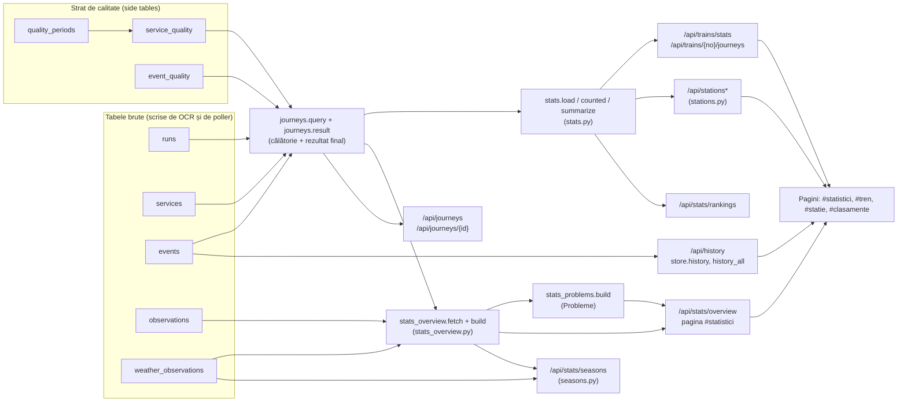

# Statistici, călătorii și calitatea datelor

Această pagină descrie cum se construiesc cifrele din Tabela Gara de Nord: catalogul de trenuri, călătoriile și rezultatul lor final, stațiile, statisticile și formulele lor, graficele din pagina `#statistici`, exporturile, predicția (care nu este publică), votul de consens și stratul de calitate a datelor. Fiecare prag și fiecare formulă citată provine din cod; fișierul sursă este indicat lângă fiecare secțiune.

Principii comune, valabile peste tot:

- **Întârzierea este cea citită pe panoul din București Nord**, nu întârzierea reală în alte stații și nu ora reală de sosire sau plecare.
- **Lipsa unei citiri nu înseamnă 0.** O întârziere necitită apare ca `null`, „necunoscut” sau „—”, niciodată ca 0.
- **Sosirile și plecările nu se amestecă** niciodată într-o cifră sau într-un clasament.
- **Fiecare cifră are N** (numărul de călătorii din spatele ei).
- **Sub pragul minim de eșantion** se arată doar cifre brute (număr, medie, mediană, maxim); procentele și p90 se retrag.
- **Fantomele** (rânduri citite greșit de OCR, fără tren real) și, implicit, **perioada de calitate redusă** sunt excluse din toate statisticile publice.
- **Corelație, nu cauzalitate.** Nicio pagină nu afirmă că un factor (vremea, operatorul, tipul trenului) produce întârzierea.

## Cuprins

1. [Cum circulă datele: schema generală](#1-cum-circulă-datele-schema-generală)
2. [Catalogul de trenuri (`/api/trains*`)](#2-catalogul-de-trenuri-apitrains)
3. [Călătoriile și rezultatul final (`app/journeys.py`)](#3-călătoriile-și-rezultatul-final-appjourneyspy)
4. [Stațiile (`app/stations.py`, `/api/stations*`)](#4-stațiile-appstationspy-apistations)
5. [Statistici: formule, praguri, N (`app/stats.py`)](#5-statistici-formule-praguri-n-appstatspy)
6. [Pagina Statistici: graficele pe rând](#6-pagina-statistici-graficele-pe-rând)
7. [Secțiunea „Probleme” (`app/stats_problems.py`)](#7-secțiunea-probleme-appstats_problemspy)
8. [Istoric: `/api/history` și toate zilele](#8-istoric-apihistory-și-toate-zilele)
9. [Exporturi CSV](#9-exporturi-csv)
10. [Ultima citire sigură a întârzierii](#10-ultima-citire-sigură-a-întârzierii)
11. [Consensul pe 15 citiri (`app/consensus.py`)](#11-consensul-pe-15-citiri-appconsensuspy)
12. [Stratul de calitate a datelor (`app/quality.py`, schema v7)](#12-stratul-de-calitate-a-datelor-appqualitypy-schema-v7)
13. [Sezoane și comparația cu vremea (`app/seasons.py`)](#13-sezoane-și-comparația-cu-vremea-appseasonspy)
14. [Predicția întârzierii finale (`app/predict.py`) — nepublică](#14-predicția-întârzierii-finale-apppredictpy--nepublicată)
15. [Limitare cunoscută: statisticile citesc `services` direct](#15-limitare-cunoscută-statisticile-citesc-services-direct)
16. [Variabile de mediu](#16-variabile-de-mediu)

---

## 1. Cum circulă datele: schema generală

Diagrama de mai jos arată din ce tabele se calculează fiecare cifră și pe ce cale ajunge până pe pagină. Tabelele `services`, `events`, `runs` și `observations` sunt scrise de OCR; `service_quality`, `event_quality` și `quality_periods` sunt straturile de calitate (vezi secțiunea 12); `weather_observations` vine din Open-Meteo.



Două reguli de cod stau în spatele diagramei:

- Toate interogările publice filtrează cu `quality.public_services_where()` (`app/quality.py`): exclud fantomele (`service_quality.ghost = 1`) și, dacă `STATS_INCLUDE_LOW_QUALITY` nu este `1`, și perioada de calitate redusă (`low_quality = 1`).
- Pagina `#statistici` citește printr-o **conexiune SQLite separată, doar pentru citire** (`file:…?mode=ro`, `app/stats_overview.py`, funcția `_reader`), ca să nu blocheze ingestia OCR. Pentru o bază în memorie (teste) se folosește conexiunea store-ului, sub lock.

---

## 2. Catalogul de trenuri (`/api/trains*`)

Sursa: `app/trains_api.py` și `app/observations.py` (secțiunea „public catalog reads”).

Catalogul este public și read-only. Nu conține imagini și nu conține text OCR brut. `journeys` (călătorii, din `services`) și `observations` (citiri OCR) sunt raportate ca **numere separate**.

### Endpoint-uri

| Metodă și rută | Ce întoarce | Parametri și limite |
|---|---|---|
| `GET /api/trains` | `{"trains": [...], "n": N}`, cele mai recent văzute primele | `query` (max. 40 caractere): prefix de număr dacă sunt doar cifre, altfel subșir în stații sau operatori. `limit` implicit 50, între 1 și 200 (`TRAINS_MAX`). Eroare 422 la valori invalide. |
| `GET /api/trains/{no}` | catalogul trenului plus `journeys_list` (cel mult 200, `JOURNEYS_MAX`), cele mai noi primele, și `journeys_truncated` | `no`: cifre, cel mult 6 caractere, între 1 și 999999. 404 dacă trenul nu a fost observat. |

Un element din `trains` are câmpurile `train_no`, `first_seen`, `last_seen`, `operators`, `routes`, `journeys` și `observations`. Intră doar trenurile cu `journeys > 0`: trenurile care au existat doar ca fantome sau citiri întâmplătoare sunt ascunse.

Pentru `/api/trains/{no}`, fiecare călătorie din `journeys_list` are `board`, `service_date`, `train_type`, `sched_time`, `station`, `operator`, `status`, `observations` (numărul de citiri OCR ale călătoriei) și `low_quality`. Spre deosebire de statistici, **catalogul nu exclude perioada de calitate redusă**: o marchează cu `low_quality: true`. Fantomele sunt excluse (`COALESCE(q.ghost, 0) = 0`).

### Endpoint-uri de statistici pe tren

Acestea sunt în `app/stats_api.py` și folosesc aceiași parametri ca `/api/stats/overview` (vezi secțiunea 5):

| Rută | Conținut |
|---|---|
| `GET /api/trains/stats` | Un rând per (număr de tren, panou): N, calitatea, statisticile și trendul pe 14 zile. Parametru `query` (max. 40): cifre = prefix de număr; text = stație sau operator (LIKE cu escape). `format=csv` produce `trenuri.csv`. |
| `GET /api/trains/{no}/journeys` | Profilul unui tren: `entries` (pe panou), `distribution`, `operators` și toate călătoriile, cele mai noi primele. `format=csv` produce `tren-{no}.csv`. 404 dacă trenul nu are călătorii publice. |

---

## 3. Călătoriile și rezultatul final (`app/journeys.py`)

### Ce este o călătorie

O **călătorie** este **o singură apariție** a unui tren pe un panou (sosiri sau plecări din București Nord) pentru **o singură dată de serviciu**. Este un rând din `services`. Un tren cu număr are de obicei câte o călătorie pe zi și pe panou.

Câmpuri publice (`as_dict`): `id`, `board`, `service_date`, `train_type`, `train_no`, `station` (canonic, dacă există forma corectată), `operator`, `sched_time`, `platform` (ultima linie citită), `status` (`listed` sau `gone`), `first_seen`, `last_seen`, `uncertain` și `result`.

Stația și operatorul folosesc `COALESCE(q.station_canonical, s.station)` și `COALESCE(q.operator_canonical, s.operator)`: forma canonică se folosește când există, forma brută rămâne în baza de date.

### Cum se construiește întârzierea unei călătorii

- `last_delay` este **ultima întârziere citită** pe panou: `s.last_delay`, sau, pentru călătoriile verificate retroactiv, `q.last_delay_clean` (ultima valoare confirmată).
- O întârziere este considerată **citită** doar dacă există dovada citirii: `delay_read_at` nu este `NULL`. Pentru călătoriile verificate retroactiv, dacă nu s-a confirmat nicio valoare, `delay_read_at` devine `NULL` (`_CHECKED_NONE` în `JOURNEY_SQL`).
- Evenimentele de întârziere marcate suspecte (`event_quality.suspect = 1`) nu sunt citiri (`_NOT_SUSPECT`).

### Regula rezultatului final: „confirmat doar cu dovadă”

Funcția `journeys.result()` decide starea, în ordinea de mai jos. Textul motivului este cel din cod.

| Stare | Când se alege (în ordine) | Motivul afișat |
|---|---|---|
| `in_progress` („În desfășurare (încă pe tabelă)”) | `status != 'gone'`: trenul este încă listat | — |
| `unknown` („Rezultat necunoscut”) | `status = 'gone'`, dar întârzierea nu a fost citită niciodată | „Întârzierea nu a fost citită niciodată pentru această călătorie.” |
| `unconfirmed` („Rezultat neconfirmat”) | dispariția de pe tabelă **nu a fost observată** (`disappeared` lipsește) | „Dispariția de pe tabelă nu a fost observată (citirea tabelei a fost întreruptă).” |
| `unconfirmed` | dispariția este **înainte de ora estimată** (`disappeared < est`) | „A dispărut de pe tabelă înainte de ora estimată (HH:MM).” |
| `unconfirmed` | ultima întârziere citită este **mai veche decât `FINAL_READ_MAX_GAP_MIN`** minute față de dispariție | „Ultima întârziere citită (HH:MM) este cu peste N min mai veche decât dispariția.” |
| `confirmed` („Rezultat final confirmat”) | altfel: dispariție observată, după ora estimată, cu întârzierea citită cel mult `FINAL_READ_MAX_GAP_MIN` înainte | — |

Definițiile din cod:

- `disappeared` = momentul ultimului eveniment `gone`, dacă `status = 'gone'` și (nu există `appeared` sau `gone ≥ appeared`). Altfel `NULL`.
- `est` (ora estimată) = ora programată (`sched_at`) + `observed_delay` minute. Aritmetica se face în UTC, ca să nu fie greșită cu o oră la trecerea pe ora de iarnă.
- `sched_at` alege, la schimbarea orei (03:00–03:59 în ziua schimbării), apariția cea mai apropiată de momentul observat (`ref` = `gone` sau `delay_read_at`).
- `final_gap_min()` citește `FINAL_READ_MAX_GAP_MIN` (implicit **15**; acceptat între 1 și 240; altfel revine la 15).

Câmpurile întoarse de `result()`: `state`, `label`, `reason`, `delay_known`, `observed_delay` (ultima întârziere citită), `final_delay` (egal cu `observed_delay` **doar** dacă `state = confirmed`, altfel `null`), `delay_read_at`, `sched_at`, `estimated_at`, `disappeared_at`.

Ce intră în statistici (`stats.counted`, secțiunea 5): implicit, starea `confirmed` sau `unconfirmed`, dar **numai** cu întârziere citită. Cu `doar_confirmate=1`, doar `confirmed`.

### Cum se construiește graficul întârzierii unei călătorii (`delay_series`)

Punctele graficului sunt **citiri**, în ordine cronologică, din trei surse, cu deduplicare pe moment:

1. Observațiile OCR cu `delay_read = 1`, `delay_min` nenul și `validation_state` în `ok` sau `uncertain`. O observație intră doar dacă valoarea a fost aplicată (apare într-un eveniment sau în valoarea stocată) sau dacă citirea următoare o confirmă. Confirmarea prin două citiri **nu se aplică** pentru valori ≥ `DELAY_BIG` (100).
2. Evenimentele de întârziere (`events.kind = 'delay'`), cu valoarea nouă ca citire. Valorile care sunt „+” citit greșit (de exemplu 410 după 10) sunt scoase.
3. Ultima valoare dovedită (`last_read`).

Citirile nedeslușite nu devin puncte.

### Starea valorilor din detaliul unei călătorii

`GET /api/journeys/{id}` (`journeys.detail`) întoarce tot ce e de mai sus plus `events` (evenimentele nesuspecte, cu `ts`, `kind`, `old`, `new`), `delay_series` și `final_read_max_gap_min`. `id` are cel mult 12 cifre; 404 dacă nu există.

### Lista de călătorii (`/api/journeys`)

`GET /api/journeys` acceptă `train`, `station`, `state` (`in_progress`, `confirmed`, `unconfirmed`, `unknown`), `limit` (implicit 500, maxim 5000, `JOURNEYS_MAX`) plus parametrii comuni (secțiunea 5). Răspunsul are `n` (întoarse), `total` (potrivite înainte de limită) și `truncated`. `format=csv` produce `calatorii.csv` (secțiunea 9).

---

## 4. Stațiile (`app/stations.py`, `/api/stations*`)

Stația unei călătorii este **originea** trenului (pe panoul de sosiri) sau **destinația** lui (pe panoul de plecări), așa cum o afișează tabela. Trecerile prin stație, afișate cu altă origine sau destinație, **nu** sunt atribuite stației.

Nota afișată pe pagina stației (`NOTE` din `app/stations.py`) spune exact asta: întârzierea este cea de pe tabela din București Nord, nu cea din stația respectivă.

| Rută | Conținut | Limite |
|---|---|---|
| `GET /api/stations` | Lista stațiilor cu `journeys`, `arrivals`, `departures`, `trains`, `delay_known`, `first_date`, `last_date`, `uncertain_only`. Sortare: `journeys` descrescător, apoi nume. | `query` (max. 40), `limit` implicit 100, maxim 500 (`LIST_MAX`). |
| `GET /api/stations/{name}` | Detaliul stației: `journeys`, `trains`, `period`, `quality`, `boards` (pe panou: `stats`, `quality`, `distribution`, `trains`, `rank`), `by_time`, `note`. | Nume max. 40 caractere, canonizat; 404 dacă stația nu apare pe tabelă. |
| `GET /api/stations/{name}/journeys` | Călătoriile stației, cele mai noi primele, paginate după `id`: `next_before` | `limit` implicit 100, maxim 500 (`JOURNEYS_PAGE_MAX`); `before` = `next_before` din pagina precedentă. |

`rank.position` este poziția între stațiile cu cel puțin `min` călătorii, ordonate după medie (cea mai întârziată = 1), iar `rank.of` este numărul total de stații clasate pe panoul respectiv.

Numele sunt canonice (majuscule, fără diacritice; `clean_station` din `app/normalize.py`).

---

## 5. Statistici: formule, praguri, N (`app/stats.py`)

### Parametrii comuni

Toate endpoint-urile de statistici primesc aceiași parametri (`app/stats_api.py`, funcția `params`):

| Parametru | Valori | Implicit | Efect |
|---|---|---|---|
| `prag` | 0–60 | `ON_TIME_MAX_MIN` (5) | „La timp” = întârziere ≤ prag |
| `min` | 1–1000 | `STATS_MIN_SAMPLE` (5) | Sub acest N: fără procente și fără p90 |
| `board` | `arrival` sau `departure` | ambele | Un singur panou |
| `from`, `to` | `AAAA-LL-ZZ` | fără limită | Interval de date de serviciu (`from` ≤ `to`) |
| `doar_confirmate` | `0` sau `1` | `0` | `1`: doar rezultatele `confirmed` |

Pe `/api/stats/overview` apar în plus `perioada` (`1`, `7`, `30` sau `all`, implicit `all`; nu se combină cu `from`/`to`), `operator` și `tip` (max. 40 caractere).

Valorile efective se întorc în `params` (`on_time_max_min`, `min_sample`, `include_low_quality`, `final_read_max_gap_min` etc.).

### Formulele din `summarize()` (`app/stats.py`)

Pentru o listă de întârzieri citite `v` (sortată), `n = len(v)`:

| Câmp | Formulă | Condiție |
|---|---|---|
| `n` | numărul de valori | — |
| `mean` | suma / n, rotunjit la 1 zecimală | — |
| `median` | percentila 0,5 (interpolare liniară între rangurile apropiate) | — |
| `p90` | percentila 0,9, cu aceeași interpolare | doar dacă `n ≥ min` |
| `max` | cea mai mare valoare | — |
| `on_time` | numărul de valori `≤ prag` | — |
| `on_time_pct` | `100 · on_time / n`, o zecimală | doar dacă `n ≥ min` |
| `over_30` | numărul de valori `> 30` | — |
| `over_30_pct` | `100 · over_30 / n`, o zecimală | doar dacă `n ≥ min` |
| `sufficient` | `n ≥ min` | — |

Fără valori, `n = 0` și toate câmpurile sunt `null` sau 0. Percentila: `k = (len − 1) · q`, interpolare între `v[⌊k⌋]` și `v[⌊k⌋+1]`.

### Ce intră în statistici (`counted`, `delays`)

- Implicit: starea `confirmed` sau `unconfirmed`, **și** `delay_known = true`. Călătoriile `in_progress` și `unknown` nu intră.
- Cu `doar_confirmate=1`: doar `confirmed`.
- Întârzierea folosită este `observed_delay`, adică ultima citită pe panou.
- Fantomele și (implicit) perioada de calitate redusă sunt excluse din SQL (`Params.where`).

### Distribuția pe intervale (`distribution`)

Intervalele (etichetă, limită inferioară, limită superioară), inclusive:

| Etichetă | Interval (minute) |
|---|---|
| `0` | 0 |
| `1–5` | 1 la 5 |
| `6–15` | 6 la 15 |
| `16–30` | 16 la 30 |
| `31–60` | 31 la 60 |
| `> 60` | peste 60 |

În interfață, procentul din fiecare interval este `100 · n_interval / total` și apare doar când `total ≥ min`.

### Quality (`quality()`)

- `journeys` = toate călătoriile din filtru.
- `finished` = `journeys − in_progress`.
- `delay_known` = călătorii cu `delay_known` și `status = 'gone'`.
- `delay_known_pct` = `100 · delay_known / finished` (doar dacă `finished > 0`).
- `states` = numărătoarea pe cele patru stări.
- `uncertain_names` = călătorii cu nume de stație sau operator citit nesigur.

### Agregate pe panou, zi, oră, lună (`by_time`, `daily_trend`)

- `by_time` (pe panou): `hour` (pe ora programată, 0–23), `weekday` (pe ziua de serviciu, 0 = luni) și `month` (`AAAA-LL`). Fiecare grupă are `summarize` complet.
- `daily_trend`: media întârzierii citite pe zi, pentru ultimele **14 zile** (`TREND_DAYS`) încheiate la ultima zi cu date. O zi fără valoare este `null`, nu 0, iar `n` arată câte călătorii stau în spatele fiecărei valori.

### Clasamente (`rankings`, `/api/stats/rankings`)

- Intră doar trenurile (pe panou) cu `n ≥ min`. `eligible` = numărul lor. `below_min` = câte au `0 < n < min`.
- `most_delayed`: sortare după **medie descrescătoare**, apoi mediană descrescătoare, apoi numărul trenului.
- `most_punctual`: sortare după **% la timp descrescător**, apoi medie crescătoare.
- Același tip de clasament există pentru stații (`stations.rank_stations`). Limita `limit` implicit 10, maxim 50 (`RANK_MAX`).

Notă: pagina `#statistici` ordonează altfel (vezi secțiunea 6). Clasamentele `/api/stats/rankings` folosesc media, ca în această funcție.

### Pagina de statistici: `/api/stats/overview`

`stats_overview.build()` produce un singur JSON, care alimentează pagina. Cheile principale:

| Cheie | Conținut |
|---|---|
| `params` | parametrii efectivi, plus `perioada`, `operator`, `tip`, `today` |
| `options` | operatorii și tipurile de tren întâlnite (cu N), pentru filtre |
| `coverage` | prima și ultima zi, zile, călătorii, trenuri, `finished`, `delay_known` (și %), `observations`, `excluded` |
| `history` | `first`, `last`, `days`, `needed_days` (7), `sufficient` |
| `boards` | `journeys` plus `summarize` pe panou |
| `insights` | propoziții generate determinist din cifre (de exemplu „din N călătorii…”) |
| `problems` | secțiunea „Probleme” (secțiunea 7) |
| `distribution`, `hourly`, `heatmap`, `daily`, `operators`, `types`, `routes`, `traffic`, `platforms` | seturile de grafice (secțiunea 6) |
| `weather` | comparația cu vremea (secțiunea 6, graficul „Vremea și întârzierile”) |
| `quality` | `quality()` plus `observations` (ok, uncertain, rejected_low_conf, incomplete), `excluded` (ghost, low_quality) și `counters_scope` |
| `generated_at`, `cache_ttl_s` | moment și TTL |

**Cache.** Două niveluri (`stats_overview.overview`): citirea din baza de date (`fetch`) se păstrează pe perioadă, board și praguri, iar payload-ul construit pe fiecare filtru (LRU). TTL-ul vine din `STATS_CACHE_TTL_S` (implicit **60** secunde, acceptat între 0 și 3600). Cache-ul pentru citire are `CACHE_MAX = 32` intrări, cel pentru payload `BUILT_MAX = 64`. Un singur calcul rulează per cheie.

**Export.** `format=csv&set=<nume>` cu `set` din: `distribution`, `hourly`, `heatmap`, `daily`, `operators`, `types`, `routes`, `traffic`, `platforms`, `weather` (secțiunea 9). `format=csv` fără `set` valid întoarce 422.

**Eșantion mic în text.** Propozițiile generate afirmă explicit „prea puține pentru procente (minimum N)” când `n < min`. Comparațiile cu cifre se fac doar între grupe suficiente.

---

## 6. Pagina Statistici: graficele pe rând

Pagina `#statistici` (`web/statistici.js`) citește doar `/api/stats/overview`. Fiecare întrebare are un card cu titlu, „Cum se citește” (text fix, în cod, în argumentul `how` al fiecărei figuri), graficul, legenda, N, avertismentul de eșantion mic, tabelul „Vezi datele” și exportul CSV al aceluiași set de date. Ordinea de mai jos este cea din `render()`.

Sus, înainte de grafice, apar: **„Probleme”** (secțiunea 7), **„Ce merge bine”** (până la 6 propoziții generate din cifrele cu N suficient), apoi **„Problemele în detaliu”** (cele șapte secțiuni de detaliu, tot din `problems`) și **„Grafice de detaliu”**. Când nu există date, pagina afișează „Nu există încă date pentru filtrele alese” și glosarul.

| # | Titlu (pe pagină) | Ce reprezintă | Sursa de date |
|---|---|---|---|
| 1 | „Cât de mult întârzie trenurile?” | Coloane: câte (sau ce procent din) călătorii cu întârziere citită cad în fiecare interval din `distribution`, pe panou. | `distribution` (din `delays`, cu `counted`). Procentul doar dacă ambele panouri au N suficient. |
| 2 | „Cum se împart călătoriile?” | Donut-uri: sosiri față de plecări (toate călătoriile, cu sau fără întârziere citită), apoi tipul de tren (cel mult 6 felii + „Altele”) și operatorul (cel mult 5 felii + „Altele”), pe panou. | `boards[b].journeys`, `types`, `operators` |
| 3 | „La ce oră întârzie cel mai mult?” | Linie: mediana întârzierii pe ora programată (00–23), cu linia de referință „la timp ≤ prag”; bandă cu N pe oră. Cercurile goale: N sub minim. | `hourly` |
| 4 | „Ce zile și ore sunt cele mai problematice?” | Hartă de căldură 7 zile × 24 de ore, pe panou. Culoarea = media, în praguri de 2, 5, 10, 20 min și peste. Gri = N sub minim; „întârziere necitită”; „nicio călătorie”. | `heatmap` |
| 5 | „Cum arată fiecare zi?” (calendar) | Un pătrat per zi de serviciu, pe săptămâni, colorat după media zilei. Apare doar dacă sunt cel puțin 7 zile distincte. | `daily` (desenat de `charts3.js`) |
| 6 | „Cum a evoluat punctualitatea de la o zi la alta?” | Linie: % la timp pe zi de serviciu (zilele cu N sub minim lipsesc); linia punctată = media perioadei; bandă cu N pe zi. | `daily`, `boards` |
| 7 | „Care operatori sunt cei mai punctuali?” | Bare: % la timp per operator, fără bară dacă N sub minim. | `operators` |
| 8 | „Ce tipuri de tren sunt mai punctuale?” | Ca la 7, pe tipul de tren (R, RM, RE, IR, IRN, IC). | `types` |
| 9 | „Ce direcții întârzie cel mai mult — și care sunt cele mai punctuale?” | Liste: cele mai întârziate (după medie) și cele mai punctuale (după %), cu N, pe panou. Stația e origine (sosiri) sau destinație (plecări). | `routes` |
| 10 | „Când e gara cea mai aglomerată?” | Coloane: călătorii programate pe oră, în medie pe zi cu date, pe panou. Include toate călătoriile. | `traffic` |
| 11 | „Ce linii (peroane) se folosesc cel mai des?” | Coloane: câte călătorii au avut fiecare linie (ultima citită), plus rândul „Linie necitită” (separat, nu linia 0). | `platforms` |
| 12 | „Vremea și întârzierile” | Bare: întârzierea medie pe grupe de precipitații (fără sau cu > 0 mm) și de temperatură. Apare doar dacă analiza are status `ok`; altfel un mesaj „în curs de adunare”. Nota: corelație, nu cauzalitate. | `weather` |
| 13 | „Cât de bune sunt datele?” | Donut-uri: rezultatele călătoriilor (confirmat, neconfirmat, necunoscut, în desfășurare) și stările observațiilor OCR (completă, nesigură, respinsă, incompletă). Notă despre fantome și calitatea redusă excluse. | `quality` |

Glosarul (`glossary`) definește: întârziere citită, la timp, călătorie, tren–călătorie–observație, rezultat confirmat, neconfirmat, necunoscut, N, eșantion mic, mediană și p90, fantomă. Pragurile din glosar sunt cele efective ale cererii.

### Secțiunile „Problemele în detaliu” (cele șapte)

| Titlu | Ce arată | Sursa |
|---|---|---|
| „Ce trenuri întârzie zi de zi?” | Trenurile întârziate în toate zilele în care au fost văzute (secțiunea 7, „recurrent”), cu un sparkline pe zile | `problems.recurrent` |
| „La ce ore și în ce zile se adună întârzierile?” | Ferestre de 3 ore: procentul de călătorii peste 15 min; „critică” și episoade | `problems.windows`, `problems.episodes` |
| „Sosiri și plecări, față în față” | Aceleași măsuri pe cele două panouri, cu eventualul „amestec” de stație | `problems.boards` |
| „Cât de des apar întârzieri foarte mari?” | Numărul peste 30 și peste 60 min și cele mai mari cazuri (cel mult 5, primele 3 afișate) | `problems.big` |
| „Ce direcții au cele mai multe întârzieri?” | Stații ordonate după mediană, doar cu N suficient și cel puțin 2 trenuri | `problems.routes` |
| „Crește întârzierea după primul anunț?” | Prima întârziere afișată (peste 0) comparată cu cea finală | `problems.growth` |
| „Se îmbunătățește sau se înrăutățește?” | Punctualitatea pe zile; tendința doar cu cel puțin 7 zile de istoric | `problems.trend` |

---

## 7. Secțiunea „Probleme” (`app/stats_problems.py`)

Secțiunea „Probleme” este deterministă (fără AI). Calculează câteva constatări, le ordonează și afișează primele 10. Textul de sus al secțiunii, din `web/statistici.js` (`problemsSection`), spune: „Ce iese în evidență în întârzierile citite pe tabelă, clasat după gravitate × câte călătorii afectează × încrederea în cifre. Calcul determinist din date (fără AI). „La timp” = cel mult prag min; grupele se compară după mediană, nu după medie; sub min călătorii nu apar procente.”

### Pragurile din cod

| Constantă | Valoare | Rol |
|---|---|---|
| `LATE` | 15 | „întârziere semnificativă”: numărătorile de impact folosesc > 15 min |
| `BIG` | 30 | „mare”: > 30 min |
| `HUGE` | 60 | „foarte mare”: > 60 min |
| `REC_MIN_DAYS` | 3 | un tren e „recurent” doar dacă a fost văzut în cel puțin 3 zile |
| `GROUP_MIN_TRAINS` | 2 | o rută cu un singur tren este acel tren, nu un tipar |
| `TYPE_MIN_TRAINS` | 3 | un tip de tren trebuie să aibă cel puțin 3 trenuri |
| `WINDOW_H` | 3 | ferestre de 3 ore: 00–03, 03–06 … |
| `TOP_TRAINS` | 8 | trenuri recurente păstrate în detaliu |
| `TOP_ROUTES` | 5 | rute păstrate în detaliu |
| `MAX_ITEMS` | 10 | constatări afișate |
| `MAX_EPISODES` | 3 | episoade afișate |
| `GAP_MIN` | 10 | pauză de citire mai lungă de 10 min = pauză |
| `TREND_MIN_DAYS` | 7 | tendința cere 7 zile de istoric |
| `SEV_W` | mare 3, medie 2, mică 1 | ponderea gravității |
| `CONF_W` | ridicată 1,0; medie 0,7; scăzută 0,4 | ponderea încrederii |

### Scorul și ordonarea

`score = SEV_W[gravitate] · CONF_W[încredere] · √impact`, rotunjit la 2 zecimale, unde impactul este numărul de călătorii afectate. Constatările se sortează descrescător după scor, apoi după `id`.

### Gravitatea și încrederea

- **Gravitatea** a unei grupe după mediană: `mare` dacă mediana ≥ 30, `medie` dacă ≥ 15, altfel `mică` (`severity_of`).
- **Încrederea** unei grupe (`_conf_group`): `ridicată` dacă `n ≥ 2 · min`, trenuri > `min_trains` (adică cel puțin `min_trains + 1`) și cel puțin 3 zile; altfel `medie`.

### Condiții pentru fiecare tip de constatare

| Tip (`kind`) | Când apare | Gravitate și încredere |
|---|---|---|
| `boards` (arrival vs. departure) | ambele panouri cu N suficient și diferența de % la timp ≥ 20 puncte | gravitate: `mare` < 50 % la timp, `medie` < 75 %, altfel `mică`; încredere `ridicată` dacă ambele au ≥ 3 zile |
| `route` | o stație din top 2 (după mediană) cu grupă eligibilă și mediană ≥ 15 sau ≤ 50 % la timp | gravitate după mediană; încredere `_conf_group` |
| `type` | un tip de tren cu % la timp ≤ procentul panoului − 25 | ca mai sus, cu `TYPE_MIN_TRAINS` |
| `recurrent` | există trenuri recurente (în fiecare zi văzută, cel puțin 3 zile întârziat) | `mare` dacă ≥ 5 trenuri peste 15 min în fiecare zi, altfel `medie`; `ridicată` dacă fiecare tren are ≥ `min` zile |
| `window` | fereastră de 3 ore „critică” | critică: N suficient, peste 15 min ≥ 3, ≥ 2 zile cu întârziere peste 15 min, și raportul peste 15 ≥ max(0,2; 1,3 × raportul panoului). Gravitate: `mare` dacă ≥ 40 % peste 15 min, `medie` dacă ≥ 25 % |
| `episode` | o zi × o fereastră cu multe întârzieri | N ≥ min, peste 30 min ≥ 3, raport ≥ max(0,25; 2 × raportul panoului). Gravitate `mare` dacă ≥ 5 peste 30 min. Încredere `medie` dacă `neconfirmate · 2 ≤ peste 30`, altfel `scăzută` |
| `big` | peste 60 min ≥ 1 sau peste 30 min ≥ 3 | `mare` dacă există peste 60 min, altfel `medie` |
| `growth` | cel puțin 3 călătorii la care prima întârziere afișată a crescut, și ≥ 30 % din N | gravitate `mică`; încredere `ridicată` dacă N ≥ 2 · min |

Note de cod:

- Constatarea `boards` dă și „amestecul”: dacă o singură stație domină panoul (cel puțin 15 % din călătorii și cel puțin `min`) și diferența de % la timp față de rest este ≥ 30 puncte, pagina arată cifrele fără ea.
- Constatarea `route` și `type` folosesc doar călătorii numărate (`counted`).
- `trend` (direcție): cu cel puțin 6 zile complete și eligibile, se compară prima jumătate cu a doua din procentul la timp. Diferența `diff_pp` ≥ 10 puncte: „mai bine”; ≤ −10: „mai rău”; altfel „stabil”. Zilele parțiale (ziua curentă, ore excluse, pauze lungi) nu intră.

### Acoperirea datelor (`coverage`)

Nivelul de acoperire: `insuficientă` dacă sunt sub 3 zile de istoric, `parțială` dacă sunt sub 7, altfel `bună`. Pagina afișează și zilele parțiale (cu motivul: ziua curentă, călătorii excluse pentru calitate redusă, cel puțin 60 min fără citire), pauzele mai lungi de 10 minute (cel mult 20 listate, cu total) și ce nu se poate concluziona încă.

Dacă niciun panou nu are N suficient, `status` este `insufficient` și lista de constatări este goală, cu mesajul „Date insuficiente”.

### Constatările „Ce merge bine”

Maximum 6 propoziții: panouri cu cel puțin 90 % la timp (cu N suficient), două cele mai punctuale rute per panou (cu N suficient și cel puțin 90 % la timp) și cel mai punctual tip de tren per panou.

---

## 8. Istoric: `/api/history` și toate zilele

Sursa: `app/api.py` (rutele `/api/history`, `_history_all`), `app/store.py` (`history`) și `app/history_all.py`.

### O zi (implicit)

`GET /api/history?date=AAAA-LL-ZZ` (implicit ziua curentă) cu filtre opționale `train`, `board`, `station` (max. 64 caractere), `from` și `to` (ore `HH:MM`, `from` ≤ `to`).

- Răspunsul: `{"date": …, "services": [...]}`.
- Limita: `HISTORY_MAX = 500` rânduri (`app/store.py`). Store-ul citește 501 rânduri ca să detecteze depășirea; dacă sunt mai mult, se întorc primele 500 și se pune antetul `X-Truncated: 1`.
- Ordinea rândurilor: ora programată, panou, număr de tren.
- Fantomele nu apar; perioada de calitate redusă apare (cu marcaj).

### Toate zilele (`all=1`)

`GET /api/history?all=1` cu `train` (opțional), `date` (opțional, o singură zi), `board`, `station`, `from`, `to`, plus `limit` (implicit și maxim `PAGE_MAX = 200`), `cursor`, `doar_confirmate`, `prag`, `min`.

- Ordinea: cele mai noi primele, după `(service_date, sched_time, id)` descrescător.
- **Paginare prin cursor**: forma cursorului este `AAAA-LL-ZZ_HH:MM_id` (regex în `history_all._CURSOR`). Câmpul `next` din răspuns este cursorul pentru pagina următoare (`null` dacă nu mai este nimic). Cursorul este de tip „keyset”: citirile noi nu mută paginile.
- Cu `train=N`: toate călătoriile trenului sunt încărcate și sortate în Python (cel mult câteva pe zi).
- Fără `train`: pagina se citește cu SQL (`LIMIT`), iar `total` și `period` se calculează cu un agregat SQL, mereu proaspăt.
- `total`, `period`, `quality`, `low_quality_excluded` și `summary` descriu **tot rezultatul filtrat**, nu pagina. `summary` (pe panou: `summarize`) exclude perioada de calitate redusă, dacă `STATS_INCLUDE_LOW_QUALITY` nu este `1`. Agregatele se păstrează în cache `AGG_TTL_S = 60` secunde (sau până se schimbă datele, dacă este mai lung).
- Fiecare călătorie are `max_read_delay`: cea mai mare întârziere citită (ignoră evenimentele suspecte și valorile „+” citite greșit). Dacă verificarea retroactivă nu a confirmat nicio valoare, rezultatul este `null` (necunoscut).

---

## 9. Exporturi CSV

Exporturile din statistici (`stats.to_csv`, `stats_overview.to_csv`) sunt CSV cu BOM UTF-8 și terminatori `CRLF`, ca Excel să afișeze corect diacriticele. O celulă care începe cu `=`, `+`, `-`, `@`, tab sau retur de car este prefixată cu `'` (protecție împotriva injecției de formule, `_cell`). Numele fișierului vine din `Content-Disposition`.

**Excepție:** exportul istoricului (`app/export.py`) nu are BOM, nu aplică protecția împotriva formulelor și folosește `csv.writer` implicit; diacriticele se deschid corect doar dacă aplicația de citire presupune UTF-8.

| Rută | Fișier | Coloane |
|---|---|---|
| `GET /api/journeys?format=csv` | `calatorii.csv` | `id, service_date, board, train_type, train_no, station, operator, sched_time, platform, status, result, observed_delay_min, final_delay_min, delay_read_at, disappeared_at, reason` |
| `GET /api/trains/stats?format=csv` | `trenuri.csv` | `train_no, board, train_type, station, operator, journeys, delay_known, confirmed, unknown, first_date, last_date` + `n, mean, median, p90, max, on_time, on_time_pct, over_30, over_30_pct, sufficient` |
| `GET /api/trains/{no}/journeys?format=csv` | `tren-{no}.csv` | ca `calatorii.csv` |
| `GET /api/stations?format=csv` | `statii.csv` | `name, journeys, arrivals, departures, trains, delay_known, first_date, last_date, uncertain_only` |
| `GET /api/stations/{name}?format=csv` | `statie-{slug}.csv` | ca `trenuri.csv` (pentru toate panourile) |
| `GET /api/stations/{name}/journeys?format=csv` | `statie-{slug}-calatorii.csv` | ca `calatorii.csv` |
| `GET /api/stats/rankings?format=csv` | `clasamente.csv` | `list, rank, train_no, board, station` + coloanele statistice |
| `GET /api/stats/overview?format=csv&set=<nume>` | `statistici-<nume>.csv` | depinde de set (vezi mai jos) |
| `GET /api/export/history.csv?from=&to=&train=` | `istoric-<de la>-<până la>.csv` | `data, ora, tren, stație, întârziere_min, peron` |

Seturile CSV ale statisticilor (`stats_overview.SETS`): `distribution` (`board, bucket_min, n, pct`), `hourly`, `heatmap`, `daily`, `operators`, `types`, `routes`, `traffic`, `platforms` și `weather`. `set` invalid întoarce 422.

Exportul istoricului (`app/export.py`):

- Interval de cel mult **366 de zile** (`MAX_DAYS`); peste limită, 422.
- Cel mult **50 000 de rânduri** (`MAX_ROWS`); dacă sunt mai multe, se întorc primele și se pune `X-Truncated: 1`.
- Limită de cereri **30 pe minut per client** (`RATE_LIMIT`, `RATE_WINDOW_S = 60`), în memorie; peste limită, 429.
- Întârzierea este goală când nu a fost citită niciodată (nu 0). Exportul nu conține corecțiile și nici notele de administrare.
- Baza este deschisă în mod `mode=ro`.
- Coloanele sunt fixe (`HEADER`): `data, ora, tren, stație, întârziere_min, peron`.

---

## 10. Ultima citire sigură a întârzierii

`app/store.py`, constanta `DELAY_LAST_READ_MAX_S = 15 * 60` (900 de secunde). Funcția `_last_read_age` întoarce vârsta citirii doar dacă este între 0 și 900 de secunde; altfel `None`.

Efect: când un tren nu mai poate fi citit (rând necitit pe tabelă), pe panou se afișează ultima întârziere sigură a trenului doar cât timp are mai puțin de 15 minute. După aceea apare „necitit”. Motivul: trenurile se mișcă pe tabelă, iar o citire veche poate fi greșită. Acest prag este separat de `FINAL_READ_MAX_GAP_MIN` (secțiunea 3), care decide rezultatul final.

---

## 11. Consensul pe 15 citiri (`app/consensus.py`)

Un tren rămâne pe tabelă zeci de capturi (aproximativ una pe minut). O citire greșită a unui cadru nu trebuie să decidă valoarea.

Parametrii din cod:

| Constantă | Valoare | Sens |
|---|---|---|
| `WINDOW` | 15 | ultimele 15 citiri utile ale unei călătorii |
| `MIN_VOTES` | 3 | cel puțin 3 voturi pentru un câmp |
| `VOTING_STATES` | `ok`, `uncertain` | `rejected_low_conf` și `incomplete` nu votează |
| `FIELDS` | `type, no, station, operator, time, delay, platform` | câmpurile decise |

Regula (`winner`): valoarea câștigătoare trebuie să aibă **majoritate strictă** din voturile exprimate pentru câmp (`2 · n > total`), cel puțin `MIN_VOTES`, și nu există egalitate pentru primul loc. Altfel câmpul nu este decis, iar caller-ul păstrează valoarea stocată (nu se inventează nimic).

Reguli suplimentare:

- O citire necitită (`norm: null`) nu votează.
- Un câmp completat sau dedus de OCR (are `check`: întârziere deduse din reflexie, oră completată, întârziere dedusă din cifrele văzute) **nu votează**, ca să nu voteze pentru el însuși.
- Un `fields_json` care nu este JSON nu votează.

Unde se folosește: `Store.current_board` (tabela live, `store.py`, în jurul liniei 986) și `Store.history` (istoricul unei zile, în jurul liniei 1142). **Consensul nu intră în statisticile din această pagină** (vezi secțiunea 15).

---

## 12. Stratul de calitate a datelor (`app/quality.py`, schema v7)

Stratul de calitate nu șterge și nu modifică datele brute. Verdictele stau în tabele laterale, create de `migrate_to_7` (schema v7), apelat de `Store.migrate` (`app/store.py`, linia ~435) după v6. Funcția `ensure_schema` există în `app/quality.py`, dar nu este apelată de nimic în aplicație (verificat prin căutare în `app/`); de verificat dacă e păstrată doar pentru compatibilitate. Versiunea stratului este `dq_meta.version = "1"` (`DQ_VERSION`).

### Tabelele

| Tabelă | Cheie | Coloane importante |
|---|---|---|
| `dq_meta` | `key` | `version`, `live_since` (momentul de la care validarea rulează live; scris o singură dată) |
| `service_quality` | `service_id` | `ghost`, `ghost_reason` (`short`, `near_dup`, `minority_dup`), `ghost_of`, `low_quality`, `delay_checked`, `max_delay_clean`, `last_delay_clean` (`NULL` = necunoscut, niciodată 0), `station_canonical`, `operator_canonical`, `updated_at` |
| `event_quality` | `event_id` | `suspect` (1 = nu e citire), `reason` (`plus_misread`, `unconfirmed`, `revert`, `flap`, `cleared`) |
| `quality_periods` | (`start_ts`, `end_ts`) | `label`, `note`; perioadele cu calitate redusă |

### Perioada de calitate redusă

`LOW_QUALITY_PERIODS` conține o singură perioadă: de la `2026-10-21T00:00:00+03:00` la `2026-10-21T11:31:51+03:00` (eticheta „beta”, „Beta 1.00: pipeline vechi, înainte de capturi/observații”). Călătoriile al căror `first_seen` cade în interval primesc `low_quality = 1`. Ele sunt excluse din statistici, dar apar marcate în istoric și în catalog.

### Reguli de validare a întârzierii

Constante (`app/quality.py`):

| Constantă | Valoare | Sens |
|---|---|---|
| `DELAY_CONFIRM` | 2 | o schimbare de întârziere se aplică după 2 citiri identice consecutive |
| `DELAY_BIG` | 100 | valorile de cel puțin 100 sunt „mari” |
| `DELAY_BIG_JUMP` | 60 | … și sunt la cel puțin 60 de valoarea confirmată |
| `DELAY_BIG_CONFIRM` | 3 | … și cer 3 citiri consecutive |
| `DELAY_PLUS_CONFIRM` | 5 | valoarea confirmată cu o cifră în plus (25 → 425: „+” citit ca cifră) cere 5 citiri |

Funcția `delay_needs(valoare, confirmată)` alege numărul de citiri: `DELAY_PLUS_CONFIRM` dacă valoarea este „+”-ul citit greșit al confirmatei, `DELAY_BIG_CONFIRM` pentru valori mari cu salt mare, altfel `DELAY_CONFIRM`.

Pentru retrospectivă (`classify_delays`): fiecare valoare durează de la evenimentul ei până la următorul (ultima până la `last_seen`). Numărul de cadre = numărul de citiri reușite în interval. O valoare este confirmată dacă a durat cel puțin `delay_needs` cadre și nu este o „+” citită greșit al vecinilor. Valorile neconfirmate sunt marcate `suspect`, cu motiv.

### Reguli pentru platforme

| Constantă | Valoare |
|---|---|
| `PLATFORM_CONFIRM` | 2 |
| `PLATFORM_CONFUSED_CONFIRM` | 3 |
| `PLATFORM_CONFUSION` | perechi confundate de OCR: {5, 6}, {1, 4, 11, 14}, {3, 8}, {2, 5} |

Prima platformă afișată (de la „nimic” la o valoare) este imediată (1 citire). Schimbarea într-o pereche confundată cere 3 citiri, altfel 2 (inclusiv golirea).

### Fantome

Constante:

| Constantă | Valoare | Sens |
|---|---|---|
| `GHOST_MIN_LIFE_S` | 120 | un serviciu văzut mai puțin de 2 minute nu e un tren fiabil |
| `GHOST_MAX_OBS` | 1 | un duplicat cu cel mult 1 observație este o citire greșită |
| `GHOST_MAJORITY` | 2 | … sau un variant cu cel puțin de 2 ori mai multe observații |

Motive (`ghost_verdict`), în ordinea verificării:

1. `near_dup`: serviciul are cel mult `GHOST_MAX_OBS` observații și un partener (același panou și aceeași zi de serviciu) trăiește mai mult și diferă printr-un caracter (`_near_dup`, de exemplu R 9209 față de 92011). Partenerul devine `ghost_of`.
2. `minority_dup`: un variant cu un caracter diferit, în același slot de timp, are cel puțin `GHOST_MAJORITY` ori observațiile serviciului. Exemplu din cod: R 92011 cu 90 de observații față de R 9209 cu 160 rămâne nedecis.
3. `short`: trăiește sub `GHOST_MIN_LIFE_S` secunde.

Un serviciu încă listat pe tabelă nu este judecat niciodată (`status = listed`). Garda de coexistență (`coexisting_numbers`) previne confuzia cu două trenuri reale citite în aceeași captură, la aceeași oră programată (de exemplu 5011 și 5014): un partener cu un număr coexistent nu este „adevăratul” tren. Garda nu se aplică motivului `short`.

### Flapping

`FLAP_S = 180`: un eveniment `gone` urmat de `appeared` în mai puțin de 180 de secunde pentru același serviciu este flapping OCR, nu un tren care pleacă și revine. Ambele evenimente primesc `event_quality.suspect = 1`, `reason = 'flap'`.

### Backfill (recalcularea verdictelor)

```
python -m app.quality --db <CALE_BAZA> [--dry-run]
```

- Calculează toate verdictele din datele stocate și scrie rezultatul într-o singură tranzacție `BEGIN IMMEDIATE`. Pe calea live, verdictele de fantomă se iau la plecarea serviciului de pe tabelă (`Store._judge_ghost`), iar regulile de întârziere și platformă se aplică la fiecare citire (vezi mai jos). Este idempotent: rezultatul e funcție pură de `services`, `events`, `runs` și `observations`.
- Nu șterge nimic și nu modifică coloanele brute.
- Verdictele de întârziere retroactive acoperă serviciile `gone` văzute **înainte** de `dq_meta.live_since` (serviciile mai noi au fost validate pe calea live). Dacă `live_since` lipsește, valoarea implicită este `9999-12-31`, deci tot istoricul este tratat ca „dinainte”.

**Calea live.** O valoare nouă a întârzierii se aplică doar după ce este confirmată de `quality.delay_needs(valoare, confirmată)` (`Store`, `app/store.py` linia ~867, prin `_confirmed`). Platforma folosește `quality.platform_needs` (linia ~879). Pragurile sunt cele din secțiunea de mai sus. Nu am verificat pas cu pas toate ramurile calei live; de verificat în `app/store.py`, funcția care procesează citirile (liniile ~850–880).
- `--dry-run` calculează și apoi face `ROLLBACK`. Fără `--dry-run` scrie efectiv. Comanda afișează JSON cu `before`, `after`, `changed` și `dry_run`.

> Notă operativă: comanda fără `--dry-run` **modifică** tabelele de calitate. Rulați întâi `--dry-run` și comparați `before` și `after`.

---

## 13. Sezoane și comparația cu vremea (`app/seasons.py`)

Ruta: `GET /api/stats/seasons`, cu aceiași parametri ca `/api/stats/overview` (secțiunea 5). Pagina `web/sezoane.js` o folosește.

Reguli din cod:

| Constantă | Valoare | Sens |
|---|---|---|
| `WEATHER_DAY_OBS` | 96 | observații meteo așteptate pe zi (la 15 minute) |
| `WEATHER_DAY_MIN_SHARE` | 0,5 | o zi e eligibilă cu cel puțin 48 de observații |
| `SEASON_MIN_DAYS` | 30 | un sezon cu mai puțin de 30 de zile eligibile nu are cifre („date insuficiente”) |
| `SEASON_GROUP_MIN` | 30 | o grupă (precipitații sau temperatură) e comparabilă doar cu cel puțin 30 de călătorii |
| `MATCH_MIN` | 30 | călătoria primește cea mai apropiată observație meteo, cel mult ±30 min |
| `TIMETABLE_MARGIN_DAYS` | 7 | zilele aflate la ±7 zile de o schimbare de orar sunt excluse |
| `TIMETABLE_CHANGE_DATES` | `()` (gol) | datele schimbărilor de orar CFR |

Sezoanele (`season_of`): dec–feb (iarnă, cu decembrie aparținând iernii care începe în acel an, de exemplu „iarnă 2026/27”), mar–mai (primăvară), iun–aug (vară), sep–nov (toamnă).

Comparația se face pe grupe de precipitații (fără sau cu > 0 mm) și de temperatură (sub 5, 5–15, 15–25, peste 25 °C). Valorile meteo lipsă rămân lipsă. Nota din răspuns: „Corelație, nu cauzalitate … Vremea este modelul Open-Meteo, aceeași pentru toate stațiile.”

### Decizia deschisă pentru decembrie

`TIMETABLE_CHANGE_DATES` este **goală**: nicio zi nu este exclusă din comparație. Comentariul din cod spune că datele schimbărilor de orar CFR din decembrie 2026 trebuie confirmate de utilizator, și că exact data trebuie adăugată (de exemplu `date(2026, 12, D)`) înainte de publicarea primei comparații. Până atunci, zilele din jurul schimbării de orar intră în comparație, cu riscul ca orarul nou să denatureze sezonul de iarnă. Decizia rămâne deschisă.

Răspunsul expune `timetable_changes` (lista, goală acum), `timetable_margin_days` (7) și `timetable_excluded_days` (numărul zilelor excluse).

---

## 14. Predicția întârzierii finale (`app/predict.py`) — nepublică

### Ce face

`predict.py` estimează întârzierea **finală** a unei călătorii ca mediana întârzierilor confirmate ale aceluiași tren sau ale aceleiași stații, cu intervalul P25–P75 și N. Este o **estimare, nu o citire**. Nu scrie nimic în baza de date (citește `services`, `service_quality` și `events`).

Ierarhia (prima variantă cu N suficient):

| Nivel | Grupă | N minim |
|---|---|---|
| `a` | tren + stație + panou + zi a săptămânii | `MIN_N_TRAIN = 10` |
| `b` | tren + panou | `MIN_N_TRAIN = 10` |
| `c` | stație + panou + oră programată + zi a săptămânii | `MIN_N_STATION = 30` |

Sub prag nu există predicție (`None`). Intervalul P25–P75 se calculează cu `statistics.quantiles(n=4, method="inclusive")`.

### Ce date folosește: constatare importantă

`predict.load_journeys` ia doar serviciile cu `service_quality.delay_checked = 1` și `last_delay_clean` nenul. Verificare în cod:

- `delay_checked` este scris **doar** de `quality.backfill` (`app/quality.py`, linia ~523), și numai pentru serviciile `gone` al căror `last_seen` este **înainte de** `dq_meta.live_since`.
- Calea live (`app/store.py`) nu setează `delay_checked`. Serviciile văzute după `live_since` nu intră deci în predicție, oricât timp rulează aplicația, decât dacă backfill-ul este rulat din nou și extinde verdictele.

Concluzie: populația predicției nu crește odată cu datele live. Corectarea (de exemplu, setarea `delay_checked` și `last_delay_clean` și în calea live, sau o sursă separată pentru predicție) este o decizie de dezvoltare; nu este implementată și nu este documentată în CHANGELOG.

### Ce NU face

- **Nu este publicată.** Niciun endpoint din `app/api.py` sau `app/stats_api.py` nu apelează `predict`. CHANGELOG-ul spune același lucru: „Predicția nu are rută publică” și ruta `GET /api/trains/{no}/prediction` nu există.
- Nu folosește întârzierile neconfirmate și nu folosește citirile în curs.
- Nu garantează nimic: este o mediană istorică.

### Poarta de publicare (`gate`)

Predicția se arată public **doar** dacă backtestul ei bate linia de bază „ultima întârziere citită”:

| Condiție | Valoare | Motiv afișat |
|---|---|---|
| Zile cu date bune | ≥ `MIN_GOOD_DAYS = 30` | „nepublicat: N zile de date bune (minim 30)” |
| Predicții evaluate în backtest | ≥ `MIN_BACKTEST_N = 100` | „nepublicat: backtest cu N predicții (minim 100)” |
| MAE predicție | strict mai mic decât MAE-ul liniei de bază | „nepublicat: MAE estimare … nu bate linia de bază …” |

### Backtestul

`predict.walk_forward` evaluează fiecare zi folosind doar zilele strict anterioare (fără scurgere din viitor). Ziua devine istorie abia după ce și-a primit predicțiile.

Script: `scripts/backtest_delay.py`. Este read-only și refuză explicit baza de producție (`/var/lib/tabela/tabela.db`). Se rulează pe o **copie**:

```
C:\Users\Irina Profir\projects\tabela-gara-de-nord\.venv\Scripts\python.exe scripts/backtest_delay.py --db <CALE_COPIE_READ_ONLY>.db
```

Copia trebuie făcută înainte (vezi `docs/administrare-operare.md`, secțiunea despre backup). Scriptul afișează zilele cu date bune, predicțiile evaluate și sărite, N pe nivel, MAE-urile, mediana erorii, procentul în interval și decizia porții.

---

## 15. Limitare cunoscută: statisticile citesc `services` direct

Statisticile și predicția **nu** folosesc consensul pe 15 citiri (secțiunea 11). Ele citesc, prin `journeys.JOURNEY_SQL`, direct tabela `services` (`last_delay`, `delay_read_at`, `status`) și stratul de calitate (`service_quality`, `event_quality`). Consensul se aplică doar tabelei live (`current_board`) și istoricului unei zile (`store.history`).

Efect practic: o citire greșită a ultimului cadru poate ajunge în `services.last_delay`, iar statisticile o pot număra până când validarea (`DELAY_CONFIRM`, secțiunea 12) sau retrospectiva o corectează. Prin urmare, statisticile sunt la fel de bune ca stratul de calitate, nu ca votul pe 15 citiri.

Nota: nu am găsit o notă în cod sau în README/CHANGELOG care să descrie această limitare explicit. Afirmația de mai sus este verificată prin citirea codului (`app/journeys.py`, `app/stats.py`, `app/store.py` la liniile 986 și 1142). Dacă se decide ca statisticile să folosească consensul, schimbarea trebuie făcută în `journeys.JOURNEY_SQL` sau în `stats.load`, cu teste pentru rezultatul final.

---

## 16. Variabile de mediu

| Variabilă | Implicit | Interval | Efect | Fișier |
|---|---|---|---|---|
| `ON_TIME_MAX_MIN` | 5 | 0–60 | prag „la timp” | `app/stats.py` |
| `STATS_MIN_SAMPLE` | 5 | 1–1000 | N minim pentru procente și clasamente | `app/stats.py` |
| `FINAL_READ_MAX_GAP_MIN` | 15 | 1–240 | intervalul maxim între ultima citire și dispariție, pentru „confirmat” | `app/journeys.py` |
| `STATS_INCLUDE_LOW_QUALITY` | `0` | `0` sau `1` | include perioada beta de calitate redusă în statistici | `app/quality.py` |
| `STATS_CACHE_TTL_S` | 60 | 0–3600 | TTL-ul cache-ului `/api/stats/overview` | `app/stats_overview.py` |
| `DB_PATH` | `tabela.db` | — | baza pentru `python -m app.quality` | `app/quality.py` |

Constantele fixe (nu se schimbă din mediu): `DELAY_LAST_READ_MAX_S = 900` (`app/store.py`), `TRAINS_MAX = 200` și `JOURNEYS_MAX = 200` (`app/observations.py`), `HISTORY_MAX = 500` (`app/store.py`), `PAGE_MAX = 200` și `AGG_TTL_S = 60` (`app/history_all.py`), `MAX_ROWS = 50000` și `MAX_DAYS = 366` (`app/export.py`).

---

## Ce nu am putut verifica

- Nota „limitare cunoscută” din sarcină (statisticile citesc `services` direct): am verificat comportamentul în cod, dar nu am găsit o formulare explicită în cod, README sau CHANGELOG (secțiunea 15).
- Forma exactă a graficului „Cum arată fiecare zi?” (calendar, `web/charts3.js`, `calendarFigure`) este descrisă după codul de desenare; nu l-am randat în browser.
- Comportamentul pe browser al paginii `#statistici` (cardurile, „Vezi datele”, exportul CSV) nu a fost testat live; afirmațiile despre pagină vin din `web/statistici.js`.
- Calea interpreterului și backup-ul de pe serverul de producție nu sunt verificate aici (secțiunea 14 le marchează).
