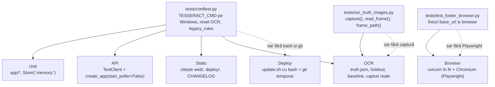

# Testare

Această pagină descrie suita de teste a proiectului Tabela Gara de Nord: cum se pregătește mediul, cum se rulează suita completă și părți din ea, ce categorii de teste există și ce verifică, ce fac `tests/conftest.py` și `tests/ocr_truth_images.py`, ce teste sar în anumite medii, și cum se adaugă un test nou după convențiile din proiect.

Pagina a fost scrisă din codul din branch-ul `docs/documentatie-detaliata`. Acolo unde o afirmație nu s-a putut verifica din repo, este marcată cu **nesigur**. Suita completă nu a fost rulată la scrierea paginii.

Numere de referință (numărătoare cu `grep`, nu cu `pytest --collect-only`):

- 90 de fișiere `tests/test_*.py`, plus `tests/conftest.py`, `tests/ocr_truth_images.py` și `tests/__init__.py`;
- aproximativ 1 200 de definiții `def test_` (un test parametrizat poate produce mai multe cazuri la rulare);
- raportul de retro din 26.10.2026 (`.superpowers/sdd/task-RETRO-report.md`) menționează „1334 teste trec” la acea dată. Cifra e istorică, nu verificată acum;
- durata suitei: „~18 min” din cerința de documentare. **Nesigur**: nu există în repo nicio măsurătoare a duratei; trebuie cronometrată pe mașina ta.

## Cuprins

1. [Configurarea mediului](#1-configurarea-mediului)
2. [Configurarea pytest](#2-configurarea-pytest)
3. [Rularea suitei complete](#3-rularea-suitei-complete)
4. [Rularea unei părți din suită](#4-rularea-unei-părți-din-suită)
5. [Categoriile de teste](#5-categoriile-de-teste)
6. [Fixture-uri partajate și conftest](#6-fixture-uri-partajate-și-conftest)
7. [Testele cu capturi reale și setul de adevăr OCR](#7-testele-cu-capturi-reale-și-setul-de-adevăr-ocr)
8. [Teste care sar sau sunt instabile în anumite medii](#8-teste-care-sar-sau-sunt-instabile-în-anumite-medii)
9. [Cum adaugi un test nou](#9-cum-adaugi-un-test-nou)

## 1. Configurarea mediului

Fișierele de dependențe:

- `requirements.txt` (runtime, pentru aplicație): `fastapi==0.156.0`, `uvicorn[standard]==0.54.0`, `opencv-python-headless==5.0.0.93`, `numpy==2.5.4`, `pytesseract==0.3.13`, `pywebpush==2.5.0`, `py-vapid==1.9.6`, `cryptography==50.0.2`, `httpx==0.28.1`, `tzdata==2026.5`.
- `requirements-dev.txt`: include `requirements.txt` (`-r requirements.txt`) și adaugă `pytest`, `pytest-asyncio` și `playwright==1.64.0`. Comentariul din fișier spune că Playwright este opțional: testele de browser din `tests/test_footer_browser.py` și restul fișierelor `*_browser.py` sar când lipsește.

Pași, din README (secțiunea „Rulare (dezvoltare)”):

```bash
python -m venv .venv
.venv/bin/pip install -r requirements-dev.txt        # Linux / macOS
.venv\Scripts\pip install -r requirements-dev.txt    # Windows
```

Componente externe, care nu sunt instalate de `pip`:

| Componentă | De ce | Ce se întâmplă dacă lipsește |
|---|---|---|
| **Tesseract 5** cu limbile `eng` și `ron` | Motorul OCR (`TESSERACT_CMD`, implicit `tesseract` în `PATH`). README îl cere pentru deploy. | Testul `test_robust_ingest` (`test_augmented_frame_with_two_arrival_rows_is_rejected_for_arrivals`) sare, cu motivul „tesseract not installed”. Testele OCR (`test_ocr*.py`) presupun Tesseract. **Nesigur**: nu am verificat ce fac exact testele OCR când binarul lipsește (pot pica, nu sar). |
| **Chromium pentru Playwright** | Testele de browser | `p.chromium.launch()` eșuează și testul sare cu „Chromium indisponibil” (sau „Chromium unavailable”). Instalarea browserului se face cu comanda standard Playwright, `python -m playwright install chromium`. **Nesigur**: comanda nu e documentată în repo. |
| **Node.js** | Un test din `tests/test_brand_theme.py` rulează un mic harness JavaScript | Testul `test_panel_level_never_green_without_read_delay` sare (`skipif(NODE is None)`). |
| **Git Bash** (Windows) sau `bash` (Linux) și **git** | `tests/test_update_sh.py` rulează `deploy/update.sh` cu bash, într-un repo git temporar | Dacă lipsesc, tot modulul sare. Pe Windows, `_bash()` caută `C:\Program Files\Git\bin\bash.exe` și `...\usr\bin\bash.exe`. |

Notă pentru Windows: `tests/conftest.py` setează `TESSERACT_CMD` la `C:\Program Files\Tesseract-OCR\tesseract.exe`, dacă variabila nu e setată și fișierul există. Scripturile din `scripts/` (`dev_seed.py`, `ocr_eval.py`, `ocr_digit_clf.py`) fac același lucru.

## 2. Configurarea pytest

Fișierul `pytest.ini` (singurul fișier de configurare pytest din repo):

```ini
[pytest]
asyncio_mode = auto
testpaths = tests
```

- `asyncio_mode = auto`: funcțiile de test `async def` rulează fără decorator `@pytest.mark.asyncio`.
- `testpaths = tests`: `python -m pytest` fără argumente colectează doar din `tests/`. Scripturile din `scripts/` și modulele din `app/` nu sunt colectate.
- Nu sunt declarate markere (`markers =`). Nu există un mecanism de tip `-m "not browser"` în repo. Pentru a exclude categorii, folosește `-k` sau o listă de fișiere (vezi secțiunea 4).

Fișierul `tests/__init__.py` există, deci `tests` este un pachet. De aceea testele importă din `tests.conftest`, `tests.ocr_truth_images` și `tests.test_footer_browser` cu `from tests...`. Rulează întotdeauna pytest din rădăcina repo-ului.

## 3. Rularea suitei complete

Din rădăcina repo-ului, cu venv-ul activat sau cu calea completă:

```bash
python -m pytest
```

Variante utile:

```bash
python -m pytest -q                 # ieșire scurtă
python -m pytest -x                 # oprire la primul eșec
python -m pytest -rs                # afișează motivul fiecărui test sărit
python -m pytest --collect-only -q  # doar lista de teste, fără rulare
```

### 3.1 Lock-ul suitei (`.superpowers/suite.lock`)

Cerința pentru această pagină menționa o convenție de tip lock: un director `.superpowers/suite.lock`, folosit pentru a nu porni două suite complete în paralel. **Această convenție nu există în repo.** Verificări făcute:

- niciun fișier din `tests/`, `scripts/`, `app/`, `README.md` sau `CHANGELOG.md` nu menționează `suite.lock` și nu conține cod care să creeze, să verifice sau să șteargă un director de lock;
- `.superpowers/` este în `.gitignore` și conține doar `sdd/` (rapoarte de sesiune).

Dacă există un director de lock pe mașina ta, el ține de convenția ta de lucru (sau de un agent), nu de proiect. **Nesigur**: motivul exact al convenției nu e scris în repo. Ce se poate spune din cod: testele de browser pornesc uvicorn pe un port liber ales de sistem (`socket.bind(("127.0.0.1", 0))` în `tests/test_footer_browser.py`), iar bazele SQLite sunt în `tmp_path`. Deci două rulări paralele nu își calcă pe porturi sau pe baze. Ce ar putea intra în conflict este resursa comună (Chromium, CPU, Tesseract), iar asta nu e tratat în cod.

## 4. Rularea unei părți din suită

```bash
python -m pytest tests/test_version.py                 # un fișier
python -m pytest tests/test_version.py::test_version_file_follows_scheme   # o funcție
python -m pytest -k "stats and not browser"            # după nume
python -m pytest tests/test_*static.py                 # toate testele statice (shell expansion)
python -m pytest tests/test_*_browser.py tests/test_footer_browser.py       # browser
python -m pytest tests/test_update_sh.py               # simularea update.sh (necesită bash și git)
```

Pe Windows, în PowerShell, expansiunea `tests/test_*static.py` nu se face de shell; folosește `python -m pytest tests -k static` sau enumeră fișierele.

Suita de deploy, pentru o modificare la `deploy/update.sh` sau `deploy/install.sh`:

```bash
python -m pytest tests/test_update_sh.py tests/test_watchdog.py tests/test_version.py
```

## 5. Categoriile de teste

Categoriile nu sunt marcate în cod. Clasificarea de mai jos este după fișier și după cum sunt scrise testele.

| Categorie | Ce verifică | Exemple (fișiere) | Cum rulează |
|---|---|---|---|
| **Unit** | Logica pură sau cu o bază SQLite în memorie | `test_store.py` (fixture `store` cu `Store(":memory:")`), `test_consensus.py`, `test_normalize.py`, `test_predict.py`, `test_quality.py`, `test_watchdog.py`, `test_dbbackup.py`, `test_telegram.py`, `test_trend.py`, `test_seasons.py` | Rapid, fără rețea. |
| **API** | Rutele FastAPI, prin `TestClient`, cu `create_app(settings, start_poller=False)` | `test_api.py`, `test_admin.py`, `test_admin_tools.py`, `test_backup_api.py`, `test_weather_api.py`, `test_system_api.py`, `test_export.py`, `test_follows.py`, `test_version.py` (`/api/health`, `/api/changelog`) | Rapid. Poller-ul e oprit, iar testele care au nevoie de el îl înlocuiesc (`monkeypatch` pe `app.poller.run_poller`). |
| **Static** (`test_*_static.py`) | Convenții verificate prin citirea fișierelor din `web/`, `deploy/` și a documentației: CSP, cache-urile service worker-ului, precache-ul, limitele nginx, versiunile, siguranța DOM-ului | `test_admin_static.py`, `test_ocr_static.py`, `test_panel_static.py`, `test_sistem_static.py`, `test_statistici_static.py`, `test_stats_static.py`, `test_ui2_static.py`, `test_ui3_static.py`, `test_weather_static.py`, `test_web_static.py` (10 fișiere) | Rapid. Multe teste au un `client` (TestClient) pentru a verifica și antetele HTTP. |
| **Browser** (Playwright) | Comportamentul real în Chromium: aspect la 390 px și la desktop, footer unic, navigare, temă, zone tactile | `test_footer_browser.py`, `test_csp_browser.py`, `test_contrast_browser.py`, `test_layout_browser.py`, `test_nav_browser.py`, `test_touch_targets_browser.py`, `test_ui2_browser.py`, `test_ui3_browser.py`, `test_statistici_browser.py`, `test_history_all_browser.py`, `test_history_nodate_browser.py`, `test_empty_states_browser.py`, `test_corrections_browser.py`, `test_weather_browser.py` (14 fișiere, cu `*_browser.py` și `test_footer_browser.py`) | Lent. Pornesc uvicorn într-un fir și Chromium. Sar dacă Playwright sau Chromium lipsesc. |
| **OCR** | Acuratețea citirii tablei pe capturi reale, cu seturi de adevăr scrise de mână; reguli de cifre, peroane, sticlă | `test_ocr.py`, `test_ocr12.py`, `test_ocr13.py`, `test_ocr14.py`, `test_ocr_platform_cut.py`, `test_ocr_robust.py`, `test_ocr_debug.py`, `test_glare.py`, `test_band_boxes.py`, `test_ambiguous_pairs.py`, `test_captures.py` | Lent. Multe teste folosesc capturi reale (secțiunea 7). |
| **Date și migrări** | Schema SQLite, migrarea la versiuni noi, coexistența datelor, restaurarea | `test_schema_v6.py`, `test_observations_migration.py`, `test_store_coexist.py`, `test_store_quality.py`, `test_restore.py`, `test_dbbackup.py`, `test_merge_number_dups.py`, `test_purge_ghosts.py` | Rapid. |
| **Deploy și release** | Scripturile `deploy/`, versiunea, CHANGELOG, watchdog-ul | `test_update_sh.py` (rulează `update.sh` cu bash și un repo git temporar), `test_watchdog.py`, `test_version.py` | Mediu: necesită bash și git. Vezi secțiunea 8. |

Diagrama straturilor de teste, cu fișierele de sprijin:



Săgețile continue arată ce fixturi sau helperi folosește fiecare strat. Săgețile punctate arată unde intervine sărirea condiționată. Diagrama nu arată ordinea de execuție: testele nu depind unele de altele.

## 6. Fixture-uri partajate și conftest

### 6.1 `tests/conftest.py`

Singurul `conftest.py` din repo. Conține patru lucruri:

1. **Tesseract pe Windows**: dacă `TESSERACT_CMD` nu e setată și `C:\Program Files\Tesseract-OCR\tesseract.exe` există, o setează. Efect doar local, pe Windows. Pe server, variabila vine din `/etc/tabela.env`.
2. **Fixture-ul `legacy_rules`** (nu e autouse): pune constantele de confirmare din `app/quality.py` și `app/store.py` la valorile dinaintea validării de calitate (Beta 1.02): o schimbare de întârziere sau peron se aplică din prima citire, un tren dispare după 2 lipsuri, iar un tren revenit e „nou”. Motivul din docstring: testele altor straturi (notificări, istoric) au fost scrise pe regulile vechi. Se cere explicit, cu `def test_x(legacy_rules, ...)`.
3. **Fixture-ul autouse `_fresh_ocr_stats`**: statisticile OCR din memorie sunt globale pe proces (`app/ocr/stats.py`), deci sunt resetate înainte și după fiecare test. Fără asta, un test ar vedea contorul altuia.
4. **Constanta `EMPTY_OCR`**: forma goală a răspunsului `ocr` din `/api/health`, folosită în aserțiuni (`test_api.py` o importă din `tests.conftest`).

### 6.2 `tests/ocr_truth_images.py`

Nu este conftest, ci un modul helper importat de testele OCR și de administrare (`test_admin.py`, `test_captures.py`, `test_band_boxes.py`, `test_corrections_browser.py`, `test_ocr13.py`, `test_ocr14.py`, `test_ocr_platform_cut.py`, `test_glare.py`, `test_ocr_robust.py` și altele). Expune:

- `FIX = tests/fixtures/`;
- `PRIVATE = OCR_TRUTH_DIR` (variabila de mediu) sau `tests/fixtures/ocr_truth/private/`;
- `frame_path(frame)`: cheile `ocr_truth/<cale>` din `truth.json` se mapează la `PRIVATE/<cale>.jpg`; celelalte, la `FIX/<cale>.jpg`;
- `capture(path)`: returnează calea dacă fișierul există, altfel apelează `pytest.skip` cu motivul „captura reală lipsă: ...; capturile nu sunt în repo” (și, pentru directorul privat, sugestia „seteaza OCR_TRUTH_DIR”);
- `read_frame(frame)`: `capture(frame_path(frame)).read_bytes()`.

### 6.3 `tests/test_footer_browser.py`: fixturile de browser

Fixturile `base_url` și `browser` sunt definite aici și reutilizate, prin import, de restul testelor de browser (de exemplu `test_contrast_browser.py`, `test_csp_browser.py`, `test_empty_states_browser.py`, `test_corrections_browser.py`, `test_ui2_browser.py`, `test_ui3_browser.py`, `test_weather_browser.py` și altele: 12 fișiere în total). Import-ul se face cu un comentariu `# noqa` și motivul „shared fixtures”.

- `base_url` (scope `module`): rulează `scripts/dev_seed.py` pe o bază SQLite temporară, apoi pornește `uvicorn` într-un fir pe un port liber. Setările: `poller_enabled=False`, `source_url` pe `127.0.0.1:9` (un port inexistent, deci poller-ul nu ajunge la CFR), `last_image_path=None`. La final oprește serverul.
- `browser` (scope `module`): `sync_playwright().chromium.launch()`. Dacă lansarea eșuează, testul sare cu „Chromium indisponibil”.
- `_page(browser, base_url, w, h, theme, view)` (helper, nu fixture): creează un context cu `service_workers="block"`, setează tema și vederea în `localStorage` înainte de încărcare și blochează orice cerere care nu începe cu `base_url`. Motivul: testele nu trebuie să depindă de internet și nici de service worker-ul din sesiunile anterioare.

### 6.4 Fixturi locale

Multe fișiere au propriile fixturi: `store` (`test_store.py`, `Store(":memory:")` cu `migrate()`), `client` (`test_admin_static.py`, `test_version.py`, `TestClient(create_app(...))`), `server` (`test_update_sh.py`, un repo git temporar cu un `origin`, scripturi fals pentru `pip` și `systemctl`, și un fișier SQLite real). Acestea nu se partajează; dacă o fixtură e folosită în două fișiere, mută-o în `conftest.py` sau în modulul helper.

## 7. Testele cu capturi reale și setul de adevăr OCR

### 7.1 De ce nu sunt capturile în repo

Capturile reale ale tablei sunt imagini JPG cu date de călători, iar repo-ul este public. Motivul este scris în `CHANGELOG.md` (Beta 1.43: „Nicio captură reală a tablei nu mai e urmărită în git”) și în `.gitignore`:

```gitignore
tests/fixtures/ocr_truth/private/
tests/fixtures/ocr_truth/**/*.jpg
tests/fixtures/**/*.jpg
```

Imaginile stau doar pe mașina de dezvoltare (`tests/fixtures/ocr_truth/private/`, sau în `OCR_TRUTH_DIR`) și pe server. Istoricul git nu a fost rescris. În clona de lucru de față, `tests/fixtures/ocr_truth/private/` nu există, deci toate testele care cer o captură privată sar.

### 7.2 Seturile de adevăr

| Fișier | Conținut | Folosit de |
|---|---|---|
| `tests/fixtures/ocr_truth/truth.json` | Cadre reale cu cele 12 rânduri pe panou (sosiri și plecări), verificate cu ochiul pe imagine. Cheile sunt `ocr_truth/<cale>` (imagini private) sau `ocr13/<cale>` (imagini din `tests/fixtures/`). | `test_ocr14.py` (aserțiuni de regresie pe acuratețe; `len(lines) >= 300`), `test_ocr_platform_cut.py`, `scripts/ocr_eval.py` |
| `tests/fixtures/ocr_truth/holdout/holdout.json` | Set separat, „hold-out”, de cadre nevăzute de implementatori, etichetate de un etichetator distinct. | `test_ocr_platform_cut.py`, `scripts/ocr_eval.py` |
| `tests/fixtures/ocr_truth/baseline-1.31.json` | Rezultatul cititorului din versiunea 1.31, înregistrat ca referință. Testul compară cadrele și contoarele cu `truth.json`. | `test_ocr_platform_cut.py` |
| `tests/fixtures/ocr_truth/NOTE-2026-10-27.md` | Notă de lucru: ce cadre au fost alese și de ce (peroane necitite, numere greșite). | Doar documentație |
| `tests/fixtures/ocr_truth/holdout/README.md` | Descrie cum a fost făcut hold-out-ul: cadre de 21–27.10.2026, la cel puțin 60 de minute de orice cadru din `truth.json`, etichetate orbește. | Doar documentație |

Regula de bază, scrisă în `tests/test_ocr_platform_cut.py`: adăugarea sau reetichetarea cadrelor cere reînregistrarea baseline-ului, pentru că testul compară `frames` și contoarele din `truth.json` cu baseline-ul.

### 7.3 Cum se măsoară

`app/ocr/truth.py` are funcțiile `load`, `lines_of` și `score`. `score` întoarce, pentru fiecare câmp, contoarele `ok`, `wrong` și `unread` (necitit), plus misses pentru diagnostic. Testul de acuratețe din `tests/test_ocr14.py` are praguri:

- `MAX_WRONG[field]`: câte valori greșite sunt admise maxim per câmp;
- `MIN_OK[field]`: câte valori corecte sunt cerute minim per câmp.

Testul pică dacă citirea se înrăutățește (`assert c["wrong"] <= MAX_WRONG[field]`), nu dacă se îmbunătățește. Testul `tests/test_ocr_platform_cut.py` compară cu baseline-ul înregistrat; baseline-ul se reînregistrează explicit, cu `OCR_RECORD_BASELINE=1 pytest tests/test_ocr_platform_cut.py` (scris în docstring-ul fișierului).

Pentru o evaluare manuală, `scripts/ocr_eval.py` are două subcomenzi, `predict` și `score` (`python scripts/ocr_eval.py predict ...`, `... score ...`). Variabilele `NPROC` (implicit 4) și `OCR_TRUTH_DIR` se pot seta.

### 7.4 Cum sar testele fără captură

Trei forme de skip, toate cu motiv scris:

- `capture(path)` din `tests/ocr_truth_images.py`: sare dacă fișierul lipsește (formularea din cod: „captura reală lipsă; capturile nu sunt în repo”);
- `test_ocr14.py`: sare dacă lipsesc capturile `ocr14_delay100` („capturile reale ocr14_delay100 lipsesc (nu sunt în repo)”);
- `test_ocr_platform_cut.py`: sare dacă lipsește directorul privat („directorul privat cu capturi lipsește ... (setează OCR_TRUTH_DIR)”).

Un test OCR care nu are captură și nu sare explicit ar pica pe `FileNotFoundError`. Când adaugi un test OCR, folosește `capture()` sau `read_frame()`, nu `open()` direct.

Dacă ai capturile pe mașina ta, pune-le în `tests/fixtures/ocr_truth/private/` (sau setează `OCR_TRUTH_DIR`), iar testele care sunt sărite acum vor rula.

## 8. Teste care sar sau sunt instabile în anumite medii

### 8.1 Sărituri condiționate de mediu

| Test sau modul | Condiție | Unde | Motiv și observație |
|---|---|---|---|
| Toate fișierele `*_browser.py` și `test_footer_browser.py` | `pytest.importorskip("playwright.sync_api")` | la nivel de modul | Playwright nu e instalat (e opțional în `requirements-dev.txt`). |
| Fixtura `browser` | `p.chromium.launch()` eșuează | `test_footer_browser.py` și alte module | Chromium lipsește sau nu poate porni. |
| `test_sistem_static.py` | `importorskip` și Chromium indisponibil | la nivel de modul și în test | Fișier static cu o verificare de browser. |
| `test_brand_theme.py::test_panel_level_never_green_without_read_delay` | `NODE is None` | `test_brand_theme.py` linia ~261 | Node.js lipsește. |
| `test_robust_ingest.py` (un test) | `TESSERACT_CMD` nesetat și `tesseract` nu e în `PATH` | `test_robust_ingest.py` | Tesseract lipsește. |
| `test_update_sh.py` (tot modulul) | `bash` sau `git` lipsesc | `test_update_sh.py` | Pe Windows, caută Git Bash. |
| `test_update_sh.py::test_backup_dir_symlink_aborts_before_chown` | `os.symlink` ridică `OSError`, sau bash nu vede link-ul | `test_update_sh.py` | Pe Windows, crearea de symlink-uri cere Developer Mode sau privilegii de administrator. |
| `test_dbbackup.py::test_real_unlistable_backup_dir` | Nu se poate face un director nelistabil pentru utilizatorul curent | `test_dbbackup.py` | Pe Windows sau cu `root`, permisiunile nu se aplică la fel. |
| Testele cu capturi reale | captura lipsește | vezi secțiunea 7 | Normal pe o clonă proaspătă. |

Recomandare: rulează `python -m pytest -rs` ca să vezi toate motivele de sărire. O sărire cu motiv clar nu e un eșec, dar o sărire neașteptată trebuie investigată.

### 8.2 Teste instabile (flaky)

În repo nu există o listă de teste instabile și nu există markere `flaky`. Verificări făcute:

- `CHANGELOG.md` (Beta 1.41) spune că testul de pixeli al Tablei „nu mai e instabil”: pastila „acum N s” și datele live care se schimbau între capturi produceau diferențe false. Testul a fost reparat, nu e marcat.
- Numele `flaky` din `tests/test_api.py`, `tests/test_weather.py` și `tests/test_weather_api.py` sunt funcții de test simulate (un poller care cade), nu teste instabile.

**Nesigur**: nu există o măsurătoare de instabilitate în repo. Dacă un test pică intermitent, notează-l într-un issue, nu-l marca ca `xfail` fără motiv scris.

### 8.3 Teste sensibile la timp

- `test_dbbackup.py` folosește un ceas fals (`Clock`), ca fiecare pornire să fie cu 5 secunde mai târziu (`RestartSec=5`), ca numele backup-urilor să nu se ciocnească.
- `test_follows.py` folosește ceasul real (`monkeypatch.undo()`) pentru o parte a testului.
- Testele de browser așteaptă elemente prin Playwright (`wait_for_selector`), nu prin `sleep`.

Când scrii un test cu timp, folosește un ceas fals sau `monkeypatch` pe `datetime`, nu `time.sleep`.

## 9. Cum adaugi un test nou

Convențiile, observate în fișierele existente:

1. **Antet cu copyright**: prima linie `# © 2026 Andy217Ace`. Majoritatea fișierelor au antetul, și unele teste verifică că fișierele web și CHANGELOG-ul au același copyright.
2. **Docstring scurt, în română sau engleză**, care spune regula testată și, dacă e cazul, versiunea la care a apărut (de exemplu, „Beta 1.28”). Multe docstring-uri spun și motivul regulii.
3. **Fișierul** în `tests/`, cu prefixul `test_` și un nume după zona testată. Pentru un fișier nou de categorie existentă, urmează modelul fișierului cel mai apropiat.
4. **Fără rețea reală** (convenție observată în fișierele existente): testele nu apelează CFR, Open-Meteo sau Telegram. Poller-ul se oprește cu `poller_enabled=False` și `start_poller=False`, iar apelurile externe se înlocuiesc prin `monkeypatch`.
5. **Fără date reale**: nu pune în test coduri de tren sau date din capturi reale. Dacă ai nevoie de o tablă, folosește `scripts/dev_seed.py` sau date sintetice.
6. **Baze temporare**: `tmp_path` sau `Store(":memory:")`.
7. **Fără secrete**: nu scrie chei VAPID, tokenuri sau parole reale. Folosește valori clar false (de exemplu, `"p" * 20` pentru cheile de abonare din `test_api.py`).

### 9.1 Exemple din suită

**Unit** (model: `tests/test_store.py`): fixtura `store` și o funcție cu aserțiuni directe.

```python
@pytest.fixture
def store():
    s = Store(":memory:")
    s.migrate()
    yield s
    s.close()

def test_migrate_idempotent_and_versioned(store):
    ...   # aserțiuni pe store și pe PRAGMA user_version
```

**API** (model: `tests/test_api.py`): un helper `settings(**kw)` care completează valorile implicite și un `TestClient` pe `create_app`.

```python
def settings(**kw):
    base = dict(db_path=":memory:", source_url="https://example.com/x",
                vapid_private_key="", vapid_public_key="", vapid_subject="mailto:a@b.c",
                tesseract_cmd="tesseract", poller_restart_backoff=0.01)
    base.update(kw)
    return Settings(**base)
```

Cu `start_poller=False` în `create_app`, aplicația nu pornește poller-ul; `TestClient` ca context manager declanșează lifespan-ul.

**Static** (model: `tests/test_admin_static.py`): un fixture `client` și citirea fișierelor din `web/`. Aserțiunile verifică reguli de siguranță, de exemplu că `admin.js` nu folosește `innerHTML` sau `localStorage`:

```python
def test_admin_js_served_and_safe(client):
    r = client.get("/admin.js")
    assert r.status_code == 200
    js = r.text
    assert js.startswith("// © 2026 Andy217Ace")
    for bad in ("innerHTML", "outerHTML", "insertAdjacentHTML", "document.write", "eval(", ...):
        assert bad not in js
```

**Browser** (model: `tests/test_footer_browser.py`): folosește fixturile `browser` și `base_url` și helperul `_page`. Aserțiunile se fac pe starea paginii reale (număr de elemente vizibile), nu pe HTML-ul sursă.

```python
def test_exactly_one_visible_footer(browser, base_url, w, h, theme, view):
    page = _page(browser, base_url, w, h, theme, view)
    ...
```

Pentru un test de browser nou, importă fixturile:

```python
from tests.test_footer_browser import base_url, browser  # noqa: E402,F401  (shared fixtures)
```

**OCR** (model: `tests/test_ocr13.py`, fragment simplificat): cadrele se citesc cu `capture()`, deci testul sare explicit când captura lipsește. Pragurile de acuratețe, când există, sunt scrise în fișier, lângă test (vezi `MAX_WRONG` și `MIN_OK` din `tests/test_ocr14.py`).

```python
from tests.ocr_truth_images import capture
...
def test_unread_delay_keeps_the_row_and_reports_why():
    rows, debug = read_board_debug(
        capture(FIX / "2026_10_22_150306-764bb6bc.jpg").read_bytes(), ...)
    ...
```

### 9.2 Pașii pentru un test nou

1. Alege categoria (secțiunea 5) și fișierul existent cel mai apropiat, sau creează `tests/test_<zona>.py` cu antetul și docstring-ul.
2. Scrie întâi testul care eșuează, apoi codul.
3. Dacă testul depinde de o captură, folosește `capture()` sau `read_frame()` și acceptă sărirea ca rezultat normal pe o clonă proaspătă.
4. Dacă testul atinge CSP, cache-ul service worker-ului sau un fișier din `web/`, adaugă o aserțiune în fișierul static corespunzător, pentru ca regula să fie verificată și fără browser.
5. Dacă testul atinge versiunea sau CHANGELOG-ul, respectă regulile de release din `deploy-si-configurare.md`, secțiunea 10.
6. Rulează fișierul singur, apoi `python -m pytest -rs` pe zona respectivă, înainte de a comite.

### 9.3 Ce nu e în repo

- Niciun fișier `.github/workflows` (nu există CI). Testele se rulează local.
- Niciun `.coveragerc` sau raport de acoperire. **Nesigur**: nu se știe dacă există o acoperire măsurată.
- Niciun `tox.ini`, `noxfile.py` sau `Makefile`. Comanda este `python -m pytest`.
